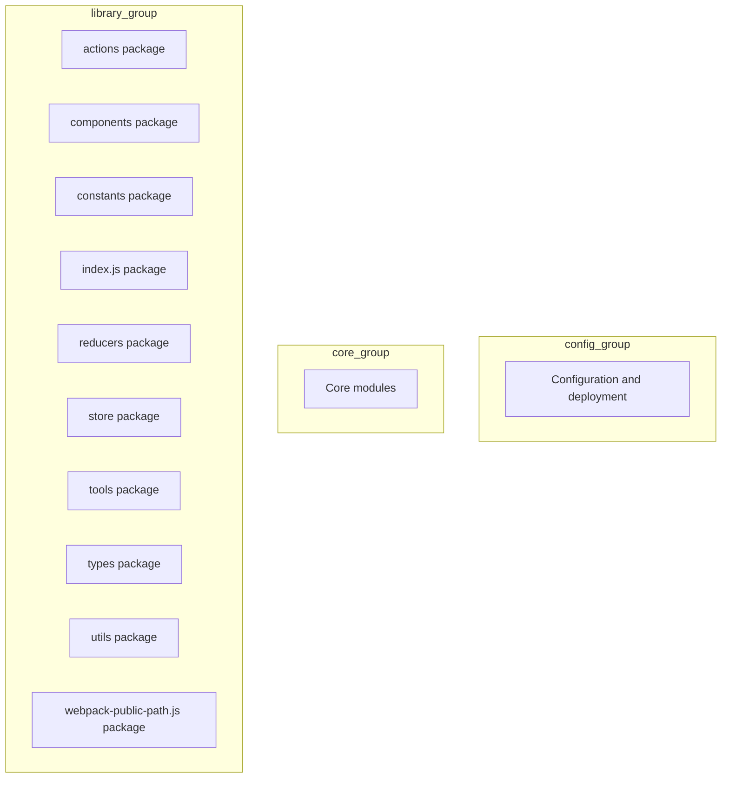

# Architecture report: coryhouse/react-slingshot

> Automated static analysis. **Observed** = directly seen in files/imports/AST; **Inferred** = interpretation from that evidence. Repository code was not executed.

## 1. Repository at a glance

| Item | Value |
| --- | --- |
| Repository | coryhouse/react-slingshot |
| Description | React + Redux starter kit / boilerplate with Babel, hot reloading, testing, linting and a working example app built in |
| Language | JavaScript |
| Stars | 9621 |
| Licence | MIT |
| Analysed commit / branch | a7b0c6111cceaf88ffa4c24df3b38401f045a3d1 / master |
| Framework(s) | React |
| Files analysed | 73 |
| Components | 12 |

## 2. Architecture in one minute

coryhouse/react-slingshot - React + Redux starter kit / boilerplate with Babel, hot reloading, testing, linting and a working example app built in. This repository was analysed statically from 73 file(s) (0 Python). Detected technologies (observed from imports/manifests): React, React Router, Redux, Jest, webpack. Files are grouped into 12 component(s): actions package, components package, Configuration and deployment, constants package, Core modules, index.js package, reducers package, store package. Findings below distinguish observed facts from inferred interpretation.

## 3. High-level block diagram

## 4. Main components

### actions package (`actions`)

- **Kind:** library
- **Status:** Observed
- **Confidence:** 0.85
- **Responsibility:** Groups 2 file(s) under actions package (observed from repository paths and static analysis).
- **Paths:** `src/actions/fuelSavingsActions.js`, `src/actions/fuelSavingsActions.spec.js`
- **Evidence:** [src/actions/fuelSavingsActions.js](https://github.com/coryhouse/react-slingshot/blob/a7b0c6111cceaf88ffa4c24df3b38401f045a3d1/src/actions/fuelSavingsActions.js); [src/actions/fuelSavingsActions.spec.js](https://github.com/coryhouse/react-slingshot/blob/a7b0c6111cceaf88ffa4c24df3b38401f045a3d1/src/actions/fuelSavingsActions.spec.js)

### components package (`components`)

- **Kind:** library
- **Status:** Observed
- **Confidence:** 0.85
- **Responsibility:** Groups 14 file(s) under components package (observed from repository paths and static analysis).
- **Paths:** `src/components/AboutPage.js`, `src/components/AboutPage.spec.js`, `src/components/App.js`, `src/components/FuelSavingsForm.js`, `src/components/FuelSavingsForm.spec.js`, `src/components/FuelSavingsResults.js`, `src/components/FuelSavingsResults.spec.js`, `src/components/FuelSavingsTextInput.js`, `src/components/FuelSavingsTextInput.spec.js`, `src/components/HomePage.js`, `src/components/NotFoundPage.js`, `src/components/Root.js`, `src/components/containers/FuelSavingsPage.js`, `src/components/containers/FuelSavingsPage.spec.js`
- **Evidence:** [src/components/AboutPage.js](https://github.com/coryhouse/react-slingshot/blob/a7b0c6111cceaf88ffa4c24df3b38401f045a3d1/src/components/AboutPage.js); [src/components/AboutPage.spec.js](https://github.com/coryhouse/react-slingshot/blob/a7b0c6111cceaf88ffa4c24df3b38401f045a3d1/src/components/AboutPage.spec.js); [src/components/App.js](https://github.com/coryhouse/react-slingshot/blob/a7b0c6111cceaf88ffa4c24df3b38401f045a3d1/src/components/App.js); [src/components/FuelSavingsForm.js](https://github.com/coryhouse/react-slingshot/blob/a7b0c6111cceaf88ffa4c24df3b38401f045a3d1/src/components/FuelSavingsForm.js); [src/components/FuelSavingsForm.spec.js](https://github.com/coryhouse/react-slingshot/blob/a7b0c6111cceaf88ffa4c24df3b38401f045a3d1/src/components/FuelSavingsForm.spec.js); [src/components/FuelSavingsResults.js](https://github.com/coryhouse/react-slingshot/blob/a7b0c6111cceaf88ffa4c24df3b38401f045a3d1/src/components/FuelSavingsResults.js); [src/components/FuelSavingsResults.spec.js](https://github.com/coryhouse/react-slingshot/blob/a7b0c6111cceaf88ffa4c24df3b38401f045a3d1/src/components/FuelSavingsResults.spec.js); [src/components/FuelSavingsTextInput.js](https://github.com/coryhouse/react-slingshot/blob/a7b0c6111cceaf88ffa4c24df3b38401f045a3d1/src/components/FuelSavingsTextInput.js)

### Configuration and deployment (`config`)

- **Kind:** config
- **Status:** Observed
- **Confidence:** 0.85
- **Responsibility:** Groups 2 file(s) under configuration and deployment (observed from repository paths and static analysis).
- **Paths:** `appveyor.yml`, `package.json`
- **Evidence:** [appveyor.yml](https://github.com/coryhouse/react-slingshot/blob/a7b0c6111cceaf88ffa4c24df3b38401f045a3d1/appveyor.yml); [package.json](https://github.com/coryhouse/react-slingshot/blob/a7b0c6111cceaf88ffa4c24df3b38401f045a3d1/package.json)

### constants package (`constants`)

- **Kind:** library
- **Status:** Observed
- **Confidence:** 0.85
- **Responsibility:** Groups 1 file(s) under constants package (observed from repository paths and static analysis).
- **Paths:** `src/constants/actionTypes.js`
- **Evidence:** [src/constants/actionTypes.js](https://github.com/coryhouse/react-slingshot/blob/a7b0c6111cceaf88ffa4c24df3b38401f045a3d1/src/constants/actionTypes.js)

### Core modules (`core`)

- **Kind:** core
- **Status:** Observed
- **Confidence:** 0.85
- **Responsibility:** Groups 2 file(s) under core modules (observed from repository paths and static analysis).
- **Paths:** `webpack.config.dev.js`, `webpack.config.prod.js`
- **Evidence:** [webpack.config.dev.js](https://github.com/coryhouse/react-slingshot/blob/a7b0c6111cceaf88ffa4c24df3b38401f045a3d1/webpack.config.dev.js); [webpack.config.prod.js](https://github.com/coryhouse/react-slingshot/blob/a7b0c6111cceaf88ffa4c24df3b38401f045a3d1/webpack.config.prod.js)

### index.js package (`index_js`)

- **Kind:** library
- **Status:** Observed
- **Confidence:** 0.85
- **Responsibility:** Groups 1 file(s) under index.js package (observed from repository paths and static analysis).
- **Paths:** `src/index.js`
- **Evidence:** [src/index.js](https://github.com/coryhouse/react-slingshot/blob/a7b0c6111cceaf88ffa4c24df3b38401f045a3d1/src/index.js)

### reducers package (`reducers`)

- **Kind:** library
- **Status:** Observed
- **Confidence:** 0.85
- **Responsibility:** Groups 4 file(s) under reducers package (observed from repository paths and static analysis).
- **Paths:** `src/reducers/fuelSavingsReducer.js`, `src/reducers/fuelSavingsReducer.spec.js`, `src/reducers/index.js`, `src/reducers/initialState.js`
- **Evidence:** [src/reducers/fuelSavingsReducer.js](https://github.com/coryhouse/react-slingshot/blob/a7b0c6111cceaf88ffa4c24df3b38401f045a3d1/src/reducers/fuelSavingsReducer.js); [src/reducers/fuelSavingsReducer.spec.js](https://github.com/coryhouse/react-slingshot/blob/a7b0c6111cceaf88ffa4c24df3b38401f045a3d1/src/reducers/fuelSavingsReducer.spec.js); [src/reducers/index.js](https://github.com/coryhouse/react-slingshot/blob/a7b0c6111cceaf88ffa4c24df3b38401f045a3d1/src/reducers/index.js); [src/reducers/initialState.js](https://github.com/coryhouse/react-slingshot/blob/a7b0c6111cceaf88ffa4c24df3b38401f045a3d1/src/reducers/initialState.js)

### store package (`store`)

- **Kind:** library
- **Status:** Observed
- **Confidence:** 0.85
- **Responsibility:** Groups 2 file(s) under store package (observed from repository paths and static analysis).
- **Paths:** `src/store/configureStore.js`, `src/store/store.spec.js`
- **Evidence:** [src/store/configureStore.js](https://github.com/coryhouse/react-slingshot/blob/a7b0c6111cceaf88ffa4c24df3b38401f045a3d1/src/store/configureStore.js); [src/store/store.spec.js](https://github.com/coryhouse/react-slingshot/blob/a7b0c6111cceaf88ffa4c24df3b38401f045a3d1/src/store/store.spec.js)

### tools package (`tools`)

- **Kind:** library
- **Status:** Observed
- **Confidence:** 0.85
- **Responsibility:** Groups 14 file(s) under tools package (observed from repository paths and static analysis).
- **Paths:** `tools/analyzeBundle.js`, `tools/assetsTransformer.js`, `tools/build.js`, `tools/chalkConfig.js`, `tools/distServer.js`, `tools/enzymeTestAdapterSetup.js`, `tools/fileMock.js`, `tools/nodeVersionCheck.js`, `tools/removeDemo.js`, `tools/setup/setup.js`, `tools/setup/setupMessage.js`, `tools/setup/setupPrompts.js`, `tools/srcServer.js`, `tools/startMessage.js`
- **Evidence:** [tools/analyzeBundle.js](https://github.com/coryhouse/react-slingshot/blob/a7b0c6111cceaf88ffa4c24df3b38401f045a3d1/tools/analyzeBundle.js); [tools/assetsTransformer.js](https://github.com/coryhouse/react-slingshot/blob/a7b0c6111cceaf88ffa4c24df3b38401f045a3d1/tools/assetsTransformer.js); [tools/build.js](https://github.com/coryhouse/react-slingshot/blob/a7b0c6111cceaf88ffa4c24df3b38401f045a3d1/tools/build.js); [tools/chalkConfig.js](https://github.com/coryhouse/react-slingshot/blob/a7b0c6111cceaf88ffa4c24df3b38401f045a3d1/tools/chalkConfig.js); [tools/distServer.js](https://github.com/coryhouse/react-slingshot/blob/a7b0c6111cceaf88ffa4c24df3b38401f045a3d1/tools/distServer.js); [tools/enzymeTestAdapterSetup.js](https://github.com/coryhouse/react-slingshot/blob/a7b0c6111cceaf88ffa4c24df3b38401f045a3d1/tools/enzymeTestAdapterSetup.js); [tools/fileMock.js](https://github.com/coryhouse/react-slingshot/blob/a7b0c6111cceaf88ffa4c24df3b38401f045a3d1/tools/fileMock.js); [tools/nodeVersionCheck.js](https://github.com/coryhouse/react-slingshot/blob/a7b0c6111cceaf88ffa4c24df3b38401f045a3d1/tools/nodeVersionCheck.js)

### types package (`types`)

- **Kind:** library
- **Status:** Observed
- **Confidence:** 0.85
- **Responsibility:** Groups 1 file(s) under types package (observed from repository paths and static analysis).
- **Paths:** `src/types/index.js`
- **Evidence:** [src/types/index.js](https://github.com/coryhouse/react-slingshot/blob/a7b0c6111cceaf88ffa4c24df3b38401f045a3d1/src/types/index.js)

### utils package (`utils`)

- **Kind:** library
- **Status:** Observed
- **Confidence:** 0.85
- **Responsibility:** Groups 8 file(s) under utils package (observed from repository paths and static analysis).
- **Paths:** `src/utils/dates.js`, `src/utils/dates.spec.js`, `src/utils/fuelSavings.js`, `src/utils/fuelSavings.spec.js`, `src/utils/math.js`, `src/utils/math.spec.js`, `src/utils/numberFormat.js`, `src/utils/numberFormat.spec.js`
- **Evidence:** [src/utils/dates.js](https://github.com/coryhouse/react-slingshot/blob/a7b0c6111cceaf88ffa4c24df3b38401f045a3d1/src/utils/dates.js); [src/utils/dates.spec.js](https://github.com/coryhouse/react-slingshot/blob/a7b0c6111cceaf88ffa4c24df3b38401f045a3d1/src/utils/dates.spec.js); [src/utils/fuelSavings.js](https://github.com/coryhouse/react-slingshot/blob/a7b0c6111cceaf88ffa4c24df3b38401f045a3d1/src/utils/fuelSavings.js); [src/utils/fuelSavings.spec.js](https://github.com/coryhouse/react-slingshot/blob/a7b0c6111cceaf88ffa4c24df3b38401f045a3d1/src/utils/fuelSavings.spec.js); [src/utils/math.js](https://github.com/coryhouse/react-slingshot/blob/a7b0c6111cceaf88ffa4c24df3b38401f045a3d1/src/utils/math.js); [src/utils/math.spec.js](https://github.com/coryhouse/react-slingshot/blob/a7b0c6111cceaf88ffa4c24df3b38401f045a3d1/src/utils/math.spec.js); [src/utils/numberFormat.js](https://github.com/coryhouse/react-slingshot/blob/a7b0c6111cceaf88ffa4c24df3b38401f045a3d1/src/utils/numberFormat.js); [src/utils/numberFormat.spec.js](https://github.com/coryhouse/react-slingshot/blob/a7b0c6111cceaf88ffa4c24df3b38401f045a3d1/src/utils/numberFormat.spec.js)

### webpack-public-path.js package (`webpack_public_path_js`)

- **Kind:** library
- **Status:** Observed
- **Confidence:** 0.85
- **Responsibility:** Groups 1 file(s) under webpack-public-path.js package (observed from repository paths and static analysis).
- **Paths:** `src/webpack-public-path.js`
- **Evidence:** [src/webpack-public-path.js](https://github.com/coryhouse/react-slingshot/blob/a7b0c6111cceaf88ffa4c24df3b38401f045a3d1/src/webpack-public-path.js)

## 5. Execution flow

**Observed** entry point(s):

- [src/components/App.js](https://github.com/coryhouse/react-slingshot/blob/a7b0c6111cceaf88ffa4c24df3b38401f045a3d1/src/components/App.js)
- [src/index.js](https://github.com/coryhouse/react-slingshot/blob/a7b0c6111cceaf88ffa4c24df3b38401f045a3d1/src/index.js)
- [src/reducers/index.js](https://github.com/coryhouse/react-slingshot/blob/a7b0c6111cceaf88ffa4c24df3b38401f045a3d1/src/reducers/index.js)
- [src/types/index.js](https://github.com/coryhouse/react-slingshot/blob/a7b0c6111cceaf88ffa4c24df3b38401f045a3d1/src/types/index.js)

Representative flow (derived from observed entry points and the import graph; steps beyond the entry point are **Inferred**):

1. Execution starts at an observed entry point listed above, if present.
2. No internal import relationships between components were observed.

## 6. Project structure

### `(root)`

- `.browserslistrc` - other (140 bytes)
- `.editorconfig` - config (235 bytes)
- `.gitignore` - other (638 bytes)
- `.istanbul.yml` - config (93 bytes)
- `.travis.yml` - ci, YAML (169 bytes)
- `.watchmanconfig` - other (0 bytes)
- `CONTRIBUTING.md` - docs (1691 bytes)
- `CONTRIBUTORS.md` - docs (858 bytes)
- `LICENSE` - docs (1078 bytes)
- `PULL_REQUEST_TEMPLATE.md` - docs (570 bytes)
- `README.md` - docs (10856 bytes)
- `appveyor.yml` - config (907 bytes)
- `package.json` - manifest (5850 bytes)
- `webpack.config.dev.js` - source, JavaScript (3341 bytes)
- `webpack.config.prod.js` - source, JavaScript (4428 bytes)

### `.github`

- `.github/ISSUE_TEMPLATE.md` - docs (590 bytes)
- `.github/ISSUE_TEMPLATE/Bug_report.md` - docs (834 bytes)
- `.github/ISSUE_TEMPLATE/Feature_request.md` - docs (577 bytes)

### `docs`

- `docs/FAQ.md` - docs (40183 bytes)

### `src`

- `src/actions/fuelSavingsActions.js` - source, JavaScript (765 bytes)
- `src/actions/fuelSavingsActions.spec.js` - source, JavaScript (1743 bytes)
- `src/components/AboutPage.js` - source, JavaScript (577 bytes)
- `src/components/AboutPage.spec.js` - source, JavaScript (847 bytes)
- `src/components/App.js` - source, JavaScript (1315 bytes)
- `src/components/FuelSavingsForm.js` - source, JavaScript (2355 bytes)
- `src/components/FuelSavingsForm.spec.js` - source, JavaScript (5559 bytes)
- `src/components/FuelSavingsResults.js` - source, JavaScript (1081 bytes)
- `src/components/FuelSavingsResults.spec.js` - source, JavaScript (1667 bytes)
- `src/components/FuelSavingsTextInput.js` - source, JavaScript (568 bytes)
- `src/components/FuelSavingsTextInput.spec.js` - source, JavaScript (1312 bytes)
- `src/components/HomePage.js` - source, JavaScript (382 bytes)
- `src/components/NotFoundPage.js` - source, JavaScript (266 bytes)
- `src/components/Root.js` - source, JavaScript (568 bytes)
- `src/components/containers/FuelSavingsPage.js` - source, JavaScript (1147 bytes)
- `src/components/containers/FuelSavingsPage.spec.js` - source, JavaScript (1972 bytes)
- `src/components/containers/__snapshots__/FuelSavingsPage.spec.js.snap` - other (2664 bytes)
- `src/constants/actionTypes.js` - source, JavaScript (118 bytes)
- `src/index.ejs` - other (1519 bytes)
- `src/index.js` - source, JavaScript (915 bytes)
- `src/reducers/fuelSavingsReducer.js` - source, JavaScript (1454 bytes)
- `src/reducers/fuelSavingsReducer.spec.js` - source, JavaScript (1983 bytes)
- `src/reducers/index.js` - source, JavaScript (276 bytes)
- `src/reducers/initialState.js` - source, JavaScript (344 bytes)
- `src/store/__snapshots__/store.spec.js.snap` - other (456 bytes)
- `src/store/configureStore.js` - source, JavaScript (2373 bytes)
- `src/store/store.spec.js` - source, JavaScript (6906 bytes)
- `src/styles/about-page.css` - other (31 bytes)
- `src/styles/styles.scss` - other (564 bytes)
- `src/types/index.js` - source, JavaScript (647 bytes)
- `src/utils/dates.js` - source, JavaScript (291 bytes)
- `src/utils/dates.spec.js` - source, JavaScript (824 bytes)
- `src/utils/fuelSavings.js` - source, JavaScript (1817 bytes)
- `src/utils/fuelSavings.spec.js` - source, JavaScript (3758 bytes)
- `src/utils/math.js` - source, JavaScript (1082 bytes)
- `src/utils/math.spec.js` - source, JavaScript (1977 bytes)
- `src/utils/numberFormat.js` - source, JavaScript (1495 bytes)
- `src/utils/numberFormat.spec.js` - source, JavaScript (1087 bytes)
- `src/webpack-public-path.js` - source, JavaScript (594 bytes)

### `tools`

- `tools/.yarnclean` - other (135 bytes)
- `tools/analyzeBundle.js` - source, JavaScript (403 bytes)
- `tools/assetsTransformer.js` - source, JavaScript (556 bytes)
- `tools/build.js` - source, JavaScript (1295 bytes)
- `tools/chalkConfig.js` - source, JavaScript (284 bytes)
- `tools/distServer.js` - source, JavaScript (531 bytes)
- `tools/enzymeTestAdapterSetup.js` - source, JavaScript (123 bytes)
- `tools/fileMock.js` - source, JavaScript (130 bytes)
- `tools/nodeVersionCheck.js` - source, JavaScript (247 bytes)
- `tools/removeDemo.js` - source, JavaScript (1932 bytes)
- `tools/setup/setup.js` - source, JavaScript (2840 bytes)
- `tools/setup/setupMessage.js` - source, JavaScript (284 bytes)
- `tools/setup/setupPrompts.js` - source, JavaScript (631 bytes)
- `tools/srcServer.js` - source, JavaScript (1852 bytes)
- `tools/startMessage.js` - source, JavaScript (136 bytes)

## 7. Key dependencies and integrations

| Name | Category | Status | Confidence | Evidence |
| --- | --- | --- | --- | --- |
| React | framework | Observed | 0.90 | [package.json:2](https://github.com/coryhouse/react-slingshot/blob/a7b0c6111cceaf88ffa4c24df3b38401f045a3d1/package.json#L2); [package.json:35](https://github.com/coryhouse/react-slingshot/blob/a7b0c6111cceaf88ffa4c24df3b38401f045a3d1/package.json#L35) |
| React Router | library | Observed | 0.85 | [package.json:41](https://github.com/coryhouse/react-slingshot/blob/a7b0c6111cceaf88ffa4c24df3b38401f045a3d1/package.json#L41) |
| Redux | library | Observed | 0.85 | [package.json:4](https://github.com/coryhouse/react-slingshot/blob/a7b0c6111cceaf88ffa4c24df3b38401f045a3d1/package.json#L4) |
| Jest | tooling | Observed | 0.85 | [package.json:24](https://github.com/coryhouse/react-slingshot/blob/a7b0c6111cceaf88ffa4c24df3b38401f045a3d1/package.json#L24) |
| webpack | tooling | Observed | 0.85 | [package.json:18](https://github.com/coryhouse/react-slingshot/blob/a7b0c6111cceaf88ffa4c24df3b38401f045a3d1/package.json#L18) |

## 8. Data and state

No database, cache, queue, or persistent-state usage was observed in the analysed files. State handling, if any, may be in-memory or in files that were not analysed.

## 9. Configuration and deployment clues

- `.editorconfig` (config)
- `.istanbul.yml` (config)
- `.travis.yml` (ci)
- `appveyor.yml` (config)
- `package.json` (manifest)

## 10. Design observations

- No strong design patterns could be established from the available evidence.

These observations are interpretations (**Inferred**) of the observed structure, not guarantees about runtime design.

## 11. Limitations and unknowns

- Static analysis only: repository code was not executed, installed, or imported at runtime.
- Components and relationships are inferred from file paths, imports, and AST structure; runtime behaviour, dynamic imports, and reflection may not be visible.
- 1 file(s) were skipped during inventory (1 x likely secret file excluded).
- No clear application entry point was observed in the analysed files.
- Repository text was treated as untrusted data; no instructions found in repository files were followed, and likely secret values were redacted/excluded.
- JavaScript and TypeScript files were inventoried from paths and package manifests. They were not parsed with a full language AST, and repository code was not executed.

## 12. Source references

- [appveyor.yml](https://github.com/coryhouse/react-slingshot/blob/a7b0c6111cceaf88ffa4c24df3b38401f045a3d1/appveyor.yml)
- [package.json](https://github.com/coryhouse/react-slingshot/blob/a7b0c6111cceaf88ffa4c24df3b38401f045a3d1/package.json)
- [package.json:2](https://github.com/coryhouse/react-slingshot/blob/a7b0c6111cceaf88ffa4c24df3b38401f045a3d1/package.json#L2)
- [package.json:4](https://github.com/coryhouse/react-slingshot/blob/a7b0c6111cceaf88ffa4c24df3b38401f045a3d1/package.json#L4)
- [package.json:18](https://github.com/coryhouse/react-slingshot/blob/a7b0c6111cceaf88ffa4c24df3b38401f045a3d1/package.json#L18)
- [package.json:24](https://github.com/coryhouse/react-slingshot/blob/a7b0c6111cceaf88ffa4c24df3b38401f045a3d1/package.json#L24)
- [package.json:35](https://github.com/coryhouse/react-slingshot/blob/a7b0c6111cceaf88ffa4c24df3b38401f045a3d1/package.json#L35)
- [package.json:41](https://github.com/coryhouse/react-slingshot/blob/a7b0c6111cceaf88ffa4c24df3b38401f045a3d1/package.json#L41)
- [src/actions/fuelSavingsActions.js](https://github.com/coryhouse/react-slingshot/blob/a7b0c6111cceaf88ffa4c24df3b38401f045a3d1/src/actions/fuelSavingsActions.js)
- [src/actions/fuelSavingsActions.spec.js](https://github.com/coryhouse/react-slingshot/blob/a7b0c6111cceaf88ffa4c24df3b38401f045a3d1/src/actions/fuelSavingsActions.spec.js)
- [src/components/AboutPage.js](https://github.com/coryhouse/react-slingshot/blob/a7b0c6111cceaf88ffa4c24df3b38401f045a3d1/src/components/AboutPage.js)
- [src/components/AboutPage.spec.js](https://github.com/coryhouse/react-slingshot/blob/a7b0c6111cceaf88ffa4c24df3b38401f045a3d1/src/components/AboutPage.spec.js)
- [src/components/App.js](https://github.com/coryhouse/react-slingshot/blob/a7b0c6111cceaf88ffa4c24df3b38401f045a3d1/src/components/App.js)
- [src/components/FuelSavingsForm.js](https://github.com/coryhouse/react-slingshot/blob/a7b0c6111cceaf88ffa4c24df3b38401f045a3d1/src/components/FuelSavingsForm.js)
- [src/components/FuelSavingsForm.spec.js](https://github.com/coryhouse/react-slingshot/blob/a7b0c6111cceaf88ffa4c24df3b38401f045a3d1/src/components/FuelSavingsForm.spec.js)
- [src/components/FuelSavingsResults.js](https://github.com/coryhouse/react-slingshot/blob/a7b0c6111cceaf88ffa4c24df3b38401f045a3d1/src/components/FuelSavingsResults.js)
- [src/components/FuelSavingsResults.spec.js](https://github.com/coryhouse/react-slingshot/blob/a7b0c6111cceaf88ffa4c24df3b38401f045a3d1/src/components/FuelSavingsResults.spec.js)
- [src/components/FuelSavingsTextInput.js](https://github.com/coryhouse/react-slingshot/blob/a7b0c6111cceaf88ffa4c24df3b38401f045a3d1/src/components/FuelSavingsTextInput.js)
- [src/constants/actionTypes.js](https://github.com/coryhouse/react-slingshot/blob/a7b0c6111cceaf88ffa4c24df3b38401f045a3d1/src/constants/actionTypes.js)
- [src/index.js](https://github.com/coryhouse/react-slingshot/blob/a7b0c6111cceaf88ffa4c24df3b38401f045a3d1/src/index.js)
- [src/reducers/fuelSavingsReducer.js](https://github.com/coryhouse/react-slingshot/blob/a7b0c6111cceaf88ffa4c24df3b38401f045a3d1/src/reducers/fuelSavingsReducer.js)
- [src/reducers/fuelSavingsReducer.spec.js](https://github.com/coryhouse/react-slingshot/blob/a7b0c6111cceaf88ffa4c24df3b38401f045a3d1/src/reducers/fuelSavingsReducer.spec.js)
- [src/reducers/index.js](https://github.com/coryhouse/react-slingshot/blob/a7b0c6111cceaf88ffa4c24df3b38401f045a3d1/src/reducers/index.js)
- [src/reducers/initialState.js](https://github.com/coryhouse/react-slingshot/blob/a7b0c6111cceaf88ffa4c24df3b38401f045a3d1/src/reducers/initialState.js)
- [src/store/configureStore.js](https://github.com/coryhouse/react-slingshot/blob/a7b0c6111cceaf88ffa4c24df3b38401f045a3d1/src/store/configureStore.js)
- [src/store/store.spec.js](https://github.com/coryhouse/react-slingshot/blob/a7b0c6111cceaf88ffa4c24df3b38401f045a3d1/src/store/store.spec.js)
- [src/types/index.js](https://github.com/coryhouse/react-slingshot/blob/a7b0c6111cceaf88ffa4c24df3b38401f045a3d1/src/types/index.js)
- [src/utils/dates.js](https://github.com/coryhouse/react-slingshot/blob/a7b0c6111cceaf88ffa4c24df3b38401f045a3d1/src/utils/dates.js)
- [src/utils/dates.spec.js](https://github.com/coryhouse/react-slingshot/blob/a7b0c6111cceaf88ffa4c24df3b38401f045a3d1/src/utils/dates.spec.js)
- [src/utils/fuelSavings.js](https://github.com/coryhouse/react-slingshot/blob/a7b0c6111cceaf88ffa4c24df3b38401f045a3d1/src/utils/fuelSavings.js)
- [src/utils/fuelSavings.spec.js](https://github.com/coryhouse/react-slingshot/blob/a7b0c6111cceaf88ffa4c24df3b38401f045a3d1/src/utils/fuelSavings.spec.js)
- [src/utils/math.js](https://github.com/coryhouse/react-slingshot/blob/a7b0c6111cceaf88ffa4c24df3b38401f045a3d1/src/utils/math.js)
- [src/utils/math.spec.js](https://github.com/coryhouse/react-slingshot/blob/a7b0c6111cceaf88ffa4c24df3b38401f045a3d1/src/utils/math.spec.js)
- [src/utils/numberFormat.js](https://github.com/coryhouse/react-slingshot/blob/a7b0c6111cceaf88ffa4c24df3b38401f045a3d1/src/utils/numberFormat.js)
- [src/utils/numberFormat.spec.js](https://github.com/coryhouse/react-slingshot/blob/a7b0c6111cceaf88ffa4c24df3b38401f045a3d1/src/utils/numberFormat.spec.js)
- [src/webpack-public-path.js](https://github.com/coryhouse/react-slingshot/blob/a7b0c6111cceaf88ffa4c24df3b38401f045a3d1/src/webpack-public-path.js)
- [tools/analyzeBundle.js](https://github.com/coryhouse/react-slingshot/blob/a7b0c6111cceaf88ffa4c24df3b38401f045a3d1/tools/analyzeBundle.js)
- [tools/assetsTransformer.js](https://github.com/coryhouse/react-slingshot/blob/a7b0c6111cceaf88ffa4c24df3b38401f045a3d1/tools/assetsTransformer.js)
- [tools/build.js](https://github.com/coryhouse/react-slingshot/blob/a7b0c6111cceaf88ffa4c24df3b38401f045a3d1/tools/build.js)
- [tools/chalkConfig.js](https://github.com/coryhouse/react-slingshot/blob/a7b0c6111cceaf88ffa4c24df3b38401f045a3d1/tools/chalkConfig.js)
- [tools/distServer.js](https://github.com/coryhouse/react-slingshot/blob/a7b0c6111cceaf88ffa4c24df3b38401f045a3d1/tools/distServer.js)
- [tools/enzymeTestAdapterSetup.js](https://github.com/coryhouse/react-slingshot/blob/a7b0c6111cceaf88ffa4c24df3b38401f045a3d1/tools/enzymeTestAdapterSetup.js)
- [tools/fileMock.js](https://github.com/coryhouse/react-slingshot/blob/a7b0c6111cceaf88ffa4c24df3b38401f045a3d1/tools/fileMock.js)
- [tools/nodeVersionCheck.js](https://github.com/coryhouse/react-slingshot/blob/a7b0c6111cceaf88ffa4c24df3b38401f045a3d1/tools/nodeVersionCheck.js)
- [webpack.config.dev.js](https://github.com/coryhouse/react-slingshot/blob/a7b0c6111cceaf88ffa4c24df3b38401f045a3d1/webpack.config.dev.js)
- [webpack.config.prod.js](https://github.com/coryhouse/react-slingshot/blob/a7b0c6111cceaf88ffa4c24df3b38401f045a3d1/webpack.config.prod.js)
