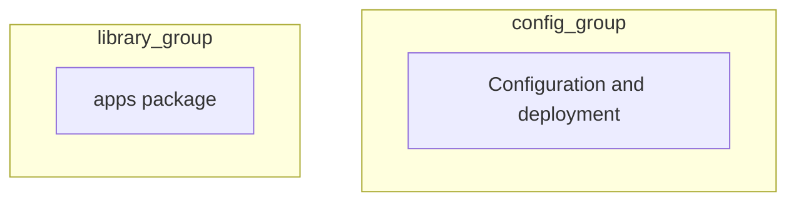

# Architecture report: cosscom/ui

> Automated static analysis. **Observed** = directly seen in files/imports/AST; **Inferred** = interpretation from that evidence. Repository code was not executed.

## 1. Repository at a glance

| Item | Value |
| --- | --- |
| Repository | cosscom/ui |
| Description | coss.com/ui is the official design system of Cal.com |
| Language | TypeScript |
| Stars | 10858 |
| Licence | MIT |
| Analysed commit / branch | 0da83f8508d3d5fa5ea757015dbf50a73ecd089d / main |
| Framework(s) | Next.js, React |
| Files analysed | 800 |
| Components | 2 |

## 2. Architecture in one minute

cosscom/ui - coss.com/ui is the official design system of Cal.com. This repository was analysed statically from 800 file(s) (0 Python). Detected technologies (observed from imports/manifests): GitHub Actions, Next.js, React, Tailwind CSS, TypeScript. Files are grouped into 2 component(s): apps package, Configuration and deployment. Findings below distinguish observed facts from inferred interpretation.

## 3. High-level block diagram

## 4. Main components

### apps package (`apps`)

- **Kind:** library
- **Status:** Observed
- **Confidence:** 0.85
- **Responsibility:** Groups 123 file(s) under apps package (observed from repository paths and static analysis).
- **Paths:** `apps/examples/calcom/app/(dashboard)/booking/booking-actions.tsx`, `apps/examples/calcom/app/(dashboard)/booking/booking-skeleton.tsx`, `apps/examples/calcom/app/(dashboard)/booking/bookings-list.tsx`, `apps/examples/calcom/app/(dashboard)/booking/canceled/bookings-empty.tsx`, `apps/examples/calcom/app/(dashboard)/booking/canceled/loading.tsx`, `apps/examples/calcom/app/(dashboard)/booking/canceled/page.tsx`, `apps/examples/calcom/app/(dashboard)/booking/page.tsx`, `apps/examples/calcom/app/(dashboard)/booking/past/booking-actions.tsx`, `apps/examples/calcom/app/(dashboard)/booking/past/bookings-list.tsx`, `apps/examples/calcom/app/(dashboard)/booking/past/loading.tsx`, `apps/examples/calcom/app/(dashboard)/booking/past/page.tsx`, `apps/examples/calcom/app/(dashboard)/booking/recurring/bookings-empty.tsx`, `apps/examples/calcom/app/(dashboard)/booking/recurring/loading.tsx`, `apps/examples/calcom/app/(dashboard)/booking/recurring/page.tsx`, `apps/examples/calcom/app/(dashboard)/booking/unconfirmed/bookings-empty.tsx`, `apps/examples/calcom/app/(dashboard)/booking/unconfirmed/loading.tsx`, `apps/examples/calcom/app/(dashboard)/booking/unconfirmed/page.tsx`, `apps/examples/calcom/app/(dashboard)/booking/upcoming/bookings-empty.tsx`, `apps/examples/calcom/app/(dashboard)/booking/upcoming/empty/page.tsx`, `apps/examples/calcom/app/(dashboard)/booking/upcoming/loading.tsx`, `apps/examples/calcom/app/(dashboard)/booking/upcoming/page.tsx`, `apps/examples/calcom/app/(dashboard)/event-types/add-event-type-dialog.tsx`, `apps/examples/calcom/app/(dashboard)/event-types/event-type-actions.tsx`, `apps/examples/calcom/app/(dashboard)/event-types/event-types-list.tsx`, `apps/examples/calcom/app/(dashboard)/event-types/page.tsx`, `apps/examples/calcom/app/(dashboard)/layout.tsx`, `apps/examples/calcom/app/(dashboard)/members/members-page-client.tsx`, `apps/examples/calcom/app/(dashboard)/members/page.tsx`, `apps/examples/calcom/app/(dashboard)/page.tsx`, `apps/examples/calcom/app/layout.tsx`, `apps/examples/calcom/components/app/app-command.tsx`, `apps/examples/calcom/components/app/app-header.tsx`, `apps/examples/calcom/components/app/app-mobile-footer.tsx`, `apps/examples/calcom/components/app/app-mobile-header.tsx`, `apps/examples/calcom/components/app/app-sidebar.tsx`, `apps/examples/calcom/components/app/bookings-filters.tsx`, `apps/examples/calcom/components/app/bookings-nav.tsx`, `apps/examples/calcom/components/app/bookings-view.tsx`, `apps/examples/calcom/components/app/filter-add-menu.tsx`, `apps/examples/calcom/components/app/filter-bar-actions.tsx`, `apps/examples/calcom/components/app/filter-chip-date-range.tsx`, `apps/examples/calcom/components/app/filter-chip-options.tsx`, `apps/examples/calcom/components/app/filter-chip-shell.tsx`, `apps/examples/calcom/components/app/filter-chip-text.tsx`, `apps/examples/calcom/components/app/filter-chip-types.ts`, `apps/examples/calcom/components/app/filter-saved-combobox.tsx`, `apps/examples/calcom/components/app/nav-main.tsx`, `apps/examples/calcom/components/app/nav-secondary.tsx`, `apps/examples/calcom/components/app/tabbed-nav.tsx`, `apps/examples/calcom/components/copyable-field.tsx`, `apps/examples/calcom/components/debug-context.tsx`, `apps/examples/calcom/components/debug-popover.tsx`, `apps/examples/calcom/components/header-actions.tsx`, `apps/examples/calcom/components/item-label.tsx`, `apps/examples/calcom/components/list-item.tsx`, `apps/examples/calcom/components/logo.tsx`, `apps/examples/calcom/components/mobile-header.tsx`, `apps/examples/calcom/components/particles/danger-zone.tsx`, `apps/examples/calcom/components/particles/field-grid.tsx`, `apps/examples/calcom/components/particles/image-checkbox-option.tsx`, `apps/examples/calcom/components/particles/image-radio-option.tsx`, `apps/examples/calcom/components/particles/index.ts`, `apps/examples/calcom/components/particles/settings-toggle.tsx`, `apps/examples/calcom/components/settings-toggle.tsx`, `apps/examples/calcom/components/shared/adaptive-menu.tsx`, `apps/examples/calcom/components/sortable.tsx`, `apps/examples/calcom/components/ui/sidebar.tsx`, `apps/examples/calcom/components/user-menu.tsx`, `apps/examples/calcom/components/workflows-badge.tsx`, `apps/examples/calcom/hooks/use-loading-state.ts`, `apps/examples/calcom/hooks/use-scroll-hide.ts`, `apps/examples/calcom/lib/booking-action-rules.ts`, `apps/examples/calcom/lib/event-types-types.ts`, `apps/examples/calcom/lib/markdown-to-safe-html.ts`, `apps/examples/calcom/lib/mock-ai-data.ts`, `apps/examples/calcom/lib/mock-bookings-data.ts`, `apps/examples/calcom/lib/mock-event-types-data.ts`, `apps/examples/calcom/lib/mock-session.ts`, `apps/examples/calcom/lib/navigation-data.ts`, `apps/examples/calcom/lib/settings-navigation-data.ts`, `apps/examples/calcom/next.config.ts`, `apps/examples/calcom/postcss.config.mjs`, `apps/examples/next-env.d.ts`, `apps/origin/app/[category]/page.tsx`, `apps/origin/app/easings/copy-class.tsx`, `apps/origin/app/easings/easings.tsx`, `apps/origin/app/easings/page.tsx`, `apps/origin/app/layout.tsx`, `apps/origin/app/not-found.tsx`, `apps/origin/app/page.tsx`, `apps/origin/app/search/components-container.tsx`, `apps/origin/app/search/multiselect.tsx`, `apps/origin/app/search/page.tsx`, `apps/origin/app/search/search-field.tsx`, `apps/origin/app/sitemap.ts`, `apps/origin/components/cli-commands.tsx`, `apps/origin/components/code-block.tsx`, `apps/origin/components/component-card.tsx`, `apps/origin/components/component-details.tsx`, `apps/origin/components/component-loader-client.tsx`, `apps/origin/components/component-loader-server.tsx`, `apps/origin/components/copy-button.tsx`, `apps/origin/components/copy-layout.tsx`, `apps/origin/components/copy-registry.tsx`, `apps/origin/components/cta.tsx`, `apps/origin/components/footer.tsx`, `apps/origin/components/header-link.tsx`, `apps/origin/components/header.tsx`, `apps/origin/components/open-in-v0.tsx`, `apps/origin/components/page-grid.tsx`, `apps/origin/components/page-header.tsx`, `apps/origin/components/search-button.tsx`, `apps/origin/components/subscribe-action.ts`, `apps/origin/components/subscribe-form.tsx`, `apps/origin/components/theme-provider.tsx`, `apps/origin/components/theme-toggle.tsx`, `apps/origin/components/top-banner.tsx`, `apps/origin/hooks/use-config.ts`, `apps/origin/hooks/use-copy.ts`, `apps/origin/hooks/use-mobile.tsx`, `apps/origin/lib/utils.ts`, `apps/origin/next.config.ts`, `apps/origin/postcss.config.mjs`
- **Evidence:** [apps/examples/calcom/app/(dashboard)/booking/booking-actions.tsx](https://github.com/cosscom/ui/blob/0da83f8508d3d5fa5ea757015dbf50a73ecd089d/apps/examples/calcom/app/%28dashboard%29/booking/booking-actions.tsx); [apps/examples/calcom/app/(dashboard)/booking/booking-skeleton.tsx](https://github.com/cosscom/ui/blob/0da83f8508d3d5fa5ea757015dbf50a73ecd089d/apps/examples/calcom/app/%28dashboard%29/booking/booking-skeleton.tsx); [apps/examples/calcom/app/(dashboard)/booking/bookings-list.tsx](https://github.com/cosscom/ui/blob/0da83f8508d3d5fa5ea757015dbf50a73ecd089d/apps/examples/calcom/app/%28dashboard%29/booking/bookings-list.tsx); [apps/examples/calcom/app/(dashboard)/booking/canceled/bookings-empty.tsx](https://github.com/cosscom/ui/blob/0da83f8508d3d5fa5ea757015dbf50a73ecd089d/apps/examples/calcom/app/%28dashboard%29/booking/canceled/bookings-empty.tsx); [apps/examples/calcom/app/(dashboard)/booking/canceled/loading.tsx](https://github.com/cosscom/ui/blob/0da83f8508d3d5fa5ea757015dbf50a73ecd089d/apps/examples/calcom/app/%28dashboard%29/booking/canceled/loading.tsx); [apps/examples/calcom/app/(dashboard)/booking/canceled/page.tsx](https://github.com/cosscom/ui/blob/0da83f8508d3d5fa5ea757015dbf50a73ecd089d/apps/examples/calcom/app/%28dashboard%29/booking/canceled/page.tsx); [apps/examples/calcom/app/(dashboard)/booking/page.tsx](https://github.com/cosscom/ui/blob/0da83f8508d3d5fa5ea757015dbf50a73ecd089d/apps/examples/calcom/app/%28dashboard%29/booking/page.tsx); [apps/examples/calcom/app/(dashboard)/booking/past/booking-actions.tsx](https://github.com/cosscom/ui/blob/0da83f8508d3d5fa5ea757015dbf50a73ecd089d/apps/examples/calcom/app/%28dashboard%29/booking/past/booking-actions.tsx)

### Configuration and deployment (`config`)

- **Kind:** config
- **Status:** Observed
- **Confidence:** 0.85
- **Responsibility:** Groups 647 file(s) under configuration and deployment (observed from repository paths and static analysis).
- **Paths:** `apps/examples/calcom/app/(settings)/settings/admin/apps/analytics/analytics-apps-content.tsx`, `apps/examples/calcom/app/(settings)/settings/admin/apps/analytics/page.tsx`, `apps/examples/calcom/app/(settings)/settings/admin/apps/page.tsx`, `apps/examples/calcom/app/(settings)/settings/admin/billing/page.tsx`, `apps/examples/calcom/app/(settings)/settings/admin/flags/flag-admin-list.tsx`, `apps/examples/calcom/app/(settings)/settings/admin/flags/page.tsx`, `apps/examples/calcom/app/(settings)/settings/admin/impersonation/page.tsx`, `apps/examples/calcom/app/(settings)/settings/admin/oauth/page.tsx`, `apps/examples/calcom/app/(settings)/settings/billing/billing-page-content.tsx`, `apps/examples/calcom/app/(settings)/settings/billing/page.tsx`, `apps/examples/calcom/app/(settings)/settings/developer/api-keys/api-keys-empty.tsx`, `apps/examples/calcom/app/(settings)/settings/developer/api-keys/api-keys-list.tsx`, `apps/examples/calcom/app/(settings)/settings/developer/api-keys/api-keys-page-content.tsx`, `apps/examples/calcom/app/(settings)/settings/developer/api-keys/edit-api-key-dialog.tsx`, `apps/examples/calcom/app/(settings)/settings/developer/api-keys/new-api-key-dialog.tsx`, `apps/examples/calcom/app/(settings)/settings/developer/api-keys/page.tsx`, `apps/examples/calcom/app/(settings)/settings/developer/oauth/copyable-field.tsx`, `apps/examples/calcom/app/(settings)/settings/developer/oauth/edit-oauth-client-dialog.tsx`, `apps/examples/calcom/app/(settings)/settings/developer/oauth/new-oauth-client-dialog.tsx`, `apps/examples/calcom/app/(settings)/settings/developer/oauth/oauth-client-form-fields.tsx`, `apps/examples/calcom/app/(settings)/settings/developer/oauth/oauth-clients-list.tsx`, `apps/examples/calcom/app/(settings)/settings/developer/oauth/oauth-empty.tsx`, `apps/examples/calcom/app/(settings)/settings/developer/oauth/oauth-page-content.tsx`, `apps/examples/calcom/app/(settings)/settings/developer/oauth/page.tsx`, `apps/examples/calcom/app/(settings)/settings/developer/page.tsx`, `apps/examples/calcom/app/(settings)/settings/developer/webhooks/demo/page.tsx`, `apps/examples/calcom/app/(settings)/settings/developer/webhooks/new-webhook-button.tsx`, `apps/examples/calcom/app/(settings)/settings/developer/webhooks/new/new-webhook-form-fields.tsx`, `apps/examples/calcom/app/(settings)/settings/developer/webhooks/new/page.tsx`, `apps/examples/calcom/app/(settings)/settings/developer/webhooks/new/webhook-test-section.tsx`, `apps/examples/calcom/app/(settings)/settings/developer/webhooks/page.tsx`, `apps/examples/calcom/app/(settings)/settings/developer/webhooks/webhooks-empty.tsx`, `apps/examples/calcom/app/(settings)/settings/developer/webhooks/webhooks-list-content.tsx`, `apps/examples/calcom/app/(settings)/settings/developer/webhooks/webhooks-page-content.tsx`, `apps/examples/calcom/app/(settings)/settings/layout.tsx`, `apps/examples/calcom/app/(settings)/settings/my-account/appearance/appearance-form.tsx`, `apps/examples/calcom/app/(settings)/settings/my-account/appearance/booking-layout-section.tsx`, `apps/examples/calcom/app/(settings)/settings/my-account/appearance/custom-brand-colors-section.tsx`, `apps/examples/calcom/app/(settings)/settings/my-account/appearance/page.tsx`, `apps/examples/calcom/app/(settings)/settings/my-account/calendars/calendars-demo-form.tsx`, `apps/examples/calcom/app/(settings)/settings/my-account/calendars/calendars-empty.tsx`, `apps/examples/calcom/app/(settings)/settings/my-account/calendars/check-for-conflicts-card.tsx`, `apps/examples/calcom/app/(settings)/settings/my-account/calendars/empty/page.tsx`, `apps/examples/calcom/app/(settings)/settings/my-account/calendars/page.tsx`, `apps/examples/calcom/app/(settings)/settings/my-account/conferencing/conferencing-empty.tsx`, `apps/examples/calcom/app/(settings)/settings/my-account/conferencing/conferencing-page-client.tsx`, `apps/examples/calcom/app/(settings)/settings/my-account/conferencing/page.tsx`, `apps/examples/calcom/app/(settings)/settings/my-account/features/features-list.tsx`, `apps/examples/calcom/app/(settings)/settings/my-account/features/page.tsx`, `apps/examples/calcom/app/(settings)/settings/my-account/general/general-settings-form.tsx`, `apps/examples/calcom/app/(settings)/settings/my-account/general/page.tsx`, `apps/examples/calcom/app/(settings)/settings/my-account/page.tsx`, `apps/examples/calcom/app/(settings)/settings/my-account/profile/page.tsx`, `apps/examples/calcom/app/(settings)/settings/my-account/profile/profile-form.tsx`, `apps/examples/calcom/app/(settings)/settings/my-account/push-notifications/page.tsx`, `apps/examples/calcom/app/(settings)/settings/my-account/push-notifications/push-notifications-toggle.tsx`, `apps/examples/calcom/app/(settings)/settings/organizations/attributes/[id]/edit/page.tsx`, `apps/examples/calcom/app/(settings)/settings/organizations/attributes/attributes-page-content.tsx`, `apps/examples/calcom/app/(settings)/settings/organizations/attributes/attributes-section.tsx`, `apps/examples/calcom/app/(settings)/settings/organizations/attributes/demo/page.tsx`, `apps/examples/calcom/app/(settings)/settings/organizations/attributes/new/new-attribute-form-fields.tsx`, `apps/examples/calcom/app/(settings)/settings/organizations/attributes/new/page.tsx`, `apps/examples/calcom/app/(settings)/settings/organizations/attributes/page.tsx`, `apps/examples/calcom/app/(settings)/settings/organizations/delegation-credential/add-delegation-credential-dialog.tsx`, `apps/examples/calcom/app/(settings)/settings/organizations/delegation-credential/delegation-credential-empty.tsx`, `apps/examples/calcom/app/(settings)/settings/organizations/delegation-credential/delegation-credential-list.tsx`, `apps/examples/calcom/app/(settings)/settings/organizations/delegation-credential/delegation-credential-page-content.tsx`, `apps/examples/calcom/app/(settings)/settings/organizations/delegation-credential/delegation-credential-types.ts`, `apps/examples/calcom/app/(settings)/settings/organizations/delegation-credential/delegation-credential-workspace-platforms.ts`, `apps/examples/calcom/app/(settings)/settings/organizations/delegation-credential/edit-delegation-credential-dialog.tsx`, `apps/examples/calcom/app/(settings)/settings/organizations/delegation-credential/page.tsx`, `apps/examples/calcom/app/(settings)/settings/organizations/dsync/configure-directory-sync-dialog.tsx`, `apps/examples/calcom/app/(settings)/settings/organizations/dsync/create-team-dialog.tsx`, `apps/examples/calcom/app/(settings)/settings/organizations/dsync/directory-sync-page-content.tsx`, `apps/examples/calcom/app/(settings)/settings/organizations/dsync/directory-sync-team-mapping.tsx`, `apps/examples/calcom/app/(settings)/settings/organizations/dsync/page.tsx`, `apps/examples/calcom/app/(settings)/settings/page.tsx`, `apps/examples/calcom/app/(settings)/settings/security/compliance/compliance-documents.tsx`, `apps/examples/calcom/app/(settings)/settings/security/compliance/page.tsx`, `apps/examples/calcom/app/(settings)/settings/security/impersonation/impersonation-toggle.tsx`, `apps/examples/calcom/app/(settings)/settings/security/impersonation/page.tsx`, `apps/examples/calcom/app/(settings)/settings/security/password/page.tsx`, `apps/examples/calcom/app/(settings)/settings/security/password/password-form.tsx`, `apps/examples/calcom/app/(settings)/settings/security/two-factor-auth/disable-2fa-dialog.tsx`, `apps/examples/calcom/app/(settings)/settings/security/two-factor-auth/enable-2fa-dialog.tsx`, `apps/examples/calcom/app/(settings)/settings/security/two-factor-auth/page.tsx`, `apps/examples/calcom/app/(settings)/settings/security/two-factor-auth/two-factor-auth-section.tsx`, `apps/examples/calcom/app/(settings)/settings/teams/[id]/appearance/page.tsx`, `apps/examples/calcom/app/(settings)/settings/teams/[id]/billing/page.tsx`, `apps/examples/calcom/app/(settings)/settings/teams/[id]/features/page.tsx`, `apps/examples/calcom/app/(settings)/settings/teams/[id]/features/team-features-page-client.tsx`, `apps/examples/calcom/app/(settings)/settings/teams/[id]/members/page.tsx`, `apps/examples/calcom/app/(settings)/settings/teams/[id]/members/team-members-page-client.tsx`, `apps/examples/calcom/app/(settings)/settings/teams/[id]/profile/no-permissions/copy-link.tsx`, `apps/examples/calcom/app/(settings)/settings/teams/[id]/profile/no-permissions/page.tsx`, `apps/examples/calcom/app/(settings)/settings/teams/[id]/profile/page.tsx`, `apps/examples/calcom/app/(settings)/settings/teams/[id]/profile/team-profile-form.tsx`, `apps/examples/calcom/app/(settings)/settings/teams/[id]/roles/page.tsx`, `apps/examples/calcom/app/(settings)/settings/teams/[id]/roles/team-roles-page-client.tsx`, `apps/examples/calcom/app/(settings)/settings/teams/[id]/settings/page.tsx`, `apps/examples/calcom/app/(settings)/settings/teams/[id]/settings/team-settings-page-client.tsx`, `apps/examples/calcom/components/settings/settings-drawer.tsx`, `apps/examples/calcom/components/settings/settings-mobile-header.tsx`, `apps/examples/calcom/components/settings/settings-nav-section.tsx`, `apps/examples/calcom/components/settings/settings-sidebar.tsx`, `apps/examples/calcom/package.json`, `apps/examples/calcom/tsconfig.json`, `apps/origin/components.json`, `apps/origin/config/components.ts`, `apps/origin/package.json`, `apps/origin/public/r/accordion.json`, `apps/origin/public/r/alert-dialog.json`, `apps/origin/public/r/avatar.json`, `apps/origin/public/r/badge.json`, `apps/origin/public/r/breadcrumb.json`, `apps/origin/public/r/button.json`, `apps/origin/public/r/calendar-rac.json`, `apps/origin/public/r/calendar.json`, `apps/origin/public/r/checkbox-tree.json`, `apps/origin/public/r/checkbox.json`, `apps/origin/public/r/collapsible.json`, `apps/origin/public/r/command.json`, `apps/origin/public/r/comp-01.json`, `apps/origin/public/r/comp-02.json`, `apps/origin/public/r/comp-03.json`, `apps/origin/public/r/comp-04.json`, `apps/origin/public/r/comp-05.json`, `apps/origin/public/r/comp-06.json`, `apps/origin/public/r/comp-07.json`, `apps/origin/public/r/comp-08.json`, `apps/origin/public/r/comp-09.json`, `apps/origin/public/r/comp-10.json`, `apps/origin/public/r/comp-100.json`, `apps/origin/public/r/comp-101.json`, `apps/origin/public/r/comp-102.json`, `apps/origin/public/r/comp-103.json`, `apps/origin/public/r/comp-104.json`, `apps/origin/public/r/comp-105.json`, `apps/origin/public/r/comp-106.json`, `apps/origin/public/r/comp-107.json`, `apps/origin/public/r/comp-108.json`, `apps/origin/public/r/comp-109.json`, `apps/origin/public/r/comp-11.json`, `apps/origin/public/r/comp-110.json`, `apps/origin/public/r/comp-111.json`, `apps/origin/public/r/comp-112.json`, `apps/origin/public/r/comp-113.json`, `apps/origin/public/r/comp-114.json`, `apps/origin/public/r/comp-115.json`, `apps/origin/public/r/comp-116.json`, `apps/origin/public/r/comp-117.json`, `apps/origin/public/r/comp-118.json`, `apps/origin/public/r/comp-119.json`, `apps/origin/public/r/comp-12.json`, `apps/origin/public/r/comp-120.json`, `apps/origin/public/r/comp-121.json`, `apps/origin/public/r/comp-122.json`, `apps/origin/public/r/comp-123.json`, `apps/origin/public/r/comp-124.json`, `apps/origin/public/r/comp-125.json`, `apps/origin/public/r/comp-126.json`, `apps/origin/public/r/comp-127.json`, `apps/origin/public/r/comp-128.json`, `apps/origin/public/r/comp-129.json`, `apps/origin/public/r/comp-13.json`, `apps/origin/public/r/comp-130.json`, `apps/origin/public/r/comp-131.json`, `apps/origin/public/r/comp-132.json`, `apps/origin/public/r/comp-133.json`, `apps/origin/public/r/comp-134.json`, `apps/origin/public/r/comp-135.json`, `apps/origin/public/r/comp-136.json`, `apps/origin/public/r/comp-137.json`, `apps/origin/public/r/comp-138.json`, `apps/origin/public/r/comp-139.json`, `apps/origin/public/r/comp-14.json`, `apps/origin/public/r/comp-140.json`, `apps/origin/public/r/comp-141.json`, `apps/origin/public/r/comp-142.json`, `apps/origin/public/r/comp-143.json`, `apps/origin/public/r/comp-144.json`, `apps/origin/public/r/comp-145.json`, `apps/origin/public/r/comp-146.json`, `apps/origin/public/r/comp-147.json`, `apps/origin/public/r/comp-148.json`, `apps/origin/public/r/comp-149.json`, `apps/origin/public/r/comp-15.json`, `apps/origin/public/r/comp-150.json`, `apps/origin/public/r/comp-151.json`, `apps/origin/public/r/comp-152.json`, `apps/origin/public/r/comp-153.json`, `apps/origin/public/r/comp-154.json`, `apps/origin/public/r/comp-155.json`, `apps/origin/public/r/comp-156.json`, `apps/origin/public/r/comp-157.json`, `apps/origin/public/r/comp-158.json`, `apps/origin/public/r/comp-159.json`, `apps/origin/public/r/comp-16.json`, `apps/origin/public/r/comp-160.json`, `apps/origin/public/r/comp-161.json`, `apps/origin/public/r/comp-162.json`, `apps/origin/public/r/comp-163.json`, `apps/origin/public/r/comp-164.json`, `apps/origin/public/r/comp-165.json`, `apps/origin/public/r/comp-166.json`, `apps/origin/public/r/comp-167.json`, `apps/origin/public/r/comp-168.json`, `apps/origin/public/r/comp-169.json`, `apps/origin/public/r/comp-17.json`, `apps/origin/public/r/comp-170.json`, `apps/origin/public/r/comp-171.json`, `apps/origin/public/r/comp-172.json`, `apps/origin/public/r/comp-173.json`, `apps/origin/public/r/comp-174.json`, `apps/origin/public/r/comp-175.json`, `apps/origin/public/r/comp-176.json`, `apps/origin/public/r/comp-177.json`, `apps/origin/public/r/comp-178.json`, `apps/origin/public/r/comp-179.json`, `apps/origin/public/r/comp-18.json`, `apps/origin/public/r/comp-180.json`, `apps/origin/public/r/comp-181.json`, `apps/origin/public/r/comp-182.json`, `apps/origin/public/r/comp-183.json`, `apps/origin/public/r/comp-184.json`, `apps/origin/public/r/comp-185.json`, `apps/origin/public/r/comp-186.json`, `apps/origin/public/r/comp-187.json`, `apps/origin/public/r/comp-188.json`, `apps/origin/public/r/comp-189.json`, `apps/origin/public/r/comp-19.json`, `apps/origin/public/r/comp-190.json`, `apps/origin/public/r/comp-191.json`, `apps/origin/public/r/comp-192.json`, `apps/origin/public/r/comp-193.json`, `apps/origin/public/r/comp-194.json`, `apps/origin/public/r/comp-195.json`, `apps/origin/public/r/comp-196.json`, `apps/origin/public/r/comp-197.json`, `apps/origin/public/r/comp-198.json`, `apps/origin/public/r/comp-199.json`, `apps/origin/public/r/comp-20.json`, `apps/origin/public/r/comp-200.json`, `apps/origin/public/r/comp-201.json`, `apps/origin/public/r/comp-202.json`, `apps/origin/public/r/comp-203.json`, `apps/origin/public/r/comp-204.json`, `apps/origin/public/r/comp-205.json`, `apps/origin/public/r/comp-206.json`, `apps/origin/public/r/comp-207.json`, `apps/origin/public/r/comp-208.json`, `apps/origin/public/r/comp-209.json`, `apps/origin/public/r/comp-21.json`, `apps/origin/public/r/comp-210.json`, `apps/origin/public/r/comp-211.json`, `apps/origin/public/r/comp-212.json`, `apps/origin/public/r/comp-213.json`, `apps/origin/public/r/comp-214.json`, `apps/origin/public/r/comp-215.json`, `apps/origin/public/r/comp-216.json`, `apps/origin/public/r/comp-217.json`, `apps/origin/public/r/comp-218.json`, `apps/origin/public/r/comp-219.json`, `apps/origin/public/r/comp-22.json`, `apps/origin/public/r/comp-220.json`, `apps/origin/public/r/comp-221.json`, `apps/origin/public/r/comp-222.json`, `apps/origin/public/r/comp-223.json`, `apps/origin/public/r/comp-224.json`, `apps/origin/public/r/comp-225.json`, `apps/origin/public/r/comp-226.json`, `apps/origin/public/r/comp-227.json`, `apps/origin/public/r/comp-228.json`, `apps/origin/public/r/comp-229.json`, `apps/origin/public/r/comp-23.json`, `apps/origin/public/r/comp-230.json`, `apps/origin/public/r/comp-231.json`, `apps/origin/public/r/comp-232.json`, `apps/origin/public/r/comp-233.json`, `apps/origin/public/r/comp-234.json`, `apps/origin/public/r/comp-235.json`, `apps/origin/public/r/comp-236.json`, `apps/origin/public/r/comp-237.json`, `apps/origin/public/r/comp-238.json`, `apps/origin/public/r/comp-239.json`, `apps/origin/public/r/comp-24.json`, `apps/origin/public/r/comp-240.json`, `apps/origin/public/r/comp-241.json`, `apps/origin/public/r/comp-242.json`, `apps/origin/public/r/comp-243.json`, `apps/origin/public/r/comp-244.json`, `apps/origin/public/r/comp-245.json`, `apps/origin/public/r/comp-246.json`, `apps/origin/public/r/comp-247.json`, `apps/origin/public/r/comp-248.json`, `apps/origin/public/r/comp-249.json`, `apps/origin/public/r/comp-25.json`, `apps/origin/public/r/comp-250.json`, `apps/origin/public/r/comp-251.json`, `apps/origin/public/r/comp-252.json`, `apps/origin/public/r/comp-253.json`, `apps/origin/public/r/comp-254.json`, `apps/origin/public/r/comp-255.json`, `apps/origin/public/r/comp-256.json`, `apps/origin/public/r/comp-257.json`, `apps/origin/public/r/comp-258.json`, `apps/origin/public/r/comp-259.json`, `apps/origin/public/r/comp-26.json`, `apps/origin/public/r/comp-260.json`, `apps/origin/public/r/comp-261.json`, `apps/origin/public/r/comp-262.json`, `apps/origin/public/r/comp-263.json`, `apps/origin/public/r/comp-264.json`, `apps/origin/public/r/comp-265.json`, `apps/origin/public/r/comp-266.json`, `apps/origin/public/r/comp-267.json`, `apps/origin/public/r/comp-268.json`, `apps/origin/public/r/comp-269.json`, `apps/origin/public/r/comp-27.json`, `apps/origin/public/r/comp-270.json`, `apps/origin/public/r/comp-271.json`, `apps/origin/public/r/comp-272.json`, `apps/origin/public/r/comp-273.json`, `apps/origin/public/r/comp-274.json`, `apps/origin/public/r/comp-275.json`, `apps/origin/public/r/comp-276.json`, `apps/origin/public/r/comp-277.json`, `apps/origin/public/r/comp-278.json`, `apps/origin/public/r/comp-279.json`, `apps/origin/public/r/comp-28.json`, `apps/origin/public/r/comp-280.json`, `apps/origin/public/r/comp-281.json`, `apps/origin/public/r/comp-282.json`, `apps/origin/public/r/comp-283.json`, `apps/origin/public/r/comp-284.json`, `apps/origin/public/r/comp-285.json`, `apps/origin/public/r/comp-286.json`, `apps/origin/public/r/comp-287.json`, `apps/origin/public/r/comp-288.json`, `apps/origin/public/r/comp-289.json`, `apps/origin/public/r/comp-29.json`, `apps/origin/public/r/comp-290.json`, `apps/origin/public/r/comp-291.json`, `apps/origin/public/r/comp-292.json`, `apps/origin/public/r/comp-293.json`, `apps/origin/public/r/comp-294.json`, `apps/origin/public/r/comp-295.json`, `apps/origin/public/r/comp-296.json`, `apps/origin/public/r/comp-297.json`, `apps/origin/public/r/comp-298.json`, `apps/origin/public/r/comp-299.json`, `apps/origin/public/r/comp-30.json`, `apps/origin/public/r/comp-300.json`, `apps/origin/public/r/comp-301.json`, `apps/origin/public/r/comp-302.json`, `apps/origin/public/r/comp-303.json`, `apps/origin/public/r/comp-304.json`, `apps/origin/public/r/comp-305.json`, `apps/origin/public/r/comp-306.json`, `apps/origin/public/r/comp-307.json`, `apps/origin/public/r/comp-308.json`, `apps/origin/public/r/comp-309.json`, `apps/origin/public/r/comp-31.json`, `apps/origin/public/r/comp-310.json`, `apps/origin/public/r/comp-311.json`, `apps/origin/public/r/comp-312.json`, `apps/origin/public/r/comp-313.json`, `apps/origin/public/r/comp-314.json`, `apps/origin/public/r/comp-315.json`, `apps/origin/public/r/comp-316.json`, `apps/origin/public/r/comp-317.json`, `apps/origin/public/r/comp-318.json`, `apps/origin/public/r/comp-319.json`, `apps/origin/public/r/comp-32.json`, `apps/origin/public/r/comp-320.json`, `apps/origin/public/r/comp-321.json`, `apps/origin/public/r/comp-322.json`, `apps/origin/public/r/comp-323.json`, `apps/origin/public/r/comp-324.json`, `apps/origin/public/r/comp-325.json`, `apps/origin/public/r/comp-326.json`, `apps/origin/public/r/comp-327.json`, `apps/origin/public/r/comp-328.json`, `apps/origin/public/r/comp-329.json`, `apps/origin/public/r/comp-33.json`, `apps/origin/public/r/comp-330.json`, `apps/origin/public/r/comp-331.json`, `apps/origin/public/r/comp-332.json`, `apps/origin/public/r/comp-333.json`, `apps/origin/public/r/comp-334.json`, `apps/origin/public/r/comp-335.json`, `apps/origin/public/r/comp-336.json`, `apps/origin/public/r/comp-337.json`, `apps/origin/public/r/comp-338.json`, `apps/origin/public/r/comp-339.json`, `apps/origin/public/r/comp-34.json`, `apps/origin/public/r/comp-340.json`, `apps/origin/public/r/comp-341.json`, `apps/origin/public/r/comp-342.json`, `apps/origin/public/r/comp-343.json`, `apps/origin/public/r/comp-344.json`, `apps/origin/public/r/comp-345.json`, `apps/origin/public/r/comp-346.json`, `apps/origin/public/r/comp-347.json`, `apps/origin/public/r/comp-348.json`, `apps/origin/public/r/comp-349.json`, `apps/origin/public/r/comp-35.json`, `apps/origin/public/r/comp-350.json`, `apps/origin/public/r/comp-351.json`, `apps/origin/public/r/comp-352.json`, `apps/origin/public/r/comp-353.json`, `apps/origin/public/r/comp-354.json`, `apps/origin/public/r/comp-355.json`, `apps/origin/public/r/comp-356.json`, `apps/origin/public/r/comp-357.json`, `apps/origin/public/r/comp-358.json`, `apps/origin/public/r/comp-359.json`, `apps/origin/public/r/comp-36.json`, `apps/origin/public/r/comp-360.json`, `apps/origin/public/r/comp-361.json`, `apps/origin/public/r/comp-362.json`, `apps/origin/public/r/comp-363.json`, `apps/origin/public/r/comp-364.json`, `apps/origin/public/r/comp-365.json`, `apps/origin/public/r/comp-366.json`, `apps/origin/public/r/comp-367.json`, `apps/origin/public/r/comp-368.json`, `apps/origin/public/r/comp-369.json`, `apps/origin/public/r/comp-37.json`, `apps/origin/public/r/comp-370.json`, `apps/origin/public/r/comp-371.json`, `apps/origin/public/r/comp-372.json`, `apps/origin/public/r/comp-373.json`, `apps/origin/public/r/comp-374.json`, `apps/origin/public/r/comp-375.json`, `apps/origin/public/r/comp-376.json`, `apps/origin/public/r/comp-377.json`, `apps/origin/public/r/comp-378.json`, `apps/origin/public/r/comp-379.json`, `apps/origin/public/r/comp-38.json`, `apps/origin/public/r/comp-380.json`, `apps/origin/public/r/comp-381.json`, `apps/origin/public/r/comp-382.json`, `apps/origin/public/r/comp-383.json`, `apps/origin/public/r/comp-384.json`, `apps/origin/public/r/comp-385.json`, `apps/origin/public/r/comp-386.json`, `apps/origin/public/r/comp-387.json`, `apps/origin/public/r/comp-388.json`, `apps/origin/public/r/comp-389.json`, `apps/origin/public/r/comp-39.json`, `apps/origin/public/r/comp-390.json`, `apps/origin/public/r/comp-391.json`, `apps/origin/public/r/comp-392.json`, `apps/origin/public/r/comp-393.json`, `apps/origin/public/r/comp-394.json`, `apps/origin/public/r/comp-395.json`, `apps/origin/public/r/comp-396.json`, `apps/origin/public/r/comp-397.json`, `apps/origin/public/r/comp-398.json`, `apps/origin/public/r/comp-399.json`, `apps/origin/public/r/comp-40.json`, `apps/origin/public/r/comp-400.json`, `apps/origin/public/r/comp-401.json`, `apps/origin/public/r/comp-402.json`, `apps/origin/public/r/comp-403.json`, `apps/origin/public/r/comp-404.json`, `apps/origin/public/r/comp-405.json`, `apps/origin/public/r/comp-406.json`, `apps/origin/public/r/comp-407.json`, `apps/origin/public/r/comp-408.json`, `apps/origin/public/r/comp-409.json`, `apps/origin/public/r/comp-41.json`, `apps/origin/public/r/comp-410.json`, `apps/origin/public/r/comp-411.json`, `apps/origin/public/r/comp-412.json`, `apps/origin/public/r/comp-413.json`, `apps/origin/public/r/comp-414.json`, `apps/origin/public/r/comp-415.json`, `apps/origin/public/r/comp-416.json`, `apps/origin/public/r/comp-417.json`, `apps/origin/public/r/comp-418.json`, `apps/origin/public/r/comp-419.json`, `apps/origin/public/r/comp-42.json`, `apps/origin/public/r/comp-420.json`, `apps/origin/public/r/comp-421.json`, `apps/origin/public/r/comp-422.json`, `apps/origin/public/r/comp-423.json`, `apps/origin/public/r/comp-424.json`, `apps/origin/public/r/comp-425.json`, `apps/origin/public/r/comp-426.json`, `apps/origin/public/r/comp-427.json`, `apps/origin/public/r/comp-428.json`, `apps/origin/public/r/comp-429.json`, `apps/origin/public/r/comp-43.json`, `apps/origin/public/r/comp-430.json`, `apps/origin/public/r/comp-431.json`, `apps/origin/public/r/comp-432.json`, `apps/origin/public/r/comp-433.json`, `apps/origin/public/r/comp-434.json`, `apps/origin/public/r/comp-435.json`, `apps/origin/public/r/comp-436.json`, `apps/origin/public/r/comp-437.json`, `apps/origin/public/r/comp-438.json`, `apps/origin/public/r/comp-439.json`, `apps/origin/public/r/comp-44.json`, `apps/origin/public/r/comp-440.json`, `apps/origin/public/r/comp-441.json`, `apps/origin/public/r/comp-442.json`, `apps/origin/public/r/comp-443.json`, `apps/origin/public/r/comp-444.json`, `apps/origin/public/r/comp-445.json`, `apps/origin/public/r/comp-446.json`, `apps/origin/public/r/comp-447.json`, `apps/origin/public/r/comp-448.json`, `apps/origin/public/r/comp-449.json`, `apps/origin/public/r/comp-45.json`, `apps/origin/public/r/comp-450.json`, `apps/origin/public/r/comp-451.json`, `apps/origin/public/r/comp-452.json`, `apps/origin/public/r/comp-453.json`, `apps/origin/public/r/comp-454.json`, `apps/origin/public/r/comp-455.json`, `apps/origin/public/r/comp-456.json`, `apps/origin/public/r/comp-457.json`, `apps/origin/public/r/comp-458.json`, `apps/origin/public/r/comp-459.json`, `apps/origin/public/r/comp-46.json`, `apps/origin/public/r/comp-460.json`, `apps/origin/public/r/comp-461.json`, `apps/origin/public/r/comp-462.json`, `apps/origin/public/r/comp-463.json`, `apps/origin/public/r/comp-464.json`, `apps/origin/public/r/comp-465.json`, `apps/origin/public/r/comp-466.json`, `apps/origin/public/r/comp-467.json`, `apps/origin/public/r/comp-468.json`, `apps/origin/public/r/comp-469.json`, `apps/origin/public/r/comp-47.json`, `apps/origin/public/r/comp-470.json`, `apps/origin/public/r/comp-471.json`, `apps/origin/public/r/comp-472.json`, `apps/origin/public/r/comp-473.json`, `apps/origin/public/r/comp-474.json`, `apps/origin/public/r/comp-475.json`, `apps/origin/public/r/comp-476.json`, `apps/origin/public/r/comp-477.json`, `apps/origin/public/r/comp-478.json`, `apps/origin/public/r/comp-479.json`, `apps/origin/public/r/comp-48.json`, `apps/origin/public/r/comp-480.json`, `apps/origin/public/r/comp-481.json`, `apps/origin/public/r/comp-482.json`, `apps/origin/public/r/comp-483.json`, `apps/origin/public/r/comp-484.json`, `apps/origin/public/r/comp-485.json`, `apps/origin/public/r/comp-486.json`, `apps/origin/public/r/comp-487.json`, `apps/origin/public/r/comp-488.json`, `apps/origin/public/r/comp-489.json`, `apps/origin/public/r/comp-49.json`, `apps/origin/public/r/comp-490.json`, `apps/origin/public/r/comp-491.json`, `apps/origin/public/r/comp-492.json`, `apps/origin/public/r/comp-493.json`, `apps/origin/public/r/comp-494.json`, `apps/origin/public/r/comp-495.json`, `apps/origin/public/r/comp-496.json`, `apps/origin/public/r/comp-497.json`, `apps/origin/public/r/comp-498.json`, `apps/origin/public/r/comp-499.json`, `apps/origin/public/r/comp-50.json`, `apps/origin/public/r/comp-500.json`, `apps/origin/public/r/comp-501.json`, `apps/origin/public/r/comp-502.json`, `apps/origin/public/r/comp-503.json`, `apps/origin/public/r/comp-504.json`, `apps/origin/public/r/comp-505.json`, `apps/origin/public/r/comp-506.json`, `apps/origin/public/r/comp-507.json`, `apps/origin/public/r/comp-508.json`, `apps/origin/public/r/comp-509.json`, `apps/origin/public/r/comp-51.json`, `apps/origin/public/r/comp-510.json`, `apps/origin/public/r/comp-511.json`, `apps/origin/public/r/comp-512.json`, `apps/origin/public/r/comp-513.json`, `apps/origin/public/r/comp-514.json`, `apps/origin/public/r/comp-515.json`, `apps/origin/public/r/comp-516.json`, `apps/origin/public/r/comp-517.json`, `apps/origin/public/r/comp-518.json`, `apps/origin/public/r/comp-519.json`, `apps/origin/public/r/comp-52.json`, `apps/origin/public/r/comp-520.json`, `apps/origin/public/r/comp-521.json`, `apps/origin/public/r/comp-522.json`, `apps/origin/public/r/comp-523.json`, `apps/origin/public/r/comp-524.json`, `apps/origin/public/r/comp-525.json`, `apps/origin/public/r/comp-526.json`, `apps/origin/public/r/comp-527.json`, `apps/origin/public/r/comp-528.json`, `apps/origin/public/r/comp-529.json`, `apps/origin/public/r/comp-53.json`, `apps/origin/public/r/comp-530.json`, `apps/origin/public/r/comp-531.json`, `apps/origin/public/r/comp-532.json`, `apps/origin/public/r/comp-533.json`, `apps/origin/public/r/comp-534.json`, `apps/origin/public/r/comp-535.json`, `apps/origin/public/r/comp-536.json`, `apps/origin/public/r/comp-537.json`, `apps/origin/public/r/comp-538.json`, `apps/origin/public/r/comp-539.json`, `apps/origin/public/r/comp-54.json`, `apps/origin/public/r/comp-540.json`, `apps/origin/public/r/comp-541.json`, `apps/origin/public/r/comp-542.json`, `apps/origin/public/r/comp-543.json`, `apps/origin/public/r/comp-544.json`, `apps/origin/public/r/comp-545.json`, `apps/origin/public/r/comp-546.json`, `apps/origin/public/r/comp-547.json`, `apps/origin/public/r/comp-548.json`, `apps/origin/public/r/comp-549.json`, `apps/origin/public/r/comp-55.json`, `apps/origin/public/r/comp-550.json`, `apps/origin/public/r/comp-551.json`, `apps/origin/public/r/comp-552.json`, `apps/origin/public/r/comp-553.json`, `apps/origin/public/r/comp-554.json`, `apps/origin/public/r/comp-555.json`, `apps/origin/public/r/comp-556.json`, `apps/origin/public/r/comp-557.json`, `apps/origin/public/r/comp-558.json`, `apps/origin/public/r/comp-559.json`, `apps/origin/public/r/comp-56.json`, `apps/origin/public/r/comp-560.json`, `apps/origin/public/r/comp-561.json`, `apps/origin/public/r/comp-562.json`, `apps/origin/public/r/comp-563.json`, `apps/origin/public/r/comp-564.json`, `apps/origin/public/r/comp-565.json`, `apps/origin/public/r/comp-566.json`, `apps/origin/public/r/comp-567.json`, `apps/origin/public/r/comp-568.json`
- **Evidence:** [apps/examples/calcom/app/(settings)/settings/admin/apps/analytics/analytics-apps-content.tsx](https://github.com/cosscom/ui/blob/0da83f8508d3d5fa5ea757015dbf50a73ecd089d/apps/examples/calcom/app/%28settings%29/settings/admin/apps/analytics/analytics-apps-content.tsx); [apps/examples/calcom/app/(settings)/settings/admin/apps/analytics/page.tsx](https://github.com/cosscom/ui/blob/0da83f8508d3d5fa5ea757015dbf50a73ecd089d/apps/examples/calcom/app/%28settings%29/settings/admin/apps/analytics/page.tsx); [apps/examples/calcom/app/(settings)/settings/admin/apps/page.tsx](https://github.com/cosscom/ui/blob/0da83f8508d3d5fa5ea757015dbf50a73ecd089d/apps/examples/calcom/app/%28settings%29/settings/admin/apps/page.tsx); [apps/examples/calcom/app/(settings)/settings/admin/billing/page.tsx](https://github.com/cosscom/ui/blob/0da83f8508d3d5fa5ea757015dbf50a73ecd089d/apps/examples/calcom/app/%28settings%29/settings/admin/billing/page.tsx); [apps/examples/calcom/app/(settings)/settings/admin/flags/flag-admin-list.tsx](https://github.com/cosscom/ui/blob/0da83f8508d3d5fa5ea757015dbf50a73ecd089d/apps/examples/calcom/app/%28settings%29/settings/admin/flags/flag-admin-list.tsx); [apps/examples/calcom/app/(settings)/settings/admin/flags/page.tsx](https://github.com/cosscom/ui/blob/0da83f8508d3d5fa5ea757015dbf50a73ecd089d/apps/examples/calcom/app/%28settings%29/settings/admin/flags/page.tsx); [apps/examples/calcom/app/(settings)/settings/admin/impersonation/page.tsx](https://github.com/cosscom/ui/blob/0da83f8508d3d5fa5ea757015dbf50a73ecd089d/apps/examples/calcom/app/%28settings%29/settings/admin/impersonation/page.tsx); [apps/examples/calcom/app/(settings)/settings/admin/oauth/page.tsx](https://github.com/cosscom/ui/blob/0da83f8508d3d5fa5ea757015dbf50a73ecd089d/apps/examples/calcom/app/%28settings%29/settings/admin/oauth/page.tsx)

## 5. Execution flow

**Observed** entry point(s):

- [apps/origin/app/page.tsx](https://github.com/cosscom/ui/blob/0da83f8508d3d5fa5ea757015dbf50a73ecd089d/apps/origin/app/page.tsx)

Representative flow (derived from observed entry points and the import graph; steps beyond the entry point are **Inferred**):

1. Execution starts at an observed entry point listed above, if present.
2. No internal import relationships between components were observed.

## 6. Project structure

### `(root)`

- `.gitignore` - other (367 bytes)
- `AGENTS.md` - docs (500 bytes)
- `LICENSE` - docs (1079 bytes)
- `README.md` - docs (4787 bytes)

### `.biome-packages-sync`

- `.biome-packages-sync/packages-sync.json` - config (204 bytes)

### `.github`

- `.github/CODEOWNERS` - other (28 bytes)
- `.github/labeler.yml` - config (969 bytes)
- `.github/workflows/build.yml` - ci, YAML (643 bytes)
- `.github/workflows/ci.yml` - ci, YAML (655 bytes)
- `.github/workflows/format.yml` - ci, YAML (681 bytes)
- `.github/workflows/labeler.yml` - ci, YAML (453 bytes)
- `.github/workflows/lint.yml` - ci, YAML (639 bytes)
- `.github/workflows/publish.yml` - ci, YAML (3480 bytes)
- `.github/workflows/semantic-pull-requests.yml` - ci, YAML (1163 bytes)
- `.github/workflows/test.yml` - ci, YAML (640 bytes)
- `.github/workflows/typecheck.yml` - ci, YAML (659 bytes)

### `.husky`

- `.husky/pre-commit` - other (17 bytes)
- `.husky/pre-push` - other (153 bytes)

### `.vscode`

- `.vscode/settings.json` - config (74 bytes)

### `.zed`

- `.zed/settings.json` - config (213 bytes)

### `apps`

- `apps/examples/calcom/.gitignore` - other (499 bytes)
- `apps/examples/calcom/README.md` - docs (1454 bytes)
- `apps/examples/calcom/app/(dashboard)/booking/booking-actions.tsx` - source, TypeScript (16645 bytes)
- `apps/examples/calcom/app/(dashboard)/booking/booking-skeleton.tsx` - source, TypeScript (2354 bytes)
- `apps/examples/calcom/app/(dashboard)/booking/bookings-list.tsx` - source, TypeScript (19458 bytes)
- `apps/examples/calcom/app/(dashboard)/booking/canceled/bookings-empty.tsx` - source, TypeScript (915 bytes)
- `apps/examples/calcom/app/(dashboard)/booking/canceled/loading.tsx` - source, TypeScript (134 bytes)
- `apps/examples/calcom/app/(dashboard)/booking/canceled/page.tsx` - source, TypeScript (657 bytes)
- `apps/examples/calcom/app/(dashboard)/booking/page.tsx` - source, TypeScript (113 bytes)
- `apps/examples/calcom/app/(dashboard)/booking/past/booking-actions.tsx` - source, TypeScript (2431 bytes)
- `apps/examples/calcom/app/(dashboard)/booking/past/bookings-list.tsx` - source, TypeScript (10254 bytes)
- `apps/examples/calcom/app/(dashboard)/booking/past/loading.tsx` - source, TypeScript (134 bytes)
- `apps/examples/calcom/app/(dashboard)/booking/past/page.tsx` - source, TypeScript (713 bytes)
- `apps/examples/calcom/app/(dashboard)/booking/recurring/bookings-empty.tsx` - source, TypeScript (924 bytes)
- `apps/examples/calcom/app/(dashboard)/booking/recurring/loading.tsx` - source, TypeScript (134 bytes)
- `apps/examples/calcom/app/(dashboard)/booking/recurring/page.tsx` - source, TypeScript (657 bytes)
- `apps/examples/calcom/app/(dashboard)/booking/unconfirmed/bookings-empty.tsx` - source, TypeScript (939 bytes)
- `apps/examples/calcom/app/(dashboard)/booking/unconfirmed/loading.tsx` - source, TypeScript (134 bytes)
- `apps/examples/calcom/app/(dashboard)/booking/unconfirmed/page.tsx` - source, TypeScript (663 bytes)
- `apps/examples/calcom/app/(dashboard)/booking/upcoming/bookings-empty.tsx` - source, TypeScript (943 bytes)
- `apps/examples/calcom/app/(dashboard)/booking/upcoming/empty/page.tsx` - source, TypeScript (507 bytes)
- `apps/examples/calcom/app/(dashboard)/booking/upcoming/loading.tsx` - source, TypeScript (134 bytes)
- `apps/examples/calcom/app/(dashboard)/booking/upcoming/page.tsx` - source, TypeScript (666 bytes)
- `apps/examples/calcom/app/(dashboard)/event-types/add-event-type-dialog.tsx` - source, TypeScript (3227 bytes)
- `apps/examples/calcom/app/(dashboard)/event-types/event-type-actions.tsx` - source, TypeScript (5700 bytes)
- `apps/examples/calcom/app/(dashboard)/event-types/event-types-list.tsx` - source, TypeScript (10020 bytes)
- `apps/examples/calcom/app/(dashboard)/event-types/page.tsx` - source, TypeScript (1223 bytes)
- `apps/examples/calcom/app/(dashboard)/layout.tsx` - source, TypeScript (598 bytes)
- `apps/examples/calcom/app/(dashboard)/members/members-page-client.tsx` - source, TypeScript (34906 bytes)
- `apps/examples/calcom/app/(dashboard)/members/page.tsx` - source, TypeScript (158 bytes)
- `apps/examples/calcom/app/(dashboard)/page.tsx` - source, TypeScript (108 bytes)
- `apps/examples/calcom/app/(settings)/settings/admin/apps/analytics/analytics-apps-content.tsx` - source, TypeScript (14774 bytes)
- `apps/examples/calcom/app/(settings)/settings/admin/apps/analytics/page.tsx` - source, TypeScript (149 bytes)
- `apps/examples/calcom/app/(settings)/settings/admin/apps/page.tsx` - source, TypeScript (130 bytes)
- `apps/examples/calcom/app/(settings)/settings/admin/billing/page.tsx` - source, TypeScript (11852 bytes)
- `apps/examples/calcom/app/(settings)/settings/admin/flags/flag-admin-list.tsx` - source, TypeScript (13483 bytes)
- `apps/examples/calcom/app/(settings)/settings/admin/flags/page.tsx` - source, TypeScript (505 bytes)
- `apps/examples/calcom/app/(settings)/settings/admin/impersonation/page.tsx` - source, TypeScript (3201 bytes)
- `apps/examples/calcom/app/(settings)/settings/admin/oauth/page.tsx` - source, TypeScript (3104 bytes)
- `apps/examples/calcom/app/(settings)/settings/billing/billing-page-content.tsx` - source, TypeScript (11789 bytes)
- `apps/examples/calcom/app/(settings)/settings/billing/page.tsx` - source, TypeScript (1492 bytes)
- `apps/examples/calcom/app/(settings)/settings/developer/api-keys/api-keys-empty.tsx` - source, TypeScript (913 bytes)
- `apps/examples/calcom/app/(settings)/settings/developer/api-keys/api-keys-list.tsx` - source, TypeScript (3646 bytes)
- `apps/examples/calcom/app/(settings)/settings/developer/api-keys/api-keys-page-content.tsx` - source, TypeScript (4430 bytes)
- `apps/examples/calcom/app/(settings)/settings/developer/api-keys/edit-api-key-dialog.tsx` - source, TypeScript (1840 bytes)
- `apps/examples/calcom/app/(settings)/settings/developer/api-keys/new-api-key-dialog.tsx` - source, TypeScript (6375 bytes)
- `apps/examples/calcom/app/(settings)/settings/developer/api-keys/page.tsx` - source, TypeScript (146 bytes)
- `apps/examples/calcom/app/(settings)/settings/developer/oauth/copyable-field.tsx` - source, TypeScript (1731 bytes)
- `apps/examples/calcom/app/(settings)/settings/developer/oauth/edit-oauth-client-dialog.tsx` - source, TypeScript (3077 bytes)
- `apps/examples/calcom/app/(settings)/settings/developer/oauth/new-oauth-client-dialog.tsx` - source, TypeScript (4496 bytes)
- `apps/examples/calcom/app/(settings)/settings/developer/oauth/oauth-client-form-fields.tsx` - source, TypeScript (3426 bytes)
- `apps/examples/calcom/app/(settings)/settings/developer/oauth/oauth-clients-list.tsx` - source, TypeScript (2909 bytes)
- `apps/examples/calcom/app/(settings)/settings/developer/oauth/oauth-empty.tsx` - source, TypeScript (929 bytes)
- `apps/examples/calcom/app/(settings)/settings/developer/oauth/oauth-page-content.tsx` - source, TypeScript (4627 bytes)
- `apps/examples/calcom/app/(settings)/settings/developer/oauth/page.tsx` - source, TypeScript (137 bytes)
- `apps/examples/calcom/app/(settings)/settings/developer/page.tsx` - source, TypeScript (124 bytes)
- `apps/examples/calcom/app/(settings)/settings/developer/webhooks/demo/page.tsx` - source, TypeScript (1539 bytes)
- `apps/examples/calcom/app/(settings)/settings/developer/webhooks/new-webhook-button.tsx` - source, TypeScript (2009 bytes)
- `apps/examples/calcom/app/(settings)/settings/developer/webhooks/new/new-webhook-form-fields.tsx` - source, TypeScript (8523 bytes)
- `apps/examples/calcom/app/(settings)/settings/developer/webhooks/new/page.tsx` - source, TypeScript (2083 bytes)
- `apps/examples/calcom/app/(settings)/settings/developer/webhooks/new/webhook-test-section.tsx` - source, TypeScript (350 bytes)
- `apps/examples/calcom/app/(settings)/settings/developer/webhooks/page.tsx` - source, TypeScript (609 bytes)
- `apps/examples/calcom/app/(settings)/settings/developer/webhooks/webhooks-empty.tsx` - source, TypeScript (2486 bytes)
- `apps/examples/calcom/app/(settings)/settings/developer/webhooks/webhooks-list-content.tsx` - source, TypeScript (7767 bytes)
- `apps/examples/calcom/app/(settings)/settings/developer/webhooks/webhooks-page-content.tsx` - source, TypeScript (1173 bytes)
- `apps/examples/calcom/app/(settings)/settings/layout.tsx` - source, TypeScript (598 bytes)
- `apps/examples/calcom/app/(settings)/settings/my-account/appearance/appearance-form.tsx` - source, TypeScript (948 bytes)
- `apps/examples/calcom/app/(settings)/settings/my-account/appearance/booking-layout-section.tsx` - source, TypeScript (2566 bytes)
- `apps/examples/calcom/app/(settings)/settings/my-account/appearance/custom-brand-colors-section.tsx` - source, TypeScript (1220 bytes)
- `apps/examples/calcom/app/(settings)/settings/my-account/appearance/page.tsx` - source, TypeScript (3832 bytes)
- `apps/examples/calcom/app/(settings)/settings/my-account/calendars/calendars-demo-form.tsx` - source, TypeScript (2928 bytes)
- `apps/examples/calcom/app/(settings)/settings/my-account/calendars/calendars-empty.tsx` - source, TypeScript (775 bytes)
- `apps/examples/calcom/app/(settings)/settings/my-account/calendars/check-for-conflicts-card.tsx` - source, TypeScript (5747 bytes)
- `apps/examples/calcom/app/(settings)/settings/my-account/calendars/empty/page.tsx` - source, TypeScript (994 bytes)
- `apps/examples/calcom/app/(settings)/settings/my-account/calendars/page.tsx` - source, TypeScript (1517 bytes)
- `apps/examples/calcom/app/(settings)/settings/my-account/conferencing/conferencing-empty.tsx` - source, TypeScript (6158 bytes)
- `apps/examples/calcom/app/(settings)/settings/my-account/conferencing/conferencing-page-client.tsx` - source, TypeScript (1278 bytes)
- `apps/examples/calcom/app/(settings)/settings/my-account/conferencing/page.tsx` - source, TypeScript (162 bytes)
- `apps/examples/calcom/app/(settings)/settings/my-account/features/features-list.tsx` - source, TypeScript (2863 bytes)
- `apps/examples/calcom/app/(settings)/settings/my-account/features/page.tsx` - source, TypeScript (791 bytes)
- `apps/examples/calcom/app/(settings)/settings/my-account/general/general-settings-form.tsx` - source, TypeScript (6060 bytes)
- `apps/examples/calcom/app/(settings)/settings/my-account/general/page.tsx` - source, TypeScript (1850 bytes)
- `apps/examples/calcom/app/(settings)/settings/my-account/page.tsx` - source, TypeScript (124 bytes)
- `apps/examples/calcom/app/(settings)/settings/my-account/profile/page.tsx` - source, TypeScript (1184 bytes)
- `apps/examples/calcom/app/(settings)/settings/my-account/profile/profile-form.tsx` - source, TypeScript (6842 bytes)
- `apps/examples/calcom/app/(settings)/settings/my-account/push-notifications/page.tsx` - source, TypeScript (650 bytes)
- `apps/examples/calcom/app/(settings)/settings/my-account/push-notifications/push-notifications-toggle.tsx` - source, TypeScript (749 bytes)
- `apps/examples/calcom/app/(settings)/settings/organizations/attributes/[id]/edit/page.tsx` - source, TypeScript (1452 bytes)
- `apps/examples/calcom/app/(settings)/settings/organizations/attributes/attributes-page-content.tsx` - source, TypeScript (729 bytes)
- `apps/examples/calcom/app/(settings)/settings/organizations/attributes/attributes-section.tsx` - source, TypeScript (9161 bytes)
- `apps/examples/calcom/app/(settings)/settings/organizations/attributes/demo/page.tsx` - source, TypeScript (467 bytes)
- `apps/examples/calcom/app/(settings)/settings/organizations/attributes/new/new-attribute-form-fields.tsx` - source, TypeScript (10492 bytes)
- `apps/examples/calcom/app/(settings)/settings/organizations/attributes/new/page.tsx` - source, TypeScript (1342 bytes)
- `apps/examples/calcom/app/(settings)/settings/organizations/attributes/page.tsx` - source, TypeScript (185 bytes)
- `apps/examples/calcom/app/(settings)/settings/organizations/delegation-credential/add-delegation-credential-dialog.tsx` - source, TypeScript (4493 bytes)
- `apps/examples/calcom/app/(settings)/settings/organizations/delegation-credential/delegation-credential-empty.tsx` - source, TypeScript (917 bytes)
- `apps/examples/calcom/app/(settings)/settings/organizations/delegation-credential/delegation-credential-list.tsx` - source, TypeScript (6312 bytes)
- `apps/examples/calcom/app/(settings)/settings/organizations/delegation-credential/delegation-credential-page-content.tsx` - source, TypeScript (6542 bytes)
- `apps/examples/calcom/app/(settings)/settings/organizations/delegation-credential/delegation-credential-types.ts` - source, TypeScript (773 bytes)
- `apps/examples/calcom/app/(settings)/settings/organizations/delegation-credential/delegation-credential-workspace-platforms.ts` - source, TypeScript (377 bytes)
- `apps/examples/calcom/app/(settings)/settings/organizations/delegation-credential/edit-delegation-credential-dialog.tsx` - source, TypeScript (4950 bytes)
- `apps/examples/calcom/app/(settings)/settings/organizations/delegation-credential/page.tsx` - source, TypeScript (190 bytes)
- `apps/examples/calcom/app/(settings)/settings/organizations/dsync/configure-directory-sync-dialog.tsx` - source, TypeScript (4884 bytes)
- `apps/examples/calcom/app/(settings)/settings/organizations/dsync/create-team-dialog.tsx` - source, TypeScript (2956 bytes)
- `apps/examples/calcom/app/(settings)/settings/organizations/dsync/directory-sync-page-content.tsx` - source, TypeScript (3781 bytes)
- `apps/examples/calcom/app/(settings)/settings/organizations/dsync/directory-sync-team-mapping.tsx` - source, TypeScript (5159 bytes)
- `apps/examples/calcom/app/(settings)/settings/organizations/dsync/page.tsx` - source, TypeScript (174 bytes)
- `apps/examples/calcom/app/(settings)/settings/page.tsx` - source, TypeScript (124 bytes)
- `apps/examples/calcom/app/(settings)/settings/security/compliance/compliance-documents.tsx` - source, TypeScript (3540 bytes)
- `apps/examples/calcom/app/(settings)/settings/security/compliance/page.tsx` - source, TypeScript (517 bytes)
- `apps/examples/calcom/app/(settings)/settings/security/impersonation/impersonation-toggle.tsx` - source, TypeScript (972 bytes)
- `apps/examples/calcom/app/(settings)/settings/security/impersonation/page.tsx` - source, TypeScript (678 bytes)
- `apps/examples/calcom/app/(settings)/settings/security/password/page.tsx` - source, TypeScript (1208 bytes)
- `apps/examples/calcom/app/(settings)/settings/security/password/password-form.tsx` - source, TypeScript (3102 bytes)
- `apps/examples/calcom/app/(settings)/settings/security/two-factor-auth/disable-2fa-dialog.tsx` - source, TypeScript (4343 bytes)
- `apps/examples/calcom/app/(settings)/settings/security/two-factor-auth/enable-2fa-dialog.tsx` - source, TypeScript (5587 bytes)
- `apps/examples/calcom/app/(settings)/settings/security/two-factor-auth/page.tsx` - source, TypeScript (533 bytes)
- `apps/examples/calcom/app/(settings)/settings/security/two-factor-auth/two-factor-auth-section.tsx` - source, TypeScript (1948 bytes)
- `apps/examples/calcom/app/(settings)/settings/teams/[id]/appearance/page.tsx` - source, TypeScript (2612 bytes)
- `apps/examples/calcom/app/(settings)/settings/teams/[id]/billing/page.tsx` - source, TypeScript (173 bytes)
- `apps/examples/calcom/app/(settings)/settings/teams/[id]/features/page.tsx` - source, TypeScript (199 bytes)
- `apps/examples/calcom/app/(settings)/settings/teams/[id]/features/team-features-page-client.tsx` - source, TypeScript (3221 bytes)
- `apps/examples/calcom/app/(settings)/settings/teams/[id]/members/page.tsx` - source, TypeScript (194 bytes)
- `apps/examples/calcom/app/(settings)/settings/teams/[id]/members/team-members-page-client.tsx` - source, TypeScript (20656 bytes)
- `apps/examples/calcom/app/(settings)/settings/teams/[id]/profile/no-permissions/copy-link.tsx` - source, TypeScript (1663 bytes)
- `apps/examples/calcom/app/(settings)/settings/teams/[id]/profile/no-permissions/page.tsx` - source, TypeScript (1451 bytes)
- `apps/examples/calcom/app/(settings)/settings/teams/[id]/profile/page.tsx` - source, TypeScript (1185 bytes)
- `apps/examples/calcom/app/(settings)/settings/teams/[id]/profile/team-profile-form.tsx` - source, TypeScript (4570 bytes)
- `apps/examples/calcom/app/(settings)/settings/teams/[id]/roles/page.tsx` - source, TypeScript (184 bytes)
- `apps/examples/calcom/app/(settings)/settings/teams/[id]/roles/team-roles-page-client.tsx` - source, TypeScript (15364 bytes)
- `apps/examples/calcom/app/(settings)/settings/teams/[id]/settings/page.tsx` - source, TypeScript (199 bytes)
- `apps/examples/calcom/app/(settings)/settings/teams/[id]/settings/team-settings-page-client.tsx` - source, TypeScript (4934 bytes)
- `apps/examples/calcom/app/globals.css` - other (266 bytes)
- `apps/examples/calcom/app/layout.tsx` - source, TypeScript (1201 bytes)
- `apps/examples/calcom/components/app/app-command.tsx` - source, TypeScript (23197 bytes)
- `apps/examples/calcom/components/app/app-header.tsx` - source, TypeScript (1185 bytes)
- `apps/examples/calcom/components/app/app-mobile-footer.tsx` - source, TypeScript (3688 bytes)
- `apps/examples/calcom/components/app/app-mobile-header.tsx` - source, TypeScript (352 bytes)
- `apps/examples/calcom/components/app/app-sidebar.tsx` - source, TypeScript (1462 bytes)
- `apps/examples/calcom/components/app/bookings-filters.tsx` - source, TypeScript (10063 bytes)
- `apps/examples/calcom/components/app/bookings-nav.tsx` - source, TypeScript (949 bytes)
- `apps/examples/calcom/components/app/bookings-view.tsx` - source, TypeScript (734 bytes)
- `apps/examples/calcom/components/app/filter-add-menu.tsx` - source, TypeScript (2008 bytes)
- `apps/examples/calcom/components/app/filter-bar-actions.tsx` - source, TypeScript (662 bytes)
- `apps/examples/calcom/components/app/filter-chip-date-range.tsx` - source, TypeScript (9405 bytes)
- `apps/examples/calcom/components/app/filter-chip-options.tsx` - source, TypeScript (6593 bytes)
- `apps/examples/calcom/components/app/filter-chip-shell.tsx` - source, TypeScript (966 bytes)
- `apps/examples/calcom/components/app/filter-chip-text.tsx` - source, TypeScript (6346 bytes)
- `apps/examples/calcom/components/app/filter-chip-types.ts` - source, TypeScript (1238 bytes)
- `apps/examples/calcom/components/app/filter-saved-combobox.tsx` - source, TypeScript (4349 bytes)
- `apps/examples/calcom/components/app/nav-main.tsx` - source, TypeScript (5737 bytes)
- `apps/examples/calcom/components/app/nav-secondary.tsx` - source, TypeScript (1122 bytes)
- `apps/examples/calcom/components/app/tabbed-nav.tsx` - source, TypeScript (2324 bytes)
- `apps/examples/calcom/components/copyable-field.tsx` - source, TypeScript (3096 bytes)
- `apps/examples/calcom/components/debug-context.tsx` - source, TypeScript (1204 bytes)
- `apps/examples/calcom/components/debug-popover.tsx` - source, TypeScript (1580 bytes)
- `apps/examples/calcom/components/header-actions.tsx` - source, TypeScript (1387 bytes)
- `apps/examples/calcom/components/item-label.tsx` - source, TypeScript (1067 bytes)
- `apps/examples/calcom/components/list-item.tsx` - source, TypeScript (10813 bytes)
- `apps/examples/calcom/components/logo.tsx` - source, TypeScript (491 bytes)
- `apps/examples/calcom/components/mobile-header.tsx` - source, TypeScript (668 bytes)
- `apps/examples/calcom/components/particles/danger-zone.tsx` - source, TypeScript (843 bytes)
- `apps/examples/calcom/components/particles/field-grid.tsx` - source, TypeScript (431 bytes)
- `apps/examples/calcom/components/particles/image-checkbox-option.tsx` - source, TypeScript (2783 bytes)
- `apps/examples/calcom/components/particles/image-radio-option.tsx` - source, TypeScript (1956 bytes)
- `apps/examples/calcom/components/particles/index.ts` - source, TypeScript (302 bytes)
- `apps/examples/calcom/components/particles/settings-toggle.tsx` - source, TypeScript (1459 bytes)
- `apps/examples/calcom/components/settings-toggle.tsx` - source, TypeScript (1459 bytes)
- `apps/examples/calcom/components/settings/settings-drawer.tsx` - source, TypeScript (1095 bytes)
- `apps/examples/calcom/components/settings/settings-mobile-header.tsx` - source, TypeScript (647 bytes)
- `apps/examples/calcom/components/settings/settings-nav-section.tsx` - source, TypeScript (8223 bytes)
- `apps/examples/calcom/components/settings/settings-sidebar.tsx` - source, TypeScript (1104 bytes)
- `apps/examples/calcom/components/shared/adaptive-menu.tsx` - source, TypeScript (8316 bytes)
- `apps/examples/calcom/components/sortable.tsx` - source, TypeScript (5294 bytes)
- `apps/examples/calcom/components/ui/sidebar.tsx` - source, TypeScript (13755 bytes)
- `apps/examples/calcom/components/user-menu.tsx` - source, TypeScript (3419 bytes)
- `apps/examples/calcom/components/workflows-badge.tsx` - source, TypeScript (697 bytes)
- `apps/examples/calcom/hooks/use-loading-state.ts` - source, TypeScript (773 bytes)
- `apps/examples/calcom/hooks/use-scroll-hide.ts` - source, TypeScript (948 bytes)
- `apps/examples/calcom/lib/booking-action-rules.ts` - source, TypeScript (6290 bytes)
- `apps/examples/calcom/lib/event-types-types.ts` - source, TypeScript (827 bytes)
- `apps/examples/calcom/lib/markdown-to-safe-html.ts` - source, TypeScript (284 bytes)
- `apps/examples/calcom/lib/mock-ai-data.ts` - source, TypeScript (4137 bytes)
- `apps/examples/calcom/lib/mock-bookings-data.ts` - source, TypeScript (51062 bytes)
- `apps/examples/calcom/lib/mock-event-types-data.ts` - source, TypeScript (26542 bytes)
- `apps/examples/calcom/lib/mock-session.ts` - source, TypeScript (1077 bytes)
- `apps/examples/calcom/lib/navigation-data.ts` - source, TypeScript (1957 bytes)
- `apps/examples/calcom/lib/settings-navigation-data.ts` - source, TypeScript (5452 bytes)
- `apps/examples/calcom/next.config.ts` - source, TypeScript (288 bytes)
- `apps/examples/calcom/package.json` - manifest (1097 bytes)
- `apps/examples/calcom/postcss.config.mjs` - source, JavaScript (88 bytes)
- `apps/examples/calcom/tsconfig.json` - config (339 bytes)
- `apps/examples/next-env.d.ts` - source, TypeScript (251 bytes)
- `apps/origin/.gitignore` - other (408 bytes)
- `apps/origin/LICENSE.md` - docs (1105 bytes)
- `apps/origin/README.md` - docs (4614 bytes)
- `apps/origin/app/[category]/page.tsx` - source, TypeScript (4235 bytes)
- `apps/origin/app/easings/copy-class.tsx` - source, TypeScript (2549 bytes)
- `apps/origin/app/easings/easings.tsx` - source, TypeScript (13573 bytes)
- `apps/origin/app/easings/page.tsx` - source, TypeScript (2601 bytes)
- `apps/origin/app/globals.css` - other (6677 bytes)
- `apps/origin/app/layout.tsx` - source, TypeScript (2800 bytes)
- `apps/origin/app/not-found.tsx` - source, TypeScript (526 bytes)
- `apps/origin/app/page.tsx` - source, TypeScript (9310 bytes)
- `apps/origin/app/search/components-container.tsx` - source, TypeScript (2140 bytes)
- `apps/origin/app/search/multiselect.tsx` - source, TypeScript (20749 bytes)
- `apps/origin/app/search/page.tsx` - source, TypeScript (631 bytes)
- `apps/origin/app/search/search-field.tsx` - source, TypeScript (3352 bytes)
- `apps/origin/app/sitemap.ts` - source, TypeScript (518 bytes)
- `apps/origin/components.json` - config (495 bytes)
- `apps/origin/components/cli-commands.tsx` - source, TypeScript (2924 bytes)
- `apps/origin/components/code-block.tsx` - source, TypeScript (1714 bytes)
- `apps/origin/components/component-card.tsx` - source, TypeScript (1608 bytes)
- `apps/origin/components/component-details.tsx` - source, TypeScript (4823 bytes)
- `apps/origin/components/component-loader-client.tsx` - source, TypeScript (1155 bytes)
- `apps/origin/components/component-loader-server.tsx` - source, TypeScript (680 bytes)
- `apps/origin/components/copy-button.tsx` - source, TypeScript (2784 bytes)
- `apps/origin/components/copy-layout.tsx` - source, TypeScript (1194 bytes)
- `apps/origin/components/copy-registry.tsx` - source, TypeScript (3170 bytes)
- `apps/origin/components/cta.tsx` - source, TypeScript (612 bytes)
- `apps/origin/components/footer.tsx` - source, TypeScript (842 bytes)
- `apps/origin/components/header-link.tsx` - source, TypeScript (1356 bytes)
- `apps/origin/components/header.tsx` - source, TypeScript (3108 bytes)
- `apps/origin/components/open-in-v0.tsx` - source, TypeScript (2081 bytes)
- `apps/origin/components/page-grid.tsx` - source, TypeScript (301 bytes)
- `apps/origin/components/page-header.tsx` - source, TypeScript (548 bytes)
- `apps/origin/components/search-button.tsx` - source, TypeScript (1506 bytes)
- `apps/origin/components/subscribe-action.ts` - source, TypeScript (3299 bytes)
- `apps/origin/components/subscribe-form.tsx` - source, TypeScript (5386 bytes)
- `apps/origin/components/theme-provider.tsx` - source, TypeScript (264 bytes)
- `apps/origin/components/theme-toggle.tsx` - source, TypeScript (1805 bytes)
- `apps/origin/components/top-banner.tsx` - source, TypeScript (1067 bytes)
- `apps/origin/config/components.ts` - source, TypeScript (19445 bytes)
- `apps/origin/docs/use-file-upload.md` - docs (20895 bytes)
- `apps/origin/hooks/use-config.ts` - source, TypeScript (300 bytes)
- `apps/origin/hooks/use-copy.ts` - source, TypeScript (472 bytes)
- `apps/origin/hooks/use-mobile.tsx` - source, TypeScript (585 bytes)
- `apps/origin/lib/utils.ts` - source, TypeScript (1952 bytes)
- `apps/origin/next.config.ts` - source, TypeScript (165 bytes)
- `apps/origin/package.json` - manifest (2196 bytes)
- `apps/origin/postcss.config.mjs` - source, JavaScript (146 bytes)
- `apps/origin/public/logo-dark.svg` - other (2271 bytes)
- `apps/origin/public/logo.svg` - other (2848 bytes)
- `apps/origin/public/r/accordion.json` - config (3236 bytes)
- `apps/origin/public/r/alert-dialog.json` - config (4509 bytes)
- `apps/origin/public/r/avatar.json` - config (1492 bytes)
- `apps/origin/public/r/badge.json` - config (1875 bytes)
- `apps/origin/public/r/breadcrumb.json` - config (2896 bytes)
- `apps/origin/public/r/button.json` - config (2275 bytes)
- `apps/origin/public/r/calendar-rac.json` - config (5170 bytes)
- `apps/origin/public/r/calendar.json` - config (4516 bytes)
- `apps/origin/public/r/checkbox-tree.json` - config (3290 bytes)
- `apps/origin/public/r/checkbox.json` - config (2746 bytes)
- `apps/origin/public/r/collapsible.json` - config (1132 bytes)
- `apps/origin/public/r/command.json` - config (5203 bytes)
- `apps/origin/public/r/comp-01.json` - config (845 bytes)
- `apps/origin/public/r/comp-02.json` - config (938 bytes)
- `apps/origin/public/r/comp-03.json` - config (1068 bytes)
- `apps/origin/public/r/comp-04.json` - config (1066 bytes)
- `apps/origin/public/r/comp-05.json` - config (944 bytes)
- `apps/origin/public/r/comp-06.json` - config (1174 bytes)
- `apps/origin/public/r/comp-07.json` - config (956 bytes)
- `apps/origin/public/r/comp-08.json` - config (874 bytes)
- `apps/origin/public/r/comp-09.json` - config (1213 bytes)
- `apps/origin/public/r/comp-10.json` - config (1205 bytes)
- `apps/origin/public/r/comp-100.json` - config (1977 bytes)
- `apps/origin/public/r/comp-101.json` - config (1618 bytes)
- `apps/origin/public/r/comp-102.json` - config (1425 bytes)
- `apps/origin/public/r/comp-103.json` - config (1392 bytes)
- `apps/origin/public/r/comp-104.json` - config (2338 bytes)
- `apps/origin/public/r/comp-105.json` - config (2439 bytes)
- `apps/origin/public/r/comp-106.json` - config (1323 bytes)
- `apps/origin/public/r/comp-107.json` - config (2479 bytes)
- `apps/origin/public/r/comp-108.json` - config (1572 bytes)
- `apps/origin/public/r/comp-109.json` - config (886 bytes)
- `apps/origin/public/r/comp-11.json` - config (1204 bytes)
- `apps/origin/public/r/comp-110.json` - config (1217 bytes)
- `apps/origin/public/r/comp-111.json` - config (1105 bytes)
- `apps/origin/public/r/comp-112.json` - config (1186 bytes)
- `apps/origin/public/r/comp-113.json` - config (1224 bytes)
- `apps/origin/public/r/comp-114.json` - config (1472 bytes)
- `apps/origin/public/r/comp-115.json` - config (911 bytes)
- `apps/origin/public/r/comp-116.json` - config (903 bytes)
- `apps/origin/public/r/comp-117.json` - config (1024 bytes)
- `apps/origin/public/r/comp-118.json` - config (875 bytes)
- `apps/origin/public/r/comp-119.json` - config (1440 bytes)
- `apps/origin/public/r/comp-12.json` - config (1192 bytes)
- `apps/origin/public/r/comp-120.json` - config (2045 bytes)
- `apps/origin/public/r/comp-121.json` - config (1732 bytes)
- `apps/origin/public/r/comp-122.json` - config (1988 bytes)
- `apps/origin/public/r/comp-123.json` - config (1335 bytes)
- `apps/origin/public/r/comp-124.json` - config (760 bytes)
- `apps/origin/public/r/comp-125.json` - config (14571 bytes)
- `apps/origin/public/r/comp-126.json` - config (14141 bytes)
- `apps/origin/public/r/comp-127.json` - config (1728 bytes)
- `apps/origin/public/r/comp-128.json` - config (1064 bytes)
- `apps/origin/public/r/comp-129.json` - config (1281 bytes)
- `apps/origin/public/r/comp-13.json` - config (1393 bytes)
- `apps/origin/public/r/comp-130.json` - config (1717 bytes)
- `apps/origin/public/r/comp-131.json` - config (3111 bytes)
- `apps/origin/public/r/comp-132.json` - config (850 bytes)
- `apps/origin/public/r/comp-133.json` - config (1037 bytes)
- `apps/origin/public/r/comp-134.json` - config (1026 bytes)
- `apps/origin/public/r/comp-135.json` - config (879 bytes)
- `apps/origin/public/r/comp-136.json` - config (937 bytes)
- `apps/origin/public/r/comp-137.json` - config (1368 bytes)
- `apps/origin/public/r/comp-138.json` - config (1116 bytes)
- `apps/origin/public/r/comp-139.json` - config (1216 bytes)
- `apps/origin/public/r/comp-14.json` - config (1210 bytes)
- `apps/origin/public/r/comp-140.json` - config (895 bytes)
- `apps/origin/public/r/comp-141.json` - config (1266 bytes)
- `apps/origin/public/r/comp-142.json` - config (2835 bytes)
- `apps/origin/public/r/comp-143.json` - config (1322 bytes)
- `apps/origin/public/r/comp-144.json` - config (1455 bytes)
- `apps/origin/public/r/comp-145.json` - config (2633 bytes)
- `apps/origin/public/r/comp-146.json` - config (3372 bytes)
- `apps/origin/public/r/comp-147.json` - config (1886 bytes)
- `apps/origin/public/r/comp-148.json` - config (2079 bytes)
- `apps/origin/public/r/comp-149.json` - config (2393 bytes)
- `apps/origin/public/r/comp-15.json` - config (1200 bytes)
- `apps/origin/public/r/comp-150.json` - config (2236 bytes)
- `apps/origin/public/r/comp-151.json` - config (1216 bytes)
- `apps/origin/public/r/comp-152.json` - config (1306 bytes)
- `apps/origin/public/r/comp-153.json` - config (1500 bytes)
- `apps/origin/public/r/comp-154.json` - config (1315 bytes)
- `apps/origin/public/r/comp-155.json` - config (2199 bytes)
- `apps/origin/public/r/comp-156.json` - config (3753 bytes)
- `apps/origin/public/r/comp-157.json` - config (5284 bytes)
- `apps/origin/public/r/comp-158.json` - config (2564 bytes)
- `apps/origin/public/r/comp-159.json` - config (2629 bytes)
- `apps/origin/public/r/comp-16.json` - config (1405 bytes)
- `apps/origin/public/r/comp-160.json` - config (5731 bytes)
- `apps/origin/public/r/comp-161.json` - config (5492 bytes)
- `apps/origin/public/r/comp-162.json` - config (1846 bytes)
- `apps/origin/public/r/comp-163.json` - config (3091 bytes)
- `apps/origin/public/r/comp-164.json` - config (2103 bytes)
- `apps/origin/public/r/comp-165.json` - config (1809 bytes)
- `apps/origin/public/r/comp-166.json` - config (2810 bytes)
- `apps/origin/public/r/comp-167.json` - config (1996 bytes)
- `apps/origin/public/r/comp-168.json` - config (2116 bytes)
- `apps/origin/public/r/comp-169.json` - config (2596 bytes)
- `apps/origin/public/r/comp-17.json` - config (1670 bytes)
- `apps/origin/public/r/comp-170.json` - config (2403 bytes)
- `apps/origin/public/r/comp-171.json` - config (2232 bytes)
- `apps/origin/public/r/comp-172.json` - config (886 bytes)
- `apps/origin/public/r/comp-173.json` - config (1041 bytes)
- `apps/origin/public/r/comp-174.json` - config (1062 bytes)
- `apps/origin/public/r/comp-175.json` - config (890 bytes)
- `apps/origin/public/r/comp-176.json` - config (928 bytes)
- `apps/origin/public/r/comp-177.json` - config (1006 bytes)
- `apps/origin/public/r/comp-178.json` - config (1250 bytes)
- `apps/origin/public/r/comp-179.json` - config (1136 bytes)
- `apps/origin/public/r/comp-18.json` - config (1444 bytes)
- `apps/origin/public/r/comp-180.json` - config (1610 bytes)
- `apps/origin/public/r/comp-181.json` - config (1351 bytes)
- `apps/origin/public/r/comp-182.json` - config (1820 bytes)
- `apps/origin/public/r/comp-183.json` - config (2071 bytes)
- `apps/origin/public/r/comp-184.json` - config (2386 bytes)
- `apps/origin/public/r/comp-185.json` - config (2382 bytes)
- `apps/origin/public/r/comp-186.json` - config (1578 bytes)
- `apps/origin/public/r/comp-187.json` - config (2761 bytes)
- `apps/origin/public/r/comp-188.json` - config (3500 bytes)
- `apps/origin/public/r/comp-189.json` - config (1074 bytes)
- `apps/origin/public/r/comp-19.json` - config (1520 bytes)
- `apps/origin/public/r/comp-190.json` - config (1155 bytes)
- `apps/origin/public/r/comp-191.json` - config (1527 bytes)
- `apps/origin/public/r/comp-192.json` - config (1289 bytes)
- `apps/origin/public/r/comp-193.json` - config (1164 bytes)
- `apps/origin/public/r/comp-194.json` - config (1280 bytes)
- `apps/origin/public/r/comp-195.json` - config (1142 bytes)
- `apps/origin/public/r/comp-196.json` - config (1103 bytes)
- `apps/origin/public/r/comp-197.json` - config (1140 bytes)
- `apps/origin/public/r/comp-198.json` - config (1142 bytes)
- `apps/origin/public/r/comp-199.json` - config (1304 bytes)
- `apps/origin/public/r/comp-20.json` - config (1691 bytes)
- `apps/origin/public/r/comp-200.json` - config (2043 bytes)
- `apps/origin/public/r/comp-201.json` - config (1294 bytes)
- `apps/origin/public/r/comp-202.json` - config (1737 bytes)
- `apps/origin/public/r/comp-203.json` - config (1337 bytes)
- `apps/origin/public/r/comp-204.json` - config (1309 bytes)
- `apps/origin/public/r/comp-205.json` - config (1699 bytes)
- `apps/origin/public/r/comp-206.json` - config (1549 bytes)
- `apps/origin/public/r/comp-207.json` - config (1417 bytes)
- `apps/origin/public/r/comp-208.json` - config (1476 bytes)
- `apps/origin/public/r/comp-209.json` - config (1418 bytes)
- `apps/origin/public/r/comp-21.json` - config (1512 bytes)
- `apps/origin/public/r/comp-210.json` - config (1347 bytes)
- `apps/origin/public/r/comp-211.json` - config (1411 bytes)
- `apps/origin/public/r/comp-212.json` - config (1432 bytes)
- `apps/origin/public/r/comp-213.json` - config (1681 bytes)
- `apps/origin/public/r/comp-214.json` - config (1727 bytes)
- `apps/origin/public/r/comp-215.json` - config (1421 bytes)
- `apps/origin/public/r/comp-216.json` - config (1407 bytes)
- `apps/origin/public/r/comp-217.json` - config (1854 bytes)
- `apps/origin/public/r/comp-218.json` - config (2245 bytes)
- `apps/origin/public/r/comp-219.json` - config (1459 bytes)
- `apps/origin/public/r/comp-22.json` - config (1050 bytes)
- `apps/origin/public/r/comp-220.json` - config (3187 bytes)
- `apps/origin/public/r/comp-221.json` - config (1269 bytes)
- `apps/origin/public/r/comp-222.json` - config (2087 bytes)
- `apps/origin/public/r/comp-223.json` - config (2257 bytes)
- `apps/origin/public/r/comp-224.json` - config (2110 bytes)
- `apps/origin/public/r/comp-225.json` - config (3421 bytes)
- `apps/origin/public/r/comp-226.json` - config (2730 bytes)
- `apps/origin/public/r/comp-227.json` - config (2721 bytes)
- `apps/origin/public/r/comp-228.json` - config (3283 bytes)
- `apps/origin/public/r/comp-229.json` - config (4483 bytes)
- `apps/origin/public/r/comp-23.json` - config (2067 bytes)
- `apps/origin/public/r/comp-230.json` - config (4238 bytes)
- `apps/origin/public/r/comp-231.json` - config (4798 bytes)
- `apps/origin/public/r/comp-232.json` - config (5249 bytes)
- `apps/origin/public/r/comp-233.json` - config (5593 bytes)
- `apps/origin/public/r/comp-234.json` - config (2778 bytes)
- `apps/origin/public/r/comp-235.json` - config (2600 bytes)
- `apps/origin/public/r/comp-236.json` - config (1337 bytes)
- `apps/origin/public/r/comp-237.json` - config (3250 bytes)
- `apps/origin/public/r/comp-238.json` - config (3271 bytes)
- `apps/origin/public/r/comp-239.json` - config (6234 bytes)
- `apps/origin/public/r/comp-24.json` - config (2093 bytes)
- `apps/origin/public/r/comp-240.json` - config (800 bytes)
- `apps/origin/public/r/comp-241.json` - config (831 bytes)
- `apps/origin/public/r/comp-242.json` - config (937 bytes)
- `apps/origin/public/r/comp-243.json` - config (933 bytes)
- `apps/origin/public/r/comp-244.json` - config (1098 bytes)
- `apps/origin/public/r/comp-245.json` - config (1212 bytes)
- `apps/origin/public/r/comp-246.json` - config (1783 bytes)
- `apps/origin/public/r/comp-247.json` - config (1152 bytes)
- `apps/origin/public/r/comp-248.json` - config (1100 bytes)
- `apps/origin/public/r/comp-249.json` - config (1213 bytes)
- `apps/origin/public/r/comp-25.json` - config (1366 bytes)
- `apps/origin/public/r/comp-250.json` - config (893 bytes)
- `apps/origin/public/r/comp-251.json` - config (1250 bytes)
- `apps/origin/public/r/comp-252.json` - config (1568 bytes)
- `apps/origin/public/r/comp-253.json` - config (988 bytes)
- `apps/origin/public/r/comp-254.json` - config (6608 bytes)
- `apps/origin/public/r/comp-255.json` - config (5108 bytes)
- `apps/origin/public/r/comp-256.json` - config (1469 bytes)
- `apps/origin/public/r/comp-257.json` - config (1408 bytes)
- `apps/origin/public/r/comp-258.json` - config (5669 bytes)
- `apps/origin/public/r/comp-259.json` - config (2354 bytes)
- `apps/origin/public/r/comp-26.json` - config (1853 bytes)
- `apps/origin/public/r/comp-260.json` - config (1600 bytes)
- `apps/origin/public/r/comp-261.json` - config (983 bytes)
- `apps/origin/public/r/comp-262.json` - config (5238 bytes)
- `apps/origin/public/r/comp-263.json` - config (1054 bytes)
- `apps/origin/public/r/comp-264.json` - config (7355 bytes)
- `apps/origin/public/r/comp-265.json` - config (12462 bytes)
- `apps/origin/public/r/comp-266.json` - config (3422 bytes)
- `apps/origin/public/r/comp-267.json` - config (763 bytes)
- `apps/origin/public/r/comp-268.json` - config (794 bytes)
- `apps/origin/public/r/comp-269.json` - config (745 bytes)
- `apps/origin/public/r/comp-27.json` - config (2618 bytes)
- `apps/origin/public/r/comp-270.json` - config (774 bytes)
- `apps/origin/public/r/comp-271.json` - config (779 bytes)
- `apps/origin/public/r/comp-272.json` - config (797 bytes)
- `apps/origin/public/r/comp-273.json` - config (739 bytes)
- `apps/origin/public/r/comp-274.json` - config (769 bytes)
- `apps/origin/public/r/comp-275.json` - config (1222 bytes)
- `apps/origin/public/r/comp-276.json` - config (1254 bytes)
- `apps/origin/public/r/comp-277.json` - config (1141 bytes)
- `apps/origin/public/r/comp-278.json` - config (1148 bytes)
- `apps/origin/public/r/comp-279.json` - config (1531 bytes)
- `apps/origin/public/r/comp-28.json` - config (2916 bytes)
- `apps/origin/public/r/comp-280.json` - config (1521 bytes)
- `apps/origin/public/r/comp-281.json` - config (1532 bytes)
- `apps/origin/public/r/comp-282.json` - config (1507 bytes)
- `apps/origin/public/r/comp-283.json` - config (2006 bytes)
- `apps/origin/public/r/comp-284.json` - config (1988 bytes)
- `apps/origin/public/r/comp-285.json` - config (2007 bytes)
- `apps/origin/public/r/comp-286.json` - config (1982 bytes)
- `apps/origin/public/r/comp-287.json` - config (1742 bytes)
- `apps/origin/public/r/comp-288.json` - config (2165 bytes)
- `apps/origin/public/r/comp-289.json` - config (2056 bytes)
- `apps/origin/public/r/comp-29.json` - config (3109 bytes)
- `apps/origin/public/r/comp-290.json` - config (2097 bytes)
- `apps/origin/public/r/comp-291.json` - config (2028 bytes)
- `apps/origin/public/r/comp-292.json` - config (2062 bytes)
- `apps/origin/public/r/comp-293.json` - config (1901 bytes)
- `apps/origin/public/r/comp-294.json` - config (2107 bytes)
- `apps/origin/public/r/comp-295.json` - config (2378 bytes)
- `apps/origin/public/r/comp-296.json` - config (1875 bytes)
- `apps/origin/public/r/comp-297.json` - config (5528 bytes)
- `apps/origin/public/r/comp-298.json` - config (5518 bytes)
- `apps/origin/public/r/comp-299.json` - config (1055 bytes)
- `apps/origin/public/r/comp-30.json` - config (929 bytes)
- `apps/origin/public/r/comp-300.json` - config (2726 bytes)
- `apps/origin/public/r/comp-301.json` - config (1267 bytes)
- `apps/origin/public/r/comp-302.json` - config (984 bytes)
- `apps/origin/public/r/comp-303.json` - config (987 bytes)
- `apps/origin/public/r/comp-304.json` - config (1461 bytes)
- `apps/origin/public/r/comp-305.json` - config (2115 bytes)
- `apps/origin/public/r/comp-306.json` - config (2149 bytes)
- `apps/origin/public/r/comp-307.json` - config (2138 bytes)
- `apps/origin/public/r/comp-308.json` - config (2030 bytes)
- `apps/origin/public/r/comp-309.json` - config (2315 bytes)
- `apps/origin/public/r/comp-31.json` - config (972 bytes)
- `apps/origin/public/r/comp-310.json` - config (5021 bytes)
- `apps/origin/public/r/comp-311.json` - config (880 bytes)
- `apps/origin/public/r/comp-312.json` - config (1922 bytes)
- `apps/origin/public/r/comp-313.json` - config (1607 bytes)
- `apps/origin/public/r/comp-314.json` - config (2027 bytes)
- `apps/origin/public/r/comp-315.json` - config (7410 bytes)
- `apps/origin/public/r/comp-316.json` - config (7566 bytes)
- `apps/origin/public/r/comp-317.json` - config (7265 bytes)
- `apps/origin/public/r/comp-318.json` - config (7389 bytes)
- `apps/origin/public/r/comp-319.json` - config (7621 bytes)
- `apps/origin/public/r/comp-32.json` - config (1499 bytes)
- `apps/origin/public/r/comp-320.json` - config (3043 bytes)
- `apps/origin/public/r/comp-321.json` - config (3170 bytes)
- `apps/origin/public/r/comp-322.json` - config (2120 bytes)
- `apps/origin/public/r/comp-323.json` - config (3818 bytes)
- `apps/origin/public/r/comp-324.json` - config (5047 bytes)
- `apps/origin/public/r/comp-325.json` - config (3943 bytes)
- `apps/origin/public/r/comp-326.json` - config (3989 bytes)
- `apps/origin/public/r/comp-327.json` - config (6423 bytes)
- `apps/origin/public/r/comp-328.json` - config (4922 bytes)
- `apps/origin/public/r/comp-329.json` - config (7857 bytes)
- `apps/origin/public/r/comp-33.json` - config (1353 bytes)
- `apps/origin/public/r/comp-330.json` - config (6980 bytes)
- `apps/origin/public/r/comp-331.json` - config (22645 bytes)
- `apps/origin/public/r/comp-332.json` - config (4213 bytes)
- `apps/origin/public/r/comp-333.json` - config (4544 bytes)
- `apps/origin/public/r/comp-334.json` - config (2395 bytes)
- `apps/origin/public/r/comp-335.json` - config (3315 bytes)
- `apps/origin/public/r/comp-336.json` - config (2442 bytes)
- `apps/origin/public/r/comp-337.json` - config (3326 bytes)
- `apps/origin/public/r/comp-338.json` - config (2851 bytes)
- `apps/origin/public/r/comp-339.json` - config (3766 bytes)
- `apps/origin/public/r/comp-34.json` - config (2582 bytes)
- `apps/origin/public/r/comp-340.json` - config (3845 bytes)
- `apps/origin/public/r/comp-341.json` - config (4050 bytes)
- `apps/origin/public/r/comp-342.json` - config (4417 bytes)
- `apps/origin/public/r/comp-343.json` - config (4622 bytes)
- `apps/origin/public/r/comp-344.json` - config (2680 bytes)
- `apps/origin/public/r/comp-345.json` - config (3458 bytes)
- `apps/origin/public/r/comp-346.json` - config (2727 bytes)
- `apps/origin/public/r/comp-347.json` - config (3472 bytes)
- `apps/origin/public/r/comp-348.json` - config (2741 bytes)
- `apps/origin/public/r/comp-349.json` - config (3528 bytes)
- `apps/origin/public/r/comp-35.json` - config (2415 bytes)
- `apps/origin/public/r/comp-350.json` - config (2812 bytes)
- `apps/origin/public/r/comp-351.json` - config (3545 bytes)
- `apps/origin/public/r/comp-352.json` - config (4915 bytes)
- `apps/origin/public/r/comp-353.json` - config (5749 bytes)
- `apps/origin/public/r/comp-354.json` - config (1087 bytes)
- `apps/origin/public/r/comp-355.json` - config (1100 bytes)
- `apps/origin/public/r/comp-356.json` - config (1114 bytes)
- `apps/origin/public/r/comp-357.json` - config (1558 bytes)
- `apps/origin/public/r/comp-358.json` - config (1727 bytes)
- `apps/origin/public/r/comp-359.json` - config (1747 bytes)
- `apps/origin/public/r/comp-36.json` - config (1324 bytes)
- `apps/origin/public/r/comp-360.json` - config (4204 bytes)
- `apps/origin/public/r/comp-361.json` - config (1922 bytes)
- `apps/origin/public/r/comp-362.json` - config (3046 bytes)
- `apps/origin/public/r/comp-363.json` - config (1913 bytes)
- `apps/origin/public/r/comp-364.json` - config (3183 bytes)
- `apps/origin/public/r/comp-365.json` - config (1941 bytes)
- `apps/origin/public/r/comp-366.json` - config (1431 bytes)
- `apps/origin/public/r/comp-367.json` - config (1474 bytes)
- `apps/origin/public/r/comp-368.json` - config (1877 bytes)
- `apps/origin/public/r/comp-369.json` - config (2285 bytes)
- `apps/origin/public/r/comp-37.json` - config (1271 bytes)
- `apps/origin/public/r/comp-370.json` - config (2423 bytes)
- `apps/origin/public/r/comp-371.json` - config (2161 bytes)
- `apps/origin/public/r/comp-372.json` - config (1832 bytes)
- `apps/origin/public/r/comp-373.json` - config (2961 bytes)
- `apps/origin/public/r/comp-374.json` - config (4776 bytes)
- `apps/origin/public/r/comp-375.json` - config (1857 bytes)
- `apps/origin/public/r/comp-376.json` - config (3295 bytes)
- `apps/origin/public/r/comp-377.json` - config (3390 bytes)
- `apps/origin/public/r/comp-378.json` - config (2401 bytes)
- `apps/origin/public/r/comp-379.json` - config (3990 bytes)
- `apps/origin/public/r/comp-38.json` - config (1637 bytes)
- `apps/origin/public/r/comp-380.json` - config (2384 bytes)
- `apps/origin/public/r/comp-381.json` - config (3307 bytes)
- `apps/origin/public/r/comp-382.json` - config (5582 bytes)
- `apps/origin/public/r/comp-383.json` - config (6064 bytes)
- `apps/origin/public/r/comp-384.json` - config (1516 bytes)
- `apps/origin/public/r/comp-385.json` - config (2598 bytes)
- `apps/origin/public/r/comp-386.json` - config (3663 bytes)
- `apps/origin/public/r/comp-387.json` - config (5576 bytes)
- `apps/origin/public/r/comp-388.json` - config (1581 bytes)
- `apps/origin/public/r/comp-389.json` - config (4091 bytes)
- `apps/origin/public/r/comp-39.json` - config (1614 bytes)
- `apps/origin/public/r/comp-390.json` - config (747 bytes)
- `apps/origin/public/r/comp-391.json` - config (648 bytes)
- `apps/origin/public/r/comp-392.json` - config (788 bytes)
- `apps/origin/public/r/comp-393.json` - config (772 bytes)
- `apps/origin/public/r/comp-394.json` - config (1003 bytes)
- `apps/origin/public/r/comp-395.json` - config (1009 bytes)
- `apps/origin/public/r/comp-396.json` - config (1021 bytes)
- `apps/origin/public/r/comp-397.json` - config (2046 bytes)
- `apps/origin/public/r/comp-398.json` - config (1062 bytes)
- `apps/origin/public/r/comp-399.json` - config (1083 bytes)
- `apps/origin/public/r/comp-40.json` - config (1336 bytes)
- `apps/origin/public/r/comp-400.json` - config (1242 bytes)
- `apps/origin/public/r/comp-401.json` - config (1239 bytes)
- `apps/origin/public/r/comp-402.json` - config (1240 bytes)
- `apps/origin/public/r/comp-403.json` - config (1238 bytes)
- `apps/origin/public/r/comp-404.json` - config (1240 bytes)
- `apps/origin/public/r/comp-405.json` - config (1231 bytes)
- `apps/origin/public/r/comp-406.json` - config (1238 bytes)
- `apps/origin/public/r/comp-407.json` - config (1238 bytes)
- `apps/origin/public/r/comp-408.json` - config (1231 bytes)
- `apps/origin/public/r/comp-409.json` - config (1659 bytes)
- `apps/origin/public/r/comp-41.json` - config (2658 bytes)
- `apps/origin/public/r/comp-410.json` - config (1749 bytes)
- `apps/origin/public/r/comp-411.json` - config (1789 bytes)
- `apps/origin/public/r/comp-412.json` - config (1580 bytes)
- `apps/origin/public/r/comp-413.json` - config (553 bytes)
- `apps/origin/public/r/comp-414.json` - config (575 bytes)
- `apps/origin/public/r/comp-415.json` - config (707 bytes)
- `apps/origin/public/r/comp-416.json` - config (593 bytes)
- `apps/origin/public/r/comp-417.json` - config (604 bytes)
- `apps/origin/public/r/comp-418.json` - config (743 bytes)
- `apps/origin/public/r/comp-419.json` - config (765 bytes)
- `apps/origin/public/r/comp-42.json` - config (2995 bytes)
- `apps/origin/public/r/comp-420.json` - config (750 bytes)
- `apps/origin/public/r/comp-421.json` - config (723 bytes)
- `apps/origin/public/r/comp-422.json` - config (721 bytes)
- `apps/origin/public/r/comp-423.json` - config (1440 bytes)
- `apps/origin/public/r/comp-424.json` - config (1264 bytes)
- `apps/origin/public/r/comp-425.json` - config (1329 bytes)
- `apps/origin/public/r/comp-426.json` - config (1415 bytes)
- `apps/origin/public/r/comp-427.json` - config (1831 bytes)
- `apps/origin/public/r/comp-428.json` - config (2014 bytes)
- `apps/origin/public/r/comp-429.json` - config (2248 bytes)
- `apps/origin/public/r/comp-43.json` - config (4179 bytes)
- `apps/origin/public/r/comp-430.json` - config (2480 bytes)
- `apps/origin/public/r/comp-431.json` - config (2393 bytes)
- `apps/origin/public/r/comp-432.json` - config (2094 bytes)
- `apps/origin/public/r/comp-433.json` - config (2756 bytes)
- `apps/origin/public/r/comp-434.json` - config (2824 bytes)
- `apps/origin/public/r/comp-435.json` - config (3203 bytes)
- `apps/origin/public/r/comp-436.json` - config (2931 bytes)
- `apps/origin/public/r/comp-437.json` - config (5860 bytes)
- `apps/origin/public/r/comp-438.json` - config (2768 bytes)
- `apps/origin/public/r/comp-439.json` - config (2482 bytes)
- `apps/origin/public/r/comp-44.json` - config (2124 bytes)
- `apps/origin/public/r/comp-440.json` - config (3458 bytes)
- `apps/origin/public/r/comp-441.json` - config (3668 bytes)
- `apps/origin/public/r/comp-442.json` - config (1741 bytes)
- `apps/origin/public/r/comp-443.json` - config (2469 bytes)
- `apps/origin/public/r/comp-444.json` - config (3226 bytes)
- `apps/origin/public/r/comp-445.json` - config (2088 bytes)
- `apps/origin/public/r/comp-446.json` - config (2192 bytes)
- `apps/origin/public/r/comp-447.json` - config (2298 bytes)
- `apps/origin/public/r/comp-448.json` - config (1339 bytes)
- `apps/origin/public/r/comp-449.json` - config (1501 bytes)
- `apps/origin/public/r/comp-45.json` - config (2545 bytes)
- `apps/origin/public/r/comp-450.json` - config (1385 bytes)
- `apps/origin/public/r/comp-451.json` - config (1387 bytes)
- `apps/origin/public/r/comp-452.json` - config (1405 bytes)
- `apps/origin/public/r/comp-453.json` - config (2030 bytes)
- `apps/origin/public/r/comp-454.json` - config (2511 bytes)
- `apps/origin/public/r/comp-455.json` - config (2201 bytes)
- `apps/origin/public/r/comp-456.json` - config (2807 bytes)
- `apps/origin/public/r/comp-457.json` - config (2371 bytes)
- `apps/origin/public/r/comp-458.json` - config (2541 bytes)
- `apps/origin/public/r/comp-459.json` - config (4595 bytes)
- `apps/origin/public/r/comp-46.json` - config (4677 bytes)
- `apps/origin/public/r/comp-460.json` - config (6119 bytes)
- `apps/origin/public/r/comp-461.json` - config (6297 bytes)
- `apps/origin/public/r/comp-462.json` - config (6519 bytes)
- `apps/origin/public/r/comp-463.json` - config (7155 bytes)
- `apps/origin/public/r/comp-464.json` - config (6055 bytes)
- `apps/origin/public/r/comp-465.json` - config (5908 bytes)
- `apps/origin/public/r/comp-466.json` - config (2803 bytes)
- `apps/origin/public/r/comp-467.json` - config (3577 bytes)
- `apps/origin/public/r/comp-468.json` - config (3175 bytes)
- `apps/origin/public/r/comp-469.json` - config (3287 bytes)
- `apps/origin/public/r/comp-47.json` - config (2048 bytes)
- `apps/origin/public/r/comp-470.json` - config (2799 bytes)
- `apps/origin/public/r/comp-471.json` - config (3754 bytes)
- `apps/origin/public/r/comp-472.json` - config (3302 bytes)
- `apps/origin/public/r/comp-473.json` - config (3464 bytes)
- `apps/origin/public/r/comp-474.json` - config (2535 bytes)
- `apps/origin/public/r/comp-475.json` - config (4970 bytes)
- `apps/origin/public/r/comp-476.json` - config (6268 bytes)
- `apps/origin/public/r/comp-477.json` - config (6266 bytes)
- `apps/origin/public/r/comp-478.json` - config (18007 bytes)
- `apps/origin/public/r/comp-479.json` - config (8989 bytes)
- `apps/origin/public/r/comp-48.json` - config (1687 bytes)
- `apps/origin/public/r/comp-480.json` - config (13066 bytes)
- `apps/origin/public/r/comp-481.json` - config (10532 bytes)
- `apps/origin/public/r/comp-482.json` - config (8281 bytes)
- `apps/origin/public/r/comp-483.json` - config (14295 bytes)
- `apps/origin/public/r/comp-484.json` - config (15556 bytes)
- `apps/origin/public/r/comp-485.json` - config (28746 bytes)
- `apps/origin/public/r/comp-486.json` - config (1652 bytes)
- `apps/origin/public/r/comp-487.json` - config (1509 bytes)
- `apps/origin/public/r/comp-488.json` - config (1621 bytes)
- `apps/origin/public/r/comp-489.json` - config (2089 bytes)
- `apps/origin/public/r/comp-49.json` - config (1660 bytes)
- `apps/origin/public/r/comp-490.json` - config (1300 bytes)
- `apps/origin/public/r/comp-491.json` - config (1498 bytes)
- `apps/origin/public/r/comp-492.json` - config (1722 bytes)
- `apps/origin/public/r/comp-493.json` - config (1488 bytes)
- `apps/origin/public/r/comp-494.json` - config (1391 bytes)
- `apps/origin/public/r/comp-495.json` - config (1962 bytes)
- `apps/origin/public/r/comp-496.json` - config (1434 bytes)
- `apps/origin/public/r/comp-497.json` - config (3366 bytes)
- `apps/origin/public/r/comp-498.json` - config (3319 bytes)
- `apps/origin/public/r/comp-499.json` - config (1776 bytes)
- `apps/origin/public/r/comp-50.json` - config (3263 bytes)
- `apps/origin/public/r/comp-500.json` - config (1880 bytes)
- `apps/origin/public/r/comp-501.json` - config (1930 bytes)
- `apps/origin/public/r/comp-502.json` - config (3501 bytes)
- `apps/origin/public/r/comp-503.json` - config (2540 bytes)
- `apps/origin/public/r/comp-504.json` - config (8705 bytes)
- `apps/origin/public/r/comp-505.json` - config (4104 bytes)
- `apps/origin/public/r/comp-506.json` - config (4175 bytes)
- `apps/origin/public/r/comp-507.json` - config (6036 bytes)
- `apps/origin/public/r/comp-508.json` - config (1896 bytes)
- `apps/origin/public/r/comp-509.json` - config (1922 bytes)
- `apps/origin/public/r/comp-51.json` - config (5297 bytes)
- `apps/origin/public/r/comp-510.json` - config (3773 bytes)
- `apps/origin/public/r/comp-511.json` - config (2783 bytes)
- `apps/origin/public/r/comp-512.json` - config (3199 bytes)
- `apps/origin/public/r/comp-513.json` - config (1291 bytes)
- `apps/origin/public/r/comp-514.json` - config (1270 bytes)
- `apps/origin/public/r/comp-515.json` - config (1427 bytes)
- `apps/origin/public/r/comp-516.json` - config (2070 bytes)
- `apps/origin/public/r/comp-517.json` - config (2377 bytes)
- `apps/origin/public/r/comp-518.json` - config (1994 bytes)
- `apps/origin/public/r/comp-519.json` - config (1738 bytes)
- `apps/origin/public/r/comp-52.json` - config (1013 bytes)
- `apps/origin/public/r/comp-520.json` - config (2556 bytes)
- `apps/origin/public/r/comp-521.json` - config (2487 bytes)
- `apps/origin/public/r/comp-522.json` - config (2217 bytes)
- `apps/origin/public/r/comp-523.json` - config (1731 bytes)
- `apps/origin/public/r/comp-524.json` - config (2047 bytes)
- `apps/origin/public/r/comp-525.json` - config (2065 bytes)
- `apps/origin/public/r/comp-526.json` - config (1313 bytes)
- `apps/origin/public/r/comp-527.json` - config (2146 bytes)
- `apps/origin/public/r/comp-528.json` - config (2116 bytes)
- `apps/origin/public/r/comp-529.json` - config (2326 bytes)
- `apps/origin/public/r/comp-53.json` - config (3328 bytes)
- `apps/origin/public/r/comp-530.json` - config (1896 bytes)
- `apps/origin/public/r/comp-531.json` - config (2426 bytes)
- `apps/origin/public/r/comp-532.json` - config (2030 bytes)
- `apps/origin/public/r/comp-533.json` - config (2085 bytes)
- `apps/origin/public/r/comp-534.json` - config (2817 bytes)
- `apps/origin/public/r/comp-535.json` - config (2813 bytes)
- `apps/origin/public/r/comp-536.json` - config (3323 bytes)
- `apps/origin/public/r/comp-537.json` - config (2408 bytes)
- `apps/origin/public/r/comp-538.json` - config (2046 bytes)
- `apps/origin/public/r/comp-539.json` - config (4058 bytes)
- `apps/origin/public/r/comp-54.json` - config (1656 bytes)
- `apps/origin/public/r/comp-540.json` - config (1728 bytes)
- `apps/origin/public/r/comp-541.json` - config (1985 bytes)
- `apps/origin/public/r/comp-542.json` - config (118964 bytes)
- `apps/origin/public/r/comp-543.json` - config (14907 bytes)
- `apps/origin/public/r/comp-544.json` - config (15830 bytes)
- `apps/origin/public/r/comp-545.json` - config (16288 bytes)
- `apps/origin/public/r/comp-546.json` - config (17592 bytes)
- `apps/origin/public/r/comp-547.json` - config (17488 bytes)
- `apps/origin/public/r/comp-548.json` - config (16201 bytes)
- `apps/origin/public/r/comp-549.json` - config (19092 bytes)
- `apps/origin/public/r/comp-55.json` - config (1665 bytes)
- `apps/origin/public/r/comp-550.json` - config (19794 bytes)
- `apps/origin/public/r/comp-551.json` - config (20777 bytes)
- `apps/origin/public/r/comp-552.json` - config (20580 bytes)
- `apps/origin/public/r/comp-553.json` - config (26634 bytes)
- `apps/origin/public/r/comp-554.json` - config (23084 bytes)
- `apps/origin/public/r/comp-555.json` - config (1386 bytes)
- `apps/origin/public/r/comp-556.json` - config (1433 bytes)
- `apps/origin/public/r/comp-557.json` - config (1438 bytes)
- `apps/origin/public/r/comp-558.json` - config (1472 bytes)
- `apps/origin/public/r/comp-559.json` - config (1486 bytes)
- `apps/origin/public/r/comp-56.json` - config (2663 bytes)
- `apps/origin/public/r/comp-560.json` - config (1430 bytes)
- `apps/origin/public/r/comp-561.json` - config (2277 bytes)
- `apps/origin/public/r/comp-562.json` - config (1447 bytes)
- `apps/origin/public/r/comp-563.json` - config (1993 bytes)
- `apps/origin/public/r/comp-564.json` - config (6112 bytes)
- `apps/origin/public/r/comp-565.json` - config (3166 bytes)
- `apps/origin/public/r/comp-566.json` - config (3613 bytes)
- `apps/origin/public/r/comp-567.json` - config (4342 bytes)
- `apps/origin/public/r/comp-568.json` - config (4376 bytes)

## 7. Key dependencies and integrations

| Name | Category | Status | Confidence | Evidence |
| --- | --- | --- | --- | --- |
| GitHub Actions | ci | Observed | 0.90 | [.github/workflows/build.yml](https://github.com/cosscom/ui/blob/0da83f8508d3d5fa5ea757015dbf50a73ecd089d/.github/workflows/build.yml); [.github/workflows/ci.yml](https://github.com/cosscom/ui/blob/0da83f8508d3d5fa5ea757015dbf50a73ecd089d/.github/workflows/ci.yml); [.github/workflows/format.yml](https://github.com/cosscom/ui/blob/0da83f8508d3d5fa5ea757015dbf50a73ecd089d/.github/workflows/format.yml); [.github/workflows/labeler.yml](https://github.com/cosscom/ui/blob/0da83f8508d3d5fa5ea757015dbf50a73ecd089d/.github/workflows/labeler.yml) |
| Next.js | framework | Observed | 0.90 | [apps/examples/calcom/package.json:14](https://github.com/cosscom/ui/blob/0da83f8508d3d5fa5ea757015dbf50a73ecd089d/apps/examples/calcom/package.json#L14); [apps/origin/package.json:24](https://github.com/cosscom/ui/blob/0da83f8508d3d5fa5ea757015dbf50a73ecd089d/apps/origin/package.json#L24) |
| React | framework | Observed | 0.90 | [apps/examples/calcom/package.json:4](https://github.com/cosscom/ui/blob/0da83f8508d3d5fa5ea757015dbf50a73ecd089d/apps/examples/calcom/package.json#L4); [apps/examples/calcom/package.json:16](https://github.com/cosscom/ui/blob/0da83f8508d3d5fa5ea757015dbf50a73ecd089d/apps/examples/calcom/package.json#L16); [apps/origin/package.json:8](https://github.com/cosscom/ui/blob/0da83f8508d3d5fa5ea757015dbf50a73ecd089d/apps/origin/package.json#L8); [apps/origin/package.json:31](https://github.com/cosscom/ui/blob/0da83f8508d3d5fa5ea757015dbf50a73ecd089d/apps/origin/package.json#L31) |
| Tailwind CSS | library | Observed | 0.90 | [apps/examples/calcom/package.json:20](https://github.com/cosscom/ui/blob/0da83f8508d3d5fa5ea757015dbf50a73ecd089d/apps/examples/calcom/package.json#L20); [apps/origin/package.json:45](https://github.com/cosscom/ui/blob/0da83f8508d3d5fa5ea757015dbf50a73ecd089d/apps/origin/package.json#L45) |
| TypeScript | tooling | Observed | 0.90 | [apps/examples/calcom/package.json:19](https://github.com/cosscom/ui/blob/0da83f8508d3d5fa5ea757015dbf50a73ecd089d/apps/examples/calcom/package.json#L19); [apps/origin/package.json:55](https://github.com/cosscom/ui/blob/0da83f8508d3d5fa5ea757015dbf50a73ecd089d/apps/origin/package.json#L55) |

## 8. Data and state

No database, cache, queue, or persistent-state usage was observed in the analysed files. State handling, if any, may be in-memory or in files that were not analysed.

## 9. Configuration and deployment clues

- `.biome-packages-sync/packages-sync.json` (config)
- `.github/labeler.yml` (config)
- `.github/workflows/build.yml` (ci)
- `.github/workflows/ci.yml` (ci)
- `.github/workflows/format.yml` (ci)
- `.github/workflows/labeler.yml` (ci)
- `.github/workflows/lint.yml` (ci)
- `.github/workflows/publish.yml` (ci)
- `.github/workflows/semantic-pull-requests.yml` (ci)
- `.github/workflows/test.yml` (ci)
- `.github/workflows/typecheck.yml` (ci)
- `.vscode/settings.json` (config)
- `.zed/settings.json` (config)
- `apps/examples/calcom/package.json` (manifest)
- `apps/examples/calcom/tsconfig.json` (config)
- `apps/origin/components.json` (config)
- `apps/origin/package.json` (manifest)
- `apps/origin/public/r/accordion.json` (config)
- `apps/origin/public/r/alert-dialog.json` (config)
- `apps/origin/public/r/avatar.json` (config)
- `apps/origin/public/r/badge.json` (config)
- `apps/origin/public/r/breadcrumb.json` (config)
- `apps/origin/public/r/button.json` (config)
- `apps/origin/public/r/calendar-rac.json` (config)
- `apps/origin/public/r/calendar.json` (config)
- `apps/origin/public/r/checkbox-tree.json` (config)
- `apps/origin/public/r/checkbox.json` (config)
- `apps/origin/public/r/collapsible.json` (config)
- `apps/origin/public/r/command.json` (config)
- `apps/origin/public/r/comp-01.json` (config)
- `apps/origin/public/r/comp-02.json` (config)
- `apps/origin/public/r/comp-03.json` (config)
- `apps/origin/public/r/comp-04.json` (config)
- `apps/origin/public/r/comp-05.json` (config)
- `apps/origin/public/r/comp-06.json` (config)
- `apps/origin/public/r/comp-07.json` (config)
- `apps/origin/public/r/comp-08.json` (config)
- `apps/origin/public/r/comp-09.json` (config)
- `apps/origin/public/r/comp-10.json` (config)
- `apps/origin/public/r/comp-100.json` (config)
- `apps/origin/public/r/comp-101.json` (config)
- `apps/origin/public/r/comp-102.json` (config)
- `apps/origin/public/r/comp-103.json` (config)
- `apps/origin/public/r/comp-104.json` (config)
- `apps/origin/public/r/comp-105.json` (config)
- `apps/origin/public/r/comp-106.json` (config)
- `apps/origin/public/r/comp-107.json` (config)
- `apps/origin/public/r/comp-108.json` (config)
- `apps/origin/public/r/comp-109.json` (config)
- `apps/origin/public/r/comp-11.json` (config)
- `apps/origin/public/r/comp-110.json` (config)
- `apps/origin/public/r/comp-111.json` (config)
- `apps/origin/public/r/comp-112.json` (config)
- `apps/origin/public/r/comp-113.json` (config)
- `apps/origin/public/r/comp-114.json` (config)
- `apps/origin/public/r/comp-115.json` (config)
- `apps/origin/public/r/comp-116.json` (config)
- `apps/origin/public/r/comp-117.json` (config)
- `apps/origin/public/r/comp-118.json` (config)
- `apps/origin/public/r/comp-119.json` (config)
- `apps/origin/public/r/comp-12.json` (config)
- `apps/origin/public/r/comp-120.json` (config)
- `apps/origin/public/r/comp-121.json` (config)
- `apps/origin/public/r/comp-122.json` (config)
- `apps/origin/public/r/comp-123.json` (config)
- `apps/origin/public/r/comp-124.json` (config)
- `apps/origin/public/r/comp-125.json` (config)
- `apps/origin/public/r/comp-126.json` (config)
- `apps/origin/public/r/comp-127.json` (config)
- `apps/origin/public/r/comp-128.json` (config)
- `apps/origin/public/r/comp-129.json` (config)
- `apps/origin/public/r/comp-13.json` (config)
- `apps/origin/public/r/comp-130.json` (config)
- `apps/origin/public/r/comp-131.json` (config)
- `apps/origin/public/r/comp-132.json` (config)
- `apps/origin/public/r/comp-133.json` (config)
- `apps/origin/public/r/comp-134.json` (config)
- `apps/origin/public/r/comp-135.json` (config)
- `apps/origin/public/r/comp-136.json` (config)
- `apps/origin/public/r/comp-137.json` (config)
- `apps/origin/public/r/comp-138.json` (config)
- `apps/origin/public/r/comp-139.json` (config)
- `apps/origin/public/r/comp-14.json` (config)
- `apps/origin/public/r/comp-140.json` (config)
- `apps/origin/public/r/comp-141.json` (config)
- `apps/origin/public/r/comp-142.json` (config)
- `apps/origin/public/r/comp-143.json` (config)
- `apps/origin/public/r/comp-144.json` (config)
- `apps/origin/public/r/comp-145.json` (config)
- `apps/origin/public/r/comp-146.json` (config)
- `apps/origin/public/r/comp-147.json` (config)
- `apps/origin/public/r/comp-148.json` (config)
- `apps/origin/public/r/comp-149.json` (config)
- `apps/origin/public/r/comp-15.json` (config)
- `apps/origin/public/r/comp-150.json` (config)
- `apps/origin/public/r/comp-151.json` (config)
- `apps/origin/public/r/comp-152.json` (config)
- `apps/origin/public/r/comp-153.json` (config)
- `apps/origin/public/r/comp-154.json` (config)
- `apps/origin/public/r/comp-155.json` (config)
- `apps/origin/public/r/comp-156.json` (config)
- `apps/origin/public/r/comp-157.json` (config)
- `apps/origin/public/r/comp-158.json` (config)
- `apps/origin/public/r/comp-159.json` (config)
- `apps/origin/public/r/comp-16.json` (config)
- `apps/origin/public/r/comp-160.json` (config)
- `apps/origin/public/r/comp-161.json` (config)
- `apps/origin/public/r/comp-162.json` (config)
- `apps/origin/public/r/comp-163.json` (config)
- `apps/origin/public/r/comp-164.json` (config)
- `apps/origin/public/r/comp-165.json` (config)
- `apps/origin/public/r/comp-166.json` (config)
- `apps/origin/public/r/comp-167.json` (config)
- `apps/origin/public/r/comp-168.json` (config)
- `apps/origin/public/r/comp-169.json` (config)
- `apps/origin/public/r/comp-17.json` (config)
- `apps/origin/public/r/comp-170.json` (config)
- `apps/origin/public/r/comp-171.json` (config)
- `apps/origin/public/r/comp-172.json` (config)
- `apps/origin/public/r/comp-173.json` (config)
- `apps/origin/public/r/comp-174.json` (config)
- `apps/origin/public/r/comp-175.json` (config)
- `apps/origin/public/r/comp-176.json` (config)
- `apps/origin/public/r/comp-177.json` (config)
- `apps/origin/public/r/comp-178.json` (config)
- `apps/origin/public/r/comp-179.json` (config)
- `apps/origin/public/r/comp-18.json` (config)
- `apps/origin/public/r/comp-180.json` (config)
- `apps/origin/public/r/comp-181.json` (config)
- `apps/origin/public/r/comp-182.json` (config)
- `apps/origin/public/r/comp-183.json` (config)
- `apps/origin/public/r/comp-184.json` (config)
- `apps/origin/public/r/comp-185.json` (config)
- `apps/origin/public/r/comp-186.json` (config)
- `apps/origin/public/r/comp-187.json` (config)
- `apps/origin/public/r/comp-188.json` (config)
- `apps/origin/public/r/comp-189.json` (config)
- `apps/origin/public/r/comp-19.json` (config)
- `apps/origin/public/r/comp-190.json` (config)
- `apps/origin/public/r/comp-191.json` (config)
- `apps/origin/public/r/comp-192.json` (config)
- `apps/origin/public/r/comp-193.json` (config)
- `apps/origin/public/r/comp-194.json` (config)
- `apps/origin/public/r/comp-195.json` (config)
- `apps/origin/public/r/comp-196.json` (config)
- `apps/origin/public/r/comp-197.json` (config)
- `apps/origin/public/r/comp-198.json` (config)
- `apps/origin/public/r/comp-199.json` (config)
- `apps/origin/public/r/comp-20.json` (config)
- `apps/origin/public/r/comp-200.json` (config)
- `apps/origin/public/r/comp-201.json` (config)
- `apps/origin/public/r/comp-202.json` (config)
- `apps/origin/public/r/comp-203.json` (config)
- `apps/origin/public/r/comp-204.json` (config)
- `apps/origin/public/r/comp-205.json` (config)
- `apps/origin/public/r/comp-206.json` (config)
- `apps/origin/public/r/comp-207.json` (config)
- `apps/origin/public/r/comp-208.json` (config)
- `apps/origin/public/r/comp-209.json` (config)
- `apps/origin/public/r/comp-21.json` (config)
- `apps/origin/public/r/comp-210.json` (config)
- `apps/origin/public/r/comp-211.json` (config)
- `apps/origin/public/r/comp-212.json` (config)
- `apps/origin/public/r/comp-213.json` (config)
- `apps/origin/public/r/comp-214.json` (config)
- `apps/origin/public/r/comp-215.json` (config)
- `apps/origin/public/r/comp-216.json` (config)
- `apps/origin/public/r/comp-217.json` (config)
- `apps/origin/public/r/comp-218.json` (config)
- `apps/origin/public/r/comp-219.json` (config)
- `apps/origin/public/r/comp-22.json` (config)
- `apps/origin/public/r/comp-220.json` (config)
- `apps/origin/public/r/comp-221.json` (config)
- `apps/origin/public/r/comp-222.json` (config)
- `apps/origin/public/r/comp-223.json` (config)
- `apps/origin/public/r/comp-224.json` (config)
- `apps/origin/public/r/comp-225.json` (config)
- `apps/origin/public/r/comp-226.json` (config)
- `apps/origin/public/r/comp-227.json` (config)
- `apps/origin/public/r/comp-228.json` (config)
- `apps/origin/public/r/comp-229.json` (config)
- `apps/origin/public/r/comp-23.json` (config)
- `apps/origin/public/r/comp-230.json` (config)
- `apps/origin/public/r/comp-231.json` (config)
- `apps/origin/public/r/comp-232.json` (config)
- `apps/origin/public/r/comp-233.json` (config)
- `apps/origin/public/r/comp-234.json` (config)
- `apps/origin/public/r/comp-235.json` (config)
- `apps/origin/public/r/comp-236.json` (config)
- `apps/origin/public/r/comp-237.json` (config)
- `apps/origin/public/r/comp-238.json` (config)
- `apps/origin/public/r/comp-239.json` (config)
- `apps/origin/public/r/comp-24.json` (config)
- `apps/origin/public/r/comp-240.json` (config)
- `apps/origin/public/r/comp-241.json` (config)
- `apps/origin/public/r/comp-242.json` (config)
- `apps/origin/public/r/comp-243.json` (config)
- `apps/origin/public/r/comp-244.json` (config)
- `apps/origin/public/r/comp-245.json` (config)
- `apps/origin/public/r/comp-246.json` (config)
- `apps/origin/public/r/comp-247.json` (config)
- `apps/origin/public/r/comp-248.json` (config)
- `apps/origin/public/r/comp-249.json` (config)
- `apps/origin/public/r/comp-25.json` (config)
- `apps/origin/public/r/comp-250.json` (config)
- `apps/origin/public/r/comp-251.json` (config)
- `apps/origin/public/r/comp-252.json` (config)
- `apps/origin/public/r/comp-253.json` (config)
- `apps/origin/public/r/comp-254.json` (config)
- `apps/origin/public/r/comp-255.json` (config)
- `apps/origin/public/r/comp-256.json` (config)
- `apps/origin/public/r/comp-257.json` (config)
- `apps/origin/public/r/comp-258.json` (config)
- `apps/origin/public/r/comp-259.json` (config)
- `apps/origin/public/r/comp-26.json` (config)
- `apps/origin/public/r/comp-260.json` (config)
- `apps/origin/public/r/comp-261.json` (config)
- `apps/origin/public/r/comp-262.json` (config)
- `apps/origin/public/r/comp-263.json` (config)
- `apps/origin/public/r/comp-264.json` (config)
- `apps/origin/public/r/comp-265.json` (config)
- `apps/origin/public/r/comp-266.json` (config)
- `apps/origin/public/r/comp-267.json` (config)
- `apps/origin/public/r/comp-268.json` (config)
- `apps/origin/public/r/comp-269.json` (config)
- `apps/origin/public/r/comp-27.json` (config)
- `apps/origin/public/r/comp-270.json` (config)
- `apps/origin/public/r/comp-271.json` (config)
- `apps/origin/public/r/comp-272.json` (config)
- `apps/origin/public/r/comp-273.json` (config)
- `apps/origin/public/r/comp-274.json` (config)
- `apps/origin/public/r/comp-275.json` (config)
- `apps/origin/public/r/comp-276.json` (config)
- `apps/origin/public/r/comp-277.json` (config)
- `apps/origin/public/r/comp-278.json` (config)
- `apps/origin/public/r/comp-279.json` (config)
- `apps/origin/public/r/comp-28.json` (config)
- `apps/origin/public/r/comp-280.json` (config)
- `apps/origin/public/r/comp-281.json` (config)
- `apps/origin/public/r/comp-282.json` (config)
- `apps/origin/public/r/comp-283.json` (config)
- `apps/origin/public/r/comp-284.json` (config)
- `apps/origin/public/r/comp-285.json` (config)
- `apps/origin/public/r/comp-286.json` (config)
- `apps/origin/public/r/comp-287.json` (config)
- `apps/origin/public/r/comp-288.json` (config)
- `apps/origin/public/r/comp-289.json` (config)
- `apps/origin/public/r/comp-29.json` (config)
- `apps/origin/public/r/comp-290.json` (config)
- `apps/origin/public/r/comp-291.json` (config)
- `apps/origin/public/r/comp-292.json` (config)
- `apps/origin/public/r/comp-293.json` (config)
- `apps/origin/public/r/comp-294.json` (config)
- `apps/origin/public/r/comp-295.json` (config)
- `apps/origin/public/r/comp-296.json` (config)
- `apps/origin/public/r/comp-297.json` (config)
- `apps/origin/public/r/comp-298.json` (config)
- `apps/origin/public/r/comp-299.json` (config)
- `apps/origin/public/r/comp-30.json` (config)
- `apps/origin/public/r/comp-300.json` (config)
- `apps/origin/public/r/comp-301.json` (config)
- `apps/origin/public/r/comp-302.json` (config)
- `apps/origin/public/r/comp-303.json` (config)
- `apps/origin/public/r/comp-304.json` (config)
- `apps/origin/public/r/comp-305.json` (config)
- `apps/origin/public/r/comp-306.json` (config)
- `apps/origin/public/r/comp-307.json` (config)
- `apps/origin/public/r/comp-308.json` (config)
- `apps/origin/public/r/comp-309.json` (config)
- `apps/origin/public/r/comp-31.json` (config)
- `apps/origin/public/r/comp-310.json` (config)
- `apps/origin/public/r/comp-311.json` (config)
- `apps/origin/public/r/comp-312.json` (config)
- `apps/origin/public/r/comp-313.json` (config)
- `apps/origin/public/r/comp-314.json` (config)
- `apps/origin/public/r/comp-315.json` (config)
- `apps/origin/public/r/comp-316.json` (config)
- `apps/origin/public/r/comp-317.json` (config)
- `apps/origin/public/r/comp-318.json` (config)
- `apps/origin/public/r/comp-319.json` (config)
- `apps/origin/public/r/comp-32.json` (config)
- `apps/origin/public/r/comp-320.json` (config)
- `apps/origin/public/r/comp-321.json` (config)
- `apps/origin/public/r/comp-322.json` (config)
- `apps/origin/public/r/comp-323.json` (config)
- `apps/origin/public/r/comp-324.json` (config)
- `apps/origin/public/r/comp-325.json` (config)
- `apps/origin/public/r/comp-326.json` (config)
- `apps/origin/public/r/comp-327.json` (config)
- `apps/origin/public/r/comp-328.json` (config)
- `apps/origin/public/r/comp-329.json` (config)
- `apps/origin/public/r/comp-33.json` (config)
- `apps/origin/public/r/comp-330.json` (config)
- `apps/origin/public/r/comp-331.json` (config)
- `apps/origin/public/r/comp-332.json` (config)
- `apps/origin/public/r/comp-333.json` (config)
- `apps/origin/public/r/comp-334.json` (config)
- `apps/origin/public/r/comp-335.json` (config)
- `apps/origin/public/r/comp-336.json` (config)
- `apps/origin/public/r/comp-337.json` (config)
- `apps/origin/public/r/comp-338.json` (config)
- `apps/origin/public/r/comp-339.json` (config)
- `apps/origin/public/r/comp-34.json` (config)
- `apps/origin/public/r/comp-340.json` (config)
- `apps/origin/public/r/comp-341.json` (config)
- `apps/origin/public/r/comp-342.json` (config)
- `apps/origin/public/r/comp-343.json` (config)
- `apps/origin/public/r/comp-344.json` (config)
- `apps/origin/public/r/comp-345.json` (config)
- `apps/origin/public/r/comp-346.json` (config)
- `apps/origin/public/r/comp-347.json` (config)
- `apps/origin/public/r/comp-348.json` (config)
- `apps/origin/public/r/comp-349.json` (config)
- `apps/origin/public/r/comp-35.json` (config)
- `apps/origin/public/r/comp-350.json` (config)
- `apps/origin/public/r/comp-351.json` (config)
- `apps/origin/public/r/comp-352.json` (config)
- `apps/origin/public/r/comp-353.json` (config)
- `apps/origin/public/r/comp-354.json` (config)
- `apps/origin/public/r/comp-355.json` (config)
- `apps/origin/public/r/comp-356.json` (config)
- `apps/origin/public/r/comp-357.json` (config)
- `apps/origin/public/r/comp-358.json` (config)
- `apps/origin/public/r/comp-359.json` (config)
- `apps/origin/public/r/comp-36.json` (config)
- `apps/origin/public/r/comp-360.json` (config)
- `apps/origin/public/r/comp-361.json` (config)
- `apps/origin/public/r/comp-362.json` (config)
- `apps/origin/public/r/comp-363.json` (config)
- `apps/origin/public/r/comp-364.json` (config)
- `apps/origin/public/r/comp-365.json` (config)
- `apps/origin/public/r/comp-366.json` (config)
- `apps/origin/public/r/comp-367.json` (config)
- `apps/origin/public/r/comp-368.json` (config)
- `apps/origin/public/r/comp-369.json` (config)
- `apps/origin/public/r/comp-37.json` (config)
- `apps/origin/public/r/comp-370.json` (config)
- `apps/origin/public/r/comp-371.json` (config)
- `apps/origin/public/r/comp-372.json` (config)
- `apps/origin/public/r/comp-373.json` (config)
- `apps/origin/public/r/comp-374.json` (config)
- `apps/origin/public/r/comp-375.json` (config)
- `apps/origin/public/r/comp-376.json` (config)
- `apps/origin/public/r/comp-377.json` (config)
- `apps/origin/public/r/comp-378.json` (config)
- `apps/origin/public/r/comp-379.json` (config)
- `apps/origin/public/r/comp-38.json` (config)
- `apps/origin/public/r/comp-380.json` (config)
- `apps/origin/public/r/comp-381.json` (config)
- `apps/origin/public/r/comp-382.json` (config)
- `apps/origin/public/r/comp-383.json` (config)
- `apps/origin/public/r/comp-384.json` (config)
- `apps/origin/public/r/comp-385.json` (config)
- `apps/origin/public/r/comp-386.json` (config)
- `apps/origin/public/r/comp-387.json` (config)
- `apps/origin/public/r/comp-388.json` (config)
- `apps/origin/public/r/comp-389.json` (config)
- `apps/origin/public/r/comp-39.json` (config)
- `apps/origin/public/r/comp-390.json` (config)
- `apps/origin/public/r/comp-391.json` (config)
- `apps/origin/public/r/comp-392.json` (config)
- `apps/origin/public/r/comp-393.json` (config)
- `apps/origin/public/r/comp-394.json` (config)
- `apps/origin/public/r/comp-395.json` (config)
- `apps/origin/public/r/comp-396.json` (config)
- `apps/origin/public/r/comp-397.json` (config)
- `apps/origin/public/r/comp-398.json` (config)
- `apps/origin/public/r/comp-399.json` (config)
- `apps/origin/public/r/comp-40.json` (config)
- `apps/origin/public/r/comp-400.json` (config)
- `apps/origin/public/r/comp-401.json` (config)
- `apps/origin/public/r/comp-402.json` (config)
- `apps/origin/public/r/comp-403.json` (config)
- `apps/origin/public/r/comp-404.json` (config)
- `apps/origin/public/r/comp-405.json` (config)
- `apps/origin/public/r/comp-406.json` (config)
- `apps/origin/public/r/comp-407.json` (config)
- `apps/origin/public/r/comp-408.json` (config)
- `apps/origin/public/r/comp-409.json` (config)
- `apps/origin/public/r/comp-41.json` (config)
- `apps/origin/public/r/comp-410.json` (config)
- `apps/origin/public/r/comp-411.json` (config)
- `apps/origin/public/r/comp-412.json` (config)
- `apps/origin/public/r/comp-413.json` (config)
- `apps/origin/public/r/comp-414.json` (config)
- `apps/origin/public/r/comp-415.json` (config)
- `apps/origin/public/r/comp-416.json` (config)
- `apps/origin/public/r/comp-417.json` (config)
- `apps/origin/public/r/comp-418.json` (config)
- `apps/origin/public/r/comp-419.json` (config)
- `apps/origin/public/r/comp-42.json` (config)
- `apps/origin/public/r/comp-420.json` (config)
- `apps/origin/public/r/comp-421.json` (config)
- `apps/origin/public/r/comp-422.json` (config)
- `apps/origin/public/r/comp-423.json` (config)
- `apps/origin/public/r/comp-424.json` (config)
- `apps/origin/public/r/comp-425.json` (config)
- `apps/origin/public/r/comp-426.json` (config)
- `apps/origin/public/r/comp-427.json` (config)
- `apps/origin/public/r/comp-428.json` (config)
- `apps/origin/public/r/comp-429.json` (config)
- `apps/origin/public/r/comp-43.json` (config)
- `apps/origin/public/r/comp-430.json` (config)
- `apps/origin/public/r/comp-431.json` (config)
- `apps/origin/public/r/comp-432.json` (config)
- `apps/origin/public/r/comp-433.json` (config)
- `apps/origin/public/r/comp-434.json` (config)
- `apps/origin/public/r/comp-435.json` (config)
- `apps/origin/public/r/comp-436.json` (config)
- `apps/origin/public/r/comp-437.json` (config)
- `apps/origin/public/r/comp-438.json` (config)
- `apps/origin/public/r/comp-439.json` (config)
- `apps/origin/public/r/comp-44.json` (config)
- `apps/origin/public/r/comp-440.json` (config)
- `apps/origin/public/r/comp-441.json` (config)
- `apps/origin/public/r/comp-442.json` (config)
- `apps/origin/public/r/comp-443.json` (config)
- `apps/origin/public/r/comp-444.json` (config)
- `apps/origin/public/r/comp-445.json` (config)
- `apps/origin/public/r/comp-446.json` (config)
- `apps/origin/public/r/comp-447.json` (config)
- `apps/origin/public/r/comp-448.json` (config)
- `apps/origin/public/r/comp-449.json` (config)
- `apps/origin/public/r/comp-45.json` (config)
- `apps/origin/public/r/comp-450.json` (config)
- `apps/origin/public/r/comp-451.json` (config)
- `apps/origin/public/r/comp-452.json` (config)
- `apps/origin/public/r/comp-453.json` (config)
- `apps/origin/public/r/comp-454.json` (config)
- `apps/origin/public/r/comp-455.json` (config)
- `apps/origin/public/r/comp-456.json` (config)
- `apps/origin/public/r/comp-457.json` (config)
- `apps/origin/public/r/comp-458.json` (config)
- `apps/origin/public/r/comp-459.json` (config)
- `apps/origin/public/r/comp-46.json` (config)
- `apps/origin/public/r/comp-460.json` (config)
- `apps/origin/public/r/comp-461.json` (config)
- `apps/origin/public/r/comp-462.json` (config)
- `apps/origin/public/r/comp-463.json` (config)
- `apps/origin/public/r/comp-464.json` (config)
- `apps/origin/public/r/comp-465.json` (config)
- `apps/origin/public/r/comp-466.json` (config)
- `apps/origin/public/r/comp-467.json` (config)
- `apps/origin/public/r/comp-468.json` (config)
- `apps/origin/public/r/comp-469.json` (config)
- `apps/origin/public/r/comp-47.json` (config)
- `apps/origin/public/r/comp-470.json` (config)
- `apps/origin/public/r/comp-471.json` (config)
- `apps/origin/public/r/comp-472.json` (config)
- `apps/origin/public/r/comp-473.json` (config)
- `apps/origin/public/r/comp-474.json` (config)
- `apps/origin/public/r/comp-475.json` (config)
- `apps/origin/public/r/comp-476.json` (config)
- `apps/origin/public/r/comp-477.json` (config)
- `apps/origin/public/r/comp-478.json` (config)
- `apps/origin/public/r/comp-479.json` (config)
- `apps/origin/public/r/comp-48.json` (config)
- `apps/origin/public/r/comp-480.json` (config)
- `apps/origin/public/r/comp-481.json` (config)
- `apps/origin/public/r/comp-482.json` (config)
- `apps/origin/public/r/comp-483.json` (config)
- `apps/origin/public/r/comp-484.json` (config)
- `apps/origin/public/r/comp-485.json` (config)
- `apps/origin/public/r/comp-486.json` (config)
- `apps/origin/public/r/comp-487.json` (config)
- `apps/origin/public/r/comp-488.json` (config)
- `apps/origin/public/r/comp-489.json` (config)
- `apps/origin/public/r/comp-49.json` (config)
- `apps/origin/public/r/comp-490.json` (config)
- `apps/origin/public/r/comp-491.json` (config)
- `apps/origin/public/r/comp-492.json` (config)
- `apps/origin/public/r/comp-493.json` (config)
- `apps/origin/public/r/comp-494.json` (config)
- `apps/origin/public/r/comp-495.json` (config)
- `apps/origin/public/r/comp-496.json` (config)
- `apps/origin/public/r/comp-497.json` (config)
- `apps/origin/public/r/comp-498.json` (config)
- `apps/origin/public/r/comp-499.json` (config)
- `apps/origin/public/r/comp-50.json` (config)
- `apps/origin/public/r/comp-500.json` (config)
- `apps/origin/public/r/comp-501.json` (config)
- `apps/origin/public/r/comp-502.json` (config)
- `apps/origin/public/r/comp-503.json` (config)
- `apps/origin/public/r/comp-504.json` (config)
- `apps/origin/public/r/comp-505.json` (config)
- `apps/origin/public/r/comp-506.json` (config)
- `apps/origin/public/r/comp-507.json` (config)
- `apps/origin/public/r/comp-508.json` (config)
- `apps/origin/public/r/comp-509.json` (config)
- `apps/origin/public/r/comp-51.json` (config)
- `apps/origin/public/r/comp-510.json` (config)
- `apps/origin/public/r/comp-511.json` (config)
- `apps/origin/public/r/comp-512.json` (config)
- `apps/origin/public/r/comp-513.json` (config)
- `apps/origin/public/r/comp-514.json` (config)
- `apps/origin/public/r/comp-515.json` (config)
- `apps/origin/public/r/comp-516.json` (config)
- `apps/origin/public/r/comp-517.json` (config)
- `apps/origin/public/r/comp-518.json` (config)
- `apps/origin/public/r/comp-519.json` (config)
- `apps/origin/public/r/comp-52.json` (config)
- `apps/origin/public/r/comp-520.json` (config)
- `apps/origin/public/r/comp-521.json` (config)
- `apps/origin/public/r/comp-522.json` (config)
- `apps/origin/public/r/comp-523.json` (config)
- `apps/origin/public/r/comp-524.json` (config)
- `apps/origin/public/r/comp-525.json` (config)
- `apps/origin/public/r/comp-526.json` (config)
- `apps/origin/public/r/comp-527.json` (config)
- `apps/origin/public/r/comp-528.json` (config)
- `apps/origin/public/r/comp-529.json` (config)
- `apps/origin/public/r/comp-53.json` (config)
- `apps/origin/public/r/comp-530.json` (config)
- `apps/origin/public/r/comp-531.json` (config)
- `apps/origin/public/r/comp-532.json` (config)
- `apps/origin/public/r/comp-533.json` (config)
- `apps/origin/public/r/comp-534.json` (config)
- `apps/origin/public/r/comp-535.json` (config)
- `apps/origin/public/r/comp-536.json` (config)
- `apps/origin/public/r/comp-537.json` (config)
- `apps/origin/public/r/comp-538.json` (config)
- `apps/origin/public/r/comp-539.json` (config)
- `apps/origin/public/r/comp-54.json` (config)
- `apps/origin/public/r/comp-540.json` (config)
- `apps/origin/public/r/comp-541.json` (config)
- `apps/origin/public/r/comp-542.json` (config)
- `apps/origin/public/r/comp-543.json` (config)
- `apps/origin/public/r/comp-544.json` (config)
- `apps/origin/public/r/comp-545.json` (config)
- `apps/origin/public/r/comp-546.json` (config)
- `apps/origin/public/r/comp-547.json` (config)
- `apps/origin/public/r/comp-548.json` (config)
- `apps/origin/public/r/comp-549.json` (config)
- `apps/origin/public/r/comp-55.json` (config)
- `apps/origin/public/r/comp-550.json` (config)
- `apps/origin/public/r/comp-551.json` (config)
- `apps/origin/public/r/comp-552.json` (config)
- `apps/origin/public/r/comp-553.json` (config)
- `apps/origin/public/r/comp-554.json` (config)
- `apps/origin/public/r/comp-555.json` (config)
- `apps/origin/public/r/comp-556.json` (config)
- `apps/origin/public/r/comp-557.json` (config)
- `apps/origin/public/r/comp-558.json` (config)
- `apps/origin/public/r/comp-559.json` (config)
- `apps/origin/public/r/comp-56.json` (config)
- `apps/origin/public/r/comp-560.json` (config)
- `apps/origin/public/r/comp-561.json` (config)
- `apps/origin/public/r/comp-562.json` (config)
- `apps/origin/public/r/comp-563.json` (config)
- `apps/origin/public/r/comp-564.json` (config)
- `apps/origin/public/r/comp-565.json` (config)
- `apps/origin/public/r/comp-566.json` (config)
- `apps/origin/public/r/comp-567.json` (config)
- `apps/origin/public/r/comp-568.json` (config)

## 10. Design observations

- No strong design patterns could be established from the available evidence.

These observations are interpretations (**Inferred**) of the observed structure, not guarantees about runtime design.

## 11. Limitations and unknowns

- Static analysis only: repository code was not executed, installed, or imported at runtime.
- Components and relationships are inferred from file paths, imports, and AST structure; runtime behaviour, dynamic imports, and reflection may not be visible.
- No clear application entry point was observed in the analysed files.
- Repository text was treated as untrusted data; no instructions found in repository files were followed, and likely secret values were redacted/excluded.
- JavaScript and TypeScript files were inventoried from paths and package manifests. They were not parsed with a full language AST, and repository code was not executed.

## 12. Source references

- [.github/workflows/build.yml](https://github.com/cosscom/ui/blob/0da83f8508d3d5fa5ea757015dbf50a73ecd089d/.github/workflows/build.yml)
- [.github/workflows/ci.yml](https://github.com/cosscom/ui/blob/0da83f8508d3d5fa5ea757015dbf50a73ecd089d/.github/workflows/ci.yml)
- [.github/workflows/format.yml](https://github.com/cosscom/ui/blob/0da83f8508d3d5fa5ea757015dbf50a73ecd089d/.github/workflows/format.yml)
- [.github/workflows/labeler.yml](https://github.com/cosscom/ui/blob/0da83f8508d3d5fa5ea757015dbf50a73ecd089d/.github/workflows/labeler.yml)
- [.github/workflows/lint.yml](https://github.com/cosscom/ui/blob/0da83f8508d3d5fa5ea757015dbf50a73ecd089d/.github/workflows/lint.yml)
- [.github/workflows/publish.yml](https://github.com/cosscom/ui/blob/0da83f8508d3d5fa5ea757015dbf50a73ecd089d/.github/workflows/publish.yml)
- [.github/workflows/semantic-pull-requests.yml](https://github.com/cosscom/ui/blob/0da83f8508d3d5fa5ea757015dbf50a73ecd089d/.github/workflows/semantic-pull-requests.yml)
- [.github/workflows/test.yml](https://github.com/cosscom/ui/blob/0da83f8508d3d5fa5ea757015dbf50a73ecd089d/.github/workflows/test.yml)
- [apps/examples/calcom/app/(dashboard)/booking/booking-actions.tsx](https://github.com/cosscom/ui/blob/0da83f8508d3d5fa5ea757015dbf50a73ecd089d/apps/examples/calcom/app/%28dashboard%29/booking/booking-actions.tsx)
- [apps/examples/calcom/app/(dashboard)/booking/booking-skeleton.tsx](https://github.com/cosscom/ui/blob/0da83f8508d3d5fa5ea757015dbf50a73ecd089d/apps/examples/calcom/app/%28dashboard%29/booking/booking-skeleton.tsx)
- [apps/examples/calcom/app/(dashboard)/booking/bookings-list.tsx](https://github.com/cosscom/ui/blob/0da83f8508d3d5fa5ea757015dbf50a73ecd089d/apps/examples/calcom/app/%28dashboard%29/booking/bookings-list.tsx)
- [apps/examples/calcom/app/(dashboard)/booking/canceled/bookings-empty.tsx](https://github.com/cosscom/ui/blob/0da83f8508d3d5fa5ea757015dbf50a73ecd089d/apps/examples/calcom/app/%28dashboard%29/booking/canceled/bookings-empty.tsx)
- [apps/examples/calcom/app/(dashboard)/booking/canceled/loading.tsx](https://github.com/cosscom/ui/blob/0da83f8508d3d5fa5ea757015dbf50a73ecd089d/apps/examples/calcom/app/%28dashboard%29/booking/canceled/loading.tsx)
- [apps/examples/calcom/app/(dashboard)/booking/canceled/page.tsx](https://github.com/cosscom/ui/blob/0da83f8508d3d5fa5ea757015dbf50a73ecd089d/apps/examples/calcom/app/%28dashboard%29/booking/canceled/page.tsx)
- [apps/examples/calcom/app/(dashboard)/booking/page.tsx](https://github.com/cosscom/ui/blob/0da83f8508d3d5fa5ea757015dbf50a73ecd089d/apps/examples/calcom/app/%28dashboard%29/booking/page.tsx)
- [apps/examples/calcom/app/(dashboard)/booking/past/booking-actions.tsx](https://github.com/cosscom/ui/blob/0da83f8508d3d5fa5ea757015dbf50a73ecd089d/apps/examples/calcom/app/%28dashboard%29/booking/past/booking-actions.tsx)
- [apps/examples/calcom/app/(settings)/settings/admin/apps/analytics/analytics-apps-content.tsx](https://github.com/cosscom/ui/blob/0da83f8508d3d5fa5ea757015dbf50a73ecd089d/apps/examples/calcom/app/%28settings%29/settings/admin/apps/analytics/analytics-apps-content.tsx)
- [apps/examples/calcom/app/(settings)/settings/admin/apps/analytics/page.tsx](https://github.com/cosscom/ui/blob/0da83f8508d3d5fa5ea757015dbf50a73ecd089d/apps/examples/calcom/app/%28settings%29/settings/admin/apps/analytics/page.tsx)
- [apps/examples/calcom/app/(settings)/settings/admin/apps/page.tsx](https://github.com/cosscom/ui/blob/0da83f8508d3d5fa5ea757015dbf50a73ecd089d/apps/examples/calcom/app/%28settings%29/settings/admin/apps/page.tsx)
- [apps/examples/calcom/app/(settings)/settings/admin/billing/page.tsx](https://github.com/cosscom/ui/blob/0da83f8508d3d5fa5ea757015dbf50a73ecd089d/apps/examples/calcom/app/%28settings%29/settings/admin/billing/page.tsx)
- [apps/examples/calcom/app/(settings)/settings/admin/flags/flag-admin-list.tsx](https://github.com/cosscom/ui/blob/0da83f8508d3d5fa5ea757015dbf50a73ecd089d/apps/examples/calcom/app/%28settings%29/settings/admin/flags/flag-admin-list.tsx)
- [apps/examples/calcom/app/(settings)/settings/admin/flags/page.tsx](https://github.com/cosscom/ui/blob/0da83f8508d3d5fa5ea757015dbf50a73ecd089d/apps/examples/calcom/app/%28settings%29/settings/admin/flags/page.tsx)
- [apps/examples/calcom/app/(settings)/settings/admin/impersonation/page.tsx](https://github.com/cosscom/ui/blob/0da83f8508d3d5fa5ea757015dbf50a73ecd089d/apps/examples/calcom/app/%28settings%29/settings/admin/impersonation/page.tsx)
- [apps/examples/calcom/app/(settings)/settings/admin/oauth/page.tsx](https://github.com/cosscom/ui/blob/0da83f8508d3d5fa5ea757015dbf50a73ecd089d/apps/examples/calcom/app/%28settings%29/settings/admin/oauth/page.tsx)
- [apps/examples/calcom/package.json:4](https://github.com/cosscom/ui/blob/0da83f8508d3d5fa5ea757015dbf50a73ecd089d/apps/examples/calcom/package.json#L4)
- [apps/examples/calcom/package.json:14](https://github.com/cosscom/ui/blob/0da83f8508d3d5fa5ea757015dbf50a73ecd089d/apps/examples/calcom/package.json#L14)
- [apps/examples/calcom/package.json:16](https://github.com/cosscom/ui/blob/0da83f8508d3d5fa5ea757015dbf50a73ecd089d/apps/examples/calcom/package.json#L16)
- [apps/examples/calcom/package.json:19](https://github.com/cosscom/ui/blob/0da83f8508d3d5fa5ea757015dbf50a73ecd089d/apps/examples/calcom/package.json#L19)
- [apps/examples/calcom/package.json:20](https://github.com/cosscom/ui/blob/0da83f8508d3d5fa5ea757015dbf50a73ecd089d/apps/examples/calcom/package.json#L20)
- [apps/origin/app/page.tsx](https://github.com/cosscom/ui/blob/0da83f8508d3d5fa5ea757015dbf50a73ecd089d/apps/origin/app/page.tsx)
- [apps/origin/package.json:8](https://github.com/cosscom/ui/blob/0da83f8508d3d5fa5ea757015dbf50a73ecd089d/apps/origin/package.json#L8)
- [apps/origin/package.json:24](https://github.com/cosscom/ui/blob/0da83f8508d3d5fa5ea757015dbf50a73ecd089d/apps/origin/package.json#L24)
- [apps/origin/package.json:31](https://github.com/cosscom/ui/blob/0da83f8508d3d5fa5ea757015dbf50a73ecd089d/apps/origin/package.json#L31)
- [apps/origin/package.json:45](https://github.com/cosscom/ui/blob/0da83f8508d3d5fa5ea757015dbf50a73ecd089d/apps/origin/package.json#L45)
- [apps/origin/package.json:55](https://github.com/cosscom/ui/blob/0da83f8508d3d5fa5ea757015dbf50a73ecd089d/apps/origin/package.json#L55)
