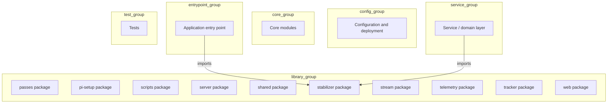

# Architecture report: cpaczek/skylight

> Automated static analysis. **Observed** = directly seen in files/imports/AST; **Inferred** = interpretation from that evidence. Repository code was not executed.

## 1. Repository at a glance

| Item | Value |
| --- | --- |
| Repository | cpaczek/skylight |
| Description | Project the aircraft passing overhead onto your ceiling in real time, from an RTL-SDR — with a live sky layer (sun, moon, stars, ISS) and where each plane is headed. |
| Language | TypeScript |
| Stars | 3394 |
| Licence | MIT |
| Analysed commit / branch | 3656b4d56e11e23af58c8f12168d2edec88e7b53 / main |
| Framework(s) | Express, React |
| Files analysed | 336 |
| Components | 15 |

## 2. Architecture in one minute

cpaczek/skylight - Project the aircraft passing overhead onto your ceiling in real time, from an RTL-SDR — with a live sky layer (sun, moon, stars, ISS) and where each plane is headed.. This repository was analysed statically from 336 file(s) (48 Python). Detected technologies (observed from imports/manifests): Express, React, NumPy, Docker, Docker Compose, TypeScript. Files are grouped into 15 component(s): Configuration and deployment, Core modules, Application entry point, passes package, pi-setup package, scripts package, server package, Service / domain layer. Observed entry point(s): stabilizer/skylight_stab/__main__.py, tracker/scripts/calib/pass_bias_fit.py, tracker/scripts/calib/remount_fit.py. Findings below distinguish observed facts from inferred interpretation.

## 3. High-level block diagram

## 4. Main components

### Configuration and deployment (`config`)

- **Kind:** config
- **Status:** Observed
- **Confidence:** 0.85
- **Responsibility:** Groups 23 file(s) under configuration and deployment (observed from repository paths and static analysis).
- **Paths:** `Dockerfile`, `compose.yaml`, `package.json`, `passes/package.json`, `passes/tsconfig.json`, `passes/wrangler.toml`, `pnpm-workspace.yaml`, `server/package.json`, `server/src/enrich/airlines.json`, `server/src/enrich/types.json`, `server/tsconfig.json`, `shared/package.json`, `shared/tsconfig.json`, `stabilizer/requirements.txt`, `stream/.env.example`, `telemetry/package.json`, `telemetry/tsconfig.json`, `telemetry/wrangler.toml`, `tracker/package.json`, `tracker/tsconfig.json`, `tsconfig.base.json`, `web/package.json`, `web/tsconfig.json`
- **Evidence:** [Dockerfile](https://github.com/cpaczek/skylight/blob/3656b4d56e11e23af58c8f12168d2edec88e7b53/Dockerfile); [compose.yaml](https://github.com/cpaczek/skylight/blob/3656b4d56e11e23af58c8f12168d2edec88e7b53/compose.yaml); [package.json](https://github.com/cpaczek/skylight/blob/3656b4d56e11e23af58c8f12168d2edec88e7b53/package.json); [passes/package.json](https://github.com/cpaczek/skylight/blob/3656b4d56e11e23af58c8f12168d2edec88e7b53/passes/package.json); [passes/tsconfig.json](https://github.com/cpaczek/skylight/blob/3656b4d56e11e23af58c8f12168d2edec88e7b53/passes/tsconfig.json); [passes/wrangler.toml](https://github.com/cpaczek/skylight/blob/3656b4d56e11e23af58c8f12168d2edec88e7b53/passes/wrangler.toml); [pnpm-workspace.yaml](https://github.com/cpaczek/skylight/blob/3656b4d56e11e23af58c8f12168d2edec88e7b53/pnpm-workspace.yaml); [server/package.json](https://github.com/cpaczek/skylight/blob/3656b4d56e11e23af58c8f12168d2edec88e7b53/server/package.json)

### Core modules (`core`)

- **Kind:** core
- **Status:** Observed
- **Confidence:** 0.85
- **Responsibility:** Groups 1 file(s) under core modules (observed from repository paths and static analysis).
- **Paths:** `vitest.config.ts`
- **Evidence:** [vitest.config.ts](https://github.com/cpaczek/skylight/blob/3656b4d56e11e23af58c8f12168d2edec88e7b53/vitest.config.ts)

### Application entry point (`entrypoint`)

- **Kind:** entrypoint
- **Status:** Observed
- **Confidence:** 0.85
- **Responsibility:** Groups 5 file(s) under application entry point (observed from repository paths and static analysis). Observed top-level functions: best_match, call, grad_img, isotropic, login, main.
- **Paths:** `stabilizer/skylight_stab/__main__.py`, `tracker/scripts/calib/pass_bias_fit.py`, `tracker/scripts/calib/remount_fit.py`, `tracker/scripts/camera-web/camweb.py`, `tracker/scripts/camera-web/exposure-by-sun.py`
- **Evidence:** [stabilizer/skylight_stab/__main__.py:13](https://github.com/cpaczek/skylight/blob/3656b4d56e11e23af58c8f12168d2edec88e7b53/stabilizer/skylight_stab/__main__.py#L13); [tracker/scripts/calib/pass_bias_fit.py:32](https://github.com/cpaczek/skylight/blob/3656b4d56e11e23af58c8f12168d2edec88e7b53/tracker/scripts/calib/pass_bias_fit.py#L32); [tracker/scripts/calib/remount_fit.py:40](https://github.com/cpaczek/skylight/blob/3656b4d56e11e23af58c8f12168d2edec88e7b53/tracker/scripts/calib/remount_fit.py#L40); [tracker/scripts/camera-web/camweb.py:21](https://github.com/cpaczek/skylight/blob/3656b4d56e11e23af58c8f12168d2edec88e7b53/tracker/scripts/camera-web/camweb.py#L21); [tracker/scripts/camera-web/exposure-by-sun.py:32](https://github.com/cpaczek/skylight/blob/3656b4d56e11e23af58c8f12168d2edec88e7b53/tracker/scripts/camera-web/exposure-by-sun.py#L32)

### passes package (`passes`)

- **Kind:** library
- **Status:** Observed
- **Confidence:** 0.85
- **Responsibility:** Groups 6 file(s) under passes package (observed from repository paths and static analysis). Observed top-level functions: ms.
- **Paths:** `passes/src/index.ts`, `passes/src/query.ts`, `passes/src/row.ts`, `passes/tools/geometry-backfill.ts`, `passes/tools/geometry-extract.py`, `passes/tools/rescore.ts`
- **Evidence:** [passes/src/index.ts](https://github.com/cpaczek/skylight/blob/3656b4d56e11e23af58c8f12168d2edec88e7b53/passes/src/index.ts); [passes/src/query.ts](https://github.com/cpaczek/skylight/blob/3656b4d56e11e23af58c8f12168d2edec88e7b53/passes/src/query.ts); [passes/src/row.ts](https://github.com/cpaczek/skylight/blob/3656b4d56e11e23af58c8f12168d2edec88e7b53/passes/src/row.ts); [passes/tools/geometry-backfill.ts](https://github.com/cpaczek/skylight/blob/3656b4d56e11e23af58c8f12168d2edec88e7b53/passes/tools/geometry-backfill.ts); [passes/tools/geometry-extract.py:10](https://github.com/cpaczek/skylight/blob/3656b4d56e11e23af58c8f12168d2edec88e7b53/passes/tools/geometry-extract.py#L10); [passes/tools/rescore.ts](https://github.com/cpaczek/skylight/blob/3656b4d56e11e23af58c8f12168d2edec88e7b53/passes/tools/rescore.ts)

### pi-setup package (`pi_setup`)

- **Kind:** library
- **Status:** Observed
- **Confidence:** 0.85
- **Responsibility:** Groups 6 file(s) under pi-setup package (observed from repository paths and static analysis).
- **Paths:** `pi-setup/install-on-pi.sh`, `pi-setup/provision-sd.sh`, `pi-setup/setup-kiosk.sh`, `pi-setup/skylight-keypress.py`, `pi-setup/skylight-tv-kiosk.sh`, `pi-setup/skylight-update.sh`
- **Evidence:** [pi-setup/install-on-pi.sh](https://github.com/cpaczek/skylight/blob/3656b4d56e11e23af58c8f12168d2edec88e7b53/pi-setup/install-on-pi.sh); [pi-setup/provision-sd.sh](https://github.com/cpaczek/skylight/blob/3656b4d56e11e23af58c8f12168d2edec88e7b53/pi-setup/provision-sd.sh); [pi-setup/setup-kiosk.sh](https://github.com/cpaczek/skylight/blob/3656b4d56e11e23af58c8f12168d2edec88e7b53/pi-setup/setup-kiosk.sh); [pi-setup/skylight-keypress.py](https://github.com/cpaczek/skylight/blob/3656b4d56e11e23af58c8f12168d2edec88e7b53/pi-setup/skylight-keypress.py); [pi-setup/skylight-tv-kiosk.sh](https://github.com/cpaczek/skylight/blob/3656b4d56e11e23af58c8f12168d2edec88e7b53/pi-setup/skylight-tv-kiosk.sh); [pi-setup/skylight-update.sh](https://github.com/cpaczek/skylight/blob/3656b4d56e11e23af58c8f12168d2edec88e7b53/pi-setup/skylight-update.sh)

### scripts package (`scripts`)

- **Kind:** library
- **Status:** Observed
- **Confidence:** 0.85
- **Responsibility:** Groups 5 file(s) under scripts package (observed from repository paths and static analysis).
- **Paths:** `scripts/deploy-to-pi.sh`, `scripts/fetch-vision-model.sh`, `scripts/install-rtlsdr-fedora.sh`, `scripts/run-dump1090-local.sh`, `scripts/screenshot.mjs`
- **Evidence:** [scripts/deploy-to-pi.sh](https://github.com/cpaczek/skylight/blob/3656b4d56e11e23af58c8f12168d2edec88e7b53/scripts/deploy-to-pi.sh); [scripts/fetch-vision-model.sh](https://github.com/cpaczek/skylight/blob/3656b4d56e11e23af58c8f12168d2edec88e7b53/scripts/fetch-vision-model.sh); [scripts/install-rtlsdr-fedora.sh](https://github.com/cpaczek/skylight/blob/3656b4d56e11e23af58c8f12168d2edec88e7b53/scripts/install-rtlsdr-fedora.sh); [scripts/run-dump1090-local.sh](https://github.com/cpaczek/skylight/blob/3656b4d56e11e23af58c8f12168d2edec88e7b53/scripts/run-dump1090-local.sh); [scripts/screenshot.mjs](https://github.com/cpaczek/skylight/blob/3656b4d56e11e23af58c8f12168d2edec88e7b53/scripts/screenshot.mjs)

### server package (`server`)

- **Kind:** library
- **Status:** Observed
- **Confidence:** 0.85
- **Responsibility:** Groups 15 file(s) under server package (observed from repository paths and static analysis).
- **Paths:** `server/src/airlines.ts`, `server/src/airports.ts`, `server/src/allowed-hosts.ts`, `server/src/config-store.ts`, `server/src/datasource.ts`, `server/src/enrich/route-check.ts`, `server/src/enrich/routes.ts`, `server/src/enrich/tables.ts`, `server/src/geocode.ts`, `server/src/hub.ts`, `server/src/index.ts`, `server/src/satcat.ts`, `server/src/sfo-ground.ts`, `server/src/telemetry.ts`, `server/src/tle.ts`
- **Evidence:** [server/src/airlines.ts](https://github.com/cpaczek/skylight/blob/3656b4d56e11e23af58c8f12168d2edec88e7b53/server/src/airlines.ts); [server/src/airports.ts](https://github.com/cpaczek/skylight/blob/3656b4d56e11e23af58c8f12168d2edec88e7b53/server/src/airports.ts); [server/src/allowed-hosts.ts](https://github.com/cpaczek/skylight/blob/3656b4d56e11e23af58c8f12168d2edec88e7b53/server/src/allowed-hosts.ts); [server/src/config-store.ts](https://github.com/cpaczek/skylight/blob/3656b4d56e11e23af58c8f12168d2edec88e7b53/server/src/config-store.ts); [server/src/datasource.ts](https://github.com/cpaczek/skylight/blob/3656b4d56e11e23af58c8f12168d2edec88e7b53/server/src/datasource.ts); [server/src/enrich/route-check.ts](https://github.com/cpaczek/skylight/blob/3656b4d56e11e23af58c8f12168d2edec88e7b53/server/src/enrich/route-check.ts); [server/src/enrich/routes.ts](https://github.com/cpaczek/skylight/blob/3656b4d56e11e23af58c8f12168d2edec88e7b53/server/src/enrich/routes.ts); [server/src/enrich/tables.ts](https://github.com/cpaczek/skylight/blob/3656b4d56e11e23af58c8f12168d2edec88e7b53/server/src/enrich/tables.ts)

### Service / domain layer (`service_layer`)

- **Kind:** service
- **Status:** Observed
- **Confidence:** 0.85
- **Responsibility:** Groups 1 file(s) under service / domain layer (observed from repository paths and static analysis). Observed top-level functions: _fail_path, _failures, _log, _pending, _record_failure, mark.
- **Paths:** `stabilizer/skylight_stab/service.py`
- **Evidence:** [stabilizer/skylight_stab/service.py:27](https://github.com/cpaczek/skylight/blob/3656b4d56e11e23af58c8f12168d2edec88e7b53/stabilizer/skylight_stab/service.py#L27)

### shared package (`shared`)

- **Kind:** library
- **Status:** Observed
- **Confidence:** 0.85
- **Responsibility:** Groups 16 file(s) under shared package (observed from repository paths and static analysis).
- **Paths:** `shared/src/aim.ts`, `shared/src/aircraft.ts`, `shared/src/airport.ts`, `shared/src/camera-profile.ts`, `shared/src/camera.ts`, `shared/src/celestial.ts`, `shared/src/config.ts`, `shared/src/constants.ts`, `shared/src/format.ts`, `shared/src/geo.ts`, `shared/src/index.ts`, `shared/src/messages.ts`, `shared/src/route.ts`, `shared/src/skyEvents.ts`, `shared/src/stars.ts`, `shared/src/tracker-messages.ts`
- **Evidence:** [shared/src/aim.ts](https://github.com/cpaczek/skylight/blob/3656b4d56e11e23af58c8f12168d2edec88e7b53/shared/src/aim.ts); [shared/src/aircraft.ts](https://github.com/cpaczek/skylight/blob/3656b4d56e11e23af58c8f12168d2edec88e7b53/shared/src/aircraft.ts); [shared/src/airport.ts](https://github.com/cpaczek/skylight/blob/3656b4d56e11e23af58c8f12168d2edec88e7b53/shared/src/airport.ts); [shared/src/camera-profile.ts](https://github.com/cpaczek/skylight/blob/3656b4d56e11e23af58c8f12168d2edec88e7b53/shared/src/camera-profile.ts); [shared/src/camera.ts](https://github.com/cpaczek/skylight/blob/3656b4d56e11e23af58c8f12168d2edec88e7b53/shared/src/camera.ts); [shared/src/celestial.ts](https://github.com/cpaczek/skylight/blob/3656b4d56e11e23af58c8f12168d2edec88e7b53/shared/src/celestial.ts); [shared/src/config.ts](https://github.com/cpaczek/skylight/blob/3656b4d56e11e23af58c8f12168d2edec88e7b53/shared/src/config.ts); [shared/src/constants.ts](https://github.com/cpaczek/skylight/blob/3656b4d56e11e23af58c8f12168d2edec88e7b53/shared/src/constants.ts)

### stabilizer package (`stabilizer`)

- **Kind:** library
- **Status:** Observed
- **Confidence:** 0.85
- **Responsibility:** Groups 8 file(s) under stabilizer package (observed from repository paths and static analysis). Observed top-level classes: Analysis, Blob, Clean, Debander, FlatField, Guard. Observed top-level functions: _json_req, _key, _load_maps, _open, _r, _ramp.
- **Paths:** `stabilizer/skylight_stab/__init__.py`, `stabilizer/skylight_stab/archive.py`, `stabilizer/skylight_stab/deband.py`, `stabilizer/skylight_stab/detect.py`, `stabilizer/skylight_stab/pipeline.py`, `stabilizer/skylight_stab/plan.py`, `stabilizer/skylight_stab/video.py`, `stabilizer/tools/export_flatfield_ts.py`
- **Evidence:** [stabilizer/skylight_stab/__init__.py](https://github.com/cpaczek/skylight/blob/3656b4d56e11e23af58c8f12168d2edec88e7b53/stabilizer/skylight_stab/__init__.py); [stabilizer/skylight_stab/archive.py:28](https://github.com/cpaczek/skylight/blob/3656b4d56e11e23af58c8f12168d2edec88e7b53/stabilizer/skylight_stab/archive.py#L28); [stabilizer/skylight_stab/deband.py:41](https://github.com/cpaczek/skylight/blob/3656b4d56e11e23af58c8f12168d2edec88e7b53/stabilizer/skylight_stab/deband.py#L41); [stabilizer/skylight_stab/detect.py:26](https://github.com/cpaczek/skylight/blob/3656b4d56e11e23af58c8f12168d2edec88e7b53/stabilizer/skylight_stab/detect.py#L26); [stabilizer/skylight_stab/pipeline.py:32](https://github.com/cpaczek/skylight/blob/3656b4d56e11e23af58c8f12168d2edec88e7b53/stabilizer/skylight_stab/pipeline.py#L32); [stabilizer/skylight_stab/plan.py:29](https://github.com/cpaczek/skylight/blob/3656b4d56e11e23af58c8f12168d2edec88e7b53/stabilizer/skylight_stab/plan.py#L29); [stabilizer/skylight_stab/video.py:34](https://github.com/cpaczek/skylight/blob/3656b4d56e11e23af58c8f12168d2edec88e7b53/stabilizer/skylight_stab/video.py#L34); [stabilizer/tools/export_flatfield_ts.py](https://github.com/cpaczek/skylight/blob/3656b4d56e11e23af58c8f12168d2edec88e7b53/stabilizer/tools/export_flatfield_ts.py)

### stream package (`stream`)

- **Kind:** library
- **Status:** Observed
- **Confidence:** 0.85
- **Responsibility:** Groups 1 file(s) under stream package (observed from repository paths and static analysis).
- **Paths:** `stream/start-stream.sh`
- **Evidence:** [stream/start-stream.sh](https://github.com/cpaczek/skylight/blob/3656b4d56e11e23af58c8f12168d2edec88e7b53/stream/start-stream.sh)

### telemetry package (`telemetry`)

- **Kind:** library
- **Status:** Observed
- **Confidence:** 0.85
- **Responsibility:** Groups 1 file(s) under telemetry package (observed from repository paths and static analysis).
- **Paths:** `telemetry/src/index.ts`
- **Evidence:** [telemetry/src/index.ts](https://github.com/cpaczek/skylight/blob/3656b4d56e11e23af58c8f12168d2edec88e7b53/telemetry/src/index.ts)

### Tests (`tests`)

- **Kind:** test
- **Status:** Observed
- **Confidence:** 0.85
- **Responsibility:** Groups 68 file(s) under tests (observed from repository paths and static analysis). Observed top-level classes: _Resp. Observed top-level functions: _fake, staircase, synthetic, test_big_file_multipart, test_bridges_short_gaps_only, test_deband_smooths_steps_but_keeps_a_plane.
- **Paths:** `passes/test/fixtures/pass.example.json`, `passes/test/ingest.test.ts`, `passes/test/query.test.ts`, `passes/test/row.test.ts`, `server/test/allowed-hosts.test.ts`, `server/test/api-source.test.ts`, `server/test/geocode.test.ts`, `server/test/poller-source.test.ts`, `server/test/route-check.test.ts`, `server/test/seen-pos.test.ts`, `server/test/telemetry.test.ts`, `shared/test/aim-fixage.test.ts`, `shared/test/aim-geometry.test.ts`, `shared/test/aim-mount.test.ts`, `shared/test/aim-predict.test.ts`, `shared/test/axis-steer.test.ts`, `shared/test/celestial-planets.test.ts`, `shared/test/config-merge.test.ts`, `shared/test/format.test.ts`, `shared/test/horizon.test.ts`, `shared/test/route-plausible.test.ts`, `shared/test/sky-events.test.ts`, `shared/test/sky-projection.test.ts`, `stabilizer/tests/test_archive.py`, `stabilizer/tests/test_deband.py`, `stabilizer/tests/test_plan.py`, `tracker/test/autocal.test.ts`, `tracker/test/departure.test.ts`, `tracker/test/focus.test.ts`, `tracker/test/frame-geom.test.ts`, `tracker/test/landmarks.test.ts`, `tracker/test/lead-learn.test.ts`, `tracker/test/loop-sim.test.ts`, `tracker/test/merge-blobs.test.ts`, `tracker/test/motion.test.ts`, `tracker/test/nextpass.test.ts`, `tracker/test/passes-archive.test.ts`, `tracker/test/passes-clip.test.ts`, `tracker/test/passes-geometry.test.ts`, `tracker/test/passes-quality.test.ts`, `tracker/test/passes-summary.test.ts`, `tracker/test/passes-uploader.test.ts`, `tracker/test/pipeline.test.ts`, `tracker/test/planner.test.ts`, `tracker/test/predict-latency.test.ts`, `tracker/test/sharpness.test.ts`, `tracker/test/silhouette.test.ts`, `tracker/test/sim/fake-visca-head.ts`, `tracker/test/sim/oracle-vision.ts`, `tracker/test/sim/pi-tracker-2026-10-14.json`, `tracker/test/sim/run-pass.ts`, `tracker/test/smooth-geo.test.ts`, `tracker/test/speed-floor.test.ts`, `tracker/test/speed-surface.test.ts`, `tracker/test/sun.test.ts`, `tracker/test/target.test.ts`, `tracker/test/tilt-follow.test.ts`, `tracker/test/tracks.test.ts`, `tracker/test/upstream-carry.test.ts`, `tracker/test/visca-drive.test.ts`, `tracker/test/visca-focus.test.ts`, `tracker/test/visca-zoom-delivery.test.ts`, `tracker/test/vision-sim.test.ts`, `tracker/test/zoom-stops.test.ts`, `tracker/test/zoom.test.ts`, `web/test/crop-follow.test.ts`, `web/test/geolocation.test.ts`, `web/test/live-stab.test.ts`
- **Evidence:** [passes/test/fixtures/pass.example.json](https://github.com/cpaczek/skylight/blob/3656b4d56e11e23af58c8f12168d2edec88e7b53/passes/test/fixtures/pass.example.json); [passes/test/ingest.test.ts](https://github.com/cpaczek/skylight/blob/3656b4d56e11e23af58c8f12168d2edec88e7b53/passes/test/ingest.test.ts); [passes/test/query.test.ts](https://github.com/cpaczek/skylight/blob/3656b4d56e11e23af58c8f12168d2edec88e7b53/passes/test/query.test.ts); [passes/test/row.test.ts](https://github.com/cpaczek/skylight/blob/3656b4d56e11e23af58c8f12168d2edec88e7b53/passes/test/row.test.ts); [server/test/allowed-hosts.test.ts](https://github.com/cpaczek/skylight/blob/3656b4d56e11e23af58c8f12168d2edec88e7b53/server/test/allowed-hosts.test.ts); [server/test/api-source.test.ts](https://github.com/cpaczek/skylight/blob/3656b4d56e11e23af58c8f12168d2edec88e7b53/server/test/api-source.test.ts); [server/test/geocode.test.ts](https://github.com/cpaczek/skylight/blob/3656b4d56e11e23af58c8f12168d2edec88e7b53/server/test/geocode.test.ts); [server/test/poller-source.test.ts](https://github.com/cpaczek/skylight/blob/3656b4d56e11e23af58c8f12168d2edec88e7b53/server/test/poller-source.test.ts)

### tracker package (`tracker`)

- **Kind:** library
- **Status:** Observed
- **Confidence:** 0.85
- **Responsibility:** Groups 95 file(s) under tracker package (observed from repository paths and static analysis). Observed top-level classes: Dither, Stepper, Traj. Observed top-level functions: _axis, _azel, _rot, _vec, azel2vec, bracket.
- **Paths:** `tracker/scripts/analysis/abstats.py`, `tracker/scripts/analysis/blindspot.py`, `tracker/scripts/analysis/bounce.py`, `tracker/scripts/analysis/buildstats.py`, `tracker/scripts/analysis/candframes.py`, `tracker/scripts/analysis/clipgaps.py`, `tracker/scripts/analysis/clipping.py`, `tracker/scripts/analysis/dither.py`, `tracker/scripts/analysis/errnoise.py`, `tracker/scripts/analysis/ffcheck.py`, `tracker/scripts/analysis/gapframes2.py`, `tracker/scripts/analysis/imglag.py`, `tracker/scripts/analysis/latency.py`, `tracker/scripts/analysis/posestale.py`, `tracker/scripts/analysis/ringcmp.py`, `tracker/scripts/analysis/sess.py`, `tracker/scripts/analysis/silframes.py`, `tracker/scripts/analysis/sky.py`, `tracker/scripts/analysis/slipline.py`, `tracker/scripts/analysis/telegaps.py`, `tracker/scripts/analysis/telesum.py`, `tracker/scripts/analysis/timing.py`, `tracker/scripts/analysis/window-report.sh`, `tracker/scripts/cal-analyze.ts`, `tracker/scripts/calib/frame_shift.py`, `tracker/scripts/calib/mountmodel.py`, `tracker/scripts/characterize-camera.ts`, `tracker/scripts/goto-pose.ts`, `tracker/scripts/lib/camera-config.ts`, `tracker/scripts/lib/onvif.ts`, `tracker/scripts/lib/visca-probe.ts`, `tracker/scripts/measure-fov.ts`, `tracker/scripts/measure-vision-lag.ts`, `tracker/scripts/motion-profile.ts`, `tracker/scripts/motion-validate.ts`, `tracker/scripts/onvif-cmd.ts`, `tracker/scripts/onvif-ptz.ts`, `tracker/scripts/passes/elband.py`, `tracker/scripts/passes/focusline.py`, `tracker/scripts/passes/focussum.py`, `tracker/scripts/passes/passstats.py`, `tracker/scripts/passes/tilthops.py`, `tracker/scripts/print-camera-profile.ts`, `tracker/scripts/probe-abs-speed.ts`, `tracker/scripts/probe-mech.ts`, `tracker/scripts/probe-onvif-speed.ts`, `tracker/scripts/probe-speed-zoom.ts`, `tracker/scripts/probe-speed-zoomchange.ts`, `tracker/scripts/probe-tilt-reach.ts`, `tracker/scripts/probe-tilt-slip.ts`, `tracker/scripts/probe-zoom-busy.ts`, `tracker/scripts/probe-zoomdrive.ts`, `tracker/scripts/probe-zoomfocus.ts`, `tracker/scripts/stabilize-cli.ts`, `tracker/scripts/survey-ring.ts`, `tracker/scripts/visca-diag.ts`, `tracker/src/calibration/auto.ts`, `tracker/src/calibration/landmarks.ts`, `tracker/src/calibration/session.ts`, `tracker/src/camera/driver.ts`, `tracker/src/camera/focus.ts`, `tracker/src/camera/sim.ts`, `tracker/src/camera/units.ts`, `tracker/src/camera/visca.ts`, `tracker/src/hub.ts`, `tracker/src/index.ts`, `tracker/src/loop.ts`, `tracker/src/passes/archive.ts`, `tracker/src/passes/build.ts`, `tracker/src/passes/clip.ts`, `tracker/src/passes/geometry.ts`, `tracker/src/passes/quality-cli.ts`, `tracker/src/passes/quality.ts`, `tracker/src/passes/summary.ts`, `tracker/src/passes/uploader.ts`, `tracker/src/pointing/leadLearn.ts`, `tracker/src/pointing/nextPass.ts`, `tracker/src/pointing/planner.ts`, `tracker/src/pointing/predict.ts`, `tracker/src/pointing/sun.ts`, `tracker/src/pointing/target.ts`, `tracker/src/pointing/wingspan.ts`, `tracker/src/pointing/zoom.ts`, `tracker/src/record.ts`, `tracker/src/upstream.ts`, `tracker/src/video/mse.ts`, `tracker/src/video/recorder.ts`, `tracker/src/video/stabilize.ts`, `tracker/src/video/stream.ts`, `tracker/src/vision/detect.ts`, `tracker/src/vision/frame.ts`, `tracker/src/vision/motion.ts`, `tracker/src/vision/sharpness.ts`, `tracker/src/vision/silhouette.ts`, `tracker/src/vision/tracks.ts`
- **Evidence:** [tracker/scripts/analysis/abstats.py:4](https://github.com/cpaczek/skylight/blob/3656b4d56e11e23af58c8f12168d2edec88e7b53/tracker/scripts/analysis/abstats.py#L4); [tracker/scripts/analysis/blindspot.py:24](https://github.com/cpaczek/skylight/blob/3656b4d56e11e23af58c8f12168d2edec88e7b53/tracker/scripts/analysis/blindspot.py#L24); [tracker/scripts/analysis/bounce.py](https://github.com/cpaczek/skylight/blob/3656b4d56e11e23af58c8f12168d2edec88e7b53/tracker/scripts/analysis/bounce.py); [tracker/scripts/analysis/buildstats.py:4](https://github.com/cpaczek/skylight/blob/3656b4d56e11e23af58c8f12168d2edec88e7b53/tracker/scripts/analysis/buildstats.py#L4); [tracker/scripts/analysis/candframes.py:7](https://github.com/cpaczek/skylight/blob/3656b4d56e11e23af58c8f12168d2edec88e7b53/tracker/scripts/analysis/candframes.py#L7); [tracker/scripts/analysis/clipgaps.py:7](https://github.com/cpaczek/skylight/blob/3656b4d56e11e23af58c8f12168d2edec88e7b53/tracker/scripts/analysis/clipgaps.py#L7); [tracker/scripts/analysis/clipping.py:6](https://github.com/cpaczek/skylight/blob/3656b4d56e11e23af58c8f12168d2edec88e7b53/tracker/scripts/analysis/clipping.py#L6); [tracker/scripts/analysis/dither.py:3](https://github.com/cpaczek/skylight/blob/3656b4d56e11e23af58c8f12168d2edec88e7b53/tracker/scripts/analysis/dither.py#L3)

### web package (`web`)

- **Kind:** library
- **Status:** Observed
- **Confidence:** 0.85
- **Responsibility:** Groups 45 file(s) under web package (observed from repository paths and static analysis).
- **Paths:** `web/src/control/Control.tsx`, `web/src/control/components.tsx`, `web/src/control/main.tsx`, `web/src/display/Display.tsx`, `web/src/display/PlaneCard.tsx`, `web/src/display/SatelliteCard.tsx`, `web/src/display/aircraftGlyph.ts`, `web/src/display/celestial.ts`, `web/src/display/main.tsx`, `web/src/display/renderer.ts`, `web/src/display/skyEvents.ts`, `web/src/display/stars.ts`, `web/src/lib/connection.ts`, `web/src/lib/geolocation.ts`, `web/src/lib/useAmbientMode.ts`, `web/src/lib/useStream.ts`, `web/src/stream/Stream.tsx`, `web/src/stream/main.tsx`, `web/src/tracker/Tracker.tsx`, `web/src/tracker/components/CalibrationWizard.tsx`, `web/src/tracker/components/ConfigPanel.tsx`, `web/src/tracker/components/JogPad.tsx`, `web/src/tracker/components/RecordPanel.tsx`, `web/src/tracker/components/SkyPolar.tsx`, `web/src/tracker/components/StatusBar.tsx`, `web/src/tracker/components/TargetTable.tsx`, `web/src/tracker/components/VideoPane.tsx`, `web/src/tracker/connection.ts`, `web/src/tracker/main.tsx`, `web/src/tracker/useLiveVideo.ts`, `web/src/tracker/useTracker.ts`, `web/src/tv/SfoGround.tsx`, `web/src/tv/Tv.tsx`, `web/src/tv/cropFollow.ts`, `web/src/tv/liveStab/LiveStabilizer.ts`, `web/src/tv/liveStab/flatfield.ts`, `web/src/tv/liveStab/phaseCorr.ts`, `web/src/tv/liveStab/planeTrack.ts`, `web/src/tv/liveStab/stabPlan.ts`, `web/src/tv/liveStab/useLiveStab.ts`, `web/src/tv/main.tsx`, `web/src/tv/useMse.ts`, `web/src/tv/useStabilize.ts`, `web/src/types/tz-lookup.d.ts`, `web/vite.config.ts`
- **Evidence:** [web/src/control/Control.tsx](https://github.com/cpaczek/skylight/blob/3656b4d56e11e23af58c8f12168d2edec88e7b53/web/src/control/Control.tsx); [web/src/control/components.tsx](https://github.com/cpaczek/skylight/blob/3656b4d56e11e23af58c8f12168d2edec88e7b53/web/src/control/components.tsx); [web/src/control/main.tsx](https://github.com/cpaczek/skylight/blob/3656b4d56e11e23af58c8f12168d2edec88e7b53/web/src/control/main.tsx); [web/src/display/Display.tsx](https://github.com/cpaczek/skylight/blob/3656b4d56e11e23af58c8f12168d2edec88e7b53/web/src/display/Display.tsx); [web/src/display/PlaneCard.tsx](https://github.com/cpaczek/skylight/blob/3656b4d56e11e23af58c8f12168d2edec88e7b53/web/src/display/PlaneCard.tsx); [web/src/display/SatelliteCard.tsx](https://github.com/cpaczek/skylight/blob/3656b4d56e11e23af58c8f12168d2edec88e7b53/web/src/display/SatelliteCard.tsx); [web/src/display/aircraftGlyph.ts](https://github.com/cpaczek/skylight/blob/3656b4d56e11e23af58c8f12168d2edec88e7b53/web/src/display/aircraftGlyph.ts); [web/src/display/celestial.ts](https://github.com/cpaczek/skylight/blob/3656b4d56e11e23af58c8f12168d2edec88e7b53/web/src/display/celestial.ts)

## 5. Execution flow

**Observed** entry point(s):

- [passes/src/index.ts](https://github.com/cpaczek/skylight/blob/3656b4d56e11e23af58c8f12168d2edec88e7b53/passes/src/index.ts)
- [server/src/index.ts](https://github.com/cpaczek/skylight/blob/3656b4d56e11e23af58c8f12168d2edec88e7b53/server/src/index.ts)
- [shared/src/index.ts](https://github.com/cpaczek/skylight/blob/3656b4d56e11e23af58c8f12168d2edec88e7b53/shared/src/index.ts)
- [stabilizer/skylight_stab/__main__.py:47](https://github.com/cpaczek/skylight/blob/3656b4d56e11e23af58c8f12168d2edec88e7b53/stabilizer/skylight_stab/__main__.py#L47)
- [telemetry/src/index.ts](https://github.com/cpaczek/skylight/blob/3656b4d56e11e23af58c8f12168d2edec88e7b53/telemetry/src/index.ts)
- [tracker/scripts/calib/pass_bias_fit.py:96](https://github.com/cpaczek/skylight/blob/3656b4d56e11e23af58c8f12168d2edec88e7b53/tracker/scripts/calib/pass_bias_fit.py#L96)
- [tracker/scripts/calib/remount_fit.py:158](https://github.com/cpaczek/skylight/blob/3656b4d56e11e23af58c8f12168d2edec88e7b53/tracker/scripts/calib/remount_fit.py#L158)
- [tracker/scripts/camera-web/camweb.py:55](https://github.com/cpaczek/skylight/blob/3656b4d56e11e23af58c8f12168d2edec88e7b53/tracker/scripts/camera-web/camweb.py#L55)
- [tracker/scripts/camera-web/exposure-by-sun.py:62](https://github.com/cpaczek/skylight/blob/3656b4d56e11e23af58c8f12168d2edec88e7b53/tracker/scripts/camera-web/exposure-by-sun.py#L62)
- [tracker/src/index.ts](https://github.com/cpaczek/skylight/blob/3656b4d56e11e23af58c8f12168d2edec88e7b53/tracker/src/index.ts)
- [web/src/control/main.tsx](https://github.com/cpaczek/skylight/blob/3656b4d56e11e23af58c8f12168d2edec88e7b53/web/src/control/main.tsx)
- [web/src/display/main.tsx](https://github.com/cpaczek/skylight/blob/3656b4d56e11e23af58c8f12168d2edec88e7b53/web/src/display/main.tsx)

Representative flow (derived from observed entry points and the import graph; steps beyond the entry point are **Inferred**):

1. Execution starts at an observed entry point listed above, if present.
2. `entrypoint` imports `stabilizer` (Application entry point -> stabilizer package).
3. `service_layer` imports `stabilizer` (Service / domain layer -> stabilizer package).

## 6. Project structure

### `(root)`

- `.dockerignore` - container (429 bytes)
- `.gitignore` - other (625 bytes)
- `Dockerfile` - container (1683 bytes)
- `LICENSE` - docs (1064 bytes)
- `README.md` - docs (25819 bytes)
- `compose.yaml` - container (1406 bytes)
- `package.json` - manifest (911 bytes)
- `pnpm-workspace.yaml` - config (252 bytes)
- `tsconfig.base.json` - config (584 bytes)
- `vitest.config.ts` - source, TypeScript (401 bytes)

### `docs`

- `docs/camera-profile.md` - docs (4764 bytes)
- `docs/handoff-2026-10-14.md` - docs (14780 bytes)
- `docs/handoff-2026-10-15.md` - docs (8331 bytes)
- `docs/handoff-2026-10-16.md` - docs (6477 bytes)
- `docs/pass-archive.md` - docs (27804 bytes)

### `passes`

- `passes/.gitignore` - other (45 bytes)
- `passes/README.md` - docs (5805 bytes)
- `passes/package.json` - manifest (647 bytes)
- `passes/schema.sql` - data, SQL (3885 bytes)
- `passes/src/index.ts` - source, TypeScript (21332 bytes)
- `passes/src/query.ts` - source, TypeScript (13055 bytes)
- `passes/src/row.ts` - source, TypeScript (7820 bytes)
- `passes/test/fixtures/pass.example.json` - test (3443 bytes)
- `passes/test/ingest.test.ts` - test, TypeScript (7470 bytes)
- `passes/test/query.test.ts` - test, TypeScript (14365 bytes)
- `passes/test/row.test.ts` - test, TypeScript (7723 bytes)
- `passes/tools/geometry-backfill.ts` - source, TypeScript (9016 bytes)
- `passes/tools/geometry-extract.py` - source, Python (1510 bytes)
- `passes/tools/rescore.ts` - source, TypeScript (6031 bytes)
- `passes/tsconfig.json` - config (219 bytes)
- `passes/wrangler.toml` - config (754 bytes)

### `pi-setup`

- `pi-setup/README.md` - docs (5602 bytes)
- `pi-setup/install-on-pi.sh` - source, Shell (8899 bytes)
- `pi-setup/provision-sd.sh` - source, Shell (2207 bytes)
- `pi-setup/setup-kiosk.sh` - source, Shell (3477 bytes)
- `pi-setup/skylight-exposure.service` - other (227 bytes)
- `pi-setup/skylight-exposure.timer` - other (151 bytes)
- `pi-setup/skylight-keypress.py` - source, Python (569 bytes)
- `pi-setup/skylight-server.service` - other (794 bytes)
- `pi-setup/skylight-tracker.service` - other (623 bytes)
- `pi-setup/skylight-tv-kiosk.sh` - source, Shell (1757 bytes)
- `pi-setup/skylight-update.service` - other (368 bytes)
- `pi-setup/skylight-update.sh` - source, Shell (1613 bytes)
- `pi-setup/skylight-update.timer` - other (310 bytes)

### `scripts`

- `scripts/deploy-to-pi.sh` - source, Shell (3879 bytes)
- `scripts/fetch-vision-model.sh` - source, Shell (2110 bytes)
- `scripts/install-rtlsdr-fedora.sh` - source, Shell (1136 bytes)
- `scripts/run-dump1090-local.sh` - source, Shell (1358 bytes)
- `scripts/screenshot.mjs` - source, JavaScript (925 bytes)

### `server`

- `server/package.json` - manifest (436 bytes)
- `server/src/airlines.ts` - source, TypeScript (2979 bytes)
- `server/src/airports.ts` - source, TypeScript (6047 bytes)
- `server/src/allowed-hosts.ts` - source, TypeScript (4352 bytes)
- `server/src/config-store.ts` - source, TypeScript (3179 bytes)
- `server/src/datasource.ts` - source, TypeScript (20456 bytes)
- `server/src/enrich/airlines.json` - config (29068 bytes)
- `server/src/enrich/route-check.ts` - source, TypeScript (5551 bytes)
- `server/src/enrich/routes.ts` - source, TypeScript (4891 bytes)
- `server/src/enrich/tables.ts` - source, TypeScript (1088 bytes)
- `server/src/enrich/types.json` - config (2304 bytes)
- `server/src/geocode.ts` - source, TypeScript (2530 bytes)
- `server/src/hub.ts` - source, TypeScript (4092 bytes)
- `server/src/index.ts` - source, TypeScript (10331 bytes)
- `server/src/satcat.ts` - source, TypeScript (6358 bytes)
- `server/src/sfo-ground.ts` - source, TypeScript (3968 bytes)
- `server/src/telemetry.ts` - source, TypeScript (4929 bytes)
- `server/src/tle.ts` - source, TypeScript (2491 bytes)
- `server/test/allowed-hosts.test.ts` - test, TypeScript (3369 bytes)
- `server/test/api-source.test.ts` - test, TypeScript (8736 bytes)
- `server/test/geocode.test.ts` - test, TypeScript (2764 bytes)
- `server/test/poller-source.test.ts` - test, TypeScript (2379 bytes)
- `server/test/route-check.test.ts` - test, TypeScript (6325 bytes)
- `server/test/seen-pos.test.ts` - test, TypeScript (962 bytes)
- `server/test/telemetry.test.ts` - test, TypeScript (2414 bytes)
- `server/tsconfig.json` - config (299 bytes)

### `shared`

- `shared/package.json` - manifest (352 bytes)
- `shared/src/aim.ts` - source, TypeScript (28697 bytes)
- `shared/src/aircraft.ts` - source, TypeScript (2301 bytes)
- `shared/src/airport.ts` - source, TypeScript (1379 bytes)
- `shared/src/camera-profile.ts` - source, TypeScript (14662 bytes)
- `shared/src/camera.ts` - source, TypeScript (10356 bytes)
- `shared/src/celestial.ts` - source, TypeScript (7181 bytes)
- `shared/src/config.ts` - source, TypeScript (27893 bytes)
- `shared/src/constants.ts` - source, TypeScript (339 bytes)
- `shared/src/format.ts` - source, TypeScript (3096 bytes)
- `shared/src/geo.ts` - source, TypeScript (5902 bytes)
- `shared/src/index.ts` - source, TypeScript (367 bytes)
- `shared/src/messages.ts` - source, TypeScript (1322 bytes)
- `shared/src/route.ts` - source, TypeScript (4882 bytes)
- `shared/src/skyEvents.ts` - source, TypeScript (10000 bytes)
- `shared/src/stars.ts` - source, TypeScript (5692 bytes)
- `shared/src/tracker-messages.ts` - source, TypeScript (1620 bytes)
- `shared/test/aim-fixage.test.ts` - test, TypeScript (1647 bytes)
- `shared/test/aim-geometry.test.ts` - test, TypeScript (2805 bytes)
- `shared/test/aim-mount.test.ts` - test, TypeScript (7080 bytes)
- `shared/test/aim-predict.test.ts` - test, TypeScript (4159 bytes)
- `shared/test/axis-steer.test.ts` - test, TypeScript (1103 bytes)
- `shared/test/celestial-planets.test.ts` - test, TypeScript (1675 bytes)
- `shared/test/config-merge.test.ts` - test, TypeScript (6861 bytes)
- `shared/test/format.test.ts` - test, TypeScript (1165 bytes)
- `shared/test/horizon.test.ts` - test, TypeScript (847 bytes)
- `shared/test/route-plausible.test.ts` - test, TypeScript (2905 bytes)
- `shared/test/sky-events.test.ts` - test, TypeScript (3777 bytes)
- `shared/test/sky-projection.test.ts` - test, TypeScript (2450 bytes)
- `shared/tsconfig.json` - config (110 bytes)

### `stabilizer`

- `stabilizer/.gitignore` - other (34 bytes)
- `stabilizer/README.md` - docs (6780 bytes)
- `stabilizer/requirements.txt` - manifest (385 bytes)
- `stabilizer/skylight_stab/__init__.py` - source, Python (886 bytes)
- `stabilizer/skylight_stab/__main__.py` - source, Python (2229 bytes)
- `stabilizer/skylight_stab/archive.py` - source, Python (4953 bytes)
- `stabilizer/skylight_stab/deband.py` - source, Python (7374 bytes)
- `stabilizer/skylight_stab/detect.py` - source, Python (6079 bytes)
- `stabilizer/skylight_stab/pipeline.py` - source, Python (8923 bytes)
- `stabilizer/skylight_stab/plan.py` - source, Python (9106 bytes)
- `stabilizer/skylight_stab/service.py` - source, Python (6753 bytes)
- `stabilizer/skylight_stab/video.py` - source, Python (18344 bytes)
- `stabilizer/systemd/skylight-stabilizer.service` - other (866 bytes)
- `stabilizer/tests/test_archive.py` - test, Python (3344 bytes)
- `stabilizer/tests/test_deband.py` - test, Python (2062 bytes)
- `stabilizer/tests/test_plan.py` - test, Python (2664 bytes)
- `stabilizer/tools/export_flatfield_ts.py` - source, Python (1857 bytes)

### `stream`

- `stream/.env.example` - config (1004 bytes)
- `stream/README.md` - docs (3405 bytes)
- `stream/skylight-stream@.service` - other (630 bytes)
- `stream/start-stream.sh` - source, Shell (3935 bytes)

### `telemetry`

- `telemetry/.gitignore` - other (33 bytes)
- `telemetry/README.md` - docs (1070 bytes)
- `telemetry/package.json` - manifest (552 bytes)
- `telemetry/schema.sql` - data, SQL (955 bytes)
- `telemetry/src/index.ts` - source, TypeScript (13640 bytes)
- `telemetry/tsconfig.json` - config (219 bytes)
- `telemetry/wrangler.toml` - config (503 bytes)

### `tracker`

- `tracker/package.json` - manifest (621 bytes)
- `tracker/scripts/analysis/README.md` - docs (3433 bytes)
- `tracker/scripts/analysis/abstats.py` - source, Python (1837 bytes)
- `tracker/scripts/analysis/blindspot.py` - source, Python (1767 bytes)
- `tracker/scripts/analysis/bounce.py` - source, Python (2428 bytes)
- `tracker/scripts/analysis/buildstats.py` - source, Python (1351 bytes)
- `tracker/scripts/analysis/candframes.py` - source, Python (2471 bytes)
- `tracker/scripts/analysis/clipgaps.py` - source, Python (1391 bytes)
- `tracker/scripts/analysis/clipping.py` - source, Python (1749 bytes)
- `tracker/scripts/analysis/dither.py` - source, Python (1847 bytes)
- `tracker/scripts/analysis/errnoise.py` - source, Python (1189 bytes)
- `tracker/scripts/analysis/ffcheck.py` - source, Python (2461 bytes)
- `tracker/scripts/analysis/gapframes2.py` - source, Python (2579 bytes)
- `tracker/scripts/analysis/imglag.py` - source, Python (809 bytes)
- `tracker/scripts/analysis/latency.py` - source, Python (1574 bytes)
- `tracker/scripts/analysis/posestale.py` - source, Python (1187 bytes)
- `tracker/scripts/analysis/ringcmp.py` - source, Python (1105 bytes)
- `tracker/scripts/analysis/sess.py` - source, Python (2619 bytes)
- `tracker/scripts/analysis/silframes.py` - source, Python (1808 bytes)
- `tracker/scripts/analysis/sky.py` - source, Python (3683 bytes)
- `tracker/scripts/analysis/slipline.py` - source, Python (2328 bytes)
- `tracker/scripts/analysis/telegaps.py` - source, Python (2336 bytes)
- `tracker/scripts/analysis/telesum.py` - source, Python (1301 bytes)
- `tracker/scripts/analysis/timing.py` - source, Python (1268 bytes)
- `tracker/scripts/analysis/window-report.sh` - source, Shell (2552 bytes)
- `tracker/scripts/cal-analyze.ts` - source, TypeScript (6591 bytes)
- `tracker/scripts/calib/README.md` - docs (1486 bytes)
- `tracker/scripts/calib/frame_shift.py` - source, Python (1167 bytes)
- `tracker/scripts/calib/mountmodel.py` - source, Python (3690 bytes)
- `tracker/scripts/calib/pass_bias_fit.py` - source, Python (4372 bytes)
- `tracker/scripts/calib/remount_fit.py` - source, Python (7410 bytes)
- `tracker/scripts/camera-web/camweb.py` - source, Python (2679 bytes)
- `tracker/scripts/camera-web/exposure-by-sun.py` - source, Python (3311 bytes)
- `tracker/scripts/characterize-camera.ts` - source, TypeScript (4942 bytes)
- `tracker/scripts/goto-pose.ts` - source, TypeScript (712 bytes)
- `tracker/scripts/lib/camera-config.ts` - source, TypeScript (1622 bytes)
- `tracker/scripts/lib/onvif.ts` - source, TypeScript (3741 bytes)
- `tracker/scripts/lib/visca-probe.ts` - source, TypeScript (5412 bytes)
- `tracker/scripts/measure-fov.ts` - source, TypeScript (8966 bytes)
- `tracker/scripts/measure-vision-lag.ts` - source, TypeScript (5607 bytes)
- `tracker/scripts/motion-profile.ts` - source, TypeScript (6027 bytes)
- `tracker/scripts/motion-validate.ts` - source, TypeScript (3418 bytes)
- `tracker/scripts/onvif-cmd.ts` - source, TypeScript (2971 bytes)
- `tracker/scripts/onvif-ptz.ts` - source, TypeScript (1828 bytes)
- `tracker/scripts/passes/README.md` - docs (1024 bytes)
- `tracker/scripts/passes/elband.py` - source, Python (774 bytes)
- `tracker/scripts/passes/focusline.py` - source, Python (768 bytes)
- `tracker/scripts/passes/focussum.py` - source, Python (1233 bytes)
- `tracker/scripts/passes/passstats.py` - source, Python (1875 bytes)
- `tracker/scripts/passes/tilthops.py` - source, Python (743 bytes)
- `tracker/scripts/print-camera-profile.ts` - source, TypeScript (615 bytes)
- `tracker/scripts/probe-abs-speed.ts` - source, TypeScript (2089 bytes)
- `tracker/scripts/probe-mech.ts` - source, TypeScript (7890 bytes)
- `tracker/scripts/probe-onvif-speed.ts` - source, TypeScript (2336 bytes)
- `tracker/scripts/probe-speed-zoom.ts` - source, TypeScript (7976 bytes)
- `tracker/scripts/probe-speed-zoomchange.ts` - source, TypeScript (2778 bytes)
- `tracker/scripts/probe-tilt-reach.ts` - source, TypeScript (1346 bytes)
- `tracker/scripts/probe-tilt-slip.ts` - source, TypeScript (4755 bytes)
- `tracker/scripts/probe-zoom-busy.ts` - source, TypeScript (5926 bytes)
- `tracker/scripts/probe-zoomdrive.ts` - source, TypeScript (2347 bytes)
- `tracker/scripts/probe-zoomfocus.ts` - source, TypeScript (2149 bytes)
- `tracker/scripts/stabilize-cli.ts` - source, TypeScript (676 bytes)
- `tracker/scripts/survey-ring.ts` - source, TypeScript (2710 bytes)
- `tracker/scripts/visca-diag.ts` - source, TypeScript (1184 bytes)
- `tracker/src/calibration/auto.ts` - source, TypeScript (16263 bytes)
- `tracker/src/calibration/landmarks.ts` - source, TypeScript (11867 bytes)
- `tracker/src/calibration/session.ts` - source, TypeScript (4890 bytes)
- `tracker/src/camera/driver.ts` - source, TypeScript (4044 bytes)
- `tracker/src/camera/focus.ts` - source, TypeScript (19328 bytes)
- `tracker/src/camera/sim.ts` - source, TypeScript (4518 bytes)
- `tracker/src/camera/units.ts` - source, TypeScript (1326 bytes)
- `tracker/src/camera/visca.ts` - source, TypeScript (48917 bytes)
- `tracker/src/hub.ts` - source, TypeScript (7039 bytes)
- `tracker/src/index.ts` - source, TypeScript (8096 bytes)
- `tracker/src/loop.ts` - source, TypeScript (137486 bytes)
- `tracker/src/passes/archive.ts` - source, TypeScript (21138 bytes)
- `tracker/src/passes/build.ts` - source, TypeScript (993 bytes)
- `tracker/src/passes/clip.ts` - source, TypeScript (9738 bytes)
- `tracker/src/passes/geometry.ts` - source, TypeScript (7577 bytes)
- `tracker/src/passes/quality-cli.ts` - source, TypeScript (2018 bytes)
- `tracker/src/passes/quality.ts` - source, TypeScript (33294 bytes)
- `tracker/src/passes/summary.ts` - source, TypeScript (19343 bytes)
- `tracker/src/passes/uploader.ts` - source, TypeScript (11056 bytes)
- `tracker/src/pointing/leadLearn.ts` - source, TypeScript (3174 bytes)
- `tracker/src/pointing/nextPass.ts` - source, TypeScript (6526 bytes)
- `tracker/src/pointing/planner.ts` - source, TypeScript (11602 bytes)
- `tracker/src/pointing/predict.ts` - source, TypeScript (8171 bytes)
- `tracker/src/pointing/sun.ts` - source, TypeScript (3444 bytes)
- `tracker/src/pointing/target.ts` - source, TypeScript (11128 bytes)
- `tracker/src/pointing/wingspan.ts` - source, TypeScript (1804 bytes)
- `tracker/src/pointing/zoom.ts` - source, TypeScript (4852 bytes)
- `tracker/src/record.ts` - source, TypeScript (1178 bytes)
- `tracker/src/upstream.ts` - source, TypeScript (8300 bytes)
- `tracker/src/video/mse.ts` - source, TypeScript (10001 bytes)
- `tracker/src/video/recorder.ts` - source, TypeScript (7140 bytes)
- `tracker/src/video/stabilize.ts` - source, TypeScript (11086 bytes)
- `tracker/src/video/stream.ts` - source, TypeScript (6040 bytes)
- `tracker/src/vision/detect.ts` - source, TypeScript (1477 bytes)
- `tracker/src/vision/frame.ts` - source, TypeScript (3702 bytes)
- `tracker/src/vision/motion.ts` - source, TypeScript (9907 bytes)
- `tracker/src/vision/sharpness.ts` - source, TypeScript (3051 bytes)
- `tracker/src/vision/silhouette.ts` - source, TypeScript (8139 bytes)
- `tracker/src/vision/tracks.ts` - source, TypeScript (17440 bytes)
- `tracker/test/autocal.test.ts` - test, TypeScript (13040 bytes)
- `tracker/test/departure.test.ts` - test, TypeScript (4193 bytes)
- `tracker/test/focus.test.ts` - test, TypeScript (9231 bytes)
- `tracker/test/frame-geom.test.ts` - test, TypeScript (2659 bytes)
- `tracker/test/landmarks.test.ts` - test, TypeScript (3683 bytes)
- `tracker/test/lead-learn.test.ts` - test, TypeScript (1790 bytes)
- `tracker/test/loop-sim.test.ts` - test, TypeScript (7548 bytes)
- `tracker/test/merge-blobs.test.ts` - test, TypeScript (1172 bytes)
- `tracker/test/motion.test.ts` - test, TypeScript (3886 bytes)
- `tracker/test/nextpass.test.ts` - test, TypeScript (3296 bytes)
- `tracker/test/passes-archive.test.ts` - test, TypeScript (12125 bytes)
- `tracker/test/passes-clip.test.ts` - test, TypeScript (9084 bytes)
- `tracker/test/passes-geometry.test.ts` - test, TypeScript (6480 bytes)
- `tracker/test/passes-quality.test.ts` - test, TypeScript (16219 bytes)
- `tracker/test/passes-summary.test.ts` - test, TypeScript (11216 bytes)
- `tracker/test/passes-uploader.test.ts` - test, TypeScript (12665 bytes)
- `tracker/test/pipeline.test.ts` - test, TypeScript (4378 bytes)
- `tracker/test/planner.test.ts` - test, TypeScript (12358 bytes)
- `tracker/test/predict-latency.test.ts` - test, TypeScript (2604 bytes)
- `tracker/test/sharpness.test.ts` - test, TypeScript (937 bytes)
- `tracker/test/silhouette.test.ts` - test, TypeScript (2997 bytes)
- `tracker/test/sim/fake-visca-head.ts` - test, TypeScript (7642 bytes)
- `tracker/test/sim/oracle-vision.ts` - test, TypeScript (5811 bytes)
- `tracker/test/sim/pi-tracker-2026-10-14.json` - test (2098 bytes)
- `tracker/test/sim/run-pass.ts` - test, TypeScript (12639 bytes)
- `tracker/test/smooth-geo.test.ts` - test, TypeScript (3993 bytes)
- `tracker/test/speed-floor.test.ts` - test, TypeScript (2446 bytes)
- `tracker/test/speed-surface.test.ts` - test, TypeScript (2064 bytes)
- `tracker/test/sun.test.ts` - test, TypeScript (3117 bytes)
- `tracker/test/target.test.ts` - test, TypeScript (4778 bytes)
- `tracker/test/tilt-follow.test.ts` - test, TypeScript (1406 bytes)
- `tracker/test/tracks.test.ts` - test, TypeScript (12215 bytes)
- `tracker/test/upstream-carry.test.ts` - test, TypeScript (2989 bytes)
- `tracker/test/visca-drive.test.ts` - test, TypeScript (14042 bytes)
- `tracker/test/visca-focus.test.ts` - test, TypeScript (7753 bytes)
- `tracker/test/visca-zoom-delivery.test.ts` - test, TypeScript (7017 bytes)
- `tracker/test/vision-sim.test.ts` - test, TypeScript (1376 bytes)
- `tracker/test/zoom-stops.test.ts` - test, TypeScript (2160 bytes)
- `tracker/test/zoom.test.ts` - test, TypeScript (2174 bytes)
- `tracker/tsconfig.json` - config (299 bytes)

### `web`

- `web/control.html` - other (445 bytes)
- `web/index.html` - other (363 bytes)
- `web/package.json` - manifest (524 bytes)
- `web/src/control/Control.tsx` - source, TypeScript (27345 bytes)
- `web/src/control/components.tsx` - source, TypeScript (4392 bytes)
- `web/src/control/main.tsx` - source, TypeScript (260 bytes)
- `web/src/display/Display.tsx` - source, TypeScript (16228 bytes)
- `web/src/display/PlaneCard.tsx` - source, TypeScript (7397 bytes)
- `web/src/display/SatelliteCard.tsx` - source, TypeScript (4461 bytes)
- `web/src/display/aircraftGlyph.ts` - source, TypeScript (11823 bytes)
- `web/src/display/celestial.ts` - source, TypeScript (160 bytes)
- `web/src/display/main.tsx` - source, TypeScript (260 bytes)
- `web/src/display/renderer.ts` - source, TypeScript (50160 bytes)
- `web/src/display/skyEvents.ts` - source, TypeScript (177 bytes)
- `web/src/display/stars.ts` - source, TypeScript (100 bytes)
- `web/src/lib/connection.ts` - source, TypeScript (3243 bytes)
- `web/src/lib/geolocation.ts` - source, TypeScript (1632 bytes)
- `web/src/lib/useAmbientMode.ts` - source, TypeScript (5894 bytes)
- `web/src/lib/useStream.ts` - source, TypeScript (769 bytes)
- `web/src/stream/Stream.tsx` - source, TypeScript (7260 bytes)
- `web/src/stream/main.tsx` - source, TypeScript (331 bytes)
- `web/src/styles/control.css` - other (7333 bytes)
- `web/src/styles/display.css` - other (1950 bytes)
- `web/src/styles/stream.css` - other (5306 bytes)
- `web/src/styles/tracker.css` - other (9861 bytes)
- `web/src/styles/tv.css` - other (10132 bytes)
- `web/src/tracker/Tracker.tsx` - source, TypeScript (1965 bytes)
- `web/src/tracker/components/CalibrationWizard.tsx` - source, TypeScript (4854 bytes)
- `web/src/tracker/components/ConfigPanel.tsx` - source, TypeScript (9411 bytes)
- `web/src/tracker/components/JogPad.tsx` - source, TypeScript (1772 bytes)
- `web/src/tracker/components/RecordPanel.tsx` - source, TypeScript (3804 bytes)
- `web/src/tracker/components/SkyPolar.tsx` - source, TypeScript (3123 bytes)
- `web/src/tracker/components/StatusBar.tsx` - source, TypeScript (3041 bytes)
- `web/src/tracker/components/TargetTable.tsx` - source, TypeScript (1538 bytes)
- `web/src/tracker/components/VideoPane.tsx` - source, TypeScript (4252 bytes)
- `web/src/tracker/connection.ts` - source, TypeScript (3218 bytes)
- `web/src/tracker/main.tsx` - source, TypeScript (260 bytes)
- `web/src/tracker/useLiveVideo.ts` - source, TypeScript (1958 bytes)
- `web/src/tracker/useTracker.ts` - source, TypeScript (699 bytes)
- `web/src/tv/SfoGround.tsx` - source, TypeScript (3598 bytes)
- `web/src/tv/Tv.tsx` - source, TypeScript (18247 bytes)
- `web/src/tv/cropFollow.ts` - source, TypeScript (4757 bytes)
- `web/src/tv/liveStab/LiveStabilizer.ts` - source, TypeScript (33490 bytes)
- `web/src/tv/liveStab/flatfield.ts` - source, TypeScript (29554 bytes)
- `web/src/tv/liveStab/phaseCorr.ts` - source, TypeScript (4557 bytes)
- `web/src/tv/liveStab/planeTrack.ts` - source, TypeScript (9240 bytes)
- `web/src/tv/liveStab/stabPlan.ts` - source, TypeScript (11881 bytes)
- `web/src/tv/liveStab/useLiveStab.ts` - source, TypeScript (5303 bytes)
- `web/src/tv/main.tsx` - source, TypeScript (329 bytes)
- `web/src/tv/useMse.ts` - source, TypeScript (6088 bytes)
- `web/src/tv/useStabilize.ts` - source, TypeScript (4883 bytes)
- `web/src/types/tz-lookup.d.ts` - source, TypeScript (175 bytes)
- `web/stream.html` - other (697 bytes)
- `web/test/crop-follow.test.ts` - test, TypeScript (4392 bytes)
- `web/test/geolocation.test.ts` - test, TypeScript (2518 bytes)
- `web/test/live-stab.test.ts` - test, TypeScript (7446 bytes)
- `web/tracker.html` - other (372 bytes)
- `web/tsconfig.json` - config (263 bytes)
- `web/tv.html` - other (692 bytes)
- `web/vite.config.ts` - source, TypeScript (1358 bytes)

## 7. Key dependencies and integrations

| Name | Category | Status | Confidence | Evidence |
| --- | --- | --- | --- | --- |
| Express | framework | Observed | 0.90 | [server/package.json:13](https://github.com/cpaczek/skylight/blob/3656b4d56e11e23af58c8f12168d2edec88e7b53/server/package.json#L13); [tracker/package.json:14](https://github.com/cpaczek/skylight/blob/3656b4d56e11e23af58c8f12168d2edec88e7b53/tracker/package.json#L14) |
| React | framework | Observed | 0.90 | [web/package.json:14](https://github.com/cpaczek/skylight/blob/3656b4d56e11e23af58c8f12168d2edec88e7b53/web/package.json#L14); [web/package.json:15](https://github.com/cpaczek/skylight/blob/3656b4d56e11e23af58c8f12168d2edec88e7b53/web/package.json#L15) |
| NumPy | library | Observed | 0.95 | [stabilizer/requirements.txt:2](https://github.com/cpaczek/skylight/blob/3656b4d56e11e23af58c8f12168d2edec88e7b53/stabilizer/requirements.txt#L2); [stabilizer/skylight_stab/deband.py:34](https://github.com/cpaczek/skylight/blob/3656b4d56e11e23af58c8f12168d2edec88e7b53/stabilizer/skylight_stab/deband.py#L34); [stabilizer/skylight_stab/detect.py:19](https://github.com/cpaczek/skylight/blob/3656b4d56e11e23af58c8f12168d2edec88e7b53/stabilizer/skylight_stab/detect.py#L19); [stabilizer/skylight_stab/pipeline.py:17](https://github.com/cpaczek/skylight/blob/3656b4d56e11e23af58c8f12168d2edec88e7b53/stabilizer/skylight_stab/pipeline.py#L17) |
| Docker | tooling | Observed | 0.85 | [Dockerfile](https://github.com/cpaczek/skylight/blob/3656b4d56e11e23af58c8f12168d2edec88e7b53/Dockerfile) |
| Docker Compose | tooling | Observed | 0.85 | [compose.yaml](https://github.com/cpaczek/skylight/blob/3656b4d56e11e23af58c8f12168d2edec88e7b53/compose.yaml) |
| TypeScript | tooling | Observed | 0.90 | [package.json:21](https://github.com/cpaczek/skylight/blob/3656b4d56e11e23af58c8f12168d2edec88e7b53/package.json#L21); [shared/package.json:15](https://github.com/cpaczek/skylight/blob/3656b4d56e11e23af58c8f12168d2edec88e7b53/shared/package.json#L15); [tracker/package.json:27](https://github.com/cpaczek/skylight/blob/3656b4d56e11e23af58c8f12168d2edec88e7b53/tracker/package.json#L27) |
| Vite | tooling | Observed | 0.85 | [web/package.json:7](https://github.com/cpaczek/skylight/blob/3656b4d56e11e23af58c8f12168d2edec88e7b53/web/package.json#L7) |
| Vitest | tooling | Observed | 0.85 | [package.json:15](https://github.com/cpaczek/skylight/blob/3656b4d56e11e23af58c8f12168d2edec88e7b53/package.json#L15) |

## 8. Data and state

No database, cache, queue, or persistent-state usage was observed in the analysed files. State handling, if any, may be in-memory or in files that were not analysed.

## 9. Configuration and deployment clues

- `.dockerignore` (container)
- `Dockerfile` (container)
- `compose.yaml` (container)
- `package.json` (manifest)
- `passes/package.json` (manifest)
- `passes/tsconfig.json` (config)
- `passes/wrangler.toml` (config)
- `pnpm-workspace.yaml` (config)
- `server/package.json` (manifest)
- `server/src/enrich/airlines.json` (config)
- `server/src/enrich/types.json` (config)
- `server/tsconfig.json` (config)
- `shared/package.json` (manifest)
- `shared/tsconfig.json` (config)
- `stabilizer/requirements.txt` (manifest)
- `stream/.env.example` (config)
- `telemetry/package.json` (manifest)
- `telemetry/tsconfig.json` (config)
- `telemetry/wrangler.toml` (config)
- `tracker/package.json` (manifest)
- `tracker/tsconfig.json` (config)
- `tsconfig.base.json` (config)
- `web/package.json` (manifest)
- `web/tsconfig.json` (config)

Environment variable *names* seen in example env files (values never recorded):

- `stream/.env.example`: `DISPLAY_NUM`, `RTMP_URL`, `STREAM_KEY`

## 10. Design observations

- An entry/API layer is separated from other code (Inferred from paths and decorators).
- Service/domain code is distinct from entry and data code, suggesting layered separation (Inferred).
- Tests are present alongside source code (Observed from test file paths).

These observations are interpretations (**Inferred**) of the observed structure, not guarantees about runtime design.

## 11. Limitations and unknowns

- Static analysis only: repository code was not executed, installed, or imported at runtime.
- Components and relationships are inferred from file paths, imports, and AST structure; runtime behaviour, dynamic imports, and reflection may not be visible.
- 3 file(s) were skipped during inventory (2 x likely secret file excluded; 1 x lockfile excluded).
- Repository text was treated as untrusted data; no instructions found in repository files were followed, and likely secret values were redacted/excluded.

## 12. Source references

- [Dockerfile](https://github.com/cpaczek/skylight/blob/3656b4d56e11e23af58c8f12168d2edec88e7b53/Dockerfile)
- [compose.yaml](https://github.com/cpaczek/skylight/blob/3656b4d56e11e23af58c8f12168d2edec88e7b53/compose.yaml)
- [package.json](https://github.com/cpaczek/skylight/blob/3656b4d56e11e23af58c8f12168d2edec88e7b53/package.json)
- [package.json:15](https://github.com/cpaczek/skylight/blob/3656b4d56e11e23af58c8f12168d2edec88e7b53/package.json#L15)
- [package.json:21](https://github.com/cpaczek/skylight/blob/3656b4d56e11e23af58c8f12168d2edec88e7b53/package.json#L21)
- [passes/package.json](https://github.com/cpaczek/skylight/blob/3656b4d56e11e23af58c8f12168d2edec88e7b53/passes/package.json)
- [passes/src/index.ts](https://github.com/cpaczek/skylight/blob/3656b4d56e11e23af58c8f12168d2edec88e7b53/passes/src/index.ts)
- [passes/src/query.ts](https://github.com/cpaczek/skylight/blob/3656b4d56e11e23af58c8f12168d2edec88e7b53/passes/src/query.ts)
- [passes/src/row.ts](https://github.com/cpaczek/skylight/blob/3656b4d56e11e23af58c8f12168d2edec88e7b53/passes/src/row.ts)
- [passes/test/fixtures/pass.example.json](https://github.com/cpaczek/skylight/blob/3656b4d56e11e23af58c8f12168d2edec88e7b53/passes/test/fixtures/pass.example.json)
- [passes/test/ingest.test.ts](https://github.com/cpaczek/skylight/blob/3656b4d56e11e23af58c8f12168d2edec88e7b53/passes/test/ingest.test.ts)
- [passes/test/query.test.ts](https://github.com/cpaczek/skylight/blob/3656b4d56e11e23af58c8f12168d2edec88e7b53/passes/test/query.test.ts)
- [passes/test/row.test.ts](https://github.com/cpaczek/skylight/blob/3656b4d56e11e23af58c8f12168d2edec88e7b53/passes/test/row.test.ts)
- [passes/tools/geometry-backfill.ts](https://github.com/cpaczek/skylight/blob/3656b4d56e11e23af58c8f12168d2edec88e7b53/passes/tools/geometry-backfill.ts)
- [passes/tools/geometry-extract.py:10](https://github.com/cpaczek/skylight/blob/3656b4d56e11e23af58c8f12168d2edec88e7b53/passes/tools/geometry-extract.py#L10)
- [passes/tools/rescore.ts](https://github.com/cpaczek/skylight/blob/3656b4d56e11e23af58c8f12168d2edec88e7b53/passes/tools/rescore.ts)
- [passes/tsconfig.json](https://github.com/cpaczek/skylight/blob/3656b4d56e11e23af58c8f12168d2edec88e7b53/passes/tsconfig.json)
- [passes/wrangler.toml](https://github.com/cpaczek/skylight/blob/3656b4d56e11e23af58c8f12168d2edec88e7b53/passes/wrangler.toml)
- [pi-setup/install-on-pi.sh](https://github.com/cpaczek/skylight/blob/3656b4d56e11e23af58c8f12168d2edec88e7b53/pi-setup/install-on-pi.sh)
- [pi-setup/provision-sd.sh](https://github.com/cpaczek/skylight/blob/3656b4d56e11e23af58c8f12168d2edec88e7b53/pi-setup/provision-sd.sh)
- [pi-setup/setup-kiosk.sh](https://github.com/cpaczek/skylight/blob/3656b4d56e11e23af58c8f12168d2edec88e7b53/pi-setup/setup-kiosk.sh)
- [pi-setup/skylight-keypress.py](https://github.com/cpaczek/skylight/blob/3656b4d56e11e23af58c8f12168d2edec88e7b53/pi-setup/skylight-keypress.py)
- [pi-setup/skylight-tv-kiosk.sh](https://github.com/cpaczek/skylight/blob/3656b4d56e11e23af58c8f12168d2edec88e7b53/pi-setup/skylight-tv-kiosk.sh)
- [pi-setup/skylight-update.sh](https://github.com/cpaczek/skylight/blob/3656b4d56e11e23af58c8f12168d2edec88e7b53/pi-setup/skylight-update.sh)
- [pnpm-workspace.yaml](https://github.com/cpaczek/skylight/blob/3656b4d56e11e23af58c8f12168d2edec88e7b53/pnpm-workspace.yaml)
- [scripts/deploy-to-pi.sh](https://github.com/cpaczek/skylight/blob/3656b4d56e11e23af58c8f12168d2edec88e7b53/scripts/deploy-to-pi.sh)
- [scripts/fetch-vision-model.sh](https://github.com/cpaczek/skylight/blob/3656b4d56e11e23af58c8f12168d2edec88e7b53/scripts/fetch-vision-model.sh)
- [scripts/install-rtlsdr-fedora.sh](https://github.com/cpaczek/skylight/blob/3656b4d56e11e23af58c8f12168d2edec88e7b53/scripts/install-rtlsdr-fedora.sh)
- [scripts/run-dump1090-local.sh](https://github.com/cpaczek/skylight/blob/3656b4d56e11e23af58c8f12168d2edec88e7b53/scripts/run-dump1090-local.sh)
- [scripts/screenshot.mjs](https://github.com/cpaczek/skylight/blob/3656b4d56e11e23af58c8f12168d2edec88e7b53/scripts/screenshot.mjs)
- [server/package.json](https://github.com/cpaczek/skylight/blob/3656b4d56e11e23af58c8f12168d2edec88e7b53/server/package.json)
- [server/package.json:13](https://github.com/cpaczek/skylight/blob/3656b4d56e11e23af58c8f12168d2edec88e7b53/server/package.json#L13)
- [server/src/airlines.ts](https://github.com/cpaczek/skylight/blob/3656b4d56e11e23af58c8f12168d2edec88e7b53/server/src/airlines.ts)
- [server/src/airports.ts](https://github.com/cpaczek/skylight/blob/3656b4d56e11e23af58c8f12168d2edec88e7b53/server/src/airports.ts)
- [server/src/allowed-hosts.ts](https://github.com/cpaczek/skylight/blob/3656b4d56e11e23af58c8f12168d2edec88e7b53/server/src/allowed-hosts.ts)
- [server/src/config-store.ts](https://github.com/cpaczek/skylight/blob/3656b4d56e11e23af58c8f12168d2edec88e7b53/server/src/config-store.ts)
- [server/src/datasource.ts](https://github.com/cpaczek/skylight/blob/3656b4d56e11e23af58c8f12168d2edec88e7b53/server/src/datasource.ts)
- [server/src/enrich/route-check.ts](https://github.com/cpaczek/skylight/blob/3656b4d56e11e23af58c8f12168d2edec88e7b53/server/src/enrich/route-check.ts)
- [server/src/enrich/routes.ts](https://github.com/cpaczek/skylight/blob/3656b4d56e11e23af58c8f12168d2edec88e7b53/server/src/enrich/routes.ts)
- [server/src/enrich/tables.ts](https://github.com/cpaczek/skylight/blob/3656b4d56e11e23af58c8f12168d2edec88e7b53/server/src/enrich/tables.ts)
- [server/src/index.ts](https://github.com/cpaczek/skylight/blob/3656b4d56e11e23af58c8f12168d2edec88e7b53/server/src/index.ts)
- [server/test/allowed-hosts.test.ts](https://github.com/cpaczek/skylight/blob/3656b4d56e11e23af58c8f12168d2edec88e7b53/server/test/allowed-hosts.test.ts)
- [server/test/api-source.test.ts](https://github.com/cpaczek/skylight/blob/3656b4d56e11e23af58c8f12168d2edec88e7b53/server/test/api-source.test.ts)
- [server/test/geocode.test.ts](https://github.com/cpaczek/skylight/blob/3656b4d56e11e23af58c8f12168d2edec88e7b53/server/test/geocode.test.ts)
- [server/test/poller-source.test.ts](https://github.com/cpaczek/skylight/blob/3656b4d56e11e23af58c8f12168d2edec88e7b53/server/test/poller-source.test.ts)
- [shared/package.json:15](https://github.com/cpaczek/skylight/blob/3656b4d56e11e23af58c8f12168d2edec88e7b53/shared/package.json#L15)
- [shared/src/aim.ts](https://github.com/cpaczek/skylight/blob/3656b4d56e11e23af58c8f12168d2edec88e7b53/shared/src/aim.ts)
- [shared/src/aircraft.ts](https://github.com/cpaczek/skylight/blob/3656b4d56e11e23af58c8f12168d2edec88e7b53/shared/src/aircraft.ts)
- [shared/src/airport.ts](https://github.com/cpaczek/skylight/blob/3656b4d56e11e23af58c8f12168d2edec88e7b53/shared/src/airport.ts)
- [shared/src/camera-profile.ts](https://github.com/cpaczek/skylight/blob/3656b4d56e11e23af58c8f12168d2edec88e7b53/shared/src/camera-profile.ts)
- [shared/src/camera.ts](https://github.com/cpaczek/skylight/blob/3656b4d56e11e23af58c8f12168d2edec88e7b53/shared/src/camera.ts)
- [shared/src/celestial.ts](https://github.com/cpaczek/skylight/blob/3656b4d56e11e23af58c8f12168d2edec88e7b53/shared/src/celestial.ts)
- [shared/src/config.ts](https://github.com/cpaczek/skylight/blob/3656b4d56e11e23af58c8f12168d2edec88e7b53/shared/src/config.ts)
- [shared/src/constants.ts](https://github.com/cpaczek/skylight/blob/3656b4d56e11e23af58c8f12168d2edec88e7b53/shared/src/constants.ts)
- [shared/src/index.ts](https://github.com/cpaczek/skylight/blob/3656b4d56e11e23af58c8f12168d2edec88e7b53/shared/src/index.ts)
- [stabilizer/requirements.txt:2](https://github.com/cpaczek/skylight/blob/3656b4d56e11e23af58c8f12168d2edec88e7b53/stabilizer/requirements.txt#L2)
- [stabilizer/skylight_stab/__init__.py](https://github.com/cpaczek/skylight/blob/3656b4d56e11e23af58c8f12168d2edec88e7b53/stabilizer/skylight_stab/__init__.py)
- [stabilizer/skylight_stab/__main__.py:13](https://github.com/cpaczek/skylight/blob/3656b4d56e11e23af58c8f12168d2edec88e7b53/stabilizer/skylight_stab/__main__.py#L13)
- [stabilizer/skylight_stab/__main__.py:47](https://github.com/cpaczek/skylight/blob/3656b4d56e11e23af58c8f12168d2edec88e7b53/stabilizer/skylight_stab/__main__.py#L47)
- [stabilizer/skylight_stab/archive.py:28](https://github.com/cpaczek/skylight/blob/3656b4d56e11e23af58c8f12168d2edec88e7b53/stabilizer/skylight_stab/archive.py#L28)
- [stabilizer/skylight_stab/deband.py:34](https://github.com/cpaczek/skylight/blob/3656b4d56e11e23af58c8f12168d2edec88e7b53/stabilizer/skylight_stab/deband.py#L34)
- [stabilizer/skylight_stab/deband.py:41](https://github.com/cpaczek/skylight/blob/3656b4d56e11e23af58c8f12168d2edec88e7b53/stabilizer/skylight_stab/deband.py#L41)
- [stabilizer/skylight_stab/detect.py:19](https://github.com/cpaczek/skylight/blob/3656b4d56e11e23af58c8f12168d2edec88e7b53/stabilizer/skylight_stab/detect.py#L19)
- [stabilizer/skylight_stab/detect.py:26](https://github.com/cpaczek/skylight/blob/3656b4d56e11e23af58c8f12168d2edec88e7b53/stabilizer/skylight_stab/detect.py#L26)
- [stabilizer/skylight_stab/pipeline.py:17](https://github.com/cpaczek/skylight/blob/3656b4d56e11e23af58c8f12168d2edec88e7b53/stabilizer/skylight_stab/pipeline.py#L17)
- [stabilizer/skylight_stab/pipeline.py:32](https://github.com/cpaczek/skylight/blob/3656b4d56e11e23af58c8f12168d2edec88e7b53/stabilizer/skylight_stab/pipeline.py#L32)
- [stabilizer/skylight_stab/plan.py:22](https://github.com/cpaczek/skylight/blob/3656b4d56e11e23af58c8f12168d2edec88e7b53/stabilizer/skylight_stab/plan.py#L22)
- [stabilizer/skylight_stab/plan.py:29](https://github.com/cpaczek/skylight/blob/3656b4d56e11e23af58c8f12168d2edec88e7b53/stabilizer/skylight_stab/plan.py#L29)
- [stabilizer/skylight_stab/service.py:27](https://github.com/cpaczek/skylight/blob/3656b4d56e11e23af58c8f12168d2edec88e7b53/stabilizer/skylight_stab/service.py#L27)
- [stabilizer/skylight_stab/video.py:26](https://github.com/cpaczek/skylight/blob/3656b4d56e11e23af58c8f12168d2edec88e7b53/stabilizer/skylight_stab/video.py#L26)
- [stabilizer/skylight_stab/video.py:34](https://github.com/cpaczek/skylight/blob/3656b4d56e11e23af58c8f12168d2edec88e7b53/stabilizer/skylight_stab/video.py#L34)
- [stabilizer/tests/test_deband.py:5](https://github.com/cpaczek/skylight/blob/3656b4d56e11e23af58c8f12168d2edec88e7b53/stabilizer/tests/test_deband.py#L5)
- [stabilizer/tests/test_plan.py:5](https://github.com/cpaczek/skylight/blob/3656b4d56e11e23af58c8f12168d2edec88e7b53/stabilizer/tests/test_plan.py#L5)
- [stabilizer/tools/export_flatfield_ts.py](https://github.com/cpaczek/skylight/blob/3656b4d56e11e23af58c8f12168d2edec88e7b53/stabilizer/tools/export_flatfield_ts.py)
- [stream/start-stream.sh](https://github.com/cpaczek/skylight/blob/3656b4d56e11e23af58c8f12168d2edec88e7b53/stream/start-stream.sh)
- [telemetry/src/index.ts](https://github.com/cpaczek/skylight/blob/3656b4d56e11e23af58c8f12168d2edec88e7b53/telemetry/src/index.ts)
- [tracker/package.json:14](https://github.com/cpaczek/skylight/blob/3656b4d56e11e23af58c8f12168d2edec88e7b53/tracker/package.json#L14)
- [tracker/package.json:27](https://github.com/cpaczek/skylight/blob/3656b4d56e11e23af58c8f12168d2edec88e7b53/tracker/package.json#L27)
- [tracker/scripts/analysis/abstats.py:4](https://github.com/cpaczek/skylight/blob/3656b4d56e11e23af58c8f12168d2edec88e7b53/tracker/scripts/analysis/abstats.py#L4)
- [tracker/scripts/analysis/blindspot.py:24](https://github.com/cpaczek/skylight/blob/3656b4d56e11e23af58c8f12168d2edec88e7b53/tracker/scripts/analysis/blindspot.py#L24)
- [tracker/scripts/analysis/bounce.py](https://github.com/cpaczek/skylight/blob/3656b4d56e11e23af58c8f12168d2edec88e7b53/tracker/scripts/analysis/bounce.py)
- [tracker/scripts/analysis/buildstats.py:4](https://github.com/cpaczek/skylight/blob/3656b4d56e11e23af58c8f12168d2edec88e7b53/tracker/scripts/analysis/buildstats.py#L4)
- [tracker/scripts/analysis/candframes.py:7](https://github.com/cpaczek/skylight/blob/3656b4d56e11e23af58c8f12168d2edec88e7b53/tracker/scripts/analysis/candframes.py#L7)
- [tracker/scripts/analysis/clipgaps.py:7](https://github.com/cpaczek/skylight/blob/3656b4d56e11e23af58c8f12168d2edec88e7b53/tracker/scripts/analysis/clipgaps.py#L7)
- [tracker/scripts/analysis/clipping.py:6](https://github.com/cpaczek/skylight/blob/3656b4d56e11e23af58c8f12168d2edec88e7b53/tracker/scripts/analysis/clipping.py#L6)
- [tracker/scripts/analysis/dither.py:3](https://github.com/cpaczek/skylight/blob/3656b4d56e11e23af58c8f12168d2edec88e7b53/tracker/scripts/analysis/dither.py#L3)
- [tracker/scripts/calib/pass_bias_fit.py:32](https://github.com/cpaczek/skylight/blob/3656b4d56e11e23af58c8f12168d2edec88e7b53/tracker/scripts/calib/pass_bias_fit.py#L32)
- [tracker/scripts/calib/pass_bias_fit.py:96](https://github.com/cpaczek/skylight/blob/3656b4d56e11e23af58c8f12168d2edec88e7b53/tracker/scripts/calib/pass_bias_fit.py#L96)
- [tracker/scripts/calib/remount_fit.py:40](https://github.com/cpaczek/skylight/blob/3656b4d56e11e23af58c8f12168d2edec88e7b53/tracker/scripts/calib/remount_fit.py#L40)
- [tracker/scripts/calib/remount_fit.py:158](https://github.com/cpaczek/skylight/blob/3656b4d56e11e23af58c8f12168d2edec88e7b53/tracker/scripts/calib/remount_fit.py#L158)
- [tracker/scripts/camera-web/camweb.py:21](https://github.com/cpaczek/skylight/blob/3656b4d56e11e23af58c8f12168d2edec88e7b53/tracker/scripts/camera-web/camweb.py#L21)
- [tracker/scripts/camera-web/camweb.py:55](https://github.com/cpaczek/skylight/blob/3656b4d56e11e23af58c8f12168d2edec88e7b53/tracker/scripts/camera-web/camweb.py#L55)
- [tracker/scripts/camera-web/exposure-by-sun.py:32](https://github.com/cpaczek/skylight/blob/3656b4d56e11e23af58c8f12168d2edec88e7b53/tracker/scripts/camera-web/exposure-by-sun.py#L32)
- [tracker/scripts/camera-web/exposure-by-sun.py:62](https://github.com/cpaczek/skylight/blob/3656b4d56e11e23af58c8f12168d2edec88e7b53/tracker/scripts/camera-web/exposure-by-sun.py#L62)
- [tracker/src/index.ts](https://github.com/cpaczek/skylight/blob/3656b4d56e11e23af58c8f12168d2edec88e7b53/tracker/src/index.ts)
- [vitest.config.ts](https://github.com/cpaczek/skylight/blob/3656b4d56e11e23af58c8f12168d2edec88e7b53/vitest.config.ts)
- [web/package.json:7](https://github.com/cpaczek/skylight/blob/3656b4d56e11e23af58c8f12168d2edec88e7b53/web/package.json#L7)
- [web/package.json:14](https://github.com/cpaczek/skylight/blob/3656b4d56e11e23af58c8f12168d2edec88e7b53/web/package.json#L14)
- [web/package.json:15](https://github.com/cpaczek/skylight/blob/3656b4d56e11e23af58c8f12168d2edec88e7b53/web/package.json#L15)
- [web/src/control/Control.tsx](https://github.com/cpaczek/skylight/blob/3656b4d56e11e23af58c8f12168d2edec88e7b53/web/src/control/Control.tsx)
- [web/src/control/components.tsx](https://github.com/cpaczek/skylight/blob/3656b4d56e11e23af58c8f12168d2edec88e7b53/web/src/control/components.tsx)
- [web/src/control/main.tsx](https://github.com/cpaczek/skylight/blob/3656b4d56e11e23af58c8f12168d2edec88e7b53/web/src/control/main.tsx)
- [web/src/display/Display.tsx](https://github.com/cpaczek/skylight/blob/3656b4d56e11e23af58c8f12168d2edec88e7b53/web/src/display/Display.tsx)
- [web/src/display/PlaneCard.tsx](https://github.com/cpaczek/skylight/blob/3656b4d56e11e23af58c8f12168d2edec88e7b53/web/src/display/PlaneCard.tsx)
- [web/src/display/SatelliteCard.tsx](https://github.com/cpaczek/skylight/blob/3656b4d56e11e23af58c8f12168d2edec88e7b53/web/src/display/SatelliteCard.tsx)
- [web/src/display/aircraftGlyph.ts](https://github.com/cpaczek/skylight/blob/3656b4d56e11e23af58c8f12168d2edec88e7b53/web/src/display/aircraftGlyph.ts)
- [web/src/display/celestial.ts](https://github.com/cpaczek/skylight/blob/3656b4d56e11e23af58c8f12168d2edec88e7b53/web/src/display/celestial.ts)
- [web/src/display/main.tsx](https://github.com/cpaczek/skylight/blob/3656b4d56e11e23af58c8f12168d2edec88e7b53/web/src/display/main.tsx)
