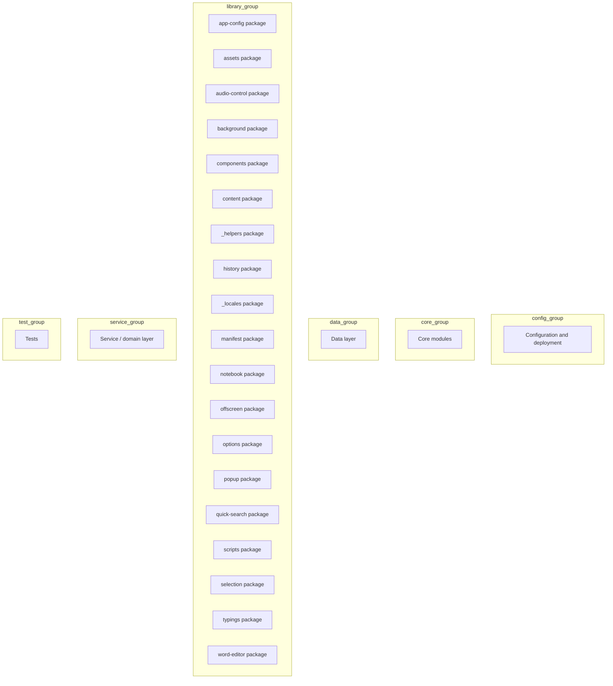

# Architecture report: crimx/ext-saladict

> Automated static analysis. **Observed** = directly seen in files/imports/AST; **Inferred** = interpretation from that evidence. Repository code was not executed.

## 1. Repository at a glance

| Item | Value |
| --- | --- |
| Repository | crimx/ext-saladict |
| Description | 🥗 All-in-one professional pop-up dictionary and page translator which supports multiple search modes, page translations, new word notebook and PDF selection searching. |
| Language | TypeScript |
| Stars | 13436 |
| Licence | MIT |
| Analysed commit / branch | 1673df15690842847f4c5369f8113f26d4aa2604 / dev |
| Framework(s) | React |
| Files analysed | 766 |
| Components | 24 |

## 2. Architecture in one minute

crimx/ext-saladict - 🥗 All-in-one professional pop-up dictionary and page translator which supports multiple search modes, page translations, new word notebook and PDF selection searching.. This repository was analysed statically from 766 file(s) (0 Python). Detected technologies (observed from imports/manifests): GitHub Actions, React, axios, Redux, Jest, TypeScript. Files are grouped into 24 component(s): app-config package, assets package, audio-control package, background package, components package, Configuration and deployment, content package, Core modules. Findings below distinguish observed facts from inferred interpretation.

## 3. High-level block diagram

## 4. Main components

### app-config package (`app_config`)

- **Kind:** library
- **Status:** Observed
- **Confidence:** 0.85
- **Responsibility:** Groups 7 file(s) under app-config package (observed from repository paths and static analysis).
- **Paths:** `src/app-config/auth.ts`, `src/app-config/context-menus.ts`, `src/app-config/dicts.ts`, `src/app-config/index.ts`, `src/app-config/merge-config.ts`, `src/app-config/merge-profile.ts`, `src/app-config/profiles.ts`
- **Evidence:** [src/app-config/auth.ts](https://github.com/crimx/ext-saladict/blob/1673df15690842847f4c5369f8113f26d4aa2604/src/app-config/auth.ts); [src/app-config/context-menus.ts](https://github.com/crimx/ext-saladict/blob/1673df15690842847f4c5369f8113f26d4aa2604/src/app-config/context-menus.ts); [src/app-config/dicts.ts](https://github.com/crimx/ext-saladict/blob/1673df15690842847f4c5369f8113f26d4aa2604/src/app-config/dicts.ts); [src/app-config/index.ts](https://github.com/crimx/ext-saladict/blob/1673df15690842847f4c5369f8113f26d4aa2604/src/app-config/index.ts); [src/app-config/merge-config.ts](https://github.com/crimx/ext-saladict/blob/1673df15690842847f4c5369f8113f26d4aa2604/src/app-config/merge-config.ts); [src/app-config/merge-profile.ts](https://github.com/crimx/ext-saladict/blob/1673df15690842847f4c5369f8113f26d4aa2604/src/app-config/merge-profile.ts); [src/app-config/profiles.ts](https://github.com/crimx/ext-saladict/blob/1673df15690842847f4c5369f8113f26d4aa2604/src/app-config/profiles.ts)

### assets package (`assets`)

- **Kind:** library
- **Status:** Observed
- **Confidence:** 0.85
- **Responsibility:** Groups 2 file(s) under assets package (observed from repository paths and static analysis).
- **Paths:** `assets/inject-dict-panel.js`, `assets/pdf-viewer-bridge.js`
- **Evidence:** [assets/inject-dict-panel.js](https://github.com/crimx/ext-saladict/blob/1673df15690842847f4c5369f8113f26d4aa2604/assets/inject-dict-panel.js); [assets/pdf-viewer-bridge.js](https://github.com/crimx/ext-saladict/blob/1673df15690842847f4c5369f8113f26d4aa2604/assets/pdf-viewer-bridge.js)

### audio-control package (`audio_control`)

- **Kind:** library
- **Status:** Observed
- **Confidence:** 0.85
- **Responsibility:** Groups 1 file(s) under audio-control package (observed from repository paths and static analysis).
- **Paths:** `src/audio-control/index.tsx`
- **Evidence:** [src/audio-control/index.tsx](https://github.com/crimx/ext-saladict/blob/1673df15690842847f4c5369f8113f26d4aa2604/src/audio-control/index.tsx)

### background package (`background`)

- **Kind:** library
- **Status:** Observed
- **Confidence:** 0.85
- **Responsibility:** Groups 27 file(s) under background package (observed from repository paths and static analysis).
- **Paths:** `src/background/__fake__/env.ts`, `src/background/__mocks__/database.ts`, `src/background/audio-manager.ts`, `src/background/badge.ts`, `src/background/clipboard-manager.ts`, `src/background/context-menus.ts`, `src/background/dom-task-bridge.ts`, `src/background/env.ts`, `src/background/i18n-loader.ts`, `src/background/i18n-manager.ts`, `src/background/index.ts`, `src/background/initialization.ts`, `src/background/offscreen-dict-bridge.ts`, `src/background/offscreen-document.ts`, `src/background/pdf-pending-store.ts`, `src/background/pdf-sniffer-mv3.ts`, `src/background/pdf-sniffer-shared.ts`, `src/background/pdf-sniffer.ts`, `src/background/server.ts`, `src/background/state.ts`, `src/background/static-locales.ts`, `src/background/sync-manager/__mocks__/helpers.ts`, `src/background/sync-manager/helpers.ts`, `src/background/sync-manager/index.ts`, `src/background/sync-manager/interface.ts`, `src/background/types.ts`, `src/background/windows-manager.ts`
- **Evidence:** [src/background/__fake__/env.ts](https://github.com/crimx/ext-saladict/blob/1673df15690842847f4c5369f8113f26d4aa2604/src/background/__fake__/env.ts); [src/background/__mocks__/database.ts](https://github.com/crimx/ext-saladict/blob/1673df15690842847f4c5369f8113f26d4aa2604/src/background/__mocks__/database.ts); [src/background/audio-manager.ts](https://github.com/crimx/ext-saladict/blob/1673df15690842847f4c5369f8113f26d4aa2604/src/background/audio-manager.ts); [src/background/badge.ts](https://github.com/crimx/ext-saladict/blob/1673df15690842847f4c5369f8113f26d4aa2604/src/background/badge.ts); [src/background/clipboard-manager.ts](https://github.com/crimx/ext-saladict/blob/1673df15690842847f4c5369f8113f26d4aa2604/src/background/clipboard-manager.ts); [src/background/context-menus.ts](https://github.com/crimx/ext-saladict/blob/1673df15690842847f4c5369f8113f26d4aa2604/src/background/context-menus.ts); [src/background/dom-task-bridge.ts](https://github.com/crimx/ext-saladict/blob/1673df15690842847f4c5369f8113f26d4aa2604/src/background/dom-task-bridge.ts); [src/background/env.ts](https://github.com/crimx/ext-saladict/blob/1673df15690842847f4c5369f8113f26d4aa2604/src/background/env.ts)

### components package (`components`)

- **Kind:** library
- **Status:** Observed
- **Confidence:** 0.85
- **Responsibility:** Groups 157 file(s) under components package (observed from repository paths and static analysis).
- **Paths:** `src/components/AntdRoot/AntdRootContainer.tsx`, `src/components/AntdRoot/index.tsx`, `src/components/DocumentTitle.tsx`, `src/components/EntryBox/EntryBox.stories.tsx`, `src/components/EntryBox/index.tsx`, `src/components/ErrorBoundary.tsx`, `src/components/FloatBox/FloatBox.stories.tsx`, `src/components/FloatBox/index.tsx`, `src/components/HoverBox/index.tsx`, `src/components/MachineTrans/MachineTrans.stories.tsx`, `src/components/MachineTrans/MachineTrans.tsx`, `src/components/MachineTrans/engine.ts`, `src/components/ShadowPortal/index.tsx`, `src/components/Speaker/Speaker.stories.tsx`, `src/components/Speaker/index.tsx`, `src/components/StarRates/index.tsx`, `src/components/StrElm/index.tsx`, `src/components/Waveform/Waveform.stories.tsx`, `src/components/Waveform/Waveform.tsx`, `src/components/WordPage/ExportModal/Linebreak.tsx`, `src/components/WordPage/ExportModal/PlaceholderTable.tsx`, `src/components/WordPage/ExportModal/index.tsx`, `src/components/WordPage/Header.tsx`, `src/components/WordPage/WordTable.tsx`, `src/components/WordPage/index.tsx`, `src/components/dictionaries/ahdict/View.tsx`, `src/components/dictionaries/ahdict/config.ts`, `src/components/dictionaries/ahdict/engine.ts`, `src/components/dictionaries/alibaba/View.tsx`, `src/components/dictionaries/alibaba/_locales.ts`, `src/components/dictionaries/alibaba/auth.ts`, `src/components/dictionaries/alibaba/config.ts`, `src/components/dictionaries/alibaba/engine.ts`, `src/components/dictionaries/baidu/View.tsx`, `src/components/dictionaries/baidu/_locales.ts`, `src/components/dictionaries/baidu/auth.ts`, `src/components/dictionaries/baidu/config.ts`, `src/components/dictionaries/baidu/engine.ts`, `src/components/dictionaries/bing/View.tsx`, `src/components/dictionaries/bing/config.ts`, `src/components/dictionaries/bing/engine.ts`, `src/components/dictionaries/bingtrans/View.tsx`, `src/components/dictionaries/bingtrans/_locales.ts`, `src/components/dictionaries/bingtrans/config.ts`, `src/components/dictionaries/bingtrans/engine.ts`, `src/components/dictionaries/caiyun/View.tsx`, `src/components/dictionaries/caiyun/_locales.ts`, `src/components/dictionaries/caiyun/auth.ts`, `src/components/dictionaries/caiyun/config.ts`, `src/components/dictionaries/caiyun/engine.ts`, `src/components/dictionaries/cambridge/View.tsx`, `src/components/dictionaries/cambridge/config.ts`, `src/components/dictionaries/cambridge/engine.ts`, `src/components/dictionaries/cambridge/network.ts`, `src/components/dictionaries/cobuild/View.tsx`, `src/components/dictionaries/cobuild/config.ts`, `src/components/dictionaries/cobuild/engine.ts`, `src/components/dictionaries/cobuild/network.ts`, `src/components/dictionaries/deepl/View.tsx`, `src/components/dictionaries/deepl/_locales.ts`, `src/components/dictionaries/deepl/auth.ts`, `src/components/dictionaries/deepl/config.ts`, `src/components/dictionaries/deepl/engine.ts`, `src/components/dictionaries/deeplx/View.tsx`, `src/components/dictionaries/deeplx/_locales.ts`, `src/components/dictionaries/deeplx/auth.ts`, `src/components/dictionaries/deeplx/config.ts`, `src/components/dictionaries/deeplx/engine.ts`, `src/components/dictionaries/dictionaries.stories.tsx`, `src/components/dictionaries/etymonline/View.tsx`, `src/components/dictionaries/etymonline/config.ts`, `src/components/dictionaries/etymonline/engine.ts`, `src/components/dictionaries/etymonline/network.ts`, `src/components/dictionaries/eudic/View.tsx`, `src/components/dictionaries/eudic/config.ts`, `src/components/dictionaries/eudic/engine.ts`, `src/components/dictionaries/google/View.tsx`, `src/components/dictionaries/google/_locales.ts`, `src/components/dictionaries/google/config.ts`, `src/components/dictionaries/google/engine.ts`, `src/components/dictionaries/guoyu/View.tsx`, `src/components/dictionaries/guoyu/config.ts`, `src/components/dictionaries/guoyu/engine.ts`, `src/components/dictionaries/helpers.ts`, `src/components/dictionaries/hjdict/View.tsx`, `src/components/dictionaries/hjdict/config.ts`, `src/components/dictionaries/hjdict/engine.ts`, `src/components/dictionaries/hjdict/network.ts`, `src/components/dictionaries/liangan/View.tsx`, `src/components/dictionaries/liangan/config.ts`, `src/components/dictionaries/liangan/engine.ts`, `src/components/dictionaries/locales.ts`, `src/components/dictionaries/longman/View.tsx`, `src/components/dictionaries/longman/config.ts`, `src/components/dictionaries/longman/engine.ts`, `src/components/dictionaries/machine-custom.ts`, `src/components/dictionaries/merriamwebster/View.tsx`, `src/components/dictionaries/merriamwebster/config.ts`, `src/components/dictionaries/merriamwebster/engine.ts`, `src/components/dictionaries/mojidict/View.tsx`, `src/components/dictionaries/mojidict/config.ts`, `src/components/dictionaries/mojidict/engine.ts`, `src/components/dictionaries/naver/View.tsx`, `src/components/dictionaries/naver/config.ts`, `src/components/dictionaries/naver/engine.ts`, `src/components/dictionaries/network-compat.ts`, `src/components/dictionaries/niutrans/View.tsx`, `src/components/dictionaries/niutrans/_locales.ts`, `src/components/dictionaries/niutrans/auth.ts`, `src/components/dictionaries/niutrans/config.ts`, `src/components/dictionaries/niutrans/engine.ts`, `src/components/dictionaries/oaldict/View.tsx`, `src/components/dictionaries/oaldict/config.ts`, `src/components/dictionaries/oaldict/engine.ts`, `src/components/dictionaries/renren/View.tsx`, `src/components/dictionaries/renren/config.ts`, `src/components/dictionaries/renren/engine.ts`, `src/components/dictionaries/shanbay/View.tsx`, `src/components/dictionaries/shanbay/config.ts`, `src/components/dictionaries/shanbay/engine.ts`, `src/components/dictionaries/tencent/View.tsx`, `src/components/dictionaries/tencent/_locales.ts`, `src/components/dictionaries/tencent/auth.ts`, `src/components/dictionaries/tencent/config.ts`, `src/components/dictionaries/tencent/engine.ts`, `src/components/dictionaries/urban/View.tsx`, `src/components/dictionaries/urban/config.ts`, `src/components/dictionaries/urban/engine.ts`, `src/components/dictionaries/vocabulary/View.tsx`, `src/components/dictionaries/vocabulary/config.ts`, `src/components/dictionaries/vocabulary/engine.ts`, `src/components/dictionaries/volc/View.tsx`, `src/components/dictionaries/volc/_locales.ts`, `src/components/dictionaries/volc/auth.ts`, `src/components/dictionaries/volc/config.ts`, `src/components/dictionaries/volc/engine.ts`, `src/components/dictionaries/weblio/View.tsx`, `src/components/dictionaries/weblio/config.ts`, `src/components/dictionaries/weblio/engine.ts`, `src/components/dictionaries/weblioejje/View.tsx`, `src/components/dictionaries/weblioejje/config.ts`, `src/components/dictionaries/weblioejje/engine.ts`, `src/components/dictionaries/wikipedia/View.tsx`, `src/components/dictionaries/wikipedia/config.ts`, `src/components/dictionaries/wikipedia/engine.ts`, `src/components/dictionaries/youdao/View.tsx`, `src/components/dictionaries/youdao/config.ts`, `src/components/dictionaries/youdao/engine.ts`, `src/components/dictionaries/youdaotrans/View.tsx`, `src/components/dictionaries/youdaotrans/_locales.ts`, `src/components/dictionaries/youdaotrans/auth.ts`, `src/components/dictionaries/youdaotrans/config.ts`, `src/components/dictionaries/youdaotrans/engine.ts`, `src/components/dictionaries/zdic/View.tsx`, `src/components/dictionaries/zdic/config.ts`, `src/components/dictionaries/zdic/engine.ts`, `src/components/dictionaries/zdic/network.ts`
- **Evidence:** [src/components/AntdRoot/AntdRootContainer.tsx](https://github.com/crimx/ext-saladict/blob/1673df15690842847f4c5369f8113f26d4aa2604/src/components/AntdRoot/AntdRootContainer.tsx); [src/components/AntdRoot/index.tsx](https://github.com/crimx/ext-saladict/blob/1673df15690842847f4c5369f8113f26d4aa2604/src/components/AntdRoot/index.tsx); [src/components/DocumentTitle.tsx](https://github.com/crimx/ext-saladict/blob/1673df15690842847f4c5369f8113f26d4aa2604/src/components/DocumentTitle.tsx); [src/components/EntryBox/EntryBox.stories.tsx](https://github.com/crimx/ext-saladict/blob/1673df15690842847f4c5369f8113f26d4aa2604/src/components/EntryBox/EntryBox.stories.tsx); [src/components/EntryBox/index.tsx](https://github.com/crimx/ext-saladict/blob/1673df15690842847f4c5369f8113f26d4aa2604/src/components/EntryBox/index.tsx); [src/components/ErrorBoundary.tsx](https://github.com/crimx/ext-saladict/blob/1673df15690842847f4c5369f8113f26d4aa2604/src/components/ErrorBoundary.tsx); [src/components/FloatBox/FloatBox.stories.tsx](https://github.com/crimx/ext-saladict/blob/1673df15690842847f4c5369f8113f26d4aa2604/src/components/FloatBox/FloatBox.stories.tsx); [src/components/FloatBox/index.tsx](https://github.com/crimx/ext-saladict/blob/1673df15690842847f4c5369f8113f26d4aa2604/src/components/FloatBox/index.tsx)

### Configuration and deployment (`config`)

- **Kind:** config
- **Status:** Observed
- **Confidence:** 0.85
- **Responsibility:** Groups 43 file(s) under configuration and deployment (observed from repository paths and static analysis).
- **Paths:** `config/jest/cssTransform.js`, `config/jest/fileTransform.js`, `config/jest/rawTextTransform.js`, `config/jest/setupTests.js`, `jsconfig.json`, `mac-app/Saladict - Pop-up Dictionary and Page Translator/Saladict - Pop-up Dictionary and Page Translator/Assets.xcassets/AccentColor.colorset/Contents.json`, `mac-app/Saladict - Pop-up Dictionary and Page Translator/Saladict - Pop-up Dictionary and Page Translator/Assets.xcassets/AppIcon.appiconset/Contents.json`, `mac-app/Saladict - Pop-up Dictionary and Page Translator/Saladict - Pop-up Dictionary and Page Translator/Assets.xcassets/Contents.json`, `package.json`, `src/_locales/manifest/en/messages.json`, `src/_locales/manifest/ko/messages.json`, `src/_locales/manifest/np/messages.json`, `src/_locales/manifest/zh_CN/messages.json`, `src/_locales/manifest/zh_TW/messages.json`, `src/_locales/zh-CN/tsconfig.json`, `src/components/dictionaries/ahdict/_locales.json`, `src/components/dictionaries/bing/_locales.json`, `src/components/dictionaries/cambridge/_locales.json`, `src/components/dictionaries/cobuild/_locales.json`, `src/components/dictionaries/etymonline/_locales.json`, `src/components/dictionaries/eudic/_locales.json`, `src/components/dictionaries/guoyu/_locales.json`, `src/components/dictionaries/hjdict/_locales.json`, `src/components/dictionaries/liangan/_locales.json`, `src/components/dictionaries/longman/_locales.json`, `src/components/dictionaries/merriamwebster/_locales.json`, `src/components/dictionaries/mojidict/_locales.json`, `src/components/dictionaries/naver/_locales.json`, `src/components/dictionaries/oaldict/_locales.json`, `src/components/dictionaries/renren/_locales.json`, `src/components/dictionaries/shanbay/_locales.json`, `src/components/dictionaries/urban/_locales.json`, `src/components/dictionaries/vocabulary/_locales.json`, `src/components/dictionaries/weblio/_locales.json`, `src/components/dictionaries/weblioejje/_locales.json`, `src/components/dictionaries/wikipedia/_locales.json`, `src/components/dictionaries/youdao/_locales.json`, `src/components/dictionaries/zdic/_locales.json`, `src/manifest/chrome.manifest.json`, `src/manifest/edge.manifest.json`, `src/manifest/firefox.manifest.json`, `src/manifest/safari.manifest.json`, `tsconfig.json`
- **Evidence:** [config/jest/cssTransform.js](https://github.com/crimx/ext-saladict/blob/1673df15690842847f4c5369f8113f26d4aa2604/config/jest/cssTransform.js); [config/jest/fileTransform.js](https://github.com/crimx/ext-saladict/blob/1673df15690842847f4c5369f8113f26d4aa2604/config/jest/fileTransform.js); [config/jest/rawTextTransform.js](https://github.com/crimx/ext-saladict/blob/1673df15690842847f4c5369f8113f26d4aa2604/config/jest/rawTextTransform.js); [config/jest/setupTests.js](https://github.com/crimx/ext-saladict/blob/1673df15690842847f4c5369f8113f26d4aa2604/config/jest/setupTests.js); [jsconfig.json](https://github.com/crimx/ext-saladict/blob/1673df15690842847f4c5369f8113f26d4aa2604/jsconfig.json); [mac-app/Saladict - Pop-up Dictionary and Page Translator/Saladict - Pop-up Dictionary and Page Translator/Assets.xcassets/AccentColor.colorset/Contents.json](https://github.com/crimx/ext-saladict/blob/1673df15690842847f4c5369f8113f26d4aa2604/mac-app/Saladict%20-%20Pop-up%20Dictionary%20and%20Page%20Translator/Saladict%20-%20Pop-up%20Dictionary%20and%20Page%20Translator/Assets.xcassets/AccentColor.colorset/Contents.json); [mac-app/Saladict - Pop-up Dictionary and Page Translator/Saladict - Pop-up Dictionary and Page Translator/Assets.xcassets/AppIcon.appiconset/Contents.json](https://github.com/crimx/ext-saladict/blob/1673df15690842847f4c5369f8113f26d4aa2604/mac-app/Saladict%20-%20Pop-up%20Dictionary%20and%20Page%20Translator/Saladict%20-%20Pop-up%20Dictionary%20and%20Page%20Translator/Assets.xcassets/AppIcon.appiconset/Contents.json); [mac-app/Saladict - Pop-up Dictionary and Page Translator/Saladict - Pop-up Dictionary and Page Translator/Assets.xcassets/Contents.json](https://github.com/crimx/ext-saladict/blob/1673df15690842847f4c5369f8113f26d4aa2604/mac-app/Saladict%20-%20Pop-up%20Dictionary%20and%20Page%20Translator/Saladict%20-%20Pop-up%20Dictionary%20and%20Page%20Translator/Assets.xcassets/Contents.json)

### content package (`content`)

- **Kind:** library
- **Status:** Observed
- **Confidence:** 0.85
- **Responsibility:** Groups 63 file(s) under content package (observed from repository paths and static analysis).
- **Paths:** `src/content/__fake__/env-instant-capture.ts`, `src/content/__fake__/env-select-text.ts`, `src/content/__fake__/env.ts`, `src/content/components/DictItem/DictItem.stories.tsx`, `src/content/components/DictItem/DictItem.tsx`, `src/content/components/DictItem/DictItemBody.tsx`, `src/content/components/DictItem/DictItemHead.tsx`, `src/content/components/DictItem/ManualVerification.tsx`, `src/content/components/DictList/DictList.container.tsx`, `src/content/components/DictList/DictList.stories.tsx`, `src/content/components/DictList/DictList.tsx`, `src/content/components/DictPanel/DictPanel.container.tsx`, `src/content/components/DictPanel/DictPanel.portal.tsx`, `src/content/components/DictPanel/DictPanel.stories.tsx`, `src/content/components/DictPanel/DictPanel.tsx`, `src/content/components/DictPanel/DictPanelStandalone.container.tsx`, `src/content/components/DictPanel/DictPanelStandalone.tsx`, `src/content/components/MenuBar/MenuBar.container.tsx`, `src/content/components/MenuBar/MenuBar.stories.tsx`, `src/content/components/MenuBar/MenuBar.tsx`, `src/content/components/MenuBar/MenubarBtns.stories.tsx`, `src/content/components/MenuBar/MenubarBtns.tsx`, `src/content/components/MenuBar/Profiles.stories.tsx`, `src/content/components/MenuBar/Profiles.tsx`, `src/content/components/MenuBar/SearchBox.stories.tsx`, `src/content/components/MenuBar/SearchBox.tsx`, `src/content/components/MenuBar/Suggest.stories.tsx`, `src/content/components/MenuBar/Suggest.tsx`, `src/content/components/MtaBox/MtaBox.container.tsx`, `src/content/components/MtaBox/MtaBox.stories.tsx`, `src/content/components/MtaBox/MtaBox.tsx`, `src/content/components/SaladBowl/SaladBowl.container.tsx`, `src/content/components/SaladBowl/SaladBowl.portal.tsx`, `src/content/components/SaladBowl/SaladBowl.stories.tsx`, `src/content/components/SaladBowl/SaladBowl.tsx`, `src/content/components/WaveformBox/WaveformBox.container.tsx`, `src/content/components/WaveformBox/WaveformBox.stories.tsx`, `src/content/components/WaveformBox/WaveformBox.tsx`, `src/content/components/WordEditor/CtxTransList.stories.tsx`, `src/content/components/WordEditor/CtxTransList.tsx`, `src/content/components/WordEditor/Notes.tsx`, `src/content/components/WordEditor/WordCards.tsx`, `src/content/components/WordEditor/WordEditor.container.tsx`, `src/content/components/WordEditor/WordEditor.portal.tsx`, `src/content/components/WordEditor/WordEditor.stories.tsx`, `src/content/components/WordEditor/WordEditor.tsx`, `src/content/components/WordEditor/WordEditorPanel.stories.tsx`, `src/content/components/WordEditor/WordEditorPanel.tsx`, `src/content/components/WordEditor/WordEditorStandalone.container.tsx`, `src/content/index.tsx`, `src/content/redux/epics/index.ts`, `src/content/redux/epics/newSelection.epic.ts`, `src/content/redux/epics/searchStart.epic.ts`, `src/content/redux/epics/utils.ts`, `src/content/redux/index.ts`, `src/content/redux/init.ts`, `src/content/redux/modules/action-catalog.ts`, `src/content/redux/modules/action-handlers/index.ts`, `src/content/redux/modules/action-handlers/new-selection.ts`, `src/content/redux/modules/action-handlers/open-qs-panel.ts`, `src/content/redux/modules/action-handlers/search-start.ts`, `src/content/redux/modules/index.ts`, `src/content/redux/modules/state.ts`
- **Evidence:** [src/content/__fake__/env-instant-capture.ts](https://github.com/crimx/ext-saladict/blob/1673df15690842847f4c5369f8113f26d4aa2604/src/content/__fake__/env-instant-capture.ts); [src/content/__fake__/env-select-text.ts](https://github.com/crimx/ext-saladict/blob/1673df15690842847f4c5369f8113f26d4aa2604/src/content/__fake__/env-select-text.ts); [src/content/__fake__/env.ts](https://github.com/crimx/ext-saladict/blob/1673df15690842847f4c5369f8113f26d4aa2604/src/content/__fake__/env.ts); [src/content/components/DictItem/DictItem.stories.tsx](https://github.com/crimx/ext-saladict/blob/1673df15690842847f4c5369f8113f26d4aa2604/src/content/components/DictItem/DictItem.stories.tsx); [src/content/components/DictItem/DictItem.tsx](https://github.com/crimx/ext-saladict/blob/1673df15690842847f4c5369f8113f26d4aa2604/src/content/components/DictItem/DictItem.tsx); [src/content/components/DictItem/DictItemBody.tsx](https://github.com/crimx/ext-saladict/blob/1673df15690842847f4c5369f8113f26d4aa2604/src/content/components/DictItem/DictItemBody.tsx); [src/content/components/DictItem/DictItemHead.tsx](https://github.com/crimx/ext-saladict/blob/1673df15690842847f4c5369f8113f26d4aa2604/src/content/components/DictItem/DictItemHead.tsx); [src/content/components/DictItem/ManualVerification.tsx](https://github.com/crimx/ext-saladict/blob/1673df15690842847f4c5369f8113f26d4aa2604/src/content/components/DictItem/ManualVerification.tsx)

### Core modules (`core`)

- **Kind:** core
- **Status:** Observed
- **Confidence:** 0.85
- **Responsibility:** Groups 5 file(s) under core modules (observed from repository paths and static analysis).
- **Paths:** `commitlint.config.js`, `jest.config.js`, `postcss.config.js`, `webpack.config.js`, `webpack.mv3.config.js`
- **Evidence:** [commitlint.config.js](https://github.com/crimx/ext-saladict/blob/1673df15690842847f4c5369f8113f26d4aa2604/commitlint.config.js); [jest.config.js](https://github.com/crimx/ext-saladict/blob/1673df15690842847f4c5369f8113f26d4aa2604/jest.config.js); [postcss.config.js](https://github.com/crimx/ext-saladict/blob/1673df15690842847f4c5369f8113f26d4aa2604/postcss.config.js); [webpack.config.js](https://github.com/crimx/ext-saladict/blob/1673df15690842847f4c5369f8113f26d4aa2604/webpack.config.js); [webpack.mv3.config.js](https://github.com/crimx/ext-saladict/blob/1673df15690842847f4c5369f8113f26d4aa2604/webpack.mv3.config.js)

### Data layer (`data_layer`)

- **Kind:** data
- **Status:** Observed
- **Confidence:** 0.85
- **Responsibility:** Groups 5 file(s) under data layer (observed from repository paths and static analysis).
- **Paths:** `src/background/database/core.ts`, `src/background/database/index.ts`, `src/background/database/read.ts`, `src/background/database/sync-meta.ts`, `src/background/database/write.ts`
- **Evidence:** [src/background/database/core.ts](https://github.com/crimx/ext-saladict/blob/1673df15690842847f4c5369f8113f26d4aa2604/src/background/database/core.ts); [src/background/database/index.ts](https://github.com/crimx/ext-saladict/blob/1673df15690842847f4c5369f8113f26d4aa2604/src/background/database/index.ts); [src/background/database/read.ts](https://github.com/crimx/ext-saladict/blob/1673df15690842847f4c5369f8113f26d4aa2604/src/background/database/read.ts); [src/background/database/sync-meta.ts](https://github.com/crimx/ext-saladict/blob/1673df15690842847f4c5369f8113f26d4aa2604/src/background/database/sync-meta.ts); [src/background/database/write.ts](https://github.com/crimx/ext-saladict/blob/1673df15690842847f4c5369f8113f26d4aa2604/src/background/database/write.ts)

### _helpers package (`helpers`)

- **Kind:** library
- **Status:** Observed
- **Confidence:** 0.85
- **Responsibility:** Groups 35 file(s) under _helpers package (observed from repository paths and static analysis).
- **Paths:** `src/_helpers/__mocks__/browser-api.ts`, `src/_helpers/__mocks__/config-manager.ts`, `src/_helpers/__mocks__/selection.ts`, `src/_helpers/analytics/events.ts`, `src/_helpers/analytics/index.ts`, `src/_helpers/axios-worker-adapter.ts`, `src/_helpers/basic-auth.ts`, `src/_helpers/browser-api.ts`, `src/_helpers/check-update.ts`, `src/_helpers/chs-to-chz.ts`, `src/_helpers/config-manager.ts`, `src/_helpers/dark-mode.ts`, `src/_helpers/dom.ts`, `src/_helpers/fetch-dom.ts`, `src/_helpers/getSuggests.ts`, `src/_helpers/hooks.ts`, `src/_helpers/i18n.ts`, `src/_helpers/injectSaladictInternal.ts`, `src/_helpers/integrity.ts`, `src/_helpers/lang-check.ts`, `src/_helpers/matchPatternToRegExpStr.ts`, `src/_helpers/message-tab.ts`, `src/_helpers/observables.ts`, `src/_helpers/permission-manager.ts`, `src/_helpers/profile-manager.ts`, `src/_helpers/promise-more.ts`, `src/_helpers/record-manager.ts`, `src/_helpers/saladict.ts`, `src/_helpers/scripting.ts`, `src/_helpers/scrollbar-width.ts`, `src/_helpers/storybook.tsx`, `src/_helpers/titlebar-offset.ts`, `src/_helpers/translateCtx.ts`, `src/_helpers/uniqueKey.ts`, `src/_helpers/wordoftheday.ts`
- **Evidence:** [src/_helpers/__mocks__/browser-api.ts](https://github.com/crimx/ext-saladict/blob/1673df15690842847f4c5369f8113f26d4aa2604/src/_helpers/__mocks__/browser-api.ts); [src/_helpers/__mocks__/config-manager.ts](https://github.com/crimx/ext-saladict/blob/1673df15690842847f4c5369f8113f26d4aa2604/src/_helpers/__mocks__/config-manager.ts); [src/_helpers/__mocks__/selection.ts](https://github.com/crimx/ext-saladict/blob/1673df15690842847f4c5369f8113f26d4aa2604/src/_helpers/__mocks__/selection.ts); [src/_helpers/analytics/events.ts](https://github.com/crimx/ext-saladict/blob/1673df15690842847f4c5369f8113f26d4aa2604/src/_helpers/analytics/events.ts); [src/_helpers/analytics/index.ts](https://github.com/crimx/ext-saladict/blob/1673df15690842847f4c5369f8113f26d4aa2604/src/_helpers/analytics/index.ts); [src/_helpers/axios-worker-adapter.ts](https://github.com/crimx/ext-saladict/blob/1673df15690842847f4c5369f8113f26d4aa2604/src/_helpers/axios-worker-adapter.ts); [src/_helpers/basic-auth.ts](https://github.com/crimx/ext-saladict/blob/1673df15690842847f4c5369f8113f26d4aa2604/src/_helpers/basic-auth.ts); [src/_helpers/browser-api.ts](https://github.com/crimx/ext-saladict/blob/1673df15690842847f4c5369f8113f26d4aa2604/src/_helpers/browser-api.ts)

### history package (`history`)

- **Kind:** library
- **Status:** Observed
- **Confidence:** 0.85
- **Responsibility:** Groups 2 file(s) under history package (observed from repository paths and static analysis).
- **Paths:** `src/history/env.ts`, `src/history/index.tsx`
- **Evidence:** [src/history/env.ts](https://github.com/crimx/ext-saladict/blob/1673df15690842847f4c5369f8113f26d4aa2604/src/history/env.ts); [src/history/index.tsx](https://github.com/crimx/ext-saladict/blob/1673df15690842847f4c5369f8113f26d4aa2604/src/history/index.tsx)

### _locales package (`locales`)

- **Kind:** library
- **Status:** Observed
- **Confidence:** 0.85
- **Responsibility:** Groups 48 file(s) under _locales package (observed from repository paths and static analysis).
- **Paths:** `src/_locales/en/background.ts`, `src/_locales/en/common.ts`, `src/_locales/en/content.ts`, `src/_locales/en/langcode.ts`, `src/_locales/en/menus.ts`, `src/_locales/en/options.ts`, `src/_locales/en/popup.ts`, `src/_locales/en/wordpage.ts`, `src/_locales/es/background.ts`, `src/_locales/es/common.ts`, `src/_locales/es/content.ts`, `src/_locales/es/langcode.ts`, `src/_locales/es/menus.ts`, `src/_locales/es/options.ts`, `src/_locales/es/popup.ts`, `src/_locales/es/wordpage.ts`, `src/_locales/ko/background.ts`, `src/_locales/ko/common.ts`, `src/_locales/ko/content.ts`, `src/_locales/ko/langcode.ts`, `src/_locales/ko/menus.ts`, `src/_locales/ko/options.ts`, `src/_locales/ko/popup.ts`, `src/_locales/ko/wordpage.ts`, `src/_locales/ne/background.ts`, `src/_locales/ne/common.ts`, `src/_locales/ne/content.ts`, `src/_locales/ne/langcode.ts`, `src/_locales/ne/menus.ts`, `src/_locales/ne/options.ts`, `src/_locales/ne/popup.ts`, `src/_locales/ne/wordpage.ts`, `src/_locales/zh-CN/background.ts`, `src/_locales/zh-CN/common.ts`, `src/_locales/zh-CN/content.ts`, `src/_locales/zh-CN/langcode.ts`, `src/_locales/zh-CN/menus.ts`, `src/_locales/zh-CN/options.ts`, `src/_locales/zh-CN/popup.ts`, `src/_locales/zh-CN/wordpage.ts`, `src/_locales/zh-TW/background.ts`, `src/_locales/zh-TW/common.ts`, `src/_locales/zh-TW/content.ts`, `src/_locales/zh-TW/langcode.ts`, `src/_locales/zh-TW/menus.ts`, `src/_locales/zh-TW/options.ts`, `src/_locales/zh-TW/popup.ts`, `src/_locales/zh-TW/wordpage.ts`
- **Evidence:** [src/_locales/en/background.ts](https://github.com/crimx/ext-saladict/blob/1673df15690842847f4c5369f8113f26d4aa2604/src/_locales/en/background.ts); [src/_locales/en/common.ts](https://github.com/crimx/ext-saladict/blob/1673df15690842847f4c5369f8113f26d4aa2604/src/_locales/en/common.ts); [src/_locales/en/content.ts](https://github.com/crimx/ext-saladict/blob/1673df15690842847f4c5369f8113f26d4aa2604/src/_locales/en/content.ts); [src/_locales/en/langcode.ts](https://github.com/crimx/ext-saladict/blob/1673df15690842847f4c5369f8113f26d4aa2604/src/_locales/en/langcode.ts); [src/_locales/en/menus.ts](https://github.com/crimx/ext-saladict/blob/1673df15690842847f4c5369f8113f26d4aa2604/src/_locales/en/menus.ts); [src/_locales/en/options.ts](https://github.com/crimx/ext-saladict/blob/1673df15690842847f4c5369f8113f26d4aa2604/src/_locales/en/options.ts); [src/_locales/en/popup.ts](https://github.com/crimx/ext-saladict/blob/1673df15690842847f4c5369f8113f26d4aa2604/src/_locales/en/popup.ts); [src/_locales/en/wordpage.ts](https://github.com/crimx/ext-saladict/blob/1673df15690842847f4c5369f8113f26d4aa2604/src/_locales/en/wordpage.ts)

### manifest package (`manifest`)

- **Kind:** library
- **Status:** Observed
- **Confidence:** 0.85
- **Responsibility:** Groups 1 file(s) under manifest package (observed from repository paths and static analysis).
- **Paths:** `src/manifest/common.manifest.js`
- **Evidence:** [src/manifest/common.manifest.js](https://github.com/crimx/ext-saladict/blob/1673df15690842847f4c5369f8113f26d4aa2604/src/manifest/common.manifest.js)

### notebook package (`notebook`)

- **Kind:** library
- **Status:** Observed
- **Confidence:** 0.85
- **Responsibility:** Groups 2 file(s) under notebook package (observed from repository paths and static analysis).
- **Paths:** `src/notebook/env.ts`, `src/notebook/index.tsx`
- **Evidence:** [src/notebook/env.ts](https://github.com/crimx/ext-saladict/blob/1673df15690842847f4c5369f8113f26d4aa2604/src/notebook/env.ts); [src/notebook/index.tsx](https://github.com/crimx/ext-saladict/blob/1673df15690842847f4c5369f8113f26d4aa2604/src/notebook/index.tsx)

### offscreen package (`offscreen`)

- **Kind:** library
- **Status:** Observed
- **Confidence:** 0.85
- **Responsibility:** Groups 1 file(s) under offscreen package (observed from repository paths and static analysis).
- **Paths:** `src/offscreen/index.ts`
- **Evidence:** [src/offscreen/index.ts](https://github.com/crimx/ext-saladict/blob/1673df15690842847f4c5369f8113f26d4aa2604/src/offscreen/index.ts)

### options package (`options`)

- **Kind:** library
- **Status:** Observed
- **Confidence:** 0.85
- **Responsibility:** Groups 57 file(s) under options package (observed from repository paths and static analysis).
- **Paths:** `src/options/__fake__/env.ts`, `src/options/acknowledgement.ts`, `src/options/components/BtnPreview/PreviewIcon.tsx`, `src/options/components/BtnPreview/index.tsx`, `src/options/components/DarkModeSelect.tsx`, `src/options/components/Entries/BlackWhiteList.tsx`, `src/options/components/Entries/ContextMenus/AddModal.tsx`, `src/options/components/Entries/ContextMenus/EditeModal.tsx`, `src/options/components/Entries/ContextMenus/index.tsx`, `src/options/components/Entries/DictAuths.tsx`, `src/options/components/Entries/DictPanel.tsx`, `src/options/components/Entries/Dictionaries/AllDicts.tsx`, `src/options/components/Entries/Dictionaries/DictTitle/index.tsx`, `src/options/components/Entries/Dictionaries/EditModal.tsx`, `src/options/components/Entries/Dictionaries/index.tsx`, `src/options/components/Entries/General.tsx`, `src/options/components/Entries/ImportExport.tsx`, `src/options/components/Entries/Notebook/index.tsx`, `src/options/components/Entries/Notebook/sync-services/ankiconnect.tsx`, `src/options/components/Entries/Notebook/sync-services/eudic.tsx`, `src/options/components/Entries/Notebook/sync-services/maimemo.tsx`, `src/options/components/Entries/Notebook/sync-services/shanbay.tsx`, `src/options/components/Entries/Notebook/sync-services/webdav.tsx`, `src/options/components/Entries/PDF.tsx`, `src/options/components/Entries/Permissions.tsx`, `src/options/components/Entries/Popup.tsx`, `src/options/components/Entries/Privacy.tsx`, `src/options/components/Entries/Profiles/EditNameModal.tsx`, `src/options/components/Entries/Profiles/index.tsx`, `src/options/components/Entries/Pronunciation.tsx`, `src/options/components/Entries/QuickSearch/StandaloneModal.tsx`, `src/options/components/Entries/QuickSearch/TitlebarOffsetModal.tsx`, `src/options/components/Entries/QuickSearch/index.tsx`, `src/options/components/Entries/SearchModes/index.tsx`, `src/options/components/Entries/SearchModes/searchMode.tsx`, `src/options/components/EntryError.tsx`, `src/options/components/EntrySideBar/index.tsx`, `src/options/components/Header/HeadInfo/AckList.tsx`, `src/options/components/Header/HeadInfo/index.tsx`, `src/options/components/Header/index.tsx`, `src/options/components/InputNumberGroup/index.tsx`, `src/options/components/MainEntry.tsx`, `src/options/components/MatchPatternModal/ PatternItem.tsx`, `src/options/components/MatchPatternModal/index.tsx`, `src/options/components/SaladictForm/SaveBtn.tsx`, `src/options/components/SaladictForm/index.tsx`, `src/options/components/SaladictModalForm.tsx`, `src/options/components/SortableList/index.tsx`, `src/options/components/SortableList/reorder.ts`, `src/options/env.ts`, `src/options/helpers/change-entry.ts`, `src/options/helpers/layout.ts`, `src/options/helpers/panel-store.ts`, `src/options/helpers/path-joiner.ts`, `src/options/helpers/upload.ts`, `src/options/helpers/use-form-dirty.ts`, `src/options/index.tsx`
- **Evidence:** [src/options/__fake__/env.ts](https://github.com/crimx/ext-saladict/blob/1673df15690842847f4c5369f8113f26d4aa2604/src/options/__fake__/env.ts); [src/options/acknowledgement.ts](https://github.com/crimx/ext-saladict/blob/1673df15690842847f4c5369f8113f26d4aa2604/src/options/acknowledgement.ts); [src/options/components/BtnPreview/PreviewIcon.tsx](https://github.com/crimx/ext-saladict/blob/1673df15690842847f4c5369f8113f26d4aa2604/src/options/components/BtnPreview/PreviewIcon.tsx); [src/options/components/BtnPreview/index.tsx](https://github.com/crimx/ext-saladict/blob/1673df15690842847f4c5369f8113f26d4aa2604/src/options/components/BtnPreview/index.tsx); [src/options/components/DarkModeSelect.tsx](https://github.com/crimx/ext-saladict/blob/1673df15690842847f4c5369f8113f26d4aa2604/src/options/components/DarkModeSelect.tsx); [src/options/components/Entries/BlackWhiteList.tsx](https://github.com/crimx/ext-saladict/blob/1673df15690842847f4c5369f8113f26d4aa2604/src/options/components/Entries/BlackWhiteList.tsx); [src/options/components/Entries/ContextMenus/AddModal.tsx](https://github.com/crimx/ext-saladict/blob/1673df15690842847f4c5369f8113f26d4aa2604/src/options/components/Entries/ContextMenus/AddModal.tsx); [src/options/components/Entries/ContextMenus/EditeModal.tsx](https://github.com/crimx/ext-saladict/blob/1673df15690842847f4c5369f8113f26d4aa2604/src/options/components/Entries/ContextMenus/EditeModal.tsx)

### popup package (`popup`)

- **Kind:** library
- **Status:** Observed
- **Confidence:** 0.85
- **Responsibility:** Groups 5 file(s) under popup package (observed from repository paths and static analysis).
- **Paths:** `src/popup/Notebook.tsx`, `src/popup/Popup.tsx`, `src/popup/__fake__/env.ts`, `src/popup/env.ts`, `src/popup/index.tsx`
- **Evidence:** [src/popup/Notebook.tsx](https://github.com/crimx/ext-saladict/blob/1673df15690842847f4c5369f8113f26d4aa2604/src/popup/Notebook.tsx); [src/popup/Popup.tsx](https://github.com/crimx/ext-saladict/blob/1673df15690842847f4c5369f8113f26d4aa2604/src/popup/Popup.tsx); [src/popup/__fake__/env.ts](https://github.com/crimx/ext-saladict/blob/1673df15690842847f4c5369f8113f26d4aa2604/src/popup/__fake__/env.ts); [src/popup/env.ts](https://github.com/crimx/ext-saladict/blob/1673df15690842847f4c5369f8113f26d4aa2604/src/popup/env.ts); [src/popup/index.tsx](https://github.com/crimx/ext-saladict/blob/1673df15690842847f4c5369f8113f26d4aa2604/src/popup/index.tsx)

### quick-search package (`quick_search`)

- **Kind:** library
- **Status:** Observed
- **Confidence:** 0.85
- **Responsibility:** Groups 2 file(s) under quick-search package (observed from repository paths and static analysis).
- **Paths:** `src/quick-search/env.ts`, `src/quick-search/index.tsx`
- **Evidence:** [src/quick-search/env.ts](https://github.com/crimx/ext-saladict/blob/1673df15690842847f4c5369f8113f26d4aa2604/src/quick-search/env.ts); [src/quick-search/index.tsx](https://github.com/crimx/ext-saladict/blob/1673df15690842847f4c5369f8113f26d4aa2604/src/quick-search/index.tsx)

### scripts package (`scripts`)

- **Kind:** library
- **Status:** Observed
- **Confidence:** 0.85
- **Responsibility:** Groups 13 file(s) under scripts package (observed from repository paths and static analysis).
- **Paths:** `scripts/build.js`, `scripts/clean-output-plugin.js`, `scripts/create-neutrino-config.js`, `scripts/firefox-fix.js`, `scripts/fixtures.js`, `scripts/pdf.js`, `scripts/setup-env.js`, `scripts/start.js`, `scripts/style-extractor.js`, `scripts/targeted-webext-manifest-plugin.js`, `scripts/test.js`, `scripts/webext-targets.js`, `scripts/zip.js`
- **Evidence:** [scripts/build.js](https://github.com/crimx/ext-saladict/blob/1673df15690842847f4c5369f8113f26d4aa2604/scripts/build.js); [scripts/clean-output-plugin.js](https://github.com/crimx/ext-saladict/blob/1673df15690842847f4c5369f8113f26d4aa2604/scripts/clean-output-plugin.js); [scripts/create-neutrino-config.js](https://github.com/crimx/ext-saladict/blob/1673df15690842847f4c5369f8113f26d4aa2604/scripts/create-neutrino-config.js); [scripts/firefox-fix.js](https://github.com/crimx/ext-saladict/blob/1673df15690842847f4c5369f8113f26d4aa2604/scripts/firefox-fix.js); [scripts/fixtures.js](https://github.com/crimx/ext-saladict/blob/1673df15690842847f4c5369f8113f26d4aa2604/scripts/fixtures.js); [scripts/pdf.js](https://github.com/crimx/ext-saladict/blob/1673df15690842847f4c5369f8113f26d4aa2604/scripts/pdf.js); [scripts/setup-env.js](https://github.com/crimx/ext-saladict/blob/1673df15690842847f4c5369f8113f26d4aa2604/scripts/setup-env.js); [scripts/start.js](https://github.com/crimx/ext-saladict/blob/1673df15690842847f4c5369f8113f26d4aa2604/scripts/start.js)

### selection package (`selection`)

- **Kind:** library
- **Status:** Observed
- **Confidence:** 0.85
- **Responsibility:** Groups 6 file(s) under selection package (observed from repository paths and static analysis).
- **Paths:** `src/selection/helper.ts`, `src/selection/index.ts`, `src/selection/instant-capture.ts`, `src/selection/message.ts`, `src/selection/quick-search.ts`, `src/selection/select-text.ts`
- **Evidence:** [src/selection/helper.ts](https://github.com/crimx/ext-saladict/blob/1673df15690842847f4c5369f8113f26d4aa2604/src/selection/helper.ts); [src/selection/index.ts](https://github.com/crimx/ext-saladict/blob/1673df15690842847f4c5369f8113f26d4aa2604/src/selection/index.ts); [src/selection/instant-capture.ts](https://github.com/crimx/ext-saladict/blob/1673df15690842847f4c5369f8113f26d4aa2604/src/selection/instant-capture.ts); [src/selection/message.ts](https://github.com/crimx/ext-saladict/blob/1673df15690842847f4c5369f8113f26d4aa2604/src/selection/message.ts); [src/selection/quick-search.ts](https://github.com/crimx/ext-saladict/blob/1673df15690842847f4c5369f8113f26d4aa2604/src/selection/quick-search.ts); [src/selection/select-text.ts](https://github.com/crimx/ext-saladict/blob/1673df15690842847f4c5369f8113f26d4aa2604/src/selection/select-text.ts)

### Service / domain layer (`service_layer`)

- **Kind:** service
- **Status:** Observed
- **Confidence:** 0.85
- **Responsibility:** Groups 27 file(s) under service / domain layer (observed from repository paths and static analysis).
- **Paths:** `src/background/sync-manager/services/ankiconnect/_locales/en.ts`, `src/background/sync-manager/services/ankiconnect/_locales/ko.ts`, `src/background/sync-manager/services/ankiconnect/_locales/zh-CN.ts`, `src/background/sync-manager/services/ankiconnect/_locales/zh-TW.ts`, `src/background/sync-manager/services/ankiconnect/index.ts`, `src/background/sync-manager/services/ankiconnect/migration.ts`, `src/background/sync-manager/services/eudic/_locales/en.ts`, `src/background/sync-manager/services/eudic/_locales/ko.ts`, `src/background/sync-manager/services/eudic/_locales/zh-CN.ts`, `src/background/sync-manager/services/eudic/_locales/zh-TW.ts`, `src/background/sync-manager/services/eudic/index.ts`, `src/background/sync-manager/services/maimemo/_locales/en.ts`, `src/background/sync-manager/services/maimemo/_locales/ko.ts`, `src/background/sync-manager/services/maimemo/_locales/zh-CN.ts`, `src/background/sync-manager/services/maimemo/_locales/zh-TW.ts`, `src/background/sync-manager/services/maimemo/index.ts`, `src/background/sync-manager/services/maimemo/rate-limiter.ts`, `src/background/sync-manager/services/shanbay/_locales/en.ts`, `src/background/sync-manager/services/shanbay/_locales/ko.ts`, `src/background/sync-manager/services/shanbay/_locales/zh-CN.ts`, `src/background/sync-manager/services/shanbay/_locales/zh-TW.ts`, `src/background/sync-manager/services/shanbay/index.ts`, `src/background/sync-manager/services/webdav/_locales/en.ts`, `src/background/sync-manager/services/webdav/_locales/ko.ts`, `src/background/sync-manager/services/webdav/_locales/zh-CN.ts`, `src/background/sync-manager/services/webdav/_locales/zh-TW.ts`, `src/background/sync-manager/services/webdav/index.ts`
- **Evidence:** [src/background/sync-manager/services/ankiconnect/_locales/en.ts](https://github.com/crimx/ext-saladict/blob/1673df15690842847f4c5369f8113f26d4aa2604/src/background/sync-manager/services/ankiconnect/_locales/en.ts); [src/background/sync-manager/services/ankiconnect/_locales/ko.ts](https://github.com/crimx/ext-saladict/blob/1673df15690842847f4c5369f8113f26d4aa2604/src/background/sync-manager/services/ankiconnect/_locales/ko.ts); [src/background/sync-manager/services/ankiconnect/_locales/zh-CN.ts](https://github.com/crimx/ext-saladict/blob/1673df15690842847f4c5369f8113f26d4aa2604/src/background/sync-manager/services/ankiconnect/_locales/zh-CN.ts); [src/background/sync-manager/services/ankiconnect/_locales/zh-TW.ts](https://github.com/crimx/ext-saladict/blob/1673df15690842847f4c5369f8113f26d4aa2604/src/background/sync-manager/services/ankiconnect/_locales/zh-TW.ts); [src/background/sync-manager/services/ankiconnect/index.ts](https://github.com/crimx/ext-saladict/blob/1673df15690842847f4c5369f8113f26d4aa2604/src/background/sync-manager/services/ankiconnect/index.ts); [src/background/sync-manager/services/ankiconnect/migration.ts](https://github.com/crimx/ext-saladict/blob/1673df15690842847f4c5369f8113f26d4aa2604/src/background/sync-manager/services/ankiconnect/migration.ts); [src/background/sync-manager/services/eudic/_locales/en.ts](https://github.com/crimx/ext-saladict/blob/1673df15690842847f4c5369f8113f26d4aa2604/src/background/sync-manager/services/eudic/_locales/en.ts); [src/background/sync-manager/services/eudic/_locales/ko.ts](https://github.com/crimx/ext-saladict/blob/1673df15690842847f4c5369f8113f26d4aa2604/src/background/sync-manager/services/eudic/_locales/ko.ts)

### Tests (`tests`)

- **Kind:** test
- **Status:** Observed
- **Confidence:** 0.85
- **Responsibility:** Groups 105 file(s) under tests (observed from repository paths and static analysis).
- **Paths:** `test/helper.ts`, `test/specs/_helpers/analytics.spec.ts`, `test/specs/_helpers/browser-api.spec.ts`, `test/specs/_helpers/check-update.spec.ts`, `test/specs/_helpers/chs-to-chz.spec.ts`, `test/specs/_helpers/lang-check.spec.ts`, `test/specs/_helpers/message-tab.spec.ts`, `test/specs/_helpers/permission-manager.spec.ts`, `test/specs/_helpers/profile-manager.spec.ts`, `test/specs/_helpers/promise-more.spec.ts`, `test/specs/app-config/index.spec.ts`, `test/specs/app-config/merge-config.spec.ts`, `test/specs/background/audio-manager.spec.ts`, `test/specs/background/context-menus.spec.ts`, `test/specs/background/initialization.spec.ts`, `test/specs/background/pdf-sniffer.spec.ts`, `test/specs/background/server.spec.ts`, `test/specs/background/sync-manager/services/ankiconnect-migration.spec.ts`, `test/specs/background/sync-manager/services/ankiconnect.spec.ts`, `test/specs/background/sync-manager/services/maimemo.spec.ts`, `test/specs/background/sync-manager/services/rate-limiter.spec.ts`, `test/specs/background/sync-manager/services/webdav.spec.ts`, `test/specs/components/dictionaries/ahdict/engine.spec.ts`, `test/specs/components/dictionaries/ahdict/fixtures.js`, `test/specs/components/dictionaries/ahdict/requests.mock.ts`, `test/specs/components/dictionaries/alibaba/engine.spec.ts`, `test/specs/components/dictionaries/bing/engine.spec.ts`, `test/specs/components/dictionaries/bing/fixtures.js`, `test/specs/components/dictionaries/bing/requests.mock.ts`, `test/specs/components/dictionaries/bingtrans/engine.spec.ts`, `test/specs/components/dictionaries/cambridge/engine.spec.ts`, `test/specs/components/dictionaries/cambridge/fixtures.js`, `test/specs/components/dictionaries/cambridge/network.spec.ts`, `test/specs/components/dictionaries/cambridge/requests.mock.ts`, `test/specs/components/dictionaries/cobuild/engine.spec.ts`, `test/specs/components/dictionaries/cobuild/fixtures.js`, `test/specs/components/dictionaries/cobuild/network.spec.ts`, `test/specs/components/dictionaries/cobuild/requests.mock.ts`, `test/specs/components/dictionaries/deepl/engine.spec.ts`, `test/specs/components/dictionaries/deeplx/engine.spec.ts`, `test/specs/components/dictionaries/etymonline/engine.spec.ts`, `test/specs/components/dictionaries/etymonline/fixtures.js`, `test/specs/components/dictionaries/etymonline/network.spec.ts`, `test/specs/components/dictionaries/etymonline/requests.mock.ts`, `test/specs/components/dictionaries/eudic/engine.spec.ts`, `test/specs/components/dictionaries/eudic/fixtures.js`, `test/specs/components/dictionaries/eudic/requests.mock.ts`, `test/specs/components/dictionaries/guoyu/engine.spec.ts`, `test/specs/components/dictionaries/guoyu/fixtures.js`, `test/specs/components/dictionaries/guoyu/requests.mock.ts`, `test/specs/components/dictionaries/helpers.ts`, `test/specs/components/dictionaries/hjdict/engine.spec.ts`, `test/specs/components/dictionaries/hjdict/fixtures.js`, `test/specs/components/dictionaries/hjdict/requests.mock.ts`, `test/specs/components/dictionaries/liangan/engine.spec.ts`, `test/specs/components/dictionaries/liangan/fixtures.js`, `test/specs/components/dictionaries/liangan/requests.mock.ts`, `test/specs/components/dictionaries/longman/engine.spec.ts`, `test/specs/components/dictionaries/longman/fixtures.js`, `test/specs/components/dictionaries/longman/requests.mock.ts`, `test/specs/components/dictionaries/machine-custom.spec.ts`, `test/specs/components/dictionaries/merriamwebster/engine.spec.ts`, `test/specs/components/dictionaries/merriamwebster/fixtures.js`, `test/specs/components/dictionaries/merriamwebster/requests.mock.ts`, `test/specs/components/dictionaries/merriamwebster/testCases.ts`, `test/specs/components/dictionaries/mojidict/engine.spec.ts`, `test/specs/components/dictionaries/mojidict/fixtures.js`, `test/specs/components/dictionaries/mojidict/requests.mock.ts`, `test/specs/components/dictionaries/naver/engine.spec.ts`, `test/specs/components/dictionaries/naver/fixtures.js`, `test/specs/components/dictionaries/naver/requests.mock.ts`, `test/specs/components/dictionaries/niutrans/engine.spec.ts`, `test/specs/components/dictionaries/oaldict/engine.spec.ts`, `test/specs/components/dictionaries/oaldict/fixtures.js`, `test/specs/components/dictionaries/oaldict/requests.mock.ts`, `test/specs/components/dictionaries/renren/engine.spec.ts`, `test/specs/components/dictionaries/renren/fixtures.js`, `test/specs/components/dictionaries/renren/requests.mock.ts`, `test/specs/components/dictionaries/tencent/engine.spec.ts`, `test/specs/components/dictionaries/urban/engine.spec.ts`, `test/specs/components/dictionaries/urban/fixtures.js`, `test/specs/components/dictionaries/urban/requests.mock.ts`, `test/specs/components/dictionaries/vocabulary/engine.spec.ts`, `test/specs/components/dictionaries/vocabulary/fixtures.js`, `test/specs/components/dictionaries/vocabulary/requests.mock.ts`, `test/specs/components/dictionaries/volc/engine.spec.ts`, `test/specs/components/dictionaries/weblio/engine.spec.ts`, `test/specs/components/dictionaries/weblio/fixtures.js`, `test/specs/components/dictionaries/weblio/requests.mock.ts`, `test/specs/components/dictionaries/weblioejje/engine.spec.ts`, `test/specs/components/dictionaries/weblioejje/fixtures.js`, `test/specs/components/dictionaries/weblioejje/requests.mock.ts`, `test/specs/components/dictionaries/wikipedia/engine.spec.ts`, `test/specs/components/dictionaries/wikipedia/fixtures.js`, `test/specs/components/dictionaries/wikipedia/requests.mock.ts`, `test/specs/components/dictionaries/youdao/engine.spec.ts`, `test/specs/components/dictionaries/youdao/fixtures.js`, `test/specs/components/dictionaries/youdao/requests.mock.ts`, `test/specs/components/dictionaries/zdic/engine.spec.ts`, `test/specs/components/dictionaries/zdic/fixtures.js`, `test/specs/components/dictionaries/zdic/network.spec.ts`, `test/specs/components/dictionaries/zdic/requests.mock.ts`, `test/specs/content/components/DictPanel/DictPanel.spec.tsx`, `test/specs/content/redux/auto-hide.spec.ts`, `test/specs/options/ankiconnect-migration.spec.tsx`
- **Evidence:** [test/helper.ts](https://github.com/crimx/ext-saladict/blob/1673df15690842847f4c5369f8113f26d4aa2604/test/helper.ts); [test/specs/_helpers/analytics.spec.ts](https://github.com/crimx/ext-saladict/blob/1673df15690842847f4c5369f8113f26d4aa2604/test/specs/_helpers/analytics.spec.ts); [test/specs/_helpers/browser-api.spec.ts](https://github.com/crimx/ext-saladict/blob/1673df15690842847f4c5369f8113f26d4aa2604/test/specs/_helpers/browser-api.spec.ts); [test/specs/_helpers/check-update.spec.ts](https://github.com/crimx/ext-saladict/blob/1673df15690842847f4c5369f8113f26d4aa2604/test/specs/_helpers/check-update.spec.ts); [test/specs/_helpers/chs-to-chz.spec.ts](https://github.com/crimx/ext-saladict/blob/1673df15690842847f4c5369f8113f26d4aa2604/test/specs/_helpers/chs-to-chz.spec.ts); [test/specs/_helpers/lang-check.spec.ts](https://github.com/crimx/ext-saladict/blob/1673df15690842847f4c5369f8113f26d4aa2604/test/specs/_helpers/lang-check.spec.ts); [test/specs/_helpers/message-tab.spec.ts](https://github.com/crimx/ext-saladict/blob/1673df15690842847f4c5369f8113f26d4aa2604/test/specs/_helpers/message-tab.spec.ts); [test/specs/_helpers/permission-manager.spec.ts](https://github.com/crimx/ext-saladict/blob/1673df15690842847f4c5369f8113f26d4aa2604/test/specs/_helpers/permission-manager.spec.ts)

### typings package (`typings`)

- **Kind:** library
- **Status:** Observed
- **Confidence:** 0.85
- **Responsibility:** Groups 4 file(s) under typings package (observed from repository paths and static analysis).
- **Paths:** `src/typings/css.d.ts`, `src/typings/global.d.ts`, `src/typings/helpers.ts`, `src/typings/message.ts`
- **Evidence:** [src/typings/css.d.ts](https://github.com/crimx/ext-saladict/blob/1673df15690842847f4c5369f8113f26d4aa2604/src/typings/css.d.ts); [src/typings/global.d.ts](https://github.com/crimx/ext-saladict/blob/1673df15690842847f4c5369f8113f26d4aa2604/src/typings/global.d.ts); [src/typings/helpers.ts](https://github.com/crimx/ext-saladict/blob/1673df15690842847f4c5369f8113f26d4aa2604/src/typings/helpers.ts); [src/typings/message.ts](https://github.com/crimx/ext-saladict/blob/1673df15690842847f4c5369f8113f26d4aa2604/src/typings/message.ts)

### word-editor package (`word_editor`)

- **Kind:** library
- **Status:** Observed
- **Confidence:** 0.85
- **Responsibility:** Groups 2 file(s) under word-editor package (observed from repository paths and static analysis).
- **Paths:** `src/word-editor/env.ts`, `src/word-editor/index.tsx`
- **Evidence:** [src/word-editor/env.ts](https://github.com/crimx/ext-saladict/blob/1673df15690842847f4c5369f8113f26d4aa2604/src/word-editor/env.ts); [src/word-editor/index.tsx](https://github.com/crimx/ext-saladict/blob/1673df15690842847f4c5369f8113f26d4aa2604/src/word-editor/index.tsx)

## 5. Execution flow

**Observed** entry point(s):

- [src/_helpers/analytics/index.ts](https://github.com/crimx/ext-saladict/blob/1673df15690842847f4c5369f8113f26d4aa2604/src/_helpers/analytics/index.ts)
- [src/app-config/index.ts](https://github.com/crimx/ext-saladict/blob/1673df15690842847f4c5369f8113f26d4aa2604/src/app-config/index.ts)
- [src/audio-control/index.tsx](https://github.com/crimx/ext-saladict/blob/1673df15690842847f4c5369f8113f26d4aa2604/src/audio-control/index.tsx)
- [src/background/database/index.ts](https://github.com/crimx/ext-saladict/blob/1673df15690842847f4c5369f8113f26d4aa2604/src/background/database/index.ts)
- [src/background/index.ts](https://github.com/crimx/ext-saladict/blob/1673df15690842847f4c5369f8113f26d4aa2604/src/background/index.ts)
- [src/background/server.ts](https://github.com/crimx/ext-saladict/blob/1673df15690842847f4c5369f8113f26d4aa2604/src/background/server.ts)
- [src/background/sync-manager/index.ts](https://github.com/crimx/ext-saladict/blob/1673df15690842847f4c5369f8113f26d4aa2604/src/background/sync-manager/index.ts)
- [src/components/AntdRoot/index.tsx](https://github.com/crimx/ext-saladict/blob/1673df15690842847f4c5369f8113f26d4aa2604/src/components/AntdRoot/index.tsx)
- [src/components/EntryBox/index.tsx](https://github.com/crimx/ext-saladict/blob/1673df15690842847f4c5369f8113f26d4aa2604/src/components/EntryBox/index.tsx)
- [src/components/FloatBox/index.tsx](https://github.com/crimx/ext-saladict/blob/1673df15690842847f4c5369f8113f26d4aa2604/src/components/FloatBox/index.tsx)
- [src/components/HoverBox/index.tsx](https://github.com/crimx/ext-saladict/blob/1673df15690842847f4c5369f8113f26d4aa2604/src/components/HoverBox/index.tsx)
- [src/components/ShadowPortal/index.tsx](https://github.com/crimx/ext-saladict/blob/1673df15690842847f4c5369f8113f26d4aa2604/src/components/ShadowPortal/index.tsx)

Representative flow (derived from observed entry points and the import graph; steps beyond the entry point are **Inferred**):

1. Execution starts at an observed entry point listed above, if present.
2. No internal import relationships between components were observed.

## 6. Project structure

### `(root)`

- `.browserslistrc` - other (26 bytes)
- `.editorconfig` - config (188 bytes)
- `.env.example` - config (456 bytes)
- `.eslintrc.js` - source, JavaScript (1137 bytes)
- `.gitattributes` - other (137 bytes)
- `.gitignore` - other (1392 bytes)
- `.neutrinorc.js` - source, JavaScript (63 bytes)
- `.neutrinorc.mv3.js` - source, JavaScript (115 bytes)
- `.nvmrc` - other (9 bytes)
- `.prettierrc` - other (42 bytes)
- `CHANGELOG.md` - docs (149607 bytes)
- `CONTRIBUTING-zh.md` - docs (4907 bytes)
- `CONTRIBUTING.md` - docs (5257 bytes)
- `LICENSE` - docs (1073 bytes)
- `README-zh.md` - docs (4907 bytes)
- `README.md` - docs (5406 bytes)
- `TRADEMARKS.md` - docs (2076 bytes)
- `commitlint.config.js` - source, JavaScript (68 bytes)
- `jest.config.js` - source, JavaScript (128 bytes)
- `jsconfig.json` - config (96 bytes)
- `package.json` - manifest (6231 bytes)
- `postcss.config.js` - source, JavaScript (172 bytes)
- `tsconfig.json` - config (970 bytes)
- `webpack.config.js` - source, JavaScript (813 bytes)
- `webpack.mv3.config.js` - source, JavaScript (358 bytes)

### `.github`

- `.github/FUNDING.yml` - config (621 bytes)
- `.github/ISSUE_TEMPLATE/_bug_report_chs.md` - docs (2355 bytes)
- `.github/ISSUE_TEMPLATE/_feature_request_chs.md` - docs (2120 bytes)
- `.github/ISSUE_TEMPLATE/_new_dict_chs.md` - docs (1366 bytes)
- `.github/ISSUE_TEMPLATE/bug_report.md` - docs (667 bytes)
- `.github/ISSUE_TEMPLATE/config.yml` - config (28 bytes)
- `.github/ISSUE_TEMPLATE/feature_request.md` - docs (627 bytes)
- `.github/config.yml` - config (1531 bytes)
- `.github/no-response.yml` - config (697 bytes)
- `.github/workflows/build.yml` - ci, YAML (791 bytes)
- `.github/workflows/pr.yml` - ci, YAML (806 bytes)

### `.storybook`

- `.storybook/addons.ts` - source, TypeScript (547 bytes)
- `.storybook/config.ts` - source, TypeScript (1302 bytes)
- `.storybook/configs/contexts.tsx` - source, TypeScript (2183 bytes)
- `.storybook/manager-head.html` - other (118 bytes)
- `.storybook/preview-head.html` - other (60 bytes)
- `.storybook/style.css` - other (117 bytes)
- `.storybook/webpack.config.js` - source, JavaScript (3771 bytes)

### `.vscode`

- `.vscode/locales.schema.json` - config (771 bytes)
- `.vscode/settings.json` - config (868 bytes)

### `assets`

- `assets/content.css` - other (267 bytes)
- `assets/inject-dict-panel.js` - source, JavaScript (689 bytes)
- `assets/pdf-viewer-bridge.js` - source, JavaScript (2952 bytes)

### `config`

- `config/jest/cssTransform.js` - source, JavaScript (316 bytes)
- `config/jest/fileTransform.js` - source, JavaScript (307 bytes)
- `config/jest/rawTextTransform.js` - source, JavaScript (176 bytes)
- `config/jest/setupTests.js` - source, JavaScript (747 bytes)

### `docs`

- `docs/superpowers/plans/2026-06-06-machine-translators.md` - docs (54158 bytes)
- `docs/superpowers/specs/2026-06-06-machine-translators-design.md` - docs (5272 bytes)

### `mac-app`

- `mac-app/Saladict - Pop-up Dictionary and Page Translator/Saladict - Pop-up Dictionary and Page Translator Extension/Info.plist` - other (1155 bytes)
- `mac-app/Saladict - Pop-up Dictionary and Page Translator/Saladict - Pop-up Dictionary and Page Translator Extension/SafariWebExtensionHandler.swift` - other (804 bytes)
- `mac-app/Saladict - Pop-up Dictionary and Page Translator/Saladict - Pop-up Dictionary and Page Translator Extension/Saladict___Pop_up_Dictionary_and_Page_Translator_Extension.entitlements` - other (322 bytes)
- `mac-app/Saladict - Pop-up Dictionary and Page Translator/Saladict - Pop-up Dictionary and Page Translator.xcodeproj/project.pbxproj` - other (25806 bytes)
- `mac-app/Saladict - Pop-up Dictionary and Page Translator/Saladict - Pop-up Dictionary and Page Translator.xcodeproj/project.xcworkspace/contents.xcworkspacedata` - other (135 bytes)
- `mac-app/Saladict - Pop-up Dictionary and Page Translator/Saladict - Pop-up Dictionary and Page Translator.xcodeproj/project.xcworkspace/xcshareddata/IDEWorkspaceChecks.plist` - other (238 bytes)
- `mac-app/Saladict - Pop-up Dictionary and Page Translator/Saladict - Pop-up Dictionary and Page Translator.xcodeproj/xcuserdata/crimx.xcuserdatad/xcschemes/xcschememanagement.plist` - other (383 bytes)
- `mac-app/Saladict - Pop-up Dictionary and Page Translator/Saladict - Pop-up Dictionary and Page Translator/AppDelegate.swift` - other (587 bytes)
- `mac-app/Saladict - Pop-up Dictionary and Page Translator/Saladict - Pop-up Dictionary and Page Translator/Assets.xcassets/AccentColor.colorset/Contents.json` - config (123 bytes)
- `mac-app/Saladict - Pop-up Dictionary and Page Translator/Saladict - Pop-up Dictionary and Page Translator/Assets.xcassets/AppIcon.appiconset/Contents.json` - config (972 bytes)
- `mac-app/Saladict - Pop-up Dictionary and Page Translator/Saladict - Pop-up Dictionary and Page Translator/Assets.xcassets/Contents.json` - config (63 bytes)
- `mac-app/Saladict - Pop-up Dictionary and Page Translator/Saladict - Pop-up Dictionary and Page Translator/Base.lproj/Main.storyboard` - other (12686 bytes)
- `mac-app/Saladict - Pop-up Dictionary and Page Translator/Saladict - Pop-up Dictionary and Page Translator/Info.plist` - other (973 bytes)
- `mac-app/Saladict - Pop-up Dictionary and Page Translator/Saladict - Pop-up Dictionary and Page Translator/Saladict___Pop_up_Dictionary_and_Page_Translator.entitlements` - other (322 bytes)
- `mac-app/Saladict - Pop-up Dictionary and Page Translator/Saladict - Pop-up Dictionary and Page Translator/ViewController.swift` - other (1763 bytes)

### `scripts`

- `scripts/build.js` - source, JavaScript (7628 bytes)
- `scripts/clean-output-plugin.js` - source, JavaScript (301 bytes)
- `scripts/create-neutrino-config.js` - source, JavaScript (14252 bytes)
- `scripts/firefox-fix.js` - source, JavaScript (3163 bytes)
- `scripts/fixtures.js` - source, JavaScript (8814 bytes)
- `scripts/pdf.js` - source, JavaScript (13094 bytes)
- `scripts/setup-env.js` - source, JavaScript (1212 bytes)
- `scripts/start.js` - source, JavaScript (3057 bytes)
- `scripts/style-extractor.js` - source, JavaScript (1553 bytes)
- `scripts/targeted-webext-manifest-plugin.js` - source, JavaScript (7172 bytes)
- `scripts/test.js` - source, JavaScript (903 bytes)
- `scripts/webext-targets.js` - source, JavaScript (1610 bytes)
- `scripts/zip.js` - source, JavaScript (3409 bytes)

### `src`

- `src/_helpers/__mocks__/browser-api.ts` - source, TypeScript (12810 bytes)
- `src/_helpers/__mocks__/config-manager.ts` - source, TypeScript (1269 bytes)
- `src/_helpers/__mocks__/selection.ts` - source, TypeScript (264 bytes)
- `src/_helpers/analytics/events.ts` - source, TypeScript (324 bytes)
- `src/_helpers/analytics/index.ts` - source, TypeScript (3991 bytes)
- `src/_helpers/axios-worker-adapter.ts` - source, TypeScript (4672 bytes)
- `src/_helpers/basic-auth.ts` - source, TypeScript (520 bytes)
- `src/_helpers/browser-api.ts` - source, TypeScript (18853 bytes)
- `src/_helpers/check-update.ts` - source, TypeScript (1284 bytes)
- `src/_helpers/chs-to-chz.ts` - source, TypeScript (47722 bytes)
- `src/_helpers/config-manager.ts` - source, TypeScript (3513 bytes)
- `src/_helpers/dark-mode.ts` - source, TypeScript (958 bytes)
- `src/_helpers/dom.ts` - source, TypeScript (205 bytes)
- `src/_helpers/fetch-dom.ts` - source, TypeScript (1497 bytes)
- `src/_helpers/getSuggests.ts` - source, TypeScript (1481 bytes)
- `src/_helpers/hooks.ts` - source, TypeScript (439 bytes)
- `src/_helpers/i18n.ts` - source, TypeScript (7530 bytes)
- `src/_helpers/injectSaladictInternal.ts` - source, TypeScript (1131 bytes)
- `src/_helpers/integrity.ts` - source, TypeScript (237 bytes)
- `src/_helpers/lang-check.ts` - source, TypeScript (4861 bytes)
- `src/_helpers/matchPatternToRegExpStr.ts` - source, TypeScript (1115 bytes)
- `src/_helpers/message-tab.ts` - source, TypeScript (855 bytes)
- `src/_helpers/observables.ts` - source, TypeScript (1902 bytes)
- `src/_helpers/permission-manager.ts` - source, TypeScript (1134 bytes)
- `src/_helpers/profile-manager.ts` - source, TypeScript (10820 bytes)
- `src/_helpers/promise-more.ts` - source, TypeScript (8779 bytes)
- `src/_helpers/record-manager.ts` - source, TypeScript (2459 bytes)
- `src/_helpers/saladict.ts` - source, TypeScript (1753 bytes)
- `src/_helpers/scripting.ts` - source, TypeScript (1485 bytes)
- `src/_helpers/scrollbar-width.ts` - source, TypeScript (514 bytes)
- `src/_helpers/storybook.tsx` - source, TypeScript (4755 bytes)
- `src/_helpers/titlebar-offset.ts` - source, TypeScript (1554 bytes)
- `src/_helpers/translateCtx.ts` - source, TypeScript (2980 bytes)
- `src/_helpers/uniqueKey.ts` - source, TypeScript (376 bytes)
- `src/_helpers/wordoftheday.ts` - source, TypeScript (1963 bytes)
- `src/_locales/en/background.ts` - source, TypeScript (399 bytes)
- `src/_locales/en/common.ts` - source, TypeScript (1392 bytes)
- `src/_locales/en/content.ts` - source, TypeScript (2238 bytes)
- `src/_locales/en/langcode.ts` - source, TypeScript (684 bytes)
- `src/_locales/en/menus.ts` - source, TypeScript (869 bytes)
- `src/_locales/en/options.ts` - source, TypeScript (22028 bytes)
- `src/_locales/en/popup.ts` - source, TypeScript (556 bytes)
- `src/_locales/en/wordpage.ts` - source, TypeScript (1430 bytes)
- `src/_locales/es/background.ts` - source, TypeScript (458 bytes)
- `src/_locales/es/common.ts` - source, TypeScript (1472 bytes)
- `src/_locales/es/content.ts` - source, TypeScript (2421 bytes)
- `src/_locales/es/langcode.ts` - source, TypeScript (687 bytes)
- `src/_locales/es/menus.ts` - source, TypeScript (927 bytes)
- `src/_locales/es/options.ts` - source, TypeScript (25646 bytes)
- `src/_locales/es/popup.ts` - source, TypeScript (642 bytes)
- `src/_locales/es/wordpage.ts` - source, TypeScript (1592 bytes)
- `src/_locales/ko/background.ts` - source, TypeScript (486 bytes)
- `src/_locales/ko/common.ts` - source, TypeScript (1570 bytes)
- `src/_locales/ko/content.ts` - source, TypeScript (2657 bytes)
- `src/_locales/ko/langcode.ts` - source, TypeScript (3671 bytes)
- `src/_locales/ko/menus.ts` - source, TypeScript (920 bytes)
- `src/_locales/ko/options.ts` - source, TypeScript (25542 bytes)
- `src/_locales/ko/popup.ts` - source, TypeScript (650 bytes)
- `src/_locales/ko/wordpage.ts` - source, TypeScript (1569 bytes)
- `src/_locales/manifest/en/messages.json` - config (1504 bytes)
- `src/_locales/manifest/ko/messages.json` - config (1609 bytes)
- `src/_locales/manifest/np/messages.json` - config (2381 bytes)
- `src/_locales/manifest/zh_CN/messages.json` - config (1547 bytes)
- `src/_locales/manifest/zh_TW/messages.json` - config (1556 bytes)
- `src/_locales/ne/background.ts` - source, TypeScript (791 bytes)
- `src/_locales/ne/common.ts` - source, TypeScript (2472 bytes)
- `src/_locales/ne/content.ts` - source, TypeScript (4539 bytes)
- `src/_locales/ne/langcode.ts` - source, TypeScript (1205 bytes)
- `src/_locales/ne/menus.ts` - source, TypeScript (1286 bytes)
- `src/_locales/ne/options.ts` - source, TypeScript (22027 bytes)
- `src/_locales/ne/popup.ts` - source, TypeScript (1022 bytes)
- `src/_locales/ne/wordpage.ts` - source, TypeScript (2872 bytes)
- `src/_locales/zh-CN/background.ts` - source, TypeScript (287 bytes)
- `src/_locales/zh-CN/common.ts` - source, TypeScript (1374 bytes)
- `src/_locales/zh-CN/content.ts` - source, TypeScript (2106 bytes)
- `src/_locales/zh-CN/langcode.ts` - source, TypeScript (695 bytes)
- `src/_locales/zh-CN/menus.ts` - source, TypeScript (845 bytes)
- `src/_locales/zh-CN/options.ts` - source, TypeScript (21307 bytes)
- `src/_locales/zh-CN/popup.ts` - source, TypeScript (468 bytes)
- `src/_locales/zh-CN/tsconfig.json` - config (201 bytes)
- `src/_locales/zh-CN/wordpage.ts` - source, TypeScript (1403 bytes)
- `src/_locales/zh-TW/background.ts` - source, TypeScript (360 bytes)
- `src/_locales/zh-TW/common.ts` - source, TypeScript (1446 bytes)
- `src/_locales/zh-TW/content.ts` - source, TypeScript (2194 bytes)
- `src/_locales/zh-TW/langcode.ts` - source, TypeScript (765 bytes)
- `src/_locales/zh-TW/menus.ts` - source, TypeScript (918 bytes)
- `src/_locales/zh-TW/options.ts` - source, TypeScript (21608 bytes)
- `src/_locales/zh-TW/popup.ts` - source, TypeScript (554 bytes)
- `src/_locales/zh-TW/wordpage.ts` - source, TypeScript (1483 bytes)
- `src/_sass_shared/_fancy-scrollbar.scss` - other (1276 bytes)
- `src/_sass_shared/_global/_interfaces.scss` - other (3073 bytes)
- `src/_sass_shared/_global/_mixins.scss` - other (910 bytes)
- `src/_sass_shared/_global/_variables.scss` - other (0 bytes)
- `src/_sass_shared/_global/_z-indices.scss` - other (713 bytes)
- `src/_sass_shared/_namespace.scss` - other (18 bytes)
- `src/_sass_shared/_reset.scss` - other (610 bytes)
- `src/_sass_shared/_theme.scss` - other (700 bytes)
- `src/app-config/auth.ts` - source, TypeScript (1407 bytes)
- `src/app-config/context-menus.ts` - source, TypeScript (1377 bytes)
- `src/app-config/dicts.ts` - source, TypeScript (5422 bytes)
- `src/app-config/index.ts` - source, TypeScript (9239 bytes)
- `src/app-config/merge-config.ts` - source, TypeScript (7829 bytes)
- `src/app-config/merge-profile.ts` - source, TypeScript (6011 bytes)
- `src/app-config/profiles.ts` - source, TypeScript (4461 bytes)
- `src/assets/Speaker.svg` - other (6722 bytes)
- `src/assets/bowl.svg` - other (816 bytes)
- `src/assets/leaf.svg` - other (988 bytes)
- `src/assets/orange.svg` - other (985 bytes)
- `src/assets/saladict.svg` - other (2544 bytes)
- `src/assets/symbol-defs.svg` - other (24076 bytes)
- `src/assets/tomato.svg` - other (987 bytes)
- `src/audio-control/audio-control.scss` - other (165 bytes)
- `src/audio-control/index.tsx` - source, TypeScript (347 bytes)
- `src/background/__fake__/env.ts` - source, TypeScript (598 bytes)
- `src/background/__mocks__/database.ts` - source, TypeScript (213 bytes)
- `src/background/audio-manager.ts` - source, TypeScript (1381 bytes)
- `src/background/badge.ts` - source, TypeScript (4466 bytes)
- `src/background/clipboard-manager.ts` - source, TypeScript (1280 bytes)
- `src/background/context-menus.ts` - source, TypeScript (7275 bytes)
- `src/background/database/core.ts` - source, TypeScript (894 bytes)
- `src/background/database/index.ts` - source, TypeScript (936 bytes)
- `src/background/database/read.ts` - source, TypeScript (2282 bytes)
- `src/background/database/sync-meta.ts` - source, TypeScript (668 bytes)
- `src/background/database/write.ts` - source, TypeScript (1066 bytes)
- `src/background/dom-task-bridge.ts` - source, TypeScript (2704 bytes)
- `src/background/env.ts` - source, TypeScript (95 bytes)
- `src/background/i18n-loader.ts` - source, TypeScript (1923 bytes)
- `src/background/i18n-manager.ts` - source, TypeScript (1108 bytes)
- `src/background/index.ts` - source, TypeScript (759 bytes)
- `src/background/initialization.ts` - source, TypeScript (12529 bytes)
- `src/background/offscreen-dict-bridge.ts` - source, TypeScript (1680 bytes)
- `src/background/offscreen-document.ts` - source, TypeScript (2456 bytes)
- `src/background/pdf-pending-store.ts` - source, TypeScript (2381 bytes)
- `src/background/pdf-sniffer-mv3.ts` - source, TypeScript (9717 bytes)
- `src/background/pdf-sniffer-shared.ts` - source, TypeScript (2450 bytes)
- `src/background/pdf-sniffer.ts` - source, TypeScript (6107 bytes)
- `src/background/server.ts` - source, TypeScript (10814 bytes)
- `src/background/state.ts` - source, TypeScript (2530 bytes)
- `src/background/static-locales.ts` - source, TypeScript (484 bytes)
- `src/background/sync-manager/__mocks__/helpers.ts` - source, TypeScript (627 bytes)
- `src/background/sync-manager/helpers.ts` - source, TypeScript (3040 bytes)
- `src/background/sync-manager/index.ts` - source, TypeScript (3389 bytes)
- `src/background/sync-manager/interface.ts` - source, TypeScript (2224 bytes)
- `src/background/sync-manager/services/ankiconnect/_locales/en.ts` - source, TypeScript (2776 bytes)
- `src/background/sync-manager/services/ankiconnect/_locales/ko.ts` - source, TypeScript (3243 bytes)
- `src/background/sync-manager/services/ankiconnect/_locales/zh-CN.ts` - source, TypeScript (2618 bytes)
- `src/background/sync-manager/services/ankiconnect/_locales/zh-TW.ts` - source, TypeScript (2709 bytes)
- `src/background/sync-manager/services/ankiconnect/index.ts` - source, TypeScript (12017 bytes)
- `src/background/sync-manager/services/ankiconnect/migration.ts` - source, TypeScript (11807 bytes)
- `src/background/sync-manager/services/eudic/_locales/en.ts` - source, TypeScript (486 bytes)
- `src/background/sync-manager/services/eudic/_locales/ko.ts` - source, TypeScript (540 bytes)
- `src/background/sync-manager/services/eudic/_locales/zh-CN.ts` - source, TypeScript (327 bytes)
- `src/background/sync-manager/services/eudic/_locales/zh-TW.ts` - source, TypeScript (388 bytes)
- `src/background/sync-manager/services/eudic/index.ts` - source, TypeScript (2651 bytes)
- `src/background/sync-manager/services/maimemo/_locales/en.ts` - source, TypeScript (532 bytes)
- `src/background/sync-manager/services/maimemo/_locales/ko.ts` - source, TypeScript (703 bytes)
- `src/background/sync-manager/services/maimemo/_locales/zh-CN.ts` - source, TypeScript (585 bytes)
- `src/background/sync-manager/services/maimemo/_locales/zh-TW.ts` - source, TypeScript (585 bytes)
- `src/background/sync-manager/services/maimemo/index.ts` - source, TypeScript (4538 bytes)
- `src/background/sync-manager/services/maimemo/rate-limiter.ts` - source, TypeScript (7381 bytes)
- `src/background/sync-manager/services/shanbay/_locales/en.ts` - source, TypeScript (408 bytes)
- `src/background/sync-manager/services/shanbay/_locales/ko.ts` - source, TypeScript (485 bytes)
- `src/background/sync-manager/services/shanbay/_locales/zh-CN.ts` - source, TypeScript (315 bytes)
- `src/background/sync-manager/services/shanbay/_locales/zh-TW.ts` - source, TypeScript (376 bytes)
- `src/background/sync-manager/services/shanbay/index.ts` - source, TypeScript (4359 bytes)
- `src/background/sync-manager/services/webdav/_locales/en.ts` - source, TypeScript (703 bytes)
- `src/background/sync-manager/services/webdav/_locales/ko.ts` - source, TypeScript (935 bytes)
- `src/background/sync-manager/services/webdav/_locales/zh-CN.ts` - source, TypeScript (624 bytes)
- `src/background/sync-manager/services/webdav/_locales/zh-TW.ts` - source, TypeScript (685 bytes)
- `src/background/sync-manager/services/webdav/index.ts` - source, TypeScript (11177 bytes)
- `src/background/types.ts` - source, TypeScript (234 bytes)
- `src/background/windows-manager.ts` - source, TypeScript (14589 bytes)
- `src/components/AntdRoot/AntdRootContainer.tsx` - source, TypeScript (1523 bytes)
- `src/components/AntdRoot/_style.scss` - other (884 bytes)
- `src/components/AntdRoot/index.tsx` - source, TypeScript (3329 bytes)
- `src/components/DocumentTitle.tsx` - source, TypeScript (271 bytes)
- `src/components/EntryBox/EntryBox.scss` - other (447 bytes)
- `src/components/EntryBox/EntryBox.stories.tsx` - source, TypeScript (1021 bytes)
- `src/components/EntryBox/index.tsx` - source, TypeScript (602 bytes)
- `src/components/ErrorBoundary.tsx` - source, TypeScript (584 bytes)
- `src/components/FloatBox/FloatBox.scss` - other (4777 bytes)
- `src/components/FloatBox/FloatBox.stories.tsx` - source, TypeScript (2472 bytes)
- `src/components/FloatBox/index.tsx` - source, TypeScript (5401 bytes)
- `src/components/HoverBox/HoverBox.scss` - other (487 bytes)
- `src/components/HoverBox/index.tsx` - source, TypeScript (5947 bytes)
- `src/components/MachineTrans/MachineTrans.scss` - other (2246 bytes)
- `src/components/MachineTrans/MachineTrans.stories.tsx` - source, TypeScript (2934 bytes)
- `src/components/MachineTrans/MachineTrans.tsx` - source, TypeScript (5693 bytes)
- `src/components/MachineTrans/engine.ts` - source, TypeScript (5919 bytes)
- `src/components/ShadowPortal/ShadowPortal.scss` - other (272 bytes)
- `src/components/ShadowPortal/index.tsx` - source, TypeScript (2661 bytes)
- `src/components/Speaker/Speaker.scss` - other (659 bytes)
- `src/components/Speaker/Speaker.stories.tsx` - source, TypeScript (2006 bytes)
- `src/components/Speaker/index.tsx` - source, TypeScript (3010 bytes)
- `src/components/StarRates/index.tsx` - source, TypeScript (1262 bytes)
- `src/components/StrElm/index.tsx` - source, TypeScript (1242 bytes)
- `src/components/Waveform/Waveform.scss` - other (1776 bytes)
- `src/components/Waveform/Waveform.stories.tsx` - source, TypeScript (1329 bytes)
- `src/components/Waveform/Waveform.tsx` - source, TypeScript (11736 bytes)
- `src/components/WordPage/ExportModal/Linebreak.tsx` - source, TypeScript (865 bytes)
- `src/components/WordPage/ExportModal/PlaceholderTable.tsx` - source, TypeScript (1925 bytes)
- `src/components/WordPage/ExportModal/index.tsx` - source, TypeScript (6644 bytes)
- `src/components/WordPage/Header.tsx` - source, TypeScript (3045 bytes)
- `src/components/WordPage/WordTable.tsx` - source, TypeScript (4423 bytes)
- `src/components/WordPage/_style.scss` - other (1462 bytes)
- `src/components/WordPage/index.tsx` - source, TypeScript (6262 bytes)
- `src/components/dictionaries/ahdict/View.tsx` - source, TypeScript (1908 bytes)
- `src/components/dictionaries/ahdict/_locales.json` - config (436 bytes)
- `src/components/dictionaries/ahdict/_style.shadow.scss` - other (883 bytes)
- `src/components/dictionaries/ahdict/config.ts` - source, TypeScript (668 bytes)
- `src/components/dictionaries/ahdict/engine.ts` - source, TypeScript (3145 bytes)
- `src/components/dictionaries/alibaba/View.tsx` - source, TypeScript (81 bytes)
- `src/components/dictionaries/alibaba/_locales.ts` - source, TypeScript (203 bytes)
- `src/components/dictionaries/alibaba/_style.shadow.scss` - other (55 bytes)
- `src/components/dictionaries/alibaba/auth.ts` - source, TypeScript (186 bytes)
- `src/components/dictionaries/alibaba/config.ts` - source, TypeScript (532 bytes)
- `src/components/dictionaries/alibaba/engine.ts` - source, TypeScript (4971 bytes)
- `src/components/dictionaries/baidu/View.tsx` - source, TypeScript (81 bytes)
- `src/components/dictionaries/baidu/_locales.ts` - source, TypeScript (198 bytes)
- `src/components/dictionaries/baidu/_style.shadow.scss` - other (55 bytes)
- `src/components/dictionaries/baidu/auth.ts` - source, TypeScript (123 bytes)
- `src/components/dictionaries/baidu/config.ts` - source, TypeScript (535 bytes)
- `src/components/dictionaries/baidu/engine.ts` - source, TypeScript (2314 bytes)
- `src/components/dictionaries/bing/View.tsx` - source, TypeScript (3162 bytes)
- `src/components/dictionaries/bing/_locales.json` - config (1070 bytes)
- `src/components/dictionaries/bing/_style.shadow.scss` - other (1226 bytes)
- `src/components/dictionaries/bing/config.ts` - source, TypeScript (799 bytes)
- `src/components/dictionaries/bing/engine.ts` - source, TypeScript (8323 bytes)
- `src/components/dictionaries/bingtrans/View.tsx` - source, TypeScript (81 bytes)
- `src/components/dictionaries/bingtrans/_locales.ts` - source, TypeScript (192 bytes)
- `src/components/dictionaries/bingtrans/_style.shadow.scss` - other (55 bytes)
- `src/components/dictionaries/bingtrans/config.ts` - source, TypeScript (590 bytes)
- `src/components/dictionaries/bingtrans/engine.ts` - source, TypeScript (6136 bytes)
- `src/components/dictionaries/caiyun/View.tsx` - source, TypeScript (81 bytes)
- `src/components/dictionaries/caiyun/_locales.ts` - source, TypeScript (187 bytes)
- `src/components/dictionaries/caiyun/_style.shadow.scss` - other (55 bytes)
- `src/components/dictionaries/caiyun/auth.ts` - source, TypeScript (92 bytes)
- `src/components/dictionaries/caiyun/config.ts` - source, TypeScript (465 bytes)
- `src/components/dictionaries/caiyun/engine.ts` - source, TypeScript (2658 bytes)
- `src/components/dictionaries/cambridge/View.tsx` - source, TypeScript (903 bytes)
- `src/components/dictionaries/cambridge/_locales.json` - config (1028 bytes)
- `src/components/dictionaries/cambridge/_style.shadow.scss` - other (32201 bytes)
- `src/components/dictionaries/cambridge/config.ts` - source, TypeScript (812 bytes)
- `src/components/dictionaries/cambridge/engine.ts` - source, TypeScript (7975 bytes)
- `src/components/dictionaries/cambridge/network.ts` - source, TypeScript (481 bytes)
- `src/components/dictionaries/cobuild/View.tsx` - source, TypeScript (2685 bytes)
- `src/components/dictionaries/cobuild/_locales.json` - config (708 bytes)
- `src/components/dictionaries/cobuild/_style.shadow.scss` - other (58927 bytes)
- `src/components/dictionaries/cobuild/config.ts` - source, TypeScript (726 bytes)
- `src/components/dictionaries/cobuild/engine.ts` - source, TypeScript (9818 bytes)
- `src/components/dictionaries/cobuild/network.ts` - source, TypeScript (597 bytes)
- `src/components/dictionaries/deepl/View.tsx` - source, TypeScript (81 bytes)
- `src/components/dictionaries/deepl/_locales.ts` - source, TypeScript (163 bytes)
- `src/components/dictionaries/deepl/_style.shadow.scss` - other (55 bytes)
- `src/components/dictionaries/deepl/auth.ts` - source, TypeScript (90 bytes)
- `src/components/dictionaries/deepl/config.ts` - source, TypeScript (522 bytes)
- `src/components/dictionaries/deepl/engine.ts` - source, TypeScript (4517 bytes)
- `src/components/dictionaries/deeplx/View.tsx` - source, TypeScript (81 bytes)
- `src/components/dictionaries/deeplx/_locales.ts` - source, TypeScript (167 bytes)
- `src/components/dictionaries/deeplx/_style.shadow.scss` - other (55 bytes)
- `src/components/dictionaries/deeplx/auth.ts` - source, TypeScript (110 bytes)
- `src/components/dictionaries/deeplx/config.ts` - source, TypeScript (527 bytes)
- `src/components/dictionaries/deeplx/engine.ts` - source, TypeScript (4555 bytes)
- `src/components/dictionaries/dictionaries.stories.tsx` - source, TypeScript (5764 bytes)
- `src/components/dictionaries/etymonline/View.tsx` - source, TypeScript (971 bytes)
- `src/components/dictionaries/etymonline/_locales.json` - config (530 bytes)
- `src/components/dictionaries/etymonline/_style.shadow.scss` - other (406 bytes)
- `src/components/dictionaries/etymonline/config.ts` - source, TypeScript (710 bytes)
- `src/components/dictionaries/etymonline/engine.ts` - source, TypeScript (6835 bytes)
- `src/components/dictionaries/etymonline/network.ts` - source, TypeScript (492 bytes)
- `src/components/dictionaries/eudic/View.tsx` - source, TypeScript (633 bytes)
- `src/components/dictionaries/eudic/_locales.json` - config (400 bytes)
- `src/components/dictionaries/eudic/_style.shadow.scss` - other (185 bytes)
- `src/components/dictionaries/eudic/config.ts` - source, TypeScript (666 bytes)
- `src/components/dictionaries/eudic/engine.ts` - source, TypeScript (2703 bytes)
- `src/components/dictionaries/google/View.tsx` - source, TypeScript (81 bytes)
- `src/components/dictionaries/google/_locales.ts` - source, TypeScript (846 bytes)
- `src/components/dictionaries/google/_style.shadow.scss` - other (55 bytes)
- `src/components/dictionaries/google/config.ts` - source, TypeScript (606 bytes)
- `src/components/dictionaries/google/engine.ts` - source, TypeScript (2217 bytes)
- `src/components/dictionaries/guoyu/View.tsx` - source, TypeScript (2346 bytes)
- `src/components/dictionaries/guoyu/_locales.json` - config (563 bytes)
- `src/components/dictionaries/guoyu/_style.shadow.scss` - other (728 bytes)
- `src/components/dictionaries/guoyu/config.ts` - source, TypeScript (688 bytes)
- `src/components/dictionaries/guoyu/engine.ts` - source, TypeScript (2125 bytes)
- `src/components/dictionaries/helpers.ts` - source, TypeScript (10255 bytes)
- `src/components/dictionaries/hjdict/View.tsx` - source, TypeScript (2756 bytes)
- `src/components/dictionaries/hjdict/_locales.json` - config (3524 bytes)
- `src/components/dictionaries/hjdict/_style.shadow.scss` - other (56799 bytes)
- `src/components/dictionaries/hjdict/config.ts` - source, TypeScript (1095 bytes)
- `src/components/dictionaries/hjdict/engine.ts` - source, TypeScript (4850 bytes)
- `src/components/dictionaries/hjdict/network.ts` - source, TypeScript (1821 bytes)
- `src/components/dictionaries/liangan/View.tsx` - source, TypeScript (145 bytes)
- `src/components/dictionaries/liangan/_locales.json` - config (556 bytes)
- `src/components/dictionaries/liangan/_style.shadow.scss` - other (39 bytes)
- `src/components/dictionaries/liangan/config.ts` - source, TypeScript (667 bytes)
- `src/components/dictionaries/liangan/engine.ts` - source, TypeScript (757 bytes)
- `src/components/dictionaries/locales.ts` - source, TypeScript (3022 bytes)
- `src/components/dictionaries/longman/View.tsx` - source, TypeScript (4293 bytes)
- `src/components/dictionaries/longman/_locales.json` - config (1354 bytes)
- `src/components/dictionaries/longman/_style.shadow.scss` - other (4469 bytes)
- `src/components/dictionaries/longman/config.ts` - source, TypeScript (931 bytes)
- `src/components/dictionaries/longman/engine.ts` - source, TypeScript (6227 bytes)
- `src/components/dictionaries/machine-custom.ts` - source, TypeScript (9837 bytes)
- `src/components/dictionaries/merriamwebster/View.tsx` - source, TypeScript (3905 bytes)
- `src/components/dictionaries/merriamwebster/_locales.json` - config (430 bytes)
- `src/components/dictionaries/merriamwebster/_style.shadow.scss` - other (2406 bytes)
- `src/components/dictionaries/merriamwebster/config.ts` - source, TypeScript (684 bytes)
- `src/components/dictionaries/merriamwebster/engine.ts` - source, TypeScript (8297 bytes)
- `src/components/dictionaries/mojidict/View.tsx` - source, TypeScript (6448 bytes)
- `src/components/dictionaries/mojidict/_locales.json` - config (121 bytes)
- `src/components/dictionaries/mojidict/_style.shadow.scss` - other (1808 bytes)
- `src/components/dictionaries/mojidict/config.ts` - source, TypeScript (609 bytes)
- `src/components/dictionaries/mojidict/engine.ts` - source, TypeScript (12874 bytes)
- `src/components/dictionaries/naver/View.tsx` - source, TypeScript (9259 bytes)
- `src/components/dictionaries/naver/_locales.json` - config (616 bytes)
- `src/components/dictionaries/naver/_style.shadow.scss` - other (2940 bytes)
- `src/components/dictionaries/naver/config.ts` - source, TypeScript (705 bytes)
- `src/components/dictionaries/naver/engine.ts` - source, TypeScript (2020 bytes)
- `src/components/dictionaries/network-compat.ts` - source, TypeScript (11973 bytes)
- `src/components/dictionaries/niutrans/View.tsx` - source, TypeScript (81 bytes)
- `src/components/dictionaries/niutrans/_locales.ts` - source, TypeScript (183 bytes)
- `src/components/dictionaries/niutrans/_style.shadow.scss` - other (55 bytes)
- `src/components/dictionaries/niutrans/auth.ts` - source, TypeScript (115 bytes)
- `src/components/dictionaries/niutrans/config.ts` - source, TypeScript (537 bytes)
- `src/components/dictionaries/niutrans/engine.ts` - source, TypeScript (3881 bytes)
- `src/components/dictionaries/oaldict/View.tsx` - source, TypeScript (5289 bytes)
- `src/components/dictionaries/oaldict/_locales.json` - config (167 bytes)
- `src/components/dictionaries/oaldict/_style.shadow.scss` - other (3171 bytes)
- `src/components/dictionaries/oaldict/config.ts` - source, TypeScript (610 bytes)
- `src/components/dictionaries/oaldict/engine.ts` - source, TypeScript (6403 bytes)
- `src/components/dictionaries/renren/View.tsx` - source, TypeScript (3220 bytes)
- `src/components/dictionaries/renren/_locales.json` - config (124 bytes)
- `src/components/dictionaries/renren/_style.shadow.scss` - other (1599 bytes)
- `src/components/dictionaries/renren/config.ts` - source, TypeScript (609 bytes)
- `src/components/dictionaries/renren/engine.ts` - source, TypeScript (3098 bytes)
- `src/components/dictionaries/shanbay/View.tsx` - source, TypeScript (1346 bytes)
- `src/components/dictionaries/shanbay/_locales.json` - config (491 bytes)
- `src/components/dictionaries/shanbay/_style.shadow.scss` - other (479 bytes)
- `src/components/dictionaries/shanbay/config.ts` - source, TypeScript (707 bytes)
- `src/components/dictionaries/shanbay/engine.ts` - source, TypeScript (3389 bytes)
- `src/components/dictionaries/tencent/View.tsx` - source, TypeScript (81 bytes)
- `src/components/dictionaries/tencent/_locales.ts` - source, TypeScript (206 bytes)
- `src/components/dictionaries/tencent/_style.shadow.scss` - other (55 bytes)
- `src/components/dictionaries/tencent/auth.ts` - source, TypeScript (111 bytes)
- `src/components/dictionaries/tencent/config.ts` - source, TypeScript (541 bytes)
- `src/components/dictionaries/tencent/engine.ts` - source, TypeScript (4184 bytes)
- `src/components/dictionaries/urban/View.tsx` - source, TypeScript (3026 bytes)
- `src/components/dictionaries/urban/_locales.json` - config (372 bytes)
- `src/components/dictionaries/urban/_style.shadow.scss` - other (827 bytes)
- `src/components/dictionaries/urban/config.ts` - source, TypeScript (666 bytes)
- `src/components/dictionaries/urban/engine.ts` - source, TypeScript (4747 bytes)
- `src/components/dictionaries/vocabulary/View.tsx` - source, TypeScript (382 bytes)
- `src/components/dictionaries/vocabulary/_locales.json` - config (136 bytes)
- `src/components/dictionaries/vocabulary/_style.shadow.scss` - other (77 bytes)
- `src/components/dictionaries/vocabulary/config.ts` - source, TypeScript (616 bytes)
- `src/components/dictionaries/vocabulary/engine.ts` - source, TypeScript (1041 bytes)
- `src/components/dictionaries/volc/View.tsx` - source, TypeScript (81 bytes)
- `src/components/dictionaries/volc/_locales.ts` - source, TypeScript (204 bytes)
- `src/components/dictionaries/volc/_style.shadow.scss` - other (55 bytes)
- `src/components/dictionaries/volc/auth.ts` - source, TypeScript (130 bytes)
- `src/components/dictionaries/volc/config.ts` - source, TypeScript (517 bytes)
- `src/components/dictionaries/volc/engine.ts` - source, TypeScript (7075 bytes)
- `src/components/dictionaries/weblio/View.tsx` - source, TypeScript (605 bytes)
- `src/components/dictionaries/weblio/_locales.json` - config (119 bytes)
- `src/components/dictionaries/weblio/_style.shadow.scss` - other (87529 bytes)
- `src/components/dictionaries/weblio/config.ts` - source, TypeScript (607 bytes)
- `src/components/dictionaries/weblio/engine.ts` - source, TypeScript (1929 bytes)
- `src/components/dictionaries/weblioejje/View.tsx` - source, TypeScript (643 bytes)
- `src/components/dictionaries/weblioejje/_locales.json` - config (149 bytes)
- `src/components/dictionaries/weblioejje/_style.shadow.scss` - other (60506 bytes)
- `src/components/dictionaries/weblioejje/config.ts` - source, TypeScript (617 bytes)
- `src/components/dictionaries/weblioejje/engine.ts` - source, TypeScript (4287 bytes)
- `src/components/dictionaries/wikipedia/View.tsx` - source, TypeScript (3974 bytes)
- `src/components/dictionaries/wikipedia/_locales.json` - config (1986 bytes)
- `src/components/dictionaries/wikipedia/_style.shadow.scss` - other (6653 bytes)
- `src/components/dictionaries/wikipedia/config.ts` - source, TypeScript (839 bytes)
- `src/components/dictionaries/wikipedia/engine.ts` - source, TypeScript (4384 bytes)
- `src/components/dictionaries/youdao/View.tsx` - source, TypeScript (2785 bytes)
- `src/components/dictionaries/youdao/_locales.json` - config (1216 bytes)
- `src/components/dictionaries/youdao/_style.shadow.scss` - other (1289 bytes)
- `src/components/dictionaries/youdao/config.ts` - source, TypeScript (892 bytes)
- `src/components/dictionaries/youdao/engine.ts` - source, TypeScript (5495 bytes)
- `src/components/dictionaries/youdaotrans/View.tsx` - source, TypeScript (81 bytes)
- `src/components/dictionaries/youdaotrans/_locales.ts` - source, TypeScript (199 bytes)
- `src/components/dictionaries/youdaotrans/_style.shadow.scss` - other (55 bytes)
- `src/components/dictionaries/youdaotrans/auth.ts` - source, TypeScript (96 bytes)
- `src/components/dictionaries/youdaotrans/config.ts` - source, TypeScript (561 bytes)
- `src/components/dictionaries/youdaotrans/engine.ts` - source, TypeScript (2140 bytes)
- `src/components/dictionaries/zdic/View.tsx` - source, TypeScript (486 bytes)
- `src/components/dictionaries/zdic/_locales.json` - config (717 bytes)
- `src/components/dictionaries/zdic/_style.shadow.scss` - other (38932 bytes)
- `src/components/dictionaries/zdic/config.ts` - source, TypeScript (604 bytes)
- `src/components/dictionaries/zdic/engine.ts` - source, TypeScript (2343 bytes)
- `src/components/dictionaries/zdic/network.ts` - source, TypeScript (3911 bytes)
- `src/content/__fake__/env-instant-capture.ts` - source, TypeScript (318 bytes)
- `src/content/__fake__/env-select-text.ts` - source, TypeScript (199 bytes)
- `src/content/__fake__/env.ts` - source, TypeScript (842 bytes)
- `src/content/_style.scss` - other (46 bytes)
- `src/content/components/DictItem/DictItem.scss` - other (2659 bytes)
- `src/content/components/DictItem/DictItem.stories.tsx` - source, TypeScript (1992 bytes)
- `src/content/components/DictItem/DictItem.tsx` - source, TypeScript (7306 bytes)
- `src/content/components/DictItem/DictItemBody.tsx` - source, TypeScript (3684 bytes)
- `src/content/components/DictItem/DictItemContent.shadow.scss` - other (2169 bytes)
- `src/content/components/DictItem/DictItemHead.scss` - other (2354 bytes)
- `src/content/components/DictItem/DictItemHead.tsx` - source, TypeScript (4915 bytes)
- `src/content/components/DictItem/ManualVerification.tsx` - source, TypeScript (596 bytes)
- `src/content/components/DictList/DictList.container.tsx` - source, TypeScript (2915 bytes)
- `src/content/components/DictList/DictList.scss` - other (125 bytes)
- `src/content/components/DictList/DictList.stories.tsx` - source, TypeScript (2929 bytes)
- `src/content/components/DictList/DictList.tsx` - source, TypeScript (2841 bytes)
- `src/content/components/DictPanel/DictPanel.container.tsx` - source, TypeScript (2069 bytes)
- `src/content/components/DictPanel/DictPanel.portal.tsx` - source, TypeScript (1623 bytes)
- `src/content/components/DictPanel/DictPanel.scss` - other (833 bytes)
- `src/content/components/DictPanel/DictPanel.shadow.scss` - other (658 bytes)
- `src/content/components/DictPanel/DictPanel.stories.tsx` - source, TypeScript (7363 bytes)
- `src/content/components/DictPanel/DictPanel.tsx` - source, TypeScript (6369 bytes)
- `src/content/components/DictPanel/DictPanelStandalone.container.tsx` - source, TypeScript (1351 bytes)
- `src/content/components/DictPanel/DictPanelStandalone.scss` - other (419 bytes)
- `src/content/components/DictPanel/DictPanelStandalone.tsx` - source, TypeScript (1658 bytes)
- `src/content/components/MenuBar/MenuBar.container.tsx` - source, TypeScript (3836 bytes)
- `src/content/components/MenuBar/MenuBar.scss` - other (393 bytes)
- `src/content/components/MenuBar/MenuBar.stories.tsx` - source, TypeScript (3045 bytes)
- `src/content/components/MenuBar/MenuBar.tsx` - source, TypeScript (5216 bytes)
- `src/content/components/MenuBar/MenubarBtns.scss` - other (1115 bytes)
- `src/content/components/MenuBar/MenubarBtns.stories.tsx` - source, TypeScript (4023 bytes)
- `src/content/components/MenuBar/MenubarBtns.tsx` - source, TypeScript (14942 bytes)
- `src/content/components/MenuBar/Profiles.scss` - other (459 bytes)
- `src/content/components/MenuBar/Profiles.stories.tsx` - source, TypeScript (1628 bytes)
- `src/content/components/MenuBar/Profiles.tsx` - source, TypeScript (1592 bytes)
- `src/content/components/MenuBar/SearchBox.scss` - other (786 bytes)
- `src/content/components/MenuBar/SearchBox.stories.tsx` - source, TypeScript (2345 bytes)
- `src/content/components/MenuBar/SearchBox.tsx` - source, TypeScript (5552 bytes)
- `src/content/components/MenuBar/Suggest.scss` - other (174 bytes)
- `src/content/components/MenuBar/Suggest.stories.tsx` - source, TypeScript (1719 bytes)
- `src/content/components/MenuBar/Suggest.tsx` - source, TypeScript (2209 bytes)
- `src/content/components/MtaBox/MtaBox.container.tsx` - source, TypeScript (1470 bytes)
- `src/content/components/MtaBox/MtaBox.scss` - other (1294 bytes)
- `src/content/components/MtaBox/MtaBox.stories.tsx` - source, TypeScript (1428 bytes)
- `src/content/components/MtaBox/MtaBox.tsx` - source, TypeScript (3676 bytes)
- `src/content/components/SaladBowl/SaladBowl.container.tsx` - source, TypeScript (969 bytes)
- `src/content/components/SaladBowl/SaladBowl.portal.tsx` - source, TypeScript (1168 bytes)
- `src/content/components/SaladBowl/SaladBowl.shadow.scss` - other (4563 bytes)
- `src/content/components/SaladBowl/SaladBowl.stories.tsx` - source, TypeScript (2559 bytes)
- `src/content/components/SaladBowl/SaladBowl.tsx` - source, TypeScript (4937 bytes)
- `src/content/components/WaveformBox/WaveformBox.container.tsx` - source, TypeScript (1087 bytes)
- `src/content/components/WaveformBox/WaveformBox.scss` - other (1038 bytes)
- `src/content/components/WaveformBox/WaveformBox.stories.tsx` - source, TypeScript (1309 bytes)
- `src/content/components/WaveformBox/WaveformBox.tsx` - source, TypeScript (1614 bytes)
- `src/content/components/WordEditor/CtxTransList.scss` - other (1007 bytes)
- `src/content/components/WordEditor/CtxTransList.stories.tsx` - source, TypeScript (1923 bytes)
- `src/content/components/WordEditor/CtxTransList.tsx` - source, TypeScript (2577 bytes)
- `src/content/components/WordEditor/Notes.scss` - other (1853 bytes)
- `src/content/components/WordEditor/Notes.tsx` - source, TypeScript (11259 bytes)
- `src/content/components/WordEditor/WordCards.scss` - other (1552 bytes)
- `src/content/components/WordEditor/WordCards.tsx` - source, TypeScript (5381 bytes)
- `src/content/components/WordEditor/WordEditor.container.tsx` - source, TypeScript (1123 bytes)
- `src/content/components/WordEditor/WordEditor.portal.tsx` - source, TypeScript (976 bytes)
- `src/content/components/WordEditor/WordEditor.scss` - other (437 bytes)
- `src/content/components/WordEditor/WordEditor.shadow.scss` - other (84 bytes)
- `src/content/components/WordEditor/WordEditor.stories.tsx` - source, TypeScript (3507 bytes)
- `src/content/components/WordEditor/WordEditor.tsx` - source, TypeScript (364 bytes)
- `src/content/components/WordEditor/WordEditorPanel.scss` - other (3523 bytes)
- `src/content/components/WordEditor/WordEditorPanel.stories.tsx` - source, TypeScript (2560 bytes)
- `src/content/components/WordEditor/WordEditorPanel.tsx` - source, TypeScript (1868 bytes)
- `src/content/components/WordEditor/WordEditorStandalone.container.tsx` - source, TypeScript (676 bytes)
- `src/content/index.tsx` - source, TypeScript (967 bytes)
- `src/content/redux/epics/index.ts` - source, TypeScript (3765 bytes)
- `src/content/redux/epics/newSelection.epic.ts` - source, TypeScript (3112 bytes)
- `src/content/redux/epics/searchStart.epic.ts` - source, TypeScript (4214 bytes)
- `src/content/redux/epics/utils.ts` - source, TypeScript (779 bytes)
- `src/content/redux/index.ts` - source, TypeScript (2601 bytes)
- `src/content/redux/init.ts` - source, TypeScript (10100 bytes)
- `src/content/redux/modules/action-catalog.ts` - source, TypeScript (3080 bytes)
- `src/content/redux/modules/action-handlers/index.ts` - source, TypeScript (7412 bytes)
- `src/content/redux/modules/action-handlers/new-selection.ts` - source, TypeScript (3718 bytes)
- `src/content/redux/modules/action-handlers/open-qs-panel.ts` - source, TypeScript (1424 bytes)
- `src/content/redux/modules/action-handlers/search-start.ts` - source, TypeScript (2774 bytes)
- `src/content/redux/modules/index.ts` - source, TypeScript (985 bytes)
- `src/content/redux/modules/state.ts` - source, TypeScript (3534 bytes)
- `src/history/env.ts` - source, TypeScript (52 bytes)
- `src/history/index.tsx` - source, TypeScript (272 bytes)
- `src/manifest/chrome.manifest.json` - config (203 bytes)
- `src/manifest/common.manifest.js` - source, JavaScript (1998 bytes)
- `src/manifest/edge.manifest.json` - config (211 bytes)
- `src/manifest/firefox.manifest.json` - config (539 bytes)
- `src/manifest/safari.manifest.json` - config (197 bytes)
- `src/notebook/env.ts` - source, TypeScript (52 bytes)
- `src/notebook/index.tsx` - source, TypeScript (275 bytes)
- `src/offscreen/index.ts` - source, TypeScript (3788 bytes)
- `src/options/__fake__/env.ts` - source, TypeScript (457 bytes)
- `src/options/_style.scss` - other (3786 bytes)
- `src/options/acknowledgement.ts` - source, TypeScript (1270 bytes)
- `src/options/components/BtnPreview/PreviewIcon.tsx` - source, TypeScript (1186 bytes)
- `src/options/components/BtnPreview/_style.scss` - other (525 bytes)
- `src/options/components/BtnPreview/index.tsx` - source, TypeScript (1646 bytes)
- `src/options/components/DarkModeSelect.tsx` - source, TypeScript (904 bytes)
- `src/options/components/Entries/BlackWhiteList.tsx` - source, TypeScript (1902 bytes)
- `src/options/components/Entries/ContextMenus/AddModal.tsx` - source, TypeScript (3654 bytes)
- `src/options/components/Entries/ContextMenus/EditeModal.tsx` - source, TypeScript (2507 bytes)
- `src/options/components/Entries/ContextMenus/index.tsx` - source, TypeScript (2580 bytes)
- `src/options/components/Entries/DictAuths.tsx` - source, TypeScript (1901 bytes)
- `src/options/components/Entries/DictPanel.tsx` - source, TypeScript (4112 bytes)
- `src/options/components/Entries/Dictionaries/AllDicts.tsx` - source, TypeScript (1435 bytes)
- `src/options/components/Entries/Dictionaries/DictTitle/_style.scss` - other (439 bytes)
- `src/options/components/Entries/Dictionaries/DictTitle/index.tsx` - source, TypeScript (1759 bytes)
- `src/options/components/Entries/Dictionaries/EditModal.tsx` - source, TypeScript (7251 bytes)
- `src/options/components/Entries/Dictionaries/index.tsx` - source, TypeScript (3094 bytes)
- `src/options/components/Entries/General.tsx` - source, TypeScript (1363 bytes)
- `src/options/components/Entries/ImportExport.tsx` - source, TypeScript (5151 bytes)
- `src/options/components/Entries/Notebook/index.tsx` - source, TypeScript (3356 bytes)
- `src/options/components/Entries/Notebook/sync-services/ankiconnect.tsx` - source, TypeScript (12482 bytes)
- `src/options/components/Entries/Notebook/sync-services/eudic.tsx` - source, TypeScript (5637 bytes)
- `src/options/components/Entries/Notebook/sync-services/maimemo.tsx` - source, TypeScript (5962 bytes)
- `src/options/components/Entries/Notebook/sync-services/shanbay.tsx` - source, TypeScript (3545 bytes)
- `src/options/components/Entries/Notebook/sync-services/webdav.tsx` - source, TypeScript (7903 bytes)
- `src/options/components/Entries/PDF.tsx` - source, TypeScript (2400 bytes)
- `src/options/components/Entries/Permissions.tsx` - source, TypeScript (2607 bytes)
- `src/options/components/Entries/Popup.tsx` - source, TypeScript (3336 bytes)
- `src/options/components/Entries/Privacy.tsx` - source, TypeScript (1089 bytes)
- `src/options/components/Entries/Profiles/EditNameModal.tsx` - source, TypeScript (902 bytes)
- `src/options/components/Entries/Profiles/index.tsx` - source, TypeScript (4324 bytes)
- `src/options/components/Entries/Pronunciation.tsx` - source, TypeScript (3025 bytes)
- `src/options/components/Entries/QuickSearch/StandaloneModal.tsx` - source, TypeScript (2722 bytes)
- `src/options/components/Entries/QuickSearch/TitlebarOffsetModal.tsx` - source, TypeScript (3589 bytes)
- `src/options/components/Entries/QuickSearch/index.tsx` - source, TypeScript (3375 bytes)
- `src/options/components/Entries/SearchModes/index.tsx` - source, TypeScript (1826 bytes)
- `src/options/components/Entries/SearchModes/searchMode.tsx` - source, TypeScript (5022 bytes)
- `src/options/components/EntryError.tsx` - source, TypeScript (617 bytes)
- `src/options/components/EntrySideBar/_style.scss` - other (265 bytes)
- `src/options/components/EntrySideBar/index.tsx` - source, TypeScript (4875 bytes)
- `src/options/components/Header/HeadInfo/AckList.tsx` - source, TypeScript (615 bytes)
- `src/options/components/Header/HeadInfo/_style.scss` - other (1368 bytes)
- `src/options/components/Header/HeadInfo/index.tsx` - source, TypeScript (2336 bytes)
- `src/options/components/Header/_style.scss` - other (502 bytes)
- `src/options/components/Header/index.tsx` - source, TypeScript (1587 bytes)
- `src/options/components/InputNumberGroup/_style.scss` - other (1202 bytes)
- `src/options/components/InputNumberGroup/index.tsx` - source, TypeScript (613 bytes)
- `src/options/components/MainEntry.tsx` - source, TypeScript (3532 bytes)
- `src/options/components/MatchPatternModal/ PatternItem.tsx` - source, TypeScript (1097 bytes)
- `src/options/components/MatchPatternModal/index.tsx` - source, TypeScript (4365 bytes)
- `src/options/components/SaladictForm/SaveBtn.tsx` - source, TypeScript (634 bytes)
- `src/options/components/SaladictForm/_style.scss` - other (228 bytes)
- `src/options/components/SaladictForm/index.tsx` - source, TypeScript (10635 bytes)
- `src/options/components/SaladictModalForm.tsx` - source, TypeScript (2031 bytes)
- `src/options/components/SortableList/_style.scss` - other (301 bytes)
- `src/options/components/SortableList/index.tsx` - source, TypeScript (5733 bytes)
- `src/options/components/SortableList/reorder.ts` - source, TypeScript (246 bytes)
- `src/options/env.ts` - source, TypeScript (129 bytes)
- `src/options/helpers/change-entry.ts` - source, TypeScript (123 bytes)
- `src/options/helpers/layout.ts` - source, TypeScript (1193 bytes)
- `src/options/helpers/panel-store.ts` - source, TypeScript (254 bytes)
- `src/options/helpers/path-joiner.ts` - source, TypeScript (7507 bytes)
- `src/options/helpers/upload.ts` - source, TypeScript (2793 bytes)
- `src/options/helpers/use-form-dirty.ts` - source, TypeScript (189 bytes)
- `src/options/index.tsx` - source, TypeScript (264 bytes)
- `src/popup/Notebook.tsx` - source, TypeScript (2947 bytes)
- `src/popup/Popup.tsx` - source, TypeScript (8547 bytes)
- `src/popup/__fake__/_style.scss` - other (29 bytes)
- `src/popup/__fake__/env.ts` - source, TypeScript (245 bytes)
- `src/popup/_style.scss` - other (3639 bytes)
- `src/popup/env.ts` - source, TypeScript (90 bytes)
- `src/popup/index.tsx` - source, TypeScript (3740 bytes)
- `src/quick-search/env.ts` - source, TypeScript (97 bytes)
- `src/quick-search/index.tsx` - source, TypeScript (1703 bytes)
- `src/quick-search/quick-search.scss` - other (363 bytes)
- `src/selection/helper.ts` - source, TypeScript (2622 bytes)
- `src/selection/index.ts` - source, TypeScript (3448 bytes)
- `src/selection/instant-capture.ts` - source, TypeScript (6276 bytes)
- `src/selection/message.ts` - source, TypeScript (3229 bytes)
- `src/selection/quick-search.ts` - source, TypeScript (908 bytes)
- `src/selection/select-text.ts` - source, TypeScript (9893 bytes)
- `src/typings/css.d.ts` - source, TypeScript (374 bytes)
- `src/typings/global.d.ts` - source, TypeScript (600 bytes)
- `src/typings/helpers.ts` - source, TypeScript (774 bytes)
- `src/typings/message.ts` - source, TypeScript (8532 bytes)
- `src/word-editor/env.ts` - source, TypeScript (52 bytes)
- `src/word-editor/index.tsx` - source, TypeScript (1059 bytes)
- `src/word-editor/word-editor.scss` - other (430 bytes)

### `test`

- `test/helper.ts` - test, TypeScript (118 bytes)
- `test/specs/_helpers/analytics.spec.ts` - test, TypeScript (618 bytes)
- `test/specs/_helpers/browser-api.spec.ts` - test, TypeScript (29077 bytes)
- `test/specs/_helpers/check-update.spec.ts` - test, TypeScript (1440 bytes)
- `test/specs/_helpers/chs-to-chz.spec.ts` - test, TypeScript (173 bytes)
- `test/specs/_helpers/lang-check.spec.ts` - test, TypeScript (5727 bytes)
- `test/specs/_helpers/message-tab.spec.ts` - test, TypeScript (1664 bytes)
- `test/specs/_helpers/permission-manager.spec.ts` - test, TypeScript (2907 bytes)
- `test/specs/_helpers/profile-manager.spec.ts` - test, TypeScript (11702 bytes)
- `test/specs/_helpers/promise-more.spec.ts` - test, TypeScript (5594 bytes)
- `test/specs/app-config/index.spec.ts` - test, TypeScript (393 bytes)
- `test/specs/app-config/merge-config.spec.ts` - test, TypeScript (3175 bytes)
- `test/specs/background/audio-manager.spec.ts` - test, TypeScript (2433 bytes)
- `test/specs/background/context-menus.spec.ts` - test, TypeScript (9198 bytes)
- `test/specs/background/initialization.spec.ts` - test, TypeScript (3432 bytes)
- `test/specs/background/pdf-sniffer.spec.ts` - test, TypeScript (23973 bytes)
- `test/specs/background/server.spec.ts` - test, TypeScript (4642 bytes)
- `test/specs/background/sync-manager/services/ankiconnect-migration.spec.ts` - test, TypeScript (15633 bytes)
- `test/specs/background/sync-manager/services/ankiconnect.spec.ts` - test, TypeScript (11926 bytes)
- `test/specs/background/sync-manager/services/maimemo.spec.ts` - test, TypeScript (9492 bytes)
- `test/specs/background/sync-manager/services/rate-limiter.spec.ts` - test, TypeScript (4253 bytes)
- `test/specs/background/sync-manager/services/webdav.spec.ts` - test, TypeScript (29819 bytes)
- `test/specs/components/dictionaries/ahdict/engine.spec.ts` - test, TypeScript (1352 bytes)
- `test/specs/components/dictionaries/ahdict/fixtures.js` - test, JavaScript (256 bytes)
- `test/specs/components/dictionaries/ahdict/requests.mock.ts` - test, TypeScript (518 bytes)
- `test/specs/components/dictionaries/alibaba/engine.spec.ts` - test, TypeScript (6257 bytes)
- `test/specs/components/dictionaries/bing/engine.spec.ts` - test, TypeScript (3580 bytes)
- `test/specs/components/dictionaries/bing/fixtures.js` - test, JavaScript (387 bytes)
- `test/specs/components/dictionaries/bing/requests.mock.ts` - test, TypeScript (514 bytes)
- `test/specs/components/dictionaries/bingtrans/engine.spec.ts` - test, TypeScript (6659 bytes)
- `test/specs/components/dictionaries/cambridge/engine.spec.ts` - test, TypeScript (3981 bytes)
- `test/specs/components/dictionaries/cambridge/fixtures.js` - test, JavaScript (814 bytes)
- `test/specs/components/dictionaries/cambridge/network.spec.ts` - test, TypeScript (11696 bytes)
- `test/specs/components/dictionaries/cambridge/requests.mock.ts` - test, TypeScript (1096 bytes)
- `test/specs/components/dictionaries/cobuild/engine.spec.ts` - test, TypeScript (3614 bytes)
- `test/specs/components/dictionaries/cobuild/fixtures.js` - test, JavaScript (214 bytes)
- `test/specs/components/dictionaries/cobuild/network.spec.ts` - test, TypeScript (4354 bytes)
- `test/specs/components/dictionaries/cobuild/requests.mock.ts` - test, TypeScript (509 bytes)
- `test/specs/components/dictionaries/deepl/engine.spec.ts` - test, TypeScript (4658 bytes)
- `test/specs/components/dictionaries/deeplx/engine.spec.ts` - test, TypeScript (6923 bytes)
- `test/specs/components/dictionaries/etymonline/engine.spec.ts` - test, TypeScript (3950 bytes)
- `test/specs/components/dictionaries/etymonline/fixtures.js` - test, JavaScript (161 bytes)
- `test/specs/components/dictionaries/etymonline/network.spec.ts` - test, TypeScript (4280 bytes)
- `test/specs/components/dictionaries/etymonline/requests.mock.ts` - test, TypeScript (545 bytes)
- `test/specs/components/dictionaries/eudic/engine.spec.ts` - test, TypeScript (1131 bytes)
- `test/specs/components/dictionaries/eudic/fixtures.js` - test, JavaScript (632 bytes)
- `test/specs/components/dictionaries/eudic/requests.mock.ts` - test, TypeScript (347 bytes)
- `test/specs/components/dictionaries/guoyu/engine.spec.ts` - test, TypeScript (1022 bytes)
- `test/specs/components/dictionaries/guoyu/fixtures.js` - test, JavaScript (115 bytes)
- `test/specs/components/dictionaries/guoyu/requests.mock.ts` - test, TypeScript (224 bytes)
- `test/specs/components/dictionaries/helpers.ts` - test, TypeScript (379 bytes)
- `test/specs/components/dictionaries/hjdict/engine.spec.ts` - test, TypeScript (1856 bytes)
- `test/specs/components/dictionaries/hjdict/fixtures.js` - test, JavaScript (1647 bytes)
- `test/specs/components/dictionaries/hjdict/requests.mock.ts` - test, TypeScript (467 bytes)
- `test/specs/components/dictionaries/liangan/engine.spec.ts` - test, TypeScript (1428 bytes)
- `test/specs/components/dictionaries/liangan/fixtures.js` - test, JavaScript (115 bytes)
- `test/specs/components/dictionaries/liangan/requests.mock.ts` - test, TypeScript (224 bytes)
- `test/specs/components/dictionaries/longman/engine.spec.ts` - test, TypeScript (5956 bytes)
- `test/specs/components/dictionaries/longman/fixtures.js` - test, JavaScript (245 bytes)
- `test/specs/components/dictionaries/longman/requests.mock.ts` - test, TypeScript (467 bytes)
- `test/specs/components/dictionaries/machine-custom.spec.ts` - test, TypeScript (5179 bytes)
- `test/specs/components/dictionaries/merriamwebster/engine.spec.ts` - test, TypeScript (12810 bytes)
- `test/specs/components/dictionaries/merriamwebster/fixtures.js` - test, JavaScript (397 bytes)
- `test/specs/components/dictionaries/merriamwebster/requests.mock.ts` - test, TypeScript (515 bytes)
- `test/specs/components/dictionaries/merriamwebster/testCases.ts` - test, TypeScript (5999 bytes)
- `test/specs/components/dictionaries/mojidict/engine.spec.ts` - test, TypeScript (1954 bytes)
- `test/specs/components/dictionaries/mojidict/fixtures.js` - test, JavaScript (3093 bytes)
- `test/specs/components/dictionaries/mojidict/requests.mock.ts` - test, TypeScript (741 bytes)
- `test/specs/components/dictionaries/naver/engine.spec.ts` - test, TypeScript (1276 bytes)
- `test/specs/components/dictionaries/naver/fixtures.js` - test, JavaScript (304 bytes)
- `test/specs/components/dictionaries/naver/requests.mock.ts` - test, TypeScript (399 bytes)
- `test/specs/components/dictionaries/niutrans/engine.spec.ts` - test, TypeScript (4912 bytes)
- `test/specs/components/dictionaries/oaldict/engine.spec.ts` - test, TypeScript (1388 bytes)
- `test/specs/components/dictionaries/oaldict/fixtures.js` - test, JavaScript (382 bytes)
- `test/specs/components/dictionaries/oaldict/requests.mock.ts` - test, TypeScript (560 bytes)
- `test/specs/components/dictionaries/renren/engine.spec.ts` - test, TypeScript (729 bytes)
- `test/specs/components/dictionaries/renren/fixtures.js` - test, JavaScript (344 bytes)
- `test/specs/components/dictionaries/renren/requests.mock.ts` - test, TypeScript (361 bytes)
- `test/specs/components/dictionaries/tencent/engine.spec.ts` - test, TypeScript (2868 bytes)
- `test/specs/components/dictionaries/urban/engine.spec.ts` - test, TypeScript (1302 bytes)
- `test/specs/components/dictionaries/urban/fixtures.js` - test, JavaScript (101 bytes)
- `test/specs/components/dictionaries/urban/requests.mock.ts` - test, TypeScript (704 bytes)
- `test/specs/components/dictionaries/vocabulary/engine.spec.ts` - test, TypeScript (890 bytes)
- `test/specs/components/dictionaries/vocabulary/fixtures.js` - test, JavaScript (92 bytes)
- `test/specs/components/dictionaries/vocabulary/requests.mock.ts` - test, TypeScript (258 bytes)
- `test/specs/components/dictionaries/volc/engine.spec.ts` - test, TypeScript (7672 bytes)
- `test/specs/components/dictionaries/weblio/engine.spec.ts` - test, TypeScript (983 bytes)
- `test/specs/components/dictionaries/weblio/fixtures.js` - test, JavaScript (410 bytes)
- `test/specs/components/dictionaries/weblio/requests.mock.ts` - test, TypeScript (773 bytes)
- `test/specs/components/dictionaries/weblioejje/engine.spec.ts` - test, TypeScript (1654 bytes)
- `test/specs/components/dictionaries/weblioejje/fixtures.js` - test, JavaScript (174 bytes)
- `test/specs/components/dictionaries/weblioejje/requests.mock.ts` - test, TypeScript (427 bytes)
- `test/specs/components/dictionaries/wikipedia/engine.spec.ts` - test, TypeScript (1200 bytes)
- `test/specs/components/dictionaries/wikipedia/fixtures.js` - test, JavaScript (259 bytes)
- `test/specs/components/dictionaries/wikipedia/requests.mock.ts` - test, TypeScript (830 bytes)
- `test/specs/components/dictionaries/youdao/engine.spec.ts` - test, TypeScript (5018 bytes)
- `test/specs/components/dictionaries/youdao/fixtures.js` - test, JavaScript (795 bytes)
- `test/specs/components/dictionaries/youdao/requests.mock.ts` - test, TypeScript (533 bytes)
- `test/specs/components/dictionaries/zdic/engine.spec.ts` - test, TypeScript (1246 bytes)
- `test/specs/components/dictionaries/zdic/fixtures.js` - test, JavaScript (193 bytes)
- `test/specs/components/dictionaries/zdic/network.spec.ts` - test, TypeScript (3789 bytes)
- `test/specs/components/dictionaries/zdic/requests.mock.ts` - test, TypeScript (447 bytes)
- `test/specs/content/components/DictPanel/DictPanel.spec.tsx` - test, TypeScript (3013 bytes)
- `test/specs/content/redux/auto-hide.spec.ts` - test, TypeScript (1841 bytes)
- `test/specs/options/ankiconnect-migration.spec.tsx` - test, TypeScript (6129 bytes)

## 7. Key dependencies and integrations

| Name | Category | Status | Confidence | Evidence |
| --- | --- | --- | --- | --- |
| GitHub Actions | ci | Observed | 0.90 | [.github/workflows/build.yml](https://github.com/crimx/ext-saladict/blob/1673df15690842847f4c5369f8113f26d4aa2604/.github/workflows/build.yml); [.github/workflows/pr.yml](https://github.com/crimx/ext-saladict/blob/1673df15690842847f4c5369f8113f26d4aa2604/.github/workflows/pr.yml) |
| React | framework | Observed | 0.90 | [package.json:67](https://github.com/crimx/ext-saladict/blob/1673df15690842847f4c5369f8113f26d4aa2604/package.json#L67); [package.json:69](https://github.com/crimx/ext-saladict/blob/1673df15690842847f4c5369f8113f26d4aa2604/package.json#L69) |
| axios | library | Observed | 0.85 | [package.json:78](https://github.com/crimx/ext-saladict/blob/1673df15690842847f4c5369f8113f26d4aa2604/package.json#L78) |
| Redux | library | Observed | 0.85 | [package.json:70](https://github.com/crimx/ext-saladict/blob/1673df15690842847f4c5369f8113f26d4aa2604/package.json#L70) |
| Jest | tooling | Observed | 0.85 | [package.json:15](https://github.com/crimx/ext-saladict/blob/1673df15690842847f4c5369f8113f26d4aa2604/package.json#L15) |
| TypeScript | tooling | Observed | 0.85 | [package.json:116](https://github.com/crimx/ext-saladict/blob/1673df15690842847f4c5369f8113f26d4aa2604/package.json#L116) |
| webpack | tooling | Observed | 0.85 | [package.json:7](https://github.com/crimx/ext-saladict/blob/1673df15690842847f4c5369f8113f26d4aa2604/package.json#L7) |

## 8. Data and state

- Data component `data_layer` (Observed): Groups 5 file(s) under data layer (observed from repository paths and static analysis).

## 9. Configuration and deployment clues

- `.editorconfig` (config)
- `.env.example` (config)
- `.github/FUNDING.yml` (config)
- `.github/ISSUE_TEMPLATE/config.yml` (config)
- `.github/config.yml` (config)
- `.github/no-response.yml` (config)
- `.github/workflows/build.yml` (ci)
- `.github/workflows/pr.yml` (ci)
- `.vscode/locales.schema.json` (config)
- `.vscode/settings.json` (config)
- `jsconfig.json` (config)
- `mac-app/Saladict - Pop-up Dictionary and Page Translator/Saladict - Pop-up Dictionary and Page Translator/Assets.xcassets/AccentColor.colorset/Contents.json` (config)
- `mac-app/Saladict - Pop-up Dictionary and Page Translator/Saladict - Pop-up Dictionary and Page Translator/Assets.xcassets/AppIcon.appiconset/Contents.json` (config)
- `mac-app/Saladict - Pop-up Dictionary and Page Translator/Saladict - Pop-up Dictionary and Page Translator/Assets.xcassets/Contents.json` (config)
- `package.json` (manifest)
- `src/_locales/manifest/en/messages.json` (config)
- `src/_locales/manifest/ko/messages.json` (config)
- `src/_locales/manifest/np/messages.json` (config)
- `src/_locales/manifest/zh_CN/messages.json` (config)
- `src/_locales/manifest/zh_TW/messages.json` (config)
- `src/_locales/zh-CN/tsconfig.json` (config)
- `src/components/dictionaries/ahdict/_locales.json` (config)
- `src/components/dictionaries/bing/_locales.json` (config)
- `src/components/dictionaries/cambridge/_locales.json` (config)
- `src/components/dictionaries/cobuild/_locales.json` (config)
- `src/components/dictionaries/etymonline/_locales.json` (config)
- `src/components/dictionaries/eudic/_locales.json` (config)
- `src/components/dictionaries/guoyu/_locales.json` (config)
- `src/components/dictionaries/hjdict/_locales.json` (config)
- `src/components/dictionaries/liangan/_locales.json` (config)
- `src/components/dictionaries/longman/_locales.json` (config)
- `src/components/dictionaries/merriamwebster/_locales.json` (config)
- `src/components/dictionaries/mojidict/_locales.json` (config)
- `src/components/dictionaries/naver/_locales.json` (config)
- `src/components/dictionaries/oaldict/_locales.json` (config)
- `src/components/dictionaries/renren/_locales.json` (config)
- `src/components/dictionaries/shanbay/_locales.json` (config)
- `src/components/dictionaries/urban/_locales.json` (config)
- `src/components/dictionaries/vocabulary/_locales.json` (config)
- `src/components/dictionaries/weblio/_locales.json` (config)
- `src/components/dictionaries/weblioejje/_locales.json` (config)
- `src/components/dictionaries/wikipedia/_locales.json` (config)
- `src/components/dictionaries/youdao/_locales.json` (config)
- `src/components/dictionaries/zdic/_locales.json` (config)
- `src/manifest/chrome.manifest.json` (config)
- `src/manifest/edge.manifest.json` (config)
- `src/manifest/firefox.manifest.json` (config)
- `src/manifest/safari.manifest.json` (config)
- `tsconfig.json` (config)

Environment variable *names* seen in example env files (values never recorded):

- `.env.example`: `BAIDU_APPID`, `BAIDU_KEY`, `CAIYUN_TOKEN`, `PDFJS_VERSION`, `SDAPP_GA4_API_SECRET`, `SDAPP_GA4_MEASUREMENT_ID`, `TENCENT_SECRETID`, `TENCENT_SECRETKEY`, `YOUDAO_APPKEY`, `YOUDAO_KEY`

## 10. Design observations

- Data-related code is grouped separately, suggesting a data-layer boundary (Inferred).
- Service/domain code is distinct from entry and data code, suggesting layered separation (Inferred).
- Tests are present alongside source code (Observed from test file paths).

These observations are interpretations (**Inferred**) of the observed structure, not guarantees about runtime design.

## 11. Limitations and unknowns

- Static analysis only: repository code was not executed, installed, or imported at runtime.
- Components and relationships are inferred from file paths, imports, and AST structure; runtime behaviour, dynamic imports, and reflection may not be visible.
- No clear application entry point was observed in the analysed files.
- Repository text was treated as untrusted data; no instructions found in repository files were followed, and likely secret values were redacted/excluded.
- JavaScript and TypeScript files were inventoried from paths and package manifests. They were not parsed with a full language AST, and repository code was not executed.

## 12. Source references

- [.github/workflows/build.yml](https://github.com/crimx/ext-saladict/blob/1673df15690842847f4c5369f8113f26d4aa2604/.github/workflows/build.yml)
- [.github/workflows/pr.yml](https://github.com/crimx/ext-saladict/blob/1673df15690842847f4c5369f8113f26d4aa2604/.github/workflows/pr.yml)
- [assets/inject-dict-panel.js](https://github.com/crimx/ext-saladict/blob/1673df15690842847f4c5369f8113f26d4aa2604/assets/inject-dict-panel.js)
- [assets/pdf-viewer-bridge.js](https://github.com/crimx/ext-saladict/blob/1673df15690842847f4c5369f8113f26d4aa2604/assets/pdf-viewer-bridge.js)
- [commitlint.config.js](https://github.com/crimx/ext-saladict/blob/1673df15690842847f4c5369f8113f26d4aa2604/commitlint.config.js)
- [config/jest/cssTransform.js](https://github.com/crimx/ext-saladict/blob/1673df15690842847f4c5369f8113f26d4aa2604/config/jest/cssTransform.js)
- [config/jest/fileTransform.js](https://github.com/crimx/ext-saladict/blob/1673df15690842847f4c5369f8113f26d4aa2604/config/jest/fileTransform.js)
- [config/jest/rawTextTransform.js](https://github.com/crimx/ext-saladict/blob/1673df15690842847f4c5369f8113f26d4aa2604/config/jest/rawTextTransform.js)
- [config/jest/setupTests.js](https://github.com/crimx/ext-saladict/blob/1673df15690842847f4c5369f8113f26d4aa2604/config/jest/setupTests.js)
- [jest.config.js](https://github.com/crimx/ext-saladict/blob/1673df15690842847f4c5369f8113f26d4aa2604/jest.config.js)
- [jsconfig.json](https://github.com/crimx/ext-saladict/blob/1673df15690842847f4c5369f8113f26d4aa2604/jsconfig.json)
- [mac-app/Saladict - Pop-up Dictionary and Page Translator/Saladict - Pop-up Dictionary and Page Translator/Assets.xcassets/AccentColor.colorset/Contents.json](https://github.com/crimx/ext-saladict/blob/1673df15690842847f4c5369f8113f26d4aa2604/mac-app/Saladict%20-%20Pop-up%20Dictionary%20and%20Page%20Translator/Saladict%20-%20Pop-up%20Dictionary%20and%20Page%20Translator/Assets.xcassets/AccentColor.colorset/Contents.json)
- [mac-app/Saladict - Pop-up Dictionary and Page Translator/Saladict - Pop-up Dictionary and Page Translator/Assets.xcassets/AppIcon.appiconset/Contents.json](https://github.com/crimx/ext-saladict/blob/1673df15690842847f4c5369f8113f26d4aa2604/mac-app/Saladict%20-%20Pop-up%20Dictionary%20and%20Page%20Translator/Saladict%20-%20Pop-up%20Dictionary%20and%20Page%20Translator/Assets.xcassets/AppIcon.appiconset/Contents.json)
- [mac-app/Saladict - Pop-up Dictionary and Page Translator/Saladict - Pop-up Dictionary and Page Translator/Assets.xcassets/Contents.json](https://github.com/crimx/ext-saladict/blob/1673df15690842847f4c5369f8113f26d4aa2604/mac-app/Saladict%20-%20Pop-up%20Dictionary%20and%20Page%20Translator/Saladict%20-%20Pop-up%20Dictionary%20and%20Page%20Translator/Assets.xcassets/Contents.json)
- [package.json:7](https://github.com/crimx/ext-saladict/blob/1673df15690842847f4c5369f8113f26d4aa2604/package.json#L7)
- [package.json:15](https://github.com/crimx/ext-saladict/blob/1673df15690842847f4c5369f8113f26d4aa2604/package.json#L15)
- [package.json:67](https://github.com/crimx/ext-saladict/blob/1673df15690842847f4c5369f8113f26d4aa2604/package.json#L67)
- [package.json:69](https://github.com/crimx/ext-saladict/blob/1673df15690842847f4c5369f8113f26d4aa2604/package.json#L69)
- [package.json:70](https://github.com/crimx/ext-saladict/blob/1673df15690842847f4c5369f8113f26d4aa2604/package.json#L70)
- [package.json:78](https://github.com/crimx/ext-saladict/blob/1673df15690842847f4c5369f8113f26d4aa2604/package.json#L78)
- [package.json:116](https://github.com/crimx/ext-saladict/blob/1673df15690842847f4c5369f8113f26d4aa2604/package.json#L116)
- [postcss.config.js](https://github.com/crimx/ext-saladict/blob/1673df15690842847f4c5369f8113f26d4aa2604/postcss.config.js)
- [scripts/build.js](https://github.com/crimx/ext-saladict/blob/1673df15690842847f4c5369f8113f26d4aa2604/scripts/build.js)
- [scripts/clean-output-plugin.js](https://github.com/crimx/ext-saladict/blob/1673df15690842847f4c5369f8113f26d4aa2604/scripts/clean-output-plugin.js)
- [scripts/create-neutrino-config.js](https://github.com/crimx/ext-saladict/blob/1673df15690842847f4c5369f8113f26d4aa2604/scripts/create-neutrino-config.js)
- [scripts/firefox-fix.js](https://github.com/crimx/ext-saladict/blob/1673df15690842847f4c5369f8113f26d4aa2604/scripts/firefox-fix.js)
- [scripts/fixtures.js](https://github.com/crimx/ext-saladict/blob/1673df15690842847f4c5369f8113f26d4aa2604/scripts/fixtures.js)
- [scripts/pdf.js](https://github.com/crimx/ext-saladict/blob/1673df15690842847f4c5369f8113f26d4aa2604/scripts/pdf.js)
- [scripts/setup-env.js](https://github.com/crimx/ext-saladict/blob/1673df15690842847f4c5369f8113f26d4aa2604/scripts/setup-env.js)
- [scripts/start.js](https://github.com/crimx/ext-saladict/blob/1673df15690842847f4c5369f8113f26d4aa2604/scripts/start.js)
- [src/_helpers/__mocks__/browser-api.ts](https://github.com/crimx/ext-saladict/blob/1673df15690842847f4c5369f8113f26d4aa2604/src/_helpers/__mocks__/browser-api.ts)
- [src/_helpers/__mocks__/config-manager.ts](https://github.com/crimx/ext-saladict/blob/1673df15690842847f4c5369f8113f26d4aa2604/src/_helpers/__mocks__/config-manager.ts)
- [src/_helpers/__mocks__/selection.ts](https://github.com/crimx/ext-saladict/blob/1673df15690842847f4c5369f8113f26d4aa2604/src/_helpers/__mocks__/selection.ts)
- [src/_helpers/analytics/events.ts](https://github.com/crimx/ext-saladict/blob/1673df15690842847f4c5369f8113f26d4aa2604/src/_helpers/analytics/events.ts)
- [src/_helpers/analytics/index.ts](https://github.com/crimx/ext-saladict/blob/1673df15690842847f4c5369f8113f26d4aa2604/src/_helpers/analytics/index.ts)
- [src/_helpers/axios-worker-adapter.ts](https://github.com/crimx/ext-saladict/blob/1673df15690842847f4c5369f8113f26d4aa2604/src/_helpers/axios-worker-adapter.ts)
- [src/_helpers/basic-auth.ts](https://github.com/crimx/ext-saladict/blob/1673df15690842847f4c5369f8113f26d4aa2604/src/_helpers/basic-auth.ts)
- [src/_helpers/browser-api.ts](https://github.com/crimx/ext-saladict/blob/1673df15690842847f4c5369f8113f26d4aa2604/src/_helpers/browser-api.ts)
- [src/_locales/en/background.ts](https://github.com/crimx/ext-saladict/blob/1673df15690842847f4c5369f8113f26d4aa2604/src/_locales/en/background.ts)
- [src/_locales/en/common.ts](https://github.com/crimx/ext-saladict/blob/1673df15690842847f4c5369f8113f26d4aa2604/src/_locales/en/common.ts)
- [src/_locales/en/content.ts](https://github.com/crimx/ext-saladict/blob/1673df15690842847f4c5369f8113f26d4aa2604/src/_locales/en/content.ts)
- [src/_locales/en/langcode.ts](https://github.com/crimx/ext-saladict/blob/1673df15690842847f4c5369f8113f26d4aa2604/src/_locales/en/langcode.ts)
- [src/_locales/en/menus.ts](https://github.com/crimx/ext-saladict/blob/1673df15690842847f4c5369f8113f26d4aa2604/src/_locales/en/menus.ts)
- [src/_locales/en/options.ts](https://github.com/crimx/ext-saladict/blob/1673df15690842847f4c5369f8113f26d4aa2604/src/_locales/en/options.ts)
- [src/_locales/en/popup.ts](https://github.com/crimx/ext-saladict/blob/1673df15690842847f4c5369f8113f26d4aa2604/src/_locales/en/popup.ts)
- [src/_locales/en/wordpage.ts](https://github.com/crimx/ext-saladict/blob/1673df15690842847f4c5369f8113f26d4aa2604/src/_locales/en/wordpage.ts)
- [src/app-config/auth.ts](https://github.com/crimx/ext-saladict/blob/1673df15690842847f4c5369f8113f26d4aa2604/src/app-config/auth.ts)
- [src/app-config/context-menus.ts](https://github.com/crimx/ext-saladict/blob/1673df15690842847f4c5369f8113f26d4aa2604/src/app-config/context-menus.ts)
- [src/app-config/dicts.ts](https://github.com/crimx/ext-saladict/blob/1673df15690842847f4c5369f8113f26d4aa2604/src/app-config/dicts.ts)
- [src/app-config/index.ts](https://github.com/crimx/ext-saladict/blob/1673df15690842847f4c5369f8113f26d4aa2604/src/app-config/index.ts)
- [src/app-config/merge-config.ts](https://github.com/crimx/ext-saladict/blob/1673df15690842847f4c5369f8113f26d4aa2604/src/app-config/merge-config.ts)
- [src/app-config/merge-profile.ts](https://github.com/crimx/ext-saladict/blob/1673df15690842847f4c5369f8113f26d4aa2604/src/app-config/merge-profile.ts)
- [src/app-config/profiles.ts](https://github.com/crimx/ext-saladict/blob/1673df15690842847f4c5369f8113f26d4aa2604/src/app-config/profiles.ts)
- [src/audio-control/index.tsx](https://github.com/crimx/ext-saladict/blob/1673df15690842847f4c5369f8113f26d4aa2604/src/audio-control/index.tsx)
- [src/background/__fake__/env.ts](https://github.com/crimx/ext-saladict/blob/1673df15690842847f4c5369f8113f26d4aa2604/src/background/__fake__/env.ts)
- [src/background/__mocks__/database.ts](https://github.com/crimx/ext-saladict/blob/1673df15690842847f4c5369f8113f26d4aa2604/src/background/__mocks__/database.ts)
- [src/background/audio-manager.ts](https://github.com/crimx/ext-saladict/blob/1673df15690842847f4c5369f8113f26d4aa2604/src/background/audio-manager.ts)
- [src/background/badge.ts](https://github.com/crimx/ext-saladict/blob/1673df15690842847f4c5369f8113f26d4aa2604/src/background/badge.ts)
- [src/background/clipboard-manager.ts](https://github.com/crimx/ext-saladict/blob/1673df15690842847f4c5369f8113f26d4aa2604/src/background/clipboard-manager.ts)
- [src/background/context-menus.ts](https://github.com/crimx/ext-saladict/blob/1673df15690842847f4c5369f8113f26d4aa2604/src/background/context-menus.ts)
- [src/background/database/core.ts](https://github.com/crimx/ext-saladict/blob/1673df15690842847f4c5369f8113f26d4aa2604/src/background/database/core.ts)
- [src/background/database/index.ts](https://github.com/crimx/ext-saladict/blob/1673df15690842847f4c5369f8113f26d4aa2604/src/background/database/index.ts)
- [src/background/database/read.ts](https://github.com/crimx/ext-saladict/blob/1673df15690842847f4c5369f8113f26d4aa2604/src/background/database/read.ts)
- [src/background/database/sync-meta.ts](https://github.com/crimx/ext-saladict/blob/1673df15690842847f4c5369f8113f26d4aa2604/src/background/database/sync-meta.ts)
- [src/background/database/write.ts](https://github.com/crimx/ext-saladict/blob/1673df15690842847f4c5369f8113f26d4aa2604/src/background/database/write.ts)
- [src/background/dom-task-bridge.ts](https://github.com/crimx/ext-saladict/blob/1673df15690842847f4c5369f8113f26d4aa2604/src/background/dom-task-bridge.ts)
- [src/background/env.ts](https://github.com/crimx/ext-saladict/blob/1673df15690842847f4c5369f8113f26d4aa2604/src/background/env.ts)
- [src/background/index.ts](https://github.com/crimx/ext-saladict/blob/1673df15690842847f4c5369f8113f26d4aa2604/src/background/index.ts)
- [src/background/server.ts](https://github.com/crimx/ext-saladict/blob/1673df15690842847f4c5369f8113f26d4aa2604/src/background/server.ts)
- [src/background/sync-manager/index.ts](https://github.com/crimx/ext-saladict/blob/1673df15690842847f4c5369f8113f26d4aa2604/src/background/sync-manager/index.ts)
- [src/background/sync-manager/services/ankiconnect/_locales/en.ts](https://github.com/crimx/ext-saladict/blob/1673df15690842847f4c5369f8113f26d4aa2604/src/background/sync-manager/services/ankiconnect/_locales/en.ts)
- [src/background/sync-manager/services/ankiconnect/_locales/ko.ts](https://github.com/crimx/ext-saladict/blob/1673df15690842847f4c5369f8113f26d4aa2604/src/background/sync-manager/services/ankiconnect/_locales/ko.ts)
- [src/background/sync-manager/services/ankiconnect/_locales/zh-CN.ts](https://github.com/crimx/ext-saladict/blob/1673df15690842847f4c5369f8113f26d4aa2604/src/background/sync-manager/services/ankiconnect/_locales/zh-CN.ts)
- [src/background/sync-manager/services/ankiconnect/_locales/zh-TW.ts](https://github.com/crimx/ext-saladict/blob/1673df15690842847f4c5369f8113f26d4aa2604/src/background/sync-manager/services/ankiconnect/_locales/zh-TW.ts)
- [src/background/sync-manager/services/ankiconnect/index.ts](https://github.com/crimx/ext-saladict/blob/1673df15690842847f4c5369f8113f26d4aa2604/src/background/sync-manager/services/ankiconnect/index.ts)
- [src/background/sync-manager/services/ankiconnect/migration.ts](https://github.com/crimx/ext-saladict/blob/1673df15690842847f4c5369f8113f26d4aa2604/src/background/sync-manager/services/ankiconnect/migration.ts)
- [src/background/sync-manager/services/eudic/_locales/en.ts](https://github.com/crimx/ext-saladict/blob/1673df15690842847f4c5369f8113f26d4aa2604/src/background/sync-manager/services/eudic/_locales/en.ts)
- [src/background/sync-manager/services/eudic/_locales/ko.ts](https://github.com/crimx/ext-saladict/blob/1673df15690842847f4c5369f8113f26d4aa2604/src/background/sync-manager/services/eudic/_locales/ko.ts)
- [src/components/AntdRoot/AntdRootContainer.tsx](https://github.com/crimx/ext-saladict/blob/1673df15690842847f4c5369f8113f26d4aa2604/src/components/AntdRoot/AntdRootContainer.tsx)
- [src/components/AntdRoot/index.tsx](https://github.com/crimx/ext-saladict/blob/1673df15690842847f4c5369f8113f26d4aa2604/src/components/AntdRoot/index.tsx)
- [src/components/DocumentTitle.tsx](https://github.com/crimx/ext-saladict/blob/1673df15690842847f4c5369f8113f26d4aa2604/src/components/DocumentTitle.tsx)
- [src/components/EntryBox/EntryBox.stories.tsx](https://github.com/crimx/ext-saladict/blob/1673df15690842847f4c5369f8113f26d4aa2604/src/components/EntryBox/EntryBox.stories.tsx)
- [src/components/EntryBox/index.tsx](https://github.com/crimx/ext-saladict/blob/1673df15690842847f4c5369f8113f26d4aa2604/src/components/EntryBox/index.tsx)
- [src/components/ErrorBoundary.tsx](https://github.com/crimx/ext-saladict/blob/1673df15690842847f4c5369f8113f26d4aa2604/src/components/ErrorBoundary.tsx)
- [src/components/FloatBox/FloatBox.stories.tsx](https://github.com/crimx/ext-saladict/blob/1673df15690842847f4c5369f8113f26d4aa2604/src/components/FloatBox/FloatBox.stories.tsx)
- [src/components/FloatBox/index.tsx](https://github.com/crimx/ext-saladict/blob/1673df15690842847f4c5369f8113f26d4aa2604/src/components/FloatBox/index.tsx)
- [src/components/HoverBox/index.tsx](https://github.com/crimx/ext-saladict/blob/1673df15690842847f4c5369f8113f26d4aa2604/src/components/HoverBox/index.tsx)
- [src/components/ShadowPortal/index.tsx](https://github.com/crimx/ext-saladict/blob/1673df15690842847f4c5369f8113f26d4aa2604/src/components/ShadowPortal/index.tsx)
- [src/content/__fake__/env-instant-capture.ts](https://github.com/crimx/ext-saladict/blob/1673df15690842847f4c5369f8113f26d4aa2604/src/content/__fake__/env-instant-capture.ts)
- [src/content/__fake__/env-select-text.ts](https://github.com/crimx/ext-saladict/blob/1673df15690842847f4c5369f8113f26d4aa2604/src/content/__fake__/env-select-text.ts)
- [src/content/__fake__/env.ts](https://github.com/crimx/ext-saladict/blob/1673df15690842847f4c5369f8113f26d4aa2604/src/content/__fake__/env.ts)
- [src/content/components/DictItem/DictItem.stories.tsx](https://github.com/crimx/ext-saladict/blob/1673df15690842847f4c5369f8113f26d4aa2604/src/content/components/DictItem/DictItem.stories.tsx)
- [src/content/components/DictItem/DictItem.tsx](https://github.com/crimx/ext-saladict/blob/1673df15690842847f4c5369f8113f26d4aa2604/src/content/components/DictItem/DictItem.tsx)
- [src/content/components/DictItem/DictItemBody.tsx](https://github.com/crimx/ext-saladict/blob/1673df15690842847f4c5369f8113f26d4aa2604/src/content/components/DictItem/DictItemBody.tsx)
- [src/content/components/DictItem/DictItemHead.tsx](https://github.com/crimx/ext-saladict/blob/1673df15690842847f4c5369f8113f26d4aa2604/src/content/components/DictItem/DictItemHead.tsx)
- [src/content/components/DictItem/ManualVerification.tsx](https://github.com/crimx/ext-saladict/blob/1673df15690842847f4c5369f8113f26d4aa2604/src/content/components/DictItem/ManualVerification.tsx)
- [src/history/env.ts](https://github.com/crimx/ext-saladict/blob/1673df15690842847f4c5369f8113f26d4aa2604/src/history/env.ts)
- [src/history/index.tsx](https://github.com/crimx/ext-saladict/blob/1673df15690842847f4c5369f8113f26d4aa2604/src/history/index.tsx)
- [src/manifest/common.manifest.js](https://github.com/crimx/ext-saladict/blob/1673df15690842847f4c5369f8113f26d4aa2604/src/manifest/common.manifest.js)
- [src/notebook/env.ts](https://github.com/crimx/ext-saladict/blob/1673df15690842847f4c5369f8113f26d4aa2604/src/notebook/env.ts)
- [src/notebook/index.tsx](https://github.com/crimx/ext-saladict/blob/1673df15690842847f4c5369f8113f26d4aa2604/src/notebook/index.tsx)
- [src/offscreen/index.ts](https://github.com/crimx/ext-saladict/blob/1673df15690842847f4c5369f8113f26d4aa2604/src/offscreen/index.ts)
- [src/options/__fake__/env.ts](https://github.com/crimx/ext-saladict/blob/1673df15690842847f4c5369f8113f26d4aa2604/src/options/__fake__/env.ts)
- [src/options/acknowledgement.ts](https://github.com/crimx/ext-saladict/blob/1673df15690842847f4c5369f8113f26d4aa2604/src/options/acknowledgement.ts)
- [src/options/components/BtnPreview/PreviewIcon.tsx](https://github.com/crimx/ext-saladict/blob/1673df15690842847f4c5369f8113f26d4aa2604/src/options/components/BtnPreview/PreviewIcon.tsx)
- [src/options/components/BtnPreview/index.tsx](https://github.com/crimx/ext-saladict/blob/1673df15690842847f4c5369f8113f26d4aa2604/src/options/components/BtnPreview/index.tsx)
- [src/options/components/DarkModeSelect.tsx](https://github.com/crimx/ext-saladict/blob/1673df15690842847f4c5369f8113f26d4aa2604/src/options/components/DarkModeSelect.tsx)
- [src/options/components/Entries/BlackWhiteList.tsx](https://github.com/crimx/ext-saladict/blob/1673df15690842847f4c5369f8113f26d4aa2604/src/options/components/Entries/BlackWhiteList.tsx)
- [src/options/components/Entries/ContextMenus/AddModal.tsx](https://github.com/crimx/ext-saladict/blob/1673df15690842847f4c5369f8113f26d4aa2604/src/options/components/Entries/ContextMenus/AddModal.tsx)
- [src/options/components/Entries/ContextMenus/EditeModal.tsx](https://github.com/crimx/ext-saladict/blob/1673df15690842847f4c5369f8113f26d4aa2604/src/options/components/Entries/ContextMenus/EditeModal.tsx)
- [src/popup/Notebook.tsx](https://github.com/crimx/ext-saladict/blob/1673df15690842847f4c5369f8113f26d4aa2604/src/popup/Notebook.tsx)
- [src/popup/Popup.tsx](https://github.com/crimx/ext-saladict/blob/1673df15690842847f4c5369f8113f26d4aa2604/src/popup/Popup.tsx)
- [src/popup/__fake__/env.ts](https://github.com/crimx/ext-saladict/blob/1673df15690842847f4c5369f8113f26d4aa2604/src/popup/__fake__/env.ts)
- [src/popup/env.ts](https://github.com/crimx/ext-saladict/blob/1673df15690842847f4c5369f8113f26d4aa2604/src/popup/env.ts)
- [src/popup/index.tsx](https://github.com/crimx/ext-saladict/blob/1673df15690842847f4c5369f8113f26d4aa2604/src/popup/index.tsx)
- [src/quick-search/env.ts](https://github.com/crimx/ext-saladict/blob/1673df15690842847f4c5369f8113f26d4aa2604/src/quick-search/env.ts)
- [src/quick-search/index.tsx](https://github.com/crimx/ext-saladict/blob/1673df15690842847f4c5369f8113f26d4aa2604/src/quick-search/index.tsx)
- [src/selection/helper.ts](https://github.com/crimx/ext-saladict/blob/1673df15690842847f4c5369f8113f26d4aa2604/src/selection/helper.ts)
- [src/selection/index.ts](https://github.com/crimx/ext-saladict/blob/1673df15690842847f4c5369f8113f26d4aa2604/src/selection/index.ts)
- [src/selection/instant-capture.ts](https://github.com/crimx/ext-saladict/blob/1673df15690842847f4c5369f8113f26d4aa2604/src/selection/instant-capture.ts)
- [src/selection/message.ts](https://github.com/crimx/ext-saladict/blob/1673df15690842847f4c5369f8113f26d4aa2604/src/selection/message.ts)
- [src/selection/quick-search.ts](https://github.com/crimx/ext-saladict/blob/1673df15690842847f4c5369f8113f26d4aa2604/src/selection/quick-search.ts)
- [src/selection/select-text.ts](https://github.com/crimx/ext-saladict/blob/1673df15690842847f4c5369f8113f26d4aa2604/src/selection/select-text.ts)
- [src/typings/css.d.ts](https://github.com/crimx/ext-saladict/blob/1673df15690842847f4c5369f8113f26d4aa2604/src/typings/css.d.ts)
- [src/typings/global.d.ts](https://github.com/crimx/ext-saladict/blob/1673df15690842847f4c5369f8113f26d4aa2604/src/typings/global.d.ts)
- [src/typings/helpers.ts](https://github.com/crimx/ext-saladict/blob/1673df15690842847f4c5369f8113f26d4aa2604/src/typings/helpers.ts)
- [src/typings/message.ts](https://github.com/crimx/ext-saladict/blob/1673df15690842847f4c5369f8113f26d4aa2604/src/typings/message.ts)
- [src/word-editor/env.ts](https://github.com/crimx/ext-saladict/blob/1673df15690842847f4c5369f8113f26d4aa2604/src/word-editor/env.ts)
- [src/word-editor/index.tsx](https://github.com/crimx/ext-saladict/blob/1673df15690842847f4c5369f8113f26d4aa2604/src/word-editor/index.tsx)
- [test/helper.ts](https://github.com/crimx/ext-saladict/blob/1673df15690842847f4c5369f8113f26d4aa2604/test/helper.ts)
- [test/specs/_helpers/analytics.spec.ts](https://github.com/crimx/ext-saladict/blob/1673df15690842847f4c5369f8113f26d4aa2604/test/specs/_helpers/analytics.spec.ts)
- [test/specs/_helpers/browser-api.spec.ts](https://github.com/crimx/ext-saladict/blob/1673df15690842847f4c5369f8113f26d4aa2604/test/specs/_helpers/browser-api.spec.ts)
- [test/specs/_helpers/check-update.spec.ts](https://github.com/crimx/ext-saladict/blob/1673df15690842847f4c5369f8113f26d4aa2604/test/specs/_helpers/check-update.spec.ts)
- [test/specs/_helpers/chs-to-chz.spec.ts](https://github.com/crimx/ext-saladict/blob/1673df15690842847f4c5369f8113f26d4aa2604/test/specs/_helpers/chs-to-chz.spec.ts)
- [test/specs/_helpers/lang-check.spec.ts](https://github.com/crimx/ext-saladict/blob/1673df15690842847f4c5369f8113f26d4aa2604/test/specs/_helpers/lang-check.spec.ts)
- [test/specs/_helpers/message-tab.spec.ts](https://github.com/crimx/ext-saladict/blob/1673df15690842847f4c5369f8113f26d4aa2604/test/specs/_helpers/message-tab.spec.ts)
- [test/specs/_helpers/permission-manager.spec.ts](https://github.com/crimx/ext-saladict/blob/1673df15690842847f4c5369f8113f26d4aa2604/test/specs/_helpers/permission-manager.spec.ts)
- [webpack.config.js](https://github.com/crimx/ext-saladict/blob/1673df15690842847f4c5369f8113f26d4aa2604/webpack.config.js)
- [webpack.mv3.config.js](https://github.com/crimx/ext-saladict/blob/1673df15690842847f4c5369f8113f26d4aa2604/webpack.mv3.config.js)
