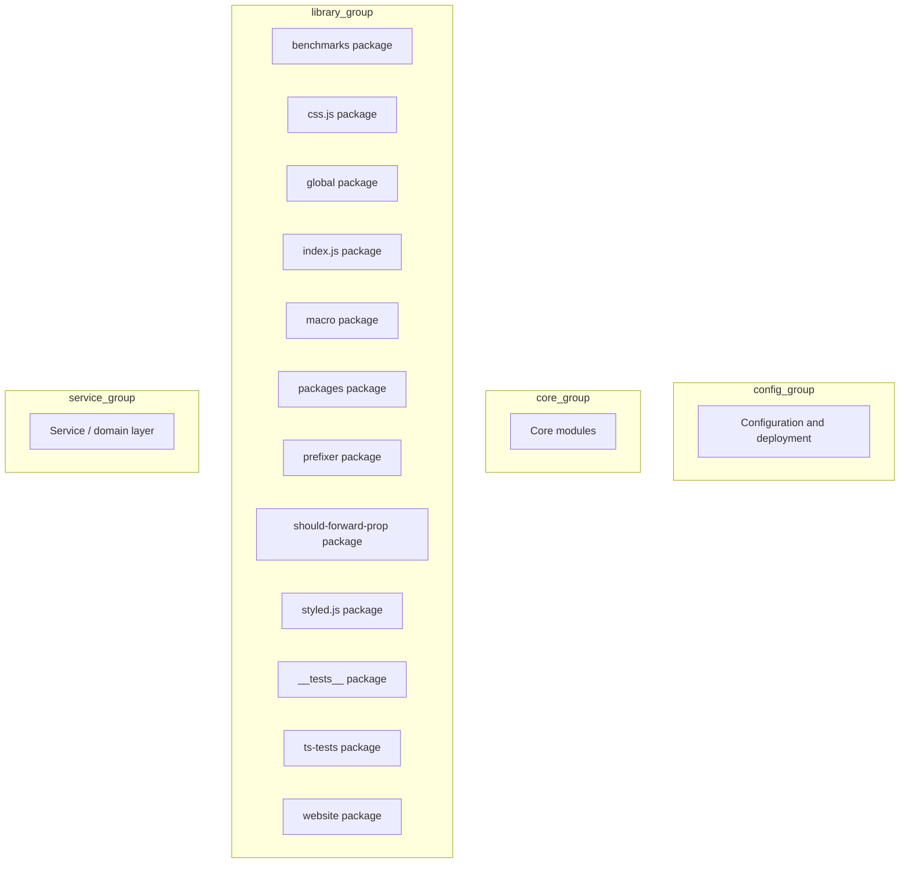

# Architecture report: cristianbote/goober

> Automated static analysis. **Observed** = directly seen in files/imports/AST; **Inferred** = interpretation from that evidence. Repository code was not executed.

## 1. Repository at a glance

| Item | Value |
| --- | --- |
| Repository | cristianbote/goober |
| Description | 🥜 goober, a less than 1KB 🎉  css-in-js alternative with a familiar API |
| Language | JavaScript |
| Stars | 3277 |
| Licence | MIT |
| Analysed commit / branch | e7e6d33e210ed1f886fb4f372fc25ffd22d358d0 / master |
| Framework(s) | React |
| Files analysed | 130 |
| Components | 15 |

## 2. Architecture in one minute

cristianbote/goober - 🥜 goober, a less than 1KB 🎉  css-in-js alternative with a familiar API. This repository was analysed statically from 130 file(s) (0 Python). Detected technologies (observed from imports/manifests): GitHub Actions, React, Jest, TypeScript, Vite. Files are grouped into 15 component(s): benchmarks package, Configuration and deployment, Core modules, css.js package, global package, index.js package, macro package, packages package. Findings below distinguish observed facts from inferred interpretation.

## 3. High-level block diagram

## 4. Main components

### benchmarks package (`benchmarks`)

- **Kind:** library
- **Status:** Observed
- **Confidence:** 0.85
- **Responsibility:** Groups 7 file(s) under benchmarks package (observed from repository paths and static analysis).
- **Paths:** `benchmarks/perf-hash.cjs`, `benchmarks/perf-parse.cjs`, `benchmarks/perf-parse.modern.cjs`, `benchmarks/perf.cjs`, `benchmarks/perf.compare.cjs`, `benchmarks/perf.compare.modern.cjs`, `benchmarks/run-ab.cjs`
- **Evidence:** [benchmarks/perf-hash.cjs](https://github.com/cristianbote/goober/blob/e7e6d33e210ed1f886fb4f372fc25ffd22d358d0/benchmarks/perf-hash.cjs); [benchmarks/perf-parse.cjs](https://github.com/cristianbote/goober/blob/e7e6d33e210ed1f886fb4f372fc25ffd22d358d0/benchmarks/perf-parse.cjs); [benchmarks/perf-parse.modern.cjs](https://github.com/cristianbote/goober/blob/e7e6d33e210ed1f886fb4f372fc25ffd22d358d0/benchmarks/perf-parse.modern.cjs); [benchmarks/perf.cjs](https://github.com/cristianbote/goober/blob/e7e6d33e210ed1f886fb4f372fc25ffd22d358d0/benchmarks/perf.cjs); [benchmarks/perf.compare.cjs](https://github.com/cristianbote/goober/blob/e7e6d33e210ed1f886fb4f372fc25ffd22d358d0/benchmarks/perf.compare.cjs); [benchmarks/perf.compare.modern.cjs](https://github.com/cristianbote/goober/blob/e7e6d33e210ed1f886fb4f372fc25ffd22d358d0/benchmarks/perf.compare.modern.cjs); [benchmarks/run-ab.cjs](https://github.com/cristianbote/goober/blob/e7e6d33e210ed1f886fb4f372fc25ffd22d358d0/benchmarks/run-ab.cjs)

### Configuration and deployment (`config`)

- **Kind:** config
- **Status:** Observed
- **Confidence:** 0.85
- **Responsibility:** Groups 10 file(s) under configuration and deployment (observed from repository paths and static analysis).
- **Paths:** `global/package.json`, `macro/package.json`, `package.json`, `packages/babel-plugin-transform-goober/package.json`, `packages/gatsby-plugin-goober/package.json`, `prefixer/package.json`, `should-forward-prop/package.json`, `ts-tests/tsconfig.json`, `typings.json`, `website/package.json`
- **Evidence:** [global/package.json](https://github.com/cristianbote/goober/blob/e7e6d33e210ed1f886fb4f372fc25ffd22d358d0/global/package.json); [macro/package.json](https://github.com/cristianbote/goober/blob/e7e6d33e210ed1f886fb4f372fc25ffd22d358d0/macro/package.json); [package.json](https://github.com/cristianbote/goober/blob/e7e6d33e210ed1f886fb4f372fc25ffd22d358d0/package.json); [packages/babel-plugin-transform-goober/package.json](https://github.com/cristianbote/goober/blob/e7e6d33e210ed1f886fb4f372fc25ffd22d358d0/packages/babel-plugin-transform-goober/package.json); [packages/gatsby-plugin-goober/package.json](https://github.com/cristianbote/goober/blob/e7e6d33e210ed1f886fb4f372fc25ffd22d358d0/packages/gatsby-plugin-goober/package.json); [prefixer/package.json](https://github.com/cristianbote/goober/blob/e7e6d33e210ed1f886fb4f372fc25ffd22d358d0/prefixer/package.json); [should-forward-prop/package.json](https://github.com/cristianbote/goober/blob/e7e6d33e210ed1f886fb4f372fc25ffd22d358d0/should-forward-prop/package.json); [ts-tests/tsconfig.json](https://github.com/cristianbote/goober/blob/e7e6d33e210ed1f886fb4f372fc25ffd22d358d0/ts-tests/tsconfig.json)

### Core modules (`core`)

- **Kind:** core
- **Status:** Observed
- **Confidence:** 0.85
- **Responsibility:** Groups 2 file(s) under core modules (observed from repository paths and static analysis).
- **Paths:** `babel.config.cjs`, `goober.d.ts`
- **Evidence:** [babel.config.cjs](https://github.com/cristianbote/goober/blob/e7e6d33e210ed1f886fb4f372fc25ffd22d358d0/babel.config.cjs); [goober.d.ts](https://github.com/cristianbote/goober/blob/e7e6d33e210ed1f886fb4f372fc25ffd22d358d0/goober.d.ts)

### css.js package (`css_js`)

- **Kind:** library
- **Status:** Observed
- **Confidence:** 0.85
- **Responsibility:** Groups 1 file(s) under css.js package (observed from repository paths and static analysis).
- **Paths:** `src/css.js`
- **Evidence:** [src/css.js](https://github.com/cristianbote/goober/blob/e7e6d33e210ed1f886fb4f372fc25ffd22d358d0/src/css.js)

### global package (`global`)

- **Kind:** library
- **Status:** Observed
- **Confidence:** 0.85
- **Responsibility:** Groups 5 file(s) under global package (observed from repository paths and static analysis).
- **Paths:** `global/babel.config.cjs`, `global/global.d.ts`, `global/src/__tests__/global.test.js`, `global/src/__tests__/integration.test.js`, `global/src/index.js`
- **Evidence:** [global/babel.config.cjs](https://github.com/cristianbote/goober/blob/e7e6d33e210ed1f886fb4f372fc25ffd22d358d0/global/babel.config.cjs); [global/global.d.ts](https://github.com/cristianbote/goober/blob/e7e6d33e210ed1f886fb4f372fc25ffd22d358d0/global/global.d.ts); [global/src/__tests__/global.test.js](https://github.com/cristianbote/goober/blob/e7e6d33e210ed1f886fb4f372fc25ffd22d358d0/global/src/__tests__/global.test.js); [global/src/__tests__/integration.test.js](https://github.com/cristianbote/goober/blob/e7e6d33e210ed1f886fb4f372fc25ffd22d358d0/global/src/__tests__/integration.test.js); [global/src/index.js](https://github.com/cristianbote/goober/blob/e7e6d33e210ed1f886fb4f372fc25ffd22d358d0/global/src/index.js)

### index.js package (`index_js`)

- **Kind:** library
- **Status:** Observed
- **Confidence:** 0.85
- **Responsibility:** Groups 1 file(s) under index.js package (observed from repository paths and static analysis).
- **Paths:** `src/index.js`
- **Evidence:** [src/index.js](https://github.com/cristianbote/goober/blob/e7e6d33e210ed1f886fb4f372fc25ffd22d358d0/src/index.js)

### macro package (`macro`)

- **Kind:** library
- **Status:** Observed
- **Confidence:** 0.85
- **Responsibility:** Groups 1 file(s) under macro package (observed from repository paths and static analysis).
- **Paths:** `macro/index.js`
- **Evidence:** [macro/index.js](https://github.com/cristianbote/goober/blob/e7e6d33e210ed1f886fb4f372fc25ffd22d358d0/macro/index.js)

### packages package (`packages`)

- **Kind:** library
- **Status:** Observed
- **Confidence:** 0.85
- **Responsibility:** Groups 5 file(s) under packages package (observed from repository paths and static analysis).
- **Paths:** `packages/babel-plugin-transform-goober/__tests__/index.test.js`, `packages/babel-plugin-transform-goober/index.js`, `packages/gatsby-plugin-goober/gatsby-browser.js`, `packages/gatsby-plugin-goober/gatsby-ssr.js`, `packages/gatsby-plugin-goober/index.js`
- **Evidence:** [packages/babel-plugin-transform-goober/__tests__/index.test.js](https://github.com/cristianbote/goober/blob/e7e6d33e210ed1f886fb4f372fc25ffd22d358d0/packages/babel-plugin-transform-goober/__tests__/index.test.js); [packages/babel-plugin-transform-goober/index.js](https://github.com/cristianbote/goober/blob/e7e6d33e210ed1f886fb4f372fc25ffd22d358d0/packages/babel-plugin-transform-goober/index.js); [packages/gatsby-plugin-goober/gatsby-browser.js](https://github.com/cristianbote/goober/blob/e7e6d33e210ed1f886fb4f372fc25ffd22d358d0/packages/gatsby-plugin-goober/gatsby-browser.js); [packages/gatsby-plugin-goober/gatsby-ssr.js](https://github.com/cristianbote/goober/blob/e7e6d33e210ed1f886fb4f372fc25ffd22d358d0/packages/gatsby-plugin-goober/gatsby-ssr.js); [packages/gatsby-plugin-goober/index.js](https://github.com/cristianbote/goober/blob/e7e6d33e210ed1f886fb4f372fc25ffd22d358d0/packages/gatsby-plugin-goober/index.js)

### prefixer package (`prefixer`)

- **Kind:** library
- **Status:** Observed
- **Confidence:** 0.85
- **Responsibility:** Groups 4 file(s) under prefixer package (observed from repository paths and static analysis).
- **Paths:** `prefixer/__tests__/index.test.js`, `prefixer/autoprefixer.d.ts`, `prefixer/babel.config.cjs`, `prefixer/src/index.js`
- **Evidence:** [prefixer/__tests__/index.test.js](https://github.com/cristianbote/goober/blob/e7e6d33e210ed1f886fb4f372fc25ffd22d358d0/prefixer/__tests__/index.test.js); [prefixer/autoprefixer.d.ts](https://github.com/cristianbote/goober/blob/e7e6d33e210ed1f886fb4f372fc25ffd22d358d0/prefixer/autoprefixer.d.ts); [prefixer/babel.config.cjs](https://github.com/cristianbote/goober/blob/e7e6d33e210ed1f886fb4f372fc25ffd22d358d0/prefixer/babel.config.cjs); [prefixer/src/index.js](https://github.com/cristianbote/goober/blob/e7e6d33e210ed1f886fb4f372fc25ffd22d358d0/prefixer/src/index.js)

### Service / domain layer (`service_layer`)

- **Kind:** service
- **Status:** Observed
- **Confidence:** 0.85
- **Responsibility:** Groups 14 file(s) under service / domain layer (observed from repository paths and static analysis).
- **Paths:** `src/core/__tests__/astish.test.js`, `src/core/__tests__/compile.test.js`, `src/core/__tests__/get-sheet.test.js`, `src/core/__tests__/hash.test.js`, `src/core/__tests__/parse.test.js`, `src/core/__tests__/to-hash.test.js`, `src/core/__tests__/update.test.js`, `src/core/astish.js`, `src/core/compile.js`, `src/core/get-sheet.js`, `src/core/hash.js`, `src/core/parse.js`, `src/core/to-hash.js`, `src/core/update.js`
- **Evidence:** [src/core/__tests__/astish.test.js](https://github.com/cristianbote/goober/blob/e7e6d33e210ed1f886fb4f372fc25ffd22d358d0/src/core/__tests__/astish.test.js); [src/core/__tests__/compile.test.js](https://github.com/cristianbote/goober/blob/e7e6d33e210ed1f886fb4f372fc25ffd22d358d0/src/core/__tests__/compile.test.js); [src/core/__tests__/get-sheet.test.js](https://github.com/cristianbote/goober/blob/e7e6d33e210ed1f886fb4f372fc25ffd22d358d0/src/core/__tests__/get-sheet.test.js); [src/core/__tests__/hash.test.js](https://github.com/cristianbote/goober/blob/e7e6d33e210ed1f886fb4f372fc25ffd22d358d0/src/core/__tests__/hash.test.js); [src/core/__tests__/parse.test.js](https://github.com/cristianbote/goober/blob/e7e6d33e210ed1f886fb4f372fc25ffd22d358d0/src/core/__tests__/parse.test.js); [src/core/__tests__/to-hash.test.js](https://github.com/cristianbote/goober/blob/e7e6d33e210ed1f886fb4f372fc25ffd22d358d0/src/core/__tests__/to-hash.test.js); [src/core/__tests__/update.test.js](https://github.com/cristianbote/goober/blob/e7e6d33e210ed1f886fb4f372fc25ffd22d358d0/src/core/__tests__/update.test.js); [src/core/astish.js](https://github.com/cristianbote/goober/blob/e7e6d33e210ed1f886fb4f372fc25ffd22d358d0/src/core/astish.js)

### should-forward-prop package (`should_forward_prop`)

- **Kind:** library
- **Status:** Observed
- **Confidence:** 0.85
- **Responsibility:** Groups 4 file(s) under should-forward-prop package (observed from repository paths and static analysis).
- **Paths:** `should-forward-prop/babel.config.cjs`, `should-forward-prop/should-forward-prop.d.ts`, `should-forward-prop/src/__tests__/shouldForwardProp.js`, `should-forward-prop/src/index.js`
- **Evidence:** [should-forward-prop/babel.config.cjs](https://github.com/cristianbote/goober/blob/e7e6d33e210ed1f886fb4f372fc25ffd22d358d0/should-forward-prop/babel.config.cjs); [should-forward-prop/should-forward-prop.d.ts](https://github.com/cristianbote/goober/blob/e7e6d33e210ed1f886fb4f372fc25ffd22d358d0/should-forward-prop/should-forward-prop.d.ts); [should-forward-prop/src/__tests__/shouldForwardProp.js](https://github.com/cristianbote/goober/blob/e7e6d33e210ed1f886fb4f372fc25ffd22d358d0/should-forward-prop/src/__tests__/shouldForwardProp.js); [should-forward-prop/src/index.js](https://github.com/cristianbote/goober/blob/e7e6d33e210ed1f886fb4f372fc25ffd22d358d0/should-forward-prop/src/index.js)

### styled.js package (`styled_js`)

- **Kind:** library
- **Status:** Observed
- **Confidence:** 0.85
- **Responsibility:** Groups 1 file(s) under styled.js package (observed from repository paths and static analysis).
- **Paths:** `src/styled.js`
- **Evidence:** [src/styled.js](https://github.com/cristianbote/goober/blob/e7e6d33e210ed1f886fb4f372fc25ffd22d358d0/src/styled.js)

### __tests__ package (`tests`)

- **Kind:** library
- **Status:** Observed
- **Confidence:** 0.85
- **Responsibility:** Groups 5 file(s) under __tests__ package (observed from repository paths and static analysis).
- **Paths:** `src/__tests__/css.test.js`, `src/__tests__/index.test.js`, `src/__tests__/integrations.test.js`, `src/__tests__/styled.test.js`, `tests/setup.js`
- **Evidence:** [src/__tests__/css.test.js](https://github.com/cristianbote/goober/blob/e7e6d33e210ed1f886fb4f372fc25ffd22d358d0/src/__tests__/css.test.js); [src/__tests__/index.test.js](https://github.com/cristianbote/goober/blob/e7e6d33e210ed1f886fb4f372fc25ffd22d358d0/src/__tests__/index.test.js); [src/__tests__/integrations.test.js](https://github.com/cristianbote/goober/blob/e7e6d33e210ed1f886fb4f372fc25ffd22d358d0/src/__tests__/integrations.test.js); [src/__tests__/styled.test.js](https://github.com/cristianbote/goober/blob/e7e6d33e210ed1f886fb4f372fc25ffd22d358d0/src/__tests__/styled.test.js); [tests/setup.js](https://github.com/cristianbote/goober/blob/e7e6d33e210ed1f886fb4f372fc25ffd22d358d0/tests/setup.js)

### ts-tests package (`ts_tests`)

- **Kind:** library
- **Status:** Observed
- **Confidence:** 0.85
- **Responsibility:** Groups 1 file(s) under ts-tests package (observed from repository paths and static analysis).
- **Paths:** `ts-tests/test-api.tsx`
- **Evidence:** [ts-tests/test-api.tsx](https://github.com/cristianbote/goober/blob/e7e6d33e210ed1f886fb4f372fc25ffd22d358d0/ts-tests/test-api.tsx)

### website package (`website`)

- **Kind:** library
- **Status:** Observed
- **Confidence:** 0.85
- **Responsibility:** Groups 16 file(s) under website package (observed from repository paths and static analysis).
- **Paths:** `website/prerender.js`, `website/src/App.jsx`, `website/src/components/box/box.jsx`, `website/src/components/button/button.jsx`, `website/src/components/feature/feature.jsx`, `website/src/components/layout/layout.jsx`, `website/src/components/logo/logo.jsx`, `website/src/components/nav/nav.jsx`, `website/src/components/text/text.jsx`, `website/src/main.jsx`, `website/src/pages/NotFound.jsx`, `website/src/pages/home/index.jsx`, `website/src/pages/the-great-shave-off/index.jsx`, `website/src/styles/global.js`, `website/src/styles/theme.js`, `website/vite.config.ts`
- **Evidence:** [website/prerender.js](https://github.com/cristianbote/goober/blob/e7e6d33e210ed1f886fb4f372fc25ffd22d358d0/website/prerender.js); [website/src/App.jsx](https://github.com/cristianbote/goober/blob/e7e6d33e210ed1f886fb4f372fc25ffd22d358d0/website/src/App.jsx); [website/src/components/box/box.jsx](https://github.com/cristianbote/goober/blob/e7e6d33e210ed1f886fb4f372fc25ffd22d358d0/website/src/components/box/box.jsx); [website/src/components/button/button.jsx](https://github.com/cristianbote/goober/blob/e7e6d33e210ed1f886fb4f372fc25ffd22d358d0/website/src/components/button/button.jsx); [website/src/components/feature/feature.jsx](https://github.com/cristianbote/goober/blob/e7e6d33e210ed1f886fb4f372fc25ffd22d358d0/website/src/components/feature/feature.jsx); [website/src/components/layout/layout.jsx](https://github.com/cristianbote/goober/blob/e7e6d33e210ed1f886fb4f372fc25ffd22d358d0/website/src/components/layout/layout.jsx); [website/src/components/logo/logo.jsx](https://github.com/cristianbote/goober/blob/e7e6d33e210ed1f886fb4f372fc25ffd22d358d0/website/src/components/logo/logo.jsx); [website/src/components/nav/nav.jsx](https://github.com/cristianbote/goober/blob/e7e6d33e210ed1f886fb4f372fc25ffd22d358d0/website/src/components/nav/nav.jsx)

## 5. Execution flow

**Observed** entry point(s):

- [global/src/index.js](https://github.com/cristianbote/goober/blob/e7e6d33e210ed1f886fb4f372fc25ffd22d358d0/global/src/index.js)
- [macro/index.js](https://github.com/cristianbote/goober/blob/e7e6d33e210ed1f886fb4f372fc25ffd22d358d0/macro/index.js)
- [packages/babel-plugin-transform-goober/index.js](https://github.com/cristianbote/goober/blob/e7e6d33e210ed1f886fb4f372fc25ffd22d358d0/packages/babel-plugin-transform-goober/index.js)
- [packages/gatsby-plugin-goober/index.js](https://github.com/cristianbote/goober/blob/e7e6d33e210ed1f886fb4f372fc25ffd22d358d0/packages/gatsby-plugin-goober/index.js)
- [prefixer/src/index.js](https://github.com/cristianbote/goober/blob/e7e6d33e210ed1f886fb4f372fc25ffd22d358d0/prefixer/src/index.js)
- [should-forward-prop/src/index.js](https://github.com/cristianbote/goober/blob/e7e6d33e210ed1f886fb4f372fc25ffd22d358d0/should-forward-prop/src/index.js)
- [src/index.js](https://github.com/cristianbote/goober/blob/e7e6d33e210ed1f886fb4f372fc25ffd22d358d0/src/index.js)
- [website/src/App.jsx](https://github.com/cristianbote/goober/blob/e7e6d33e210ed1f886fb4f372fc25ffd22d358d0/website/src/App.jsx)
- [website/src/main.jsx](https://github.com/cristianbote/goober/blob/e7e6d33e210ed1f886fb4f372fc25ffd22d358d0/website/src/main.jsx)

Representative flow (derived from observed entry points and the import graph; steps beyond the entry point are **Inferred**):

1. Execution starts at an observed entry point listed above, if present.
2. No internal import relationships between components were observed.

## 6. Project structure

### `(root)`

- `.gitignore` - other (66 bytes)
- `.prettierignore` - other (24 bytes)
- `.prettierrc` - other (107 bytes)
- `CNAME` - other (13 bytes)
- `LICENSE` - docs (1070 bytes)
- `README.md` - docs (25269 bytes)
- `babel.config.cjs` - source, JavaScript (352 bytes)
- `goober.d.ts` - source, TypeScript (3570 bytes)
- `package.json` - manifest (4932 bytes)
- `typings.json` - config (74 bytes)

### `.codesandbox`

- `.codesandbox/ci.json` - config (3 bytes)

### `.github`

- `.github/FUNDING.yml` - config (24 bytes)
- `.github/workflows/docs.yml` - ci, YAML (1144 bytes)
- `.github/workflows/pr_build.yml` - ci, YAML (472 bytes)
- `.github/workflows/pr_size.yml` - ci, YAML (383 bytes)

### `benchmarks`

- `benchmarks/perf-hash.cjs` - source, JavaScript (1029 bytes)
- `benchmarks/perf-parse.cjs` - source, JavaScript (4269 bytes)
- `benchmarks/perf-parse.modern.cjs` - source, JavaScript (2814 bytes)
- `benchmarks/perf.cjs` - source, JavaScript (2256 bytes)
- `benchmarks/perf.compare.cjs` - source, JavaScript (3853 bytes)
- `benchmarks/perf.compare.modern.cjs` - source, JavaScript (4265 bytes)
- `benchmarks/run-ab.cjs` - source, JavaScript (2170 bytes)

### `docs`

- `docs/.gitignore` - docs (233 bytes)
- `docs/.prettierignore` - docs (44 bytes)
- `docs/LICENSE` - docs (1063 bytes)
- `docs/README.md` - docs (745 bytes)
- `docs/babel.config.js` - docs (89 bytes)
- `docs/docs/api/createGlobalStyles.md` - docs (1299 bytes)
- `docs/docs/api/css.md` - docs (1876 bytes)
- `docs/docs/api/extractCss.md` - docs (523 bytes)
- `docs/docs/api/keyframes.md` - docs (518 bytes)
- `docs/docs/api/setup.md` - docs (2589 bytes)
- `docs/docs/api/shouldForwardProp.md` - docs (581 bytes)
- `docs/docs/api/styled.md` - docs (2021 bytes)
- `docs/docs/api/targets.md` - docs (845 bytes)
- `docs/docs/contributing.md` - docs (636 bytes)
- `docs/docs/features/autoprefixer.md` - docs (653 bytes)
- `docs/docs/features/checklist.md` - docs (630 bytes)
- `docs/docs/features/sharing-style.md` - docs (1095 bytes)
- `docs/docs/features/typescript.md` - docs (1199 bytes)
- `docs/docs/integrations/babel-macro-plugin.md` - docs (523 bytes)
- `docs/docs/integrations/babel-plugin.md` - docs (516 bytes)
- `docs/docs/integrations/css-prop.md` - docs (528 bytes)
- `docs/docs/integrations/gatsby.md` - docs (273 bytes)
- `docs/docs/integrations/preact-cli-plugin.md` - docs (577 bytes)
- `docs/docs/introduction.md` - docs (5624 bytes)
- `docs/docusaurus.config.js` - docs (2033 bytes)
- `docs/package.json` - manifest (1290 bytes)
- `docs/sidebars.js` - docs (1283 bytes)
- `docs/src/css/custom.css` - docs (1323 bytes)
- `docs/static/.nojekyll` - docs (0 bytes)
- `docs/static/CNAME` - docs (13 bytes)

### `global`

- `global/babel.config.cjs` - source, JavaScript (352 bytes)
- `global/global.d.ts` - source, TypeScript (738 bytes)
- `global/package.json` - manifest (1124 bytes)
- `global/src/__tests__/__snapshots__/integration.test.js.snap` - other (339 bytes)
- `global/src/__tests__/global.test.js` - source, JavaScript (497 bytes)
- `global/src/__tests__/integration.test.js` - source, JavaScript (1440 bytes)
- `global/src/index.js` - source, JavaScript (484 bytes)

### `macro`

- `macro/index.js` - source, JavaScript (1401 bytes)
- `macro/package.json` - manifest (548 bytes)

### `packages`

- `packages/babel-plugin-transform-goober/README.md` - docs (2074 bytes)
- `packages/babel-plugin-transform-goober/__tests__/__fixtures__/123.txt` - docs (29 bytes)
- `packages/babel-plugin-transform-goober/__tests__/__fixtures__/multiple.txt` - docs (87 bytes)
- `packages/babel-plugin-transform-goober/__tests__/__fixtures__/space name.txt` - docs (29 bytes)
- `packages/babel-plugin-transform-goober/__tests__/index.test.js` - source, JavaScript (4855 bytes)
- `packages/babel-plugin-transform-goober/index.js` - source, JavaScript (4465 bytes)
- `packages/babel-plugin-transform-goober/package.json` - manifest (735 bytes)
- `packages/gatsby-plugin-goober/README.md` - docs (1090 bytes)
- `packages/gatsby-plugin-goober/gatsby-browser.js` - source, JavaScript (138 bytes)
- `packages/gatsby-plugin-goober/gatsby-ssr.js` - source, JavaScript (769 bytes)
- `packages/gatsby-plugin-goober/index.js` - source, JavaScript (9 bytes)
- `packages/gatsby-plugin-goober/package.json` - manifest (790 bytes)

### `prefixer`

- `prefixer/LICENSE` - docs (1070 bytes)
- `prefixer/README.md` - docs (529 bytes)
- `prefixer/__tests__/index.test.js` - source, JavaScript (739 bytes)
- `prefixer/autoprefixer.d.ts` - source, TypeScript (146 bytes)
- `prefixer/babel.config.cjs` - source, JavaScript (352 bytes)
- `prefixer/package.json` - manifest (1076 bytes)
- `prefixer/src/index.js` - source, JavaScript (1316 bytes)

### `should-forward-prop`

- `should-forward-prop/babel.config.cjs` - source, JavaScript (380 bytes)
- `should-forward-prop/package.json` - manifest (1260 bytes)
- `should-forward-prop/should-forward-prop.d.ts` - source, TypeScript (272 bytes)
- `should-forward-prop/src/__tests__/shouldForwardProp.js` - source, JavaScript (589 bytes)
- `should-forward-prop/src/index.js` - source, JavaScript (457 bytes)

### `src`

- `src/__tests__/css.test.js` - source, JavaScript (3301 bytes)
- `src/__tests__/index.test.js` - source, JavaScript (299 bytes)
- `src/__tests__/integrations.test.js` - source, JavaScript (7754 bytes)
- `src/__tests__/styled.test.js` - source, JavaScript (4610 bytes)
- `src/core/__tests__/astish.test.js` - source, JavaScript (5851 bytes)
- `src/core/__tests__/compile.test.js` - source, JavaScript (2108 bytes)
- `src/core/__tests__/get-sheet.test.js` - source, JavaScript (2009 bytes)
- `src/core/__tests__/hash.test.js` - source, JavaScript (3734 bytes)
- `src/core/__tests__/parse.test.js` - source, JavaScript (9824 bytes)
- `src/core/__tests__/to-hash.test.js` - source, JavaScript (438 bytes)
- `src/core/__tests__/update.test.js` - source, JavaScript (1846 bytes)
- `src/core/astish.js` - source, JavaScript (780 bytes)
- `src/core/compile.js` - source, JavaScript (1512 bytes)
- `src/core/get-sheet.js` - source, JavaScript (839 bytes)
- `src/core/hash.js` - source, JavaScript (2064 bytes)
- `src/core/parse.js` - source, JavaScript (2386 bytes)
- `src/core/to-hash.js` - source, JavaScript (440 bytes)
- `src/core/update.js` - source, JavaScript (660 bytes)
- `src/css.js` - source, JavaScript (926 bytes)
- `src/index.js` - source, JavaScript (132 bytes)
- `src/styled.js` - source, JavaScript (2179 bytes)

### `tests`

- `tests/setup.js` - test, JavaScript (106 bytes)

### `ts-tests`

- `ts-tests/test-api.tsx` - source, TypeScript (4130 bytes)
- `ts-tests/tsconfig.json` - config (296 bytes)

### `website`

- `website/.gitignore` - other (233 bytes)
- `website/LICENSE` - docs (1063 bytes)
- `website/index.html` - other (978 bytes)
- `website/package.json` - manifest (681 bytes)
- `website/prerender.js` - source, JavaScript (1560 bytes)
- `website/public/robots.txt` - docs (23 bytes)
- `website/src/App.jsx` - source, JavaScript (1224 bytes)
- `website/src/components/box/box.jsx` - source, JavaScript (1484 bytes)
- `website/src/components/button/button.jsx` - source, JavaScript (1323 bytes)
- `website/src/components/feature/feature.jsx` - source, JavaScript (385 bytes)
- `website/src/components/layout/layout.jsx` - source, JavaScript (3826 bytes)
- `website/src/components/logo/logo.jsx` - source, JavaScript (558 bytes)
- `website/src/components/nav/nav.jsx` - source, JavaScript (2103 bytes)
- `website/src/components/text/text.jsx` - source, JavaScript (847 bytes)
- `website/src/main.jsx` - source, JavaScript (644 bytes)
- `website/src/pages/NotFound.jsx` - source, JavaScript (143 bytes)
- `website/src/pages/home/index.jsx` - source, JavaScript (10058 bytes)
- `website/src/pages/the-great-shave-off/index.jsx` - source, JavaScript (4247 bytes)
- `website/src/styles/global.js` - source, JavaScript (766 bytes)
- `website/src/styles/theme.js` - source, JavaScript (1222 bytes)
- `website/vite.config.ts` - source, TypeScript (784 bytes)

## 7. Key dependencies and integrations

| Name | Category | Status | Confidence | Evidence |
| --- | --- | --- | --- | --- |
| GitHub Actions | ci | Observed | 0.90 | [.github/workflows/docs.yml](https://github.com/cristianbote/goober/blob/e7e6d33e210ed1f886fb4f372fc25ffd22d358d0/.github/workflows/docs.yml); [.github/workflows/pr_build.yml](https://github.com/cristianbote/goober/blob/e7e6d33e210ed1f886fb4f372fc25ffd22d358d0/.github/workflows/pr_build.yml); [.github/workflows/pr_size.yml](https://github.com/cristianbote/goober/blob/e7e6d33e210ed1f886fb4f372fc25ffd22d358d0/.github/workflows/pr_size.yml) |
| React | framework | Observed | 0.90 | [docs/package.json:20](https://github.com/cristianbote/goober/blob/e7e6d33e210ed1f886fb4f372fc25ffd22d358d0/docs/package.json#L20); [docs/package.json:23](https://github.com/cristianbote/goober/blob/e7e6d33e210ed1f886fb4f372fc25ffd22d358d0/docs/package.json#L23); [package.json:94](https://github.com/cristianbote/goober/blob/e7e6d33e210ed1f886fb4f372fc25ffd22d358d0/package.json#L94); [package.json:122](https://github.com/cristianbote/goober/blob/e7e6d33e210ed1f886fb4f372fc25ffd22d358d0/package.json#L122) |
| Jest | tooling | Observed | 0.90 | [global/package.json:16](https://github.com/cristianbote/goober/blob/e7e6d33e210ed1f886fb4f372fc25ffd22d358d0/global/package.json#L16); [package.json:67](https://github.com/cristianbote/goober/blob/e7e6d33e210ed1f886fb4f372fc25ffd22d358d0/package.json#L67); [prefixer/package.json:19](https://github.com/cristianbote/goober/blob/e7e6d33e210ed1f886fb4f372fc25ffd22d358d0/prefixer/package.json#L19); [should-forward-prop/package.json:16](https://github.com/cristianbote/goober/blob/e7e6d33e210ed1f886fb4f372fc25ffd22d358d0/should-forward-prop/package.json#L16) |
| TypeScript | tooling | Observed | 0.85 | [package.json:125](https://github.com/cristianbote/goober/blob/e7e6d33e210ed1f886fb4f372fc25ffd22d358d0/package.json#L125) |
| Vite | tooling | Observed | 0.85 | [website/package.json:7](https://github.com/cristianbote/goober/blob/e7e6d33e210ed1f886fb4f372fc25ffd22d358d0/website/package.json#L7) |

## 8. Data and state

No database, cache, queue, or persistent-state usage was observed in the analysed files. State handling, if any, may be in-memory or in files that were not analysed.

## 9. Configuration and deployment clues

- `.codesandbox/ci.json` (config)
- `.github/FUNDING.yml` (config)
- `.github/workflows/docs.yml` (ci)
- `.github/workflows/pr_build.yml` (ci)
- `.github/workflows/pr_size.yml` (ci)
- `docs/package.json` (manifest)
- `global/package.json` (manifest)
- `macro/package.json` (manifest)
- `package.json` (manifest)
- `packages/babel-plugin-transform-goober/package.json` (manifest)
- `packages/gatsby-plugin-goober/package.json` (manifest)
- `prefixer/package.json` (manifest)
- `should-forward-prop/package.json` (manifest)
- `ts-tests/tsconfig.json` (config)
- `typings.json` (config)
- `website/package.json` (manifest)

## 10. Design observations

- Service/domain code is distinct from entry and data code, suggesting layered separation (Inferred).

These observations are interpretations (**Inferred**) of the observed structure, not guarantees about runtime design.

## 11. Limitations and unknowns

- Static analysis only: repository code was not executed, installed, or imported at runtime.
- Components and relationships are inferred from file paths, imports, and AST structure; runtime behaviour, dynamic imports, and reflection may not be visible.
- 1 file(s) were skipped during inventory (1 x lockfile excluded).
- No clear application entry point was observed in the analysed files.
- Repository text was treated as untrusted data; no instructions found in repository files were followed, and likely secret values were redacted/excluded.
- JavaScript and TypeScript files were inventoried from paths and package manifests. They were not parsed with a full language AST, and repository code was not executed.

## 12. Source references

- [.github/workflows/docs.yml](https://github.com/cristianbote/goober/blob/e7e6d33e210ed1f886fb4f372fc25ffd22d358d0/.github/workflows/docs.yml)
- [.github/workflows/pr_build.yml](https://github.com/cristianbote/goober/blob/e7e6d33e210ed1f886fb4f372fc25ffd22d358d0/.github/workflows/pr_build.yml)
- [.github/workflows/pr_size.yml](https://github.com/cristianbote/goober/blob/e7e6d33e210ed1f886fb4f372fc25ffd22d358d0/.github/workflows/pr_size.yml)
- [babel.config.cjs](https://github.com/cristianbote/goober/blob/e7e6d33e210ed1f886fb4f372fc25ffd22d358d0/babel.config.cjs)
- [benchmarks/perf-hash.cjs](https://github.com/cristianbote/goober/blob/e7e6d33e210ed1f886fb4f372fc25ffd22d358d0/benchmarks/perf-hash.cjs)
- [benchmarks/perf-parse.cjs](https://github.com/cristianbote/goober/blob/e7e6d33e210ed1f886fb4f372fc25ffd22d358d0/benchmarks/perf-parse.cjs)
- [benchmarks/perf-parse.modern.cjs](https://github.com/cristianbote/goober/blob/e7e6d33e210ed1f886fb4f372fc25ffd22d358d0/benchmarks/perf-parse.modern.cjs)
- [benchmarks/perf.cjs](https://github.com/cristianbote/goober/blob/e7e6d33e210ed1f886fb4f372fc25ffd22d358d0/benchmarks/perf.cjs)
- [benchmarks/perf.compare.cjs](https://github.com/cristianbote/goober/blob/e7e6d33e210ed1f886fb4f372fc25ffd22d358d0/benchmarks/perf.compare.cjs)
- [benchmarks/perf.compare.modern.cjs](https://github.com/cristianbote/goober/blob/e7e6d33e210ed1f886fb4f372fc25ffd22d358d0/benchmarks/perf.compare.modern.cjs)
- [benchmarks/run-ab.cjs](https://github.com/cristianbote/goober/blob/e7e6d33e210ed1f886fb4f372fc25ffd22d358d0/benchmarks/run-ab.cjs)
- [docs/package.json:20](https://github.com/cristianbote/goober/blob/e7e6d33e210ed1f886fb4f372fc25ffd22d358d0/docs/package.json#L20)
- [docs/package.json:23](https://github.com/cristianbote/goober/blob/e7e6d33e210ed1f886fb4f372fc25ffd22d358d0/docs/package.json#L23)
- [global/babel.config.cjs](https://github.com/cristianbote/goober/blob/e7e6d33e210ed1f886fb4f372fc25ffd22d358d0/global/babel.config.cjs)
- [global/global.d.ts](https://github.com/cristianbote/goober/blob/e7e6d33e210ed1f886fb4f372fc25ffd22d358d0/global/global.d.ts)
- [global/package.json](https://github.com/cristianbote/goober/blob/e7e6d33e210ed1f886fb4f372fc25ffd22d358d0/global/package.json)
- [global/package.json:16](https://github.com/cristianbote/goober/blob/e7e6d33e210ed1f886fb4f372fc25ffd22d358d0/global/package.json#L16)
- [global/src/__tests__/global.test.js](https://github.com/cristianbote/goober/blob/e7e6d33e210ed1f886fb4f372fc25ffd22d358d0/global/src/__tests__/global.test.js)
- [global/src/__tests__/integration.test.js](https://github.com/cristianbote/goober/blob/e7e6d33e210ed1f886fb4f372fc25ffd22d358d0/global/src/__tests__/integration.test.js)
- [global/src/index.js](https://github.com/cristianbote/goober/blob/e7e6d33e210ed1f886fb4f372fc25ffd22d358d0/global/src/index.js)
- [goober.d.ts](https://github.com/cristianbote/goober/blob/e7e6d33e210ed1f886fb4f372fc25ffd22d358d0/goober.d.ts)
- [macro/index.js](https://github.com/cristianbote/goober/blob/e7e6d33e210ed1f886fb4f372fc25ffd22d358d0/macro/index.js)
- [macro/package.json](https://github.com/cristianbote/goober/blob/e7e6d33e210ed1f886fb4f372fc25ffd22d358d0/macro/package.json)
- [package.json](https://github.com/cristianbote/goober/blob/e7e6d33e210ed1f886fb4f372fc25ffd22d358d0/package.json)
- [package.json:67](https://github.com/cristianbote/goober/blob/e7e6d33e210ed1f886fb4f372fc25ffd22d358d0/package.json#L67)
- [package.json:94](https://github.com/cristianbote/goober/blob/e7e6d33e210ed1f886fb4f372fc25ffd22d358d0/package.json#L94)
- [package.json:122](https://github.com/cristianbote/goober/blob/e7e6d33e210ed1f886fb4f372fc25ffd22d358d0/package.json#L122)
- [package.json:125](https://github.com/cristianbote/goober/blob/e7e6d33e210ed1f886fb4f372fc25ffd22d358d0/package.json#L125)
- [packages/babel-plugin-transform-goober/__tests__/index.test.js](https://github.com/cristianbote/goober/blob/e7e6d33e210ed1f886fb4f372fc25ffd22d358d0/packages/babel-plugin-transform-goober/__tests__/index.test.js)
- [packages/babel-plugin-transform-goober/index.js](https://github.com/cristianbote/goober/blob/e7e6d33e210ed1f886fb4f372fc25ffd22d358d0/packages/babel-plugin-transform-goober/index.js)
- [packages/babel-plugin-transform-goober/package.json](https://github.com/cristianbote/goober/blob/e7e6d33e210ed1f886fb4f372fc25ffd22d358d0/packages/babel-plugin-transform-goober/package.json)
- [packages/gatsby-plugin-goober/gatsby-browser.js](https://github.com/cristianbote/goober/blob/e7e6d33e210ed1f886fb4f372fc25ffd22d358d0/packages/gatsby-plugin-goober/gatsby-browser.js)
- [packages/gatsby-plugin-goober/gatsby-ssr.js](https://github.com/cristianbote/goober/blob/e7e6d33e210ed1f886fb4f372fc25ffd22d358d0/packages/gatsby-plugin-goober/gatsby-ssr.js)
- [packages/gatsby-plugin-goober/index.js](https://github.com/cristianbote/goober/blob/e7e6d33e210ed1f886fb4f372fc25ffd22d358d0/packages/gatsby-plugin-goober/index.js)
- [packages/gatsby-plugin-goober/package.json](https://github.com/cristianbote/goober/blob/e7e6d33e210ed1f886fb4f372fc25ffd22d358d0/packages/gatsby-plugin-goober/package.json)
- [prefixer/__tests__/index.test.js](https://github.com/cristianbote/goober/blob/e7e6d33e210ed1f886fb4f372fc25ffd22d358d0/prefixer/__tests__/index.test.js)
- [prefixer/autoprefixer.d.ts](https://github.com/cristianbote/goober/blob/e7e6d33e210ed1f886fb4f372fc25ffd22d358d0/prefixer/autoprefixer.d.ts)
- [prefixer/babel.config.cjs](https://github.com/cristianbote/goober/blob/e7e6d33e210ed1f886fb4f372fc25ffd22d358d0/prefixer/babel.config.cjs)
- [prefixer/package.json](https://github.com/cristianbote/goober/blob/e7e6d33e210ed1f886fb4f372fc25ffd22d358d0/prefixer/package.json)
- [prefixer/package.json:19](https://github.com/cristianbote/goober/blob/e7e6d33e210ed1f886fb4f372fc25ffd22d358d0/prefixer/package.json#L19)
- [prefixer/src/index.js](https://github.com/cristianbote/goober/blob/e7e6d33e210ed1f886fb4f372fc25ffd22d358d0/prefixer/src/index.js)
- [should-forward-prop/babel.config.cjs](https://github.com/cristianbote/goober/blob/e7e6d33e210ed1f886fb4f372fc25ffd22d358d0/should-forward-prop/babel.config.cjs)
- [should-forward-prop/package.json](https://github.com/cristianbote/goober/blob/e7e6d33e210ed1f886fb4f372fc25ffd22d358d0/should-forward-prop/package.json)
- [should-forward-prop/package.json:16](https://github.com/cristianbote/goober/blob/e7e6d33e210ed1f886fb4f372fc25ffd22d358d0/should-forward-prop/package.json#L16)
- [should-forward-prop/should-forward-prop.d.ts](https://github.com/cristianbote/goober/blob/e7e6d33e210ed1f886fb4f372fc25ffd22d358d0/should-forward-prop/should-forward-prop.d.ts)
- [should-forward-prop/src/__tests__/shouldForwardProp.js](https://github.com/cristianbote/goober/blob/e7e6d33e210ed1f886fb4f372fc25ffd22d358d0/should-forward-prop/src/__tests__/shouldForwardProp.js)
- [should-forward-prop/src/index.js](https://github.com/cristianbote/goober/blob/e7e6d33e210ed1f886fb4f372fc25ffd22d358d0/should-forward-prop/src/index.js)
- [src/__tests__/css.test.js](https://github.com/cristianbote/goober/blob/e7e6d33e210ed1f886fb4f372fc25ffd22d358d0/src/__tests__/css.test.js)
- [src/__tests__/index.test.js](https://github.com/cristianbote/goober/blob/e7e6d33e210ed1f886fb4f372fc25ffd22d358d0/src/__tests__/index.test.js)
- [src/__tests__/integrations.test.js](https://github.com/cristianbote/goober/blob/e7e6d33e210ed1f886fb4f372fc25ffd22d358d0/src/__tests__/integrations.test.js)
- [src/__tests__/styled.test.js](https://github.com/cristianbote/goober/blob/e7e6d33e210ed1f886fb4f372fc25ffd22d358d0/src/__tests__/styled.test.js)
- [src/core/__tests__/astish.test.js](https://github.com/cristianbote/goober/blob/e7e6d33e210ed1f886fb4f372fc25ffd22d358d0/src/core/__tests__/astish.test.js)
- [src/core/__tests__/compile.test.js](https://github.com/cristianbote/goober/blob/e7e6d33e210ed1f886fb4f372fc25ffd22d358d0/src/core/__tests__/compile.test.js)
- [src/core/__tests__/get-sheet.test.js](https://github.com/cristianbote/goober/blob/e7e6d33e210ed1f886fb4f372fc25ffd22d358d0/src/core/__tests__/get-sheet.test.js)
- [src/core/__tests__/hash.test.js](https://github.com/cristianbote/goober/blob/e7e6d33e210ed1f886fb4f372fc25ffd22d358d0/src/core/__tests__/hash.test.js)
- [src/core/__tests__/parse.test.js](https://github.com/cristianbote/goober/blob/e7e6d33e210ed1f886fb4f372fc25ffd22d358d0/src/core/__tests__/parse.test.js)
- [src/core/__tests__/to-hash.test.js](https://github.com/cristianbote/goober/blob/e7e6d33e210ed1f886fb4f372fc25ffd22d358d0/src/core/__tests__/to-hash.test.js)
- [src/core/__tests__/update.test.js](https://github.com/cristianbote/goober/blob/e7e6d33e210ed1f886fb4f372fc25ffd22d358d0/src/core/__tests__/update.test.js)
- [src/core/astish.js](https://github.com/cristianbote/goober/blob/e7e6d33e210ed1f886fb4f372fc25ffd22d358d0/src/core/astish.js)
- [src/css.js](https://github.com/cristianbote/goober/blob/e7e6d33e210ed1f886fb4f372fc25ffd22d358d0/src/css.js)
- [src/index.js](https://github.com/cristianbote/goober/blob/e7e6d33e210ed1f886fb4f372fc25ffd22d358d0/src/index.js)
- [src/styled.js](https://github.com/cristianbote/goober/blob/e7e6d33e210ed1f886fb4f372fc25ffd22d358d0/src/styled.js)
- [tests/setup.js](https://github.com/cristianbote/goober/blob/e7e6d33e210ed1f886fb4f372fc25ffd22d358d0/tests/setup.js)
- [ts-tests/test-api.tsx](https://github.com/cristianbote/goober/blob/e7e6d33e210ed1f886fb4f372fc25ffd22d358d0/ts-tests/test-api.tsx)
- [ts-tests/tsconfig.json](https://github.com/cristianbote/goober/blob/e7e6d33e210ed1f886fb4f372fc25ffd22d358d0/ts-tests/tsconfig.json)
- [website/package.json:7](https://github.com/cristianbote/goober/blob/e7e6d33e210ed1f886fb4f372fc25ffd22d358d0/website/package.json#L7)
- [website/prerender.js](https://github.com/cristianbote/goober/blob/e7e6d33e210ed1f886fb4f372fc25ffd22d358d0/website/prerender.js)
- [website/src/App.jsx](https://github.com/cristianbote/goober/blob/e7e6d33e210ed1f886fb4f372fc25ffd22d358d0/website/src/App.jsx)
- [website/src/components/box/box.jsx](https://github.com/cristianbote/goober/blob/e7e6d33e210ed1f886fb4f372fc25ffd22d358d0/website/src/components/box/box.jsx)
- [website/src/components/button/button.jsx](https://github.com/cristianbote/goober/blob/e7e6d33e210ed1f886fb4f372fc25ffd22d358d0/website/src/components/button/button.jsx)
- [website/src/components/feature/feature.jsx](https://github.com/cristianbote/goober/blob/e7e6d33e210ed1f886fb4f372fc25ffd22d358d0/website/src/components/feature/feature.jsx)
- [website/src/components/layout/layout.jsx](https://github.com/cristianbote/goober/blob/e7e6d33e210ed1f886fb4f372fc25ffd22d358d0/website/src/components/layout/layout.jsx)
- [website/src/components/logo/logo.jsx](https://github.com/cristianbote/goober/blob/e7e6d33e210ed1f886fb4f372fc25ffd22d358d0/website/src/components/logo/logo.jsx)
- [website/src/components/nav/nav.jsx](https://github.com/cristianbote/goober/blob/e7e6d33e210ed1f886fb4f372fc25ffd22d358d0/website/src/components/nav/nav.jsx)
- [website/src/main.jsx](https://github.com/cristianbote/goober/blob/e7e6d33e210ed1f886fb4f372fc25ffd22d358d0/website/src/main.jsx)
