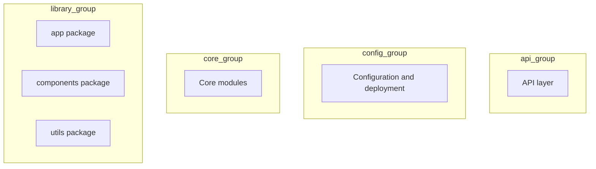

# Architecture report: cruip/open-react-template

> Automated static analysis. **Observed** = directly seen in files/imports/AST; **Inferred** = interpretation from that evidence. Repository code was not executed.

## 1. Repository at a glance

| Item | Value |
| --- | --- |
| Repository | cruip/open-react-template |
| Description | A free React / Next.js landing page template designed to showcase open source projects, SaaS products, online services, and more. Made by |
| Language | TypeScript |
| Stars | 4716 |
| Licence | Not detected |
| Analysed commit / branch | 9da36763df216be7840f3c063edcdcaf7862401e / master |
| Framework(s) | Next.js, React |
| Files analysed | 47 |
| Components | 6 |

## 2. Architecture in one minute

cruip/open-react-template - A free React / Next.js landing page template designed to showcase open source projects, SaaS products, online services, and more. Made by. This repository was analysed statically from 47 file(s) (0 Python). Detected technologies (observed from imports/manifests): Next.js, React, Tailwind CSS, TypeScript. Files are grouped into 6 component(s): API layer, app package, components package, Configuration and deployment, Core modules, utils package. Findings below distinguish observed facts from inferred interpretation.

## 3. High-level block diagram

## 4. Main components

### API layer (`api_layer`)

- **Kind:** api
- **Status:** Observed
- **Confidence:** 0.85
- **Responsibility:** Groups 1 file(s) under api layer (observed from repository paths and static analysis).
- **Paths:** `app/api/hello/route.ts`
- **Evidence:** [app/api/hello/route.ts](https://github.com/cruip/open-react-template/blob/9da36763df216be7840f3c063edcdcaf7862401e/app/api/hello/route.ts)

### app package (`app`)

- **Kind:** library
- **Status:** Observed
- **Confidence:** 0.85
- **Responsibility:** Groups 7 file(s) under app package (observed from repository paths and static analysis).
- **Paths:** `app/(auth)/layout.tsx`, `app/(auth)/reset-password/page.tsx`, `app/(auth)/signin/page.tsx`, `app/(auth)/signup/page.tsx`, `app/(default)/layout.tsx`, `app/(default)/page.tsx`, `app/layout.tsx`
- **Evidence:** [app/(auth)/layout.tsx](https://github.com/cruip/open-react-template/blob/9da36763df216be7840f3c063edcdcaf7862401e/app/%28auth%29/layout.tsx); [app/(auth)/reset-password/page.tsx](https://github.com/cruip/open-react-template/blob/9da36763df216be7840f3c063edcdcaf7862401e/app/%28auth%29/reset-password/page.tsx); [app/(auth)/signin/page.tsx](https://github.com/cruip/open-react-template/blob/9da36763df216be7840f3c063edcdcaf7862401e/app/%28auth%29/signin/page.tsx); [app/(auth)/signup/page.tsx](https://github.com/cruip/open-react-template/blob/9da36763df216be7840f3c063edcdcaf7862401e/app/%28auth%29/signup/page.tsx); [app/(default)/layout.tsx](https://github.com/cruip/open-react-template/blob/9da36763df216be7840f3c063edcdcaf7862401e/app/%28default%29/layout.tsx); [app/(default)/page.tsx](https://github.com/cruip/open-react-template/blob/9da36763df216be7840f3c063edcdcaf7862401e/app/%28default%29/page.tsx); [app/layout.tsx](https://github.com/cruip/open-react-template/blob/9da36763df216be7840f3c063edcdcaf7862401e/app/layout.tsx)

### components package (`components`)

- **Kind:** library
- **Status:** Observed
- **Confidence:** 0.85
- **Responsibility:** Groups 11 file(s) under components package (observed from repository paths and static analysis).
- **Paths:** `components/cta.tsx`, `components/features.tsx`, `components/hero-home.tsx`, `components/modal-video.tsx`, `components/page-illustration.tsx`, `components/spotlight.tsx`, `components/testimonials.tsx`, `components/ui/footer.tsx`, `components/ui/header.tsx`, `components/ui/logo.tsx`, `components/workflows.tsx`
- **Evidence:** [components/cta.tsx](https://github.com/cruip/open-react-template/blob/9da36763df216be7840f3c063edcdcaf7862401e/components/cta.tsx); [components/features.tsx](https://github.com/cruip/open-react-template/blob/9da36763df216be7840f3c063edcdcaf7862401e/components/features.tsx); [components/hero-home.tsx](https://github.com/cruip/open-react-template/blob/9da36763df216be7840f3c063edcdcaf7862401e/components/hero-home.tsx); [components/modal-video.tsx](https://github.com/cruip/open-react-template/blob/9da36763df216be7840f3c063edcdcaf7862401e/components/modal-video.tsx); [components/page-illustration.tsx](https://github.com/cruip/open-react-template/blob/9da36763df216be7840f3c063edcdcaf7862401e/components/page-illustration.tsx); [components/spotlight.tsx](https://github.com/cruip/open-react-template/blob/9da36763df216be7840f3c063edcdcaf7862401e/components/spotlight.tsx); [components/testimonials.tsx](https://github.com/cruip/open-react-template/blob/9da36763df216be7840f3c063edcdcaf7862401e/components/testimonials.tsx); [components/ui/footer.tsx](https://github.com/cruip/open-react-template/blob/9da36763df216be7840f3c063edcdcaf7862401e/components/ui/footer.tsx)

### Configuration and deployment (`config`)

- **Kind:** config
- **Status:** Observed
- **Confidence:** 0.85
- **Responsibility:** Groups 2 file(s) under configuration and deployment (observed from repository paths and static analysis).
- **Paths:** `package.json`, `tsconfig.json`
- **Evidence:** [package.json](https://github.com/cruip/open-react-template/blob/9da36763df216be7840f3c063edcdcaf7862401e/package.json); [tsconfig.json](https://github.com/cruip/open-react-template/blob/9da36763df216be7840f3c063edcdcaf7862401e/tsconfig.json)

### Core modules (`core`)

- **Kind:** core
- **Status:** Observed
- **Confidence:** 0.85
- **Responsibility:** Groups 2 file(s) under core modules (observed from repository paths and static analysis).
- **Paths:** `next.config.js`, `postcss.config.js`
- **Evidence:** [next.config.js](https://github.com/cruip/open-react-template/blob/9da36763df216be7840f3c063edcdcaf7862401e/next.config.js); [postcss.config.js](https://github.com/cruip/open-react-template/blob/9da36763df216be7840f3c063edcdcaf7862401e/postcss.config.js)

### utils package (`utils`)

- **Kind:** library
- **Status:** Observed
- **Confidence:** 0.85
- **Responsibility:** Groups 2 file(s) under utils package (observed from repository paths and static analysis).
- **Paths:** `utils/useMasonry.tsx`, `utils/useMousePosition.tsx`
- **Evidence:** [utils/useMasonry.tsx](https://github.com/cruip/open-react-template/blob/9da36763df216be7840f3c063edcdcaf7862401e/utils/useMasonry.tsx); [utils/useMousePosition.tsx](https://github.com/cruip/open-react-template/blob/9da36763df216be7840f3c063edcdcaf7862401e/utils/useMousePosition.tsx)

## 5. Execution flow

**Observed** entry point(s):

- [app/(auth)/reset-password/page.tsx](https://github.com/cruip/open-react-template/blob/9da36763df216be7840f3c063edcdcaf7862401e/app/%28auth%29/reset-password/page.tsx)
- [app/(auth)/signin/page.tsx](https://github.com/cruip/open-react-template/blob/9da36763df216be7840f3c063edcdcaf7862401e/app/%28auth%29/signin/page.tsx)
- [app/(auth)/signup/page.tsx](https://github.com/cruip/open-react-template/blob/9da36763df216be7840f3c063edcdcaf7862401e/app/%28auth%29/signup/page.tsx)
- [app/(default)/page.tsx](https://github.com/cruip/open-react-template/blob/9da36763df216be7840f3c063edcdcaf7862401e/app/%28default%29/page.tsx)

Representative flow (derived from observed entry points and the import graph; steps beyond the entry point are **Inferred**):

1. Execution starts at an observed entry point listed above, if present.
2. No internal import relationships between components were observed.

## 6. Project structure

### `(root)`

- `.gitignore` - other (415 bytes)
- `CHANGELOG.md` - docs (746 bytes)
- `README.md` - docs (4481 bytes)
- `next.config.js` - source, JavaScript (94 bytes)
- `package.json` - manifest (842 bytes)
- `postcss.config.js` - source, JavaScript (72 bytes)
- `tsconfig.json` - config (638 bytes)

### `.vscode`

- `.vscode/settings.json` - config (106 bytes)

### `app`

- `app/(auth)/layout.tsx` - source, TypeScript (287 bytes)
- `app/(auth)/reset-password/page.tsx` - source, TypeScript (1647 bytes)
- `app/(auth)/signin/page.tsx` - source, TypeScript (3695 bytes)
- `app/(auth)/signup/page.tsx` - source, TypeScript (4508 bytes)
- `app/(default)/layout.tsx` - source, TypeScript (504 bytes)
- `app/(default)/page.tsx` - source, TypeScript (568 bytes)
- `app/api/hello/route.ts` - source, TypeScript (90 bytes)
- `app/css/additional-styles/theme.css` - other (2580 bytes)
- `app/css/additional-styles/utility-patterns.css` - other (1010 bytes)
- `app/css/style.css` - other (2275 bytes)
- `app/layout.tsx` - source, TypeScript (1358 bytes)

### `components`

- `components/cta.tsx` - source, TypeScript (2809 bytes)
- `components/features.tsx` - source, TypeScript (8828 bytes)
- `components/hero-home.tsx` - source, TypeScript (3202 bytes)
- `components/modal-video.tsx` - source, TypeScript (4475 bytes)
- `components/page-illustration.tsx` - source, TypeScript (1475 bytes)
- `components/spotlight.tsx` - source, TypeScript (2132 bytes)
- `components/testimonials.tsx` - source, TypeScript (17291 bytes)
- `components/ui/footer.tsx` - source, TypeScript (9719 bytes)
- `components/ui/header.tsx` - source, TypeScript (2129 bytes)
- `components/ui/logo.tsx` - source, TypeScript (310 bytes)
- `components/workflows.tsx` - source, TypeScript (11363 bytes)

### `public`

- `public/images/blurred-shape-gray.svg` - other (802 bytes)
- `public/images/blurred-shape.svg` - other (801 bytes)
- `public/images/client-logo-01.svg` - other (6061 bytes)
- `public/images/client-logo-02.svg` - other (2762 bytes)
- `public/images/client-logo-03.svg` - other (2084 bytes)
- `public/images/client-logo-04.svg` - other (2100 bytes)
- `public/images/client-logo-05.svg` - other (5130 bytes)
- `public/images/client-logo-06.svg` - other (1535 bytes)
- `public/images/client-logo-07.svg` - other (2493 bytes)
- `public/images/client-logo-08.svg` - other (2467 bytes)
- `public/images/client-logo-09.svg` - other (4677 bytes)
- `public/images/footer-illustration.svg` - other (9058 bytes)
- `public/images/logo.svg` - other (1020 bytes)
- `public/images/page-illustration.svg` - other (9803 bytes)
- `public/images/secondary-illustration.svg` - other (2398 bytes)

### `utils`

- `utils/useMasonry.tsx` - source, TypeScript (1861 bytes)
- `utils/useMousePosition.tsx` - source, TypeScript (590 bytes)

## 7. Key dependencies and integrations

| Name | Category | Status | Confidence | Evidence |
| --- | --- | --- | --- | --- |
| Next.js | framework | Observed | 0.85 | [package.json:2](https://github.com/cruip/open-react-template/blob/9da36763df216be7840f3c063edcdcaf7862401e/package.json#L2) |
| React | framework | Observed | 0.90 | [package.json:12](https://github.com/cruip/open-react-template/blob/9da36763df216be7840f3c063edcdcaf7862401e/package.json#L12); [package.json:15](https://github.com/cruip/open-react-template/blob/9da36763df216be7840f3c063edcdcaf7862401e/package.json#L15) |
| Tailwind CSS | library | Observed | 0.85 | [package.json:23](https://github.com/cruip/open-react-template/blob/9da36763df216be7840f3c063edcdcaf7862401e/package.json#L23) |
| TypeScript | tooling | Observed | 0.85 | [package.json:20](https://github.com/cruip/open-react-template/blob/9da36763df216be7840f3c063edcdcaf7862401e/package.json#L20) |

## 8. Data and state

No database, cache, queue, or persistent-state usage was observed in the analysed files. State handling, if any, may be in-memory or in files that were not analysed.

## 9. Configuration and deployment clues

- `.vscode/settings.json` (config)
- `package.json` (manifest)
- `tsconfig.json` (config)

## 10. Design observations

- An entry/API layer is separated from other code (Inferred from paths and decorators).

These observations are interpretations (**Inferred**) of the observed structure, not guarantees about runtime design.

## 11. Limitations and unknowns

- Static analysis only: repository code was not executed, installed, or imported at runtime.
- Components and relationships are inferred from file paths, imports, and AST structure; runtime behaviour, dynamic imports, and reflection may not be visible.
- 1 file(s) were skipped during inventory (1 x lockfile excluded).
- No clear application entry point was observed in the analysed files.
- Repository text was treated as untrusted data; no instructions found in repository files were followed, and likely secret values were redacted/excluded.
- JavaScript and TypeScript files were inventoried from paths and package manifests. They were not parsed with a full language AST, and repository code was not executed.

## 12. Source references

- [app/(auth)/layout.tsx](https://github.com/cruip/open-react-template/blob/9da36763df216be7840f3c063edcdcaf7862401e/app/%28auth%29/layout.tsx)
- [app/(auth)/reset-password/page.tsx](https://github.com/cruip/open-react-template/blob/9da36763df216be7840f3c063edcdcaf7862401e/app/%28auth%29/reset-password/page.tsx)
- [app/(auth)/signin/page.tsx](https://github.com/cruip/open-react-template/blob/9da36763df216be7840f3c063edcdcaf7862401e/app/%28auth%29/signin/page.tsx)
- [app/(auth)/signup/page.tsx](https://github.com/cruip/open-react-template/blob/9da36763df216be7840f3c063edcdcaf7862401e/app/%28auth%29/signup/page.tsx)
- [app/(default)/layout.tsx](https://github.com/cruip/open-react-template/blob/9da36763df216be7840f3c063edcdcaf7862401e/app/%28default%29/layout.tsx)
- [app/(default)/page.tsx](https://github.com/cruip/open-react-template/blob/9da36763df216be7840f3c063edcdcaf7862401e/app/%28default%29/page.tsx)
- [app/api/hello/route.ts](https://github.com/cruip/open-react-template/blob/9da36763df216be7840f3c063edcdcaf7862401e/app/api/hello/route.ts)
- [app/layout.tsx](https://github.com/cruip/open-react-template/blob/9da36763df216be7840f3c063edcdcaf7862401e/app/layout.tsx)
- [components/cta.tsx](https://github.com/cruip/open-react-template/blob/9da36763df216be7840f3c063edcdcaf7862401e/components/cta.tsx)
- [components/features.tsx](https://github.com/cruip/open-react-template/blob/9da36763df216be7840f3c063edcdcaf7862401e/components/features.tsx)
- [components/hero-home.tsx](https://github.com/cruip/open-react-template/blob/9da36763df216be7840f3c063edcdcaf7862401e/components/hero-home.tsx)
- [components/modal-video.tsx](https://github.com/cruip/open-react-template/blob/9da36763df216be7840f3c063edcdcaf7862401e/components/modal-video.tsx)
- [components/page-illustration.tsx](https://github.com/cruip/open-react-template/blob/9da36763df216be7840f3c063edcdcaf7862401e/components/page-illustration.tsx)
- [components/spotlight.tsx](https://github.com/cruip/open-react-template/blob/9da36763df216be7840f3c063edcdcaf7862401e/components/spotlight.tsx)
- [components/testimonials.tsx](https://github.com/cruip/open-react-template/blob/9da36763df216be7840f3c063edcdcaf7862401e/components/testimonials.tsx)
- [components/ui/footer.tsx](https://github.com/cruip/open-react-template/blob/9da36763df216be7840f3c063edcdcaf7862401e/components/ui/footer.tsx)
- [next.config.js](https://github.com/cruip/open-react-template/blob/9da36763df216be7840f3c063edcdcaf7862401e/next.config.js)
- [package.json](https://github.com/cruip/open-react-template/blob/9da36763df216be7840f3c063edcdcaf7862401e/package.json)
- [package.json:2](https://github.com/cruip/open-react-template/blob/9da36763df216be7840f3c063edcdcaf7862401e/package.json#L2)
- [package.json:12](https://github.com/cruip/open-react-template/blob/9da36763df216be7840f3c063edcdcaf7862401e/package.json#L12)
- [package.json:15](https://github.com/cruip/open-react-template/blob/9da36763df216be7840f3c063edcdcaf7862401e/package.json#L15)
- [package.json:20](https://github.com/cruip/open-react-template/blob/9da36763df216be7840f3c063edcdcaf7862401e/package.json#L20)
- [package.json:23](https://github.com/cruip/open-react-template/blob/9da36763df216be7840f3c063edcdcaf7862401e/package.json#L23)
- [postcss.config.js](https://github.com/cruip/open-react-template/blob/9da36763df216be7840f3c063edcdcaf7862401e/postcss.config.js)
- [tsconfig.json](https://github.com/cruip/open-react-template/blob/9da36763df216be7840f3c063edcdcaf7862401e/tsconfig.json)
- [utils/useMasonry.tsx](https://github.com/cruip/open-react-template/blob/9da36763df216be7840f3c063edcdcaf7862401e/utils/useMasonry.tsx)
- [utils/useMousePosition.tsx](https://github.com/cruip/open-react-template/blob/9da36763df216be7840f3c063edcdcaf7862401e/utils/useMousePosition.tsx)
