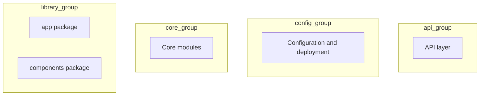

# Architecture report: cruip/tailwind-landing-page-template

> Automated static analysis. **Observed** = directly seen in files/imports/AST; **Inferred** = interpretation from that evidence. Repository code was not executed.

## 1. Repository at a glance

| Item | Value |
| --- | --- |
| Repository | cruip/tailwind-landing-page-template |
| Description | Simple Light is a free landing page template built on top of TailwindCSS and fully coded in React / Next.js. Made by  |
| Language | TypeScript |
| Stars | 4529 |
| Licence | Not detected |
| Analysed commit / branch | 909e38e3249ac575017864a202188b48ef016c9c / main |
| Framework(s) | Next.js, React |
| Files analysed | 44 |
| Components | 5 |

## 2. Architecture in one minute

cruip/tailwind-landing-page-template - Simple Light is a free landing page template built on top of TailwindCSS and fully coded in React / Next.js. Made by . This repository was analysed statically from 44 file(s) (0 Python). Detected technologies (observed from imports/manifests): Next.js, React, Tailwind CSS, TypeScript. Files are grouped into 5 component(s): API layer, app package, components package, Configuration and deployment, Core modules. Findings below distinguish observed facts from inferred interpretation.

## 3. High-level block diagram

## 4. Main components

### API layer (`api_layer`)

- **Kind:** api
- **Status:** Observed
- **Confidence:** 0.85
- **Responsibility:** Groups 1 file(s) under api layer (observed from repository paths and static analysis).
- **Paths:** `app/api/hello/route.ts`
- **Evidence:** [app/api/hello/route.ts](https://github.com/cruip/tailwind-landing-page-template/blob/909e38e3249ac575017864a202188b48ef016c9c/app/api/hello/route.ts)

### app package (`app`)

- **Kind:** library
- **Status:** Observed
- **Confidence:** 0.85
- **Responsibility:** Groups 7 file(s) under app package (observed from repository paths and static analysis).
- **Paths:** `app/(auth)/layout.tsx`, `app/(auth)/reset-password/page.tsx`, `app/(auth)/signin/page.tsx`, `app/(auth)/signup/page.tsx`, `app/(default)/layout.tsx`, `app/(default)/page.tsx`, `app/layout.tsx`
- **Evidence:** [app/(auth)/layout.tsx](https://github.com/cruip/tailwind-landing-page-template/blob/909e38e3249ac575017864a202188b48ef016c9c/app/%28auth%29/layout.tsx); [app/(auth)/reset-password/page.tsx](https://github.com/cruip/tailwind-landing-page-template/blob/909e38e3249ac575017864a202188b48ef016c9c/app/%28auth%29/reset-password/page.tsx); [app/(auth)/signin/page.tsx](https://github.com/cruip/tailwind-landing-page-template/blob/909e38e3249ac575017864a202188b48ef016c9c/app/%28auth%29/signin/page.tsx); [app/(auth)/signup/page.tsx](https://github.com/cruip/tailwind-landing-page-template/blob/909e38e3249ac575017864a202188b48ef016c9c/app/%28auth%29/signup/page.tsx); [app/(default)/layout.tsx](https://github.com/cruip/tailwind-landing-page-template/blob/909e38e3249ac575017864a202188b48ef016c9c/app/%28default%29/layout.tsx); [app/(default)/page.tsx](https://github.com/cruip/tailwind-landing-page-template/blob/909e38e3249ac575017864a202188b48ef016c9c/app/%28default%29/page.tsx); [app/layout.tsx](https://github.com/cruip/tailwind-landing-page-template/blob/909e38e3249ac575017864a202188b48ef016c9c/app/layout.tsx)

### components package (`components`)

- **Kind:** library
- **Status:** Observed
- **Confidence:** 0.85
- **Responsibility:** Groups 11 file(s) under components package (observed from repository paths and static analysis).
- **Paths:** `components/accordion.tsx`, `components/banner.tsx`, `components/business-categories.tsx`, `components/cta.tsx`, `components/features-planet.tsx`, `components/hero-home.tsx`, `components/large-testimonial.tsx`, `components/page-illustration.tsx`, `components/ui/footer.tsx`, `components/ui/header.tsx`, `components/ui/logo.tsx`
- **Evidence:** [components/accordion.tsx](https://github.com/cruip/tailwind-landing-page-template/blob/909e38e3249ac575017864a202188b48ef016c9c/components/accordion.tsx); [components/banner.tsx](https://github.com/cruip/tailwind-landing-page-template/blob/909e38e3249ac575017864a202188b48ef016c9c/components/banner.tsx); [components/business-categories.tsx](https://github.com/cruip/tailwind-landing-page-template/blob/909e38e3249ac575017864a202188b48ef016c9c/components/business-categories.tsx); [components/cta.tsx](https://github.com/cruip/tailwind-landing-page-template/blob/909e38e3249ac575017864a202188b48ef016c9c/components/cta.tsx); [components/features-planet.tsx](https://github.com/cruip/tailwind-landing-page-template/blob/909e38e3249ac575017864a202188b48ef016c9c/components/features-planet.tsx); [components/hero-home.tsx](https://github.com/cruip/tailwind-landing-page-template/blob/909e38e3249ac575017864a202188b48ef016c9c/components/hero-home.tsx); [components/large-testimonial.tsx](https://github.com/cruip/tailwind-landing-page-template/blob/909e38e3249ac575017864a202188b48ef016c9c/components/large-testimonial.tsx); [components/page-illustration.tsx](https://github.com/cruip/tailwind-landing-page-template/blob/909e38e3249ac575017864a202188b48ef016c9c/components/page-illustration.tsx)

### Configuration and deployment (`config`)

- **Kind:** config
- **Status:** Observed
- **Confidence:** 0.85
- **Responsibility:** Groups 2 file(s) under configuration and deployment (observed from repository paths and static analysis).
- **Paths:** `package.json`, `tsconfig.json`
- **Evidence:** [package.json](https://github.com/cruip/tailwind-landing-page-template/blob/909e38e3249ac575017864a202188b48ef016c9c/package.json); [tsconfig.json](https://github.com/cruip/tailwind-landing-page-template/blob/909e38e3249ac575017864a202188b48ef016c9c/tsconfig.json)

### Core modules (`core`)

- **Kind:** core
- **Status:** Observed
- **Confidence:** 0.85
- **Responsibility:** Groups 2 file(s) under core modules (observed from repository paths and static analysis).
- **Paths:** `next.config.js`, `postcss.config.js`
- **Evidence:** [next.config.js](https://github.com/cruip/tailwind-landing-page-template/blob/909e38e3249ac575017864a202188b48ef016c9c/next.config.js); [postcss.config.js](https://github.com/cruip/tailwind-landing-page-template/blob/909e38e3249ac575017864a202188b48ef016c9c/postcss.config.js)

## 5. Execution flow

**Observed** entry point(s):

- [app/(auth)/reset-password/page.tsx](https://github.com/cruip/tailwind-landing-page-template/blob/909e38e3249ac575017864a202188b48ef016c9c/app/%28auth%29/reset-password/page.tsx)
- [app/(auth)/signin/page.tsx](https://github.com/cruip/tailwind-landing-page-template/blob/909e38e3249ac575017864a202188b48ef016c9c/app/%28auth%29/signin/page.tsx)
- [app/(auth)/signup/page.tsx](https://github.com/cruip/tailwind-landing-page-template/blob/909e38e3249ac575017864a202188b48ef016c9c/app/%28auth%29/signup/page.tsx)
- [app/(default)/page.tsx](https://github.com/cruip/tailwind-landing-page-template/blob/909e38e3249ac575017864a202188b48ef016c9c/app/%28default%29/page.tsx)

Representative flow (derived from observed entry points and the import graph; steps beyond the entry point are **Inferred**):

1. Execution starts at an observed entry point listed above, if present.
2. No internal import relationships between components were observed.

## 6. Project structure

### `(root)`

- `.gitignore` - other (415 bytes)
- `CHANGELOG.md` - docs (1188 bytes)
- `README.md` - docs (4248 bytes)
- `next.config.js` - source, JavaScript (94 bytes)
- `package.json` - manifest (972 bytes)
- `postcss.config.js` - source, JavaScript (72 bytes)
- `tsconfig.json` - config (638 bytes)

### `.vscode`

- `.vscode/settings.json` - config (106 bytes)

### `app`

- `app/(auth)/layout.tsx` - source, TypeScript (3732 bytes)
- `app/(auth)/reset-password/page.tsx` - source, TypeScript (1054 bytes)
- `app/(auth)/signin/page.tsx` - source, TypeScript (1912 bytes)
- `app/(auth)/signup/page.tsx` - source, TypeScript (3222 bytes)
- `app/(default)/layout.tsx` - source, TypeScript (559 bytes)
- `app/(default)/page.tsx` - source, TypeScript (536 bytes)
- `app/api/hello/route.ts` - source, TypeScript (90 bytes)
- `app/css/additional-styles/custom-fonts.css` - other (0 bytes)
- `app/css/additional-styles/theme.css` - other (2812 bytes)
- `app/css/additional-styles/utility-patterns.css` - other (1104 bytes)
- `app/css/style.css` - other (3699 bytes)
- `app/layout.tsx` - source, TypeScript (717 bytes)

### `components`

- `components/accordion.tsx` - source, TypeScript (2234 bytes)
- `components/banner.tsx` - source, TypeScript (1847 bytes)
- `components/business-categories.tsx` - source, TypeScript (15269 bytes)
- `components/cta.tsx` - source, TypeScript (2196 bytes)
- `components/features-planet.tsx` - source, TypeScript (10457 bytes)
- `components/hero-home.tsx` - source, TypeScript (6734 bytes)
- `components/large-testimonial.tsx` - source, TypeScript (1872 bytes)
- `components/page-illustration.tsx` - source, TypeScript (1331 bytes)
- `components/ui/footer.tsx` - source, TypeScript (8332 bytes)
- `components/ui/header.tsx` - source, TypeScript (1480 bytes)
- `components/ui/logo.tsx` - source, TypeScript (854 bytes)

### `public`

- `public/images/auth-bg.svg` - other (5607 bytes)
- `public/images/logo-01.svg` - other (514 bytes)
- `public/images/logo-02.svg` - other (869 bytes)
- `public/images/logo-03.svg` - other (1884 bytes)
- `public/images/logo-04.svg` - other (376 bytes)
- `public/images/logo-05.svg` - other (914 bytes)
- `public/images/logo-06.svg` - other (174 bytes)
- `public/images/logo-07.svg` - other (953 bytes)
- `public/images/logo-08.svg` - other (1213 bytes)
- `public/images/logo-09.svg` - other (320 bytes)
- `public/images/planet-overlay.svg` - other (9116 bytes)
- `public/images/stripes-dark.svg` - other (3039 bytes)
- `public/images/stripes.svg` - other (2886 bytes)

## 7. Key dependencies and integrations

| Name | Category | Status | Confidence | Evidence |
| --- | --- | --- | --- | --- |
| Next.js | framework | Observed | 0.85 | [package.json:2](https://github.com/cruip/tailwind-landing-page-template/blob/909e38e3249ac575017864a202188b48ef016c9c/package.json#L2) |
| React | framework | Observed | 0.90 | [package.json:12](https://github.com/cruip/tailwind-landing-page-template/blob/909e38e3249ac575017864a202188b48ef016c9c/package.json#L12); [package.json:15](https://github.com/cruip/tailwind-landing-page-template/blob/909e38e3249ac575017864a202188b48ef016c9c/package.json#L15) |
| Tailwind CSS | library | Observed | 0.85 | [package.json:18](https://github.com/cruip/tailwind-landing-page-template/blob/909e38e3249ac575017864a202188b48ef016c9c/package.json#L18) |
| TypeScript | tooling | Observed | 0.85 | [package.json:21](https://github.com/cruip/tailwind-landing-page-template/blob/909e38e3249ac575017864a202188b48ef016c9c/package.json#L21) |

## 8. Data and state

No database, cache, queue, or persistent-state usage was observed in the analysed files. State handling, if any, may be in-memory or in files that were not analysed.

## 9. Configuration and deployment clues

- `.vscode/settings.json` (config)
- `package.json` (manifest)
- `tsconfig.json` (config)

## 10. Design observations

- An entry/API layer is separated from other code (Inferred from paths and decorators).

These observations are interpretations (**Inferred**) of the observed structure, not guarantees about runtime design.

## 11. Limitations and unknowns

- Static analysis only: repository code was not executed, installed, or imported at runtime.
- Components and relationships are inferred from file paths, imports, and AST structure; runtime behaviour, dynamic imports, and reflection may not be visible.
- 1 file(s) were skipped during inventory (1 x lockfile excluded).
- No clear application entry point was observed in the analysed files.
- Repository text was treated as untrusted data; no instructions found in repository files were followed, and likely secret values were redacted/excluded.
- JavaScript and TypeScript files were inventoried from paths and package manifests. They were not parsed with a full language AST, and repository code was not executed.

## 12. Source references

- [app/(auth)/layout.tsx](https://github.com/cruip/tailwind-landing-page-template/blob/909e38e3249ac575017864a202188b48ef016c9c/app/%28auth%29/layout.tsx)
- [app/(auth)/reset-password/page.tsx](https://github.com/cruip/tailwind-landing-page-template/blob/909e38e3249ac575017864a202188b48ef016c9c/app/%28auth%29/reset-password/page.tsx)
- [app/(auth)/signin/page.tsx](https://github.com/cruip/tailwind-landing-page-template/blob/909e38e3249ac575017864a202188b48ef016c9c/app/%28auth%29/signin/page.tsx)
- [app/(auth)/signup/page.tsx](https://github.com/cruip/tailwind-landing-page-template/blob/909e38e3249ac575017864a202188b48ef016c9c/app/%28auth%29/signup/page.tsx)
- [app/(default)/layout.tsx](https://github.com/cruip/tailwind-landing-page-template/blob/909e38e3249ac575017864a202188b48ef016c9c/app/%28default%29/layout.tsx)
- [app/(default)/page.tsx](https://github.com/cruip/tailwind-landing-page-template/blob/909e38e3249ac575017864a202188b48ef016c9c/app/%28default%29/page.tsx)
- [app/api/hello/route.ts](https://github.com/cruip/tailwind-landing-page-template/blob/909e38e3249ac575017864a202188b48ef016c9c/app/api/hello/route.ts)
- [app/layout.tsx](https://github.com/cruip/tailwind-landing-page-template/blob/909e38e3249ac575017864a202188b48ef016c9c/app/layout.tsx)
- [components/accordion.tsx](https://github.com/cruip/tailwind-landing-page-template/blob/909e38e3249ac575017864a202188b48ef016c9c/components/accordion.tsx)
- [components/banner.tsx](https://github.com/cruip/tailwind-landing-page-template/blob/909e38e3249ac575017864a202188b48ef016c9c/components/banner.tsx)
- [components/business-categories.tsx](https://github.com/cruip/tailwind-landing-page-template/blob/909e38e3249ac575017864a202188b48ef016c9c/components/business-categories.tsx)
- [components/cta.tsx](https://github.com/cruip/tailwind-landing-page-template/blob/909e38e3249ac575017864a202188b48ef016c9c/components/cta.tsx)
- [components/features-planet.tsx](https://github.com/cruip/tailwind-landing-page-template/blob/909e38e3249ac575017864a202188b48ef016c9c/components/features-planet.tsx)
- [components/hero-home.tsx](https://github.com/cruip/tailwind-landing-page-template/blob/909e38e3249ac575017864a202188b48ef016c9c/components/hero-home.tsx)
- [components/large-testimonial.tsx](https://github.com/cruip/tailwind-landing-page-template/blob/909e38e3249ac575017864a202188b48ef016c9c/components/large-testimonial.tsx)
- [components/page-illustration.tsx](https://github.com/cruip/tailwind-landing-page-template/blob/909e38e3249ac575017864a202188b48ef016c9c/components/page-illustration.tsx)
- [next.config.js](https://github.com/cruip/tailwind-landing-page-template/blob/909e38e3249ac575017864a202188b48ef016c9c/next.config.js)
- [package.json](https://github.com/cruip/tailwind-landing-page-template/blob/909e38e3249ac575017864a202188b48ef016c9c/package.json)
- [package.json:2](https://github.com/cruip/tailwind-landing-page-template/blob/909e38e3249ac575017864a202188b48ef016c9c/package.json#L2)
- [package.json:12](https://github.com/cruip/tailwind-landing-page-template/blob/909e38e3249ac575017864a202188b48ef016c9c/package.json#L12)
- [package.json:15](https://github.com/cruip/tailwind-landing-page-template/blob/909e38e3249ac575017864a202188b48ef016c9c/package.json#L15)
- [package.json:18](https://github.com/cruip/tailwind-landing-page-template/blob/909e38e3249ac575017864a202188b48ef016c9c/package.json#L18)
- [package.json:21](https://github.com/cruip/tailwind-landing-page-template/blob/909e38e3249ac575017864a202188b48ef016c9c/package.json#L21)
- [postcss.config.js](https://github.com/cruip/tailwind-landing-page-template/blob/909e38e3249ac575017864a202188b48ef016c9c/postcss.config.js)
- [tsconfig.json](https://github.com/cruip/tailwind-landing-page-template/blob/909e38e3249ac575017864a202188b48ef016c9c/tsconfig.json)
