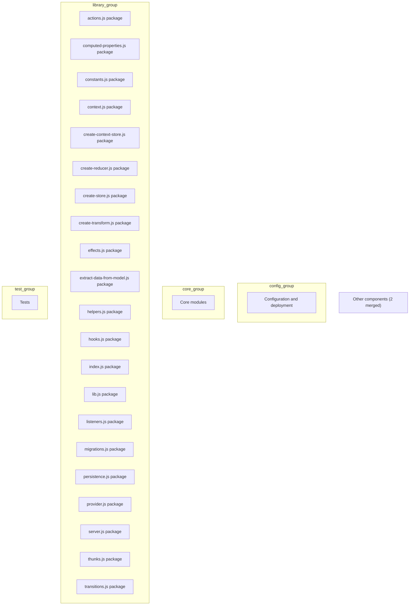

# Architecture report: ctrlplusb/easy-peasy

> Automated static analysis. **Observed** = directly seen in files/imports/AST; **Inferred** = interpretation from that evidence. Repository code was not executed.

## 1. Repository at a glance

| Item | Value |
| --- | --- |
| Repository | ctrlplusb/easy-peasy |
| Description | Vegetarian friendly state for React |
| Language | JavaScript |
| Stars | 5040 |
| Licence | MIT |
| Analysed commit / branch | c1ffaf3937746ac8456e24187b46c4aa3890b699 / master |
| Framework(s) | Next.js, React |
| Files analysed | 381 |
| Components | 26 |

## 2. Architecture in one minute

ctrlplusb/easy-peasy - Vegetarian friendly state for React. This repository was analysed statically from 381 file(s) (0 Python). Detected technologies (observed from imports/manifests): GitHub Actions, Next.js, React, React Router, Redux, Tailwind CSS. Files are grouped into 26 component(s): actions.js package, computed-properties.js package, Configuration and deployment, constants.js package, context.js package, Core modules, create-context-store.js package, create-reducer.js package. Findings below distinguish observed facts from inferred interpretation.

## 3. High-level block diagram

## 4. Main components

### actions.js package (`actions_js`)

- **Kind:** library
- **Status:** Observed
- **Confidence:** 0.85
- **Responsibility:** Groups 1 file(s) under actions.js package (observed from repository paths and static analysis).
- **Paths:** `src/actions.js`
- **Evidence:** [src/actions.js](https://github.com/ctrlplusb/easy-peasy/blob/c1ffaf3937746ac8456e24187b46c4aa3890b699/src/actions.js)

### computed-properties.js package (`computed_properties_js`)

- **Kind:** library
- **Status:** Observed
- **Confidence:** 0.85
- **Responsibility:** Groups 1 file(s) under computed-properties.js package (observed from repository paths and static analysis).
- **Paths:** `src/computed-properties.js`
- **Evidence:** [src/computed-properties.js](https://github.com/ctrlplusb/easy-peasy/blob/c1ffaf3937746ac8456e24187b46c4aa3890b699/src/computed-properties.js)

### Configuration and deployment (`config`)

- **Kind:** config
- **Status:** Observed
- **Confidence:** 0.85
- **Responsibility:** Groups 3 file(s) under configuration and deployment (observed from repository paths and static analysis).
- **Paths:** `package.json`, `website/package.json`, `website/vercel.json`
- **Evidence:** [package.json](https://github.com/ctrlplusb/easy-peasy/blob/c1ffaf3937746ac8456e24187b46c4aa3890b699/package.json); [website/package.json](https://github.com/ctrlplusb/easy-peasy/blob/c1ffaf3937746ac8456e24187b46c4aa3890b699/website/package.json); [website/vercel.json](https://github.com/ctrlplusb/easy-peasy/blob/c1ffaf3937746ac8456e24187b46c4aa3890b699/website/vercel.json)

### constants.js package (`constants_js`)

- **Kind:** library
- **Status:** Observed
- **Confidence:** 0.85
- **Responsibility:** Groups 1 file(s) under constants.js package (observed from repository paths and static analysis).
- **Paths:** `src/constants.js`
- **Evidence:** [src/constants.js](https://github.com/ctrlplusb/easy-peasy/blob/c1ffaf3937746ac8456e24187b46c4aa3890b699/src/constants.js)

### context.js package (`context_js`)

- **Kind:** library
- **Status:** Observed
- **Confidence:** 0.85
- **Responsibility:** Groups 1 file(s) under context.js package (observed from repository paths and static analysis).
- **Paths:** `src/context.js`
- **Evidence:** [src/context.js](https://github.com/ctrlplusb/easy-peasy/blob/c1ffaf3937746ac8456e24187b46c4aa3890b699/src/context.js)

### Core modules (`core`)

- **Kind:** core
- **Status:** Observed
- **Confidence:** 0.85
- **Responsibility:** Groups 7 file(s) under core modules (observed from repository paths and static analysis).
- **Paths:** `eslint.config.js`, `index.d.ts`, `map-set-support.d.ts`, `map-set-support.js`, `rollup.config.js`, `server.d.ts`, `vitest.config.js`
- **Evidence:** [eslint.config.js](https://github.com/ctrlplusb/easy-peasy/blob/c1ffaf3937746ac8456e24187b46c4aa3890b699/eslint.config.js); [index.d.ts](https://github.com/ctrlplusb/easy-peasy/blob/c1ffaf3937746ac8456e24187b46c4aa3890b699/index.d.ts); [map-set-support.d.ts](https://github.com/ctrlplusb/easy-peasy/blob/c1ffaf3937746ac8456e24187b46c4aa3890b699/map-set-support.d.ts); [map-set-support.js](https://github.com/ctrlplusb/easy-peasy/blob/c1ffaf3937746ac8456e24187b46c4aa3890b699/map-set-support.js); [rollup.config.js](https://github.com/ctrlplusb/easy-peasy/blob/c1ffaf3937746ac8456e24187b46c4aa3890b699/rollup.config.js); [server.d.ts](https://github.com/ctrlplusb/easy-peasy/blob/c1ffaf3937746ac8456e24187b46c4aa3890b699/server.d.ts); [vitest.config.js](https://github.com/ctrlplusb/easy-peasy/blob/c1ffaf3937746ac8456e24187b46c4aa3890b699/vitest.config.js)

### create-context-store.js package (`create_context_store_js`)

- **Kind:** library
- **Status:** Observed
- **Confidence:** 0.85
- **Responsibility:** Groups 1 file(s) under create-context-store.js package (observed from repository paths and static analysis).
- **Paths:** `src/create-context-store.js`
- **Evidence:** [src/create-context-store.js](https://github.com/ctrlplusb/easy-peasy/blob/c1ffaf3937746ac8456e24187b46c4aa3890b699/src/create-context-store.js)

### create-reducer.js package (`create_reducer_js`)

- **Kind:** library
- **Status:** Observed
- **Confidence:** 0.85
- **Responsibility:** Groups 1 file(s) under create-reducer.js package (observed from repository paths and static analysis).
- **Paths:** `src/create-reducer.js`
- **Evidence:** [src/create-reducer.js](https://github.com/ctrlplusb/easy-peasy/blob/c1ffaf3937746ac8456e24187b46c4aa3890b699/src/create-reducer.js)

### create-store.js package (`create_store_js`)

- **Kind:** library
- **Status:** Observed
- **Confidence:** 0.85
- **Responsibility:** Groups 1 file(s) under create-store.js package (observed from repository paths and static analysis).
- **Paths:** `src/create-store.js`
- **Evidence:** [src/create-store.js](https://github.com/ctrlplusb/easy-peasy/blob/c1ffaf3937746ac8456e24187b46c4aa3890b699/src/create-store.js)

### create-transform.js package (`create_transform_js`)

- **Kind:** library
- **Status:** Observed
- **Confidence:** 0.85
- **Responsibility:** Groups 1 file(s) under create-transform.js package (observed from repository paths and static analysis).
- **Paths:** `src/create-transform.js`
- **Evidence:** [src/create-transform.js](https://github.com/ctrlplusb/easy-peasy/blob/c1ffaf3937746ac8456e24187b46c4aa3890b699/src/create-transform.js)

### effects.js package (`effects_js`)

- **Kind:** library
- **Status:** Observed
- **Confidence:** 0.85
- **Responsibility:** Groups 1 file(s) under effects.js package (observed from repository paths and static analysis).
- **Paths:** `src/effects.js`
- **Evidence:** [src/effects.js](https://github.com/ctrlplusb/easy-peasy/blob/c1ffaf3937746ac8456e24187b46c4aa3890b699/src/effects.js)

### extract-data-from-model.js package (`extract_data_from_model_js`)

- **Kind:** library
- **Status:** Observed
- **Confidence:** 0.85
- **Responsibility:** Groups 1 file(s) under extract-data-from-model.js package (observed from repository paths and static analysis).
- **Paths:** `src/extract-data-from-model.js`
- **Evidence:** [src/extract-data-from-model.js](https://github.com/ctrlplusb/easy-peasy/blob/c1ffaf3937746ac8456e24187b46c4aa3890b699/src/extract-data-from-model.js)

### helpers.js package (`helpers_js`)

- **Kind:** library
- **Status:** Observed
- **Confidence:** 0.85
- **Responsibility:** Groups 1 file(s) under helpers.js package (observed from repository paths and static analysis).
- **Paths:** `src/helpers.js`
- **Evidence:** [src/helpers.js](https://github.com/ctrlplusb/easy-peasy/blob/c1ffaf3937746ac8456e24187b46c4aa3890b699/src/helpers.js)

### hooks.js package (`hooks_js`)

- **Kind:** library
- **Status:** Observed
- **Confidence:** 0.85
- **Responsibility:** Groups 1 file(s) under hooks.js package (observed from repository paths and static analysis).
- **Paths:** `src/hooks.js`
- **Evidence:** [src/hooks.js](https://github.com/ctrlplusb/easy-peasy/blob/c1ffaf3937746ac8456e24187b46c4aa3890b699/src/hooks.js)

### index.js package (`index_js`)

- **Kind:** library
- **Status:** Observed
- **Confidence:** 0.85
- **Responsibility:** Groups 1 file(s) under index.js package (observed from repository paths and static analysis).
- **Paths:** `src/index.js`
- **Evidence:** [src/index.js](https://github.com/ctrlplusb/easy-peasy/blob/c1ffaf3937746ac8456e24187b46c4aa3890b699/src/index.js)

### lib.js package (`lib_js`)

- **Kind:** library
- **Status:** Observed
- **Confidence:** 0.85
- **Responsibility:** Groups 1 file(s) under lib.js package (observed from repository paths and static analysis).
- **Paths:** `src/lib.js`
- **Evidence:** [src/lib.js](https://github.com/ctrlplusb/easy-peasy/blob/c1ffaf3937746ac8456e24187b46c4aa3890b699/src/lib.js)

### listeners.js package (`listeners_js`)

- **Kind:** library
- **Status:** Observed
- **Confidence:** 0.85
- **Responsibility:** Groups 1 file(s) under listeners.js package (observed from repository paths and static analysis).
- **Paths:** `src/listeners.js`
- **Evidence:** [src/listeners.js](https://github.com/ctrlplusb/easy-peasy/blob/c1ffaf3937746ac8456e24187b46c4aa3890b699/src/listeners.js)

### migrations.js package (`migrations_js`)

- **Kind:** library
- **Status:** Observed
- **Confidence:** 0.85
- **Responsibility:** Groups 1 file(s) under migrations.js package (observed from repository paths and static analysis).
- **Paths:** `src/migrations.js`
- **Evidence:** [src/migrations.js](https://github.com/ctrlplusb/easy-peasy/blob/c1ffaf3937746ac8456e24187b46c4aa3890b699/src/migrations.js)

### persistence.js package (`persistence_js`)

- **Kind:** library
- **Status:** Observed
- **Confidence:** 0.85
- **Responsibility:** Groups 1 file(s) under persistence.js package (observed from repository paths and static analysis).
- **Paths:** `src/persistence.js`
- **Evidence:** [src/persistence.js](https://github.com/ctrlplusb/easy-peasy/blob/c1ffaf3937746ac8456e24187b46c4aa3890b699/src/persistence.js)

### provider.js package (`provider_js`)

- **Kind:** library
- **Status:** Observed
- **Confidence:** 0.85
- **Responsibility:** Groups 1 file(s) under provider.js package (observed from repository paths and static analysis).
- **Paths:** `src/provider.js`
- **Evidence:** [src/provider.js](https://github.com/ctrlplusb/easy-peasy/blob/c1ffaf3937746ac8456e24187b46c4aa3890b699/src/provider.js)

### server.js package (`server_js`)

- **Kind:** library
- **Status:** Observed
- **Confidence:** 0.85
- **Responsibility:** Groups 1 file(s) under server.js package (observed from repository paths and static analysis).
- **Paths:** `src/server.js`
- **Evidence:** [src/server.js](https://github.com/ctrlplusb/easy-peasy/blob/c1ffaf3937746ac8456e24187b46c4aa3890b699/src/server.js)

### Tests (`tests`)

- **Kind:** test
- **Status:** Observed
- **Confidence:** 0.85
- **Responsibility:** Groups 70 file(s) under tests (observed from repository paths and static analysis).
- **Paths:** `examples/reduxtagram/test/comments-model.spec.ts`, `examples/reduxtagram/test/posts-model.spec.ts`, `tests/actions.test.js`, `tests/computed.test.js`, `tests/create-context-store.test.js`, `tests/create-typed-hooks.test.js`, `tests/debug.test.js`, `tests/dependency-injection.test.js`, `tests/dev-tools.test.js`, `tests/dynamic-store.test.js`, `tests/effect-on.test.js`, `tests/generic.test.js`, `tests/immer.test.js`, `tests/lib.test.js`, `tests/lib/enable-immer-map-set.js`, `tests/listener-actions.test.js`, `tests/migrations.test.js`, `tests/persist.test.js`, `tests/react.test.js`, `tests/reducer.test.js`, `tests/rehydration-transition.test.js`, `tests/server-export.test.js`, `tests/server-rendering.test.js`, `tests/store.test.js`, `tests/testing/README.md`, `tests/testing/actions.test.js`, `tests/testing/listeners.test.js`, `tests/testing/react.test.js`, `tests/testing/thunks.test.js`, `tests/thunks.test.js`, `tests/typescript/action.ts`, `tests/typescript/actions.ts`, `tests/typescript/complex-store-inheritance.ts`, `tests/typescript/composed-store.ts`, `tests/typescript/computed.ts`, `tests/typescript/create-context-store.tsx`, `tests/typescript/create-store.ts`, `tests/typescript/debug.ts`, `tests/typescript/effect-on.ts`, `tests/typescript/external-type-defs.ts`, `tests/typescript/generic-model.ts`, `tests/typescript/giant-model.ts`, `tests/typescript/hooks.ts`, `tests/typescript/issue117.ts`, `tests/typescript/issue224.ts`, `tests/typescript/issue246.ts`, `tests/typescript/issue427.ts`, `tests/typescript/issue66.tsx`, `tests/typescript/issue802.ts`, `tests/typescript/issue87.ts`, `tests/typescript/listener-action.ts`, `tests/typescript/listener-thunk.ts`, `tests/typescript/listeners.ts`, `tests/typescript/persist.tsx`, `tests/typescript/react-redux-compat.tsx`, `tests/typescript/react.tsx`, `tests/typescript/server-entry.ts`, `tests/typescript/state-resolvers.ts`, `tests/typescript/state.ts`, `tests/typescript/store.ts`, `tests/typescript/thunk.ts`, `tests/typescript/tsconfig.json`, `tests/typescript/use-local-store.tsx`, `tests/use-local-store.test.js`, `tests/use-store-deferred-state.test.js`, `tests/use-store-optimistic.test.js`, `tests/use-store-state.test.js`, `tests/use-store-transition.test.js`, `tests/use-store.test.js`, `tests/utils.js`
- **Evidence:** [examples/reduxtagram/test/comments-model.spec.ts](https://github.com/ctrlplusb/easy-peasy/blob/c1ffaf3937746ac8456e24187b46c4aa3890b699/examples/reduxtagram/test/comments-model.spec.ts); [examples/reduxtagram/test/posts-model.spec.ts](https://github.com/ctrlplusb/easy-peasy/blob/c1ffaf3937746ac8456e24187b46c4aa3890b699/examples/reduxtagram/test/posts-model.spec.ts); [tests/actions.test.js](https://github.com/ctrlplusb/easy-peasy/blob/c1ffaf3937746ac8456e24187b46c4aa3890b699/tests/actions.test.js); [tests/computed.test.js](https://github.com/ctrlplusb/easy-peasy/blob/c1ffaf3937746ac8456e24187b46c4aa3890b699/tests/computed.test.js); [tests/create-context-store.test.js](https://github.com/ctrlplusb/easy-peasy/blob/c1ffaf3937746ac8456e24187b46c4aa3890b699/tests/create-context-store.test.js); [tests/create-typed-hooks.test.js](https://github.com/ctrlplusb/easy-peasy/blob/c1ffaf3937746ac8456e24187b46c4aa3890b699/tests/create-typed-hooks.test.js); [tests/debug.test.js](https://github.com/ctrlplusb/easy-peasy/blob/c1ffaf3937746ac8456e24187b46c4aa3890b699/tests/debug.test.js); [tests/dependency-injection.test.js](https://github.com/ctrlplusb/easy-peasy/blob/c1ffaf3937746ac8456e24187b46c4aa3890b699/tests/dependency-injection.test.js)

### thunks.js package (`thunks_js`)

- **Kind:** library
- **Status:** Observed
- **Confidence:** 0.85
- **Responsibility:** Groups 1 file(s) under thunks.js package (observed from repository paths and static analysis).
- **Paths:** `src/thunks.js`
- **Evidence:** [src/thunks.js](https://github.com/ctrlplusb/easy-peasy/blob/c1ffaf3937746ac8456e24187b46c4aa3890b699/src/thunks.js)

### transitions.js package (`transitions_js`)

- **Kind:** library
- **Status:** Observed
- **Confidence:** 0.85
- **Responsibility:** Groups 1 file(s) under transitions.js package (observed from repository paths and static analysis).
- **Paths:** `src/transitions.js`
- **Evidence:** [src/transitions.js](https://github.com/ctrlplusb/easy-peasy/blob/c1ffaf3937746ac8456e24187b46c4aa3890b699/src/transitions.js)

### use-local-store.js package (`use_local_store_js`)

- **Kind:** library
- **Status:** Observed
- **Confidence:** 0.85
- **Responsibility:** Groups 1 file(s) under use-local-store.js package (observed from repository paths and static analysis).
- **Paths:** `src/use-local-store.js`
- **Evidence:** [src/use-local-store.js](https://github.com/ctrlplusb/easy-peasy/blob/c1ffaf3937746ac8456e24187b46c4aa3890b699/src/use-local-store.js)

### use-memo-one.js package (`use_memo_one_js`)

- **Kind:** library
- **Status:** Observed
- **Confidence:** 0.85
- **Responsibility:** Groups 1 file(s) under use-memo-one.js package (observed from repository paths and static analysis).
- **Paths:** `src/use-memo-one.js`
- **Evidence:** [src/use-memo-one.js](https://github.com/ctrlplusb/easy-peasy/blob/c1ffaf3937746ac8456e24187b46c4aa3890b699/src/use-memo-one.js)

## 5. Execution flow

**Observed** entry point(s):

- [src/index.js](https://github.com/ctrlplusb/easy-peasy/blob/c1ffaf3937746ac8456e24187b46c4aa3890b699/src/index.js)
- [src/server.js](https://github.com/ctrlplusb/easy-peasy/blob/c1ffaf3937746ac8456e24187b46c4aa3890b699/src/server.js)

Representative flow (derived from observed entry points and the import graph; steps beyond the entry point are **Inferred**):

1. Execution starts at an observed entry point listed above, if present.
2. No internal import relationships between components were observed.

## 6. Project structure

### `(root)`

- `.babelrc.js` - source, JavaScript (419 bytes)
- `.gitignore` - other (258 bytes)
- `.nvmrc` - other (3 bytes)
- `.yarnrc` - other (97 bytes)
- `CHANGELOG.md` - docs (156 bytes)
- `CLAUDE.md` - docs (2764 bytes)
- `CODE_OF_CONDUCT.md` - docs (5260 bytes)
- `CONTRIBUTING.md` - docs (3812 bytes)
- `LICENSE` - docs (1088 bytes)
- `README.md` - docs (4246 bytes)
- `eslint.config.js` - source, JavaScript (2193 bytes)
- `index.d.ts` - source, TypeScript (29854 bytes)
- `map-set-support.d.ts` - source, TypeScript (26 bytes)
- `map-set-support.js` - source, JavaScript (75 bytes)
- `package.json` - manifest (3482 bytes)
- `rollup.config.js` - source, JavaScript (1433 bytes)
- `server.d.ts` - source, TypeScript (459 bytes)
- `vitest.config.js` - source, JavaScript (842 bytes)

### `.github`

- `.github/FUNDING.yml` - config (580 bytes)
- `.github/actions/prepare/action.yml` - config (252 bytes)
- `.github/actions/setup-node/action.yml` - config (221 bytes)
- `.github/workflows/codeql-analysis.yml` - ci, YAML (633 bytes)
- `.github/workflows/pr-validate.yml` - ci, YAML (655 bytes)

### `.husky`

- `.husky/pre-commit` - other (23 bytes)

### `examples`

- `examples/README.md` - docs (1098 bytes)
- `examples/kanban/.eslintignore` - other (59 bytes)
- `examples/kanban/.eslintrc.js` - source, JavaScript (1244 bytes)
- `examples/kanban/.gitignore` - other (59 bytes)
- `examples/kanban/.prettierignore` - other (59 bytes)
- `examples/kanban/.prettierrc.js` - source, JavaScript (135 bytes)
- `examples/kanban/README.md` - docs (1473 bytes)
- `examples/kanban/index.html` - other (372 bytes)
- `examples/kanban/package.json` - manifest (1541 bytes)
- `examples/kanban/postcss.config.js` - source, JavaScript (82 bytes)
- `examples/kanban/src/components/App.test.tsx` - source, TypeScript (2114 bytes)
- `examples/kanban/src/components/App.tsx` - source, TypeScript (428 bytes)
- `examples/kanban/src/components/TaskList/AddTask.test.tsx` - source, TypeScript (909 bytes)
- `examples/kanban/src/components/TaskList/AddTask.tsx` - source, TypeScript (1176 bytes)
- `examples/kanban/src/components/TaskList/TaskList.test.tsx` - source, TypeScript (938 bytes)
- `examples/kanban/src/components/TaskList/TaskList.tsx` - source, TypeScript (854 bytes)
- `examples/kanban/src/components/TaskList/TaskView.test.tsx` - source, TypeScript (1206 bytes)
- `examples/kanban/src/components/TaskList/TaskView.tsx` - source, TypeScript (1312 bytes)
- `examples/kanban/src/components/TaskList/__snapshots__/TaskList.test.tsx.snap` - other (8736 bytes)
- `examples/kanban/src/components/TaskList/index.ts` - source, TypeScript (38 bytes)
- `examples/kanban/src/components/__snapshots__/App.test.tsx.snap` - other (14214 bytes)
- `examples/kanban/src/index.css` - other (59 bytes)
- `examples/kanban/src/main.tsx` - source, TypeScript (407 bytes)
- `examples/kanban/src/store/index.ts` - source, TypeScript (441 bytes)
- `examples/kanban/src/store/model.test.ts` - source, TypeScript (1772 bytes)
- `examples/kanban/src/store/model.ts` - source, TypeScript (633 bytes)
- `examples/kanban/src/store/taskList.model.ts` - source, TypeScript (1494 bytes)
- `examples/kanban/src/utils/generateId.ts` - source, TypeScript (147 bytes)
- `examples/kanban/src/utils/test-utils.tsx` - source, TypeScript (2118 bytes)
- `examples/kanban/src/vite-env.d.ts` - source, TypeScript (38 bytes)
- `examples/kanban/tailwind.config.js` - source, JavaScript (201 bytes)
- `examples/kanban/testSetup.ts` - source, TypeScript (36 bytes)
- `examples/kanban/tsconfig.json` - config (559 bytes)
- `examples/kanban/tsconfig.node.json` - config (142 bytes)
- `examples/kanban/vite.config.ts` - source, TypeScript (332 bytes)
- `examples/nextjs-app-router/.gitignore` - other (51 bytes)
- `examples/nextjs-app-router/README.md` - docs (1215 bytes)
- `examples/nextjs-app-router/app/layout.tsx` - source, TypeScript (365 bytes)
- `examples/nextjs-app-router/app/page.tsx` - source, TypeScript (971 bytes)
- `examples/nextjs-app-router/app/products-client.tsx` - source, TypeScript (670 bytes)
- `examples/nextjs-app-router/app/products-view.tsx` - source, TypeScript (1004 bytes)
- `examples/nextjs-app-router/lib/data.ts` - source, TypeScript (605 bytes)
- `examples/nextjs-app-router/lib/hooks.ts` - source, TypeScript (185 bytes)
- `examples/nextjs-app-router/lib/model.ts` - source, TypeScript (959 bytes)
- `examples/nextjs-app-router/next-env.d.ts` - source, TypeScript (262 bytes)
- `examples/nextjs-app-router/next.config.js` - source, JavaScript (88 bytes)
- `examples/nextjs-app-router/package.json` - manifest (475 bytes)
- `examples/nextjs-app-router/tsconfig.json` - config (572 bytes)
- `examples/nextjs-ssr/.eslintrc.json` - config (88 bytes)
- `examples/nextjs-ssr/.gitignore` - other (386 bytes)
- `examples/nextjs-ssr/README.md` - docs (489 bytes)
- `examples/nextjs-ssr/components/Counter.js` - source, JavaScript (445 bytes)
- `examples/nextjs-ssr/components/Inventory.js` - source, JavaScript (660 bytes)
- `examples/nextjs-ssr/components/Page.js` - source, JavaScript (574 bytes)
- `examples/nextjs-ssr/components/Shop.js` - source, JavaScript (503 bytes)
- `examples/nextjs-ssr/package.json` - manifest (463 bytes)
- `examples/nextjs-ssr/pages/_app.js` - source, JavaScript (314 bytes)
- `examples/nextjs-ssr/pages/index.js` - source, JavaScript (136 bytes)
- `examples/nextjs-ssr/pages/ssr.js` - source, JavaScript (410 bytes)
- `examples/nextjs-ssr/store/store.js` - source, JavaScript (1657 bytes)
- `examples/nextjs-todo/.eslintrc.json` - config (40 bytes)
- `examples/nextjs-todo/.gitignore` - other (385 bytes)
- `examples/nextjs-todo/README.md` - docs (795 bytes)
- `examples/nextjs-todo/next.config.js` - source, JavaScript (186 bytes)
- `examples/nextjs-todo/package.json` - manifest (548 bytes)
- `examples/nextjs-todo/pages/_app.tsx` - source, TypeScript (284 bytes)
- `examples/nextjs-todo/pages/index.tsx` - source, TypeScript (1791 bytes)
- `examples/nextjs-todo/public/vercel.svg` - other (1101 bytes)
- `examples/nextjs-todo/store/index.ts` - source, TypeScript (413 bytes)
- `examples/nextjs-todo/store/model.ts` - source, TypeScript (1538 bytes)
- `examples/nextjs-todo/tsconfig.json` - config (509 bytes)
- `examples/react-native-todo/.bundle/config` - other (59 bytes)
- `examples/react-native-todo/.eslintrc.js` - source, JavaScript (74 bytes)
- `examples/react-native-todo/.gitignore` - other (968 bytes)
- `examples/react-native-todo/.node-version` - other (3 bytes)
- `examples/react-native-todo/.prettierrc.js` - source, JavaScript (141 bytes)
- `examples/react-native-todo/.ruby-version` - other (6 bytes)
- `examples/react-native-todo/.watchmanconfig` - other (2 bytes)
- `examples/react-native-todo/Gemfile` - other (213 bytes)
- `examples/react-native-todo/Gemfile.lock` - other (2369 bytes)
- `examples/react-native-todo/README.md` - docs (771 bytes)
- `examples/react-native-todo/__tests__/App-test.tsx` - source, TypeScript (266 bytes)
- `examples/react-native-todo/android/app/build.gradle` - manifest (6842 bytes)
- `examples/react-native-todo/android/app/proguard-rules.pro` - other (435 bytes)
- `examples/react-native-todo/android/app/src/debug/AndroidManifest.xml` - other (520 bytes)
- `examples/react-native-todo/android/app/src/debug/java/com/reactnativetodo/ReactNativeFlipper.java` - source, Java (3381 bytes)
- `examples/react-native-todo/android/app/src/main/AndroidManifest.xml` - other (971 bytes)
- `examples/react-native-todo/android/app/src/main/java/com/reactnativetodo/MainActivity.java` - source, Java (1327 bytes)
- `examples/react-native-todo/android/app/src/main/java/com/reactnativetodo/MainApplication.java` - source, Java (1979 bytes)
- `examples/react-native-todo/android/app/src/main/res/drawable/rn_edit_text_material.xml` - other (1910 bytes)
- `examples/react-native-todo/android/app/src/main/res/values/strings.xml` - other (78 bytes)
- `examples/react-native-todo/android/app/src/main/res/values/styles.xml` - other (282 bytes)
- `examples/react-native-todo/android/app/src/release/java/com/reactnativetodo/ReactNativeFlipper.java` - source, Java (685 bytes)
- `examples/react-native-todo/android/build.gradle` - manifest (607 bytes)
- `examples/react-native-todo/android/gradle.properties` - other (1902 bytes)
- `examples/react-native-todo/android/gradle/wrapper/gradle-wrapper.properties` - other (202 bytes)
- `examples/react-native-todo/android/gradlew` - other (8070 bytes)
- `examples/react-native-todo/android/gradlew.bat` - other (2763 bytes)
- `examples/react-native-todo/android/settings.gradle` - other (258 bytes)
- `examples/react-native-todo/app.json` - config (67 bytes)
- `examples/react-native-todo/babel.config.js` - source, JavaScript (77 bytes)
- `examples/react-native-todo/index.js` - source, JavaScript (187 bytes)
- `examples/react-native-todo/ios/.xcode.env` - other (482 bytes)
- `examples/react-native-todo/ios/Podfile` - other (2175 bytes)
- `examples/react-native-todo/ios/Podfile.lock` - other (21964 bytes)
- `examples/react-native-todo/ios/ReactNativeTodo.xcodeproj/project.pbxproj` - other (29887 bytes)
- `examples/react-native-todo/ios/ReactNativeTodo.xcodeproj/xcshareddata/xcschemes/ReactNativeTodo.xcscheme` - other (3366 bytes)
- `examples/react-native-todo/ios/ReactNativeTodo.xcworkspace/contents.xcworkspacedata` - other (233 bytes)
- `examples/react-native-todo/ios/ReactNativeTodo/AppDelegate.h` - source, C/C++ (98 bytes)
- `examples/react-native-todo/ios/ReactNativeTodo/AppDelegate.mm` - other (1140 bytes)
- `examples/react-native-todo/ios/ReactNativeTodo/Images.xcassets/AppIcon.appiconset/Contents.json` - config (849 bytes)
- `examples/react-native-todo/ios/ReactNativeTodo/Images.xcassets/Contents.json` - config (63 bytes)
- `examples/react-native-todo/ios/ReactNativeTodo/Info.plist` - other (1597 bytes)
- `examples/react-native-todo/ios/ReactNativeTodo/LaunchScreen.storyboard` - other (4239 bytes)
- `examples/react-native-todo/ios/ReactNativeTodo/main.m` - other (199 bytes)
- `examples/react-native-todo/ios/ReactNativeTodoTests/Info.plist` - other (733 bytes)
- `examples/react-native-todo/ios/ReactNativeTodoTests/ReactNativeTodoTests.m` - other (2006 bytes)
- `examples/react-native-todo/metro.config.js` - source, JavaScript (299 bytes)
- `examples/react-native-todo/package.json` - manifest (944 bytes)
- `examples/react-native-todo/src/App.tsx` - source, TypeScript (513 bytes)
- `examples/react-native-todo/src/components/TodoList.tsx` - source, TypeScript (1744 bytes)
- `examples/react-native-todo/src/components/Toolbar.tsx` - source, TypeScript (1102 bytes)
- `examples/react-native-todo/src/store/index.ts` - source, TypeScript (409 bytes)
- `examples/react-native-todo/src/store/model.ts` - source, TypeScript (2076 bytes)
- `examples/react-native-todo/tsconfig.json` - config (56 bytes)
- `examples/reduxtagram/.editorconfig` - config (169 bytes)
- `examples/reduxtagram/.eslintignore` - other (18 bytes)
- `examples/reduxtagram/.eslintrc.json` - config (931 bytes)
- `examples/reduxtagram/.gitignore` - other (265 bytes)
- `examples/reduxtagram/.prettierrc.json` - config (108 bytes)
- `examples/reduxtagram/README.md` - docs (1179 bytes)
- `examples/reduxtagram/index.html` - other (468 bytes)
- `examples/reduxtagram/package.json` - manifest (1256 bytes)
- `examples/reduxtagram/src/assets/fonts/billabong-webfont.svg` - other (155574 bytes)
- `examples/reduxtagram/src/components/add-comment-form.tsx` - source, TypeScript (1016 bytes)
- `examples/reduxtagram/src/components/photo.tsx` - source, TypeScript (1594 bytes)
- `examples/reduxtagram/src/components/post-comment.tsx` - source, TypeScript (638 bytes)
- `examples/reduxtagram/src/data/comments.ts` - source, TypeScript (8343 bytes)
- `examples/reduxtagram/src/data/posts.ts` - source, TypeScript (4150 bytes)
- `examples/reduxtagram/src/hooks/index.ts` - source, TypeScript (261 bytes)
- `examples/reduxtagram/src/index.tsx` - source, TypeScript (272 bytes)
- `examples/reduxtagram/src/model/comments-model.ts` - source, TypeScript (1448 bytes)
- `examples/reduxtagram/src/model/index.ts` - source, TypeScript (96 bytes)
- `examples/reduxtagram/src/model/posts-model.ts` - source, TypeScript (443 bytes)
- `examples/reduxtagram/src/model/store-model.ts` - source, TypeScript (287 bytes)
- `examples/reduxtagram/src/pages/photo-grid.tsx` - source, TypeScript (532 bytes)
- `examples/reduxtagram/src/pages/root.tsx` - source, TypeScript (782 bytes)
- `examples/reduxtagram/src/pages/single.tsx` - source, TypeScript (961 bytes)
- `examples/reduxtagram/src/store.ts` - source, TypeScript (372 bytes)
- `examples/reduxtagram/src/styles/_animations.css` - other (411 bytes)
- `examples/reduxtagram/src/styles/_normalize.css` - other (2304 bytes)
- `examples/reduxtagram/src/styles/_typography.css` - other (856 bytes)
- `examples/reduxtagram/src/styles/_variables.css` - other (76 bytes)
- `examples/reduxtagram/src/styles/index.css` - other (2987 bytes)
- `examples/reduxtagram/src/vite-env.d.ts` - source, TypeScript (38 bytes)
- `examples/reduxtagram/test/comments-model.spec.ts` - test, TypeScript (2712 bytes)
- `examples/reduxtagram/test/posts-model.spec.ts` - test, TypeScript (811 bytes)
- `examples/reduxtagram/tsconfig.json` - config (634 bytes)
- `examples/reduxtagram/tsconfig.node.json` - config (184 bytes)
- `examples/reduxtagram/vite.config.ts` - source, TypeScript (295 bytes)
- `examples/simple-todo/.eslintignore` - other (59 bytes)
- `examples/simple-todo/.eslintrc.js` - source, JavaScript (1244 bytes)
- `examples/simple-todo/.gitignore` - other (59 bytes)
- `examples/simple-todo/.prettierignore` - other (59 bytes)
- `examples/simple-todo/.prettierrc.js` - source, JavaScript (135 bytes)
- `examples/simple-todo/README.md` - docs (853 bytes)
- `examples/simple-todo/index.html` - other (371 bytes)
- `examples/simple-todo/package.json` - manifest (1206 bytes)
- `examples/simple-todo/src/App.tsx` - source, TypeScript (1405 bytes)
- `examples/simple-todo/src/main.tsx` - source, TypeScript (363 bytes)
- `examples/simple-todo/src/store/index.ts` - source, TypeScript (413 bytes)
- `examples/simple-todo/src/store/model.ts` - source, TypeScript (1538 bytes)
- `examples/simple-todo/src/vite-env.d.ts` - source, TypeScript (38 bytes)
- `examples/simple-todo/tsconfig.json` - config (559 bytes)
- `examples/simple-todo/tsconfig.node.json` - config (142 bytes)
- `examples/simple-todo/vite.config.ts` - source, TypeScript (166 bytes)
- `examples/v7-concurrent/.gitignore` - other (34 bytes)
- `examples/v7-concurrent/README.md` - docs (676 bytes)
- `examples/v7-concurrent/index.html` - other (321 bytes)
- `examples/v7-concurrent/package.json` - manifest (540 bytes)
- `examples/v7-concurrent/src/App.tsx` - source, TypeScript (636 bytes)
- `examples/v7-concurrent/src/features/CatalogSearch.tsx` - source, TypeScript (1648 bytes)
- `examples/v7-concurrent/src/features/CounterRehydrate.tsx` - source, TypeScript (706 bytes)
- `examples/v7-concurrent/src/features/TodoOptimistic.tsx` - source, TypeScript (1621 bytes)
- `examples/v7-concurrent/src/main.tsx` - source, TypeScript (364 bytes)
- `examples/v7-concurrent/src/store/hooks.ts` - source, TypeScript (302 bytes)
- `examples/v7-concurrent/src/store/index.ts` - source, TypeScript (128 bytes)
- `examples/v7-concurrent/src/store/model.ts` - source, TypeScript (1921 bytes)
- `examples/v7-concurrent/src/vite-env.d.ts` - source, TypeScript (38 bytes)
- `examples/v7-concurrent/tsconfig.json` - config (562 bytes)
- `examples/v7-concurrent/tsconfig.node.json` - config (145 bytes)
- `examples/v7-concurrent/vite.config.ts` - source, TypeScript (136 bytes)

### `src`

- `src/actions.js` - source, JavaScript (526 bytes)
- `src/computed-properties.js` - source, JavaScript (1906 bytes)
- `src/constants.js` - source, JavaScript (290 bytes)
- `src/context.js` - source, JavaScript (108 bytes)
- `src/create-context-store.js` - source, JavaScript (2155 bytes)
- `src/create-reducer.js` - source, JavaScript (1603 bytes)
- `src/create-store.js` - source, JavaScript (4817 bytes)
- `src/create-transform.js` - source, JavaScript (787 bytes)
- `src/effects.js` - source, JavaScript (3795 bytes)
- `src/extract-data-from-model.js` - source, JavaScript (6827 bytes)
- `src/helpers.js` - source, JavaScript (1558 bytes)
- `src/hooks.js` - source, JavaScript (6217 bytes)
- `src/index.js` - source, JavaScript (349 bytes)
- `src/lib.js` - source, JavaScript (4876 bytes)
- `src/listeners.js` - source, JavaScript (1574 bytes)
- `src/migrations.js` - source, JavaScript (737 bytes)
- `src/persistence.js` - source, JavaScript (9696 bytes)
- `src/provider.js` - source, JavaScript (204 bytes)
- `src/reference.txt` - docs (335 bytes)
- `src/server.js` - source, JavaScript (237 bytes)
- `src/thunks.js` - source, JavaScript (2171 bytes)
- `src/transitions.js` - source, JavaScript (236 bytes)
- `src/use-local-store.js` - source, JavaScript (902 bytes)
- `src/use-memo-one.js` - source, JavaScript (882 bytes)

### `tests`

- `tests/actions.test.js` - test, JavaScript (1706 bytes)
- `tests/computed.test.js` - test, JavaScript (16467 bytes)
- `tests/create-context-store.test.js` - test, JavaScript (3898 bytes)
- `tests/create-typed-hooks.test.js` - test, JavaScript (440 bytes)
- `tests/debug.test.js` - test, JavaScript (828 bytes)
- `tests/dependency-injection.test.js` - test, JavaScript (479 bytes)
- `tests/dev-tools.test.js` - test, JavaScript (2014 bytes)
- `tests/dynamic-store.test.js` - test, JavaScript (2565 bytes)
- `tests/effect-on.test.js` - test, JavaScript (14138 bytes)
- `tests/generic.test.js` - test, JavaScript (251 bytes)
- `tests/immer.test.js` - test, JavaScript (1080 bytes)
- `tests/lib.test.js` - test, JavaScript (151 bytes)
- `tests/lib/enable-immer-map-set.js` - test, JavaScript (55 bytes)
- `tests/listener-actions.test.js` - test, JavaScript (11134 bytes)
- `tests/migrations.test.js` - test, JavaScript (3342 bytes)
- `tests/persist.test.js` - test, JavaScript (29992 bytes)
- `tests/react.test.js` - test, JavaScript (4965 bytes)
- `tests/reducer.test.js` - test, JavaScript (1426 bytes)
- `tests/rehydration-transition.test.js` - test, JavaScript (2987 bytes)
- `tests/server-export.test.js` - test, JavaScript (1695 bytes)
- `tests/server-rendering.test.js` - test, JavaScript (1223 bytes)
- `tests/store.test.js` - test, JavaScript (10835 bytes)
- `tests/testing/README.md` - test (512 bytes)
- `tests/testing/actions.test.js` - test, JavaScript (686 bytes)
- `tests/testing/listeners.test.js` - test, JavaScript (1091 bytes)
- `tests/testing/react.test.js` - test, JavaScript (1170 bytes)
- `tests/testing/thunks.test.js` - test, JavaScript (3548 bytes)
- `tests/thunks.test.js` - test, JavaScript (6748 bytes)
- `tests/typescript/action.ts` - test, TypeScript (665 bytes)
- `tests/typescript/actions.ts` - test, TypeScript (3031 bytes)
- `tests/typescript/complex-store-inheritance.ts` - test, TypeScript (909 bytes)
- `tests/typescript/composed-store.ts` - test, TypeScript (576 bytes)
- `tests/typescript/computed.ts` - test, TypeScript (3305 bytes)
- `tests/typescript/create-context-store.tsx` - test, TypeScript (2409 bytes)
- `tests/typescript/create-store.ts` - test, TypeScript (728 bytes)
- `tests/typescript/debug.ts` - test, TypeScript (254 bytes)
- `tests/typescript/effect-on.ts` - test, TypeScript (1716 bytes)
- `tests/typescript/external-type-defs.ts` - test, TypeScript (1158 bytes)
- `tests/typescript/generic-model.ts` - test, TypeScript (1898 bytes)
- `tests/typescript/giant-model.ts` - test, TypeScript (21190 bytes)
- `tests/typescript/hooks.ts` - test, TypeScript (1701 bytes)
- `tests/typescript/issue117.ts` - test, TypeScript (532 bytes)
- `tests/typescript/issue224.ts` - test, TypeScript (1847 bytes)
- `tests/typescript/issue246.ts` - test, TypeScript (1022 bytes)
- `tests/typescript/issue427.ts` - test, TypeScript (962 bytes)
- `tests/typescript/issue66.tsx` - test, TypeScript (602 bytes)
- `tests/typescript/issue802.ts` - test, TypeScript (1990 bytes)
- `tests/typescript/issue87.ts` - test, TypeScript (401 bytes)
- `tests/typescript/listener-action.ts` - test, TypeScript (2955 bytes)
- `tests/typescript/listener-thunk.ts` - test, TypeScript (3241 bytes)
- `tests/typescript/listeners.ts` - test, TypeScript (2902 bytes)
- `tests/typescript/persist.tsx` - test, TypeScript (1516 bytes)
- `tests/typescript/react-redux-compat.tsx` - test, TypeScript (357 bytes)
- `tests/typescript/react.tsx` - test, TypeScript (1277 bytes)
- `tests/typescript/server-entry.ts` - test, TypeScript (671 bytes)
- `tests/typescript/state-resolvers.ts` - test, TypeScript (4898 bytes)
- `tests/typescript/state.ts` - test, TypeScript (3601 bytes)
- `tests/typescript/store.ts` - test, TypeScript (1802 bytes)
- `tests/typescript/thunk.ts` - test, TypeScript (2606 bytes)
- `tests/typescript/tsconfig.json` - test (432 bytes)
- `tests/typescript/use-local-store.tsx` - test, TypeScript (919 bytes)
- `tests/use-local-store.test.js` - test, JavaScript (6551 bytes)
- `tests/use-store-deferred-state.test.js` - test, JavaScript (2531 bytes)
- `tests/use-store-optimistic.test.js` - test, JavaScript (3047 bytes)
- `tests/use-store-state.test.js` - test, JavaScript (8052 bytes)
- `tests/use-store-transition.test.js` - test, JavaScript (3369 bytes)
- `tests/use-store.test.js` - test, JavaScript (462 bytes)
- `tests/utils.js` - test, JavaScript (357 bytes)

### `website`

- `website/.gitignore` - other (4 bytes)
- `website/docs/.vuepress/config.js` - docs (4342 bytes)
- `website/docs/.vuepress/public/camera.svg` - docs (1520 bytes)
- `website/docs/.vuepress/styles/index.styl` - docs (1900 bytes)
- `website/docs/README.md` - docs (4004 bytes)
- `website/docs/docs/api/README.md` - docs (319 bytes)
- `website/docs/docs/api/action-on.md` - docs (198 bytes)
- `website/docs/docs/api/action.md` - docs (5603 bytes)
- `website/docs/docs/api/computed.md` - docs (8884 bytes)
- `website/docs/docs/api/create-context-store.md` - docs (12115 bytes)
- `website/docs/docs/api/create-store.md` - docs (1447 bytes)
- `website/docs/docs/api/create-transform.md` - docs (1635 bytes)
- `website/docs/docs/api/debug.md` - docs (1042 bytes)
- `website/docs/docs/api/easy-peasy-server.md` - docs (3102 bytes)
- `website/docs/docs/api/effect-on.md` - docs (10076 bytes)
- `website/docs/docs/api/generic.md` - docs (200 bytes)
- `website/docs/docs/api/listeners.md` - docs (8577 bytes)
- `website/docs/docs/api/persist.md` - docs (26557 bytes)
- `website/docs/docs/api/reducer.md` - docs (2212 bytes)
- `website/docs/docs/api/store-config.md` - docs (3594 bytes)
- `website/docs/docs/api/store-provider.md` - docs (508 bytes)
- `website/docs/docs/api/store.md` - docs (3632 bytes)
- `website/docs/docs/api/thunk-on.md` - docs (195 bytes)
- `website/docs/docs/api/thunk.md` - docs (9405 bytes)
- `website/docs/docs/api/use-local-store.md` - docs (4361 bytes)
- `website/docs/docs/api/use-store-actions.md` - docs (950 bytes)
- `website/docs/docs/api/use-store-deferred-state.md` - docs (2409 bytes)
- `website/docs/docs/api/use-store-dispatch.md` - docs (624 bytes)
- `website/docs/docs/api/use-store-optimistic.md` - docs (3796 bytes)
- `website/docs/docs/api/use-store-rehydrated.md` - docs (2370 bytes)
- `website/docs/docs/api/use-store-state.md` - docs (5976 bytes)
- `website/docs/docs/api/use-store-transition.md` - docs (3645 bytes)
- `website/docs/docs/api/use-store.md` - docs (541 bytes)
- `website/docs/docs/community-extensions/README.md` - docs (923 bytes)
- `website/docs/docs/introduction/README.md` - docs (826 bytes)
- `website/docs/docs/introduction/alternatives.md` - docs (3661 bytes)
- `website/docs/docs/introduction/architecture.md` - docs (953 bytes)
- `website/docs/docs/introduction/browser-support.md` - docs (2149 bytes)
- `website/docs/docs/introduction/downsides.md` - docs (4130 bytes)
- `website/docs/docs/introduction/installation.md` - docs (803 bytes)
- `website/docs/docs/known-issues/README.md` - docs (171 bytes)
- `website/docs/docs/known-issues/typescript-optional-computed-properties.md` - docs (923 bytes)
- `website/docs/docs/known-issues/using-keyof-in-generic-typescript-model.md` - docs (952 bytes)
- `website/docs/docs/recipes/README.md` - docs (377 bytes)
- `website/docs/docs/recipes/connecting-to-reactotron.md` - docs (1017 bytes)
- `website/docs/docs/recipes/generalising-models.md` - docs (2852 bytes)
- `website/docs/docs/recipes/hot-reloading.md` - docs (1136 bytes)
- `website/docs/docs/recipes/interop-with-existing-react-redux-app.md` - docs (3478 bytes)
- `website/docs/docs/recipes/react-native-devtools.md` - docs (921 bytes)
- `website/docs/docs/recipes/usage-with-react-redux.md` - docs (1639 bytes)
- `website/docs/docs/recipes/usage-with-rsc-and-next-app-router.md` - docs (9749 bytes)
- `website/docs/docs/tutorials/README.md` - docs (1625 bytes)
- `website/docs/docs/tutorials/extended-api.md` - docs (75 bytes)
- `website/docs/docs/tutorials/primary-api.md` - docs (23637 bytes)
- `website/docs/docs/tutorials/quick-start.md` - docs (7031 bytes)
- `website/docs/docs/tutorials/testing.md` - docs (14423 bytes)
- `website/docs/docs/tutorials/typescript.md` - docs (10083 bytes)
- `website/docs/docs/typescript-api/README.md` - docs (382 bytes)
- `website/docs/docs/typescript-api/action-on.md` - docs (1041 bytes)
- `website/docs/docs/typescript-api/action.md` - docs (827 bytes)
- `website/docs/docs/typescript-api/actions.md` - docs (719 bytes)
- `website/docs/docs/typescript-api/computed.md` - docs (1608 bytes)
- `website/docs/docs/typescript-api/create-typed-hooks.md` - docs (1559 bytes)
- `website/docs/docs/typescript-api/effect-on.md` - docs (1152 bytes)
- `website/docs/docs/typescript-api/generic.md` - docs (2608 bytes)
- `website/docs/docs/typescript-api/reducer.md` - docs (684 bytes)
- `website/docs/docs/typescript-api/state.md` - docs (689 bytes)
- `website/docs/docs/typescript-api/thunk-on.md` - docs (1689 bytes)
- `website/docs/docs/typescript-api/thunk.md` - docs (2244 bytes)
- `website/docs/docs/upgrading-from-v6/README.md` - docs (8845 bytes)
- `website/docs/releases/README.md` - docs (16 bytes)
- `website/package.json` - manifest (252 bytes)
- `website/vercel.json` - config (139 bytes)

## 7. Key dependencies and integrations

| Name | Category | Status | Confidence | Evidence |
| --- | --- | --- | --- | --- |
| GitHub Actions | ci | Observed | 0.90 | [.github/workflows/codeql-analysis.yml](https://github.com/ctrlplusb/easy-peasy/blob/c1ffaf3937746ac8456e24187b46c4aa3890b699/.github/workflows/codeql-analysis.yml); [.github/workflows/pr-validate.yml](https://github.com/ctrlplusb/easy-peasy/blob/c1ffaf3937746ac8456e24187b46c4aa3890b699/.github/workflows/pr-validate.yml) |
| Next.js | framework | Observed | 0.90 | [examples/nextjs-app-router/package.json:2](https://github.com/ctrlplusb/easy-peasy/blob/c1ffaf3937746ac8456e24187b46c4aa3890b699/examples/nextjs-app-router/package.json#L2); [examples/nextjs-ssr/package.json:2](https://github.com/ctrlplusb/easy-peasy/blob/c1ffaf3937746ac8456e24187b46c4aa3890b699/examples/nextjs-ssr/package.json#L2); [examples/nextjs-todo/package.json:2](https://github.com/ctrlplusb/easy-peasy/blob/c1ffaf3937746ac8456e24187b46c4aa3890b699/examples/nextjs-todo/package.json#L2) |
| React | framework | Observed | 0.90 | [examples/kanban/package.json:16](https://github.com/ctrlplusb/easy-peasy/blob/c1ffaf3937746ac8456e24187b46c4aa3890b699/examples/kanban/package.json#L16); [examples/kanban/package.json:17](https://github.com/ctrlplusb/easy-peasy/blob/c1ffaf3937746ac8456e24187b46c4aa3890b699/examples/kanban/package.json#L17); [examples/nextjs-app-router/package.json:13](https://github.com/ctrlplusb/easy-peasy/blob/c1ffaf3937746ac8456e24187b46c4aa3890b699/examples/nextjs-app-router/package.json#L13); [examples/nextjs-app-router/package.json:14](https://github.com/ctrlplusb/easy-peasy/blob/c1ffaf3937746ac8456e24187b46c4aa3890b699/examples/nextjs-app-router/package.json#L14) |
| React Router | library | Observed | 0.85 | [examples/reduxtagram/package.json:20](https://github.com/ctrlplusb/easy-peasy/blob/c1ffaf3937746ac8456e24187b46c4aa3890b699/examples/reduxtagram/package.json#L20) |
| Redux | library | Observed | 0.90 | [examples/nextjs-ssr/package.json:14](https://github.com/ctrlplusb/easy-peasy/blob/c1ffaf3937746ac8456e24187b46c4aa3890b699/examples/nextjs-ssr/package.json#L14); [package.json:54](https://github.com/ctrlplusb/easy-peasy/blob/c1ffaf3937746ac8456e24187b46c4aa3890b699/package.json#L54) |
| Tailwind CSS | library | Observed | 0.85 | [examples/kanban/package.json:20](https://github.com/ctrlplusb/easy-peasy/blob/c1ffaf3937746ac8456e24187b46c4aa3890b699/examples/kanban/package.json#L20) |
| Jest | tooling | Observed | 0.85 | [examples/react-native-todo/package.json:10](https://github.com/ctrlplusb/easy-peasy/blob/c1ffaf3937746ac8456e24187b46c4aa3890b699/examples/react-native-todo/package.json#L10) |
| TypeScript | tooling | Observed | 0.90 | [examples/kanban/package.json:27](https://github.com/ctrlplusb/easy-peasy/blob/c1ffaf3937746ac8456e24187b46c4aa3890b699/examples/kanban/package.json#L27); [examples/nextjs-app-router/package.json:20](https://github.com/ctrlplusb/easy-peasy/blob/c1ffaf3937746ac8456e24187b46c4aa3890b699/examples/nextjs-app-router/package.json#L20); [examples/nextjs-todo/package.json:23](https://github.com/ctrlplusb/easy-peasy/blob/c1ffaf3937746ac8456e24187b46c4aa3890b699/examples/nextjs-todo/package.json#L23); [examples/react-native-todo/package.json:32](https://github.com/ctrlplusb/easy-peasy/blob/c1ffaf3937746ac8456e24187b46c4aa3890b699/examples/react-native-todo/package.json#L32) |
| Vite | tooling | Observed | 0.90 | [examples/kanban/package.json:5](https://github.com/ctrlplusb/easy-peasy/blob/c1ffaf3937746ac8456e24187b46c4aa3890b699/examples/kanban/package.json#L5); [examples/reduxtagram/package.json:8](https://github.com/ctrlplusb/easy-peasy/blob/c1ffaf3937746ac8456e24187b46c4aa3890b699/examples/reduxtagram/package.json#L8); [examples/simple-todo/package.json:5](https://github.com/ctrlplusb/easy-peasy/blob/c1ffaf3937746ac8456e24187b46c4aa3890b699/examples/simple-todo/package.json#L5); [examples/v7-concurrent/package.json:6](https://github.com/ctrlplusb/easy-peasy/blob/c1ffaf3937746ac8456e24187b46c4aa3890b699/examples/v7-concurrent/package.json#L6) |
| Vitest | tooling | Observed | 0.90 | [examples/kanban/package.json:8](https://github.com/ctrlplusb/easy-peasy/blob/c1ffaf3937746ac8456e24187b46c4aa3890b699/examples/kanban/package.json#L8); [examples/reduxtagram/package.json:11](https://github.com/ctrlplusb/easy-peasy/blob/c1ffaf3937746ac8456e24187b46c4aa3890b699/examples/reduxtagram/package.json#L11); [package.json:65](https://github.com/ctrlplusb/easy-peasy/blob/c1ffaf3937746ac8456e24187b46c4aa3890b699/package.json#L65) |

## 8. Data and state

No database, cache, queue, or persistent-state usage was observed in the analysed files. State handling, if any, may be in-memory or in files that were not analysed.

## 9. Configuration and deployment clues

- `.github/FUNDING.yml` (config)
- `.github/actions/prepare/action.yml` (config)
- `.github/actions/setup-node/action.yml` (config)
- `.github/workflows/codeql-analysis.yml` (ci)
- `.github/workflows/pr-validate.yml` (ci)
- `examples/kanban/package.json` (manifest)
- `examples/kanban/tsconfig.json` (config)
- `examples/kanban/tsconfig.node.json` (config)
- `examples/nextjs-app-router/package.json` (manifest)
- `examples/nextjs-app-router/tsconfig.json` (config)
- `examples/nextjs-ssr/.eslintrc.json` (config)
- `examples/nextjs-ssr/package.json` (manifest)
- `examples/nextjs-todo/.eslintrc.json` (config)
- `examples/nextjs-todo/package.json` (manifest)
- `examples/nextjs-todo/tsconfig.json` (config)
- `examples/react-native-todo/android/app/build.gradle` (manifest)
- `examples/react-native-todo/android/build.gradle` (manifest)
- `examples/react-native-todo/app.json` (config)
- `examples/react-native-todo/ios/ReactNativeTodo/Images.xcassets/AppIcon.appiconset/Contents.json` (config)
- `examples/react-native-todo/ios/ReactNativeTodo/Images.xcassets/Contents.json` (config)
- `examples/react-native-todo/package.json` (manifest)
- `examples/react-native-todo/tsconfig.json` (config)
- `examples/reduxtagram/.editorconfig` (config)
- `examples/reduxtagram/.eslintrc.json` (config)
- `examples/reduxtagram/.prettierrc.json` (config)
- `examples/reduxtagram/package.json` (manifest)
- `examples/reduxtagram/tsconfig.json` (config)
- `examples/reduxtagram/tsconfig.node.json` (config)
- `examples/simple-todo/package.json` (manifest)
- `examples/simple-todo/tsconfig.json` (config)
- `examples/simple-todo/tsconfig.node.json` (config)
- `examples/v7-concurrent/package.json` (manifest)
- `examples/v7-concurrent/tsconfig.json` (config)
- `examples/v7-concurrent/tsconfig.node.json` (config)
- `package.json` (manifest)
- `website/package.json` (manifest)
- `website/vercel.json` (config)

## 10. Design observations

- Tests are present alongside source code (Observed from test file paths).

These observations are interpretations (**Inferred**) of the observed structure, not guarantees about runtime design.

## 11. Limitations and unknowns

- Static analysis only: repository code was not executed, installed, or imported at runtime.
- Components and relationships are inferred from file paths, imports, and AST structure; runtime behaviour, dynamic imports, and reflection may not be visible.
- 8 file(s) were skipped during inventory (1 x likely secret file excluded; 7 x lockfile excluded).
- No clear application entry point was observed in the analysed files.
- Repository text was treated as untrusted data; no instructions found in repository files were followed, and likely secret values were redacted/excluded.
- JavaScript and TypeScript files were inventoried from paths and package manifests. They were not parsed with a full language AST, and repository code was not executed.

## 12. Source references

- [.github/workflows/codeql-analysis.yml](https://github.com/ctrlplusb/easy-peasy/blob/c1ffaf3937746ac8456e24187b46c4aa3890b699/.github/workflows/codeql-analysis.yml)
- [.github/workflows/pr-validate.yml](https://github.com/ctrlplusb/easy-peasy/blob/c1ffaf3937746ac8456e24187b46c4aa3890b699/.github/workflows/pr-validate.yml)
- [eslint.config.js](https://github.com/ctrlplusb/easy-peasy/blob/c1ffaf3937746ac8456e24187b46c4aa3890b699/eslint.config.js)
- [examples/kanban/package.json:5](https://github.com/ctrlplusb/easy-peasy/blob/c1ffaf3937746ac8456e24187b46c4aa3890b699/examples/kanban/package.json#L5)
- [examples/kanban/package.json:8](https://github.com/ctrlplusb/easy-peasy/blob/c1ffaf3937746ac8456e24187b46c4aa3890b699/examples/kanban/package.json#L8)
- [examples/kanban/package.json:16](https://github.com/ctrlplusb/easy-peasy/blob/c1ffaf3937746ac8456e24187b46c4aa3890b699/examples/kanban/package.json#L16)
- [examples/kanban/package.json:17](https://github.com/ctrlplusb/easy-peasy/blob/c1ffaf3937746ac8456e24187b46c4aa3890b699/examples/kanban/package.json#L17)
- [examples/kanban/package.json:20](https://github.com/ctrlplusb/easy-peasy/blob/c1ffaf3937746ac8456e24187b46c4aa3890b699/examples/kanban/package.json#L20)
- [examples/kanban/package.json:27](https://github.com/ctrlplusb/easy-peasy/blob/c1ffaf3937746ac8456e24187b46c4aa3890b699/examples/kanban/package.json#L27)
- [examples/nextjs-app-router/package.json:2](https://github.com/ctrlplusb/easy-peasy/blob/c1ffaf3937746ac8456e24187b46c4aa3890b699/examples/nextjs-app-router/package.json#L2)
- [examples/nextjs-app-router/package.json:13](https://github.com/ctrlplusb/easy-peasy/blob/c1ffaf3937746ac8456e24187b46c4aa3890b699/examples/nextjs-app-router/package.json#L13)
- [examples/nextjs-app-router/package.json:14](https://github.com/ctrlplusb/easy-peasy/blob/c1ffaf3937746ac8456e24187b46c4aa3890b699/examples/nextjs-app-router/package.json#L14)
- [examples/nextjs-app-router/package.json:20](https://github.com/ctrlplusb/easy-peasy/blob/c1ffaf3937746ac8456e24187b46c4aa3890b699/examples/nextjs-app-router/package.json#L20)
- [examples/nextjs-ssr/package.json:2](https://github.com/ctrlplusb/easy-peasy/blob/c1ffaf3937746ac8456e24187b46c4aa3890b699/examples/nextjs-ssr/package.json#L2)
- [examples/nextjs-ssr/package.json:12](https://github.com/ctrlplusb/easy-peasy/blob/c1ffaf3937746ac8456e24187b46c4aa3890b699/examples/nextjs-ssr/package.json#L12)
- [examples/nextjs-ssr/package.json:13](https://github.com/ctrlplusb/easy-peasy/blob/c1ffaf3937746ac8456e24187b46c4aa3890b699/examples/nextjs-ssr/package.json#L13)
- [examples/nextjs-ssr/package.json:14](https://github.com/ctrlplusb/easy-peasy/blob/c1ffaf3937746ac8456e24187b46c4aa3890b699/examples/nextjs-ssr/package.json#L14)
- [examples/nextjs-todo/package.json:2](https://github.com/ctrlplusb/easy-peasy/blob/c1ffaf3937746ac8456e24187b46c4aa3890b699/examples/nextjs-todo/package.json#L2)
- [examples/nextjs-todo/package.json:14](https://github.com/ctrlplusb/easy-peasy/blob/c1ffaf3937746ac8456e24187b46c4aa3890b699/examples/nextjs-todo/package.json#L14)
- [examples/nextjs-todo/package.json:15](https://github.com/ctrlplusb/easy-peasy/blob/c1ffaf3937746ac8456e24187b46c4aa3890b699/examples/nextjs-todo/package.json#L15)
- [examples/nextjs-todo/package.json:23](https://github.com/ctrlplusb/easy-peasy/blob/c1ffaf3937746ac8456e24187b46c4aa3890b699/examples/nextjs-todo/package.json#L23)
- [examples/react-native-todo/package.json:10](https://github.com/ctrlplusb/easy-peasy/blob/c1ffaf3937746ac8456e24187b46c4aa3890b699/examples/react-native-todo/package.json#L10)
- [examples/react-native-todo/package.json:32](https://github.com/ctrlplusb/easy-peasy/blob/c1ffaf3937746ac8456e24187b46c4aa3890b699/examples/react-native-todo/package.json#L32)
- [examples/reduxtagram/package.json:8](https://github.com/ctrlplusb/easy-peasy/blob/c1ffaf3937746ac8456e24187b46c4aa3890b699/examples/reduxtagram/package.json#L8)
- [examples/reduxtagram/package.json:11](https://github.com/ctrlplusb/easy-peasy/blob/c1ffaf3937746ac8456e24187b46c4aa3890b699/examples/reduxtagram/package.json#L11)
- [examples/reduxtagram/package.json:20](https://github.com/ctrlplusb/easy-peasy/blob/c1ffaf3937746ac8456e24187b46c4aa3890b699/examples/reduxtagram/package.json#L20)
- [examples/reduxtagram/package.json:26](https://github.com/ctrlplusb/easy-peasy/blob/c1ffaf3937746ac8456e24187b46c4aa3890b699/examples/reduxtagram/package.json#L26)
- [examples/reduxtagram/test/comments-model.spec.ts](https://github.com/ctrlplusb/easy-peasy/blob/c1ffaf3937746ac8456e24187b46c4aa3890b699/examples/reduxtagram/test/comments-model.spec.ts)
- [examples/reduxtagram/test/posts-model.spec.ts](https://github.com/ctrlplusb/easy-peasy/blob/c1ffaf3937746ac8456e24187b46c4aa3890b699/examples/reduxtagram/test/posts-model.spec.ts)
- [examples/simple-todo/package.json:5](https://github.com/ctrlplusb/easy-peasy/blob/c1ffaf3937746ac8456e24187b46c4aa3890b699/examples/simple-todo/package.json#L5)
- [examples/simple-todo/package.json:21](https://github.com/ctrlplusb/easy-peasy/blob/c1ffaf3937746ac8456e24187b46c4aa3890b699/examples/simple-todo/package.json#L21)
- [examples/v7-concurrent/package.json:6](https://github.com/ctrlplusb/easy-peasy/blob/c1ffaf3937746ac8456e24187b46c4aa3890b699/examples/v7-concurrent/package.json#L6)
- [examples/v7-concurrent/package.json:20](https://github.com/ctrlplusb/easy-peasy/blob/c1ffaf3937746ac8456e24187b46c4aa3890b699/examples/v7-concurrent/package.json#L20)
- [index.d.ts](https://github.com/ctrlplusb/easy-peasy/blob/c1ffaf3937746ac8456e24187b46c4aa3890b699/index.d.ts)
- [map-set-support.d.ts](https://github.com/ctrlplusb/easy-peasy/blob/c1ffaf3937746ac8456e24187b46c4aa3890b699/map-set-support.d.ts)
- [map-set-support.js](https://github.com/ctrlplusb/easy-peasy/blob/c1ffaf3937746ac8456e24187b46c4aa3890b699/map-set-support.js)
- [package.json](https://github.com/ctrlplusb/easy-peasy/blob/c1ffaf3937746ac8456e24187b46c4aa3890b699/package.json)
- [package.json:54](https://github.com/ctrlplusb/easy-peasy/blob/c1ffaf3937746ac8456e24187b46c4aa3890b699/package.json#L54)
- [package.json:56](https://github.com/ctrlplusb/easy-peasy/blob/c1ffaf3937746ac8456e24187b46c4aa3890b699/package.json#L56)
- [package.json:65](https://github.com/ctrlplusb/easy-peasy/blob/c1ffaf3937746ac8456e24187b46c4aa3890b699/package.json#L65)
- [rollup.config.js](https://github.com/ctrlplusb/easy-peasy/blob/c1ffaf3937746ac8456e24187b46c4aa3890b699/rollup.config.js)
- [server.d.ts](https://github.com/ctrlplusb/easy-peasy/blob/c1ffaf3937746ac8456e24187b46c4aa3890b699/server.d.ts)
- [src/actions.js](https://github.com/ctrlplusb/easy-peasy/blob/c1ffaf3937746ac8456e24187b46c4aa3890b699/src/actions.js)
- [src/computed-properties.js](https://github.com/ctrlplusb/easy-peasy/blob/c1ffaf3937746ac8456e24187b46c4aa3890b699/src/computed-properties.js)
- [src/constants.js](https://github.com/ctrlplusb/easy-peasy/blob/c1ffaf3937746ac8456e24187b46c4aa3890b699/src/constants.js)
- [src/context.js](https://github.com/ctrlplusb/easy-peasy/blob/c1ffaf3937746ac8456e24187b46c4aa3890b699/src/context.js)
- [src/create-context-store.js](https://github.com/ctrlplusb/easy-peasy/blob/c1ffaf3937746ac8456e24187b46c4aa3890b699/src/create-context-store.js)
- [src/create-reducer.js](https://github.com/ctrlplusb/easy-peasy/blob/c1ffaf3937746ac8456e24187b46c4aa3890b699/src/create-reducer.js)
- [src/create-store.js](https://github.com/ctrlplusb/easy-peasy/blob/c1ffaf3937746ac8456e24187b46c4aa3890b699/src/create-store.js)
- [src/create-transform.js](https://github.com/ctrlplusb/easy-peasy/blob/c1ffaf3937746ac8456e24187b46c4aa3890b699/src/create-transform.js)
- [src/effects.js](https://github.com/ctrlplusb/easy-peasy/blob/c1ffaf3937746ac8456e24187b46c4aa3890b699/src/effects.js)
- [src/extract-data-from-model.js](https://github.com/ctrlplusb/easy-peasy/blob/c1ffaf3937746ac8456e24187b46c4aa3890b699/src/extract-data-from-model.js)
- [src/helpers.js](https://github.com/ctrlplusb/easy-peasy/blob/c1ffaf3937746ac8456e24187b46c4aa3890b699/src/helpers.js)
- [src/hooks.js](https://github.com/ctrlplusb/easy-peasy/blob/c1ffaf3937746ac8456e24187b46c4aa3890b699/src/hooks.js)
- [src/index.js](https://github.com/ctrlplusb/easy-peasy/blob/c1ffaf3937746ac8456e24187b46c4aa3890b699/src/index.js)
- [src/lib.js](https://github.com/ctrlplusb/easy-peasy/blob/c1ffaf3937746ac8456e24187b46c4aa3890b699/src/lib.js)
- [src/listeners.js](https://github.com/ctrlplusb/easy-peasy/blob/c1ffaf3937746ac8456e24187b46c4aa3890b699/src/listeners.js)
- [src/migrations.js](https://github.com/ctrlplusb/easy-peasy/blob/c1ffaf3937746ac8456e24187b46c4aa3890b699/src/migrations.js)
- [src/persistence.js](https://github.com/ctrlplusb/easy-peasy/blob/c1ffaf3937746ac8456e24187b46c4aa3890b699/src/persistence.js)
- [src/provider.js](https://github.com/ctrlplusb/easy-peasy/blob/c1ffaf3937746ac8456e24187b46c4aa3890b699/src/provider.js)
- [src/server.js](https://github.com/ctrlplusb/easy-peasy/blob/c1ffaf3937746ac8456e24187b46c4aa3890b699/src/server.js)
- [src/thunks.js](https://github.com/ctrlplusb/easy-peasy/blob/c1ffaf3937746ac8456e24187b46c4aa3890b699/src/thunks.js)
- [src/transitions.js](https://github.com/ctrlplusb/easy-peasy/blob/c1ffaf3937746ac8456e24187b46c4aa3890b699/src/transitions.js)
- [src/use-local-store.js](https://github.com/ctrlplusb/easy-peasy/blob/c1ffaf3937746ac8456e24187b46c4aa3890b699/src/use-local-store.js)
- [src/use-memo-one.js](https://github.com/ctrlplusb/easy-peasy/blob/c1ffaf3937746ac8456e24187b46c4aa3890b699/src/use-memo-one.js)
- [tests/actions.test.js](https://github.com/ctrlplusb/easy-peasy/blob/c1ffaf3937746ac8456e24187b46c4aa3890b699/tests/actions.test.js)
- [tests/computed.test.js](https://github.com/ctrlplusb/easy-peasy/blob/c1ffaf3937746ac8456e24187b46c4aa3890b699/tests/computed.test.js)
- [tests/create-context-store.test.js](https://github.com/ctrlplusb/easy-peasy/blob/c1ffaf3937746ac8456e24187b46c4aa3890b699/tests/create-context-store.test.js)
- [tests/create-typed-hooks.test.js](https://github.com/ctrlplusb/easy-peasy/blob/c1ffaf3937746ac8456e24187b46c4aa3890b699/tests/create-typed-hooks.test.js)
- [tests/debug.test.js](https://github.com/ctrlplusb/easy-peasy/blob/c1ffaf3937746ac8456e24187b46c4aa3890b699/tests/debug.test.js)
- [tests/dependency-injection.test.js](https://github.com/ctrlplusb/easy-peasy/blob/c1ffaf3937746ac8456e24187b46c4aa3890b699/tests/dependency-injection.test.js)
- [vitest.config.js](https://github.com/ctrlplusb/easy-peasy/blob/c1ffaf3937746ac8456e24187b46c4aa3890b699/vitest.config.js)
- [website/package.json](https://github.com/ctrlplusb/easy-peasy/blob/c1ffaf3937746ac8456e24187b46c4aa3890b699/website/package.json)
- [website/vercel.json](https://github.com/ctrlplusb/easy-peasy/blob/c1ffaf3937746ac8456e24187b46c4aa3890b699/website/vercel.json)
