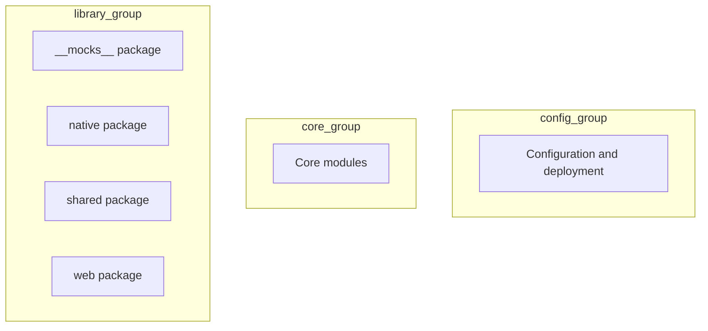

# Architecture report: danilowoz/react-content-loader

> Automated static analysis. **Observed** = directly seen in files/imports/AST; **Inferred** = interpretation from that evidence. Repository code was not executed.

## 1. Repository at a glance

| Item | Value |
| --- | --- |
| Repository | danilowoz/react-content-loader |
| Description | ⚪ SVG-Powered component to easily create skeleton loadings. |
| Language | TypeScript |
| Stars | 13997 |
| Licence | MIT |
| Analysed commit / branch | c8a6b6c6669d7e663f9d7e1efecec08e876b0e5d / master |
| Framework(s) | React |
| Files analysed | 74 |
| Components | 6 |

## 2. Architecture in one minute

danilowoz/react-content-loader - ⚪ SVG-Powered component to easily create skeleton loadings.. This repository was analysed statically from 74 file(s) (0 Python). Detected technologies (observed from imports/manifests): GitHub Actions, React, Jest, TypeScript. Files are grouped into 6 component(s): Configuration and deployment, Core modules, __mocks__ package, native package, shared package, web package. Findings below distinguish observed facts from inferred interpretation.

## 3. High-level block diagram

## 4. Main components

### Configuration and deployment (`config`)

- **Kind:** config
- **Status:** Observed
- **Confidence:** 0.85
- **Responsibility:** Groups 5 file(s) under configuration and deployment (observed from repository paths and static analysis).
- **Paths:** `package.json`, `src/native/package.json`, `tsconfig.base.json`, `tsconfig.json`, `tsconfig.test.json`
- **Evidence:** [package.json](https://github.com/danilowoz/react-content-loader/blob/c8a6b6c6669d7e663f9d7e1efecec08e876b0e5d/package.json); [src/native/package.json](https://github.com/danilowoz/react-content-loader/blob/c8a6b6c6669d7e663f9d7e1efecec08e876b0e5d/src/native/package.json); [tsconfig.base.json](https://github.com/danilowoz/react-content-loader/blob/c8a6b6c6669d7e663f9d7e1efecec08e876b0e5d/tsconfig.base.json); [tsconfig.json](https://github.com/danilowoz/react-content-loader/blob/c8a6b6c6669d7e663f9d7e1efecec08e876b0e5d/tsconfig.json); [tsconfig.test.json](https://github.com/danilowoz/react-content-loader/blob/c8a6b6c6669d7e663f9d7e1efecec08e876b0e5d/tsconfig.test.json)

### Core modules (`core`)

- **Kind:** core
- **Status:** Observed
- **Confidence:** 0.85
- **Responsibility:** Groups 4 file(s) under core modules (observed from repository paths and static analysis).
- **Paths:** `babel.config.js`, `jest.native.config.js`, `jest.web.config.js`, `rollup.config.js`
- **Evidence:** [babel.config.js](https://github.com/danilowoz/react-content-loader/blob/c8a6b6c6669d7e663f9d7e1efecec08e876b0e5d/babel.config.js); [jest.native.config.js](https://github.com/danilowoz/react-content-loader/blob/c8a6b6c6669d7e663f9d7e1efecec08e876b0e5d/jest.native.config.js); [jest.web.config.js](https://github.com/danilowoz/react-content-loader/blob/c8a6b6c6669d7e663f9d7e1efecec08e876b0e5d/jest.web.config.js); [rollup.config.js](https://github.com/danilowoz/react-content-loader/blob/c8a6b6c6669d7e663f9d7e1efecec08e876b0e5d/rollup.config.js)

### __mocks__ package (`mocks`)

- **Kind:** library
- **Status:** Observed
- **Confidence:** 0.85
- **Responsibility:** Groups 1 file(s) under __mocks__ package (observed from repository paths and static analysis).
- **Paths:** `__mocks__/react-native-svg.js`
- **Evidence:** [__mocks__/react-native-svg.js](https://github.com/danilowoz/react-content-loader/blob/c8a6b6c6669d7e663f9d7e1efecec08e876b0e5d/__mocks__/react-native-svg.js)

### native package (`native`)

- **Kind:** library
- **Status:** Observed
- **Confidence:** 0.85
- **Responsibility:** Groups 16 file(s) under native package (observed from repository paths and static analysis).
- **Paths:** `src/native/ContentLoader.tsx`, `src/native/Svg.tsx`, `src/native/__tests__/ContentLoader.test.tsx`, `src/native/__tests__/Svg.test.tsx`, `src/native/__tests__/presets/BulletListStyle.test.tsx`, `src/native/__tests__/presets/CodeStyle.test.tsx`, `src/native/__tests__/presets/FacebookStyle.test.tsx`, `src/native/__tests__/presets/InstagramStyle.test.tsx`, `src/native/__tests__/presets/ListStyle.test.tsx`, `src/native/__tests__/snapshots.test.tsx`, `src/native/index.ts`, `src/native/presets/BulletListStyle.tsx`, `src/native/presets/CodeStyle.tsx`, `src/native/presets/FacebookStyle.tsx`, `src/native/presets/InstagramStyle.tsx`, `src/native/presets/ListStyle.tsx`
- **Evidence:** [src/native/ContentLoader.tsx](https://github.com/danilowoz/react-content-loader/blob/c8a6b6c6669d7e663f9d7e1efecec08e876b0e5d/src/native/ContentLoader.tsx); [src/native/Svg.tsx](https://github.com/danilowoz/react-content-loader/blob/c8a6b6c6669d7e663f9d7e1efecec08e876b0e5d/src/native/Svg.tsx); [src/native/__tests__/ContentLoader.test.tsx](https://github.com/danilowoz/react-content-loader/blob/c8a6b6c6669d7e663f9d7e1efecec08e876b0e5d/src/native/__tests__/ContentLoader.test.tsx); [src/native/__tests__/Svg.test.tsx](https://github.com/danilowoz/react-content-loader/blob/c8a6b6c6669d7e663f9d7e1efecec08e876b0e5d/src/native/__tests__/Svg.test.tsx); [src/native/__tests__/presets/BulletListStyle.test.tsx](https://github.com/danilowoz/react-content-loader/blob/c8a6b6c6669d7e663f9d7e1efecec08e876b0e5d/src/native/__tests__/presets/BulletListStyle.test.tsx); [src/native/__tests__/presets/CodeStyle.test.tsx](https://github.com/danilowoz/react-content-loader/blob/c8a6b6c6669d7e663f9d7e1efecec08e876b0e5d/src/native/__tests__/presets/CodeStyle.test.tsx); [src/native/__tests__/presets/FacebookStyle.test.tsx](https://github.com/danilowoz/react-content-loader/blob/c8a6b6c6669d7e663f9d7e1efecec08e876b0e5d/src/native/__tests__/presets/FacebookStyle.test.tsx); [src/native/__tests__/presets/InstagramStyle.test.tsx](https://github.com/danilowoz/react-content-loader/blob/c8a6b6c6669d7e663f9d7e1efecec08e876b0e5d/src/native/__tests__/presets/InstagramStyle.test.tsx)

### shared package (`shared`)

- **Kind:** library
- **Status:** Observed
- **Confidence:** 0.85
- **Responsibility:** Groups 1 file(s) under shared package (observed from repository paths and static analysis).
- **Paths:** `src/shared/uid.ts`
- **Evidence:** [src/shared/uid.ts](https://github.com/danilowoz/react-content-loader/blob/c8a6b6c6669d7e663f9d7e1efecec08e876b0e5d/src/shared/uid.ts)

### web package (`web`)

- **Kind:** library
- **Status:** Observed
- **Confidence:** 0.85
- **Responsibility:** Groups 18 file(s) under web package (observed from repository paths and static analysis).
- **Paths:** `src/web/ContentLoader.tsx`, `src/web/Svg.tsx`, `src/web/__tests__/ContentLoader.test.tsx`, `src/web/__tests__/Svg.test.tsx`, `src/web/__tests__/index.test.tsx`, `src/web/__tests__/presets/BulletListStyle.test.tsx`, `src/web/__tests__/presets/CodeStyle.test.tsx`, `src/web/__tests__/presets/FacebookStyle.test.tsx`, `src/web/__tests__/presets/InstagramStyle.test.tsx`, `src/web/__tests__/presets/ListStyle.test.tsx`, `src/web/__tests__/snapshots.test.tsx`, `src/web/__tests__/uid.test.tsx`, `src/web/index.ts`, `src/web/presets/BulletListStyle.tsx`, `src/web/presets/CodeStyle.tsx`, `src/web/presets/FacebookStyle.tsx`, `src/web/presets/InstagramStyle.tsx`, `src/web/presets/ListStyle.tsx`
- **Evidence:** [src/web/ContentLoader.tsx](https://github.com/danilowoz/react-content-loader/blob/c8a6b6c6669d7e663f9d7e1efecec08e876b0e5d/src/web/ContentLoader.tsx); [src/web/Svg.tsx](https://github.com/danilowoz/react-content-loader/blob/c8a6b6c6669d7e663f9d7e1efecec08e876b0e5d/src/web/Svg.tsx); [src/web/__tests__/ContentLoader.test.tsx](https://github.com/danilowoz/react-content-loader/blob/c8a6b6c6669d7e663f9d7e1efecec08e876b0e5d/src/web/__tests__/ContentLoader.test.tsx); [src/web/__tests__/Svg.test.tsx](https://github.com/danilowoz/react-content-loader/blob/c8a6b6c6669d7e663f9d7e1efecec08e876b0e5d/src/web/__tests__/Svg.test.tsx); [src/web/__tests__/index.test.tsx](https://github.com/danilowoz/react-content-loader/blob/c8a6b6c6669d7e663f9d7e1efecec08e876b0e5d/src/web/__tests__/index.test.tsx); [src/web/__tests__/presets/BulletListStyle.test.tsx](https://github.com/danilowoz/react-content-loader/blob/c8a6b6c6669d7e663f9d7e1efecec08e876b0e5d/src/web/__tests__/presets/BulletListStyle.test.tsx); [src/web/__tests__/presets/CodeStyle.test.tsx](https://github.com/danilowoz/react-content-loader/blob/c8a6b6c6669d7e663f9d7e1efecec08e876b0e5d/src/web/__tests__/presets/CodeStyle.test.tsx); [src/web/__tests__/presets/FacebookStyle.test.tsx](https://github.com/danilowoz/react-content-loader/blob/c8a6b6c6669d7e663f9d7e1efecec08e876b0e5d/src/web/__tests__/presets/FacebookStyle.test.tsx)

## 5. Execution flow

**Observed** entry point(s):

- [.storybook/main.ts](https://github.com/danilowoz/react-content-loader/blob/c8a6b6c6669d7e663f9d7e1efecec08e876b0e5d/.storybook/main.ts)
- [src/native/index.ts](https://github.com/danilowoz/react-content-loader/blob/c8a6b6c6669d7e663f9d7e1efecec08e876b0e5d/src/native/index.ts)
- [src/web/index.ts](https://github.com/danilowoz/react-content-loader/blob/c8a6b6c6669d7e663f9d7e1efecec08e876b0e5d/src/web/index.ts)

Representative flow (derived from observed entry points and the import graph; steps beyond the entry point are **Inferred**):

1. Execution starts at an observed entry point listed above, if present.
2. No internal import relationships between components were observed.

## 6. Project structure

### `(root)`

- `.gitignore` - other (197 bytes)
- `.prettierrc.js` - source, JavaScript (56 bytes)
- `CODE_OF_CONDUCT.md` - docs (3216 bytes)
- `LICENSE` - docs (1092 bytes)
- `README.md` - docs (17448 bytes)
- `babel.config.js` - source, JavaScript (192 bytes)
- `jest.native.config.js` - source, JavaScript (220 bytes)
- `jest.web.config.js` - source, JavaScript (276 bytes)
- `package.json` - manifest (3845 bytes)
- `rollup.config.js` - source, JavaScript (2669 bytes)
- `tsconfig.base.json` - config (427 bytes)
- `tsconfig.json` - config (40 bytes)
- `tsconfig.test.json` - config (87 bytes)

### `.codesandbox`

- `.codesandbox/tasks.json` - config (1806 bytes)

### `.devcontainer`

- `.devcontainer/devcontainer.json` - config (909 bytes)

### `.github`

- `.github/FUNDING.yml` - config (645 bytes)
- `.github/ISSUE_TEMPLATE.md` - docs (313 bytes)
- `.github/PULL_REQUEST_TEMPLATE.md` - docs (530 bytes)
- `.github/dependabot.yml` - config (467 bytes)
- `.github/workflows/ci.yml` - ci, YAML (599 bytes)
- `.github/workflows/release.yml` - ci, YAML (1135 bytes)

### `.storybook`

- `.storybook/main.ts` - source, TypeScript (289 bytes)
- `.storybook/preview-head.html` - other (46 bytes)
- `.storybook/preview.tsx` - source, TypeScript (246 bytes)

### `__mocks__`

- `__mocks__/react-native-svg.js` - source, JavaScript (1607 bytes)

### `docs`

- `docs/index.stories.tsx` - docs (10394 bytes)

### `src`

- `src/native/ContentLoader.tsx` - source, TypeScript (348 bytes)
- `src/native/Svg.tsx` - source, TypeScript (3377 bytes)
- `src/native/__tests__/ContentLoader.test.tsx` - source, TypeScript (4572 bytes)
- `src/native/__tests__/Svg.test.tsx` - source, TypeScript (3334 bytes)
- `src/native/__tests__/__snapshots__/snapshots.test.tsx.snap` - other (7565 bytes)
- `src/native/__tests__/presets/BulletListStyle.test.tsx` - source, TypeScript (550 bytes)
- `src/native/__tests__/presets/CodeStyle.test.tsx` - source, TypeScript (520 bytes)
- `src/native/__tests__/presets/FacebookStyle.test.tsx` - source, TypeScript (540 bytes)
- `src/native/__tests__/presets/InstagramStyle.test.tsx` - source, TypeScript (545 bytes)
- `src/native/__tests__/presets/ListStyle.test.tsx` - source, TypeScript (520 bytes)
- `src/native/__tests__/presets/__snapshots__/BulletListStyle.test.tsx.snap` - other (1666 bytes)
- `src/native/__tests__/presets/__snapshots__/CodeStyle.test.tsx.snap` - other (1715 bytes)
- `src/native/__tests__/presets/__snapshots__/FacebookStyle.test.tsx.snap` - other (1483 bytes)
- `src/native/__tests__/presets/__snapshots__/InstagramStyle.test.tsx.snap` - other (1332 bytes)
- `src/native/__tests__/presets/__snapshots__/ListStyle.test.tsx.snap` - other (1597 bytes)
- `src/native/__tests__/snapshots.test.tsx` - source, TypeScript (1968 bytes)
- `src/native/index.ts` - source, TypeScript (765 bytes)
- `src/native/package.json` - manifest (394 bytes)
- `src/native/presets/BulletListStyle.tsx` - source, TypeScript (767 bytes)
- `src/native/presets/CodeStyle.tsx` - source, TypeScript (795 bytes)
- `src/native/presets/FacebookStyle.tsx` - source, TypeScript (671 bytes)
- `src/native/presets/InstagramStyle.tsx` - source, TypeScript (589 bytes)
- `src/native/presets/ListStyle.tsx` - source, TypeScript (735 bytes)
- `src/shared/uid.ts` - source, TypeScript (81 bytes)
- `src/web/ContentLoader.tsx` - source, TypeScript (263 bytes)
- `src/web/Svg.tsx` - source, TypeScript (2196 bytes)
- `src/web/__tests__/ContentLoader.test.tsx` - source, TypeScript (5057 bytes)
- `src/web/__tests__/Svg.test.tsx` - source, TypeScript (5356 bytes)
- `src/web/__tests__/__snapshots__/snapshots.test.tsx.snap` - other (9228 bytes)
- `src/web/__tests__/index.test.tsx` - source, TypeScript (625 bytes)
- `src/web/__tests__/presets/BulletListStyle.test.tsx` - source, TypeScript (557 bytes)
- `src/web/__tests__/presets/CodeStyle.test.tsx` - source, TypeScript (521 bytes)
- `src/web/__tests__/presets/FacebookStyle.test.tsx` - source, TypeScript (545 bytes)
- `src/web/__tests__/presets/InstagramStyle.test.tsx` - source, TypeScript (551 bytes)
- `src/web/__tests__/presets/ListStyle.test.tsx` - source, TypeScript (521 bytes)
- `src/web/__tests__/presets/__snapshots__/BulletListStyle.test.tsx.snap` - other (1937 bytes)
- `src/web/__tests__/presets/__snapshots__/CodeStyle.test.tsx.snap` - other (1975 bytes)
- `src/web/__tests__/presets/__snapshots__/FacebookStyle.test.tsx.snap` - other (1750 bytes)
- `src/web/__tests__/presets/__snapshots__/InstagramStyle.test.tsx.snap` - other (1601 bytes)
- `src/web/__tests__/presets/__snapshots__/ListStyle.test.tsx.snap` - other (1856 bytes)
- `src/web/__tests__/snapshots.test.tsx` - source, TypeScript (1838 bytes)
- `src/web/__tests__/uid.test.tsx` - source, TypeScript (522 bytes)
- `src/web/index.ts` - source, TypeScript (779 bytes)
- `src/web/presets/BulletListStyle.tsx` - source, TypeScript (725 bytes)
- `src/web/presets/CodeStyle.tsx` - source, TypeScript (761 bytes)
- `src/web/presets/FacebookStyle.tsx` - source, TypeScript (628 bytes)
- `src/web/presets/InstagramStyle.tsx` - source, TypeScript (546 bytes)
- `src/web/presets/ListStyle.tsx` - source, TypeScript (700 bytes)

## 7. Key dependencies and integrations

| Name | Category | Status | Confidence | Evidence |
| --- | --- | --- | --- | --- |
| GitHub Actions | ci | Observed | 0.90 | [.github/workflows/ci.yml](https://github.com/danilowoz/react-content-loader/blob/c8a6b6c6669d7e663f9d7e1efecec08e876b0e5d/.github/workflows/ci.yml); [.github/workflows/release.yml](https://github.com/danilowoz/react-content-loader/blob/c8a6b6c6669d7e663f9d7e1efecec08e876b0e5d/.github/workflows/release.yml) |
| React | framework | Observed | 0.90 | [package.json:2](https://github.com/danilowoz/react-content-loader/blob/c8a6b6c6669d7e663f9d7e1efecec08e876b0e5d/package.json#L2); [package.json:76](https://github.com/danilowoz/react-content-loader/blob/c8a6b6c6669d7e663f9d7e1efecec08e876b0e5d/package.json#L76); [src/native/package.json:2](https://github.com/danilowoz/react-content-loader/blob/c8a6b6c6669d7e663f9d7e1efecec08e876b0e5d/src/native/package.json#L2) |
| Jest | tooling | Observed | 0.85 | [package.json:54](https://github.com/danilowoz/react-content-loader/blob/c8a6b6c6669d7e663f9d7e1efecec08e876b0e5d/package.json#L54) |
| TypeScript | tooling | Observed | 0.85 | [package.json:66](https://github.com/danilowoz/react-content-loader/blob/c8a6b6c6669d7e663f9d7e1efecec08e876b0e5d/package.json#L66) |

## 8. Data and state

No database, cache, queue, or persistent-state usage was observed in the analysed files. State handling, if any, may be in-memory or in files that were not analysed.

## 9. Configuration and deployment clues

- `.codesandbox/tasks.json` (config)
- `.devcontainer/devcontainer.json` (config)
- `.github/FUNDING.yml` (config)
- `.github/dependabot.yml` (config)
- `.github/workflows/ci.yml` (ci)
- `.github/workflows/release.yml` (ci)
- `package.json` (manifest)
- `src/native/package.json` (manifest)
- `tsconfig.base.json` (config)
- `tsconfig.json` (config)
- `tsconfig.test.json` (config)

## 10. Design observations

- No strong design patterns could be established from the available evidence.

These observations are interpretations (**Inferred**) of the observed structure, not guarantees about runtime design.

## 11. Limitations and unknowns

- Static analysis only: repository code was not executed, installed, or imported at runtime.
- Components and relationships are inferred from file paths, imports, and AST structure; runtime behaviour, dynamic imports, and reflection may not be visible.
- No clear application entry point was observed in the analysed files.
- Repository text was treated as untrusted data; no instructions found in repository files were followed, and likely secret values were redacted/excluded.
- JavaScript and TypeScript files were inventoried from paths and package manifests. They were not parsed with a full language AST, and repository code was not executed.

## 12. Source references

- [.github/workflows/ci.yml](https://github.com/danilowoz/react-content-loader/blob/c8a6b6c6669d7e663f9d7e1efecec08e876b0e5d/.github/workflows/ci.yml)
- [.github/workflows/release.yml](https://github.com/danilowoz/react-content-loader/blob/c8a6b6c6669d7e663f9d7e1efecec08e876b0e5d/.github/workflows/release.yml)
- [.storybook/main.ts](https://github.com/danilowoz/react-content-loader/blob/c8a6b6c6669d7e663f9d7e1efecec08e876b0e5d/.storybook/main.ts)
- [__mocks__/react-native-svg.js](https://github.com/danilowoz/react-content-loader/blob/c8a6b6c6669d7e663f9d7e1efecec08e876b0e5d/__mocks__/react-native-svg.js)
- [babel.config.js](https://github.com/danilowoz/react-content-loader/blob/c8a6b6c6669d7e663f9d7e1efecec08e876b0e5d/babel.config.js)
- [jest.native.config.js](https://github.com/danilowoz/react-content-loader/blob/c8a6b6c6669d7e663f9d7e1efecec08e876b0e5d/jest.native.config.js)
- [jest.web.config.js](https://github.com/danilowoz/react-content-loader/blob/c8a6b6c6669d7e663f9d7e1efecec08e876b0e5d/jest.web.config.js)
- [package.json](https://github.com/danilowoz/react-content-loader/blob/c8a6b6c6669d7e663f9d7e1efecec08e876b0e5d/package.json)
- [package.json:2](https://github.com/danilowoz/react-content-loader/blob/c8a6b6c6669d7e663f9d7e1efecec08e876b0e5d/package.json#L2)
- [package.json:54](https://github.com/danilowoz/react-content-loader/blob/c8a6b6c6669d7e663f9d7e1efecec08e876b0e5d/package.json#L54)
- [package.json:66](https://github.com/danilowoz/react-content-loader/blob/c8a6b6c6669d7e663f9d7e1efecec08e876b0e5d/package.json#L66)
- [package.json:76](https://github.com/danilowoz/react-content-loader/blob/c8a6b6c6669d7e663f9d7e1efecec08e876b0e5d/package.json#L76)
- [rollup.config.js](https://github.com/danilowoz/react-content-loader/blob/c8a6b6c6669d7e663f9d7e1efecec08e876b0e5d/rollup.config.js)
- [src/native/ContentLoader.tsx](https://github.com/danilowoz/react-content-loader/blob/c8a6b6c6669d7e663f9d7e1efecec08e876b0e5d/src/native/ContentLoader.tsx)
- [src/native/Svg.tsx](https://github.com/danilowoz/react-content-loader/blob/c8a6b6c6669d7e663f9d7e1efecec08e876b0e5d/src/native/Svg.tsx)
- [src/native/__tests__/ContentLoader.test.tsx](https://github.com/danilowoz/react-content-loader/blob/c8a6b6c6669d7e663f9d7e1efecec08e876b0e5d/src/native/__tests__/ContentLoader.test.tsx)
- [src/native/__tests__/Svg.test.tsx](https://github.com/danilowoz/react-content-loader/blob/c8a6b6c6669d7e663f9d7e1efecec08e876b0e5d/src/native/__tests__/Svg.test.tsx)
- [src/native/__tests__/presets/BulletListStyle.test.tsx](https://github.com/danilowoz/react-content-loader/blob/c8a6b6c6669d7e663f9d7e1efecec08e876b0e5d/src/native/__tests__/presets/BulletListStyle.test.tsx)
- [src/native/__tests__/presets/CodeStyle.test.tsx](https://github.com/danilowoz/react-content-loader/blob/c8a6b6c6669d7e663f9d7e1efecec08e876b0e5d/src/native/__tests__/presets/CodeStyle.test.tsx)
- [src/native/__tests__/presets/FacebookStyle.test.tsx](https://github.com/danilowoz/react-content-loader/blob/c8a6b6c6669d7e663f9d7e1efecec08e876b0e5d/src/native/__tests__/presets/FacebookStyle.test.tsx)
- [src/native/__tests__/presets/InstagramStyle.test.tsx](https://github.com/danilowoz/react-content-loader/blob/c8a6b6c6669d7e663f9d7e1efecec08e876b0e5d/src/native/__tests__/presets/InstagramStyle.test.tsx)
- [src/native/index.ts](https://github.com/danilowoz/react-content-loader/blob/c8a6b6c6669d7e663f9d7e1efecec08e876b0e5d/src/native/index.ts)
- [src/native/package.json](https://github.com/danilowoz/react-content-loader/blob/c8a6b6c6669d7e663f9d7e1efecec08e876b0e5d/src/native/package.json)
- [src/native/package.json:2](https://github.com/danilowoz/react-content-loader/blob/c8a6b6c6669d7e663f9d7e1efecec08e876b0e5d/src/native/package.json#L2)
- [src/shared/uid.ts](https://github.com/danilowoz/react-content-loader/blob/c8a6b6c6669d7e663f9d7e1efecec08e876b0e5d/src/shared/uid.ts)
- [src/web/ContentLoader.tsx](https://github.com/danilowoz/react-content-loader/blob/c8a6b6c6669d7e663f9d7e1efecec08e876b0e5d/src/web/ContentLoader.tsx)
- [src/web/Svg.tsx](https://github.com/danilowoz/react-content-loader/blob/c8a6b6c6669d7e663f9d7e1efecec08e876b0e5d/src/web/Svg.tsx)
- [src/web/__tests__/ContentLoader.test.tsx](https://github.com/danilowoz/react-content-loader/blob/c8a6b6c6669d7e663f9d7e1efecec08e876b0e5d/src/web/__tests__/ContentLoader.test.tsx)
- [src/web/__tests__/Svg.test.tsx](https://github.com/danilowoz/react-content-loader/blob/c8a6b6c6669d7e663f9d7e1efecec08e876b0e5d/src/web/__tests__/Svg.test.tsx)
- [src/web/__tests__/index.test.tsx](https://github.com/danilowoz/react-content-loader/blob/c8a6b6c6669d7e663f9d7e1efecec08e876b0e5d/src/web/__tests__/index.test.tsx)
- [src/web/__tests__/presets/BulletListStyle.test.tsx](https://github.com/danilowoz/react-content-loader/blob/c8a6b6c6669d7e663f9d7e1efecec08e876b0e5d/src/web/__tests__/presets/BulletListStyle.test.tsx)
- [src/web/__tests__/presets/CodeStyle.test.tsx](https://github.com/danilowoz/react-content-loader/blob/c8a6b6c6669d7e663f9d7e1efecec08e876b0e5d/src/web/__tests__/presets/CodeStyle.test.tsx)
- [src/web/__tests__/presets/FacebookStyle.test.tsx](https://github.com/danilowoz/react-content-loader/blob/c8a6b6c6669d7e663f9d7e1efecec08e876b0e5d/src/web/__tests__/presets/FacebookStyle.test.tsx)
- [src/web/index.ts](https://github.com/danilowoz/react-content-loader/blob/c8a6b6c6669d7e663f9d7e1efecec08e876b0e5d/src/web/index.ts)
- [tsconfig.base.json](https://github.com/danilowoz/react-content-loader/blob/c8a6b6c6669d7e663f9d7e1efecec08e876b0e5d/tsconfig.base.json)
- [tsconfig.json](https://github.com/danilowoz/react-content-loader/blob/c8a6b6c6669d7e663f9d7e1efecec08e876b0e5d/tsconfig.json)
- [tsconfig.test.json](https://github.com/danilowoz/react-content-loader/blob/c8a6b6c6669d7e663f9d7e1efecec08e876b0e5d/tsconfig.test.json)
