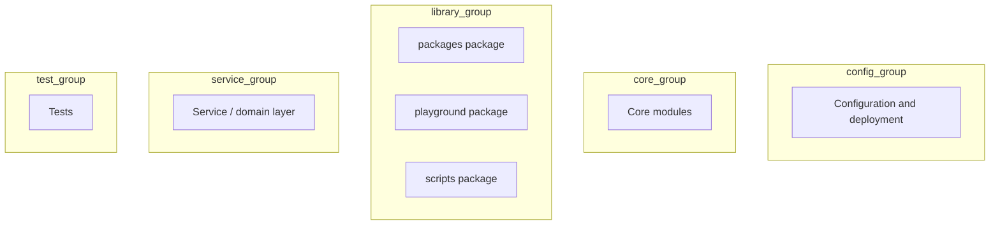

# Architecture report: darkroomengineering/lenis

> Automated static analysis. **Observed** = directly seen in files/imports/AST; **Inferred** = interpretation from that evidence. Repository code was not executed.

## 1. Repository at a glance

| Item | Value |
| --- | --- |
| Repository | darkroomengineering/lenis |
| Description | Smooth scroll as it should be |
| Language | TypeScript |
| Stars | 17264 |
| Licence | MIT |
| Analysed commit / branch | bd89165aa6ab64c4ae68242c8d2a5e90b76ff77d / main |
| Framework(s) | React, Vue |
| Files analysed | 108 |
| Components | 7 |

## 2. Architecture in one minute

darkroomengineering/lenis - Smooth scroll as it should be. This repository was analysed statically from 108 file(s) (0 Python). Detected technologies (observed from imports/manifests): GitHub Actions, React, Vue, TypeScript, Vite. Files are grouped into 7 component(s): Configuration and deployment, Core modules, packages package, playground package, scripts package, Service / domain layer, Tests. Findings below distinguish observed facts from inferred interpretation.

## 3. High-level block diagram

## 4. Main components

### Configuration and deployment (`config`)

- **Kind:** config
- **Status:** Observed
- **Confidence:** 0.85
- **Responsibility:** Groups 11 file(s) under configuration and deployment (observed from repository paths and static analysis).
- **Paths:** `package.json`, `packages/core/package.json`, `packages/react/package.json`, `packages/snap/package.json`, `packages/vue/package.json`, `playground/nuxt/package.json`, `playground/nuxt/server/tsconfig.json`, `playground/nuxt/tsconfig.json`, `playground/package.json`, `playground/tsconfig.json`, `tsconfig.json`
- **Evidence:** [package.json](https://github.com/darkroomengineering/lenis/blob/bd89165aa6ab64c4ae68242c8d2a5e90b76ff77d/package.json); [packages/core/package.json](https://github.com/darkroomengineering/lenis/blob/bd89165aa6ab64c4ae68242c8d2a5e90b76ff77d/packages/core/package.json); [packages/react/package.json](https://github.com/darkroomengineering/lenis/blob/bd89165aa6ab64c4ae68242c8d2a5e90b76ff77d/packages/react/package.json); [packages/snap/package.json](https://github.com/darkroomengineering/lenis/blob/bd89165aa6ab64c4ae68242c8d2a5e90b76ff77d/packages/snap/package.json); [packages/vue/package.json](https://github.com/darkroomengineering/lenis/blob/bd89165aa6ab64c4ae68242c8d2a5e90b76ff77d/packages/vue/package.json); [playground/nuxt/package.json](https://github.com/darkroomengineering/lenis/blob/bd89165aa6ab64c4ae68242c8d2a5e90b76ff77d/playground/nuxt/package.json); [playground/nuxt/server/tsconfig.json](https://github.com/darkroomengineering/lenis/blob/bd89165aa6ab64c4ae68242c8d2a5e90b76ff77d/playground/nuxt/server/tsconfig.json); [playground/nuxt/tsconfig.json](https://github.com/darkroomengineering/lenis/blob/bd89165aa6ab64c4ae68242c8d2a5e90b76ff77d/playground/nuxt/tsconfig.json)

### Core modules (`core`)

- **Kind:** core
- **Status:** Observed
- **Confidence:** 0.85
- **Responsibility:** Groups 1 file(s) under core modules (observed from repository paths and static analysis).
- **Paths:** `vite.config.ts`
- **Evidence:** [vite.config.ts](https://github.com/darkroomengineering/lenis/blob/bd89165aa6ab64c4ae68242c8d2a5e90b76ff77d/vite.config.ts)

### packages package (`packages`)

- **Kind:** library
- **Status:** Observed
- **Confidence:** 0.85
- **Responsibility:** Groups 20 file(s) under packages package (observed from repository paths and static analysis).
- **Paths:** `packages/react/index.ts`, `packages/react/src/provider.tsx`, `packages/react/src/store.ts`, `packages/react/src/types.ts`, `packages/react/src/use-lenis.ts`, `packages/snap/browser.ts`, `packages/snap/index.ts`, `packages/snap/src/debounce.ts`, `packages/snap/src/element.ts`, `packages/snap/src/snap.ts`, `packages/snap/src/types.ts`, `packages/snap/src/uid.ts`, `packages/vue/index.ts`, `packages/vue/nuxt/module.ts`, `packages/vue/nuxt/runtime/lenis.ts`, `packages/vue/nuxt/types/app.d.ts`, `packages/vue/nuxt/types/imports.d.ts`, `packages/vue/src/provider.ts`, `packages/vue/src/store.ts`, `packages/vue/src/use-lenis.ts`
- **Evidence:** [packages/react/index.ts](https://github.com/darkroomengineering/lenis/blob/bd89165aa6ab64c4ae68242c8d2a5e90b76ff77d/packages/react/index.ts); [packages/react/src/provider.tsx](https://github.com/darkroomengineering/lenis/blob/bd89165aa6ab64c4ae68242c8d2a5e90b76ff77d/packages/react/src/provider.tsx); [packages/react/src/store.ts](https://github.com/darkroomengineering/lenis/blob/bd89165aa6ab64c4ae68242c8d2a5e90b76ff77d/packages/react/src/store.ts); [packages/react/src/types.ts](https://github.com/darkroomengineering/lenis/blob/bd89165aa6ab64c4ae68242c8d2a5e90b76ff77d/packages/react/src/types.ts); [packages/react/src/use-lenis.ts](https://github.com/darkroomengineering/lenis/blob/bd89165aa6ab64c4ae68242c8d2a5e90b76ff77d/packages/react/src/use-lenis.ts); [packages/snap/browser.ts](https://github.com/darkroomengineering/lenis/blob/bd89165aa6ab64c4ae68242c8d2a5e90b76ff77d/packages/snap/browser.ts); [packages/snap/index.ts](https://github.com/darkroomengineering/lenis/blob/bd89165aa6ab64c4ae68242c8d2a5e90b76ff77d/packages/snap/index.ts); [packages/snap/src/debounce.ts](https://github.com/darkroomengineering/lenis/blob/bd89165aa6ab64c4ae68242c8d2a5e90b76ff77d/packages/snap/src/debounce.ts)

### playground package (`playground`)

- **Kind:** library
- **Status:** Observed
- **Confidence:** 0.85
- **Responsibility:** Groups 19 file(s) under playground package (observed from repository paths and static analysis).
- **Paths:** `playground/astro.config.mjs`, `playground/horizontal/browser.js`, `playground/horizontal/test.ts`, `playground/infinite/browser.js`, `playground/infinite/test.ts`, `playground/nuxt/app.vue`, `playground/nuxt/components/inner.vue`, `playground/nuxt/nuxt.config.ts`, `playground/nuxt/pages/about.vue`, `playground/nuxt/pages/index.vue`, `playground/nuxt/plugins/lenis.ts`, `playground/react/app.tsx`, `playground/snap/test.ts`, `playground/stats-js.d.ts`, `playground/touch-debug/test.ts`, `playground/vue/App.vue`, `playground/vue/Child.vue`, `playground/vue/InnerChild.vue`, `playground/vue/setup.ts`
- **Evidence:** [playground/astro.config.mjs](https://github.com/darkroomengineering/lenis/blob/bd89165aa6ab64c4ae68242c8d2a5e90b76ff77d/playground/astro.config.mjs); [playground/horizontal/browser.js](https://github.com/darkroomengineering/lenis/blob/bd89165aa6ab64c4ae68242c8d2a5e90b76ff77d/playground/horizontal/browser.js); [playground/horizontal/test.ts](https://github.com/darkroomengineering/lenis/blob/bd89165aa6ab64c4ae68242c8d2a5e90b76ff77d/playground/horizontal/test.ts); [playground/infinite/browser.js](https://github.com/darkroomengineering/lenis/blob/bd89165aa6ab64c4ae68242c8d2a5e90b76ff77d/playground/infinite/browser.js); [playground/infinite/test.ts](https://github.com/darkroomengineering/lenis/blob/bd89165aa6ab64c4ae68242c8d2a5e90b76ff77d/playground/infinite/test.ts); [playground/nuxt/app.vue](https://github.com/darkroomengineering/lenis/blob/bd89165aa6ab64c4ae68242c8d2a5e90b76ff77d/playground/nuxt/app.vue); [playground/nuxt/components/inner.vue](https://github.com/darkroomengineering/lenis/blob/bd89165aa6ab64c4ae68242c8d2a5e90b76ff77d/playground/nuxt/components/inner.vue); [playground/nuxt/nuxt.config.ts](https://github.com/darkroomengineering/lenis/blob/bd89165aa6ab64c4ae68242c8d2a5e90b76ff77d/playground/nuxt/nuxt.config.ts)

### scripts package (`scripts`)

- **Kind:** library
- **Status:** Observed
- **Confidence:** 0.85
- **Responsibility:** Groups 1 file(s) under scripts package (observed from repository paths and static analysis).
- **Paths:** `scripts/update-readme.js`
- **Evidence:** [scripts/update-readme.js](https://github.com/darkroomengineering/lenis/blob/bd89165aa6ab64c4ae68242c8d2a5e90b76ff77d/scripts/update-readme.js)

### Service / domain layer (`service_layer`)

- **Kind:** service
- **Status:** Observed
- **Confidence:** 0.85
- **Responsibility:** Groups 12 file(s) under service / domain layer (observed from repository paths and static analysis).
- **Paths:** `packages/core/browser.ts`, `packages/core/index.ts`, `packages/core/src/animate.ts`, `packages/core/src/debounce.ts`, `packages/core/src/dimensions.ts`, `packages/core/src/emitter.ts`, `packages/core/src/lenis.ts`, `packages/core/src/maths.ts`, `packages/core/src/types.ts`, `packages/core/src/virtual-scroll.ts`, `playground/core/browser.js`, `playground/core/test.ts`
- **Evidence:** [packages/core/browser.ts](https://github.com/darkroomengineering/lenis/blob/bd89165aa6ab64c4ae68242c8d2a5e90b76ff77d/packages/core/browser.ts); [packages/core/index.ts](https://github.com/darkroomengineering/lenis/blob/bd89165aa6ab64c4ae68242c8d2a5e90b76ff77d/packages/core/index.ts); [packages/core/src/animate.ts](https://github.com/darkroomengineering/lenis/blob/bd89165aa6ab64c4ae68242c8d2a5e90b76ff77d/packages/core/src/animate.ts); [packages/core/src/debounce.ts](https://github.com/darkroomengineering/lenis/blob/bd89165aa6ab64c4ae68242c8d2a5e90b76ff77d/packages/core/src/debounce.ts); [packages/core/src/dimensions.ts](https://github.com/darkroomengineering/lenis/blob/bd89165aa6ab64c4ae68242c8d2a5e90b76ff77d/packages/core/src/dimensions.ts); [packages/core/src/emitter.ts](https://github.com/darkroomengineering/lenis/blob/bd89165aa6ab64c4ae68242c8d2a5e90b76ff77d/packages/core/src/emitter.ts); [packages/core/src/lenis.ts](https://github.com/darkroomengineering/lenis/blob/bd89165aa6ab64c4ae68242c8d2a5e90b76ff77d/packages/core/src/lenis.ts); [packages/core/src/maths.ts](https://github.com/darkroomengineering/lenis/blob/bd89165aa6ab64c4ae68242c8d2a5e90b76ff77d/packages/core/src/maths.ts)

### Tests (`tests`)

- **Kind:** test
- **Status:** Observed
- **Confidence:** 0.85
- **Responsibility:** Groups 3 file(s) under tests (observed from repository paths and static analysis).
- **Paths:** `packages/core/test/wheel.test.ts`, `packages/snap/test/align.test.ts`, `packages/snap/test/unsubscribe.test.ts`
- **Evidence:** [packages/core/test/wheel.test.ts](https://github.com/darkroomengineering/lenis/blob/bd89165aa6ab64c4ae68242c8d2a5e90b76ff77d/packages/core/test/wheel.test.ts); [packages/snap/test/align.test.ts](https://github.com/darkroomengineering/lenis/blob/bd89165aa6ab64c4ae68242c8d2a5e90b76ff77d/packages/snap/test/align.test.ts); [packages/snap/test/unsubscribe.test.ts](https://github.com/darkroomengineering/lenis/blob/bd89165aa6ab64c4ae68242c8d2a5e90b76ff77d/packages/snap/test/unsubscribe.test.ts)

## 5. Execution flow

**Observed** entry point(s):

- [packages/core/index.ts](https://github.com/darkroomengineering/lenis/blob/bd89165aa6ab64c4ae68242c8d2a5e90b76ff77d/packages/core/index.ts)
- [packages/react/index.ts](https://github.com/darkroomengineering/lenis/blob/bd89165aa6ab64c4ae68242c8d2a5e90b76ff77d/packages/react/index.ts)
- [packages/snap/index.ts](https://github.com/darkroomengineering/lenis/blob/bd89165aa6ab64c4ae68242c8d2a5e90b76ff77d/packages/snap/index.ts)
- [packages/vue/index.ts](https://github.com/darkroomengineering/lenis/blob/bd89165aa6ab64c4ae68242c8d2a5e90b76ff77d/packages/vue/index.ts)
- [playground/react/app.tsx](https://github.com/darkroomengineering/lenis/blob/bd89165aa6ab64c4ae68242c8d2a5e90b76ff77d/playground/react/app.tsx)

Representative flow (derived from observed entry points and the import graph; steps beyond the entry point are **Inferred**):

1. Execution starts at an observed entry point listed above, if present.
2. No internal import relationships between components were observed.

## 6. Project structure

### `(root)`

- `.gitignore` - other (579 bytes)
- `CONTRIBUTING.md` - docs (1418 bytes)
- `LICENSE` - docs (1088 bytes)
- `MANIFESTO.md` - docs (2317 bytes)
- `README.md` - docs (34587 bytes)
- `V2-ROADMAP.md` - docs (4337 bytes)
- `package.json` - manifest (2833 bytes)
- `tsconfig.json` - config (936 bytes)
- `vite.config.ts` - source, TypeScript (3660 bytes)

### `.github`

- `.github/CODEOWNERS` - other (35 bytes)
- `.github/FUNDING.yml` - config (57 bytes)
- `.github/ISSUE_TEMPLATE/bug_report.md` - docs (537 bytes)
- `.github/dependabot.yml` - config (513 bytes)
- `.github/workflows/ci.yml` - ci, YAML (1309 bytes)

### `.vscode`

- `.vscode/extensions.json` - config (405 bytes)
- `.vscode/settings.json` - config (2125 bytes)

### `packages`

- `packages/core/browser.ts` - source, TypeScript (201 bytes)
- `packages/core/index.ts` - source, TypeScript (129 bytes)
- `packages/core/lenis.css` - other (513 bytes)
- `packages/core/package.json` - manifest (47 bytes)
- `packages/core/src/animate.ts` - source, TypeScript (2351 bytes)
- `packages/core/src/debounce.ts` - source, TypeScript (338 bytes)
- `packages/core/src/dimensions.ts` - source, TypeScript (2291 bytes)
- `packages/core/src/emitter.ts` - source, TypeScript (1572 bytes)
- `packages/core/src/lenis.ts` - source, TypeScript (33448 bytes)
- `packages/core/src/maths.ts` - source, TypeScript (1668 bytes)
- `packages/core/src/types.ts` - source, TypeScript (6222 bytes)
- `packages/core/src/virtual-scroll.ts` - source, TypeScript (3856 bytes)
- `packages/core/test/wheel.test.ts` - test, TypeScript (1328 bytes)
- `packages/react/README.md` - docs (3432 bytes)
- `packages/react/index.ts` - source, TypeScript (236 bytes)
- `packages/react/package.json` - manifest (130 bytes)
- `packages/react/src/provider.tsx` - source, TypeScript (3786 bytes)
- `packages/react/src/store.ts` - source, TypeScript (740 bytes)
- `packages/react/src/types.ts` - source, TypeScript (1289 bytes)
- `packages/react/src/use-lenis.ts` - source, TypeScript (2433 bytes)
- `packages/snap/README.md` - docs (2646 bytes)
- `packages/snap/browser.ts` - source, TypeScript (132 bytes)
- `packages/snap/index.ts` - source, TypeScript (127 bytes)
- `packages/snap/package.json` - manifest (47 bytes)
- `packages/snap/src/debounce.ts` - source, TypeScript (367 bytes)
- `packages/snap/src/element.ts` - source, TypeScript (4549 bytes)
- `packages/snap/src/snap.ts` - source, TypeScript (8118 bytes)
- `packages/snap/src/types.ts` - source, TypeScript (1182 bytes)
- `packages/snap/src/uid.ts` - source, TypeScript (89 bytes)
- `packages/snap/test/align.test.ts` - test, TypeScript (2046 bytes)
- `packages/snap/test/unsubscribe.test.ts` - test, TypeScript (2819 bytes)
- `packages/vue/README.md` - docs (4351 bytes)
- `packages/vue/index.ts` - source, TypeScript (192 bytes)
- `packages/vue/nuxt/module.ts` - source, TypeScript (912 bytes)
- `packages/vue/nuxt/runtime/lenis.ts` - source, TypeScript (341 bytes)
- `packages/vue/nuxt/types/app.d.ts` - source, TypeScript (114 bytes)
- `packages/vue/nuxt/types/imports.d.ts` - source, TypeScript (125 bytes)
- `packages/vue/package.json` - manifest (95 bytes)
- `packages/vue/src/provider.ts` - source, TypeScript (4294 bytes)
- `packages/vue/src/store.ts` - source, TypeScript (345 bytes)
- `packages/vue/src/use-lenis.ts` - source, TypeScript (1817 bytes)

### `playground`

- `playground/.gitignore` - other (273 bytes)
- `playground/astro.config.mjs` - source, JavaScript (712 bytes)
- `playground/core/browser.js` - source, JavaScript (174 bytes)
- `playground/core/static.html` - other (571 bytes)
- `playground/core/style.css` - other (875 bytes)
- `playground/core/test.ts` - source, TypeScript (6149 bytes)
- `playground/horizontal/browser.js` - source, JavaScript (174 bytes)
- `playground/horizontal/static.html` - other (571 bytes)
- `playground/horizontal/style.css` - other (915 bytes)
- `playground/horizontal/test.ts` - source, TypeScript (708 bytes)
- `playground/infinite/browser.js` - source, JavaScript (174 bytes)
- `playground/infinite/static.html` - other (571 bytes)
- `playground/infinite/style.css` - other (53 bytes)
- `playground/infinite/test.ts` - source, TypeScript (986 bytes)
- `playground/nuxt/.gitignore` - other (193 bytes)
- `playground/nuxt/README.md` - docs (822 bytes)
- `playground/nuxt/app.vue` - source, Vue (955 bytes)
- `playground/nuxt/components/inner.vue` - source, Vue (271 bytes)
- `playground/nuxt/nuxt.config.ts` - source, TypeScript (185 bytes)
- `playground/nuxt/package.json` - manifest (321 bytes)
- `playground/nuxt/pages/about.vue` - source, Vue (521 bytes)
- `playground/nuxt/pages/index.vue` - source, Vue (600 bytes)
- `playground/nuxt/plugins/lenis.ts` - source, TypeScript (87 bytes)
- `playground/nuxt/public/robots.txt` - docs (1 bytes)
- `playground/nuxt/server/tsconfig.json` - config (49 bytes)
- `playground/nuxt/tsconfig.json` - config (94 bytes)
- `playground/package.json` - manifest (623 bytes)
- `playground/react/app.tsx` - source, TypeScript (1222 bytes)
- `playground/react/style.css` - other (1263 bytes)
- `playground/snap/style.css` - other (1007 bytes)
- `playground/snap/test.ts` - source, TypeScript (2134 bytes)
- `playground/stats-js.d.ts` - source, TypeScript (26 bytes)
- `playground/touch-debug/test.ts` - source, TypeScript (1804 bytes)
- `playground/tsconfig.json` - config (367 bytes)
- `playground/vue/App.vue` - source, Vue (1348 bytes)
- `playground/vue/Child.vue` - source, Vue (484 bytes)
- `playground/vue/InnerChild.vue` - source, Vue (308 bytes)
- `playground/vue/setup.ts` - source, TypeScript (118 bytes)
- `playground/vue/style.css` - other (0 bytes)
- `playground/www/layouts/Layout.astro` - other (2392 bytes)
- `playground/www/pages/anchor-special-chars.astro` - other (1171 bytes)
- `playground/www/pages/core.astro` - other (2367 bytes)
- `playground/www/pages/horizontal.astro` - other (1790 bytes)
- `playground/www/pages/index.astro` - other (963 bytes)
- `playground/www/pages/infinite.astro` - other (4129 bytes)
- `playground/www/pages/react.astro` - other (180 bytes)
- `playground/www/pages/scroll-margin.astro` - other (3467 bytes)
- `playground/www/pages/snap.astro` - other (791 bytes)
- `playground/www/pages/touch-debug.astro` - other (1387 bytes)
- `playground/www/pages/vue.astro` - other (176 bytes)

### `scripts`

- `scripts/update-readme.js` - source, JavaScript (744 bytes)

## 7. Key dependencies and integrations

| Name | Category | Status | Confidence | Evidence |
| --- | --- | --- | --- | --- |
| GitHub Actions | ci | Observed | 0.85 | [.github/workflows/ci.yml](https://github.com/darkroomengineering/lenis/blob/bd89165aa6ab64c4ae68242c8d2a5e90b76ff77d/.github/workflows/ci.yml) |
| React | framework | Observed | 0.90 | [package.json:25](https://github.com/darkroomengineering/lenis/blob/bd89165aa6ab64c4ae68242c8d2a5e90b76ff77d/package.json#L25); [packages/react/package.json:2](https://github.com/darkroomengineering/lenis/blob/bd89165aa6ab64c4ae68242c8d2a5e90b76ff77d/packages/react/package.json#L2); [playground/package.json:14](https://github.com/darkroomengineering/lenis/blob/bd89165aa6ab64c4ae68242c8d2a5e90b76ff77d/playground/package.json#L14); [playground/package.json:17](https://github.com/darkroomengineering/lenis/blob/bd89165aa6ab64c4ae68242c8d2a5e90b76ff77d/playground/package.json#L17) |
| Vue | framework | Observed | 0.90 | [package.json:26](https://github.com/darkroomengineering/lenis/blob/bd89165aa6ab64c4ae68242c8d2a5e90b76ff77d/package.json#L26); [packages/vue/package.json:2](https://github.com/darkroomengineering/lenis/blob/bd89165aa6ab64c4ae68242c8d2a5e90b76ff77d/packages/vue/package.json#L2); [playground/nuxt/package.json:13](https://github.com/darkroomengineering/lenis/blob/bd89165aa6ab64c4ae68242c8d2a5e90b76ff77d/playground/nuxt/package.json#L13); [playground/package.json:15](https://github.com/darkroomengineering/lenis/blob/bd89165aa6ab64c4ae68242c8d2a5e90b76ff77d/playground/package.json#L15) |
| TypeScript | tooling | Observed | 0.90 | [package.json:56](https://github.com/darkroomengineering/lenis/blob/bd89165aa6ab64c4ae68242c8d2a5e90b76ff77d/package.json#L56); [playground/package.json:24](https://github.com/darkroomengineering/lenis/blob/bd89165aa6ab64c4ae68242c8d2a5e90b76ff77d/playground/package.json#L24) |
| Vite | tooling | Observed | 0.85 | [package.json:54](https://github.com/darkroomengineering/lenis/blob/bd89165aa6ab64c4ae68242c8d2a5e90b76ff77d/package.json#L54) |

## 8. Data and state

No database, cache, queue, or persistent-state usage was observed in the analysed files. State handling, if any, may be in-memory or in files that were not analysed.

## 9. Configuration and deployment clues

- `.github/FUNDING.yml` (config)
- `.github/dependabot.yml` (config)
- `.github/workflows/ci.yml` (ci)
- `.vscode/extensions.json` (config)
- `.vscode/settings.json` (config)
- `package.json` (manifest)
- `packages/core/package.json` (manifest)
- `packages/react/package.json` (manifest)
- `packages/snap/package.json` (manifest)
- `packages/vue/package.json` (manifest)
- `playground/nuxt/package.json` (manifest)
- `playground/nuxt/server/tsconfig.json` (config)
- `playground/nuxt/tsconfig.json` (config)
- `playground/package.json` (manifest)
- `playground/tsconfig.json` (config)
- `tsconfig.json` (config)

## 10. Design observations

- Service/domain code is distinct from entry and data code, suggesting layered separation (Inferred).
- Tests are present alongside source code (Observed from test file paths).

These observations are interpretations (**Inferred**) of the observed structure, not guarantees about runtime design.

## 11. Limitations and unknowns

- Static analysis only: repository code was not executed, installed, or imported at runtime.
- Components and relationships are inferred from file paths, imports, and AST structure; runtime behaviour, dynamic imports, and reflection may not be visible.
- No clear application entry point was observed in the analysed files.
- Repository text was treated as untrusted data; no instructions found in repository files were followed, and likely secret values were redacted/excluded.
- JavaScript and TypeScript files were inventoried from paths and package manifests. They were not parsed with a full language AST, and repository code was not executed.

## 12. Source references

- [.github/workflows/ci.yml](https://github.com/darkroomengineering/lenis/blob/bd89165aa6ab64c4ae68242c8d2a5e90b76ff77d/.github/workflows/ci.yml)
- [package.json](https://github.com/darkroomengineering/lenis/blob/bd89165aa6ab64c4ae68242c8d2a5e90b76ff77d/package.json)
- [package.json:25](https://github.com/darkroomengineering/lenis/blob/bd89165aa6ab64c4ae68242c8d2a5e90b76ff77d/package.json#L25)
- [package.json:26](https://github.com/darkroomengineering/lenis/blob/bd89165aa6ab64c4ae68242c8d2a5e90b76ff77d/package.json#L26)
- [package.json:54](https://github.com/darkroomengineering/lenis/blob/bd89165aa6ab64c4ae68242c8d2a5e90b76ff77d/package.json#L54)
- [package.json:56](https://github.com/darkroomengineering/lenis/blob/bd89165aa6ab64c4ae68242c8d2a5e90b76ff77d/package.json#L56)
- [packages/core/browser.ts](https://github.com/darkroomengineering/lenis/blob/bd89165aa6ab64c4ae68242c8d2a5e90b76ff77d/packages/core/browser.ts)
- [packages/core/index.ts](https://github.com/darkroomengineering/lenis/blob/bd89165aa6ab64c4ae68242c8d2a5e90b76ff77d/packages/core/index.ts)
- [packages/core/package.json](https://github.com/darkroomengineering/lenis/blob/bd89165aa6ab64c4ae68242c8d2a5e90b76ff77d/packages/core/package.json)
- [packages/core/src/animate.ts](https://github.com/darkroomengineering/lenis/blob/bd89165aa6ab64c4ae68242c8d2a5e90b76ff77d/packages/core/src/animate.ts)
- [packages/core/src/debounce.ts](https://github.com/darkroomengineering/lenis/blob/bd89165aa6ab64c4ae68242c8d2a5e90b76ff77d/packages/core/src/debounce.ts)
- [packages/core/src/dimensions.ts](https://github.com/darkroomengineering/lenis/blob/bd89165aa6ab64c4ae68242c8d2a5e90b76ff77d/packages/core/src/dimensions.ts)
- [packages/core/src/emitter.ts](https://github.com/darkroomengineering/lenis/blob/bd89165aa6ab64c4ae68242c8d2a5e90b76ff77d/packages/core/src/emitter.ts)
- [packages/core/src/lenis.ts](https://github.com/darkroomengineering/lenis/blob/bd89165aa6ab64c4ae68242c8d2a5e90b76ff77d/packages/core/src/lenis.ts)
- [packages/core/src/maths.ts](https://github.com/darkroomengineering/lenis/blob/bd89165aa6ab64c4ae68242c8d2a5e90b76ff77d/packages/core/src/maths.ts)
- [packages/core/test/wheel.test.ts](https://github.com/darkroomengineering/lenis/blob/bd89165aa6ab64c4ae68242c8d2a5e90b76ff77d/packages/core/test/wheel.test.ts)
- [packages/react/index.ts](https://github.com/darkroomengineering/lenis/blob/bd89165aa6ab64c4ae68242c8d2a5e90b76ff77d/packages/react/index.ts)
- [packages/react/package.json](https://github.com/darkroomengineering/lenis/blob/bd89165aa6ab64c4ae68242c8d2a5e90b76ff77d/packages/react/package.json)
- [packages/react/package.json:2](https://github.com/darkroomengineering/lenis/blob/bd89165aa6ab64c4ae68242c8d2a5e90b76ff77d/packages/react/package.json#L2)
- [packages/react/src/provider.tsx](https://github.com/darkroomengineering/lenis/blob/bd89165aa6ab64c4ae68242c8d2a5e90b76ff77d/packages/react/src/provider.tsx)
- [packages/react/src/store.ts](https://github.com/darkroomengineering/lenis/blob/bd89165aa6ab64c4ae68242c8d2a5e90b76ff77d/packages/react/src/store.ts)
- [packages/react/src/types.ts](https://github.com/darkroomengineering/lenis/blob/bd89165aa6ab64c4ae68242c8d2a5e90b76ff77d/packages/react/src/types.ts)
- [packages/react/src/use-lenis.ts](https://github.com/darkroomengineering/lenis/blob/bd89165aa6ab64c4ae68242c8d2a5e90b76ff77d/packages/react/src/use-lenis.ts)
- [packages/snap/browser.ts](https://github.com/darkroomengineering/lenis/blob/bd89165aa6ab64c4ae68242c8d2a5e90b76ff77d/packages/snap/browser.ts)
- [packages/snap/index.ts](https://github.com/darkroomengineering/lenis/blob/bd89165aa6ab64c4ae68242c8d2a5e90b76ff77d/packages/snap/index.ts)
- [packages/snap/package.json](https://github.com/darkroomengineering/lenis/blob/bd89165aa6ab64c4ae68242c8d2a5e90b76ff77d/packages/snap/package.json)
- [packages/snap/src/debounce.ts](https://github.com/darkroomengineering/lenis/blob/bd89165aa6ab64c4ae68242c8d2a5e90b76ff77d/packages/snap/src/debounce.ts)
- [packages/snap/test/align.test.ts](https://github.com/darkroomengineering/lenis/blob/bd89165aa6ab64c4ae68242c8d2a5e90b76ff77d/packages/snap/test/align.test.ts)
- [packages/snap/test/unsubscribe.test.ts](https://github.com/darkroomengineering/lenis/blob/bd89165aa6ab64c4ae68242c8d2a5e90b76ff77d/packages/snap/test/unsubscribe.test.ts)
- [packages/vue/index.ts](https://github.com/darkroomengineering/lenis/blob/bd89165aa6ab64c4ae68242c8d2a5e90b76ff77d/packages/vue/index.ts)
- [packages/vue/package.json](https://github.com/darkroomengineering/lenis/blob/bd89165aa6ab64c4ae68242c8d2a5e90b76ff77d/packages/vue/package.json)
- [packages/vue/package.json:2](https://github.com/darkroomengineering/lenis/blob/bd89165aa6ab64c4ae68242c8d2a5e90b76ff77d/packages/vue/package.json#L2)
- [playground/astro.config.mjs](https://github.com/darkroomengineering/lenis/blob/bd89165aa6ab64c4ae68242c8d2a5e90b76ff77d/playground/astro.config.mjs)
- [playground/horizontal/browser.js](https://github.com/darkroomengineering/lenis/blob/bd89165aa6ab64c4ae68242c8d2a5e90b76ff77d/playground/horizontal/browser.js)
- [playground/horizontal/test.ts](https://github.com/darkroomengineering/lenis/blob/bd89165aa6ab64c4ae68242c8d2a5e90b76ff77d/playground/horizontal/test.ts)
- [playground/infinite/browser.js](https://github.com/darkroomengineering/lenis/blob/bd89165aa6ab64c4ae68242c8d2a5e90b76ff77d/playground/infinite/browser.js)
- [playground/infinite/test.ts](https://github.com/darkroomengineering/lenis/blob/bd89165aa6ab64c4ae68242c8d2a5e90b76ff77d/playground/infinite/test.ts)
- [playground/nuxt/app.vue](https://github.com/darkroomengineering/lenis/blob/bd89165aa6ab64c4ae68242c8d2a5e90b76ff77d/playground/nuxt/app.vue)
- [playground/nuxt/components/inner.vue](https://github.com/darkroomengineering/lenis/blob/bd89165aa6ab64c4ae68242c8d2a5e90b76ff77d/playground/nuxt/components/inner.vue)
- [playground/nuxt/nuxt.config.ts](https://github.com/darkroomengineering/lenis/blob/bd89165aa6ab64c4ae68242c8d2a5e90b76ff77d/playground/nuxt/nuxt.config.ts)
- [playground/nuxt/package.json](https://github.com/darkroomengineering/lenis/blob/bd89165aa6ab64c4ae68242c8d2a5e90b76ff77d/playground/nuxt/package.json)
- [playground/nuxt/package.json:13](https://github.com/darkroomengineering/lenis/blob/bd89165aa6ab64c4ae68242c8d2a5e90b76ff77d/playground/nuxt/package.json#L13)
- [playground/nuxt/server/tsconfig.json](https://github.com/darkroomengineering/lenis/blob/bd89165aa6ab64c4ae68242c8d2a5e90b76ff77d/playground/nuxt/server/tsconfig.json)
- [playground/nuxt/tsconfig.json](https://github.com/darkroomengineering/lenis/blob/bd89165aa6ab64c4ae68242c8d2a5e90b76ff77d/playground/nuxt/tsconfig.json)
- [playground/package.json:14](https://github.com/darkroomengineering/lenis/blob/bd89165aa6ab64c4ae68242c8d2a5e90b76ff77d/playground/package.json#L14)
- [playground/package.json:15](https://github.com/darkroomengineering/lenis/blob/bd89165aa6ab64c4ae68242c8d2a5e90b76ff77d/playground/package.json#L15)
- [playground/package.json:17](https://github.com/darkroomengineering/lenis/blob/bd89165aa6ab64c4ae68242c8d2a5e90b76ff77d/playground/package.json#L17)
- [playground/package.json:24](https://github.com/darkroomengineering/lenis/blob/bd89165aa6ab64c4ae68242c8d2a5e90b76ff77d/playground/package.json#L24)
- [playground/react/app.tsx](https://github.com/darkroomengineering/lenis/blob/bd89165aa6ab64c4ae68242c8d2a5e90b76ff77d/playground/react/app.tsx)
- [scripts/update-readme.js](https://github.com/darkroomengineering/lenis/blob/bd89165aa6ab64c4ae68242c8d2a5e90b76ff77d/scripts/update-readme.js)
- [vite.config.ts](https://github.com/darkroomengineering/lenis/blob/bd89165aa6ab64c4ae68242c8d2a5e90b76ff77d/vite.config.ts)
