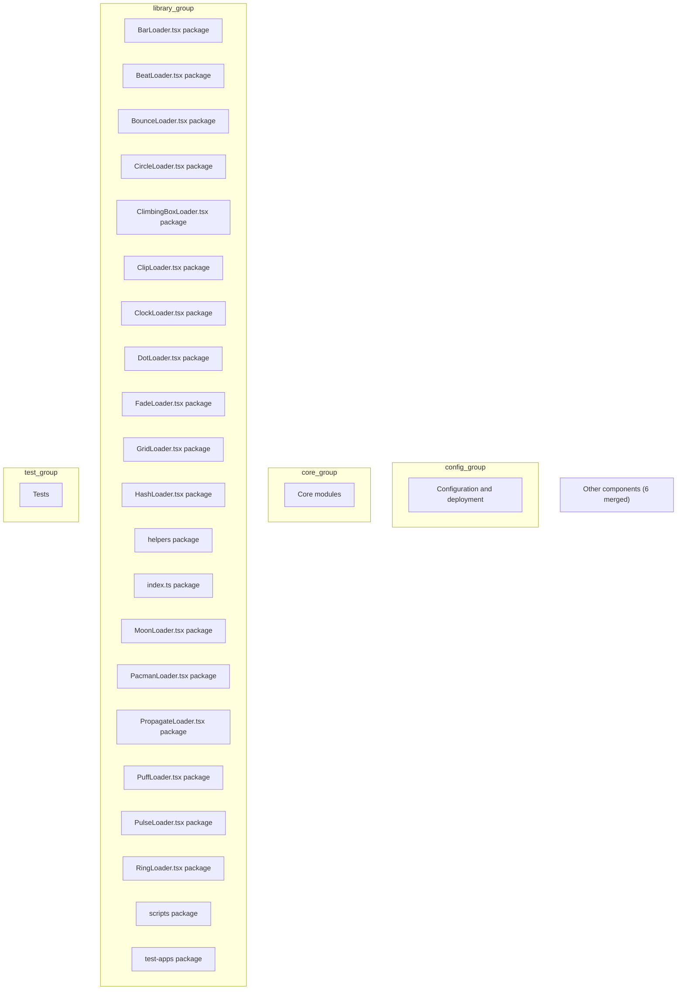

# Architecture report: davidhu2000/react-spinners

> Automated static analysis. **Observed** = directly seen in files/imports/AST; **Inferred** = interpretation from that evidence. Repository code was not executed.

## 1. Repository at a glance

| Item | Value |
| --- | --- |
| Repository | davidhu2000/react-spinners |
| Description | A collection of loading spinner components for react |
| Language | TypeScript |
| Stars | 3356 |
| Licence | MIT |
| Analysed commit / branch | 5525bb2d1062882e7f46e9ff7929407883f75a1b / main |
| Framework(s) | Next.js, React |
| Files analysed | 88 |
| Components | 30 |

## 2. Architecture in one minute

davidhu2000/react-spinners - A collection of loading spinner components for react. This repository was analysed statically from 88 file(s) (0 Python). Detected technologies (observed from imports/manifests): GitHub Actions, Next.js, React, Jest, TypeScript, Vite. Files are grouped into 30 component(s): BarLoader.tsx package, BeatLoader.tsx package, BounceLoader.tsx package, CircleLoader.tsx package, ClimbingBoxLoader.tsx package, ClipLoader.tsx package, ClockLoader.tsx package, Configuration and deployment. Findings below distinguish observed facts from inferred interpretation.

## 3. High-level block diagram

## 4. Main components

### BarLoader.tsx package (`barloader_tsx`)

- **Kind:** library
- **Status:** Observed
- **Confidence:** 0.85
- **Responsibility:** Groups 1 file(s) under barloader.tsx package (observed from repository paths and static analysis).
- **Paths:** `src/BarLoader.tsx`
- **Evidence:** [src/BarLoader.tsx](https://github.com/davidhu2000/react-spinners/blob/5525bb2d1062882e7f46e9ff7929407883f75a1b/src/BarLoader.tsx)

### BeatLoader.tsx package (`beatloader_tsx`)

- **Kind:** library
- **Status:** Observed
- **Confidence:** 0.85
- **Responsibility:** Groups 1 file(s) under beatloader.tsx package (observed from repository paths and static analysis).
- **Paths:** `src/BeatLoader.tsx`
- **Evidence:** [src/BeatLoader.tsx](https://github.com/davidhu2000/react-spinners/blob/5525bb2d1062882e7f46e9ff7929407883f75a1b/src/BeatLoader.tsx)

### BounceLoader.tsx package (`bounceloader_tsx`)

- **Kind:** library
- **Status:** Observed
- **Confidence:** 0.85
- **Responsibility:** Groups 1 file(s) under bounceloader.tsx package (observed from repository paths and static analysis).
- **Paths:** `src/BounceLoader.tsx`
- **Evidence:** [src/BounceLoader.tsx](https://github.com/davidhu2000/react-spinners/blob/5525bb2d1062882e7f46e9ff7929407883f75a1b/src/BounceLoader.tsx)

### CircleLoader.tsx package (`circleloader_tsx`)

- **Kind:** library
- **Status:** Observed
- **Confidence:** 0.85
- **Responsibility:** Groups 1 file(s) under circleloader.tsx package (observed from repository paths and static analysis).
- **Paths:** `src/CircleLoader.tsx`
- **Evidence:** [src/CircleLoader.tsx](https://github.com/davidhu2000/react-spinners/blob/5525bb2d1062882e7f46e9ff7929407883f75a1b/src/CircleLoader.tsx)

### ClimbingBoxLoader.tsx package (`climbingboxloader_tsx`)

- **Kind:** library
- **Status:** Observed
- **Confidence:** 0.85
- **Responsibility:** Groups 1 file(s) under climbingboxloader.tsx package (observed from repository paths and static analysis).
- **Paths:** `src/ClimbingBoxLoader.tsx`
- **Evidence:** [src/ClimbingBoxLoader.tsx](https://github.com/davidhu2000/react-spinners/blob/5525bb2d1062882e7f46e9ff7929407883f75a1b/src/ClimbingBoxLoader.tsx)

### ClipLoader.tsx package (`cliploader_tsx`)

- **Kind:** library
- **Status:** Observed
- **Confidence:** 0.85
- **Responsibility:** Groups 1 file(s) under cliploader.tsx package (observed from repository paths and static analysis).
- **Paths:** `src/ClipLoader.tsx`
- **Evidence:** [src/ClipLoader.tsx](https://github.com/davidhu2000/react-spinners/blob/5525bb2d1062882e7f46e9ff7929407883f75a1b/src/ClipLoader.tsx)

### ClockLoader.tsx package (`clockloader_tsx`)

- **Kind:** library
- **Status:** Observed
- **Confidence:** 0.85
- **Responsibility:** Groups 1 file(s) under clockloader.tsx package (observed from repository paths and static analysis).
- **Paths:** `src/ClockLoader.tsx`
- **Evidence:** [src/ClockLoader.tsx](https://github.com/davidhu2000/react-spinners/blob/5525bb2d1062882e7f46e9ff7929407883f75a1b/src/ClockLoader.tsx)

### Configuration and deployment (`config`)

- **Kind:** config
- **Status:** Observed
- **Confidence:** 0.85
- **Responsibility:** Groups 6 file(s) under configuration and deployment (observed from repository paths and static analysis).
- **Paths:** `package.json`, `test-apps/nextjs/package.json`, `test-apps/nextjs/tsconfig.json`, `tsconfig.cjs.json`, `tsconfig.esm.json`, `tsconfig.json`
- **Evidence:** [package.json](https://github.com/davidhu2000/react-spinners/blob/5525bb2d1062882e7f46e9ff7929407883f75a1b/package.json); [test-apps/nextjs/package.json](https://github.com/davidhu2000/react-spinners/blob/5525bb2d1062882e7f46e9ff7929407883f75a1b/test-apps/nextjs/package.json); [test-apps/nextjs/tsconfig.json](https://github.com/davidhu2000/react-spinners/blob/5525bb2d1062882e7f46e9ff7929407883f75a1b/test-apps/nextjs/tsconfig.json); [tsconfig.cjs.json](https://github.com/davidhu2000/react-spinners/blob/5525bb2d1062882e7f46e9ff7929407883f75a1b/tsconfig.cjs.json); [tsconfig.esm.json](https://github.com/davidhu2000/react-spinners/blob/5525bb2d1062882e7f46e9ff7929407883f75a1b/tsconfig.esm.json); [tsconfig.json](https://github.com/davidhu2000/react-spinners/blob/5525bb2d1062882e7f46e9ff7929407883f75a1b/tsconfig.json)

### Core modules (`core`)

- **Kind:** core
- **Status:** Observed
- **Confidence:** 0.85
- **Responsibility:** Groups 3 file(s) under core modules (observed from repository paths and static analysis).
- **Paths:** `eslint.config.mjs`, `jest.config.js`, `vite.config.mjs`
- **Evidence:** [eslint.config.mjs](https://github.com/davidhu2000/react-spinners/blob/5525bb2d1062882e7f46e9ff7929407883f75a1b/eslint.config.mjs); [jest.config.js](https://github.com/davidhu2000/react-spinners/blob/5525bb2d1062882e7f46e9ff7929407883f75a1b/jest.config.js); [vite.config.mjs](https://github.com/davidhu2000/react-spinners/blob/5525bb2d1062882e7f46e9ff7929407883f75a1b/vite.config.mjs)

### DotLoader.tsx package (`dotloader_tsx`)

- **Kind:** library
- **Status:** Observed
- **Confidence:** 0.85
- **Responsibility:** Groups 1 file(s) under dotloader.tsx package (observed from repository paths and static analysis).
- **Paths:** `src/DotLoader.tsx`
- **Evidence:** [src/DotLoader.tsx](https://github.com/davidhu2000/react-spinners/blob/5525bb2d1062882e7f46e9ff7929407883f75a1b/src/DotLoader.tsx)

### FadeLoader.tsx package (`fadeloader_tsx`)

- **Kind:** library
- **Status:** Observed
- **Confidence:** 0.85
- **Responsibility:** Groups 1 file(s) under fadeloader.tsx package (observed from repository paths and static analysis).
- **Paths:** `src/FadeLoader.tsx`
- **Evidence:** [src/FadeLoader.tsx](https://github.com/davidhu2000/react-spinners/blob/5525bb2d1062882e7f46e9ff7929407883f75a1b/src/FadeLoader.tsx)

### GridLoader.tsx package (`gridloader_tsx`)

- **Kind:** library
- **Status:** Observed
- **Confidence:** 0.85
- **Responsibility:** Groups 1 file(s) under gridloader.tsx package (observed from repository paths and static analysis).
- **Paths:** `src/GridLoader.tsx`
- **Evidence:** [src/GridLoader.tsx](https://github.com/davidhu2000/react-spinners/blob/5525bb2d1062882e7f46e9ff7929407883f75a1b/src/GridLoader.tsx)

### HashLoader.tsx package (`hashloader_tsx`)

- **Kind:** library
- **Status:** Observed
- **Confidence:** 0.85
- **Responsibility:** Groups 1 file(s) under hashloader.tsx package (observed from repository paths and static analysis).
- **Paths:** `src/HashLoader.tsx`
- **Evidence:** [src/HashLoader.tsx](https://github.com/davidhu2000/react-spinners/blob/5525bb2d1062882e7f46e9ff7929407883f75a1b/src/HashLoader.tsx)

### helpers package (`helpers`)

- **Kind:** library
- **Status:** Observed
- **Confidence:** 0.85
- **Responsibility:** Groups 8 file(s) under helpers package (observed from repository paths and static analysis).
- **Paths:** `src/helpers/animation.server.test.ts`, `src/helpers/animation.test.ts`, `src/helpers/animation.ts`, `src/helpers/colors.test.ts`, `src/helpers/colors.ts`, `src/helpers/props.ts`, `src/helpers/unitConverter.test.ts`, `src/helpers/unitConverter.ts`
- **Evidence:** [src/helpers/animation.server.test.ts](https://github.com/davidhu2000/react-spinners/blob/5525bb2d1062882e7f46e9ff7929407883f75a1b/src/helpers/animation.server.test.ts); [src/helpers/animation.test.ts](https://github.com/davidhu2000/react-spinners/blob/5525bb2d1062882e7f46e9ff7929407883f75a1b/src/helpers/animation.test.ts); [src/helpers/animation.ts](https://github.com/davidhu2000/react-spinners/blob/5525bb2d1062882e7f46e9ff7929407883f75a1b/src/helpers/animation.ts); [src/helpers/colors.test.ts](https://github.com/davidhu2000/react-spinners/blob/5525bb2d1062882e7f46e9ff7929407883f75a1b/src/helpers/colors.test.ts); [src/helpers/colors.ts](https://github.com/davidhu2000/react-spinners/blob/5525bb2d1062882e7f46e9ff7929407883f75a1b/src/helpers/colors.ts); [src/helpers/props.ts](https://github.com/davidhu2000/react-spinners/blob/5525bb2d1062882e7f46e9ff7929407883f75a1b/src/helpers/props.ts); [src/helpers/unitConverter.test.ts](https://github.com/davidhu2000/react-spinners/blob/5525bb2d1062882e7f46e9ff7929407883f75a1b/src/helpers/unitConverter.test.ts); [src/helpers/unitConverter.ts](https://github.com/davidhu2000/react-spinners/blob/5525bb2d1062882e7f46e9ff7929407883f75a1b/src/helpers/unitConverter.ts)

### index.ts package (`index_ts`)

- **Kind:** library
- **Status:** Observed
- **Confidence:** 0.85
- **Responsibility:** Groups 1 file(s) under index.ts package (observed from repository paths and static analysis).
- **Paths:** `src/index.ts`
- **Evidence:** [src/index.ts](https://github.com/davidhu2000/react-spinners/blob/5525bb2d1062882e7f46e9ff7929407883f75a1b/src/index.ts)

### MoonLoader.tsx package (`moonloader_tsx`)

- **Kind:** library
- **Status:** Observed
- **Confidence:** 0.85
- **Responsibility:** Groups 1 file(s) under moonloader.tsx package (observed from repository paths and static analysis).
- **Paths:** `src/MoonLoader.tsx`
- **Evidence:** [src/MoonLoader.tsx](https://github.com/davidhu2000/react-spinners/blob/5525bb2d1062882e7f46e9ff7929407883f75a1b/src/MoonLoader.tsx)

### PacmanLoader.tsx package (`pacmanloader_tsx`)

- **Kind:** library
- **Status:** Observed
- **Confidence:** 0.85
- **Responsibility:** Groups 1 file(s) under pacmanloader.tsx package (observed from repository paths and static analysis).
- **Paths:** `src/PacmanLoader.tsx`
- **Evidence:** [src/PacmanLoader.tsx](https://github.com/davidhu2000/react-spinners/blob/5525bb2d1062882e7f46e9ff7929407883f75a1b/src/PacmanLoader.tsx)

### PropagateLoader.tsx package (`propagateloader_tsx`)

- **Kind:** library
- **Status:** Observed
- **Confidence:** 0.85
- **Responsibility:** Groups 1 file(s) under propagateloader.tsx package (observed from repository paths and static analysis).
- **Paths:** `src/PropagateLoader.tsx`
- **Evidence:** [src/PropagateLoader.tsx](https://github.com/davidhu2000/react-spinners/blob/5525bb2d1062882e7f46e9ff7929407883f75a1b/src/PropagateLoader.tsx)

### PuffLoader.tsx package (`puffloader_tsx`)

- **Kind:** library
- **Status:** Observed
- **Confidence:** 0.85
- **Responsibility:** Groups 1 file(s) under puffloader.tsx package (observed from repository paths and static analysis).
- **Paths:** `src/PuffLoader.tsx`
- **Evidence:** [src/PuffLoader.tsx](https://github.com/davidhu2000/react-spinners/blob/5525bb2d1062882e7f46e9ff7929407883f75a1b/src/PuffLoader.tsx)

### PulseLoader.tsx package (`pulseloader_tsx`)

- **Kind:** library
- **Status:** Observed
- **Confidence:** 0.85
- **Responsibility:** Groups 1 file(s) under pulseloader.tsx package (observed from repository paths and static analysis).
- **Paths:** `src/PulseLoader.tsx`
- **Evidence:** [src/PulseLoader.tsx](https://github.com/davidhu2000/react-spinners/blob/5525bb2d1062882e7f46e9ff7929407883f75a1b/src/PulseLoader.tsx)

### RingLoader.tsx package (`ringloader_tsx`)

- **Kind:** library
- **Status:** Observed
- **Confidence:** 0.85
- **Responsibility:** Groups 1 file(s) under ringloader.tsx package (observed from repository paths and static analysis).
- **Paths:** `src/RingLoader.tsx`
- **Evidence:** [src/RingLoader.tsx](https://github.com/davidhu2000/react-spinners/blob/5525bb2d1062882e7f46e9ff7929407883f75a1b/src/RingLoader.tsx)

### RiseLoader.tsx package (`riseloader_tsx`)

- **Kind:** library
- **Status:** Observed
- **Confidence:** 0.85
- **Responsibility:** Groups 1 file(s) under riseloader.tsx package (observed from repository paths and static analysis).
- **Paths:** `src/RiseLoader.tsx`
- **Evidence:** [src/RiseLoader.tsx](https://github.com/davidhu2000/react-spinners/blob/5525bb2d1062882e7f46e9ff7929407883f75a1b/src/RiseLoader.tsx)

### RotateLoader.tsx package (`rotateloader_tsx`)

- **Kind:** library
- **Status:** Observed
- **Confidence:** 0.85
- **Responsibility:** Groups 1 file(s) under rotateloader.tsx package (observed from repository paths and static analysis).
- **Paths:** `src/RotateLoader.tsx`
- **Evidence:** [src/RotateLoader.tsx](https://github.com/davidhu2000/react-spinners/blob/5525bb2d1062882e7f46e9ff7929407883f75a1b/src/RotateLoader.tsx)

### ScaleLoader.tsx package (`scaleloader_tsx`)

- **Kind:** library
- **Status:** Observed
- **Confidence:** 0.85
- **Responsibility:** Groups 1 file(s) under scaleloader.tsx package (observed from repository paths and static analysis).
- **Paths:** `src/ScaleLoader.tsx`
- **Evidence:** [src/ScaleLoader.tsx](https://github.com/davidhu2000/react-spinners/blob/5525bb2d1062882e7f46e9ff7929407883f75a1b/src/ScaleLoader.tsx)

### scripts package (`scripts`)

- **Kind:** library
- **Status:** Observed
- **Confidence:** 0.85
- **Responsibility:** Groups 3 file(s) under scripts package (observed from repository paths and static analysis).
- **Paths:** `scripts/build-docs.sh`, `scripts/mod.rb`, `scripts/stories.rb`
- **Evidence:** [scripts/build-docs.sh](https://github.com/davidhu2000/react-spinners/blob/5525bb2d1062882e7f46e9ff7929407883f75a1b/scripts/build-docs.sh); [scripts/mod.rb](https://github.com/davidhu2000/react-spinners/blob/5525bb2d1062882e7f46e9ff7929407883f75a1b/scripts/mod.rb); [scripts/stories.rb](https://github.com/davidhu2000/react-spinners/blob/5525bb2d1062882e7f46e9ff7929407883f75a1b/scripts/stories.rb)

### SkewLoader.tsx package (`skewloader_tsx`)

- **Kind:** library
- **Status:** Observed
- **Confidence:** 0.85
- **Responsibility:** Groups 1 file(s) under skewloader.tsx package (observed from repository paths and static analysis).
- **Paths:** `src/SkewLoader.tsx`
- **Evidence:** [src/SkewLoader.tsx](https://github.com/davidhu2000/react-spinners/blob/5525bb2d1062882e7f46e9ff7929407883f75a1b/src/SkewLoader.tsx)

### SquareLoader.tsx package (`squareloader_tsx`)

- **Kind:** library
- **Status:** Observed
- **Confidence:** 0.85
- **Responsibility:** Groups 1 file(s) under squareloader.tsx package (observed from repository paths and static analysis).
- **Paths:** `src/SquareLoader.tsx`
- **Evidence:** [src/SquareLoader.tsx](https://github.com/davidhu2000/react-spinners/blob/5525bb2d1062882e7f46e9ff7929407883f75a1b/src/SquareLoader.tsx)

### SyncLoader.tsx package (`syncloader_tsx`)

- **Kind:** library
- **Status:** Observed
- **Confidence:** 0.85
- **Responsibility:** Groups 1 file(s) under syncloader.tsx package (observed from repository paths and static analysis).
- **Paths:** `src/SyncLoader.tsx`
- **Evidence:** [src/SyncLoader.tsx](https://github.com/davidhu2000/react-spinners/blob/5525bb2d1062882e7f46e9ff7929407883f75a1b/src/SyncLoader.tsx)

### test-apps package (`test_apps`)

- **Kind:** library
- **Status:** Observed
- **Confidence:** 0.85
- **Responsibility:** Groups 3 file(s) under test-apps package (observed from repository paths and static analysis).
- **Paths:** `test-apps/nextjs/next.config.ts`, `test-apps/nextjs/src/app/layout.tsx`, `test-apps/nextjs/src/app/page.tsx`
- **Evidence:** [test-apps/nextjs/next.config.ts](https://github.com/davidhu2000/react-spinners/blob/5525bb2d1062882e7f46e9ff7929407883f75a1b/test-apps/nextjs/next.config.ts); [test-apps/nextjs/src/app/layout.tsx](https://github.com/davidhu2000/react-spinners/blob/5525bb2d1062882e7f46e9ff7929407883f75a1b/test-apps/nextjs/src/app/layout.tsx); [test-apps/nextjs/src/app/page.tsx](https://github.com/davidhu2000/react-spinners/blob/5525bb2d1062882e7f46e9ff7929407883f75a1b/test-apps/nextjs/src/app/page.tsx)

### Tests (`tests`)

- **Kind:** test
- **Status:** Observed
- **Confidence:** 0.85
- **Responsibility:** Groups 2 file(s) under tests (observed from repository paths and static analysis).
- **Paths:** `tests/AllLoaders.test.tsx`, `tests/HashLoader.test.tsx`
- **Evidence:** [tests/AllLoaders.test.tsx](https://github.com/davidhu2000/react-spinners/blob/5525bb2d1062882e7f46e9ff7929407883f75a1b/tests/AllLoaders.test.tsx); [tests/HashLoader.test.tsx](https://github.com/davidhu2000/react-spinners/blob/5525bb2d1062882e7f46e9ff7929407883f75a1b/tests/HashLoader.test.tsx)

## 5. Execution flow

**Observed** entry point(s):

- [.storybook/main.js](https://github.com/davidhu2000/react-spinners/blob/5525bb2d1062882e7f46e9ff7929407883f75a1b/.storybook/main.js)
- [src/index.ts](https://github.com/davidhu2000/react-spinners/blob/5525bb2d1062882e7f46e9ff7929407883f75a1b/src/index.ts)

Representative flow (derived from observed entry points and the import graph; steps beyond the entry point are **Inferred**):

1. Execution starts at an observed entry point listed above, if present.
2. No internal import relationships between components were observed.

## 6. Project structure

### `(root)`

- `.gitignore` - other (231 bytes)
- `.npmignore` - other (432 bytes)
- `.prettierignore` - other (92 bytes)
- `.prettierrc.cjs` - source, JavaScript (185 bytes)
- `.yarnrc.yml` - config (118 bytes)
- `CHANGELOG.md` - docs (22407 bytes)
- `CODEOWNERS` - other (214 bytes)
- `CODE_OF_CONDUCT.md` - docs (3217 bytes)
- `CONTRIBUTING.md` - docs (1262 bytes)
- `LICENSE` - docs (1074 bytes)
- `README.md` - docs (5410 bytes)
- `eslint.config.mjs` - source, JavaScript (612 bytes)
- `jest.config.js` - source, JavaScript (397 bytes)
- `package.json` - manifest (3032 bytes)
- `tsconfig.cjs.json` - config (88 bytes)
- `tsconfig.esm.json` - config (86 bytes)
- `tsconfig.json` - config (787 bytes)
- `vite.config.mjs` - source, JavaScript (1506 bytes)

### `.github`

- `.github/ISSUE_TEMPLATE/bug_report.md` - docs (593 bytes)
- `.github/ISSUE_TEMPLATE/feature_request.md` - docs (634 bytes)
- `.github/PULL_REQUEST_TEMPLATE.md` - docs (51 bytes)
- `.github/actions/setup-node/action.yaml` - config (417 bytes)
- `.github/dependabot.yml` - config (1038 bytes)
- `.github/workflows/deploy.yml` - ci, YAML (1912 bytes)
- `.github/workflows/publish.yml` - ci, YAML (2487 bytes)

### `.storybook`

- `.storybook/canonical-link/register.js` - source, JavaScript (309 bytes)
- `.storybook/google-analytics-v4/register.js` - source, JavaScript (740 bytes)
- `.storybook/main.js` - source, JavaScript (420 bytes)
- `.storybook/manager.js` - source, JavaScript (126 bytes)
- `.storybook/preview.js` - source, JavaScript (682 bytes)

### `.vscode`

- `.vscode/settings.json` - config (130 bytes)

### `examples`

- `examples/components/ColorPicker.tsx` - source, TypeScript (2266 bytes)
- `examples/components/Controls.tsx` - source, TypeScript (2295 bytes)
- `examples/components/Icons.tsx` - source, TypeScript (2118 bytes)
- `examples/components/InstallCommand.tsx` - source, TypeScript (1675 bytes)
- `examples/components/SpinnerCard.tsx` - source, TypeScript (1352 bytes)
- `examples/components/ThemeToggle.tsx` - source, TypeScript (941 bytes)
- `examples/components/index.ts` - source, TypeScript (329 bytes)
- `examples/index.html` - other (5397 bytes)
- `examples/index.tsx` - source, TypeScript (1984 bytes)
- `examples/loaderProps.ts` - source, TypeScript (2055 bytes)
- `examples/styles.css` - other (12451 bytes)
- `examples/useCopied.ts` - source, TypeScript (429 bytes)

### `scripts`

- `scripts/build-docs.sh` - source, Shell (62 bytes)
- `scripts/mod.rb` - source, Ruby (2190 bytes)
- `scripts/stories.rb` - source, Ruby (941 bytes)
- `scripts/stories.template` - other (303 bytes)

### `src`

- `src/BarLoader.tsx` - source, TypeScript (1826 bytes)
- `src/BeatLoader.tsx` - source, TypeScript (1280 bytes)
- `src/BounceLoader.tsx` - source, TypeScript (1378 bytes)
- `src/CircleLoader.tsx` - source, TypeScript (1645 bytes)
- `src/ClimbingBoxLoader.tsx` - source, TypeScript (2338 bytes)
- `src/ClipLoader.tsx` - source, TypeScript (1145 bytes)
- `src/ClockLoader.tsx` - source, TypeScript (1642 bytes)
- `src/DotLoader.tsx` - source, TypeScript (1586 bytes)
- `src/FadeLoader.tsx` - source, TypeScript (2761 bytes)
- `src/GridLoader.tsx` - source, TypeScript (2123 bytes)
- `src/HashLoader.tsx` - source, TypeScript (2839 bytes)
- `src/MoonLoader.tsx` - source, TypeScript (1773 bytes)
- `src/PacmanLoader.tsx` - source, TypeScript (2566 bytes)
- `src/PropagateLoader.tsx` - source, TypeScript (3033 bytes)
- `src/PuffLoader.tsx` - source, TypeScript (1562 bytes)
- `src/PulseLoader.tsx` - source, TypeScript (1355 bytes)
- `src/RingLoader.tsx` - source, TypeScript (1663 bytes)
- `src/RiseLoader.tsx` - source, TypeScript (1735 bytes)
- `src/RotateLoader.tsx` - source, TypeScript (1525 bytes)
- `src/ScaleLoader.tsx` - source, TypeScript (1385 bytes)
- `src/SkewLoader.tsx` - source, TypeScript (1229 bytes)
- `src/SquareLoader.tsx` - source, TypeScript (1058 bytes)
- `src/SyncLoader.tsx` - source, TypeScript (1276 bytes)
- `src/helpers/animation.server.test.ts` - source, TypeScript (420 bytes)
- `src/helpers/animation.test.ts` - source, TypeScript (965 bytes)
- `src/helpers/animation.ts` - source, TypeScript (556 bytes)
- `src/helpers/colors.test.ts` - source, TypeScript (3292 bytes)
- `src/helpers/colors.ts` - source, TypeScript (1661 bytes)
- `src/helpers/props.ts` - source, TypeScript (777 bytes)
- `src/helpers/unitConverter.test.ts` - source, TypeScript (1817 bytes)
- `src/helpers/unitConverter.ts` - source, TypeScript (1601 bytes)
- `src/index.ts` - source, TypeScript (1288 bytes)

### `stories`

- `stories/.keep` - other (0 bytes)

### `test-apps`

- `test-apps/nextjs/.gitignore` - other (480 bytes)
- `test-apps/nextjs/next.config.ts` - source, TypeScript (133 bytes)
- `test-apps/nextjs/package.json` - manifest (418 bytes)
- `test-apps/nextjs/src/app/layout.tsx` - source, TypeScript (255 bytes)
- `test-apps/nextjs/src/app/page.tsx` - source, TypeScript (416 bytes)
- `test-apps/nextjs/tsconfig.json` - config (698 bytes)

### `tests`

- `tests/AllLoaders.test.tsx` - test, TypeScript (2189 bytes)
- `tests/HashLoader.test.tsx` - test, TypeScript (655 bytes)

## 7. Key dependencies and integrations

| Name | Category | Status | Confidence | Evidence |
| --- | --- | --- | --- | --- |
| GitHub Actions | ci | Observed | 0.90 | [.github/workflows/deploy.yml](https://github.com/davidhu2000/react-spinners/blob/5525bb2d1062882e7f46e9ff7929407883f75a1b/.github/workflows/deploy.yml); [.github/workflows/publish.yml](https://github.com/davidhu2000/react-spinners/blob/5525bb2d1062882e7f46e9ff7929407883f75a1b/.github/workflows/publish.yml) |
| Next.js | framework | Observed | 0.85 | [test-apps/nextjs/package.json:2](https://github.com/davidhu2000/react-spinners/blob/5525bb2d1062882e7f46e9ff7929407883f75a1b/test-apps/nextjs/package.json#L2) |
| React | framework | Observed | 0.90 | [package.json:2](https://github.com/davidhu2000/react-spinners/blob/5525bb2d1062882e7f46e9ff7929407883f75a1b/package.json#L2); [package.json:61](https://github.com/davidhu2000/react-spinners/blob/5525bb2d1062882e7f46e9ff7929407883f75a1b/package.json#L61); [test-apps/nextjs/package.json:13](https://github.com/davidhu2000/react-spinners/blob/5525bb2d1062882e7f46e9ff7929407883f75a1b/test-apps/nextjs/package.json#L13); [test-apps/nextjs/package.json:14](https://github.com/davidhu2000/react-spinners/blob/5525bb2d1062882e7f46e9ff7929407883f75a1b/test-apps/nextjs/package.json#L14) |
| Jest | tooling | Observed | 0.85 | [package.json:45](https://github.com/davidhu2000/react-spinners/blob/5525bb2d1062882e7f46e9ff7929407883f75a1b/package.json#L45) |
| TypeScript | tooling | Observed | 0.90 | [package.json:62](https://github.com/davidhu2000/react-spinners/blob/5525bb2d1062882e7f46e9ff7929407883f75a1b/package.json#L62); [test-apps/nextjs/package.json:20](https://github.com/davidhu2000/react-spinners/blob/5525bb2d1062882e7f46e9ff7929407883f75a1b/test-apps/nextjs/package.json#L20) |
| Vite | tooling | Observed | 0.85 | [package.json:38](https://github.com/davidhu2000/react-spinners/blob/5525bb2d1062882e7f46e9ff7929407883f75a1b/package.json#L38) |

## 8. Data and state

No database, cache, queue, or persistent-state usage was observed in the analysed files. State handling, if any, may be in-memory or in files that were not analysed.

## 9. Configuration and deployment clues

- `.github/actions/setup-node/action.yaml` (config)
- `.github/dependabot.yml` (config)
- `.github/workflows/deploy.yml` (ci)
- `.github/workflows/publish.yml` (ci)
- `.vscode/settings.json` (config)
- `.yarnrc.yml` (config)
- `package.json` (manifest)
- `test-apps/nextjs/package.json` (manifest)
- `test-apps/nextjs/tsconfig.json` (config)
- `tsconfig.cjs.json` (config)
- `tsconfig.esm.json` (config)
- `tsconfig.json` (config)

## 10. Design observations

- Tests are present alongside source code (Observed from test file paths).

These observations are interpretations (**Inferred**) of the observed structure, not guarantees about runtime design.

## 11. Limitations and unknowns

- Static analysis only: repository code was not executed, installed, or imported at runtime.
- Components and relationships are inferred from file paths, imports, and AST structure; runtime behaviour, dynamic imports, and reflection may not be visible.
- 1 file(s) were skipped during inventory (1 x lockfile excluded).
- No clear application entry point was observed in the analysed files.
- Repository text was treated as untrusted data; no instructions found in repository files were followed, and likely secret values were redacted/excluded.
- JavaScript and TypeScript files were inventoried from paths and package manifests. They were not parsed with a full language AST, and repository code was not executed.

## 12. Source references

- [.github/workflows/deploy.yml](https://github.com/davidhu2000/react-spinners/blob/5525bb2d1062882e7f46e9ff7929407883f75a1b/.github/workflows/deploy.yml)
- [.github/workflows/publish.yml](https://github.com/davidhu2000/react-spinners/blob/5525bb2d1062882e7f46e9ff7929407883f75a1b/.github/workflows/publish.yml)
- [.storybook/main.js](https://github.com/davidhu2000/react-spinners/blob/5525bb2d1062882e7f46e9ff7929407883f75a1b/.storybook/main.js)
- [eslint.config.mjs](https://github.com/davidhu2000/react-spinners/blob/5525bb2d1062882e7f46e9ff7929407883f75a1b/eslint.config.mjs)
- [jest.config.js](https://github.com/davidhu2000/react-spinners/blob/5525bb2d1062882e7f46e9ff7929407883f75a1b/jest.config.js)
- [package.json](https://github.com/davidhu2000/react-spinners/blob/5525bb2d1062882e7f46e9ff7929407883f75a1b/package.json)
- [package.json:2](https://github.com/davidhu2000/react-spinners/blob/5525bb2d1062882e7f46e9ff7929407883f75a1b/package.json#L2)
- [package.json:38](https://github.com/davidhu2000/react-spinners/blob/5525bb2d1062882e7f46e9ff7929407883f75a1b/package.json#L38)
- [package.json:45](https://github.com/davidhu2000/react-spinners/blob/5525bb2d1062882e7f46e9ff7929407883f75a1b/package.json#L45)
- [package.json:61](https://github.com/davidhu2000/react-spinners/blob/5525bb2d1062882e7f46e9ff7929407883f75a1b/package.json#L61)
- [package.json:62](https://github.com/davidhu2000/react-spinners/blob/5525bb2d1062882e7f46e9ff7929407883f75a1b/package.json#L62)
- [scripts/build-docs.sh](https://github.com/davidhu2000/react-spinners/blob/5525bb2d1062882e7f46e9ff7929407883f75a1b/scripts/build-docs.sh)
- [scripts/mod.rb](https://github.com/davidhu2000/react-spinners/blob/5525bb2d1062882e7f46e9ff7929407883f75a1b/scripts/mod.rb)
- [scripts/stories.rb](https://github.com/davidhu2000/react-spinners/blob/5525bb2d1062882e7f46e9ff7929407883f75a1b/scripts/stories.rb)
- [src/BarLoader.tsx](https://github.com/davidhu2000/react-spinners/blob/5525bb2d1062882e7f46e9ff7929407883f75a1b/src/BarLoader.tsx)
- [src/BeatLoader.tsx](https://github.com/davidhu2000/react-spinners/blob/5525bb2d1062882e7f46e9ff7929407883f75a1b/src/BeatLoader.tsx)
- [src/BounceLoader.tsx](https://github.com/davidhu2000/react-spinners/blob/5525bb2d1062882e7f46e9ff7929407883f75a1b/src/BounceLoader.tsx)
- [src/CircleLoader.tsx](https://github.com/davidhu2000/react-spinners/blob/5525bb2d1062882e7f46e9ff7929407883f75a1b/src/CircleLoader.tsx)
- [src/ClimbingBoxLoader.tsx](https://github.com/davidhu2000/react-spinners/blob/5525bb2d1062882e7f46e9ff7929407883f75a1b/src/ClimbingBoxLoader.tsx)
- [src/ClipLoader.tsx](https://github.com/davidhu2000/react-spinners/blob/5525bb2d1062882e7f46e9ff7929407883f75a1b/src/ClipLoader.tsx)
- [src/ClockLoader.tsx](https://github.com/davidhu2000/react-spinners/blob/5525bb2d1062882e7f46e9ff7929407883f75a1b/src/ClockLoader.tsx)
- [src/DotLoader.tsx](https://github.com/davidhu2000/react-spinners/blob/5525bb2d1062882e7f46e9ff7929407883f75a1b/src/DotLoader.tsx)
- [src/FadeLoader.tsx](https://github.com/davidhu2000/react-spinners/blob/5525bb2d1062882e7f46e9ff7929407883f75a1b/src/FadeLoader.tsx)
- [src/GridLoader.tsx](https://github.com/davidhu2000/react-spinners/blob/5525bb2d1062882e7f46e9ff7929407883f75a1b/src/GridLoader.tsx)
- [src/HashLoader.tsx](https://github.com/davidhu2000/react-spinners/blob/5525bb2d1062882e7f46e9ff7929407883f75a1b/src/HashLoader.tsx)
- [src/MoonLoader.tsx](https://github.com/davidhu2000/react-spinners/blob/5525bb2d1062882e7f46e9ff7929407883f75a1b/src/MoonLoader.tsx)
- [src/PacmanLoader.tsx](https://github.com/davidhu2000/react-spinners/blob/5525bb2d1062882e7f46e9ff7929407883f75a1b/src/PacmanLoader.tsx)
- [src/PropagateLoader.tsx](https://github.com/davidhu2000/react-spinners/blob/5525bb2d1062882e7f46e9ff7929407883f75a1b/src/PropagateLoader.tsx)
- [src/PuffLoader.tsx](https://github.com/davidhu2000/react-spinners/blob/5525bb2d1062882e7f46e9ff7929407883f75a1b/src/PuffLoader.tsx)
- [src/PulseLoader.tsx](https://github.com/davidhu2000/react-spinners/blob/5525bb2d1062882e7f46e9ff7929407883f75a1b/src/PulseLoader.tsx)
- [src/RingLoader.tsx](https://github.com/davidhu2000/react-spinners/blob/5525bb2d1062882e7f46e9ff7929407883f75a1b/src/RingLoader.tsx)
- [src/RiseLoader.tsx](https://github.com/davidhu2000/react-spinners/blob/5525bb2d1062882e7f46e9ff7929407883f75a1b/src/RiseLoader.tsx)
- [src/RotateLoader.tsx](https://github.com/davidhu2000/react-spinners/blob/5525bb2d1062882e7f46e9ff7929407883f75a1b/src/RotateLoader.tsx)
- [src/ScaleLoader.tsx](https://github.com/davidhu2000/react-spinners/blob/5525bb2d1062882e7f46e9ff7929407883f75a1b/src/ScaleLoader.tsx)
- [src/SkewLoader.tsx](https://github.com/davidhu2000/react-spinners/blob/5525bb2d1062882e7f46e9ff7929407883f75a1b/src/SkewLoader.tsx)
- [src/SquareLoader.tsx](https://github.com/davidhu2000/react-spinners/blob/5525bb2d1062882e7f46e9ff7929407883f75a1b/src/SquareLoader.tsx)
- [src/SyncLoader.tsx](https://github.com/davidhu2000/react-spinners/blob/5525bb2d1062882e7f46e9ff7929407883f75a1b/src/SyncLoader.tsx)
- [src/helpers/animation.server.test.ts](https://github.com/davidhu2000/react-spinners/blob/5525bb2d1062882e7f46e9ff7929407883f75a1b/src/helpers/animation.server.test.ts)
- [src/helpers/animation.test.ts](https://github.com/davidhu2000/react-spinners/blob/5525bb2d1062882e7f46e9ff7929407883f75a1b/src/helpers/animation.test.ts)
- [src/helpers/animation.ts](https://github.com/davidhu2000/react-spinners/blob/5525bb2d1062882e7f46e9ff7929407883f75a1b/src/helpers/animation.ts)
- [src/helpers/colors.test.ts](https://github.com/davidhu2000/react-spinners/blob/5525bb2d1062882e7f46e9ff7929407883f75a1b/src/helpers/colors.test.ts)
- [src/helpers/colors.ts](https://github.com/davidhu2000/react-spinners/blob/5525bb2d1062882e7f46e9ff7929407883f75a1b/src/helpers/colors.ts)
- [src/helpers/props.ts](https://github.com/davidhu2000/react-spinners/blob/5525bb2d1062882e7f46e9ff7929407883f75a1b/src/helpers/props.ts)
- [src/helpers/unitConverter.test.ts](https://github.com/davidhu2000/react-spinners/blob/5525bb2d1062882e7f46e9ff7929407883f75a1b/src/helpers/unitConverter.test.ts)
- [src/helpers/unitConverter.ts](https://github.com/davidhu2000/react-spinners/blob/5525bb2d1062882e7f46e9ff7929407883f75a1b/src/helpers/unitConverter.ts)
- [src/index.ts](https://github.com/davidhu2000/react-spinners/blob/5525bb2d1062882e7f46e9ff7929407883f75a1b/src/index.ts)
- [test-apps/nextjs/next.config.ts](https://github.com/davidhu2000/react-spinners/blob/5525bb2d1062882e7f46e9ff7929407883f75a1b/test-apps/nextjs/next.config.ts)
- [test-apps/nextjs/package.json](https://github.com/davidhu2000/react-spinners/blob/5525bb2d1062882e7f46e9ff7929407883f75a1b/test-apps/nextjs/package.json)
- [test-apps/nextjs/package.json:2](https://github.com/davidhu2000/react-spinners/blob/5525bb2d1062882e7f46e9ff7929407883f75a1b/test-apps/nextjs/package.json#L2)
- [test-apps/nextjs/package.json:13](https://github.com/davidhu2000/react-spinners/blob/5525bb2d1062882e7f46e9ff7929407883f75a1b/test-apps/nextjs/package.json#L13)
- [test-apps/nextjs/package.json:14](https://github.com/davidhu2000/react-spinners/blob/5525bb2d1062882e7f46e9ff7929407883f75a1b/test-apps/nextjs/package.json#L14)
- [test-apps/nextjs/package.json:20](https://github.com/davidhu2000/react-spinners/blob/5525bb2d1062882e7f46e9ff7929407883f75a1b/test-apps/nextjs/package.json#L20)
- [test-apps/nextjs/src/app/layout.tsx](https://github.com/davidhu2000/react-spinners/blob/5525bb2d1062882e7f46e9ff7929407883f75a1b/test-apps/nextjs/src/app/layout.tsx)
- [test-apps/nextjs/src/app/page.tsx](https://github.com/davidhu2000/react-spinners/blob/5525bb2d1062882e7f46e9ff7929407883f75a1b/test-apps/nextjs/src/app/page.tsx)
- [test-apps/nextjs/tsconfig.json](https://github.com/davidhu2000/react-spinners/blob/5525bb2d1062882e7f46e9ff7929407883f75a1b/test-apps/nextjs/tsconfig.json)
- [tests/AllLoaders.test.tsx](https://github.com/davidhu2000/react-spinners/blob/5525bb2d1062882e7f46e9ff7929407883f75a1b/tests/AllLoaders.test.tsx)
- [tests/HashLoader.test.tsx](https://github.com/davidhu2000/react-spinners/blob/5525bb2d1062882e7f46e9ff7929407883f75a1b/tests/HashLoader.test.tsx)
- [tsconfig.cjs.json](https://github.com/davidhu2000/react-spinners/blob/5525bb2d1062882e7f46e9ff7929407883f75a1b/tsconfig.cjs.json)
- [tsconfig.esm.json](https://github.com/davidhu2000/react-spinners/blob/5525bb2d1062882e7f46e9ff7929407883f75a1b/tsconfig.esm.json)
- [tsconfig.json](https://github.com/davidhu2000/react-spinners/blob/5525bb2d1062882e7f46e9ff7929407883f75a1b/tsconfig.json)
- [vite.config.mjs](https://github.com/davidhu2000/react-spinners/blob/5525bb2d1062882e7f46e9ff7929407883f75a1b/vite.config.mjs)
