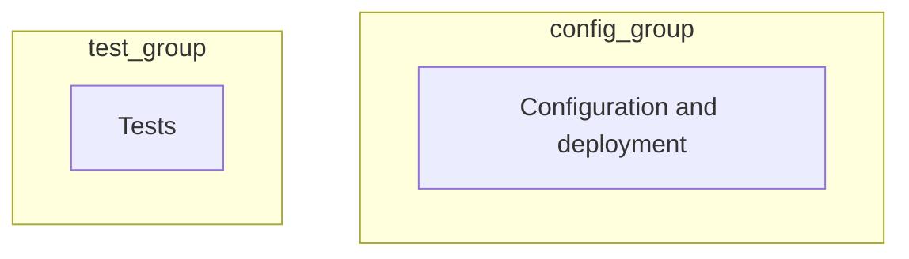

# Architecture report: day8/re-frame

> Automated static analysis. **Observed** = directly seen in files/imports/AST; **Inferred** = interpretation from that evidence. Repository code was not executed.

## 1. Repository at a glance

| Item | Value |
| --- | --- |
| Repository | day8/re-frame |
| Description | A ClojureScript framework for building user interfaces, leveraging React |
| Language | Clojure |
| Stars | 5545 |
| Licence | MIT |
| Analysed commit / branch | 1a1bf1df6570b17a148ebce70d500ec2da393cdc / master |
| Framework(s) | React |
| Files analysed | 205 |
| Components | 2 |

## 2. Architecture in one minute

day8/re-frame - A ClojureScript framework for building user interfaces, leveraging React. This repository was analysed statically from 205 file(s) (0 Python). Detected technologies (observed from imports/manifests): GitHub Actions, React, Docker. Files are grouped into 2 component(s): Configuration and deployment, Tests. Findings below distinguish observed facts from inferred interpretation.

## 3. High-level block diagram

## 4. Main components

### Configuration and deployment (`config`)

- **Kind:** config
- **Status:** Observed
- **Confidence:** 0.85
- **Responsibility:** Groups 1 file(s) under configuration and deployment (observed from repository paths and static analysis).
- **Paths:** `mkdocs.yml`
- **Evidence:** [mkdocs.yml](https://github.com/day8/re-frame/blob/1a1bf1df6570b17a148ebce70d500ec2da393cdc/mkdocs.yml)

### Tests (`tests`)

- **Kind:** test
- **Status:** Observed
- **Confidence:** 0.85
- **Responsibility:** Groups 35 file(s) under tests (observed from repository paths and static analysis).
- **Paths:** `test/re_frame/alpha_handler_source_meta_test.clj`, `test/re_frame/alpha_instrumented_standalone_require_test.clj`, `test/re_frame/core_instrumented_standalone_require_test.clj`, `test/re_frame/dispatch_source_meta_test.clj`, `test/re_frame/dispatch_source_meta_test.cljs`, `test/re_frame/dispatch_with_test.clj`, `test/re_frame/event_test.cljs`, `test/re_frame/flow/alpha_test.cljc`, `test/re_frame/fx_test.cljs`, `test/re_frame/handler_source_meta_test.clj`, `test/re_frame/handler_source_meta_test.cljs`, `test/re_frame/interceptor_test.cljs`, `test/re_frame/interop_test.clj`, `test/re_frame/live_query_vs_test.clj`, `test/re_frame/query_v_for_reaction_test.clj`, `test/re_frame/query_v_for_reaction_test.cljs`, `test/re_frame/reagent_id_test.clj`, `test/re_frame/registrar_test.clj`, `test/re_frame/registrar_test.cljs`, `test/re_frame/restore_test.cljs`, `test/re_frame/router_test.clj`, `test/re_frame/subs/alpha_test.cljs`, `test/re_frame/subs_test.clj`, `test/re_frame/subs_test.cljs`, `test/re_frame/subscribe_source_meta_test.clj`, `test/re_frame/subscribe_source_meta_test.cljs`, `test/re_frame/test_runner.cljs`, `test/re_frame/tooling_test.cljc`, `test/re_frame/trace_delivery_test.clj`, `test/re_frame/trace_test.cljs`, `test/re_frame/trace_zero_cost_test.clj`, `test/re_frame/utils_test.cljs`, `test/re_frame/validate_trace_test.clj`, `test/re_frame/version_test.clj`, `test/test.html`
- **Evidence:** [test/re_frame/alpha_handler_source_meta_test.clj](https://github.com/day8/re-frame/blob/1a1bf1df6570b17a148ebce70d500ec2da393cdc/test/re_frame/alpha_handler_source_meta_test.clj); [test/re_frame/alpha_instrumented_standalone_require_test.clj](https://github.com/day8/re-frame/blob/1a1bf1df6570b17a148ebce70d500ec2da393cdc/test/re_frame/alpha_instrumented_standalone_require_test.clj); [test/re_frame/core_instrumented_standalone_require_test.clj](https://github.com/day8/re-frame/blob/1a1bf1df6570b17a148ebce70d500ec2da393cdc/test/re_frame/core_instrumented_standalone_require_test.clj); [test/re_frame/dispatch_source_meta_test.clj](https://github.com/day8/re-frame/blob/1a1bf1df6570b17a148ebce70d500ec2da393cdc/test/re_frame/dispatch_source_meta_test.clj); [test/re_frame/dispatch_source_meta_test.cljs](https://github.com/day8/re-frame/blob/1a1bf1df6570b17a148ebce70d500ec2da393cdc/test/re_frame/dispatch_source_meta_test.cljs); [test/re_frame/dispatch_with_test.clj](https://github.com/day8/re-frame/blob/1a1bf1df6570b17a148ebce70d500ec2da393cdc/test/re_frame/dispatch_with_test.clj); [test/re_frame/event_test.cljs](https://github.com/day8/re-frame/blob/1a1bf1df6570b17a148ebce70d500ec2da393cdc/test/re_frame/event_test.cljs); [test/re_frame/flow/alpha_test.cljc](https://github.com/day8/re-frame/blob/1a1bf1df6570b17a148ebce70d500ec2da393cdc/test/re_frame/flow/alpha_test.cljc)

## 5. Execution flow

No entry point was observed; the startup flow below is therefore limited.

Representative flow (derived from observed entry points and the import graph; steps beyond the entry point are **Inferred**):

1. Execution starts at an observed entry point listed above, if present.
2. No internal import relationships between components were observed.

## 6. Project structure

### `(root)`

- `.editorconfig` - config (225 bytes)
- `.gitattributes` - other (23 bytes)
- `.gitignore` - other (653 bytes)
- `CHANGELOG.md` - docs (80 bytes)
- `CITATION.md` - docs (583 bytes)
- `CONTRIBUTING.md` - docs (1434 bytes)
- `README.md` - docs (4396 bytes)
- `SUPPORT.md` - docs (289 bytes)
- `bb.edn` - other (569 bytes)
- `deps.edn` - other (3431 bytes)
- `license.txt` - docs (1088 bytes)
- `mkdocs.yml` - config (5379 bytes)
- `shadow-cljs.edn` - other (1229 bytes)

### `.github`

- `.github/FUNDING.yml` - config (27 bytes)
- `.github/ISSUE_TEMPLATE/Bug-Report.yml` - config (1265 bytes)
- `.github/ISSUE_TEMPLATE/New-Feature.yml` - config (586 bytes)
- `.github/ISSUE_TEMPLATE/config.yml` - config (571 bytes)
- `.github/workflows/continuous-deployment-workflow.yml` - ci, YAML (5568 bytes)
- `.github/workflows/continuous-integration-workflow.yml` - ci, YAML (3088 bytes)
- `.github/workflows/docs-workflow.yml` - ci, YAML (4868 bytes)

### `docs`

- `docs/App-Structure.md` - docs (4249 bytes)
- `docs/Coeffects.md` - docs (10143 bytes)
- `docs/Debugging.md` - docs (10627 bytes)
- `docs/EPs/001-CaptureHandlerMetadata.md` - docs (5923 bytes)
- `docs/EPs/002-ReframeInstances.md` - docs (15531 bytes)
- `docs/EPs/003-ReusableComponents.md` - docs (1899 bytes)
- `docs/EPs/004-ViewRegistration.md` - docs (3298 bytes)
- `docs/EPs/005-StateMachines.md` - docs (5761 bytes)
- `docs/EPs/README.md` - docs (865 bytes)
- `docs/EffectfulHandlers.md` - docs (12920 bytes)
- `docs/Effects.md` - docs (9336 bytes)
- `docs/External-Resources.md` - docs (11411 bytes)
- `docs/FAQs/BestPractice.md` - docs (2452 bytes)
- `docs/FAQs/DB_Normalisation.md` - docs (910 bytes)
- `docs/FAQs/DoINeedReFrame.md` - docs (4325 bytes)
- `docs/FAQs/FocusOnElement.md` - docs (2176 bytes)
- `docs/FAQs/FullStackReframe.md` - docs (1231 bytes)
- `docs/FAQs/GlobalInterceptors.md` - docs (2399 bytes)
- `docs/FAQs/Inspecting-app-db.md` - docs (2415 bytes)
- `docs/FAQs/LoadOnMount.md` - docs (3275 bytes)
- `docs/FAQs/Logging.md` - docs (866 bytes)
- `docs/FAQs/Null-Dispatched-Events.md` - docs (1672 bytes)
- `docs/FAQs/PollADatabaseEvery60.md` - docs (4247 bytes)
- `docs/FAQs/UseASubscriptionInAnEventHandler.md` - docs (5057 bytes)
- `docs/FAQs/ViewsOnGlobalRegistration.md` - docs (2729 bytes)
- `docs/FAQs/When-Does-Dispatch-Happen.md` - docs (463 bytes)
- `docs/FAQs/Why-CLJC.md` - docs (647 bytes)
- `docs/FAQs/Why-Clear-Sub-Cache.md` - docs (2971 bytes)
- `docs/FAQs/alpha.md` - docs (6480 bytes)
- `docs/FAQs/laggy-input.md` - docs (2314 bytes)
- `docs/FAQs/use-cofx-as-fx.md` - docs (1781 bytes)
- `docs/FAQs/why-didnt-my-component-update.md` - docs (6883 bytes)
- `docs/Flows.md` - docs (24585 bytes)
- `docs/Interceptors.md` - docs (17052 bytes)
- `docs/Loading-Initial-Data.md` - docs (7512 bytes)
- `docs/Performance-Problems.md` - docs (5506 bytes)
- `docs/README.md` - docs (2435 bytes)
- `docs/Solve-the-CPU-hog-problem.md` - docs (8935 bytes)
- `docs/Subscribing-To-External-Data.md` - docs (11285 bytes)
- `docs/Talking-To-Servers.md` - docs (5329 bytes)
- `docs/Testing.md` - docs (11157 bytes)
- `docs/The-re-frame-logo.md` - docs (2034 bytes)
- `docs/Using-Stateful-JS-Components.md` - docs (4882 bytes)
- `docs/a-loop.md` - docs (9378 bytes)
- `docs/all-models-are-wrong.md` - docs (854 bytes)
- `docs/api-builtin-effects.md` - docs (4585 bytes)
- `docs/api-intro.md` - docs (4565 bytes)
- `docs/api-re-frame.alpha-instrumented.md` - docs (27224 bytes)
- `docs/api-re-frame.core-instrumented.md` - docs (28761 bytes)
- `docs/api-re-frame.tooling.md` - docs (4429 bytes)
- `docs/application-state.md` - docs (5790 bytes)
- `docs/breaking-it.md` - docs (4045 bytes)
- `docs/browser-dynamics.md` - docs (190 bytes)
- `docs/cljdoc.edn` - docs (266 bytes)
- `docs/clojurescript.md` - docs (47860 bytes)
- `docs/correcting-a-wrong.md` - docs (7081 bytes)
- `docs/data-oriented-design.md` - docs (5680 bytes)
- `docs/deps.edn` - docs (132 bytes)
- `docs/dominoes-30k.md` - docs (10691 bytes)
- `docs/dominoes-live.md` - docs (18719 bytes)
- `docs/event-handling-infographic.md` - docs (197 bytes)
- `docs/flow-mechanics.md` - docs (12515 bytes)
- `docs/flows-advanced-topics.md` - docs (12467 bytes)
- `docs/historical.md` - docs (10019 bytes)
- `docs/images/logo/README.md` - docs (83 bytes)
- `docs/images/logo/re-frame-colour.svg` - docs (9254 bytes)
- `docs/images/logo/re-frame-white.svg` - docs (8408 bytes)
- `docs/index.md` - docs (67 bytes)
- `docs/interconnections.md` - docs (2135 bytes)
- `docs/on-dynamics.md` - docs (14017 bytes)
- `docs/on-stable-dom-handlers.md` - docs (8563 bytes)
- `docs/re-frame.md` - docs (4453 bytes)
- `docs/reagent.md` - docs (2091 bytes)
- `docs/releases/2015.md` - docs (8036 bytes)
- `docs/releases/2016.md` - docs (13111 bytes)
- `docs/releases/2017.md` - docs (4217 bytes)
- `docs/releases/2018.md` - docs (1911 bytes)
- `docs/releases/2019.md` - docs (2201 bytes)
- `docs/releases/2020.md` - docs (9445 bytes)
- `docs/releases/2021.md` - docs (546 bytes)
- `docs/releases/2022.md` - docs (1140 bytes)
- `docs/releases/2023.md` - docs (1705 bytes)
- `docs/releases/2024.md` - docs (431 bytes)
- `docs/releases/2026.md` - docs (14846 bytes)
- `docs/reusable-components.md` - docs (15321 bytes)
- `docs/review-todomvc.md` - docs (437 bytes)
- `docs/src/ns_to_markdown.clj` - docs (5449 bytes)
- `docs/src/re_frame/docs.cljs` - docs (1701 bytes)
- `docs/start-coding.md` - docs (633 bytes)
- `docs/styles/website.css` - docs (1363 bytes)
- `docs/stylesheets/dominoes-live.css` - docs (641 bytes)
- `docs/stylesheets/mkdocs.css` - docs (1895 bytes)
- `docs/subscriptions.md` - docs (9114 bytes)
- `docs/theme/404.html` - docs (417 bytes)
- `docs/theme/main.html` - docs (817 bytes)
- `docs/theme/overrides/home.html` - docs (3055 bytes)
- `docs/theme/overrides/main.html` - docs (2421 bytes)

### `examples`

- `examples/flow/deps.edn` - other (209 bytes)
- `examples/flow/package.json` - manifest (297 bytes)
- `examples/flow/resources/public/example.css` - other (366 bytes)
- `examples/flow/resources/public/index.html` - other (301 bytes)
- `examples/flow/shadow-cljs.edn` - other (261 bytes)
- `examples/flow/src/re_frame/flow/demo.cljs` - other (3855 bytes)
- `examples/simple/.gitignore` - other (14 bytes)
- `examples/simple/README.md` - docs (1576 bytes)
- `examples/simple/deps.edn` - other (179 bytes)
- `examples/simple/package.json` - manifest (267 bytes)
- `examples/simple/resources/public/example.css` - other (366 bytes)
- `examples/simple/resources/public/index.html` - other (301 bytes)
- `examples/simple/shadow-cljs.edn` - other (212 bytes)
- `examples/simple/src/simple/core.cljs` - other (3755 bytes)
- `examples/todomvc/.gitignore` - other (34 bytes)
- `examples/todomvc/README.md` - docs (2623 bytes)
- `examples/todomvc/deps.edn` - other (349 bytes)
- `examples/todomvc/package.json` - manifest (277 bytes)
- `examples/todomvc/resources/public/index.html` - other (308 bytes)
- `examples/todomvc/resources/public/todos.css` - other (6472 bytes)
- `examples/todomvc/shadow-cljs.edn` - other (474 bytes)
- `examples/todomvc/src/todomvc/core.cljs` - other (2233 bytes)
- `examples/todomvc/src/todomvc/db.cljs` - other (3743 bytes)
- `examples/todomvc/src/todomvc/events.cljs` - other (8895 bytes)
- `examples/todomvc/src/todomvc/subs.cljs` - other (6598 bytes)
- `examples/todomvc/src/todomvc/views.cljs` - other (3257 bytes)

### `src`

- `src/deps.cljs` - other (118 bytes)
- `src/re_frame/alpha.cljc` - other (31434 bytes)
- `src/re_frame/alpha_instrumented.cljc` - other (12960 bytes)
- `src/re_frame/cofx.cljc` - other (1478 bytes)
- `src/re_frame/config.cljc` - other (1103 bytes)
- `src/re_frame/core.cljc` - other (53359 bytes)
- `src/re_frame/core_instrumented.cljc` - other (16977 bytes)
- `src/re_frame/db.cljc` - other (323 bytes)
- `src/re_frame/events.cljc` - other (5333 bytes)
- `src/re_frame/flow/alpha.cljc` - other (7828 bytes)
- `src/re_frame/fx.cljc` - other (10771 bytes)
- `src/re_frame/instrumented_macros.clj` - other (1254 bytes)
- `src/re_frame/interceptor.cljc` - other (9067 bytes)
- `src/re_frame/interop.clj` - other (5053 bytes)
- `src/re_frame/interop.cljs` - other (2811 bytes)
- `src/re_frame/loggers.cljc` - other (2012 bytes)
- `src/re_frame/query/alpha.cljc` - other (1972 bytes)
- `src/re_frame/register/alpha.cljc` - other (101 bytes)
- `src/re_frame/registrar.cljc` - other (3783 bytes)
- `src/re_frame/router.cljc` - other (31636 bytes)
- `src/re_frame/settings.cljc` - other (1724 bytes)
- `src/re_frame/std_interceptors.cljc` - other (9910 bytes)
- `src/re_frame/subs.cljc` - other (16744 bytes)
- `src/re_frame/subs/alpha.cljc` - other (4322 bytes)
- `src/re_frame/tooling.cljc` - other (2659 bytes)
- `src/re_frame/trace.cljc` - other (20178 bytes)
- `src/re_frame/utils.cljc` - other (3877 bytes)

### `test`

- `test/re_frame/alpha_handler_source_meta_test.clj` - test (4698 bytes)
- `test/re_frame/alpha_instrumented_standalone_require_test.clj` - test (5827 bytes)
- `test/re_frame/core_instrumented_standalone_require_test.clj` - test (7258 bytes)
- `test/re_frame/dispatch_source_meta_test.clj` - test (6367 bytes)
- `test/re_frame/dispatch_source_meta_test.cljs` - test (4788 bytes)
- `test/re_frame/dispatch_with_test.clj` - test (14142 bytes)
- `test/re_frame/event_test.cljs` - test (655 bytes)
- `test/re_frame/flow/alpha_test.cljc` - test (4414 bytes)
- `test/re_frame/fx_test.cljs` - test (2271 bytes)
- `test/re_frame/handler_source_meta_test.clj` - test (16206 bytes)
- `test/re_frame/handler_source_meta_test.cljs` - test (7474 bytes)
- `test/re_frame/interceptor_test.cljs` - test (13310 bytes)
- `test/re_frame/interop_test.clj` - test (488 bytes)
- `test/re_frame/live_query_vs_test.clj` - test (2954 bytes)
- `test/re_frame/query_v_for_reaction_test.clj` - test (6444 bytes)
- `test/re_frame/query_v_for_reaction_test.cljs` - test (4982 bytes)
- `test/re_frame/reagent_id_test.clj` - test (5412 bytes)
- `test/re_frame/registrar_test.clj` - test (5132 bytes)
- `test/re_frame/registrar_test.cljs` - test (4014 bytes)
- `test/re_frame/restore_test.cljs` - test (2617 bytes)
- `test/re_frame/router_test.clj` - test (2605 bytes)
- `test/re_frame/subs/alpha_test.cljs` - test (7291 bytes)
- `test/re_frame/subs_test.clj` - test (761 bytes)
- `test/re_frame/subs_test.cljs` - test (9070 bytes)
- `test/re_frame/subscribe_source_meta_test.clj` - test (7472 bytes)
- `test/re_frame/subscribe_source_meta_test.cljs` - test (5421 bytes)
- `test/re_frame/test_runner.cljs` - test (1045 bytes)
- `test/re_frame/tooling_test.cljc` - test (4458 bytes)
- `test/re_frame/trace_delivery_test.clj` - test (37438 bytes)
- `test/re_frame/trace_test.cljs` - test (26692 bytes)
- `test/re_frame/trace_zero_cost_test.clj` - test (10069 bytes)
- `test/re_frame/utils_test.cljs` - test (1046 bytes)
- `test/re_frame/validate_trace_test.clj` - test (9048 bytes)
- `test/re_frame/version_test.clj` - test (1722 bytes)
- `test/test.html` - test (4294 bytes)

## 7. Key dependencies and integrations

| Name | Category | Status | Confidence | Evidence |
| --- | --- | --- | --- | --- |
| GitHub Actions | ci | Observed | 0.90 | [.github/workflows/continuous-deployment-workflow.yml](https://github.com/day8/re-frame/blob/1a1bf1df6570b17a148ebce70d500ec2da393cdc/.github/workflows/continuous-deployment-workflow.yml); [.github/workflows/continuous-integration-workflow.yml](https://github.com/day8/re-frame/blob/1a1bf1df6570b17a148ebce70d500ec2da393cdc/.github/workflows/continuous-integration-workflow.yml); [.github/workflows/docs-workflow.yml](https://github.com/day8/re-frame/blob/1a1bf1df6570b17a148ebce70d500ec2da393cdc/.github/workflows/docs-workflow.yml) |
| React | framework | Observed | 0.90 | [examples/flow/package.json:12](https://github.com/day8/re-frame/blob/1a1bf1df6570b17a148ebce70d500ec2da393cdc/examples/flow/package.json#L12); [examples/flow/package.json:13](https://github.com/day8/re-frame/blob/1a1bf1df6570b17a148ebce70d500ec2da393cdc/examples/flow/package.json#L13); [examples/simple/package.json:11](https://github.com/day8/re-frame/blob/1a1bf1df6570b17a148ebce70d500ec2da393cdc/examples/simple/package.json#L11); [examples/simple/package.json:12](https://github.com/day8/re-frame/blob/1a1bf1df6570b17a148ebce70d500ec2da393cdc/examples/simple/package.json#L12) |
| Docker | tooling | Observed | 0.70 | [.github/workflows/continuous-deployment-workflow.yml:92](https://github.com/day8/re-frame/blob/1a1bf1df6570b17a148ebce70d500ec2da393cdc/.github/workflows/continuous-deployment-workflow.yml#L92) |

## 8. Data and state

No database, cache, queue, or persistent-state usage was observed in the analysed files. State handling, if any, may be in-memory or in files that were not analysed.

## 9. Configuration and deployment clues

- `.editorconfig` (config)
- `.github/FUNDING.yml` (config)
- `.github/ISSUE_TEMPLATE/Bug-Report.yml` (config)
- `.github/ISSUE_TEMPLATE/New-Feature.yml` (config)
- `.github/ISSUE_TEMPLATE/config.yml` (config)
- `.github/workflows/continuous-deployment-workflow.yml` (ci)
- `.github/workflows/continuous-integration-workflow.yml` (ci)
- `.github/workflows/docs-workflow.yml` (ci)
- `examples/flow/package.json` (manifest)
- `examples/simple/package.json` (manifest)
- `examples/todomvc/package.json` (manifest)
- `mkdocs.yml` (config)

## 10. Design observations

- Tests are present alongside source code (Observed from test file paths).

These observations are interpretations (**Inferred**) of the observed structure, not guarantees about runtime design.

## 11. Limitations and unknowns

- Static analysis only: repository code was not executed, installed, or imported at runtime.
- Components and relationships are inferred from file paths, imports, and AST structure; runtime behaviour, dynamic imports, and reflection may not be visible.
- 6 file(s) were skipped during inventory (3 x lockfile excluded; 3 x vendored/generated directory excluded).
- No clear application entry point was observed in the analysed files.
- Repository text was treated as untrusted data; no instructions found in repository files were followed, and likely secret values were redacted/excluded.

## 12. Source references

- [.github/workflows/continuous-deployment-workflow.yml](https://github.com/day8/re-frame/blob/1a1bf1df6570b17a148ebce70d500ec2da393cdc/.github/workflows/continuous-deployment-workflow.yml)
- [.github/workflows/continuous-deployment-workflow.yml:92](https://github.com/day8/re-frame/blob/1a1bf1df6570b17a148ebce70d500ec2da393cdc/.github/workflows/continuous-deployment-workflow.yml#L92)
- [.github/workflows/continuous-integration-workflow.yml](https://github.com/day8/re-frame/blob/1a1bf1df6570b17a148ebce70d500ec2da393cdc/.github/workflows/continuous-integration-workflow.yml)
- [.github/workflows/docs-workflow.yml](https://github.com/day8/re-frame/blob/1a1bf1df6570b17a148ebce70d500ec2da393cdc/.github/workflows/docs-workflow.yml)
- [examples/flow/package.json:12](https://github.com/day8/re-frame/blob/1a1bf1df6570b17a148ebce70d500ec2da393cdc/examples/flow/package.json#L12)
- [examples/flow/package.json:13](https://github.com/day8/re-frame/blob/1a1bf1df6570b17a148ebce70d500ec2da393cdc/examples/flow/package.json#L13)
- [examples/simple/package.json:11](https://github.com/day8/re-frame/blob/1a1bf1df6570b17a148ebce70d500ec2da393cdc/examples/simple/package.json#L11)
- [examples/simple/package.json:12](https://github.com/day8/re-frame/blob/1a1bf1df6570b17a148ebce70d500ec2da393cdc/examples/simple/package.json#L12)
- [examples/todomvc/package.json:11](https://github.com/day8/re-frame/blob/1a1bf1df6570b17a148ebce70d500ec2da393cdc/examples/todomvc/package.json#L11)
- [examples/todomvc/package.json:12](https://github.com/day8/re-frame/blob/1a1bf1df6570b17a148ebce70d500ec2da393cdc/examples/todomvc/package.json#L12)
- [mkdocs.yml](https://github.com/day8/re-frame/blob/1a1bf1df6570b17a148ebce70d500ec2da393cdc/mkdocs.yml)
- [test/re_frame/alpha_handler_source_meta_test.clj](https://github.com/day8/re-frame/blob/1a1bf1df6570b17a148ebce70d500ec2da393cdc/test/re_frame/alpha_handler_source_meta_test.clj)
- [test/re_frame/alpha_instrumented_standalone_require_test.clj](https://github.com/day8/re-frame/blob/1a1bf1df6570b17a148ebce70d500ec2da393cdc/test/re_frame/alpha_instrumented_standalone_require_test.clj)
- [test/re_frame/core_instrumented_standalone_require_test.clj](https://github.com/day8/re-frame/blob/1a1bf1df6570b17a148ebce70d500ec2da393cdc/test/re_frame/core_instrumented_standalone_require_test.clj)
- [test/re_frame/dispatch_source_meta_test.clj](https://github.com/day8/re-frame/blob/1a1bf1df6570b17a148ebce70d500ec2da393cdc/test/re_frame/dispatch_source_meta_test.clj)
- [test/re_frame/dispatch_source_meta_test.cljs](https://github.com/day8/re-frame/blob/1a1bf1df6570b17a148ebce70d500ec2da393cdc/test/re_frame/dispatch_source_meta_test.cljs)
- [test/re_frame/dispatch_with_test.clj](https://github.com/day8/re-frame/blob/1a1bf1df6570b17a148ebce70d500ec2da393cdc/test/re_frame/dispatch_with_test.clj)
- [test/re_frame/event_test.cljs](https://github.com/day8/re-frame/blob/1a1bf1df6570b17a148ebce70d500ec2da393cdc/test/re_frame/event_test.cljs)
- [test/re_frame/flow/alpha_test.cljc](https://github.com/day8/re-frame/blob/1a1bf1df6570b17a148ebce70d500ec2da393cdc/test/re_frame/flow/alpha_test.cljc)
