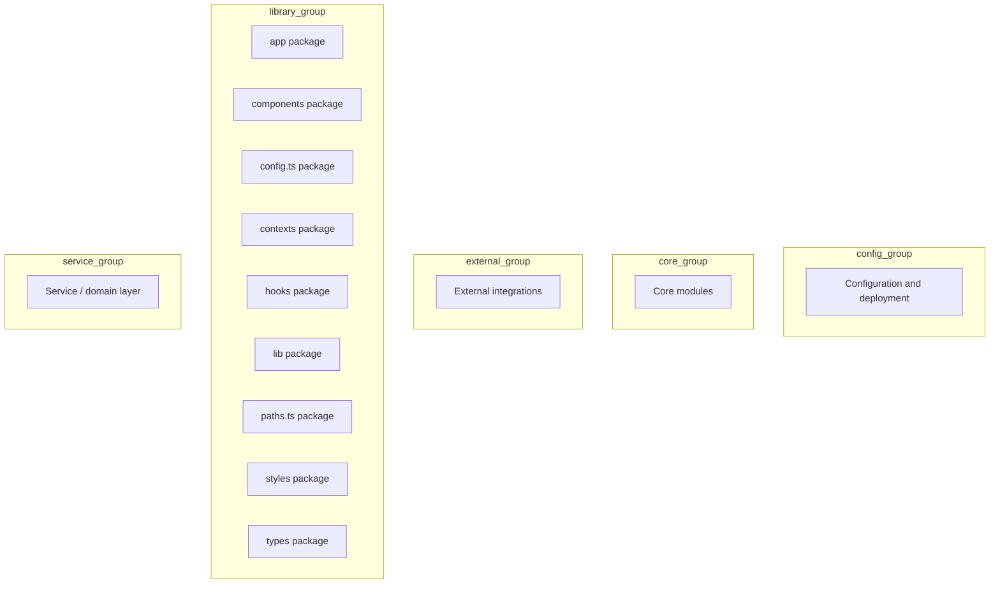

# Architecture report: devias-io/material-kit-react

> Automated static analysis. **Observed** = directly seen in files/imports/AST; **Inferred** = interpretation from that evidence. Repository code was not executed.

## 1. Repository at a glance

| Item | Value |
| --- | --- |
| Repository | devias-io/material-kit-react |
| Description | React Dashboard made with Material UI’s components. Our pro template contains features like TypeScript version, authentication system with Firebase and Auth0 plus many other  |
| Language | TypeScript |
| Stars | 5581 |
| Licence | MIT |
| Analysed commit / branch | 6423e1a2f092c50d7e1e22f3e43344df02af41de / main |
| Framework(s) | Next.js, React |
| Files analysed | 97 |
| Components | 13 |

## 2. Architecture in one minute

devias-io/material-kit-react - React Dashboard made with Material UI’s components. Our pro template contains features like TypeScript version, authentication system with Firebase and Auth0 plus many other . This repository was analysed statically from 97 file(s) (0 Python). Detected technologies (observed from imports/manifests): Next.js, React, Jest, TypeScript. Files are grouped into 13 component(s): app package, components package, Configuration and deployment, config.ts package, contexts package, Core modules, External integrations, hooks package. Findings below distinguish observed facts from inferred interpretation.

## 3. High-level block diagram

## 4. Main components

### app package (`app`)

- **Kind:** library
- **Status:** Observed
- **Confidence:** 0.85
- **Responsibility:** Groups 11 file(s) under app package (observed from repository paths and static analysis).
- **Paths:** `src/app/auth/reset-password/page.tsx`, `src/app/auth/sign-in/page.tsx`, `src/app/auth/sign-up/page.tsx`, `src/app/dashboard/account/page.tsx`, `src/app/dashboard/customers/page.tsx`, `src/app/dashboard/layout.tsx`, `src/app/dashboard/page.tsx`, `src/app/errors/not-found/page.tsx`, `src/app/layout.tsx`, `src/app/not-found.tsx`, `src/app/page.tsx`
- **Evidence:** [src/app/auth/reset-password/page.tsx](https://github.com/devias-io/material-kit-react/blob/6423e1a2f092c50d7e1e22f3e43344df02af41de/src/app/auth/reset-password/page.tsx); [src/app/auth/sign-in/page.tsx](https://github.com/devias-io/material-kit-react/blob/6423e1a2f092c50d7e1e22f3e43344df02af41de/src/app/auth/sign-in/page.tsx); [src/app/auth/sign-up/page.tsx](https://github.com/devias-io/material-kit-react/blob/6423e1a2f092c50d7e1e22f3e43344df02af41de/src/app/auth/sign-up/page.tsx); [src/app/dashboard/account/page.tsx](https://github.com/devias-io/material-kit-react/blob/6423e1a2f092c50d7e1e22f3e43344df02af41de/src/app/dashboard/account/page.tsx); [src/app/dashboard/customers/page.tsx](https://github.com/devias-io/material-kit-react/blob/6423e1a2f092c50d7e1e22f3e43344df02af41de/src/app/dashboard/customers/page.tsx); [src/app/dashboard/layout.tsx](https://github.com/devias-io/material-kit-react/blob/6423e1a2f092c50d7e1e22f3e43344df02af41de/src/app/dashboard/layout.tsx); [src/app/dashboard/page.tsx](https://github.com/devias-io/material-kit-react/blob/6423e1a2f092c50d7e1e22f3e43344df02af41de/src/app/dashboard/page.tsx); [src/app/errors/not-found/page.tsx](https://github.com/devias-io/material-kit-react/blob/6423e1a2f092c50d7e1e22f3e43344df02af41de/src/app/errors/not-found/page.tsx)

### components package (`components`)

- **Kind:** library
- **Status:** Observed
- **Confidence:** 0.85
- **Responsibility:** Groups 24 file(s) under components package (observed from repository paths and static analysis).
- **Paths:** `src/components/auth/auth-guard.tsx`, `src/components/auth/guest-guard.tsx`, `src/components/auth/layout.tsx`, `src/components/auth/reset-password-form.tsx`, `src/components/auth/sign-in-form.tsx`, `src/components/auth/sign-up-form.tsx`, `src/components/dashboard/account/account-details-form.tsx`, `src/components/dashboard/account/account-info.tsx`, `src/components/dashboard/customer/customers-filters.tsx`, `src/components/dashboard/customer/customers-table.tsx`, `src/components/dashboard/layout/config.ts`, `src/components/dashboard/layout/main-nav.tsx`, `src/components/dashboard/layout/mobile-nav.tsx`, `src/components/dashboard/layout/nav-icons.tsx`, `src/components/dashboard/layout/side-nav.tsx`, `src/components/dashboard/layout/user-popover.tsx`, `src/components/dashboard/overview/budget.tsx`, `src/components/dashboard/overview/latest-orders.tsx`, `src/components/dashboard/overview/latest-products.tsx`, `src/components/dashboard/overview/sales.tsx`, `src/components/dashboard/overview/tasks-progress.tsx`, `src/components/dashboard/overview/total-customers.tsx`, `src/components/dashboard/overview/total-profit.tsx`, `src/components/dashboard/overview/traffic.tsx`
- **Evidence:** [src/components/auth/auth-guard.tsx](https://github.com/devias-io/material-kit-react/blob/6423e1a2f092c50d7e1e22f3e43344df02af41de/src/components/auth/auth-guard.tsx); [src/components/auth/guest-guard.tsx](https://github.com/devias-io/material-kit-react/blob/6423e1a2f092c50d7e1e22f3e43344df02af41de/src/components/auth/guest-guard.tsx); [src/components/auth/layout.tsx](https://github.com/devias-io/material-kit-react/blob/6423e1a2f092c50d7e1e22f3e43344df02af41de/src/components/auth/layout.tsx); [src/components/auth/reset-password-form.tsx](https://github.com/devias-io/material-kit-react/blob/6423e1a2f092c50d7e1e22f3e43344df02af41de/src/components/auth/reset-password-form.tsx); [src/components/auth/sign-in-form.tsx](https://github.com/devias-io/material-kit-react/blob/6423e1a2f092c50d7e1e22f3e43344df02af41de/src/components/auth/sign-in-form.tsx); [src/components/auth/sign-up-form.tsx](https://github.com/devias-io/material-kit-react/blob/6423e1a2f092c50d7e1e22f3e43344df02af41de/src/components/auth/sign-up-form.tsx); [src/components/dashboard/account/account-details-form.tsx](https://github.com/devias-io/material-kit-react/blob/6423e1a2f092c50d7e1e22f3e43344df02af41de/src/components/dashboard/account/account-details-form.tsx); [src/components/dashboard/account/account-info.tsx](https://github.com/devias-io/material-kit-react/blob/6423e1a2f092c50d7e1e22f3e43344df02af41de/src/components/dashboard/account/account-info.tsx)

### Configuration and deployment (`config`)

- **Kind:** config
- **Status:** Observed
- **Confidence:** 0.85
- **Responsibility:** Groups 5 file(s) under configuration and deployment (observed from repository paths and static analysis).
- **Paths:** `package.json`, `src/app/dashboard/settings/page.tsx`, `src/components/dashboard/settings/notifications.tsx`, `src/components/dashboard/settings/update-password-form.tsx`, `tsconfig.json`
- **Evidence:** [package.json](https://github.com/devias-io/material-kit-react/blob/6423e1a2f092c50d7e1e22f3e43344df02af41de/package.json); [src/app/dashboard/settings/page.tsx](https://github.com/devias-io/material-kit-react/blob/6423e1a2f092c50d7e1e22f3e43344df02af41de/src/app/dashboard/settings/page.tsx); [src/components/dashboard/settings/notifications.tsx](https://github.com/devias-io/material-kit-react/blob/6423e1a2f092c50d7e1e22f3e43344df02af41de/src/components/dashboard/settings/notifications.tsx); [src/components/dashboard/settings/update-password-form.tsx](https://github.com/devias-io/material-kit-react/blob/6423e1a2f092c50d7e1e22f3e43344df02af41de/src/components/dashboard/settings/update-password-form.tsx); [tsconfig.json](https://github.com/devias-io/material-kit-react/blob/6423e1a2f092c50d7e1e22f3e43344df02af41de/tsconfig.json)

### config.ts package (`config_ts`)

- **Kind:** library
- **Status:** Observed
- **Confidence:** 0.85
- **Responsibility:** Groups 1 file(s) under config.ts package (observed from repository paths and static analysis).
- **Paths:** `src/config.ts`
- **Evidence:** [src/config.ts](https://github.com/devias-io/material-kit-react/blob/6423e1a2f092c50d7e1e22f3e43344df02af41de/src/config.ts)

### contexts package (`contexts`)

- **Kind:** library
- **Status:** Observed
- **Confidence:** 0.85
- **Responsibility:** Groups 1 file(s) under contexts package (observed from repository paths and static analysis).
- **Paths:** `src/contexts/user-context.tsx`
- **Evidence:** [src/contexts/user-context.tsx](https://github.com/devias-io/material-kit-react/blob/6423e1a2f092c50d7e1e22f3e43344df02af41de/src/contexts/user-context.tsx)

### Core modules (`core`)

- **Kind:** core
- **Status:** Observed
- **Confidence:** 0.85
- **Responsibility:** Groups 4 file(s) under core modules (observed from repository paths and static analysis).
- **Paths:** `eslint.config.mjs`, `next-env.d.ts`, `next.config.mjs`, `prettier.config.mjs`
- **Evidence:** [eslint.config.mjs](https://github.com/devias-io/material-kit-react/blob/6423e1a2f092c50d7e1e22f3e43344df02af41de/eslint.config.mjs); [next-env.d.ts](https://github.com/devias-io/material-kit-react/blob/6423e1a2f092c50d7e1e22f3e43344df02af41de/next-env.d.ts); [next.config.mjs](https://github.com/devias-io/material-kit-react/blob/6423e1a2f092c50d7e1e22f3e43344df02af41de/next.config.mjs); [prettier.config.mjs](https://github.com/devias-io/material-kit-react/blob/6423e1a2f092c50d7e1e22f3e43344df02af41de/prettier.config.mjs)

### External integrations (`external_integrations`)

- **Kind:** external
- **Status:** Observed
- **Confidence:** 0.85
- **Responsibility:** Groups 3 file(s) under external integrations (observed from repository paths and static analysis).
- **Paths:** `src/app/dashboard/integrations/page.tsx`, `src/components/dashboard/integrations/integrations-card.tsx`, `src/components/dashboard/integrations/integrations-filters.tsx`
- **Evidence:** [src/app/dashboard/integrations/page.tsx](https://github.com/devias-io/material-kit-react/blob/6423e1a2f092c50d7e1e22f3e43344df02af41de/src/app/dashboard/integrations/page.tsx); [src/components/dashboard/integrations/integrations-card.tsx](https://github.com/devias-io/material-kit-react/blob/6423e1a2f092c50d7e1e22f3e43344df02af41de/src/components/dashboard/integrations/integrations-card.tsx); [src/components/dashboard/integrations/integrations-filters.tsx](https://github.com/devias-io/material-kit-react/blob/6423e1a2f092c50d7e1e22f3e43344df02af41de/src/components/dashboard/integrations/integrations-filters.tsx)

### hooks package (`hooks`)

- **Kind:** library
- **Status:** Observed
- **Confidence:** 0.85
- **Responsibility:** Groups 3 file(s) under hooks package (observed from repository paths and static analysis).
- **Paths:** `src/hooks/use-popover.ts`, `src/hooks/use-selection.ts`, `src/hooks/use-user.ts`
- **Evidence:** [src/hooks/use-popover.ts](https://github.com/devias-io/material-kit-react/blob/6423e1a2f092c50d7e1e22f3e43344df02af41de/src/hooks/use-popover.ts); [src/hooks/use-selection.ts](https://github.com/devias-io/material-kit-react/blob/6423e1a2f092c50d7e1e22f3e43344df02af41de/src/hooks/use-selection.ts); [src/hooks/use-user.ts](https://github.com/devias-io/material-kit-react/blob/6423e1a2f092c50d7e1e22f3e43344df02af41de/src/hooks/use-user.ts)

### lib package (`lib`)

- **Kind:** library
- **Status:** Observed
- **Confidence:** 0.85
- **Responsibility:** Groups 5 file(s) under lib package (observed from repository paths and static analysis).
- **Paths:** `src/lib/auth/client.ts`, `src/lib/default-logger.ts`, `src/lib/get-site-url.ts`, `src/lib/is-nav-item-active.ts`, `src/lib/logger.ts`
- **Evidence:** [src/lib/auth/client.ts](https://github.com/devias-io/material-kit-react/blob/6423e1a2f092c50d7e1e22f3e43344df02af41de/src/lib/auth/client.ts); [src/lib/default-logger.ts](https://github.com/devias-io/material-kit-react/blob/6423e1a2f092c50d7e1e22f3e43344df02af41de/src/lib/default-logger.ts); [src/lib/get-site-url.ts](https://github.com/devias-io/material-kit-react/blob/6423e1a2f092c50d7e1e22f3e43344df02af41de/src/lib/get-site-url.ts); [src/lib/is-nav-item-active.ts](https://github.com/devias-io/material-kit-react/blob/6423e1a2f092c50d7e1e22f3e43344df02af41de/src/lib/is-nav-item-active.ts); [src/lib/logger.ts](https://github.com/devias-io/material-kit-react/blob/6423e1a2f092c50d7e1e22f3e43344df02af41de/src/lib/logger.ts)

### paths.ts package (`paths_ts`)

- **Kind:** library
- **Status:** Observed
- **Confidence:** 0.85
- **Responsibility:** Groups 1 file(s) under paths.ts package (observed from repository paths and static analysis).
- **Paths:** `src/paths.ts`
- **Evidence:** [src/paths.ts](https://github.com/devias-io/material-kit-react/blob/6423e1a2f092c50d7e1e22f3e43344df02af41de/src/paths.ts)

### Service / domain layer (`service_layer`)

- **Kind:** service
- **Status:** Observed
- **Confidence:** 0.85
- **Responsibility:** Groups 6 file(s) under service / domain layer (observed from repository paths and static analysis).
- **Paths:** `src/components/core/chart.tsx`, `src/components/core/localization-provider.tsx`, `src/components/core/logo.tsx`, `src/components/core/no-ssr.tsx`, `src/components/core/theme-provider/emotion-cache.tsx`, `src/components/core/theme-provider/theme-provider.tsx`
- **Evidence:** [src/components/core/chart.tsx](https://github.com/devias-io/material-kit-react/blob/6423e1a2f092c50d7e1e22f3e43344df02af41de/src/components/core/chart.tsx); [src/components/core/localization-provider.tsx](https://github.com/devias-io/material-kit-react/blob/6423e1a2f092c50d7e1e22f3e43344df02af41de/src/components/core/localization-provider.tsx); [src/components/core/logo.tsx](https://github.com/devias-io/material-kit-react/blob/6423e1a2f092c50d7e1e22f3e43344df02af41de/src/components/core/logo.tsx); [src/components/core/no-ssr.tsx](https://github.com/devias-io/material-kit-react/blob/6423e1a2f092c50d7e1e22f3e43344df02af41de/src/components/core/no-ssr.tsx); [src/components/core/theme-provider/emotion-cache.tsx](https://github.com/devias-io/material-kit-react/blob/6423e1a2f092c50d7e1e22f3e43344df02af41de/src/components/core/theme-provider/emotion-cache.tsx); [src/components/core/theme-provider/theme-provider.tsx](https://github.com/devias-io/material-kit-react/blob/6423e1a2f092c50d7e1e22f3e43344df02af41de/src/components/core/theme-provider/theme-provider.tsx)

### styles package (`styles`)

- **Kind:** library
- **Status:** Observed
- **Confidence:** 0.85
- **Responsibility:** Groups 19 file(s) under styles package (observed from repository paths and static analysis).
- **Paths:** `src/styles/theme/color-schemes.ts`, `src/styles/theme/colors.ts`, `src/styles/theme/components/avatar.tsx`, `src/styles/theme/components/button.tsx`, `src/styles/theme/components/card-content.tsx`, `src/styles/theme/components/card-header.tsx`, `src/styles/theme/components/card.tsx`, `src/styles/theme/components/components.tsx`, `src/styles/theme/components/link.tsx`, `src/styles/theme/components/stack.tsx`, `src/styles/theme/components/tab.tsx`, `src/styles/theme/components/table-body.tsx`, `src/styles/theme/components/table-cell.tsx`, `src/styles/theme/components/table-head.tsx`, `src/styles/theme/create-theme.ts`, `src/styles/theme/shadows.ts`, `src/styles/theme/theme.d.ts`, `src/styles/theme/types.d.ts`, `src/styles/theme/typography.ts`
- **Evidence:** [src/styles/theme/color-schemes.ts](https://github.com/devias-io/material-kit-react/blob/6423e1a2f092c50d7e1e22f3e43344df02af41de/src/styles/theme/color-schemes.ts); [src/styles/theme/colors.ts](https://github.com/devias-io/material-kit-react/blob/6423e1a2f092c50d7e1e22f3e43344df02af41de/src/styles/theme/colors.ts); [src/styles/theme/components/avatar.tsx](https://github.com/devias-io/material-kit-react/blob/6423e1a2f092c50d7e1e22f3e43344df02af41de/src/styles/theme/components/avatar.tsx); [src/styles/theme/components/button.tsx](https://github.com/devias-io/material-kit-react/blob/6423e1a2f092c50d7e1e22f3e43344df02af41de/src/styles/theme/components/button.tsx); [src/styles/theme/components/card-content.tsx](https://github.com/devias-io/material-kit-react/blob/6423e1a2f092c50d7e1e22f3e43344df02af41de/src/styles/theme/components/card-content.tsx); [src/styles/theme/components/card-header.tsx](https://github.com/devias-io/material-kit-react/blob/6423e1a2f092c50d7e1e22f3e43344df02af41de/src/styles/theme/components/card-header.tsx); [src/styles/theme/components/card.tsx](https://github.com/devias-io/material-kit-react/blob/6423e1a2f092c50d7e1e22f3e43344df02af41de/src/styles/theme/components/card.tsx); [src/styles/theme/components/components.tsx](https://github.com/devias-io/material-kit-react/blob/6423e1a2f092c50d7e1e22f3e43344df02af41de/src/styles/theme/components/components.tsx)

### types package (`types`)

- **Kind:** library
- **Status:** Observed
- **Confidence:** 0.85
- **Responsibility:** Groups 2 file(s) under types package (observed from repository paths and static analysis).
- **Paths:** `src/types/nav.d.ts`, `src/types/user.ts`
- **Evidence:** [src/types/nav.d.ts](https://github.com/devias-io/material-kit-react/blob/6423e1a2f092c50d7e1e22f3e43344df02af41de/src/types/nav.d.ts); [src/types/user.ts](https://github.com/devias-io/material-kit-react/blob/6423e1a2f092c50d7e1e22f3e43344df02af41de/src/types/user.ts)

## 5. Execution flow

**Observed** entry point(s):

- [src/app/dashboard/page.tsx](https://github.com/devias-io/material-kit-react/blob/6423e1a2f092c50d7e1e22f3e43344df02af41de/src/app/dashboard/page.tsx)
- [src/app/page.tsx](https://github.com/devias-io/material-kit-react/blob/6423e1a2f092c50d7e1e22f3e43344df02af41de/src/app/page.tsx)

Representative flow (derived from observed entry points and the import graph; steps beyond the entry point are **Inferred**):

1. Execution starts at an observed entry point listed above, if present.
2. No internal import relationships between components were observed.

## 6. Project structure

### `(root)`

- `.editorconfig` - config (146 bytes)
- `.gitattributes` - other (9 bytes)
- `.gitignore` - other (409 bytes)
- `.prettierignore` - other (102 bytes)
- `CHANGELOG.md` - docs (2701 bytes)
- `LICENSE.md` - docs (1063 bytes)
- `README.md` - docs (3403 bytes)
- `eslint.config.mjs` - source, JavaScript (1722 bytes)
- `next-env.d.ts` - source, TypeScript (211 bytes)
- `next.config.mjs` - source, JavaScript (84 bytes)
- `package.json` - manifest (2142 bytes)
- `prettier.config.mjs` - source, JavaScript (663 bytes)
- `tsconfig.json` - config (645 bytes)

### `public`

- `public/assets/logo--dark.svg` - other (9155 bytes)
- `public/assets/logo-emblem--dark.svg` - other (2015 bytes)
- `public/assets/logo-emblem.svg` - other (2015 bytes)
- `public/assets/logo.svg` - other (9155 bytes)

### `src`

- `src/app/auth/reset-password/page.tsx` - source, TypeScript (561 bytes)
- `src/app/auth/sign-in/page.tsx` - source, TypeScript (533 bytes)
- `src/app/auth/sign-up/page.tsx` - source, TypeScript (533 bytes)
- `src/app/dashboard/account/page.tsx` - source, TypeScript (1055 bytes)
- `src/app/dashboard/customers/page.tsx` - source, TypeScript (5302 bytes)
- `src/app/dashboard/integrations/page.tsx` - source, TypeScript (4187 bytes)
- `src/app/dashboard/layout.tsx` - source, TypeScript (1436 bytes)
- `src/app/dashboard/page.tsx` - source, TypeScript (5322 bytes)
- `src/app/dashboard/settings/page.tsx` - source, TypeScript (710 bytes)
- `src/app/errors/not-found/page.tsx` - source, TypeScript (1675 bytes)
- `src/app/layout.tsx` - source, TypeScript (789 bytes)
- `src/app/not-found.tsx` - source, TypeScript (1666 bytes)
- `src/app/page.tsx` - source, TypeScript (113 bytes)
- `src/components/auth/auth-guard.tsx` - source, TypeScript (1271 bytes)
- `src/components/auth/guest-guard.tsx` - source, TypeScript (1279 bytes)
- `src/components/auth/layout.tsx` - source, TypeScript (2343 bytes)
- `src/components/auth/reset-password-form.tsx` - source, TypeScript (2416 bytes)
- `src/components/auth/sign-in-form.tsx` - source, TypeScript (5233 bytes)
- `src/components/auth/sign-up-form.tsx` - source, TypeScript (5645 bytes)
- `src/components/core/chart.tsx` - source, TypeScript (231 bytes)
- `src/components/core/localization-provider.tsx` - source, TypeScript (453 bytes)
- `src/components/core/logo.tsx` - source, TypeScript (1386 bytes)
- `src/components/core/no-ssr.tsx` - source, TypeScript (807 bytes)
- `src/components/core/theme-provider/emotion-cache.tsx` - source, TypeScript (2883 bytes)
- `src/components/core/theme-provider/theme-provider.tsx` - source, TypeScript (726 bytes)
- `src/components/dashboard/account/account-details-form.tsx` - source, TypeScript (3703 bytes)
- `src/components/dashboard/account/account-info.tsx` - source, TypeScript (1435 bytes)
- `src/components/dashboard/customer/customers-filters.tsx` - source, TypeScript (708 bytes)
- `src/components/dashboard/customer/customers-table.tsx` - source, TypeScript (4123 bytes)
- `src/components/dashboard/integrations/integrations-card.tsx` - source, TypeScript (2233 bytes)
- `src/components/dashboard/integrations/integrations-filters.tsx` - source, TypeScript (711 bytes)
- `src/components/dashboard/layout/config.ts` - source, TypeScript (695 bytes)
- `src/components/dashboard/layout/main-nav.tsx` - source, TypeScript (2855 bytes)
- `src/components/dashboard/layout/mobile-nav.tsx` - source, TypeScript (6863 bytes)
- `src/components/dashboard/layout/nav-icons.tsx` - source, TypeScript (700 bytes)
- `src/components/dashboard/layout/side-nav.tsx` - source, TypeScript (6652 bytes)
- `src/components/dashboard/layout/user-popover.tsx` - source, TypeScript (2944 bytes)
- `src/components/dashboard/overview/budget.tsx` - source, TypeScript (2191 bytes)
- `src/components/dashboard/overview/latest-orders.tsx` - source, TypeScript (2711 bytes)
- `src/components/dashboard/overview/latest-products.tsx` - source, TypeScript (2581 bytes)
- `src/components/dashboard/overview/sales.tsx` - source, TypeScript (2789 bytes)
- `src/components/dashboard/overview/tasks-progress.tsx` - source, TypeScript (1434 bytes)
- `src/components/dashboard/overview/total-customers.tsx` - source, TypeScript (2197 bytes)
- `src/components/dashboard/overview/total-profit.tsx` - source, TypeScript (1175 bytes)
- `src/components/dashboard/overview/traffic.tsx` - source, TypeScript (2663 bytes)
- `src/components/dashboard/settings/notifications.tsx` - source, TypeScript (2231 bytes)
- `src/components/dashboard/settings/update-password-form.tsx` - source, TypeScript (1503 bytes)
- `src/config.ts` - source, TypeScript (451 bytes)
- `src/contexts/user-context.tsx` - source, TypeScript (1669 bytes)
- `src/hooks/use-popover.ts` - source, TypeScript (713 bytes)
- `src/hooks/use-selection.ts` - source, TypeScript (1423 bytes)
- `src/hooks/use-user.ts` - source, TypeScript (360 bytes)
- `src/lib/auth/client.ts` - source, TypeScript (2447 bytes)
- `src/lib/default-logger.ts` - source, TypeScript (145 bytes)
- `src/lib/get-site-url.ts` - source, TypeScript (458 bytes)
- `src/lib/is-nav-item-active.ts` - source, TypeScript (556 bytes)
- `src/lib/logger.ts` - source, TypeScript (1809 bytes)
- `src/paths.ts` - source, TypeScript (398 bytes)
- `src/styles/global.css` - other (807 bytes)
- `src/styles/theme/color-schemes.ts` - source, TypeScript (4372 bytes)
- `src/styles/theme/colors.ts` - source, TypeScript (1811 bytes)
- `src/styles/theme/components/avatar.tsx` - source, TypeScript (253 bytes)
- `src/styles/theme/components/button.tsx` - source, TypeScript (508 bytes)
- `src/styles/theme/components/card-content.tsx` - source, TypeScript (275 bytes)
- `src/styles/theme/components/card-header.tsx` - source, TypeScript (344 bytes)
- `src/styles/theme/components/card.tsx` - source, TypeScript (618 bytes)
- `src/styles/theme/components/components.tsx` - source, TypeScript (752 bytes)
- `src/styles/theme/components/link.tsx` - source, TypeScript (201 bytes)
- `src/styles/theme/components/stack.tsx` - source, TypeScript (201 bytes)
- `src/styles/theme/components/tab.tsx` - source, TypeScript (414 bytes)
- `src/styles/theme/components/table-body.tsx` - source, TypeScript (456 bytes)
- `src/styles/theme/components/table-cell.tsx` - source, TypeScript (354 bytes)
- `src/styles/theme/components/table-head.tsx` - source, TypeScript (468 bytes)
- `src/styles/theme/create-theme.ts` - source, TypeScript (666 bytes)
- `src/styles/theme/shadows.ts` - source, TypeScript (1019 bytes)
- `src/styles/theme/theme.d.ts` - source, TypeScript (691 bytes)
- `src/styles/theme/types.d.ts` - source, TypeScript (185 bytes)
- `src/styles/theme/typography.ts` - source, TypeScript (1194 bytes)
- `src/types/nav.d.ts` - source, TypeScript (426 bytes)
- `src/types/user.ts` - source, TypeScript (121 bytes)

## 7. Key dependencies and integrations

| Name | Category | Status | Confidence | Evidence |
| --- | --- | --- | --- | --- |
| Next.js | framework | Observed | 0.85 | [package.json:9](https://github.com/devias-io/material-kit-react/blob/6423e1a2f092c50d7e1e22f3e43344df02af41de/package.json#L9) |
| React | framework | Observed | 0.90 | [package.json:2](https://github.com/devias-io/material-kit-react/blob/6423e1a2f092c50d7e1e22f3e43344df02af41de/package.json#L2); [package.json:38](https://github.com/devias-io/material-kit-react/blob/6423e1a2f092c50d7e1e22f3e43344df02af41de/package.json#L38) |
| Jest | tooling | Observed | 0.85 | [package.json:47](https://github.com/devias-io/material-kit-react/blob/6423e1a2f092c50d7e1e22f3e43344df02af41de/package.json#L47) |
| TypeScript | tooling | Observed | 0.85 | [package.json:53](https://github.com/devias-io/material-kit-react/blob/6423e1a2f092c50d7e1e22f3e43344df02af41de/package.json#L53) |

## 8. Data and state

No database, cache, queue, or persistent-state usage was observed in the analysed files. State handling, if any, may be in-memory or in files that were not analysed.

## 9. Configuration and deployment clues

- `.editorconfig` (config)
- `package.json` (manifest)
- `tsconfig.json` (config)

## 10. Design observations

- Service/domain code is distinct from entry and data code, suggesting layered separation (Inferred).
- External integrations appear isolated behind a boundary component (Inferred from imports/paths).

These observations are interpretations (**Inferred**) of the observed structure, not guarantees about runtime design.

## 11. Limitations and unknowns

- Static analysis only: repository code was not executed, installed, or imported at runtime.
- Components and relationships are inferred from file paths, imports, and AST structure; runtime behaviour, dynamic imports, and reflection may not be visible.
- No clear application entry point was observed in the analysed files.
- Repository text was treated as untrusted data; no instructions found in repository files were followed, and likely secret values were redacted/excluded.
- JavaScript and TypeScript files were inventoried from paths and package manifests. They were not parsed with a full language AST, and repository code was not executed.

## 12. Source references

- [eslint.config.mjs](https://github.com/devias-io/material-kit-react/blob/6423e1a2f092c50d7e1e22f3e43344df02af41de/eslint.config.mjs)
- [next-env.d.ts](https://github.com/devias-io/material-kit-react/blob/6423e1a2f092c50d7e1e22f3e43344df02af41de/next-env.d.ts)
- [next.config.mjs](https://github.com/devias-io/material-kit-react/blob/6423e1a2f092c50d7e1e22f3e43344df02af41de/next.config.mjs)
- [package.json](https://github.com/devias-io/material-kit-react/blob/6423e1a2f092c50d7e1e22f3e43344df02af41de/package.json)
- [package.json:2](https://github.com/devias-io/material-kit-react/blob/6423e1a2f092c50d7e1e22f3e43344df02af41de/package.json#L2)
- [package.json:9](https://github.com/devias-io/material-kit-react/blob/6423e1a2f092c50d7e1e22f3e43344df02af41de/package.json#L9)
- [package.json:38](https://github.com/devias-io/material-kit-react/blob/6423e1a2f092c50d7e1e22f3e43344df02af41de/package.json#L38)
- [package.json:47](https://github.com/devias-io/material-kit-react/blob/6423e1a2f092c50d7e1e22f3e43344df02af41de/package.json#L47)
- [package.json:53](https://github.com/devias-io/material-kit-react/blob/6423e1a2f092c50d7e1e22f3e43344df02af41de/package.json#L53)
- [prettier.config.mjs](https://github.com/devias-io/material-kit-react/blob/6423e1a2f092c50d7e1e22f3e43344df02af41de/prettier.config.mjs)
- [src/app/auth/reset-password/page.tsx](https://github.com/devias-io/material-kit-react/blob/6423e1a2f092c50d7e1e22f3e43344df02af41de/src/app/auth/reset-password/page.tsx)
- [src/app/auth/sign-in/page.tsx](https://github.com/devias-io/material-kit-react/blob/6423e1a2f092c50d7e1e22f3e43344df02af41de/src/app/auth/sign-in/page.tsx)
- [src/app/auth/sign-up/page.tsx](https://github.com/devias-io/material-kit-react/blob/6423e1a2f092c50d7e1e22f3e43344df02af41de/src/app/auth/sign-up/page.tsx)
- [src/app/dashboard/account/page.tsx](https://github.com/devias-io/material-kit-react/blob/6423e1a2f092c50d7e1e22f3e43344df02af41de/src/app/dashboard/account/page.tsx)
- [src/app/dashboard/customers/page.tsx](https://github.com/devias-io/material-kit-react/blob/6423e1a2f092c50d7e1e22f3e43344df02af41de/src/app/dashboard/customers/page.tsx)
- [src/app/dashboard/integrations/page.tsx](https://github.com/devias-io/material-kit-react/blob/6423e1a2f092c50d7e1e22f3e43344df02af41de/src/app/dashboard/integrations/page.tsx)
- [src/app/dashboard/layout.tsx](https://github.com/devias-io/material-kit-react/blob/6423e1a2f092c50d7e1e22f3e43344df02af41de/src/app/dashboard/layout.tsx)
- [src/app/dashboard/page.tsx](https://github.com/devias-io/material-kit-react/blob/6423e1a2f092c50d7e1e22f3e43344df02af41de/src/app/dashboard/page.tsx)
- [src/app/dashboard/settings/page.tsx](https://github.com/devias-io/material-kit-react/blob/6423e1a2f092c50d7e1e22f3e43344df02af41de/src/app/dashboard/settings/page.tsx)
- [src/app/errors/not-found/page.tsx](https://github.com/devias-io/material-kit-react/blob/6423e1a2f092c50d7e1e22f3e43344df02af41de/src/app/errors/not-found/page.tsx)
- [src/app/page.tsx](https://github.com/devias-io/material-kit-react/blob/6423e1a2f092c50d7e1e22f3e43344df02af41de/src/app/page.tsx)
- [src/components/auth/auth-guard.tsx](https://github.com/devias-io/material-kit-react/blob/6423e1a2f092c50d7e1e22f3e43344df02af41de/src/components/auth/auth-guard.tsx)
- [src/components/auth/guest-guard.tsx](https://github.com/devias-io/material-kit-react/blob/6423e1a2f092c50d7e1e22f3e43344df02af41de/src/components/auth/guest-guard.tsx)
- [src/components/auth/layout.tsx](https://github.com/devias-io/material-kit-react/blob/6423e1a2f092c50d7e1e22f3e43344df02af41de/src/components/auth/layout.tsx)
- [src/components/auth/reset-password-form.tsx](https://github.com/devias-io/material-kit-react/blob/6423e1a2f092c50d7e1e22f3e43344df02af41de/src/components/auth/reset-password-form.tsx)
- [src/components/auth/sign-in-form.tsx](https://github.com/devias-io/material-kit-react/blob/6423e1a2f092c50d7e1e22f3e43344df02af41de/src/components/auth/sign-in-form.tsx)
- [src/components/auth/sign-up-form.tsx](https://github.com/devias-io/material-kit-react/blob/6423e1a2f092c50d7e1e22f3e43344df02af41de/src/components/auth/sign-up-form.tsx)
- [src/components/core/chart.tsx](https://github.com/devias-io/material-kit-react/blob/6423e1a2f092c50d7e1e22f3e43344df02af41de/src/components/core/chart.tsx)
- [src/components/core/localization-provider.tsx](https://github.com/devias-io/material-kit-react/blob/6423e1a2f092c50d7e1e22f3e43344df02af41de/src/components/core/localization-provider.tsx)
- [src/components/core/logo.tsx](https://github.com/devias-io/material-kit-react/blob/6423e1a2f092c50d7e1e22f3e43344df02af41de/src/components/core/logo.tsx)
- [src/components/core/no-ssr.tsx](https://github.com/devias-io/material-kit-react/blob/6423e1a2f092c50d7e1e22f3e43344df02af41de/src/components/core/no-ssr.tsx)
- [src/components/core/theme-provider/emotion-cache.tsx](https://github.com/devias-io/material-kit-react/blob/6423e1a2f092c50d7e1e22f3e43344df02af41de/src/components/core/theme-provider/emotion-cache.tsx)
- [src/components/core/theme-provider/theme-provider.tsx](https://github.com/devias-io/material-kit-react/blob/6423e1a2f092c50d7e1e22f3e43344df02af41de/src/components/core/theme-provider/theme-provider.tsx)
- [src/components/dashboard/account/account-details-form.tsx](https://github.com/devias-io/material-kit-react/blob/6423e1a2f092c50d7e1e22f3e43344df02af41de/src/components/dashboard/account/account-details-form.tsx)
- [src/components/dashboard/account/account-info.tsx](https://github.com/devias-io/material-kit-react/blob/6423e1a2f092c50d7e1e22f3e43344df02af41de/src/components/dashboard/account/account-info.tsx)
- [src/components/dashboard/integrations/integrations-card.tsx](https://github.com/devias-io/material-kit-react/blob/6423e1a2f092c50d7e1e22f3e43344df02af41de/src/components/dashboard/integrations/integrations-card.tsx)
- [src/components/dashboard/integrations/integrations-filters.tsx](https://github.com/devias-io/material-kit-react/blob/6423e1a2f092c50d7e1e22f3e43344df02af41de/src/components/dashboard/integrations/integrations-filters.tsx)
- [src/components/dashboard/settings/notifications.tsx](https://github.com/devias-io/material-kit-react/blob/6423e1a2f092c50d7e1e22f3e43344df02af41de/src/components/dashboard/settings/notifications.tsx)
- [src/components/dashboard/settings/update-password-form.tsx](https://github.com/devias-io/material-kit-react/blob/6423e1a2f092c50d7e1e22f3e43344df02af41de/src/components/dashboard/settings/update-password-form.tsx)
- [src/config.ts](https://github.com/devias-io/material-kit-react/blob/6423e1a2f092c50d7e1e22f3e43344df02af41de/src/config.ts)
- [src/contexts/user-context.tsx](https://github.com/devias-io/material-kit-react/blob/6423e1a2f092c50d7e1e22f3e43344df02af41de/src/contexts/user-context.tsx)
- [src/hooks/use-popover.ts](https://github.com/devias-io/material-kit-react/blob/6423e1a2f092c50d7e1e22f3e43344df02af41de/src/hooks/use-popover.ts)
- [src/hooks/use-selection.ts](https://github.com/devias-io/material-kit-react/blob/6423e1a2f092c50d7e1e22f3e43344df02af41de/src/hooks/use-selection.ts)
- [src/hooks/use-user.ts](https://github.com/devias-io/material-kit-react/blob/6423e1a2f092c50d7e1e22f3e43344df02af41de/src/hooks/use-user.ts)
- [src/lib/auth/client.ts](https://github.com/devias-io/material-kit-react/blob/6423e1a2f092c50d7e1e22f3e43344df02af41de/src/lib/auth/client.ts)
- [src/lib/default-logger.ts](https://github.com/devias-io/material-kit-react/blob/6423e1a2f092c50d7e1e22f3e43344df02af41de/src/lib/default-logger.ts)
- [src/lib/get-site-url.ts](https://github.com/devias-io/material-kit-react/blob/6423e1a2f092c50d7e1e22f3e43344df02af41de/src/lib/get-site-url.ts)
- [src/lib/is-nav-item-active.ts](https://github.com/devias-io/material-kit-react/blob/6423e1a2f092c50d7e1e22f3e43344df02af41de/src/lib/is-nav-item-active.ts)
- [src/lib/logger.ts](https://github.com/devias-io/material-kit-react/blob/6423e1a2f092c50d7e1e22f3e43344df02af41de/src/lib/logger.ts)
- [src/paths.ts](https://github.com/devias-io/material-kit-react/blob/6423e1a2f092c50d7e1e22f3e43344df02af41de/src/paths.ts)
- [src/styles/theme/color-schemes.ts](https://github.com/devias-io/material-kit-react/blob/6423e1a2f092c50d7e1e22f3e43344df02af41de/src/styles/theme/color-schemes.ts)
- [src/styles/theme/colors.ts](https://github.com/devias-io/material-kit-react/blob/6423e1a2f092c50d7e1e22f3e43344df02af41de/src/styles/theme/colors.ts)
- [src/styles/theme/components/avatar.tsx](https://github.com/devias-io/material-kit-react/blob/6423e1a2f092c50d7e1e22f3e43344df02af41de/src/styles/theme/components/avatar.tsx)
- [src/styles/theme/components/button.tsx](https://github.com/devias-io/material-kit-react/blob/6423e1a2f092c50d7e1e22f3e43344df02af41de/src/styles/theme/components/button.tsx)
- [src/styles/theme/components/card-content.tsx](https://github.com/devias-io/material-kit-react/blob/6423e1a2f092c50d7e1e22f3e43344df02af41de/src/styles/theme/components/card-content.tsx)
- [src/styles/theme/components/card-header.tsx](https://github.com/devias-io/material-kit-react/blob/6423e1a2f092c50d7e1e22f3e43344df02af41de/src/styles/theme/components/card-header.tsx)
- [src/styles/theme/components/card.tsx](https://github.com/devias-io/material-kit-react/blob/6423e1a2f092c50d7e1e22f3e43344df02af41de/src/styles/theme/components/card.tsx)
- [src/styles/theme/components/components.tsx](https://github.com/devias-io/material-kit-react/blob/6423e1a2f092c50d7e1e22f3e43344df02af41de/src/styles/theme/components/components.tsx)
- [src/types/nav.d.ts](https://github.com/devias-io/material-kit-react/blob/6423e1a2f092c50d7e1e22f3e43344df02af41de/src/types/nav.d.ts)
- [src/types/user.ts](https://github.com/devias-io/material-kit-react/blob/6423e1a2f092c50d7e1e22f3e43344df02af41de/src/types/user.ts)
- [tsconfig.json](https://github.com/devias-io/material-kit-react/blob/6423e1a2f092c50d7e1e22f3e43344df02af41de/tsconfig.json)
