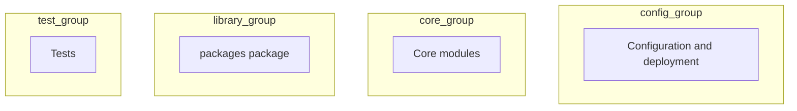

# Architecture report: diegohaz/constate

> Automated static analysis. **Observed** = directly seen in files/imports/AST; **Inferred** = interpretation from that evidence. Repository code was not executed.

## 1. Repository at a glance

| Item | Value |
| --- | --- |
| Repository | diegohaz/constate |
| Description | React Context + State |
| Language | TypeScript |
| Stars | 4006 |
| Licence | MIT |
| Analysed commit / branch | 40d6b5fa503d0bd45d599e2cbe6ab1f4c3eb8602 / main |
| Framework(s) | React |
| Files analysed | 45 |
| Components | 4 |

## 2. Architecture in one minute

diegohaz/constate - React Context + State. This repository was analysed statically from 45 file(s) (0 Python). Detected technologies (observed from imports/manifests): GitHub Actions, React, React Router, TypeScript, Vite, Vitest. Files are grouped into 4 component(s): Configuration and deployment, Core modules, packages package, Tests. Findings below distinguish observed facts from inferred interpretation.

## 3. High-level block diagram

## 4. Main components

### Configuration and deployment (`config`)

- **Kind:** config
- **Status:** Observed
- **Confidence:** 0.85
- **Responsibility:** Groups 7 file(s) under configuration and deployment (observed from repository paths and static analysis).
- **Paths:** `package.json`, `packages/constate/package.json`, `packages/constate/tsconfig.json`, `pnpm-workspace.yaml`, `renovate.json`, `tsconfig.base.json`, `tsconfig.json`
- **Evidence:** [package.json](https://github.com/diegohaz/constate/blob/40d6b5fa503d0bd45d599e2cbe6ab1f4c3eb8602/package.json); [packages/constate/package.json](https://github.com/diegohaz/constate/blob/40d6b5fa503d0bd45d599e2cbe6ab1f4c3eb8602/packages/constate/package.json); [packages/constate/tsconfig.json](https://github.com/diegohaz/constate/blob/40d6b5fa503d0bd45d599e2cbe6ab1f4c3eb8602/packages/constate/tsconfig.json); [pnpm-workspace.yaml](https://github.com/diegohaz/constate/blob/40d6b5fa503d0bd45d599e2cbe6ab1f4c3eb8602/pnpm-workspace.yaml); [renovate.json](https://github.com/diegohaz/constate/blob/40d6b5fa503d0bd45d599e2cbe6ab1f4c3eb8602/renovate.json); [tsconfig.base.json](https://github.com/diegohaz/constate/blob/40d6b5fa503d0bd45d599e2cbe6ab1f4c3eb8602/tsconfig.base.json); [tsconfig.json](https://github.com/diegohaz/constate/blob/40d6b5fa503d0bd45d599e2cbe6ab1f4c3eb8602/tsconfig.json)

### Core modules (`core`)

- **Kind:** core
- **Status:** Observed
- **Confidence:** 0.85
- **Responsibility:** Groups 3 file(s) under core modules (observed from repository paths and static analysis).
- **Paths:** `oxfmt.config.ts`, `oxlint.config.ts`, `vitest.config.ts`
- **Evidence:** [oxfmt.config.ts](https://github.com/diegohaz/constate/blob/40d6b5fa503d0bd45d599e2cbe6ab1f4c3eb8602/oxfmt.config.ts); [oxlint.config.ts](https://github.com/diegohaz/constate/blob/40d6b5fa503d0bd45d599e2cbe6ab1f4c3eb8602/oxlint.config.ts); [vitest.config.ts](https://github.com/diegohaz/constate/blob/40d6b5fa503d0bd45d599e2cbe6ab1f4c3eb8602/vitest.config.ts)

### packages package (`packages`)

- **Kind:** library
- **Status:** Observed
- **Confidence:** 0.85
- **Responsibility:** Groups 2 file(s) under packages package (observed from repository paths and static analysis).
- **Paths:** `packages/constate/rolldown.config.ts`, `packages/constate/src/index.tsx`
- **Evidence:** [packages/constate/rolldown.config.ts](https://github.com/diegohaz/constate/blob/40d6b5fa503d0bd45d599e2cbe6ab1f4c3eb8602/packages/constate/rolldown.config.ts); [packages/constate/src/index.tsx](https://github.com/diegohaz/constate/blob/40d6b5fa503d0bd45d599e2cbe6ab1f4c3eb8602/packages/constate/src/index.tsx)

### Tests (`tests`)

- **Kind:** test
- **Status:** Observed
- **Confidence:** 0.85
- **Responsibility:** Groups 1 file(s) under tests (observed from repository paths and static analysis).
- **Paths:** `packages/constate/tests/index.test.tsx`
- **Evidence:** [packages/constate/tests/index.test.tsx](https://github.com/diegohaz/constate/blob/40d6b5fa503d0bd45d599e2cbe6ab1f4c3eb8602/packages/constate/tests/index.test.tsx)

## 5. Execution flow

**Observed** entry point(s):

- [packages/constate/src/index.tsx](https://github.com/diegohaz/constate/blob/40d6b5fa503d0bd45d599e2cbe6ab1f4c3eb8602/packages/constate/src/index.tsx)

Representative flow (derived from observed entry points and the import graph; steps beyond the entry point are **Inferred**):

1. Execution starts at an observed entry point listed above, if present.
2. No internal import relationships between components were observed.

## 6. Project structure

### `(root)`

- `.editorconfig` - config (414 bytes)
- `.gitignore` - other (489 bytes)
- `LICENSE` - docs (1066 bytes)
- `oxfmt.config.ts` - source, TypeScript (153 bytes)
- `oxlint.config.ts` - source, TypeScript (580 bytes)
- `package.json` - manifest (1637 bytes)
- `pnpm-workspace.yaml` - config (188 bytes)
- `renovate.json` - config (1204 bytes)
- `tsconfig.base.json` - config (560 bytes)
- `tsconfig.json` - config (331 bytes)
- `vitest.config.ts` - source, TypeScript (257 bytes)

### `.changeset`

- `.changeset/README.md` - docs (277 bytes)
- `.changeset/changelog.ts` - source, TypeScript (2413 bytes)
- `.changeset/config.json` - config (262 bytes)
- `.changeset/get-changelog-entry.test.ts` - source, TypeScript (6135 bytes)

### `.github`

- `.github/funding.yml` - config (17 bytes)
- `.github/workflows/ci.yml` - ci, YAML (2071 bytes)
- `.github/workflows/release-preview.yml` - ci, YAML (2809 bytes)
- `.github/workflows/release.yml` - ci, YAML (1017 bytes)

### `.husky`

- `.husky/pre-commit` - other (22 bytes)

### `.vscode`

- `.vscode/extensions.json` - config (148 bytes)
- `.vscode/settings.json` - config (534 bytes)

### `examples`

- `examples/index.html` - other (304 bytes)
- `examples/package.json` - manifest (412 bytes)
- `examples/src/App.tsx` - source, TypeScript (1239 bytes)
- `examples/src/counter/App.tsx` - source, TypeScript (880 bytes)
- `examples/src/i18n/App.tsx` - source, TypeScript (1311 bytes)
- `examples/src/main.tsx` - source, TypeScript (313 bytes)
- `examples/src/theming/App.tsx` - source, TypeScript (1147 bytes)
- `examples/src/typescript/App.tsx` - source, TypeScript (832 bytes)
- `examples/src/wizard-form/App.tsx` - source, TypeScript (3265 bytes)
- `examples/tsconfig.json` - config (156 bytes)
- `examples/vite.config.ts` - source, TypeScript (271 bytes)

### `logo`

- `logo/logo-black.svg` - other (2325 bytes)
- `logo/logo-white.svg` - other (2455 bytes)
- `logo/logo.svg` - other (2461 bytes)

### `packages`

- `packages/constate/CHANGELOG.md` - docs (6858 bytes)
- `packages/constate/LICENSE` - docs (1066 bytes)
- `packages/constate/README.md` - docs (6884 bytes)
- `packages/constate/package.json` - manifest (1157 bytes)
- `packages/constate/rolldown.config.ts` - source, TypeScript (408 bytes)
- `packages/constate/src/index.tsx` - source, TypeScript (2848 bytes)
- `packages/constate/tests/index.test.tsx` - test, TypeScript (5581 bytes)
- `packages/constate/tsconfig.json` - config (146 bytes)

### `patches`

- `patches/@changesets__apply-release-plan@8.1.1.patch` - other (794 bytes)

## 7. Key dependencies and integrations

| Name | Category | Status | Confidence | Evidence |
| --- | --- | --- | --- | --- |
| GitHub Actions | ci | Observed | 0.90 | [.github/workflows/ci.yml](https://github.com/diegohaz/constate/blob/40d6b5fa503d0bd45d599e2cbe6ab1f4c3eb8602/.github/workflows/ci.yml); [.github/workflows/release-preview.yml](https://github.com/diegohaz/constate/blob/40d6b5fa503d0bd45d599e2cbe6ab1f4c3eb8602/.github/workflows/release-preview.yml); [.github/workflows/release.yml](https://github.com/diegohaz/constate/blob/40d6b5fa503d0bd45d599e2cbe6ab1f4c3eb8602/.github/workflows/release.yml) |
| React | framework | Observed | 0.90 | [examples/package.json:13](https://github.com/diegohaz/constate/blob/40d6b5fa503d0bd45d599e2cbe6ab1f4c3eb8602/examples/package.json#L13); [examples/package.json:15](https://github.com/diegohaz/constate/blob/40d6b5fa503d0bd45d599e2cbe6ab1f4c3eb8602/examples/package.json#L15); [packages/constate/package.json:4](https://github.com/diegohaz/constate/blob/40d6b5fa503d0bd45d599e2cbe6ab1f4c3eb8602/packages/constate/package.json#L4); [packages/constate/package.json:45](https://github.com/diegohaz/constate/blob/40d6b5fa503d0bd45d599e2cbe6ab1f4c3eb8602/packages/constate/package.json#L45) |
| React Router | library | Observed | 0.85 | [examples/package.json:16](https://github.com/diegohaz/constate/blob/40d6b5fa503d0bd45d599e2cbe6ab1f4c3eb8602/examples/package.json#L16) |
| TypeScript | tooling | Observed | 0.85 | [package.json:42](https://github.com/diegohaz/constate/blob/40d6b5fa503d0bd45d599e2cbe6ab1f4c3eb8602/package.json#L42) |
| Vite | tooling | Observed | 0.85 | [package.json:14](https://github.com/diegohaz/constate/blob/40d6b5fa503d0bd45d599e2cbe6ab1f4c3eb8602/package.json#L14) |
| Vitest | tooling | Observed | 0.85 | [package.json:14](https://github.com/diegohaz/constate/blob/40d6b5fa503d0bd45d599e2cbe6ab1f4c3eb8602/package.json#L14) |

## 8. Data and state

No database, cache, queue, or persistent-state usage was observed in the analysed files. State handling, if any, may be in-memory or in files that were not analysed.

## 9. Configuration and deployment clues

- `.changeset/config.json` (config)
- `.editorconfig` (config)
- `.github/funding.yml` (config)
- `.github/workflows/ci.yml` (ci)
- `.github/workflows/release-preview.yml` (ci)
- `.github/workflows/release.yml` (ci)
- `.vscode/extensions.json` (config)
- `.vscode/settings.json` (config)
- `examples/package.json` (manifest)
- `examples/tsconfig.json` (config)
- `package.json` (manifest)
- `packages/constate/package.json` (manifest)
- `packages/constate/tsconfig.json` (config)
- `pnpm-workspace.yaml` (config)
- `renovate.json` (config)
- `tsconfig.base.json` (config)
- `tsconfig.json` (config)

## 10. Design observations

- Tests are present alongside source code (Observed from test file paths).

These observations are interpretations (**Inferred**) of the observed structure, not guarantees about runtime design.

## 11. Limitations and unknowns

- Static analysis only: repository code was not executed, installed, or imported at runtime.
- Components and relationships are inferred from file paths, imports, and AST structure; runtime behaviour, dynamic imports, and reflection may not be visible.
- 2 file(s) were skipped during inventory (1 x likely secret file excluded; 1 x lockfile excluded).
- No clear application entry point was observed in the analysed files.
- Repository text was treated as untrusted data; no instructions found in repository files were followed, and likely secret values were redacted/excluded.
- JavaScript and TypeScript files were inventoried from paths and package manifests. They were not parsed with a full language AST, and repository code was not executed.

## 12. Source references

- [.github/workflows/ci.yml](https://github.com/diegohaz/constate/blob/40d6b5fa503d0bd45d599e2cbe6ab1f4c3eb8602/.github/workflows/ci.yml)
- [.github/workflows/release-preview.yml](https://github.com/diegohaz/constate/blob/40d6b5fa503d0bd45d599e2cbe6ab1f4c3eb8602/.github/workflows/release-preview.yml)
- [.github/workflows/release.yml](https://github.com/diegohaz/constate/blob/40d6b5fa503d0bd45d599e2cbe6ab1f4c3eb8602/.github/workflows/release.yml)
- [examples/package.json:13](https://github.com/diegohaz/constate/blob/40d6b5fa503d0bd45d599e2cbe6ab1f4c3eb8602/examples/package.json#L13)
- [examples/package.json:15](https://github.com/diegohaz/constate/blob/40d6b5fa503d0bd45d599e2cbe6ab1f4c3eb8602/examples/package.json#L15)
- [examples/package.json:16](https://github.com/diegohaz/constate/blob/40d6b5fa503d0bd45d599e2cbe6ab1f4c3eb8602/examples/package.json#L16)
- [oxfmt.config.ts](https://github.com/diegohaz/constate/blob/40d6b5fa503d0bd45d599e2cbe6ab1f4c3eb8602/oxfmt.config.ts)
- [oxlint.config.ts](https://github.com/diegohaz/constate/blob/40d6b5fa503d0bd45d599e2cbe6ab1f4c3eb8602/oxlint.config.ts)
- [package.json](https://github.com/diegohaz/constate/blob/40d6b5fa503d0bd45d599e2cbe6ab1f4c3eb8602/package.json)
- [package.json:14](https://github.com/diegohaz/constate/blob/40d6b5fa503d0bd45d599e2cbe6ab1f4c3eb8602/package.json#L14)
- [package.json:42](https://github.com/diegohaz/constate/blob/40d6b5fa503d0bd45d599e2cbe6ab1f4c3eb8602/package.json#L42)
- [packages/constate/package.json](https://github.com/diegohaz/constate/blob/40d6b5fa503d0bd45d599e2cbe6ab1f4c3eb8602/packages/constate/package.json)
- [packages/constate/package.json:4](https://github.com/diegohaz/constate/blob/40d6b5fa503d0bd45d599e2cbe6ab1f4c3eb8602/packages/constate/package.json#L4)
- [packages/constate/package.json:45](https://github.com/diegohaz/constate/blob/40d6b5fa503d0bd45d599e2cbe6ab1f4c3eb8602/packages/constate/package.json#L45)
- [packages/constate/rolldown.config.ts](https://github.com/diegohaz/constate/blob/40d6b5fa503d0bd45d599e2cbe6ab1f4c3eb8602/packages/constate/rolldown.config.ts)
- [packages/constate/src/index.tsx](https://github.com/diegohaz/constate/blob/40d6b5fa503d0bd45d599e2cbe6ab1f4c3eb8602/packages/constate/src/index.tsx)
- [packages/constate/tests/index.test.tsx](https://github.com/diegohaz/constate/blob/40d6b5fa503d0bd45d599e2cbe6ab1f4c3eb8602/packages/constate/tests/index.test.tsx)
- [packages/constate/tsconfig.json](https://github.com/diegohaz/constate/blob/40d6b5fa503d0bd45d599e2cbe6ab1f4c3eb8602/packages/constate/tsconfig.json)
- [pnpm-workspace.yaml](https://github.com/diegohaz/constate/blob/40d6b5fa503d0bd45d599e2cbe6ab1f4c3eb8602/pnpm-workspace.yaml)
- [renovate.json](https://github.com/diegohaz/constate/blob/40d6b5fa503d0bd45d599e2cbe6ab1f4c3eb8602/renovate.json)
- [tsconfig.base.json](https://github.com/diegohaz/constate/blob/40d6b5fa503d0bd45d599e2cbe6ab1f4c3eb8602/tsconfig.base.json)
- [tsconfig.json](https://github.com/diegohaz/constate/blob/40d6b5fa503d0bd45d599e2cbe6ab1f4c3eb8602/tsconfig.json)
- [vitest.config.ts](https://github.com/diegohaz/constate/blob/40d6b5fa503d0bd45d599e2cbe6ab1f4c3eb8602/vitest.config.ts)
