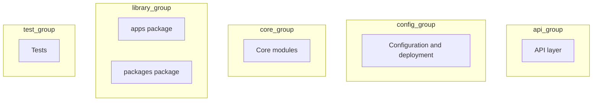

# Architecture report: diegomura/react-pdf

> Automated static analysis. **Observed** = directly seen in files/imports/AST; **Inferred** = interpretation from that evidence. Repository code was not executed.

## 1. Repository at a glance

| Item | Value |
| --- | --- |
| Repository | diegomura/react-pdf |
| Description | 📄  Create PDF files using React |
| Language | TypeScript |
| Stars | 16858 |
| Licence | MIT |
| Analysed commit / branch | f765c957902eb1f0d15b1571d6f61e5818e8bc50 / master |
| Framework(s) | Next.js, React |
| Files analysed | 799 |
| Components | 6 |

## 2. Architecture in one minute

diegomura/react-pdf - 📄  Create PDF files using React. This repository was analysed statically from 799 file(s) (0 Python). Detected technologies (observed from imports/manifests): GitHub Actions, Next.js, React, Tailwind CSS, TypeScript, Vite. Files are grouped into 6 component(s): API layer, apps package, Configuration and deployment, Core modules, packages package, Tests. Findings below distinguish observed facts from inferred interpretation.

## 3. High-level block diagram

## 4. Main components

### API layer (`api_layer`)

- **Kind:** api
- **Status:** Observed
- **Confidence:** 0.85
- **Responsibility:** Groups 4 file(s) under api layer (observed from repository paths and static analysis).
- **Paths:** `apps/site/app/api/mcp/[transport]/route.test.ts`, `apps/site/app/api/mcp/[transport]/route.ts`, `apps/site/app/api/raw/[[...slug]]/route.ts`, `apps/site/app/api/search/route.ts`
- **Evidence:** [apps/site/app/api/mcp/[transport]/route.test.ts](https://github.com/diegomura/react-pdf/blob/f765c957902eb1f0d15b1571d6f61e5818e8bc50/apps/site/app/api/mcp/%5Btransport%5D/route.test.ts); [apps/site/app/api/mcp/[transport]/route.ts](https://github.com/diegomura/react-pdf/blob/f765c957902eb1f0d15b1571d6f61e5818e8bc50/apps/site/app/api/mcp/%5Btransport%5D/route.ts); [apps/site/app/api/raw/[[...slug]]/route.ts](https://github.com/diegomura/react-pdf/blob/f765c957902eb1f0d15b1571d6f61e5818e8bc50/apps/site/app/api/raw/%5B%5B...slug%5D%5D/route.ts); [apps/site/app/api/search/route.ts](https://github.com/diegomura/react-pdf/blob/f765c957902eb1f0d15b1571d6f61e5818e8bc50/apps/site/app/api/search/route.ts)

### apps package (`apps`)

- **Kind:** library
- **Status:** Observed
- **Confidence:** 0.85
- **Responsibility:** Groups 188 file(s) under apps package (observed from repository paths and static analysis).
- **Paths:** `apps/examples/declarations.d.ts`, `apps/examples/generate-pdfs.mjs`, `apps/examples/postcss.config.js`, `apps/examples/src/examples/duplicated-images/index.tsx`, `apps/examples/src/examples/ellipsis/index.tsx`, `apps/examples/src/examples/emoji/index.tsx`, `apps/examples/src/examples/float/index.tsx`, `apps/examples/src/examples/font-family-fallback/index.tsx`, `apps/examples/src/examples/font-feature-settings/index.tsx`, `apps/examples/src/examples/font-weight/index.tsx`, `apps/examples/src/examples/forms/index.tsx`, `apps/examples/src/examples/go-to/index.tsx`, `apps/examples/src/examples/image-background/index.tsx`, `apps/examples/src/examples/image-stress-test/index.tsx`, `apps/examples/src/examples/index.ts`, `apps/examples/src/examples/jpg-orientation/index.tsx`, `apps/examples/src/examples/knobs/index.tsx`, `apps/examples/src/examples/link/index.tsx`, `apps/examples/src/examples/math/index.tsx`, `apps/examples/src/examples/media-queries/index.tsx`, `apps/examples/src/examples/mermaid/index.tsx`, `apps/examples/src/examples/min-presence-ahead/index.tsx`, `apps/examples/src/examples/multiline-text/index.tsx`, `apps/examples/src/examples/object-fit/index.tsx`, `apps/examples/src/examples/page-wrap/index.tsx`, `apps/examples/src/examples/password-protection/index.tsx`, `apps/examples/src/examples/responsive-images/index.tsx`, `apps/examples/src/examples/resume/Education.tsx`, `apps/examples/src/examples/resume/Experience.tsx`, `apps/examples/src/examples/resume/Header.tsx`, `apps/examples/src/examples/resume/List.tsx`, `apps/examples/src/examples/resume/Skills.tsx`, `apps/examples/src/examples/resume/Title.tsx`, `apps/examples/src/examples/resume/index.tsx`, `apps/examples/src/examples/scripts/index.tsx`, `apps/examples/src/examples/soft-hyphens/index.tsx`, `apps/examples/src/examples/svg-image/index.tsx`, `apps/examples/src/examples/svg-transform/index.tsx`, `apps/examples/src/examples/svg/Markers.tsx`, `apps/examples/src/examples/svg/Svg1.tsx`, `apps/examples/src/examples/svg/Svg2.tsx`, `apps/examples/src/examples/svg/Svg4.tsx`, `apps/examples/src/examples/svg/index.tsx`, `apps/examples/src/examples/svg/svg.tsx`, `apps/examples/src/examples/tailwind/index.tsx`, `apps/examples/src/examples/transform-origin/index.tsx`, `apps/examples/src/index.tsx`, `apps/examples/src/svg-render.ts`, `apps/examples/src/svg-viewer.tsx`, `apps/examples/tailwind.config.js`, `apps/examples/vite.config.js`, `apps/site/app/(home)/blog/[slug]/page.tsx`, `apps/site/app/(home)/blog/page.tsx`, `apps/site/app/(home)/changelog/page.tsx`, `apps/site/app/(home)/layout.tsx`, `apps/site/app/(home)/page.tsx`, `apps/site/app/layout.tsx`, `apps/site/app/llms-full.txt/route.ts`, `apps/site/app/llms.txt/route.ts`, `apps/site/app/not-found.tsx`, `apps/site/app/opengraph-image.tsx`, `apps/site/app/playground/loader.tsx`, `apps/site/app/playground/page.tsx`, `apps/site/app/playground/playground-client.tsx`, `apps/site/app/robots.ts`, `apps/site/app/sitemap.ts`, `apps/site/components/docs-pager/docs-pager.tsx`, `apps/site/components/docs-pager/index.ts`, `apps/site/components/editor/cm-theme.ts`, `apps/site/components/editor/completions.ts`, `apps/site/components/editor/editor.tsx`, `apps/site/components/editor/index.ts`, `apps/site/components/example/example-block.tsx`, `apps/site/components/example/example-body.tsx`, `apps/site/components/example/example.tsx`, `apps/site/components/example/index.ts`, `apps/site/components/github-stars/github-stars.tsx`, `apps/site/components/github-stars/index.ts`, `apps/site/components/hero/constants.ts`, `apps/site/components/hero/hero.tsx`, `apps/site/components/hero/index.ts`, `apps/site/components/hero/mini-playground.tsx`, `apps/site/components/mdx/index.ts`, `apps/site/components/mdx/mdx.tsx`, `apps/site/components/overview-timeline/index.ts`, `apps/site/components/overview-timeline/overview-timeline.tsx`, `apps/site/components/painter-methods/index.ts`, `apps/site/components/painter-methods/painter-methods.tsx`, `apps/site/components/pdf-preview/index.ts`, `apps/site/components/pdf-preview/pdf-preview.tsx`, `apps/site/components/pdf-preview/skeleton.tsx`, `apps/site/components/playground/example-picker.tsx`, `apps/site/components/playground/index.ts`, `apps/site/components/playground/playground.tsx`, `apps/site/components/playground/status.tsx`, `apps/site/components/playground/url.ts`, `apps/site/components/post-cover/index.ts`, `apps/site/components/post-cover/post-cover.tsx`, `apps/site/components/search-dialog/index.ts`, `apps/site/components/search-dialog/search-dialog.tsx`, `apps/site/components/section-index/hash-redirect.tsx`, `apps/site/components/section-index/index.ts`, `apps/site/components/section-index/section-index.tsx`, `apps/site/components/section-index/v4-splits.ts`, `apps/site/components/site-nav/index.ts`, `apps/site/components/site-nav/site-nav.tsx`, `apps/site/components/style-props/index.ts`, `apps/site/components/style-props/style-props.tsx`, `apps/site/components/text-lab/breaks.ts`, `apps/site/components/text-lab/font.ts`, `apps/site/components/text-lab/fontkit.d.ts`, `apps/site/components/text-lab/glyph-lab.tsx`, `apps/site/components/text-lab/index.tsx`, `apps/site/components/text-lab/line-box-lab.tsx`, `apps/site/components/text-lab/line-break-lab.tsx`, `apps/site/components/text-lab/runs-strip.tsx`, `apps/site/components/text-lab/ui.tsx`, `apps/site/components/usage/index.ts`, `apps/site/components/usage/usage-preview.tsx`, `apps/site/components/usage/usage.tsx`, `apps/site/components/viewer/index.ts`, `apps/site/components/viewer/pager.tsx`, `apps/site/components/viewer/viewer.tsx`, `apps/site/lib/blog-source/blog-source.ts`, `apps/site/lib/blog-source/index.ts`, `apps/site/lib/changelog/changelog.ts`, `apps/site/lib/changelog/index.ts`, `apps/site/lib/code-theme/code-theme.ts`, `apps/site/lib/code-theme/index.ts`, `apps/site/lib/compress/compress.ts`, `apps/site/lib/compress/index.ts`, `apps/site/lib/examples/breakable-unbreakable.ts`, `apps/site/lib/examples/checkbox.ts`, `apps/site/lib/examples/circle.ts`, `apps/site/lib/examples/clippath.ts`, `apps/site/lib/examples/debugging.ts`, `apps/site/lib/examples/disable-hyphenation.ts`, `apps/site/lib/examples/disable-wrapping.ts`, `apps/site/lib/examples/ellipse.ts`, `apps/site/lib/examples/emoji.ts`, `apps/site/lib/examples/fixed-components.ts`, `apps/site/lib/examples/float.ts`, `apps/site/lib/examples/font-feature-settings.ts`, `apps/site/lib/examples/font-register.ts`, `apps/site/lib/examples/formfield.ts`, `apps/site/lib/examples/fractals.ts`, `apps/site/lib/examples/g.ts`, `apps/site/lib/examples/hyphenation-callback.ts`, `apps/site/lib/examples/images.ts`, `apps/site/lib/examples/index.ts`, `apps/site/lib/examples/inline-styles.ts`, `apps/site/lib/examples/knobs.ts`, `apps/site/lib/examples/line.ts`, `apps/site/lib/examples/lineargradient.ts`, `apps/site/lib/examples/math.ts`, `apps/site/lib/examples/media-queries.ts`, `apps/site/lib/examples/mixed-styles.ts`, `apps/site/lib/examples/orphans-and-widows.ts`, `apps/site/lib/examples/page-breaks.ts`, `apps/site/lib/examples/page-numbers.ts`, `apps/site/lib/examples/page-wrap.ts`, `apps/site/lib/examples/path.ts`, `apps/site/lib/examples/picker-formlist.ts`, `apps/site/lib/examples/polygon.ts`, `apps/site/lib/examples/polyline.ts`, `apps/site/lib/examples/quick-start.ts`, `apps/site/lib/examples/radialgradient.ts`, `apps/site/lib/examples/rect.ts`, `apps/site/lib/examples/resume.ts`, `apps/site/lib/examples/shape-outside.ts`, `apps/site/lib/examples/styles.ts`, `apps/site/lib/examples/svg.ts`, `apps/site/lib/examples/svgtext.ts`, `apps/site/lib/examples/tailwind.ts`, `apps/site/lib/examples/text.ts`, `apps/site/lib/examples/textinput.ts`, `apps/site/lib/llm-text/index.ts`, `apps/site/lib/llm-text/llm-text.ts`, `apps/site/lib/nav/index.ts`, `apps/site/lib/nav/nav.tsx`, `apps/site/lib/source/index.ts`, `apps/site/lib/source/source.ts`, `apps/site/lib/style-props/index.ts`, `apps/site/lib/style-props/style-props.ts`, `apps/site/next.config.mjs`, `apps/site/postcss.config.mjs`, `apps/site/source.config.ts`, `apps/site/vitest.config.ts`
- **Evidence:** [apps/examples/declarations.d.ts](https://github.com/diegomura/react-pdf/blob/f765c957902eb1f0d15b1571d6f61e5818e8bc50/apps/examples/declarations.d.ts); [apps/examples/generate-pdfs.mjs](https://github.com/diegomura/react-pdf/blob/f765c957902eb1f0d15b1571d6f61e5818e8bc50/apps/examples/generate-pdfs.mjs); [apps/examples/postcss.config.js](https://github.com/diegomura/react-pdf/blob/f765c957902eb1f0d15b1571d6f61e5818e8bc50/apps/examples/postcss.config.js); [apps/examples/src/examples/duplicated-images/index.tsx](https://github.com/diegomura/react-pdf/blob/f765c957902eb1f0d15b1571d6f61e5818e8bc50/apps/examples/src/examples/duplicated-images/index.tsx); [apps/examples/src/examples/ellipsis/index.tsx](https://github.com/diegomura/react-pdf/blob/f765c957902eb1f0d15b1571d6f61e5818e8bc50/apps/examples/src/examples/ellipsis/index.tsx); [apps/examples/src/examples/emoji/index.tsx](https://github.com/diegomura/react-pdf/blob/f765c957902eb1f0d15b1571d6f61e5818e8bc50/apps/examples/src/examples/emoji/index.tsx); [apps/examples/src/examples/float/index.tsx](https://github.com/diegomura/react-pdf/blob/f765c957902eb1f0d15b1571d6f61e5818e8bc50/apps/examples/src/examples/float/index.tsx); [apps/examples/src/examples/font-family-fallback/index.tsx](https://github.com/diegomura/react-pdf/blob/f765c957902eb1f0d15b1571d6f61e5818e8bc50/apps/examples/src/examples/font-family-fallback/index.tsx)

### Configuration and deployment (`config`)

- **Kind:** config
- **Status:** Observed
- **Confidence:** 0.85
- **Responsibility:** Groups 31 file(s) under configuration and deployment (observed from repository paths and static analysis).
- **Paths:** `apps/examples/package.json`, `apps/site/content/docs/v1/meta.json`, `apps/site/content/docs/v2/meta.json`, `apps/site/content/docs/v3/meta.json`, `apps/site/content/docs/v4/meta.json`, `apps/site/package.json`, `apps/site/tsconfig.json`, `apps/site/vercel.json`, `lerna.json`, `package.json`, `packages/fns/package.json`, `packages/fns/tsconfig.json`, `packages/font/package.json`, `packages/font/tsconfig.json`, `packages/hyphenate/package.json`, `packages/hyphenate/tsconfig.json`, `packages/image/package.json`, `packages/image/tsconfig.json`, `packages/layout/package.json`, `packages/layout/tsconfig.json`, `packages/math/package.json`, `packages/math/tsconfig.json`, `packages/mermaid/package.json`, `packages/mermaid/tsconfig.json`, `packages/paginate/package.json`, `packages/paginate/tsconfig.json`, `packages/primitives/package.json`, `packages/primitives/tsconfig.json`, `packages/reconciler/package.json`, `packages/reconciler/tsconfig.json`, `packages/render/package.json`
- **Evidence:** [apps/examples/package.json](https://github.com/diegomura/react-pdf/blob/f765c957902eb1f0d15b1571d6f61e5818e8bc50/apps/examples/package.json); [apps/site/content/docs/v1/meta.json](https://github.com/diegomura/react-pdf/blob/f765c957902eb1f0d15b1571d6f61e5818e8bc50/apps/site/content/docs/v1/meta.json); [apps/site/content/docs/v2/meta.json](https://github.com/diegomura/react-pdf/blob/f765c957902eb1f0d15b1571d6f61e5818e8bc50/apps/site/content/docs/v2/meta.json); [apps/site/content/docs/v3/meta.json](https://github.com/diegomura/react-pdf/blob/f765c957902eb1f0d15b1571d6f61e5818e8bc50/apps/site/content/docs/v3/meta.json); [apps/site/content/docs/v4/meta.json](https://github.com/diegomura/react-pdf/blob/f765c957902eb1f0d15b1571d6f61e5818e8bc50/apps/site/content/docs/v4/meta.json); [apps/site/package.json](https://github.com/diegomura/react-pdf/blob/f765c957902eb1f0d15b1571d6f61e5818e8bc50/apps/site/package.json); [apps/site/tsconfig.json](https://github.com/diegomura/react-pdf/blob/f765c957902eb1f0d15b1571d6f61e5818e8bc50/apps/site/tsconfig.json); [apps/site/vercel.json](https://github.com/diegomura/react-pdf/blob/f765c957902eb1f0d15b1571d6f61e5818e8bc50/apps/site/vercel.json)

### Core modules (`core`)

- **Kind:** core
- **Status:** Observed
- **Confidence:** 0.85
- **Responsibility:** Groups 2 file(s) under core modules (observed from repository paths and static analysis).
- **Paths:** `babel.config.js`, `eslint.config.ts`
- **Evidence:** [babel.config.js](https://github.com/diegomura/react-pdf/blob/f765c957902eb1f0d15b1571d6f61e5818e8bc50/babel.config.js); [eslint.config.ts](https://github.com/diegomura/react-pdf/blob/f765c957902eb1f0d15b1571d6f61e5818e8bc50/eslint.config.ts)

### packages package (`packages`)

- **Kind:** library
- **Status:** Observed
- **Confidence:** 0.85
- **Responsibility:** Groups 274 file(s) under packages package (observed from repository paths and static analysis).
- **Paths:** `packages/fns/jest.config.js`, `packages/fns/rollup.config.js`, `packages/fns/src/adjust.ts`, `packages/fns/src/asyncCompose.ts`, `packages/fns/src/capitalize.ts`, `packages/fns/src/castArray.ts`, `packages/fns/src/compose.ts`, `packages/fns/src/dropLast.ts`, `packages/fns/src/evolve.ts`, `packages/fns/src/get.ts`, `packages/fns/src/index.ts`, `packages/fns/src/isNil.ts`, `packages/fns/src/last.ts`, `packages/fns/src/mapValues.ts`, `packages/fns/src/matchPercent.ts`, `packages/fns/src/omit.ts`, `packages/fns/src/parseFloat.ts`, `packages/fns/src/pick.ts`, `packages/fns/src/repeat.ts`, `packages/fns/src/reverse.ts`, `packages/fns/src/upperFirst.ts`, `packages/fns/src/without.ts`, `packages/font/declarations.d.ts`, `packages/font/globals.d.ts`, `packages/font/rollup.config.js`, `packages/font/src/font-family.ts`, `packages/font/src/font-source.ts`, `packages/font/src/index.ts`, `packages/font/src/pdfkit-standard-fonts.d.ts`, `packages/font/src/standard-font.ts`, `packages/font/src/types.ts`, `packages/font/vitest.config.js`, `packages/hyphenate/rollup.config.js`, `packages/hyphenate/scripts/generate-languages.mjs`, `packages/hyphenate/src/index.ts`, `packages/image/declarations.d.ts`, `packages/image/globals.d.ts`, `packages/image/rollup.config.js`, `packages/image/src/cache.ts`, `packages/image/src/index.ts`, `packages/image/src/jpeg.ts`, `packages/image/src/png.ts`, `packages/image/src/resolve.ts`, `packages/image/src/svg.ts`, `packages/image/src/types.ts`, `packages/image/vitest.config.js`, `packages/image/vitest.setup.js`, `packages/layout/globals.d.ts`, `packages/layout/jest.config.js`, `packages/layout/rollup.config.js`, `packages/layout/setupTests.js`, `packages/layout/src/canvas/measureCanvas.ts`, `packages/layout/src/image/fetchImage.ts`, `packages/layout/src/image/getRatio.ts`, `packages/layout/src/image/getSource.ts`, `packages/layout/src/image/measureImage.ts`, `packages/layout/src/image/resolveSource.ts`, `packages/layout/src/index.ts`, `packages/layout/src/node/getBorderWidth.ts`, `packages/layout/src/node/getDimension.ts`, `packages/layout/src/node/getMargin.ts`, `packages/layout/src/node/getOrigin.ts`, `packages/layout/src/node/getPadding.ts`, `packages/layout/src/node/getPosition.ts`, `packages/layout/src/node/getWrap.ts`, `packages/layout/src/node/hasDynamic.ts`, `packages/layout/src/node/isDynamic.ts`, `packages/layout/src/node/isFixed.ts`, `packages/layout/src/node/removePaddings.ts`, `packages/layout/src/node/renderDynamic.ts`, `packages/layout/src/node/setAlign.ts`, `packages/layout/src/node/setAlignContent.ts`, `packages/layout/src/node/setAlignItems.ts`, `packages/layout/src/node/setAlignSelf.ts`, `packages/layout/src/node/setAspectRatio.ts`, `packages/layout/src/node/setBorderWidth.ts`, `packages/layout/src/node/setDimension.ts`, `packages/layout/src/node/setDisplay.ts`, `packages/layout/src/node/setFlexBasis.ts`, `packages/layout/src/node/setFlexDirection.ts`, `packages/layout/src/node/setFlexGrow.ts`, `packages/layout/src/node/setFlexShrink.ts`, `packages/layout/src/node/setFlexWrap.ts`, `packages/layout/src/node/setGap.ts`, `packages/layout/src/node/setJustifyContent.ts`, `packages/layout/src/node/setMargin.ts`, `packages/layout/src/node/setOverflow.ts`, `packages/layout/src/node/setPadding.ts`, `packages/layout/src/node/setPosition.ts`, `packages/layout/src/node/setPositionType.ts`, `packages/layout/src/node/setYogaValue.ts`, `packages/layout/src/node/shouldBreak.ts`, `packages/layout/src/node/splitBox.ts`, `packages/layout/src/node/splitEdges.ts`, `packages/layout/src/node/splitNode.ts`, `packages/layout/src/page/getContentArea.ts`, `packages/layout/src/page/getOrientation.ts`, `packages/layout/src/page/getSize.ts`, `packages/layout/src/page/getWrapArea.ts`, `packages/layout/src/page/isHeightAuto.ts`, `packages/layout/src/page/isLandscape.ts`, `packages/layout/src/page/isPortrait.ts`, `packages/layout/src/page/template.ts`, `packages/layout/src/paginate/fromPage.ts`, `packages/layout/src/paginate/index.ts`, `packages/layout/src/paginate/toFlow.ts`, `packages/layout/src/paginate/types.ts`, `packages/layout/src/steps/relayoutPage.ts`, `packages/layout/src/steps/resolveAssets.ts`, `packages/layout/src/steps/resolveBookmarks.ts`, `packages/layout/src/steps/resolveDimensions.ts`, `packages/layout/src/steps/resolveFloats.ts`, `packages/layout/src/steps/resolveInheritance.ts`, `packages/layout/src/steps/resolveLinkSubstitution.ts`, `packages/layout/src/steps/resolveOrigins.ts`, `packages/layout/src/steps/resolvePagePaddings.ts`, `packages/layout/src/steps/resolvePageSizes.ts`, `packages/layout/src/steps/resolvePageTemplates.ts`, `packages/layout/src/steps/resolvePagination.ts`, `packages/layout/src/steps/resolvePercentHeight.ts`, `packages/layout/src/steps/resolvePercentRadius.ts`, `packages/layout/src/steps/resolveStyles.ts`, `packages/layout/src/steps/resolveSvg.ts`, `packages/layout/src/steps/resolveTextLayout.ts`, `packages/layout/src/steps/resolveYoga.ts`, `packages/layout/src/steps/resolveZIndex.ts`, `packages/layout/src/svg/getContainer.ts`, `packages/layout/src/svg/getDefs.ts`, `packages/layout/src/svg/inheritProps.ts`, `packages/layout/src/svg/layoutText.ts`, `packages/layout/src/svg/measureSvg.ts`, `packages/layout/src/svg/parseAspectRatio.ts`, `packages/layout/src/svg/parseViewbox.ts`, `packages/layout/src/svg/replaceDefs.ts`, `packages/layout/src/text/emoji.ts`, `packages/layout/src/text/getAttributedString.ts`, `packages/layout/src/text/getLineTop.ts`, `packages/layout/src/text/heightAtLineIndex.ts`, `packages/layout/src/text/ignoreChars.ts`, `packages/layout/src/text/layoutText.ts`, `packages/layout/src/text/lineIndexAtHeight.ts`, `packages/layout/src/text/linesHeight.ts`, `packages/layout/src/text/linesWidth.ts`, `packages/layout/src/text/measureText.ts`, `packages/layout/src/text/splitText.ts`, `packages/layout/src/text/transformText.ts`, `packages/layout/src/types/base.ts`, `packages/layout/src/types/canvas.ts`, `packages/layout/src/types/checkbox.ts`, `packages/layout/src/types/circle.ts`, `packages/layout/src/types/clip-path.ts`, `packages/layout/src/types/defs.ts`, `packages/layout/src/types/document.ts`, `packages/layout/src/types/ellipse.ts`, `packages/layout/src/types/field-set.ts`, `packages/layout/src/types/g.ts`, `packages/layout/src/types/image-background.ts`, `packages/layout/src/types/image.ts`, `packages/layout/src/types/index.ts`, `packages/layout/src/types/line.ts`, `packages/layout/src/types/linear-gradient.ts`, `packages/layout/src/types/link.ts`, `packages/layout/src/types/marker.ts`, `packages/layout/src/types/node.ts`, `packages/layout/src/types/note.ts`, `packages/layout/src/types/page.ts`, `packages/layout/src/types/path.ts`, `packages/layout/src/types/polygon.ts`, `packages/layout/src/types/polyline.ts`, `packages/layout/src/types/radial-gradient.ts`, `packages/layout/src/types/rect.ts`, `packages/layout/src/types/select.ts`, `packages/layout/src/types/stop.ts`, `packages/layout/src/types/svg.ts`, `packages/layout/src/types/text-input.ts`, `packages/layout/src/types/text-instance.ts`, `packages/layout/src/types/text.ts`, `packages/layout/src/types/tspan.ts`, `packages/layout/src/types/view.ts`, `packages/layout/src/yoga/index.ts`, `packages/math/rollup.config.js`, `packages/math/src/Math.tsx`, `packages/math/src/index.ts`, `packages/math/src/mapSvg.tsx`, `packages/math/src/mathjax.ts`, `packages/math/vitest.config.js`, `packages/math/vitest.polyfills.js`, `packages/math/vitest.setup.js`, `packages/mermaid/rollup.config.js`, `packages/mermaid/src/Mermaid.tsx`, `packages/mermaid/src/colorMix.ts`, `packages/mermaid/src/index.ts`, `packages/mermaid/src/mapSvg.tsx`, `packages/mermaid/src/preprocessSvg.ts`, `packages/mermaid/src/render.ts`, `packages/mermaid/vitest.config.js`, `packages/mermaid/vitest.polyfills.js`, `packages/mermaid/vitest.setup.js`, `packages/paginate/rollup.config.js`, `packages/paginate/src/fill/fill.ts`, `packages/paginate/src/fill/fillStep.ts`, `packages/paginate/src/fill/hasContentAbove.ts`, `packages/paginate/src/fit/column.ts`, `packages/paginate/src/fit/index.ts`, `packages/paginate/src/fit/leaf.ts`, `packages/paginate/src/fit/row.ts`, `packages/paginate/src/fragment/height.ts`, `packages/paginate/src/fragment/reach.ts`, `packages/paginate/src/fragment/repeatFragments.ts`, `packages/paginate/src/fragment/toFragments.ts`, `packages/paginate/src/index.ts`, `packages/paginate/src/item/canSplit.ts`, `packages/paginate/src/item/isColumn.ts`, `packages/paginate/src/item/isForbidPenalty.ts`, `packages/paginate/src/item/isForcePenalty.ts`, `packages/paginate/src/item/isLazy.ts`, `packages/paginate/src/item/isLeaf.ts`, `packages/paginate/src/item/isPenalty.ts`, `packages/paginate/src/item/isRepeat.ts`, `packages/paginate/src/item/isRepeatPlaced.ts`, `packages/paginate/src/item/isRow.ts`, `packages/paginate/src/lazy/materialize.ts`, `packages/paginate/src/lazy/restore.ts`, `packages/paginate/src/overflow/deferToNextPage.ts`, `packages/paginate/src/overflow/rewindToBestBreak.ts`, `packages/paginate/src/overflow/spillOntoOwnPage.ts`, `packages/paginate/src/overflow/tryOverflow.ts`, `packages/paginate/src/overflow/trySplitLeaf.ts`, `packages/paginate/src/paginator/index.ts`, `packages/paginate/src/paginator/toItems.ts`, `packages/paginate/src/paginator/toPlaced.ts`, `packages/paginate/src/paginator/types.ts`, `packages/paginate/src/step.ts`, `packages/paginate/src/types.ts`, `packages/paginate/vitest.config.js`, `packages/paginate/vitest.setup.js`, `packages/primitives/babel.config.js`, `packages/primitives/jest.config.js`, `packages/primitives/rollup.config.js`, `packages/primitives/src/index.ts`, `packages/reconciler/rollup.config.js`, `packages/reconciler/src/index.ts`, `packages/reconciler/src/propsEqual.ts`, `packages/reconciler/src/reconciler-23.ts`, `packages/reconciler/src/reconciler-31.ts`, `packages/reconciler/src/reconciler-33.ts`, `packages/reconciler/src/types.ts`, `packages/render/globals.d.ts`, `packages/render/jest.config.js`, `packages/render/rollup.config.js`, `packages/render/src/index.ts`, `packages/render/src/operations/addBookmarks.ts`, `packages/render/src/operations/clipNode.ts`, `packages/render/src/operations/drawImage.ts`, `packages/render/src/operations/encodeGlyphs.ts`, `packages/render/src/operations/setDestination.ts`, `packages/render/src/operations/setLink.ts`, `packages/render/src/operations/transform.ts`, `packages/render/src/primitives/renderBackground.ts`, `packages/render/src/primitives/renderBorders.ts`, `packages/render/src/primitives/renderCanvas.ts`, `packages/render/src/primitives/renderCheckbox.ts`, `packages/render/src/primitives/renderCircle.ts`, `packages/render/src/primitives/renderDebug.ts`, `packages/render/src/primitives/renderEllipse.ts`, `packages/render/src/primitives/renderFieldSet.ts`, `packages/render/src/primitives/renderGlyphs.ts`, `packages/render/src/primitives/renderGroup.ts`, `packages/render/src/primitives/renderImage.ts`, `packages/render/src/primitives/renderImageBackground.ts`, `packages/render/src/primitives/renderLine.ts`, `packages/render/src/primitives/renderList.ts`, `packages/render/src/primitives/renderNode.ts`, `packages/render/src/primitives/renderNote.ts`
- **Evidence:** [packages/fns/jest.config.js](https://github.com/diegomura/react-pdf/blob/f765c957902eb1f0d15b1571d6f61e5818e8bc50/packages/fns/jest.config.js); [packages/fns/rollup.config.js](https://github.com/diegomura/react-pdf/blob/f765c957902eb1f0d15b1571d6f61e5818e8bc50/packages/fns/rollup.config.js); [packages/fns/src/adjust.ts](https://github.com/diegomura/react-pdf/blob/f765c957902eb1f0d15b1571d6f61e5818e8bc50/packages/fns/src/adjust.ts); [packages/fns/src/asyncCompose.ts](https://github.com/diegomura/react-pdf/blob/f765c957902eb1f0d15b1571d6f61e5818e8bc50/packages/fns/src/asyncCompose.ts); [packages/fns/src/capitalize.ts](https://github.com/diegomura/react-pdf/blob/f765c957902eb1f0d15b1571d6f61e5818e8bc50/packages/fns/src/capitalize.ts); [packages/fns/src/castArray.ts](https://github.com/diegomura/react-pdf/blob/f765c957902eb1f0d15b1571d6f61e5818e8bc50/packages/fns/src/castArray.ts); [packages/fns/src/compose.ts](https://github.com/diegomura/react-pdf/blob/f765c957902eb1f0d15b1571d6f61e5818e8bc50/packages/fns/src/compose.ts); [packages/fns/src/dropLast.ts](https://github.com/diegomura/react-pdf/blob/f765c957902eb1f0d15b1571d6f61e5818e8bc50/packages/fns/src/dropLast.ts)

### Tests (`tests`)

- **Kind:** test
- **Status:** Observed
- **Confidence:** 0.85
- **Responsibility:** Groups 102 file(s) under tests (observed from repository paths and static analysis).
- **Paths:** `packages/fns/tests/adjust.test.ts`, `packages/fns/tests/asyncCompose.test.ts`, `packages/fns/tests/capitalize.test.ts`, `packages/fns/tests/castArray.test.ts`, `packages/fns/tests/compose.test.ts`, `packages/fns/tests/dropLast.test.ts`, `packages/fns/tests/evolve.test.ts`, `packages/fns/tests/get.test.ts`, `packages/fns/tests/isNil.test.ts`, `packages/fns/tests/last.test.ts`, `packages/fns/tests/mapValues.test.ts`, `packages/fns/tests/matchPercent.test.ts`, `packages/fns/tests/omit.test.ts`, `packages/fns/tests/parseFloat.test.ts`, `packages/fns/tests/pick.test.ts`, `packages/fns/tests/repeat.test.ts`, `packages/fns/tests/reverse.test.ts`, `packages/fns/tests/upperFirst.test.ts`, `packages/fns/tests/without.test.ts`, `packages/font/tests/fallback-weights.test.ts`, `packages/font/tests/font-store.test.ts`, `packages/font/tests/standard-fonts.test.ts`, `packages/hyphenate/tests/hyphenate.test.ts`, `packages/image/tests/assets/test.svg`, `packages/image/tests/cache.test.ts`, `packages/image/tests/resolve.test.ts`, `packages/image/tests/svg.test.ts`, `packages/image/tests/types.ts`, `packages/layout/tests/engineSelection.test.ts`, `packages/layout/tests/image/getSource.test.ts`, `packages/layout/tests/image/resolveSource.test.ts`, `packages/layout/tests/node/getBorderWidth.test.ts`, `packages/layout/tests/node/getDimension.test.ts`, `packages/layout/tests/node/getMargin.test.ts`, `packages/layout/tests/node/getOrigin.test.ts`, `packages/layout/tests/node/getPadding.test.ts`, `packages/layout/tests/node/getPosition.test.ts`, `packages/layout/tests/node/removePaddings.test.ts`, `packages/layout/tests/node/setAlignContent.test.ts`, `packages/layout/tests/node/setAlignItems.test.ts`, `packages/layout/tests/node/setAlignSelf.test.ts`, `packages/layout/tests/node/setAspectRatio.test.ts`, `packages/layout/tests/node/setBorderWidth.test.ts`, `packages/layout/tests/node/setDimension.test.ts`, `packages/layout/tests/node/setDisplay.test.ts`, `packages/layout/tests/node/setFlexBasis.test.ts`, `packages/layout/tests/node/setFlexDirection.test.ts`, `packages/layout/tests/node/setFlexGrow.test.ts`, `packages/layout/tests/node/setFlexShrink.test.ts`, `packages/layout/tests/node/setFlexWrap.test.ts`, `packages/layout/tests/node/setGap.test.ts`, `packages/layout/tests/node/setJustifyContent.test.ts`, `packages/layout/tests/node/setMargin.test.ts`, `packages/layout/tests/node/setOverflow.test.ts`, `packages/layout/tests/node/setPadding.test.ts`, `packages/layout/tests/node/setPosition.test.ts`, `packages/layout/tests/node/setPositionType.test.ts`, `packages/layout/tests/node/shouldBreak.test.ts`, `packages/layout/tests/page/getOrientation.test.ts`, `packages/layout/tests/page/getSize.test.ts`, `packages/layout/tests/page/isHeightAuto.test.ts`, `packages/layout/tests/page/isLandscape.test.ts`, `packages/layout/tests/page/isPortrait.test.ts`, `packages/layout/tests/paginate/fuzz.test.ts`, `packages/layout/tests/paginate/layout.test.ts`, `packages/layout/tests/paginate/paginate.test.ts`, `packages/layout/tests/paginate/parity.test.ts`, `packages/layout/tests/steps/__snapshots__/resolveLinkSubstitution.test.ts.snap`, `packages/layout/tests/steps/__snapshots__/resolveOrigins.test.ts.snap`, `packages/layout/tests/steps/__snapshots__/resolvePagePaddings.test.ts.snap`, `packages/layout/tests/steps/__snapshots__/resolvePercentHeight.test.ts.snap`, `packages/layout/tests/steps/__snapshots__/resolveStyles.test.ts.snap`, `packages/layout/tests/steps/resolveBookmarks.test.ts`, `packages/layout/tests/steps/resolveFloats.test.ts`, `packages/layout/tests/steps/resolveInhritance.test.ts`, `packages/layout/tests/steps/resolveLinkSubstitution.test.ts`, `packages/layout/tests/steps/resolveOrigins.test.ts`, `packages/layout/tests/steps/resolvePagePaddings.test.ts`, `packages/layout/tests/steps/resolvePageSizes.test.ts`, `packages/layout/tests/steps/resolvePagination.test.ts`, `packages/layout/tests/steps/resolvePercentHeight.test.ts`, `packages/layout/tests/steps/resolveStyles.test.ts`, `packages/layout/tests/steps/resolveSvg.test.ts`, `packages/layout/tests/steps/resolveTextLayout.test.ts`, `packages/layout/tests/text/getAttributedString.test.ts`, `packages/layout/tests/text/heightAtLineIndex.test.ts`, `packages/layout/tests/text/layoutText.test.ts`, `packages/layout/tests/text/lineIndexAtHeight.test.ts`, `packages/layout/tests/text/measureText.test.ts`, `packages/math/tests/math.test.jsx`, `packages/math/tests/renderComponent.js`, `packages/mermaid/tests/colorMix.test.ts`, `packages/mermaid/tests/mermaid.test.jsx`, `packages/mermaid/tests/preprocessSvg.test.ts`, `packages/mermaid/tests/render.test.ts`, `packages/mermaid/tests/renderComponent.js`, `packages/mermaid/tests/workerScope.test.ts`, `packages/paginate/tests/flow.test.ts`, `packages/paginate/tests/paginate.test.ts`, `packages/paginate/tests/renderCanvas.js`, `packages/primitives/tests/index.test.ts`, `packages/reconciler/tests/propsEqual.test.ts`
- **Evidence:** [packages/fns/tests/adjust.test.ts](https://github.com/diegomura/react-pdf/blob/f765c957902eb1f0d15b1571d6f61e5818e8bc50/packages/fns/tests/adjust.test.ts); [packages/fns/tests/asyncCompose.test.ts](https://github.com/diegomura/react-pdf/blob/f765c957902eb1f0d15b1571d6f61e5818e8bc50/packages/fns/tests/asyncCompose.test.ts); [packages/fns/tests/capitalize.test.ts](https://github.com/diegomura/react-pdf/blob/f765c957902eb1f0d15b1571d6f61e5818e8bc50/packages/fns/tests/capitalize.test.ts); [packages/fns/tests/castArray.test.ts](https://github.com/diegomura/react-pdf/blob/f765c957902eb1f0d15b1571d6f61e5818e8bc50/packages/fns/tests/castArray.test.ts); [packages/fns/tests/compose.test.ts](https://github.com/diegomura/react-pdf/blob/f765c957902eb1f0d15b1571d6f61e5818e8bc50/packages/fns/tests/compose.test.ts); [packages/fns/tests/dropLast.test.ts](https://github.com/diegomura/react-pdf/blob/f765c957902eb1f0d15b1571d6f61e5818e8bc50/packages/fns/tests/dropLast.test.ts); [packages/fns/tests/evolve.test.ts](https://github.com/diegomura/react-pdf/blob/f765c957902eb1f0d15b1571d6f61e5818e8bc50/packages/fns/tests/evolve.test.ts); [packages/fns/tests/get.test.ts](https://github.com/diegomura/react-pdf/blob/f765c957902eb1f0d15b1571d6f61e5818e8bc50/packages/fns/tests/get.test.ts)

## 5. Execution flow

**Observed** entry point(s):

- [packages/fns/src/index.ts](https://github.com/diegomura/react-pdf/blob/f765c957902eb1f0d15b1571d6f61e5818e8bc50/packages/fns/src/index.ts)
- [packages/font/src/index.ts](https://github.com/diegomura/react-pdf/blob/f765c957902eb1f0d15b1571d6f61e5818e8bc50/packages/font/src/index.ts)
- [packages/hyphenate/src/index.ts](https://github.com/diegomura/react-pdf/blob/f765c957902eb1f0d15b1571d6f61e5818e8bc50/packages/hyphenate/src/index.ts)
- [packages/image/src/index.ts](https://github.com/diegomura/react-pdf/blob/f765c957902eb1f0d15b1571d6f61e5818e8bc50/packages/image/src/index.ts)
- [packages/layout/src/index.ts](https://github.com/diegomura/react-pdf/blob/f765c957902eb1f0d15b1571d6f61e5818e8bc50/packages/layout/src/index.ts)
- [packages/math/src/index.ts](https://github.com/diegomura/react-pdf/blob/f765c957902eb1f0d15b1571d6f61e5818e8bc50/packages/math/src/index.ts)
- [packages/mermaid/src/index.ts](https://github.com/diegomura/react-pdf/blob/f765c957902eb1f0d15b1571d6f61e5818e8bc50/packages/mermaid/src/index.ts)
- [packages/paginate/src/index.ts](https://github.com/diegomura/react-pdf/blob/f765c957902eb1f0d15b1571d6f61e5818e8bc50/packages/paginate/src/index.ts)
- [packages/primitives/src/index.ts](https://github.com/diegomura/react-pdf/blob/f765c957902eb1f0d15b1571d6f61e5818e8bc50/packages/primitives/src/index.ts)
- [packages/reconciler/src/index.ts](https://github.com/diegomura/react-pdf/blob/f765c957902eb1f0d15b1571d6f61e5818e8bc50/packages/reconciler/src/index.ts)
- [packages/render/src/index.ts](https://github.com/diegomura/react-pdf/blob/f765c957902eb1f0d15b1571d6f61e5818e8bc50/packages/render/src/index.ts)

Representative flow (derived from observed entry points and the import graph; steps beyond the entry point are **Inferred**):

1. Execution starts at an observed entry point listed above, if present.
2. No internal import relationships between components were observed.

## 6. Project structure

### `(root)`

- `.gitattributes` - other (70 bytes)
- `.gitignore` - other (88 bytes)
- `.nvmrc` - other (3 bytes)
- `.prettierignore` - other (32 bytes)
- `.prettierrc` - other (26 bytes)
- `CLAUDE.md` - docs (4091 bytes)
- `LICENSE` - docs (1109 bytes)
- `README.md` - docs (3737 bytes)
- `babel.config.js` - source, JavaScript (460 bytes)
- `eslint.config.ts` - source, TypeScript (8297 bytes)
- `lerna.json` - config (84 bytes)
- `package.json` - manifest (3400 bytes)

### `.changeset`

- `.changeset/README.md` - docs (510 bytes)
- `.changeset/config.json` - config (397 bytes)

### `.github`

- `.github/CODE_OF_CONDUCT.md` - docs (3222 bytes)
- `.github/CONTRIBUTING.md` - docs (6200 bytes)
- `.github/FUNDING.yml` - config (45 bytes)
- `.github/ISSUE_TEMPLATE/bug_report.md` - docs (862 bytes)
- `.github/ISSUE_TEMPLATE/feature_request.md` - docs (603 bytes)
- `.github/no-response.yml` - config (497 bytes)
- `.github/workflows/main.yml` - ci, YAML (2663 bytes)
- `.github/workflows/release.yml` - ci, YAML (2930 bytes)
- `.github/workflows/site.yml` - ci, YAML (1287 bytes)

### `.husky`

- `.husky/pre-commit` - other (17 bytes)

### `apps`

- `apps/examples/.gitignore` - other (24 bytes)
- `apps/examples/CHANGELOG.md` - docs (18045 bytes)
- `apps/examples/README.md` - docs (6423 bytes)
- `apps/examples/declarations.d.ts` - source, TypeScript (284 bytes)
- `apps/examples/generate-pdfs.mjs` - source, JavaScript (3553 bytes)
- `apps/examples/package.json` - manifest (949 bytes)
- `apps/examples/postcss.config.js` - source, JavaScript (83 bytes)
- `apps/examples/public/simple-icon.svg` - other (200 bytes)
- `apps/examples/public/test-logo-cm.svg` - other (701 bytes)
- `apps/examples/public/test-logo-in.svg` - other (701 bytes)
- `apps/examples/public/test-logo-mm.svg` - other (704 bytes)
- `apps/examples/public/test-logo-pt.svg` - other (707 bytes)
- `apps/examples/public/test-logo-px.svg` - other (707 bytes)
- `apps/examples/public/test-logo-unitless.svg` - other (702 bytes)
- `apps/examples/public/video-call.svg` - other (72593 bytes)
- `apps/examples/src/examples/duplicated-images/index.tsx` - source, TypeScript (3022 bytes)
- `apps/examples/src/examples/ellipsis/index.tsx` - source, TypeScript (4207 bytes)
- `apps/examples/src/examples/emoji/index.tsx` - source, TypeScript (3284 bytes)
- `apps/examples/src/examples/float/index.tsx` - source, TypeScript (23324 bytes)
- `apps/examples/src/examples/font-family-fallback/index.tsx` - source, TypeScript (3295 bytes)
- `apps/examples/src/examples/font-feature-settings/index.tsx` - source, TypeScript (4822 bytes)
- `apps/examples/src/examples/font-weight/index.tsx` - source, TypeScript (4252 bytes)
- `apps/examples/src/examples/forms/index.tsx` - source, TypeScript (4480 bytes)
- `apps/examples/src/examples/go-to/index.tsx` - source, TypeScript (4302 bytes)
- `apps/examples/src/examples/image-background/index.tsx` - source, TypeScript (5112 bytes)
- `apps/examples/src/examples/image-stress-test/index.tsx` - source, TypeScript (14951 bytes)
- `apps/examples/src/examples/index.ts` - source, TypeScript (1733 bytes)
- `apps/examples/src/examples/jpg-orientation/index.tsx` - source, TypeScript (2653 bytes)
- `apps/examples/src/examples/knobs/index.tsx` - source, TypeScript (2670 bytes)
- `apps/examples/src/examples/link/index.tsx` - source, TypeScript (3796 bytes)
- `apps/examples/src/examples/math/index.tsx` - source, TypeScript (4224 bytes)
- `apps/examples/src/examples/media-queries/index.tsx` - source, TypeScript (2456 bytes)
- `apps/examples/src/examples/mermaid/index.tsx` - source, TypeScript (42585 bytes)
- `apps/examples/src/examples/min-presence-ahead/index.tsx` - source, TypeScript (1035 bytes)
- `apps/examples/src/examples/multiline-text/index.tsx` - source, TypeScript (3915 bytes)
- `apps/examples/src/examples/object-fit/index.tsx` - source, TypeScript (2476 bytes)
- `apps/examples/src/examples/page-wrap/index.tsx` - source, TypeScript (3861 bytes)
- `apps/examples/src/examples/password-protection/index.tsx` - source, TypeScript (4686 bytes)
- `apps/examples/src/examples/responsive-images/index.tsx` - source, TypeScript (1445 bytes)
- `apps/examples/src/examples/resume/Education.tsx` - source, TypeScript (690 bytes)
- `apps/examples/src/examples/resume/Experience.tsx` - source, TypeScript (3808 bytes)
- `apps/examples/src/examples/resume/Header.tsx` - source, TypeScript (1246 bytes)
- `apps/examples/src/examples/resume/List.tsx` - source, TypeScript (573 bytes)
- `apps/examples/src/examples/resume/Skills.tsx` - source, TypeScript (1034 bytes)
- `apps/examples/src/examples/resume/Title.tsx` - source, TypeScript (342 bytes)
- `apps/examples/src/examples/resume/index.tsx` - source, TypeScript (2521 bytes)
- `apps/examples/src/examples/scripts/index.tsx` - source, TypeScript (6185 bytes)
- `apps/examples/src/examples/soft-hyphens/index.tsx` - source, TypeScript (4591 bytes)
- `apps/examples/src/examples/svg-image/index.tsx` - source, TypeScript (4626 bytes)
- `apps/examples/src/examples/svg-transform/index.tsx` - source, TypeScript (2190 bytes)
- `apps/examples/src/examples/svg/Markers.tsx` - source, TypeScript (2733 bytes)
- `apps/examples/src/examples/svg/Svg1.tsx` - source, TypeScript (4216 bytes)
- `apps/examples/src/examples/svg/Svg2.tsx` - source, TypeScript (33805 bytes)
- `apps/examples/src/examples/svg/Svg4.tsx` - source, TypeScript (714 bytes)
- `apps/examples/src/examples/svg/index.tsx` - source, TypeScript (3038 bytes)
- `apps/examples/src/examples/svg/svg.tsx` - source, TypeScript (18705 bytes)
- `apps/examples/src/examples/tailwind/index.tsx` - source, TypeScript (9154 bytes)
- `apps/examples/src/examples/transform-origin/index.tsx` - source, TypeScript (2415 bytes)
- `apps/examples/src/index.css` - other (59 bytes)
- `apps/examples/src/index.html` - other (358 bytes)
- `apps/examples/src/index.tsx` - source, TypeScript (2550 bytes)
- `apps/examples/src/svg-render.ts` - source, TypeScript (1526 bytes)
- `apps/examples/src/svg-viewer.tsx` - source, TypeScript (6084 bytes)
- `apps/examples/tailwind.config.js` - source, JavaScript (176 bytes)
- `apps/examples/vite.config.js` - source, JavaScript (181 bytes)
- `apps/site/.gitignore` - other (61 bytes)
- `apps/site/AGENTS.md` - docs (678 bytes)
- `apps/site/CLAUDE.md` - docs (11 bytes)
- `apps/site/app/(home)/blog/[slug]/page.tsx` - source, TypeScript (2304 bytes)
- `apps/site/app/(home)/blog/page.tsx` - source, TypeScript (4803 bytes)
- `apps/site/app/(home)/changelog/page.tsx` - source, TypeScript (5434 bytes)
- `apps/site/app/(home)/hero.css` - other (1130 bytes)
- `apps/site/app/(home)/layout.tsx` - source, TypeScript (266 bytes)
- `apps/site/app/(home)/page.tsx` - source, TypeScript (6222 bytes)
- `apps/site/app/api/mcp/[transport]/route.test.ts` - source, TypeScript (2634 bytes)
- `apps/site/app/api/mcp/[transport]/route.ts` - source, TypeScript (3058 bytes)
- `apps/site/app/api/raw/[[...slug]]/route.ts` - source, TypeScript (436 bytes)
- `apps/site/app/api/search/route.ts` - source, TypeScript (366 bytes)
- `apps/site/app/docs/[[...slug]]/page.tsx` - docs (2485 bytes)
- `apps/site/app/docs/layout.tsx` - docs (473 bytes)
- `apps/site/app/global.css` - other (8552 bytes)
- `apps/site/app/layout.tsx` - source, TypeScript (1747 bytes)
- `apps/site/app/llms-full.txt/route.ts` - source, TypeScript (348 bytes)
- `apps/site/app/llms.txt/route.ts` - source, TypeScript (793 bytes)
- `apps/site/app/not-found.tsx` - source, TypeScript (1787 bytes)
- `apps/site/app/opengraph-image.tsx` - source, TypeScript (2713 bytes)
- `apps/site/app/playground/loader.tsx` - source, TypeScript (2063 bytes)
- `apps/site/app/playground/page.tsx` - source, TypeScript (330 bytes)
- `apps/site/app/playground/playground-client.tsx` - source, TypeScript (663 bytes)
- `apps/site/app/robots.ts` - source, TypeScript (212 bytes)
- `apps/site/app/sitemap.ts` - source, TypeScript (626 bytes)
- `apps/site/components/docs-pager/docs-pager.tsx` - source, TypeScript (3869 bytes)
- `apps/site/components/docs-pager/index.ts` - source, TypeScript (55 bytes)
- `apps/site/components/editor/cm-theme.ts` - source, TypeScript (5553 bytes)
- `apps/site/components/editor/completions.ts` - source, TypeScript (4889 bytes)
- `apps/site/components/editor/editor.tsx` - source, TypeScript (1896 bytes)
- `apps/site/components/editor/index.ts` - source, TypeScript (53 bytes)
- `apps/site/components/example/example-block.tsx` - source, TypeScript (1520 bytes)
- `apps/site/components/example/example-body.tsx` - source, TypeScript (2353 bytes)
- `apps/site/components/example/example.tsx` - source, TypeScript (1157 bytes)
- `apps/site/components/example/index.ts` - source, TypeScript (37 bytes)
- `apps/site/components/github-stars/github-stars.tsx` - source, TypeScript (2098 bytes)
- `apps/site/components/github-stars/index.ts` - source, TypeScript (64 bytes)
- `apps/site/components/hero/constants.ts` - source, TypeScript (7333 bytes)
- `apps/site/components/hero/hero.tsx` - source, TypeScript (2614 bytes)
- `apps/site/components/hero/index.ts` - source, TypeScript (54 bytes)
- `apps/site/components/hero/mini-playground.tsx` - source, TypeScript (4349 bytes)
- `apps/site/components/mdx/index.ts` - source, TypeScript (29 bytes)
- `apps/site/components/mdx/mdx.tsx` - source, TypeScript (2412 bytes)
- `apps/site/components/overview-timeline/index.ts` - source, TypeScript (56 bytes)
- `apps/site/components/overview-timeline/overview-timeline.tsx` - source, TypeScript (1387 bytes)
- `apps/site/components/painter-methods/index.ts` - source, TypeScript (76 bytes)
- `apps/site/components/painter-methods/painter-methods.tsx` - source, TypeScript (2262 bytes)
- `apps/site/components/pdf-preview/index.ts` - source, TypeScript (89 bytes)
- `apps/site/components/pdf-preview/pdf-preview.tsx` - source, TypeScript (1279 bytes)
- `apps/site/components/pdf-preview/skeleton.tsx` - source, TypeScript (633 bytes)
- `apps/site/components/playground/example-picker.tsx` - source, TypeScript (5573 bytes)
- `apps/site/components/playground/index.ts` - source, TypeScript (43 bytes)
- `apps/site/components/playground/playground.tsx` - source, TypeScript (9217 bytes)
- `apps/site/components/playground/status.tsx` - source, TypeScript (595 bytes)
- `apps/site/components/playground/url.ts` - source, TypeScript (611 bytes)
- `apps/site/components/post-cover/index.ts` - source, TypeScript (42 bytes)
- `apps/site/components/post-cover/post-cover.tsx` - source, TypeScript (10726 bytes)
- `apps/site/components/search-dialog/index.ts` - source, TypeScript (43 bytes)
- `apps/site/components/search-dialog/search-dialog.tsx` - source, TypeScript (1747 bytes)
- `apps/site/components/section-index/hash-redirect.tsx` - source, TypeScript (644 bytes)
- `apps/site/components/section-index/index.ts` - source, TypeScript (100 bytes)
- `apps/site/components/section-index/section-index.tsx` - source, TypeScript (788 bytes)
- `apps/site/components/section-index/v4-splits.ts` - source, TypeScript (9343 bytes)
- `apps/site/components/site-nav/index.ts` - source, TypeScript (139 bytes)
- `apps/site/components/site-nav/site-nav.tsx` - source, TypeScript (4164 bytes)
- `apps/site/components/style-props/index.ts` - source, TypeScript (44 bytes)
- `apps/site/components/style-props/style-props.tsx` - source, TypeScript (1218 bytes)
- `apps/site/components/text-lab/breaks.ts` - source, TypeScript (1139 bytes)
- `apps/site/components/text-lab/font.ts` - source, TypeScript (1614 bytes)
- `apps/site/components/text-lab/fontkit.d.ts` - source, TypeScript (107 bytes)
- `apps/site/components/text-lab/glyph-lab.tsx` - source, TypeScript (7658 bytes)
- `apps/site/components/text-lab/index.tsx` - source, TypeScript (748 bytes)
- `apps/site/components/text-lab/line-box-lab.tsx` - source, TypeScript (5583 bytes)
- `apps/site/components/text-lab/line-break-lab.tsx` - source, TypeScript (9050 bytes)
- `apps/site/components/text-lab/runs-strip.tsx` - source, TypeScript (3084 bytes)
- `apps/site/components/text-lab/ui.tsx` - source, TypeScript (4871 bytes)
- `apps/site/components/usage/index.ts` - source, TypeScript (33 bytes)
- `apps/site/components/usage/usage-preview.tsx` - source, TypeScript (1748 bytes)
- `apps/site/components/usage/usage.tsx` - source, TypeScript (1990 bytes)
- `apps/site/components/viewer/index.ts` - source, TypeScript (53 bytes)
- `apps/site/components/viewer/pager.tsx` - source, TypeScript (1511 bytes)
- `apps/site/components/viewer/viewer.tsx` - source, TypeScript (4761 bytes)
- `apps/site/content/blog/announcing-react-pdf-v2.mdx` - other (10755 bytes)
- `apps/site/content/blog/dropping-the-pdfkit-fork.mdx` - other (6816 bytes)
- `apps/site/content/blog/large-documents-in-the-browser.mdx` - other (3705 bytes)
- `apps/site/content/blog/rendering-process.mdx` - other (6651 bytes)
- `apps/site/content/blog/rendering-text.mdx` - other (12137 bytes)
- `apps/site/content/docs/v1/advanced.mdx` - docs (10083 bytes)
- `apps/site/content/docs/v1/components.mdx` - docs (15200 bytes)
- `apps/site/content/docs/v1/fonts.mdx` - docs (4756 bytes)
- `apps/site/content/docs/v1/index.mdx` - docs (2545 bytes)
- `apps/site/content/docs/v1/meta.json` - config (153 bytes)
- `apps/site/content/docs/v1/rendering-process.mdx` - docs (2534 bytes)
- `apps/site/content/docs/v1/styling.mdx` - docs (4831 bytes)
- `apps/site/content/docs/v2/advanced.mdx` - docs (14737 bytes)
- `apps/site/content/docs/v2/components.mdx` - docs (20990 bytes)
- `apps/site/content/docs/v2/fonts.mdx` - docs (5566 bytes)
- `apps/site/content/docs/v2/hooks.mdx` - docs (1610 bytes)
- `apps/site/content/docs/v2/index.mdx` - docs (2592 bytes)
- `apps/site/content/docs/v2/meta.json` - config (189 bytes)
- `apps/site/content/docs/v2/node.mdx` - docs (1750 bytes)
- `apps/site/content/docs/v2/rendering-process.mdx` - docs (2502 bytes)
- `apps/site/content/docs/v2/styling.mdx` - docs (4896 bytes)
- `apps/site/content/docs/v2/svg.mdx` - docs (16246 bytes)
- `apps/site/content/docs/v3/advanced.mdx` - docs (14869 bytes)
- `apps/site/content/docs/v3/compatibility.mdx` - docs (2010 bytes)
- `apps/site/content/docs/v3/components.mdx` - docs (21850 bytes)
- `apps/site/content/docs/v3/fonts.mdx` - docs (5821 bytes)
- `apps/site/content/docs/v3/hooks.mdx` - docs (1614 bytes)
- `apps/site/content/docs/v3/index.mdx` - docs (2702 bytes)
- `apps/site/content/docs/v3/meta.json` - config (210 bytes)
- `apps/site/content/docs/v3/node.mdx` - docs (1751 bytes)
- `apps/site/content/docs/v3/rendering-process.mdx` - docs (2502 bytes)
- `apps/site/content/docs/v3/styling.mdx` - docs (4923 bytes)
- `apps/site/content/docs/v3/svg.mdx` - docs (16403 bytes)
- `apps/site/content/docs/v4/addons/math.mdx` - docs (2421 bytes)
- `apps/site/content/docs/v4/addons/mermaid.mdx` - docs (3944 bytes)
- `apps/site/content/docs/v4/advanced/debugging.mdx` - docs (349 bytes)
- `apps/site/content/docs/v4/advanced/document-navigation.mdx` - docs (2995 bytes)
- `apps/site/content/docs/v4/advanced/dynamic-content.mdx` - docs (1707 bytes)
- `apps/site/content/docs/v4/advanced/express.mdx` - docs (358 bytes)
- `apps/site/content/docs/v4/advanced/hyphenation.mdx` - docs (1847 bytes)
- `apps/site/content/docs/v4/advanced/index.mdx` - docs (61 bytes)
- `apps/site/content/docs/v4/advanced/on-the-fly-rendering.mdx` - docs (2852 bytes)
- `apps/site/content/docs/v4/advanced/orphans-and-widows.mdx` - docs (1409 bytes)
- `apps/site/content/docs/v4/advanced/page-wrapping.mdx` - docs (3872 bytes)
- `apps/site/content/docs/v4/compatibility.mdx` - docs (2046 bytes)
- `apps/site/content/docs/v4/components/blob-provider.mdx` - docs (696 bytes)
- `apps/site/content/docs/v4/components/blob-provider.usage.jsx` - docs (369 bytes)
- `apps/site/content/docs/v4/components/canvas.mdx` - docs (2340 bytes)
- `apps/site/content/docs/v4/components/canvas.usage.jsx` - docs (386 bytes)
- `apps/site/content/docs/v4/components/document.mdx` - docs (7041 bytes)
- `apps/site/content/docs/v4/components/document.usage.jsx` - docs (314 bytes)
- `apps/site/content/docs/v4/components/image-background.mdx` - docs (2586 bytes)
- `apps/site/content/docs/v4/components/image-background.usage.jsx` - docs (447 bytes)
- `apps/site/content/docs/v4/components/image.mdx` - docs (3947 bytes)
- `apps/site/content/docs/v4/components/image.usage.jsx` - docs (293 bytes)
- `apps/site/content/docs/v4/components/index.mdx` - docs (390 bytes)
- `apps/site/content/docs/v4/components/link.mdx` - docs (2398 bytes)
- `apps/site/content/docs/v4/components/link.usage.jsx` - docs (310 bytes)
- `apps/site/content/docs/v4/components/note.mdx` - docs (1137 bytes)
- `apps/site/content/docs/v4/components/note.usage.jsx` - docs (146 bytes)
- `apps/site/content/docs/v4/components/page.mdx` - docs (3427 bytes)
- `apps/site/content/docs/v4/components/page.usage.jsx` - docs (291 bytes)
- `apps/site/content/docs/v4/components/pdf-download-link.mdx` - docs (953 bytes)
- `apps/site/content/docs/v4/components/pdf-download-link.usage.jsx` - docs (369 bytes)
- `apps/site/content/docs/v4/components/pdf-viewer.mdx` - docs (1172 bytes)
- `apps/site/content/docs/v4/components/pdf-viewer.usage.jsx` - docs (279 bytes)
- `apps/site/content/docs/v4/components/text.mdx` - docs (2647 bytes)
- `apps/site/content/docs/v4/components/text.usage.jsx` - docs (314 bytes)
- `apps/site/content/docs/v4/components/view.mdx` - docs (2114 bytes)
- `apps/site/content/docs/v4/components/view.usage.jsx` - docs (444 bytes)
- `apps/site/content/docs/v4/floats.mdx` - docs (3425 bytes)
- `apps/site/content/docs/v4/fonts.mdx` - docs (9863 bytes)
- `apps/site/content/docs/v4/form/checkbox.mdx` - docs (1479 bytes)
- `apps/site/content/docs/v4/form/checkbox.usage.jsx` - docs (523 bytes)
- `apps/site/content/docs/v4/form/common-form-attributes.mdx` - docs (1415 bytes)
- `apps/site/content/docs/v4/form/common-form-attributes.usage.jsx` - docs (556 bytes)
- `apps/site/content/docs/v4/form/field-set.mdx` - docs (662 bytes)
- `apps/site/content/docs/v4/form/field-set.usage.jsx` - docs (587 bytes)
- `apps/site/content/docs/v4/form/index.mdx` - docs (429 bytes)
- `apps/site/content/docs/v4/form/list.mdx` - docs (239 bytes)
- `apps/site/content/docs/v4/form/list.usage.jsx` - docs (534 bytes)
- `apps/site/content/docs/v4/form/select-and-list-attributes.mdx` - docs (711 bytes)
- `apps/site/content/docs/v4/form/select.mdx` - docs (759 bytes)
- `apps/site/content/docs/v4/form/select.usage.jsx` - docs (536 bytes)
- `apps/site/content/docs/v4/form/text-input.mdx` - docs (4121 bytes)
- `apps/site/content/docs/v4/form/text-input.usage.jsx` - docs (479 bytes)
- `apps/site/content/docs/v4/hooks.mdx` - docs (1635 bytes)
- `apps/site/content/docs/v4/index.mdx` - docs (2629 bytes)
- `apps/site/content/docs/v4/mcp.mdx` - docs (1145 bytes)
- `apps/site/content/docs/v4/meta.json` - config (1519 bytes)
- `apps/site/content/docs/v4/node.mdx` - docs (2283 bytes)
- `apps/site/content/docs/v4/styling.mdx` - docs (2532 bytes)
- `apps/site/content/docs/v4/svg/circle.mdx` - docs (690 bytes)
- `apps/site/content/docs/v4/svg/circle.usage.jsx` - docs (383 bytes)
- `apps/site/content/docs/v4/svg/clip-path.mdx` - docs (312 bytes)
- `apps/site/content/docs/v4/svg/clip-path.usage.jsx` - docs (564 bytes)
- `apps/site/content/docs/v4/svg/defs.mdx` - docs (241 bytes)
- `apps/site/content/docs/v4/svg/defs.usage.jsx` - docs (646 bytes)
- `apps/site/content/docs/v4/svg/ellipse.mdx` - docs (909 bytes)
- `apps/site/content/docs/v4/svg/ellipse.usage.jsx` - docs (406 bytes)
- `apps/site/content/docs/v4/svg/g.mdx` - docs (347 bytes)
- `apps/site/content/docs/v4/svg/g.usage.jsx` - docs (570 bytes)
- `apps/site/content/docs/v4/svg/index.mdx` - docs (58 bytes)
- `apps/site/content/docs/v4/svg/line.mdx` - docs (828 bytes)
- `apps/site/content/docs/v4/svg/line.usage.jsx` - docs (493 bytes)
- `apps/site/content/docs/v4/svg/linear-gradient.mdx` - docs (1736 bytes)
- `apps/site/content/docs/v4/svg/linear-gradient.usage.jsx` - docs (569 bytes)
- `apps/site/content/docs/v4/svg/marker.mdx` - docs (2256 bytes)
- `apps/site/content/docs/v4/svg/marker.usage.jsx` - docs (1158 bytes)
- `apps/site/content/docs/v4/svg/path.mdx` - docs (749 bytes)
- `apps/site/content/docs/v4/svg/path.usage.jsx` - docs (423 bytes)
- `apps/site/content/docs/v4/svg/polygon.mdx` - docs (754 bytes)
- `apps/site/content/docs/v4/svg/polygon.usage.jsx` - docs (410 bytes)
- `apps/site/content/docs/v4/svg/polyline.mdx` - docs (707 bytes)
- `apps/site/content/docs/v4/svg/polyline.usage.jsx` - docs (428 bytes)
- `apps/site/content/docs/v4/svg/presentation-attributes.mdx` - docs (3641 bytes)
- `apps/site/content/docs/v4/svg/presentation-attributes.usage.jsx` - docs (510 bytes)
- `apps/site/content/docs/v4/svg/radial-gradient.mdx` - docs (2648 bytes)
- `apps/site/content/docs/v4/svg/radial-gradient.usage.jsx` - docs (563 bytes)
- `apps/site/content/docs/v4/svg/rect.mdx` - docs (959 bytes)
- `apps/site/content/docs/v4/svg/rect.usage.jsx` - docs (481 bytes)
- `apps/site/content/docs/v4/svg/stop.mdx` - docs (867 bytes)
- `apps/site/content/docs/v4/svg/stop.usage.jsx` - docs (615 bytes)
- `apps/site/content/docs/v4/svg/svg.mdx` - docs (1880 bytes)
- `apps/site/content/docs/v4/svg/svg.usage.jsx` - docs (387 bytes)
- `apps/site/content/docs/v4/svg/text.mdx` - docs (641 bytes)
- `apps/site/content/docs/v4/svg/text.usage.jsx` - docs (548 bytes)
- `apps/site/content/docs/v4/svg/tspan.mdx` - docs (761 bytes)
- `apps/site/content/docs/v4/svg/tspan.usage.jsx` - docs (416 bytes)
- `apps/site/content/docs/v4/tailwind.mdx` - docs (5611 bytes)
- `apps/site/lib/blog-source/blog-source.ts` - source, TypeScript (250 bytes)
- `apps/site/lib/blog-source/index.ts` - source, TypeScript (44 bytes)
- `apps/site/lib/changelog/changelog.ts` - source, TypeScript (3263 bytes)
- `apps/site/lib/changelog/index.ts` - source, TypeScript (163 bytes)
- `apps/site/lib/code-theme/code-theme.ts` - source, TypeScript (3658 bytes)
- `apps/site/lib/code-theme/index.ts` - source, TypeScript (120 bytes)
- `apps/site/lib/compress/compress.ts` - source, TypeScript (553 bytes)
- `apps/site/lib/compress/index.ts` - source, TypeScript (51 bytes)
- `apps/site/lib/examples/breakable-unbreakable.ts` - source, TypeScript (2458 bytes)
- `apps/site/lib/examples/checkbox.ts` - source, TypeScript (2492 bytes)
- `apps/site/lib/examples/circle.ts` - source, TypeScript (403 bytes)
- `apps/site/lib/examples/clippath.ts` - source, TypeScript (567 bytes)
- `apps/site/lib/examples/debugging.ts` - source, TypeScript (343 bytes)
- `apps/site/lib/examples/disable-hyphenation.ts` - source, TypeScript (1044 bytes)
- `apps/site/lib/examples/disable-wrapping.ts` - source, TypeScript (1732 bytes)
- `apps/site/lib/examples/ellipse.ts` - source, TypeScript (426 bytes)
- `apps/site/lib/examples/emoji.ts` - source, TypeScript (591 bytes)
- `apps/site/lib/examples/fixed-components.ts` - source, TypeScript (1731 bytes)
- `apps/site/lib/examples/float.ts` - source, TypeScript (2347 bytes)
- `apps/site/lib/examples/font-feature-settings.ts` - source, TypeScript (1455 bytes)
- `apps/site/lib/examples/font-register.ts` - source, TypeScript (1281 bytes)
- `apps/site/lib/examples/formfield.ts` - source, TypeScript (1883 bytes)
- `apps/site/lib/examples/fractals.ts` - source, TypeScript (1567 bytes)
- `apps/site/lib/examples/g.ts` - source, TypeScript (423 bytes)
- `apps/site/lib/examples/hyphenation-callback.ts` - source, TypeScript (1299 bytes)
- `apps/site/lib/examples/images.ts` - source, TypeScript (2115 bytes)
- `apps/site/lib/examples/index.ts` - source, TypeScript (3889 bytes)
- `apps/site/lib/examples/inline-styles.ts` - source, TypeScript (314 bytes)
- `apps/site/lib/examples/knobs.ts` - source, TypeScript (1583 bytes)
- `apps/site/lib/examples/line.ts` - source, TypeScript (429 bytes)
- `apps/site/lib/examples/lineargradient.ts` - source, TypeScript (581 bytes)
- `apps/site/lib/examples/math.ts` - source, TypeScript (4026 bytes)
- `apps/site/lib/examples/media-queries.ts` - source, TypeScript (822 bytes)
- `apps/site/lib/examples/mixed-styles.ts` - source, TypeScript (405 bytes)
- `apps/site/lib/examples/orphans-and-widows.ts` - source, TypeScript (3384 bytes)
- `apps/site/lib/examples/page-breaks.ts` - source, TypeScript (1644 bytes)
- `apps/site/lib/examples/page-numbers.ts` - source, TypeScript (890 bytes)
- `apps/site/lib/examples/page-wrap.ts` - source, TypeScript (11134 bytes)
- `apps/site/lib/examples/path.ts` - source, TypeScript (423 bytes)
- `apps/site/lib/examples/picker-formlist.ts` - source, TypeScript (4425 bytes)
- `apps/site/lib/examples/polygon.ts` - source, TypeScript (424 bytes)
- `apps/site/lib/examples/polyline.ts` - source, TypeScript (422 bytes)
- `apps/site/lib/examples/quick-start.ts` - source, TypeScript (1429 bytes)
- `apps/site/lib/examples/radialgradient.ts` - source, TypeScript (583 bytes)
- `apps/site/lib/examples/rect.ts` - source, TypeScript (513 bytes)
- `apps/site/lib/examples/resume.ts` - source, TypeScript (8068 bytes)
- `apps/site/lib/examples/shape-outside.ts` - source, TypeScript (4421 bytes)
- `apps/site/lib/examples/styles.ts` - source, TypeScript (387 bytes)
- `apps/site/lib/examples/svg.ts` - source, TypeScript (19565 bytes)
- `apps/site/lib/examples/svgtext.ts` - source, TypeScript (349 bytes)
- `apps/site/lib/examples/tailwind.ts` - source, TypeScript (3939 bytes)
- `apps/site/lib/examples/text.ts` - source, TypeScript (3004 bytes)
- `apps/site/lib/examples/textinput.ts` - source, TypeScript (1927 bytes)
- `apps/site/lib/llm-text/index.ts` - source, TypeScript (62 bytes)
- `apps/site/lib/llm-text/llm-text.ts` - source, TypeScript (2617 bytes)
- `apps/site/lib/nav/index.ts` - source, TypeScript (33 bytes)
- `apps/site/lib/nav/nav.tsx` - source, TypeScript (1857 bytes)
- `apps/site/lib/source/index.ts` - source, TypeScript (35 bytes)
- `apps/site/lib/source/source.ts` - source, TypeScript (179 bytes)
- `apps/site/lib/style-props/index.ts` - source, TypeScript (66 bytes)
- `apps/site/lib/style-props/style-props.ts` - source, TypeScript (3646 bytes)
- `apps/site/next.config.mjs` - source, JavaScript (1532 bytes)
- `apps/site/package.json` - manifest (1516 bytes)
- `apps/site/postcss.config.mjs` - source, JavaScript (60 bytes)
- `apps/site/source.config.ts` - source, TypeScript (551 bytes)
- `apps/site/tsconfig.json` - config (961 bytes)
- `apps/site/vercel.json` - config (58 bytes)
- `apps/site/vitest.config.ts` - source, TypeScript (80 bytes)

### `packages`

- `packages/fns/.gitignore` - other (4 bytes)
- `packages/fns/CHANGELOG.md` - docs (3745 bytes)
- `packages/fns/README.md` - docs (5574 bytes)
- `packages/fns/jest.config.js` - source, JavaScript (58 bytes)
- `packages/fns/package.json` - manifest (610 bytes)
- `packages/fns/rollup.config.js` - source, JavaScript (458 bytes)
- `packages/fns/src/adjust.ts` - source, TypeScript (622 bytes)
- `packages/fns/src/asyncCompose.ts` - source, TypeScript (1085 bytes)
- `packages/fns/src/capitalize.ts` - source, TypeScript (293 bytes)
- `packages/fns/src/castArray.ts` - source, TypeScript (333 bytes)
- `packages/fns/src/compose.ts` - source, TypeScript (825 bytes)
- `packages/fns/src/dropLast.ts` - source, TypeScript (390 bytes)
- `packages/fns/src/evolve.ts` - source, TypeScript (1025 bytes)
- `packages/fns/src/get.ts` - source, TypeScript (934 bytes)
- `packages/fns/src/index.ts` - source, TypeScript (981 bytes)
- `packages/fns/src/isNil.ts` - source, TypeScript (393 bytes)
- `packages/fns/src/last.ts` - source, TypeScript (529 bytes)
- `packages/fns/src/mapValues.ts` - source, TypeScript (833 bytes)
- `packages/fns/src/matchPercent.ts` - source, TypeScript (814 bytes)
- `packages/fns/src/omit.ts` - source, TypeScript (674 bytes)
- `packages/fns/src/parseFloat.ts` - source, TypeScript (568 bytes)
- `packages/fns/src/pick.ts` - source, TypeScript (799 bytes)
- `packages/fns/src/repeat.ts` - source, TypeScript (549 bytes)
- `packages/fns/src/reverse.ts` - source, TypeScript (363 bytes)
- `packages/fns/src/upperFirst.ts` - source, TypeScript (642 bytes)
- `packages/fns/src/without.ts` - source, TypeScript (587 bytes)
- `packages/fns/tests/adjust.test.ts` - test, TypeScript (2245 bytes)
- `packages/fns/tests/asyncCompose.test.ts` - test, TypeScript (2608 bytes)
- `packages/fns/tests/capitalize.test.ts` - test, TypeScript (1545 bytes)
- `packages/fns/tests/castArray.test.ts` - test, TypeScript (1060 bytes)
- `packages/fns/tests/compose.test.ts` - test, TypeScript (1472 bytes)
- `packages/fns/tests/dropLast.test.ts` - test, TypeScript (1040 bytes)
- `packages/fns/tests/evolve.test.ts` - test, TypeScript (2281 bytes)
- `packages/fns/tests/get.test.ts` - test, TypeScript (2601 bytes)
- `packages/fns/tests/isNil.test.ts` - test, TypeScript (653 bytes)
- `packages/fns/tests/last.test.ts` - test, TypeScript (1017 bytes)
- `packages/fns/tests/mapValues.test.ts` - test, TypeScript (1663 bytes)
- `packages/fns/tests/matchPercent.test.ts` - test, TypeScript (2036 bytes)
- `packages/fns/tests/omit.test.ts` - test, TypeScript (1234 bytes)
- `packages/fns/tests/parseFloat.test.ts` - test, TypeScript (1367 bytes)
- `packages/fns/tests/pick.test.ts` - test, TypeScript (1660 bytes)
- `packages/fns/tests/repeat.test.ts` - test, TypeScript (1169 bytes)
- `packages/fns/tests/reverse.test.ts` - test, TypeScript (994 bytes)
- `packages/fns/tests/upperFirst.test.ts` - test, TypeScript (1235 bytes)
- `packages/fns/tests/without.test.ts` - test, TypeScript (1349 bytes)
- `packages/fns/tsconfig.json` - config (495 bytes)
- `packages/font/.gitignore` - other (4 bytes)
- `packages/font/CHANGELOG.md` - docs (17750 bytes)
- `packages/font/README.md` - docs (6729 bytes)
- `packages/font/declarations.d.ts` - source, TypeScript (199 bytes)
- `packages/font/globals.d.ts` - source, TypeScript (57 bytes)
- `packages/font/package.json` - manifest (961 bytes)
- `packages/font/rollup.config.js` - source, JavaScript (1295 bytes)
- `packages/font/src/font-family.ts` - source, TypeScript (2673 bytes)
- `packages/font/src/font-source.ts` - source, TypeScript (2540 bytes)
- `packages/font/src/index.ts` - source, TypeScript (4998 bytes)
- `packages/font/src/pdfkit-standard-fonts.d.ts` - source, TypeScript (99 bytes)
- `packages/font/src/standard-font.ts` - source, TypeScript (7082 bytes)
- `packages/font/src/types.ts` - source, TypeScript (1392 bytes)
- `packages/font/tests/fallback-weights.test.ts` - test, TypeScript (8514 bytes)
- `packages/font/tests/font-store.test.ts` - test, TypeScript (4373 bytes)
- `packages/font/tests/standard-fonts.test.ts` - test, TypeScript (6688 bytes)
- `packages/font/tsconfig.json` - config (508 bytes)
- `packages/font/vitest.config.js` - source, JavaScript (111 bytes)
- `packages/hyphenate/.gitignore` - other (4 bytes)
- `packages/hyphenate/README.md` - docs (4899 bytes)
- `packages/hyphenate/package.json` - manifest (1050 bytes)
- `packages/hyphenate/rollup.config.js` - source, JavaScript (458 bytes)
- `packages/hyphenate/scripts/generate-languages.mjs` - source, JavaScript (1996 bytes)
- `packages/hyphenate/src/index.ts` - source, TypeScript (6761 bytes)
- `packages/hyphenate/tests/hyphenate.test.ts` - test, TypeScript (2239 bytes)
- `packages/hyphenate/tsconfig.json` - config (495 bytes)
- `packages/image/.gitignore` - other (4 bytes)
- `packages/image/CHANGELOG.md` - docs (9334 bytes)
- `packages/image/README.md` - docs (3364 bytes)
- `packages/image/declarations.d.ts` - source, TypeScript (243 bytes)
- `packages/image/globals.d.ts` - source, TypeScript (57 bytes)
- `packages/image/package.json` - manifest (854 bytes)
- `packages/image/rollup.config.js` - source, JavaScript (1340 bytes)
- `packages/image/src/cache.ts` - source, TypeScript (556 bytes)
- `packages/image/src/index.ts` - source, TypeScript (140 bytes)
- `packages/image/src/jpeg.ts` - source, TypeScript (1034 bytes)
- `packages/image/src/png.ts` - source, TypeScript (669 bytes)
- `packages/image/src/resolve.ts` - source, TypeScript (5639 bytes)
- `packages/image/src/svg.ts` - source, TypeScript (1613 bytes)
- `packages/image/src/types.ts` - source, TypeScript (1055 bytes)
- `packages/image/tests/assets/test.svg` - test (300 bytes)
- `packages/image/tests/cache.test.ts` - test, TypeScript (2769 bytes)
- `packages/image/tests/resolve.test.ts` - test, TypeScript (10530 bytes)
- `packages/image/tests/svg.test.ts` - test, TypeScript (2595 bytes)
- `packages/image/tests/types.ts` - test, TypeScript (1902 bytes)
- `packages/image/tsconfig.json` - config (508 bytes)
- `packages/image/vitest.config.js` - source, JavaScript (205 bytes)
- `packages/image/vitest.setup.js` - source, JavaScript (172 bytes)
- `packages/layout/.gitignore` - other (4 bytes)
- `packages/layout/CHANGELOG.md` - docs (50690 bytes)
- `packages/layout/README.md` - docs (950 bytes)
- `packages/layout/globals.d.ts` - source, TypeScript (5845 bytes)
- `packages/layout/jest.config.js` - source, JavaScript (77 bytes)
- `packages/layout/package.json` - manifest (1015 bytes)
- `packages/layout/rollup.config.js` - source, JavaScript (606 bytes)
- `packages/layout/setupTests.js` - source, JavaScript (199 bytes)
- `packages/layout/src/canvas/measureCanvas.ts` - source, TypeScript (3234 bytes)
- `packages/layout/src/image/fetchImage.ts` - source, TypeScript (1157 bytes)
- `packages/layout/src/image/getRatio.ts` - source, TypeScript (268 bytes)
- `packages/layout/src/image/getSource.ts` - source, TypeScript (4628 bytes)
- `packages/layout/src/image/measureImage.ts` - source, TypeScript (2219 bytes)
- `packages/layout/src/image/resolveSource.ts` - source, TypeScript (415 bytes)
- `packages/layout/src/index.ts` - source, TypeScript (2179 bytes)
- `packages/layout/src/node/getBorderWidth.ts` - source, TypeScript (720 bytes)
- `packages/layout/src/node/getDimension.ts` - source, TypeScript (440 bytes)
- `packages/layout/src/node/getMargin.ts` - source, TypeScript (999 bytes)
- `packages/layout/src/node/getOrigin.ts` - source, TypeScript (1206 bytes)
- `packages/layout/src/node/getPadding.ts` - source, TypeScript (1027 bytes)
- `packages/layout/src/node/getPosition.ts` - source, TypeScript (431 bytes)
- `packages/layout/src/node/getWrap.ts` - source, TypeScript (354 bytes)
- `packages/layout/src/node/hasDynamic.ts` - source, TypeScript (230 bytes)
- `packages/layout/src/node/isDynamic.ts` - source, TypeScript (175 bytes)
- `packages/layout/src/node/isFixed.ts` - source, TypeScript (206 bytes)
- `packages/layout/src/node/removePaddings.ts` - source, TypeScript (603 bytes)
- `packages/layout/src/node/renderDynamic.ts` - source, TypeScript (1157 bytes)
- `packages/layout/src/node/setAlign.ts` - source, TypeScript (974 bytes)
- `packages/layout/src/node/setAlignContent.ts` - source, TypeScript (256 bytes)
- `packages/layout/src/node/setAlignItems.ts` - source, TypeScript (253 bytes)
- `packages/layout/src/node/setAlignSelf.ts` - source, TypeScript (249 bytes)
- `packages/layout/src/node/setAspectRatio.ts` - source, TypeScript (421 bytes)
- `packages/layout/src/node/setBorderWidth.ts` - source, TypeScript (1395 bytes)
- `packages/layout/src/node/setDimension.ts` - source, TypeScript (1150 bytes)
- `packages/layout/src/node/setDisplay.ts` - source, TypeScript (463 bytes)
- `packages/layout/src/node/setFlexBasis.ts` - source, TypeScript (271 bytes)
- `packages/layout/src/node/setFlexDirection.ts` - source, TypeScript (688 bytes)
- `packages/layout/src/node/setFlexGrow.ts` - source, TypeScript (366 bytes)
- `packages/layout/src/node/setFlexShrink.ts` - source, TypeScript (384 bytes)
- `packages/layout/src/node/setFlexWrap.ts` - source, TypeScript (574 bytes)
- `packages/layout/src/node/setGap.ts` - source, TypeScript (457 bytes)
- `packages/layout/src/node/setJustifyContent.ts` - source, TypeScript (816 bytes)
- `packages/layout/src/node/setMargin.ts` - source, TypeScript (1388 bytes)
- `packages/layout/src/node/setOverflow.ts` - source, TypeScript (620 bytes)
- `packages/layout/src/node/setPadding.ts` - source, TypeScript (1410 bytes)
- `packages/layout/src/node/setPosition.ts` - source, TypeScript (1456 bytes)
- `packages/layout/src/node/setPositionType.ts` - source, TypeScript (633 bytes)
- `packages/layout/src/node/setYogaValue.ts` - source, TypeScript (1453 bytes)
- `packages/layout/src/node/shouldBreak.ts` - source, TypeScript (2077 bytes)
- `packages/layout/src/node/splitBox.ts` - source, TypeScript (949 bytes)
- `packages/layout/src/node/splitEdges.ts` - source, TypeScript (559 bytes)
- `packages/layout/src/node/splitNode.ts` - source, TypeScript (1264 bytes)
- `packages/layout/src/page/getContentArea.ts` - source, TypeScript (354 bytes)
- `packages/layout/src/page/getOrientation.ts` - source, TypeScript (409 bytes)
- `packages/layout/src/page/getSize.ts` - source, TypeScript (4673 bytes)
- `packages/layout/src/page/getWrapArea.ts` - source, TypeScript (304 bytes)
- `packages/layout/src/page/isHeightAuto.ts` - source, TypeScript (274 bytes)
- `packages/layout/src/page/isLandscape.ts` - source, TypeScript (300 bytes)
- `packages/layout/src/page/isPortrait.ts` - source, TypeScript (291 bytes)
- `packages/layout/src/page/template.ts` - source, TypeScript (2278 bytes)
- `packages/layout/src/paginate/fromPage.ts` - source, TypeScript (2589 bytes)
- `packages/layout/src/paginate/index.ts` - source, TypeScript (6932 bytes)
- `packages/layout/src/paginate/toFlow.ts` - source, TypeScript (6450 bytes)
- `packages/layout/src/paginate/types.ts` - source, TypeScript (463 bytes)
- `packages/layout/src/steps/relayoutPage.ts` - source, TypeScript (680 bytes)
- `packages/layout/src/steps/resolveAssets.ts` - source, TypeScript (2616 bytes)
- `packages/layout/src/steps/resolveBookmarks.ts` - source, TypeScript (1677 bytes)
- `packages/layout/src/steps/resolveDimensions.ts` - source, TypeScript (8137 bytes)
- `packages/layout/src/steps/resolveFloats.ts` - source, TypeScript (8973 bytes)
- `packages/layout/src/steps/resolveInheritance.ts` - source, TypeScript (2482 bytes)
- `packages/layout/src/steps/resolveLinkSubstitution.ts` - source, TypeScript (2330 bytes)
- `packages/layout/src/steps/resolveOrigins.ts` - source, TypeScript (813 bytes)
- `packages/layout/src/steps/resolvePagePaddings.ts` - source, TypeScript (2022 bytes)
- `packages/layout/src/steps/resolvePageSizes.ts` - source, TypeScript (789 bytes)
- `packages/layout/src/steps/resolvePageTemplates.ts` - source, TypeScript (1923 bytes)
- `packages/layout/src/steps/resolvePagination.ts` - source, TypeScript (9351 bytes)
- `packages/layout/src/steps/resolvePercentHeight.ts` - source, TypeScript (2157 bytes)
- `packages/layout/src/steps/resolvePercentRadius.ts` - source, TypeScript (1005 bytes)
- `packages/layout/src/steps/resolveStyles.ts` - source, TypeScript (2579 bytes)
- `packages/layout/src/steps/resolveSvg.ts` - source, TypeScript (12192 bytes)
- `packages/layout/src/steps/resolveTextLayout.ts` - source, TypeScript (1704 bytes)
- `packages/layout/src/steps/resolveYoga.ts` - source, TypeScript (269 bytes)
- `packages/layout/src/steps/resolveZIndex.ts` - source, TypeScript (1020 bytes)
- `packages/layout/src/svg/getContainer.ts` - source, TypeScript (536 bytes)
- `packages/layout/src/svg/getDefs.ts` - source, TypeScript (525 bytes)
- `packages/layout/src/svg/inheritProps.ts` - source, TypeScript (1453 bytes)
- `packages/layout/src/svg/layoutText.ts` - source, TypeScript (4457 bytes)
- `packages/layout/src/svg/measureSvg.ts` - source, TypeScript (936 bytes)
- `packages/layout/src/svg/parseAspectRatio.ts` - source, TypeScript (501 bytes)
- `packages/layout/src/svg/parseViewbox.ts` - source, TypeScript (422 bytes)
- `packages/layout/src/svg/replaceDefs.ts` - source, TypeScript (1988 bytes)
- `packages/layout/src/text/emoji.ts` - source, TypeScript (3483 bytes)
- `packages/layout/src/text/getAttributedString.ts` - source, TypeScript (4298 bytes)
- `packages/layout/src/text/getLineTop.ts` - source, TypeScript (561 bytes)
- `packages/layout/src/text/heightAtLineIndex.ts` - source, TypeScript (410 bytes)
- `packages/layout/src/text/ignoreChars.ts` - source, TypeScript (833 bytes)
- `packages/layout/src/text/layoutText.ts` - source, TypeScript (2911 bytes)
- `packages/layout/src/text/lineIndexAtHeight.ts` - source, TypeScript (525 bytes)
- `packages/layout/src/text/linesHeight.ts` - source, TypeScript (299 bytes)
- `packages/layout/src/text/linesWidth.ts` - source, TypeScript (292 bytes)
- `packages/layout/src/text/measureText.ts` - source, TypeScript (1307 bytes)
- `packages/layout/src/text/splitText.ts` - source, TypeScript (2009 bytes)
- `packages/layout/src/text/transformText.ts` - source, TypeScript (669 bytes)
- `packages/layout/src/types/base.ts` - source, TypeScript (4148 bytes)
- `packages/layout/src/types/canvas.ts` - source, TypeScript (628 bytes)
- `packages/layout/src/types/checkbox.ts` - source, TypeScript (683 bytes)
- `packages/layout/src/types/circle.ts` - source, TypeScript (841 bytes)
- `packages/layout/src/types/clip-path.ts` - source, TypeScript (1018 bytes)
- `packages/layout/src/types/defs.ts` - source, TypeScript (915 bytes)
- `packages/layout/src/types/document.ts` - source, TypeScript (1772 bytes)
- `packages/layout/src/types/ellipse.ts` - source, TypeScript (877 bytes)
- `packages/layout/src/types/field-set.ts` - source, TypeScript (828 bytes)
- `packages/layout/src/types/g.ts` - source, TypeScript (1604 bytes)
- `packages/layout/src/types/image-background.ts` - source, TypeScript (2184 bytes)
- `packages/layout/src/types/image.ts` - source, TypeScript (1679 bytes)
- `packages/layout/src/types/index.ts` - source, TypeScript (851 bytes)
- `packages/layout/src/types/line.ts` - source, TypeScript (849 bytes)
- `packages/layout/src/types/linear-gradient.ts` - source, TypeScript (1006 bytes)
- `packages/layout/src/types/link.ts` - source, TypeScript (1172 bytes)
- `packages/layout/src/types/marker.ts` - source, TypeScript (1642 bytes)
- `packages/layout/src/types/node.ts` - source, TypeScript (2862 bytes)
- `packages/layout/src/types/note.ts` - source, TypeScript (546 bytes)
- `packages/layout/src/types/page.ts` - source, TypeScript (2767 bytes)
- `packages/layout/src/types/path.ts` - source, TypeScript (727 bytes)
- `packages/layout/src/types/polygon.ts` - source, TypeScript (761 bytes)
- `packages/layout/src/types/polyline.ts` - source, TypeScript (769 bytes)
- `packages/layout/src/types/radial-gradient.ts` - source, TypeScript (1083 bytes)
- `packages/layout/src/types/rect.ts` - source, TypeScript (941 bytes)
- `packages/layout/src/types/select.ts` - source, TypeScript (931 bytes)
- `packages/layout/src/types/stop.ts` - source, TypeScript (510 bytes)
- `packages/layout/src/types/svg.ts` - source, TypeScript (2379 bytes)
- `packages/layout/src/types/text-input.ts` - source, TypeScript (1473 bytes)
- `packages/layout/src/types/text-instance.ts` - source, TypeScript (316 bytes)
- `packages/layout/src/types/text.ts` - source, TypeScript (2177 bytes)
- `packages/layout/src/types/tspan.ts` - source, TypeScript (909 bytes)
- `packages/layout/src/types/view.ts` - source, TypeScript (1788 bytes)
- `packages/layout/src/yoga/index.ts` - source, TypeScript (535 bytes)
- `packages/layout/tests/engineSelection.test.ts` - test, TypeScript (1472 bytes)
- `packages/layout/tests/image/getSource.test.ts` - test, TypeScript (7187 bytes)
- `packages/layout/tests/image/resolveSource.test.ts` - test, TypeScript (3992 bytes)
- `packages/layout/tests/node/getBorderWidth.test.ts` - test, TypeScript (1285 bytes)
- `packages/layout/tests/node/getDimension.test.ts` - test, TypeScript (871 bytes)
- `packages/layout/tests/node/getMargin.test.ts` - test, TypeScript (2342 bytes)
- `packages/layout/tests/node/getOrigin.test.ts` - test, TypeScript (1528 bytes)
- `packages/layout/tests/node/getPadding.test.ts` - test, TypeScript (2375 bytes)
- `packages/layout/tests/node/getPosition.test.ts` - test, TypeScript (1179 bytes)
- `packages/layout/tests/node/removePaddings.test.ts` - test, TypeScript (2200 bytes)
- `packages/layout/tests/node/setAlignContent.test.ts` - test, TypeScript (2996 bytes)
- `packages/layout/tests/node/setAlignItems.test.ts` - test, TypeScript (2725 bytes)
- `packages/layout/tests/node/setAlignSelf.test.ts` - test, TypeScript (2709 bytes)
- `packages/layout/tests/node/setAspectRatio.test.ts` - test, TypeScript (1010 bytes)
- `packages/layout/tests/node/setBorderWidth.test.ts` - test, TypeScript (4133 bytes)
- `packages/layout/tests/node/setDimension.test.ts` - test, TypeScript (5913 bytes)
- `packages/layout/tests/node/setDisplay.test.ts` - test, TypeScript (1480 bytes)
- `packages/layout/tests/node/setFlexBasis.test.ts` - test, TypeScript (984 bytes)
- `packages/layout/tests/node/setFlexDirection.test.ts` - test, TypeScript (2070 bytes)
- `packages/layout/tests/node/setFlexGrow.test.ts` - test, TypeScript (1194 bytes)
- `packages/layout/tests/node/setFlexShrink.test.ts` - test, TypeScript (1207 bytes)
- `packages/layout/tests/node/setFlexWrap.test.ts` - test, TypeScript (1735 bytes)
- `packages/layout/tests/node/setGap.test.ts` - test, TypeScript (2477 bytes)
- `packages/layout/tests/node/setJustifyContent.test.ts` - test, TypeScript (2320 bytes)
- `packages/layout/tests/node/setMargin.test.ts` - test, TypeScript (7162 bytes)
- `packages/layout/tests/node/setOverflow.test.ts` - test, TypeScript (1503 bytes)
- `packages/layout/tests/node/setPadding.test.ts` - test, TypeScript (5496 bytes)
- `packages/layout/tests/node/setPosition.test.ts` - test, TypeScript (5525 bytes)
- `packages/layout/tests/node/setPositionType.test.ts` - test, TypeScript (1556 bytes)
- `packages/layout/tests/node/shouldBreak.test.ts` - test, TypeScript (24574 bytes)
- `packages/layout/tests/page/getOrientation.test.ts` - test, TypeScript (993 bytes)
- `packages/layout/tests/page/getSize.test.ts` - test, TypeScript (5909 bytes)
- `packages/layout/tests/page/isHeightAuto.test.ts` - test, TypeScript (1233 bytes)
- `packages/layout/tests/page/isLandscape.test.ts` - test, TypeScript (698 bytes)
- `packages/layout/tests/page/isPortrait.test.ts` - test, TypeScript (692 bytes)
- `packages/layout/tests/paginate/fuzz.test.ts` - test, TypeScript (5679 bytes)
- `packages/layout/tests/paginate/layout.test.ts` - test, TypeScript (10308 bytes)
- `packages/layout/tests/paginate/paginate.test.ts` - test, TypeScript (14166 bytes)
- `packages/layout/tests/paginate/parity.test.ts` - test, TypeScript (13285 bytes)
- `packages/layout/tests/steps/__snapshots__/resolveLinkSubstitution.test.ts.snap` - test (2630 bytes)
- `packages/layout/tests/steps/__snapshots__/resolveOrigins.test.ts.snap` - test (2756 bytes)
- `packages/layout/tests/steps/__snapshots__/resolvePagePaddings.test.ts.snap` - test (3187 bytes)
- `packages/layout/tests/steps/__snapshots__/resolvePercentHeight.test.ts.snap` - test (1319 bytes)
- `packages/layout/tests/steps/__snapshots__/resolveStyles.test.ts.snap` - test (9109 bytes)
- `packages/layout/tests/steps/resolveBookmarks.test.ts` - test, TypeScript (4826 bytes)
- `packages/layout/tests/steps/resolveFloats.test.ts` - test, TypeScript (5564 bytes)
- `packages/layout/tests/steps/resolveInhritance.test.ts` - test, TypeScript (5288 bytes)
- `packages/layout/tests/steps/resolveLinkSubstitution.test.ts` - test, TypeScript (2419 bytes)
- `packages/layout/tests/steps/resolveOrigins.test.ts` - test, TypeScript (2860 bytes)
- `packages/layout/tests/steps/resolvePagePaddings.test.ts` - test, TypeScript (3640 bytes)
- `packages/layout/tests/steps/resolvePageSizes.test.ts` - test, TypeScript (5185 bytes)
- `packages/layout/tests/steps/resolvePagination.test.ts` - test, TypeScript (11169 bytes)
- `packages/layout/tests/steps/resolvePercentHeight.test.ts` - test, TypeScript (1508 bytes)
- `packages/layout/tests/steps/resolveStyles.test.ts` - test, TypeScript (7171 bytes)
- `packages/layout/tests/steps/resolveSvg.test.ts` - test, TypeScript (7544 bytes)
- `packages/layout/tests/steps/resolveTextLayout.test.ts` - test, TypeScript (1855 bytes)
- `packages/layout/tests/text/getAttributedString.test.ts` - test, TypeScript (810 bytes)
- `packages/layout/tests/text/heightAtLineIndex.test.ts` - test, TypeScript (1742 bytes)
- `packages/layout/tests/text/layoutText.test.ts` - test, TypeScript (4690 bytes)
- `packages/layout/tests/text/lineIndexAtHeight.test.ts` - test, TypeScript (2383 bytes)
- `packages/layout/tests/text/measureText.test.ts` - test, TypeScript (1659 bytes)
- `packages/layout/tsconfig.json` - config (512 bytes)
- `packages/math/.gitignore` - other (4 bytes)
- `packages/math/CHANGELOG.md` - docs (3565 bytes)
- `packages/math/README.md` - docs (3344 bytes)
- `packages/math/package.json` - manifest (1108 bytes)
- `packages/math/rollup.config.js` - source, JavaScript (532 bytes)
- `packages/math/src/Math.tsx` - source, TypeScript (1353 bytes)
- `packages/math/src/index.ts` - source, TypeScript (42 bytes)
- `packages/math/src/mapSvg.tsx` - source, TypeScript (4256 bytes)
- `packages/math/src/mathjax.ts` - source, TypeScript (881 bytes)
- `packages/math/tests/math.test.jsx` - test, JavaScript (5213 bytes)
- `packages/math/tests/renderComponent.js` - test, JavaScript (1193 bytes)
- `packages/math/tsconfig.json` - config (485 bytes)
- `packages/math/vitest.config.js` - source, JavaScript (578 bytes)
- `packages/math/vitest.polyfills.js` - source, JavaScript (161 bytes)
- `packages/math/vitest.setup.js` - source, JavaScript (527 bytes)
- `packages/mermaid/.gitignore` - other (4 bytes)
- `packages/mermaid/CHANGELOG.md` - docs (2686 bytes)
- `packages/mermaid/README.md` - docs (2382 bytes)
- `packages/mermaid/package.json` - manifest (1113 bytes)
- `packages/mermaid/rollup.config.js` - source, JavaScript (537 bytes)
- `packages/mermaid/src/Mermaid.tsx` - source, TypeScript (3064 bytes)
- `packages/mermaid/src/colorMix.ts` - source, TypeScript (1326 bytes)
- `packages/mermaid/src/index.ts` - source, TypeScript (48 bytes)
- `packages/mermaid/src/mapSvg.tsx` - source, TypeScript (4957 bytes)
- `packages/mermaid/src/preprocessSvg.ts` - source, TypeScript (9883 bytes)
- `packages/mermaid/src/render.ts` - source, TypeScript (1549 bytes)
- `packages/mermaid/tests/colorMix.test.ts` - test, TypeScript (953 bytes)
- `packages/mermaid/tests/mermaid.test.jsx` - test, JavaScript (1934 bytes)
- `packages/mermaid/tests/preprocessSvg.test.ts` - test, TypeScript (4961 bytes)
- `packages/mermaid/tests/render.test.ts` - test, TypeScript (1086 bytes)
- `packages/mermaid/tests/renderComponent.js` - test, JavaScript (1193 bytes)
- `packages/mermaid/tests/workerScope.test.ts` - test, TypeScript (1319 bytes)
- `packages/mermaid/tsconfig.json` - config (485 bytes)
- `packages/mermaid/vitest.config.js` - source, JavaScript (581 bytes)
- `packages/mermaid/vitest.polyfills.js` - source, JavaScript (161 bytes)
- `packages/mermaid/vitest.setup.js` - source, JavaScript (527 bytes)
- `packages/paginate/.gitignore` - other (16 bytes)
- `packages/paginate/CHANGELOG.md` - docs (1871 bytes)
- `packages/paginate/README.md` - docs (7060 bytes)
- `packages/paginate/package.json` - manifest (758 bytes)
- `packages/paginate/rollup.config.js` - source, JavaScript (458 bytes)
- `packages/paginate/src/fill/fill.ts` - source, TypeScript (703 bytes)
- `packages/paginate/src/fill/fillStep.ts` - source, TypeScript (1286 bytes)
- `packages/paginate/src/fill/hasContentAbove.ts` - source, TypeScript (662 bytes)
- `packages/paginate/src/fit/column.ts` - source, TypeScript (2220 bytes)
- `packages/paginate/src/fit/index.ts` - source, TypeScript (1337 bytes)
- `packages/paginate/src/fit/leaf.ts` - source, TypeScript (505 bytes)
- `packages/paginate/src/fit/row.ts` - source, TypeScript (4168 bytes)
- `packages/paginate/src/fragment/height.ts` - source, TypeScript (755 bytes)
- `packages/paginate/src/fragment/reach.ts` - source, TypeScript (321 bytes)
- `packages/paginate/src/fragment/repeatFragments.ts` - source, TypeScript (1664 bytes)
- `packages/paginate/src/fragment/toFragments.ts` - source, TypeScript (367 bytes)
- `packages/paginate/src/index.ts` - source, TypeScript (221 bytes)
- `packages/paginate/src/item/canSplit.ts` - source, TypeScript (208 bytes)
- `packages/paginate/src/item/isColumn.ts` - source, TypeScript (149 bytes)
- `packages/paginate/src/item/isForbidPenalty.ts` - source, TypeScript (223 bytes)
- `packages/paginate/src/item/isForcePenalty.ts` - source, TypeScript (195 bytes)
- `packages/paginate/src/item/isLazy.ts` - source, TypeScript (139 bytes)
- `packages/paginate/src/item/isLeaf.ts` - source, TypeScript (339 bytes)
- `packages/paginate/src/item/isPenalty.ts` - source, TypeScript (154 bytes)
- `packages/paginate/src/item/isRepeat.ts` - source, TypeScript (146 bytes)
- `packages/paginate/src/item/isRepeatPlaced.ts` - source, TypeScript (402 bytes)
- `packages/paginate/src/item/isRow.ts` - source, TypeScript (134 bytes)
- `packages/paginate/src/lazy/materialize.ts` - source, TypeScript (961 bytes)
- `packages/paginate/src/lazy/restore.ts` - source, TypeScript (699 bytes)
- `packages/paginate/src/overflow/deferToNextPage.ts` - source, TypeScript (504 bytes)
- `packages/paginate/src/overflow/rewindToBestBreak.ts` - source, TypeScript (746 bytes)
- `packages/paginate/src/overflow/spillOntoOwnPage.ts` - source, TypeScript (1436 bytes)
- `packages/paginate/src/overflow/tryOverflow.ts` - source, TypeScript (1800 bytes)
- `packages/paginate/src/overflow/trySplitLeaf.ts` - source, TypeScript (729 bytes)
- `packages/paginate/src/paginator/index.ts` - source, TypeScript (1316 bytes)
- `packages/paginate/src/paginator/toItems.ts` - source, TypeScript (7025 bytes)
- `packages/paginate/src/paginator/toPlaced.ts` - source, TypeScript (1010 bytes)
- `packages/paginate/src/paginator/types.ts` - source, TypeScript (2062 bytes)
- `packages/paginate/src/step.ts` - source, TypeScript (335 bytes)
- `packages/paginate/src/types.ts` - source, TypeScript (2556 bytes)
- `packages/paginate/tests/flow.test.ts` - test, TypeScript (7468 bytes)
- `packages/paginate/tests/paginate.test.ts` - test, TypeScript (70846 bytes)
- `packages/paginate/tests/renderCanvas.js` - test, JavaScript (8373 bytes)
- `packages/paginate/tsconfig.json` - config (495 bytes)
- `packages/paginate/vitest.config.js` - source, JavaScript (369 bytes)
- `packages/paginate/vitest.setup.js` - source, JavaScript (487 bytes)
- `packages/primitives/.gitignore` - other (4 bytes)
- `packages/primitives/CHANGELOG.md` - docs (4146 bytes)
- `packages/primitives/README.md` - docs (3431 bytes)
- `packages/primitives/babel.config.js` - source, JavaScript (53 bytes)
- `packages/primitives/jest.config.js` - source, JavaScript (58 bytes)
- `packages/primitives/package.json` - manifest (659 bytes)
- `packages/primitives/rollup.config.js` - source, JavaScript (476 bytes)
- `packages/primitives/src/index.ts` - source, TypeScript (1063 bytes)
- `packages/primitives/tests/index.test.ts` - test, TypeScript (2592 bytes)
- `packages/primitives/tsconfig.json` - config (512 bytes)
- `packages/reconciler/.gitignore` - other (4 bytes)
- `packages/reconciler/CHANGELOG.md` - docs (2390 bytes)
- `packages/reconciler/README.md` - docs (864 bytes)
- `packages/reconciler/package.json` - manifest (1141 bytes)
- `packages/reconciler/rollup.config.js` - source, JavaScript (1766 bytes)
- `packages/reconciler/src/index.ts` - source, TypeScript (745 bytes)
- `packages/reconciler/src/propsEqual.ts` - source, TypeScript (1030 bytes)
- `packages/reconciler/src/reconciler-23.ts` - source, TypeScript (1152 bytes)
- `packages/reconciler/src/reconciler-31.ts` - source, TypeScript (2399 bytes)
- `packages/reconciler/src/reconciler-33.ts` - source, TypeScript (2911 bytes)
- `packages/reconciler/src/types.ts` - source, TypeScript (897 bytes)
- `packages/reconciler/tests/propsEqual.test.ts` - test, TypeScript (1047 bytes)
- `packages/reconciler/tsconfig.json` - config (512 bytes)
- `packages/render/.gitignore` - other (4 bytes)
- `packages/render/CHANGELOG.md` - docs (28576 bytes)
- `packages/render/README.md` - docs (3908 bytes)
- `packages/render/globals.d.ts` - source, TypeScript (228 bytes)
- `packages/render/jest.config.js` - source, JavaScript (58 bytes)
- `packages/render/package.json` - manifest (1130 bytes)
- `packages/render/rollup.config.js` - source, JavaScript (639 bytes)
- `packages/render/src/index.ts` - source, TypeScript (497 bytes)
- `packages/render/src/operations/addBookmarks.ts` - source, TypeScript (1165 bytes)
- `packages/render/src/operations/clipNode.ts` - source, TypeScript (2094 bytes)
- `packages/render/src/operations/drawImage.ts` - source, TypeScript (1557 bytes)
- `packages/render/src/operations/encodeGlyphs.ts` - source, TypeScript (798 bytes)
- `packages/render/src/operations/setDestination.ts` - source, TypeScript (392 bytes)
- `packages/render/src/operations/setLink.ts` - source, TypeScript (1099 bytes)
- `packages/render/src/operations/transform.ts` - source, TypeScript (1858 bytes)
- `packages/render/src/primitives/renderBackground.ts` - source, TypeScript (938 bytes)
- `packages/render/src/primitives/renderBorders.ts` - source, TypeScript (22089 bytes)
- `packages/render/src/primitives/renderCanvas.ts` - source, TypeScript (1768 bytes)
- `packages/render/src/primitives/renderCheckbox.ts` - source, TypeScript (750 bytes)
- `packages/render/src/primitives/renderCircle.ts` - source, TypeScript (353 bytes)
- `packages/render/src/primitives/renderDebug.ts` - source, TypeScript (5161 bytes)
- `packages/render/src/primitives/renderEllipse.ts` - source, TypeScript (883 bytes)
- `packages/render/src/primitives/renderFieldSet.ts` - source, TypeScript (684 bytes)
- `packages/render/src/primitives/renderGlyphs.ts` - source, TypeScript (3543 bytes)
- `packages/render/src/primitives/renderGroup.ts` - source, TypeScript (70 bytes)
- `packages/render/src/primitives/renderImage.ts` - source, TypeScript (1093 bytes)
- `packages/render/src/primitives/renderImageBackground.ts` - source, TypeScript (1133 bytes)
- `packages/render/src/primitives/renderLine.ts` - source, TypeScript (269 bytes)
- `packages/render/src/primitives/renderList.ts` - source, TypeScript (609 bytes)
- `packages/render/src/primitives/renderNode.ts` - source, TypeScript (2746 bytes)
- `packages/render/src/primitives/renderNote.ts` - source, TypeScript (380 bytes)

## 7. Key dependencies and integrations

| Name | Category | Status | Confidence | Evidence |
| --- | --- | --- | --- | --- |
| GitHub Actions | ci | Observed | 0.90 | [.github/workflows/main.yml](https://github.com/diegomura/react-pdf/blob/f765c957902eb1f0d15b1571d6f61e5818e8bc50/.github/workflows/main.yml); [.github/workflows/release.yml](https://github.com/diegomura/react-pdf/blob/f765c957902eb1f0d15b1571d6f61e5818e8bc50/.github/workflows/release.yml); [.github/workflows/site.yml](https://github.com/diegomura/react-pdf/blob/f765c957902eb1f0d15b1571d6f61e5818e8bc50/.github/workflows/site.yml) |
| Next.js | framework | Observed | 0.85 | [apps/site/package.json:7](https://github.com/diegomura/react-pdf/blob/f765c957902eb1f0d15b1571d6f61e5818e8bc50/apps/site/package.json#L7) |
| React | framework | Observed | 0.90 | [apps/examples/package.json:2](https://github.com/diegomura/react-pdf/blob/f765c957902eb1f0d15b1571d6f61e5818e8bc50/apps/examples/package.json#L2); [apps/examples/package.json:24](https://github.com/diegomura/react-pdf/blob/f765c957902eb1f0d15b1571d6f61e5818e8bc50/apps/examples/package.json#L24); [apps/site/package.json:2](https://github.com/diegomura/react-pdf/blob/f765c957902eb1f0d15b1571d6f61e5818e8bc50/apps/site/package.json#L2); [apps/site/package.json:39](https://github.com/diegomura/react-pdf/blob/f765c957902eb1f0d15b1571d6f61e5818e8bc50/apps/site/package.json#L39) |
| Tailwind CSS | library | Observed | 0.90 | [apps/examples/package.json:30](https://github.com/diegomura/react-pdf/blob/f765c957902eb1f0d15b1571d6f61e5818e8bc50/apps/examples/package.json#L30); [apps/site/package.json:46](https://github.com/diegomura/react-pdf/blob/f765c957902eb1f0d15b1571d6f61e5818e8bc50/apps/site/package.json#L46) |
| TypeScript | tooling | Observed | 0.85 | [apps/site/package.json:51](https://github.com/diegomura/react-pdf/blob/f765c957902eb1f0d15b1571d6f61e5818e8bc50/apps/site/package.json#L51) |
| Vite | tooling | Observed | 0.85 | [apps/examples/package.json:10](https://github.com/diegomura/react-pdf/blob/f765c957902eb1f0d15b1571d6f61e5818e8bc50/apps/examples/package.json#L10) |
| Vitest | tooling | Observed | 0.90 | [apps/site/package.json:10](https://github.com/diegomura/react-pdf/blob/f765c957902eb1f0d15b1571d6f61e5818e8bc50/apps/site/package.json#L10); [package.json:21](https://github.com/diegomura/react-pdf/blob/f765c957902eb1f0d15b1571d6f61e5818e8bc50/package.json#L21); [packages/hyphenate/package.json:37](https://github.com/diegomura/react-pdf/blob/f765c957902eb1f0d15b1571d6f61e5818e8bc50/packages/hyphenate/package.json#L37); [packages/math/package.json:20](https://github.com/diegomura/react-pdf/blob/f765c957902eb1f0d15b1571d6f61e5818e8bc50/packages/math/package.json#L20) |

## 8. Data and state

No database, cache, queue, or persistent-state usage was observed in the analysed files. State handling, if any, may be in-memory or in files that were not analysed.

## 9. Configuration and deployment clues

- `.changeset/config.json` (config)
- `.github/FUNDING.yml` (config)
- `.github/no-response.yml` (config)
- `.github/workflows/main.yml` (ci)
- `.github/workflows/release.yml` (ci)
- `.github/workflows/site.yml` (ci)
- `apps/examples/package.json` (manifest)
- `apps/site/content/docs/v1/meta.json` (config)
- `apps/site/content/docs/v2/meta.json` (config)
- `apps/site/content/docs/v3/meta.json` (config)
- `apps/site/content/docs/v4/meta.json` (config)
- `apps/site/package.json` (manifest)
- `apps/site/tsconfig.json` (config)
- `apps/site/vercel.json` (config)
- `lerna.json` (config)
- `package.json` (manifest)
- `packages/fns/package.json` (manifest)
- `packages/fns/tsconfig.json` (config)
- `packages/font/package.json` (manifest)
- `packages/font/tsconfig.json` (config)
- `packages/hyphenate/package.json` (manifest)
- `packages/hyphenate/tsconfig.json` (config)
- `packages/image/package.json` (manifest)
- `packages/image/tsconfig.json` (config)
- `packages/layout/package.json` (manifest)
- `packages/layout/tsconfig.json` (config)
- `packages/math/package.json` (manifest)
- `packages/math/tsconfig.json` (config)
- `packages/mermaid/package.json` (manifest)
- `packages/mermaid/tsconfig.json` (config)
- `packages/paginate/package.json` (manifest)
- `packages/paginate/tsconfig.json` (config)
- `packages/primitives/package.json` (manifest)
- `packages/primitives/tsconfig.json` (config)
- `packages/reconciler/package.json` (manifest)
- `packages/reconciler/tsconfig.json` (config)
- `packages/render/package.json` (manifest)

## 10. Design observations

- An entry/API layer is separated from other code (Inferred from paths and decorators).
- Tests are present alongside source code (Observed from test file paths).

These observations are interpretations (**Inferred**) of the observed structure, not guarantees about runtime design.

## 11. Limitations and unknowns

- Static analysis only: repository code was not executed, installed, or imported at runtime.
- Components and relationships are inferred from file paths, imports, and AST structure; runtime behaviour, dynamic imports, and reflection may not be visible.
- 1 file(s) were skipped during inventory (1 x vendored/generated directory excluded).
- No clear application entry point was observed in the analysed files.
- Repository text was treated as untrusted data; no instructions found in repository files were followed, and likely secret values were redacted/excluded.
- JavaScript and TypeScript files were inventoried from paths and package manifests. They were not parsed with a full language AST, and repository code was not executed.

## 12. Source references

- [.github/workflows/main.yml](https://github.com/diegomura/react-pdf/blob/f765c957902eb1f0d15b1571d6f61e5818e8bc50/.github/workflows/main.yml)
- [.github/workflows/release.yml](https://github.com/diegomura/react-pdf/blob/f765c957902eb1f0d15b1571d6f61e5818e8bc50/.github/workflows/release.yml)
- [.github/workflows/site.yml](https://github.com/diegomura/react-pdf/blob/f765c957902eb1f0d15b1571d6f61e5818e8bc50/.github/workflows/site.yml)
- [apps/examples/declarations.d.ts](https://github.com/diegomura/react-pdf/blob/f765c957902eb1f0d15b1571d6f61e5818e8bc50/apps/examples/declarations.d.ts)
- [apps/examples/generate-pdfs.mjs](https://github.com/diegomura/react-pdf/blob/f765c957902eb1f0d15b1571d6f61e5818e8bc50/apps/examples/generate-pdfs.mjs)
- [apps/examples/package.json](https://github.com/diegomura/react-pdf/blob/f765c957902eb1f0d15b1571d6f61e5818e8bc50/apps/examples/package.json)
- [apps/examples/package.json:2](https://github.com/diegomura/react-pdf/blob/f765c957902eb1f0d15b1571d6f61e5818e8bc50/apps/examples/package.json#L2)
- [apps/examples/package.json:10](https://github.com/diegomura/react-pdf/blob/f765c957902eb1f0d15b1571d6f61e5818e8bc50/apps/examples/package.json#L10)
- [apps/examples/package.json:24](https://github.com/diegomura/react-pdf/blob/f765c957902eb1f0d15b1571d6f61e5818e8bc50/apps/examples/package.json#L24)
- [apps/examples/package.json:30](https://github.com/diegomura/react-pdf/blob/f765c957902eb1f0d15b1571d6f61e5818e8bc50/apps/examples/package.json#L30)
- [apps/examples/postcss.config.js](https://github.com/diegomura/react-pdf/blob/f765c957902eb1f0d15b1571d6f61e5818e8bc50/apps/examples/postcss.config.js)
- [apps/examples/src/examples/duplicated-images/index.tsx](https://github.com/diegomura/react-pdf/blob/f765c957902eb1f0d15b1571d6f61e5818e8bc50/apps/examples/src/examples/duplicated-images/index.tsx)
- [apps/examples/src/examples/ellipsis/index.tsx](https://github.com/diegomura/react-pdf/blob/f765c957902eb1f0d15b1571d6f61e5818e8bc50/apps/examples/src/examples/ellipsis/index.tsx)
- [apps/examples/src/examples/emoji/index.tsx](https://github.com/diegomura/react-pdf/blob/f765c957902eb1f0d15b1571d6f61e5818e8bc50/apps/examples/src/examples/emoji/index.tsx)
- [apps/examples/src/examples/float/index.tsx](https://github.com/diegomura/react-pdf/blob/f765c957902eb1f0d15b1571d6f61e5818e8bc50/apps/examples/src/examples/float/index.tsx)
- [apps/examples/src/examples/font-family-fallback/index.tsx](https://github.com/diegomura/react-pdf/blob/f765c957902eb1f0d15b1571d6f61e5818e8bc50/apps/examples/src/examples/font-family-fallback/index.tsx)
- [apps/site/app/api/mcp/[transport]/route.test.ts](https://github.com/diegomura/react-pdf/blob/f765c957902eb1f0d15b1571d6f61e5818e8bc50/apps/site/app/api/mcp/%5Btransport%5D/route.test.ts)
- [apps/site/app/api/mcp/[transport]/route.ts](https://github.com/diegomura/react-pdf/blob/f765c957902eb1f0d15b1571d6f61e5818e8bc50/apps/site/app/api/mcp/%5Btransport%5D/route.ts)
- [apps/site/app/api/raw/[[...slug]]/route.ts](https://github.com/diegomura/react-pdf/blob/f765c957902eb1f0d15b1571d6f61e5818e8bc50/apps/site/app/api/raw/%5B%5B...slug%5D%5D/route.ts)
- [apps/site/app/api/search/route.ts](https://github.com/diegomura/react-pdf/blob/f765c957902eb1f0d15b1571d6f61e5818e8bc50/apps/site/app/api/search/route.ts)
- [apps/site/content/docs/v1/meta.json](https://github.com/diegomura/react-pdf/blob/f765c957902eb1f0d15b1571d6f61e5818e8bc50/apps/site/content/docs/v1/meta.json)
- [apps/site/content/docs/v2/meta.json](https://github.com/diegomura/react-pdf/blob/f765c957902eb1f0d15b1571d6f61e5818e8bc50/apps/site/content/docs/v2/meta.json)
- [apps/site/content/docs/v3/meta.json](https://github.com/diegomura/react-pdf/blob/f765c957902eb1f0d15b1571d6f61e5818e8bc50/apps/site/content/docs/v3/meta.json)
- [apps/site/content/docs/v4/meta.json](https://github.com/diegomura/react-pdf/blob/f765c957902eb1f0d15b1571d6f61e5818e8bc50/apps/site/content/docs/v4/meta.json)
- [apps/site/package.json](https://github.com/diegomura/react-pdf/blob/f765c957902eb1f0d15b1571d6f61e5818e8bc50/apps/site/package.json)
- [apps/site/package.json:2](https://github.com/diegomura/react-pdf/blob/f765c957902eb1f0d15b1571d6f61e5818e8bc50/apps/site/package.json#L2)
- [apps/site/package.json:7](https://github.com/diegomura/react-pdf/blob/f765c957902eb1f0d15b1571d6f61e5818e8bc50/apps/site/package.json#L7)
- [apps/site/package.json:10](https://github.com/diegomura/react-pdf/blob/f765c957902eb1f0d15b1571d6f61e5818e8bc50/apps/site/package.json#L10)
- [apps/site/package.json:39](https://github.com/diegomura/react-pdf/blob/f765c957902eb1f0d15b1571d6f61e5818e8bc50/apps/site/package.json#L39)
- [apps/site/package.json:46](https://github.com/diegomura/react-pdf/blob/f765c957902eb1f0d15b1571d6f61e5818e8bc50/apps/site/package.json#L46)
- [apps/site/package.json:51](https://github.com/diegomura/react-pdf/blob/f765c957902eb1f0d15b1571d6f61e5818e8bc50/apps/site/package.json#L51)
- [apps/site/tsconfig.json](https://github.com/diegomura/react-pdf/blob/f765c957902eb1f0d15b1571d6f61e5818e8bc50/apps/site/tsconfig.json)
- [apps/site/vercel.json](https://github.com/diegomura/react-pdf/blob/f765c957902eb1f0d15b1571d6f61e5818e8bc50/apps/site/vercel.json)
- [babel.config.js](https://github.com/diegomura/react-pdf/blob/f765c957902eb1f0d15b1571d6f61e5818e8bc50/babel.config.js)
- [eslint.config.ts](https://github.com/diegomura/react-pdf/blob/f765c957902eb1f0d15b1571d6f61e5818e8bc50/eslint.config.ts)
- [package.json:3](https://github.com/diegomura/react-pdf/blob/f765c957902eb1f0d15b1571d6f61e5818e8bc50/package.json#L3)
- [package.json:21](https://github.com/diegomura/react-pdf/blob/f765c957902eb1f0d15b1571d6f61e5818e8bc50/package.json#L21)
- [package.json:72](https://github.com/diegomura/react-pdf/blob/f765c957902eb1f0d15b1571d6f61e5818e8bc50/package.json#L72)
- [packages/fns/jest.config.js](https://github.com/diegomura/react-pdf/blob/f765c957902eb1f0d15b1571d6f61e5818e8bc50/packages/fns/jest.config.js)
- [packages/fns/rollup.config.js](https://github.com/diegomura/react-pdf/blob/f765c957902eb1f0d15b1571d6f61e5818e8bc50/packages/fns/rollup.config.js)
- [packages/fns/src/adjust.ts](https://github.com/diegomura/react-pdf/blob/f765c957902eb1f0d15b1571d6f61e5818e8bc50/packages/fns/src/adjust.ts)
- [packages/fns/src/asyncCompose.ts](https://github.com/diegomura/react-pdf/blob/f765c957902eb1f0d15b1571d6f61e5818e8bc50/packages/fns/src/asyncCompose.ts)
- [packages/fns/src/capitalize.ts](https://github.com/diegomura/react-pdf/blob/f765c957902eb1f0d15b1571d6f61e5818e8bc50/packages/fns/src/capitalize.ts)
- [packages/fns/src/castArray.ts](https://github.com/diegomura/react-pdf/blob/f765c957902eb1f0d15b1571d6f61e5818e8bc50/packages/fns/src/castArray.ts)
- [packages/fns/src/compose.ts](https://github.com/diegomura/react-pdf/blob/f765c957902eb1f0d15b1571d6f61e5818e8bc50/packages/fns/src/compose.ts)
- [packages/fns/src/dropLast.ts](https://github.com/diegomura/react-pdf/blob/f765c957902eb1f0d15b1571d6f61e5818e8bc50/packages/fns/src/dropLast.ts)
- [packages/fns/src/index.ts](https://github.com/diegomura/react-pdf/blob/f765c957902eb1f0d15b1571d6f61e5818e8bc50/packages/fns/src/index.ts)
- [packages/fns/tests/adjust.test.ts](https://github.com/diegomura/react-pdf/blob/f765c957902eb1f0d15b1571d6f61e5818e8bc50/packages/fns/tests/adjust.test.ts)
- [packages/fns/tests/asyncCompose.test.ts](https://github.com/diegomura/react-pdf/blob/f765c957902eb1f0d15b1571d6f61e5818e8bc50/packages/fns/tests/asyncCompose.test.ts)
- [packages/fns/tests/capitalize.test.ts](https://github.com/diegomura/react-pdf/blob/f765c957902eb1f0d15b1571d6f61e5818e8bc50/packages/fns/tests/capitalize.test.ts)
- [packages/fns/tests/castArray.test.ts](https://github.com/diegomura/react-pdf/blob/f765c957902eb1f0d15b1571d6f61e5818e8bc50/packages/fns/tests/castArray.test.ts)
- [packages/fns/tests/compose.test.ts](https://github.com/diegomura/react-pdf/blob/f765c957902eb1f0d15b1571d6f61e5818e8bc50/packages/fns/tests/compose.test.ts)
- [packages/fns/tests/dropLast.test.ts](https://github.com/diegomura/react-pdf/blob/f765c957902eb1f0d15b1571d6f61e5818e8bc50/packages/fns/tests/dropLast.test.ts)
- [packages/fns/tests/evolve.test.ts](https://github.com/diegomura/react-pdf/blob/f765c957902eb1f0d15b1571d6f61e5818e8bc50/packages/fns/tests/evolve.test.ts)
- [packages/fns/tests/get.test.ts](https://github.com/diegomura/react-pdf/blob/f765c957902eb1f0d15b1571d6f61e5818e8bc50/packages/fns/tests/get.test.ts)
- [packages/font/src/index.ts](https://github.com/diegomura/react-pdf/blob/f765c957902eb1f0d15b1571d6f61e5818e8bc50/packages/font/src/index.ts)
- [packages/hyphenate/package.json:37](https://github.com/diegomura/react-pdf/blob/f765c957902eb1f0d15b1571d6f61e5818e8bc50/packages/hyphenate/package.json#L37)
- [packages/hyphenate/src/index.ts](https://github.com/diegomura/react-pdf/blob/f765c957902eb1f0d15b1571d6f61e5818e8bc50/packages/hyphenate/src/index.ts)
- [packages/image/src/index.ts](https://github.com/diegomura/react-pdf/blob/f765c957902eb1f0d15b1571d6f61e5818e8bc50/packages/image/src/index.ts)
- [packages/layout/src/index.ts](https://github.com/diegomura/react-pdf/blob/f765c957902eb1f0d15b1571d6f61e5818e8bc50/packages/layout/src/index.ts)
- [packages/math/package.json:2](https://github.com/diegomura/react-pdf/blob/f765c957902eb1f0d15b1571d6f61e5818e8bc50/packages/math/package.json#L2)
- [packages/math/package.json:20](https://github.com/diegomura/react-pdf/blob/f765c957902eb1f0d15b1571d6f61e5818e8bc50/packages/math/package.json#L20)
- [packages/math/src/index.ts](https://github.com/diegomura/react-pdf/blob/f765c957902eb1f0d15b1571d6f61e5818e8bc50/packages/math/src/index.ts)
- [packages/mermaid/package.json:2](https://github.com/diegomura/react-pdf/blob/f765c957902eb1f0d15b1571d6f61e5818e8bc50/packages/mermaid/package.json#L2)
- [packages/mermaid/package.json:20](https://github.com/diegomura/react-pdf/blob/f765c957902eb1f0d15b1571d6f61e5818e8bc50/packages/mermaid/package.json#L20)
- [packages/mermaid/src/index.ts](https://github.com/diegomura/react-pdf/blob/f765c957902eb1f0d15b1571d6f61e5818e8bc50/packages/mermaid/src/index.ts)
- [packages/paginate/package.json:17](https://github.com/diegomura/react-pdf/blob/f765c957902eb1f0d15b1571d6f61e5818e8bc50/packages/paginate/package.json#L17)
- [packages/paginate/src/index.ts](https://github.com/diegomura/react-pdf/blob/f765c957902eb1f0d15b1571d6f61e5818e8bc50/packages/paginate/src/index.ts)
- [packages/primitives/src/index.ts](https://github.com/diegomura/react-pdf/blob/f765c957902eb1f0d15b1571d6f61e5818e8bc50/packages/primitives/src/index.ts)
- [packages/reconciler/src/index.ts](https://github.com/diegomura/react-pdf/blob/f765c957902eb1f0d15b1571d6f61e5818e8bc50/packages/reconciler/src/index.ts)
- [packages/render/src/index.ts](https://github.com/diegomura/react-pdf/blob/f765c957902eb1f0d15b1571d6f61e5818e8bc50/packages/render/src/index.ts)
