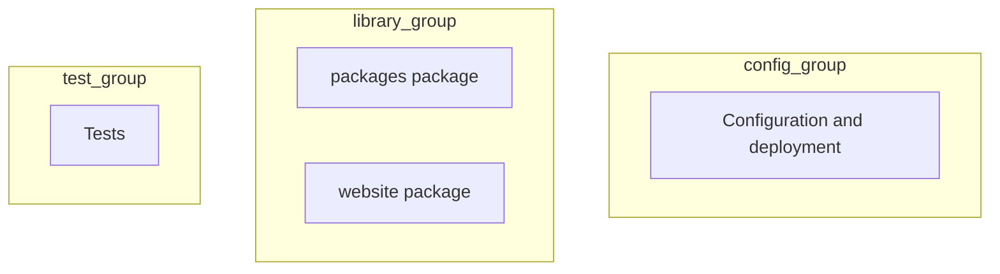

# Architecture report: dilanx/craco

> Automated static analysis. **Observed** = directly seen in files/imports/AST; **Inferred** = interpretation from that evidence. Repository code was not executed.

## 1. Repository at a glance

| Item | Value |
| --- | --- |
| Repository | dilanx/craco |
| Description | Create React App Configuration Override, an easy and comprehensible configuration layer for Create React App. |
| Language | TypeScript |
| Stars | 7404 |
| Licence | Apache-2.0 |
| Analysed commit / branch | 56840ceaedaa5f71cc580099e72f0048fafcc44f / main |
| Framework(s) | React |
| Files analysed | 167 |
| Components | 4 |

## 2. Architecture in one minute

dilanx/craco - Create React App Configuration Override, an easy and comprehensible configuration layer for Create React App.. This repository was analysed statically from 167 file(s) (0 Python). Detected technologies (observed from imports/manifests): GitHub Actions, React, Jest, TypeScript, webpack. Files are grouped into 4 component(s): Configuration and deployment, packages package, Tests, website package. Findings below distinguish observed facts from inferred interpretation.

## 3. High-level block diagram

## 4. Main components

### Configuration and deployment (`config`)

- **Kind:** config
- **Status:** Observed
- **Confidence:** 0.85
- **Responsibility:** Groups 8 file(s) under configuration and deployment (observed from repository paths and static analysis).
- **Paths:** `lerna.json`, `package.json`, `packages/craco-types/package.json`, `packages/craco-types/tsconfig.json`, `packages/craco/package.json`, `packages/craco/tsconfig.json`, `tsconfig.json`, `website/package.json`
- **Evidence:** [lerna.json](https://github.com/dilanx/craco/blob/56840ceaedaa5f71cc580099e72f0048fafcc44f/lerna.json); [package.json](https://github.com/dilanx/craco/blob/56840ceaedaa5f71cc580099e72f0048fafcc44f/package.json); [packages/craco-types/package.json](https://github.com/dilanx/craco/blob/56840ceaedaa5f71cc580099e72f0048fafcc44f/packages/craco-types/package.json); [packages/craco-types/tsconfig.json](https://github.com/dilanx/craco/blob/56840ceaedaa5f71cc580099e72f0048fafcc44f/packages/craco-types/tsconfig.json); [packages/craco/package.json](https://github.com/dilanx/craco/blob/56840ceaedaa5f71cc580099e72f0048fafcc44f/packages/craco/package.json); [packages/craco/tsconfig.json](https://github.com/dilanx/craco/blob/56840ceaedaa5f71cc580099e72f0048fafcc44f/packages/craco/tsconfig.json); [tsconfig.json](https://github.com/dilanx/craco/blob/56840ceaedaa5f71cc580099e72f0048fafcc44f/tsconfig.json); [website/package.json](https://github.com/dilanx/craco/blob/56840ceaedaa5f71cc580099e72f0048fafcc44f/website/package.json)

### packages package (`packages`)

- **Kind:** library
- **Status:** Observed
- **Confidence:** 0.85
- **Responsibility:** Groups 47 file(s) under packages package (observed from repository paths and static analysis).
- **Paths:** `packages/craco-types/src/asset-modules.ts`, `packages/craco-types/src/config.ts`, `packages/craco-types/src/context.ts`, `packages/craco-types/src/index.ts`, `packages/craco-types/src/loaders.ts`, `packages/craco-types/src/plugins.ts`, `packages/craco-types/src/providers.ts`, `packages/craco/src/bin/craco.ts`, `packages/craco/src/bin/jest.ts`, `packages/craco/src/index.ts`, `packages/craco/src/lib/args.ts`, `packages/craco/src/lib/asset-modules.ts`, `packages/craco/src/lib/config.ts`, `packages/craco/src/lib/cra.ts`, `packages/craco/src/lib/features/dev-server/api.ts`, `packages/craco/src/lib/features/dev-server/create-config-provider-proxy.ts`, `packages/craco/src/lib/features/dev-server/override-utils.ts`, `packages/craco/src/lib/features/dev-server/override.ts`, `packages/craco/src/lib/features/dev-server/set-environment-variables.ts`, `packages/craco/src/lib/features/jest/api.ts`, `packages/craco/src/lib/features/jest/create-jest-babel-transform.ts`, `packages/craco/src/lib/features/jest/jest-babel-transform.ts`, `packages/craco/src/lib/features/jest/merge-jest-config.ts`, `packages/craco/src/lib/features/jest/override.ts`, `packages/craco/src/lib/features/paths/override.ts`, `packages/craco/src/lib/features/plugins.ts`, `packages/craco/src/lib/features/webpack/api.ts`, `packages/craco/src/lib/features/webpack/babel.ts`, `packages/craco/src/lib/features/webpack/eslint.ts`, `packages/craco/src/lib/features/webpack/merge-webpack-config.ts`, `packages/craco/src/lib/features/webpack/override.ts`, `packages/craco/src/lib/features/webpack/style/css.ts`, `packages/craco/src/lib/features/webpack/style/postcss.ts`, `packages/craco/src/lib/features/webpack/style/sass.ts`, `packages/craco/src/lib/features/webpack/style/style.ts`, `packages/craco/src/lib/features/webpack/typescript.ts`, `packages/craco/src/lib/loaders.ts`, `packages/craco/src/lib/logger.ts`, `packages/craco/src/lib/paths.ts`, `packages/craco/src/lib/plugin-utils.ts`, `packages/craco/src/lib/user-config-utils.ts`, `packages/craco/src/lib/utils.ts`, `packages/craco/src/lib/validate-cra-version.ts`, `packages/craco/src/lib/webpack-plugins.ts`, `packages/craco/src/scripts/build.ts`, `packages/craco/src/scripts/start.ts`, `packages/craco/src/scripts/test.ts`
- **Evidence:** [packages/craco-types/src/asset-modules.ts](https://github.com/dilanx/craco/blob/56840ceaedaa5f71cc580099e72f0048fafcc44f/packages/craco-types/src/asset-modules.ts); [packages/craco-types/src/config.ts](https://github.com/dilanx/craco/blob/56840ceaedaa5f71cc580099e72f0048fafcc44f/packages/craco-types/src/config.ts); [packages/craco-types/src/context.ts](https://github.com/dilanx/craco/blob/56840ceaedaa5f71cc580099e72f0048fafcc44f/packages/craco-types/src/context.ts); [packages/craco-types/src/index.ts](https://github.com/dilanx/craco/blob/56840ceaedaa5f71cc580099e72f0048fafcc44f/packages/craco-types/src/index.ts); [packages/craco-types/src/loaders.ts](https://github.com/dilanx/craco/blob/56840ceaedaa5f71cc580099e72f0048fafcc44f/packages/craco-types/src/loaders.ts); [packages/craco-types/src/plugins.ts](https://github.com/dilanx/craco/blob/56840ceaedaa5f71cc580099e72f0048fafcc44f/packages/craco-types/src/plugins.ts); [packages/craco-types/src/providers.ts](https://github.com/dilanx/craco/blob/56840ceaedaa5f71cc580099e72f0048fafcc44f/packages/craco-types/src/providers.ts); [packages/craco/src/bin/craco.ts](https://github.com/dilanx/craco/blob/56840ceaedaa5f71cc580099e72f0048fafcc44f/packages/craco/src/bin/craco.ts)

### Tests (`tests`)

- **Kind:** test
- **Status:** Observed
- **Confidence:** 0.85
- **Responsibility:** Groups 40 file(s) under tests (observed from repository paths and static analysis).
- **Paths:** `test/README.md`, `test/integration/fixtures/autoprefixer-test/index.test.js`, `test/integration/fixtures/autoprefixer-test/test-package-files/craco.config.js`, `test/integration/fixtures/autoprefixer-test/test-package-files/package.json`, `test/integration/fixtures/autoprefixer-test/test-package-files/public/index.html`, `test/integration/fixtures/autoprefixer-test/test-package-files/src/index.css`, `test/integration/fixtures/autoprefixer-test/test-package-files/src/index.js`, `test/integration/fixtures/basic-integration-test/index.test.js`, `test/integration/fixtures/basic-integration-test/test-package-files/craco.config.js`, `test/integration/fixtures/basic-integration-test/test-package-files/package.json`, `test/integration/fixtures/basic-integration-test/test-package-files/public/index.html`, `test/integration/fixtures/basic-integration-test/test-package-files/src/index.js`, `test/integration/jest.config.js`, `test/integration/setup.js`, `test/integration/teardown.js`, `test/unit/jest.config.js`, `test/unit/merging-tests/autoprefixer-options/autoprefixer.test.js`, `test/unit/merging-tests/autoprefixer-options/craco.config.js`, `test/unit/merging-tests/configuration-merging/cra.mock.config.js`, `test/unit/merging-tests/configuration-merging/craco.config.js`, `test/unit/merging-tests/configuration-merging/merging.test.js`, `test/unit/merging-tests/custom-babel-config/babel.config.mock.js`, `test/unit/merging-tests/custom-babel-config/babel.test.js`, `test/unit/merging-tests/custom-babel-config/craco.config.js`, `test/unit/merging-tests/custom-craco-plugin/craco-plugin-mock/index.js`, `test/unit/merging-tests/custom-craco-plugin/craco.config.js`, `test/unit/merging-tests/custom-craco-plugin/plugin.test.js`, `test/unit/merging-tests/custom-env-variables/craco.config.js`, `test/unit/merging-tests/custom-env-variables/env.test.js`, `test/unit/merging-tests/custom-eslint-config/craco.config.js`, `test/unit/merging-tests/custom-eslint-config/eslint.config.mock.js`, `test/unit/merging-tests/custom-eslint-config/eslint.test.js`, `test/unit/merging-tests/custom-jest-config/craco.config.js`, `test/unit/merging-tests/custom-jest-config/jest.config.mock.js`, `test/unit/merging-tests/custom-jest-config/jest.test.js`, `test/unit/merging-tests/custom-postcss-config/craco.config.js`, `test/unit/merging-tests/custom-postcss-config/postcss.config.mock.js`, `test/unit/merging-tests/custom-postcss-config/postcss.test.js`, `test/unit/merging-tests/html-webpack-plugin/craco.config.js`, `test/unit/merging-tests/html-webpack-plugin/html-webpack-plugin.test.js`
- **Evidence:** [test/README.md](https://github.com/dilanx/craco/blob/56840ceaedaa5f71cc580099e72f0048fafcc44f/test/README.md); [test/integration/fixtures/autoprefixer-test/index.test.js](https://github.com/dilanx/craco/blob/56840ceaedaa5f71cc580099e72f0048fafcc44f/test/integration/fixtures/autoprefixer-test/index.test.js); [test/integration/fixtures/autoprefixer-test/test-package-files/craco.config.js](https://github.com/dilanx/craco/blob/56840ceaedaa5f71cc580099e72f0048fafcc44f/test/integration/fixtures/autoprefixer-test/test-package-files/craco.config.js); [test/integration/fixtures/autoprefixer-test/test-package-files/package.json](https://github.com/dilanx/craco/blob/56840ceaedaa5f71cc580099e72f0048fafcc44f/test/integration/fixtures/autoprefixer-test/test-package-files/package.json); [test/integration/fixtures/autoprefixer-test/test-package-files/public/index.html](https://github.com/dilanx/craco/blob/56840ceaedaa5f71cc580099e72f0048fafcc44f/test/integration/fixtures/autoprefixer-test/test-package-files/public/index.html); [test/integration/fixtures/autoprefixer-test/test-package-files/src/index.css](https://github.com/dilanx/craco/blob/56840ceaedaa5f71cc580099e72f0048fafcc44f/test/integration/fixtures/autoprefixer-test/test-package-files/src/index.css); [test/integration/fixtures/autoprefixer-test/test-package-files/src/index.js](https://github.com/dilanx/craco/blob/56840ceaedaa5f71cc580099e72f0048fafcc44f/test/integration/fixtures/autoprefixer-test/test-package-files/src/index.js); [test/integration/fixtures/basic-integration-test/index.test.js](https://github.com/dilanx/craco/blob/56840ceaedaa5f71cc580099e72f0048fafcc44f/test/integration/fixtures/basic-integration-test/index.test.js)

### website package (`website`)

- **Kind:** library
- **Status:** Observed
- **Confidence:** 0.85
- **Responsibility:** Groups 6 file(s) under website package (observed from repository paths and static analysis).
- **Paths:** `website/babel.config.js`, `website/docusaurus.config.js`, `website/sidebars.js`, `website/sidebarsRecipes.js`, `website/src/components/HomepageFeatures/index.js`, `website/src/pages/index.js`
- **Evidence:** [website/babel.config.js](https://github.com/dilanx/craco/blob/56840ceaedaa5f71cc580099e72f0048fafcc44f/website/babel.config.js); [website/docusaurus.config.js](https://github.com/dilanx/craco/blob/56840ceaedaa5f71cc580099e72f0048fafcc44f/website/docusaurus.config.js); [website/sidebars.js](https://github.com/dilanx/craco/blob/56840ceaedaa5f71cc580099e72f0048fafcc44f/website/sidebars.js); [website/sidebarsRecipes.js](https://github.com/dilanx/craco/blob/56840ceaedaa5f71cc580099e72f0048fafcc44f/website/sidebarsRecipes.js); [website/src/components/HomepageFeatures/index.js](https://github.com/dilanx/craco/blob/56840ceaedaa5f71cc580099e72f0048fafcc44f/website/src/components/HomepageFeatures/index.js); [website/src/pages/index.js](https://github.com/dilanx/craco/blob/56840ceaedaa5f71cc580099e72f0048fafcc44f/website/src/pages/index.js)

## 5. Execution flow

**Observed** entry point(s):

- [packages/craco-types/src/index.ts](https://github.com/dilanx/craco/blob/56840ceaedaa5f71cc580099e72f0048fafcc44f/packages/craco-types/src/index.ts)
- [packages/craco/src/index.ts](https://github.com/dilanx/craco/blob/56840ceaedaa5f71cc580099e72f0048fafcc44f/packages/craco/src/index.ts)
- [website/src/pages/index.js](https://github.com/dilanx/craco/blob/56840ceaedaa5f71cc580099e72f0048fafcc44f/website/src/pages/index.js)

Representative flow (derived from observed entry points and the import graph; steps beyond the entry point are **Inferred**):

1. Execution starts at an observed entry point listed above, if present.
2. No internal import relationships between components were observed.

## 6. Project structure

### `(root)`

- `.eslintrc.json` - config (483 bytes)
- `.gitattributes` - other (19 bytes)
- `.gitignore` - other (199 bytes)
- `.prettierignore` - other (76 bytes)
- `LICENSE` - docs (10173 bytes)
- `README.md` - docs (2314 bytes)
- `lerna.json` - config (111 bytes)
- `package.json` - manifest (1312 bytes)
- `tsconfig.json` - config (501 bytes)

### `.github`

- `.github/CODEOWNERS` - other (10 bytes)
- `.github/FUNDING.yml` - config (64 bytes)
- `.github/ISSUE_TEMPLATE/bug_report.md` - docs (597 bytes)
- `.github/ISSUE_TEMPLATE/feature_request.md` - docs (189 bytes)
- `.github/workflows/run-tests.yml` - ci, YAML (546 bytes)
- `.github/workflows/website-deploy.yml` - ci, YAML (859 bytes)
- `.github/workflows/website-test-deploy.yml` - ci, YAML (501 bytes)

### `.vscode`

- `.vscode/extensions.json` - config (68 bytes)

### `packages`

- `packages/craco-types/README.md` - docs (98 bytes)
- `packages/craco-types/package.json` - manifest (911 bytes)
- `packages/craco-types/src/asset-modules.ts` - source, TypeScript (411 bytes)
- `packages/craco-types/src/config.ts` - source, TypeScript (2798 bytes)
- `packages/craco-types/src/context.ts` - source, TypeScript (913 bytes)
- `packages/craco-types/src/index.ts` - source, TypeScript (774 bytes)
- `packages/craco-types/src/loaders.ts` - source, TypeScript (359 bytes)
- `packages/craco-types/src/plugins.ts` - source, TypeScript (1436 bytes)
- `packages/craco-types/src/providers.ts` - source, TypeScript (396 bytes)
- `packages/craco-types/tsconfig.json` - config (131 bytes)
- `packages/craco/LICENSE` - docs (10173 bytes)
- `packages/craco/README.md` - docs (2225 bytes)
- `packages/craco/package.json` - manifest (1690 bytes)
- `packages/craco/src/bin/craco.ts` - source, TypeScript (1589 bytes)
- `packages/craco/src/bin/jest.ts` - source, TypeScript (941 bytes)
- `packages/craco/src/index.ts` - source, TypeScript (1473 bytes)
- `packages/craco/src/lib/args.ts` - source, TypeScript (833 bytes)
- `packages/craco/src/lib/asset-modules.ts` - source, TypeScript (3589 bytes)
- `packages/craco/src/lib/config.ts` - source, TypeScript (3719 bytes)
- `packages/craco/src/lib/cra.ts` - source, TypeScript (7354 bytes)
- `packages/craco/src/lib/features/dev-server/api.ts` - source, TypeScript (1099 bytes)
- `packages/craco/src/lib/features/dev-server/create-config-provider-proxy.ts` - source, TypeScript (1820 bytes)
- `packages/craco/src/lib/features/dev-server/override-utils.ts` - source, TypeScript (1166 bytes)
- `packages/craco/src/lib/features/dev-server/override.ts` - source, TypeScript (761 bytes)
- `packages/craco/src/lib/features/dev-server/set-environment-variables.ts` - source, TypeScript (712 bytes)
- `packages/craco/src/lib/features/jest/api.ts` - source, TypeScript (1222 bytes)
- `packages/craco/src/lib/features/jest/create-jest-babel-transform.ts` - source, TypeScript (1674 bytes)
- `packages/craco/src/lib/features/jest/jest-babel-transform.ts` - source, TypeScript (1118 bytes)
- `packages/craco/src/lib/features/jest/merge-jest-config.ts` - source, TypeScript (3463 bytes)
- `packages/craco/src/lib/features/jest/override.ts` - source, TypeScript (615 bytes)
- `packages/craco/src/lib/features/paths/override.ts` - source, TypeScript (596 bytes)
- `packages/craco/src/lib/features/plugins.ts` - source, TypeScript (4478 bytes)
- `packages/craco/src/lib/features/webpack/api.ts` - source, TypeScript (1911 bytes)
- `packages/craco/src/lib/features/webpack/babel.ts` - source, TypeScript (3556 bytes)
- `packages/craco/src/lib/features/webpack/eslint.ts` - source, TypeScript (3682 bytes)
- `packages/craco/src/lib/features/webpack/merge-webpack-config.ts` - source, TypeScript (4244 bytes)
- `packages/craco/src/lib/features/webpack/override.ts` - source, TypeScript (933 bytes)
- `packages/craco/src/lib/features/webpack/style/css.ts` - source, TypeScript (3320 bytes)
- `packages/craco/src/lib/features/webpack/style/postcss.ts` - source, TypeScript (4026 bytes)
- `packages/craco/src/lib/features/webpack/style/sass.ts` - source, TypeScript (2347 bytes)
- `packages/craco/src/lib/features/webpack/style/style.ts` - source, TypeScript (657 bytes)
- `packages/craco/src/lib/features/webpack/typescript.ts` - source, TypeScript (730 bytes)
- `packages/craco/src/lib/loaders.ts` - source, TypeScript (6532 bytes)
- `packages/craco/src/lib/logger.ts` - source, TypeScript (214 bytes)
- `packages/craco/src/lib/paths.ts` - source, TypeScript (167 bytes)
- `packages/craco/src/lib/plugin-utils.ts` - source, TypeScript (1847 bytes)
- `packages/craco/src/lib/user-config-utils.ts` - source, TypeScript (606 bytes)
- `packages/craco/src/lib/utils.ts` - source, TypeScript (617 bytes)
- `packages/craco/src/lib/validate-cra-version.ts` - source, TypeScript (795 bytes)
- `packages/craco/src/lib/webpack-plugins.ts` - source, TypeScript (1758 bytes)
- `packages/craco/src/scripts/build.ts` - source, TypeScript (1125 bytes)
- `packages/craco/src/scripts/start.ts` - source, TypeScript (1151 bytes)
- `packages/craco/src/scripts/test.ts` - source, TypeScript (1010 bytes)
- `packages/craco/tsconfig.json` - config (131 bytes)

### `recipes`

- `recipes/README.md` - docs (75 bytes)

### `test`

- `test/README.md` - test (1912 bytes)
- `test/integration/fixtures/autoprefixer-test/index.test.js` - test, JavaScript (1130 bytes)
- `test/integration/fixtures/autoprefixer-test/test-package-files/craco.config.js` - test, JavaScript (182 bytes)
- `test/integration/fixtures/autoprefixer-test/test-package-files/package.json` - test (445 bytes)
- `test/integration/fixtures/autoprefixer-test/test-package-files/public/index.html` - test (247 bytes)
- `test/integration/fixtures/autoprefixer-test/test-package-files/src/index.css` - test (192 bytes)
- `test/integration/fixtures/autoprefixer-test/test-package-files/src/index.js` - test, JavaScript (244 bytes)
- `test/integration/fixtures/basic-integration-test/index.test.js` - test, JavaScript (1093 bytes)
- `test/integration/fixtures/basic-integration-test/test-package-files/craco.config.js` - test, JavaScript (341 bytes)
- `test/integration/fixtures/basic-integration-test/test-package-files/package.json` - test (434 bytes)
- `test/integration/fixtures/basic-integration-test/test-package-files/public/index.html` - test (247 bytes)
- `test/integration/fixtures/basic-integration-test/test-package-files/src/index.js` - test, JavaScript (352 bytes)
- `test/integration/jest.config.js` - test, JavaScript (638 bytes)
- `test/integration/setup.js` - test, JavaScript (1547 bytes)
- `test/integration/teardown.js` - test, JavaScript (750 bytes)
- `test/unit/jest.config.js` - test, JavaScript (292 bytes)
- `test/unit/merging-tests/autoprefixer-options/autoprefixer.test.js` - test, JavaScript (1115 bytes)
- `test/unit/merging-tests/autoprefixer-options/craco.config.js` - test, JavaScript (378 bytes)
- `test/unit/merging-tests/configuration-merging/cra.mock.config.js` - test, JavaScript (295 bytes)
- `test/unit/merging-tests/configuration-merging/craco.config.js` - test, JavaScript (764 bytes)
- `test/unit/merging-tests/configuration-merging/merging.test.js` - test, JavaScript (1540 bytes)
- `test/unit/merging-tests/custom-babel-config/babel.config.mock.js` - test, JavaScript (121 bytes)
- `test/unit/merging-tests/custom-babel-config/babel.test.js` - test, JavaScript (924 bytes)
- `test/unit/merging-tests/custom-babel-config/craco.config.js` - test, JavaScript (188 bytes)
- `test/unit/merging-tests/custom-craco-plugin/craco-plugin-mock/index.js` - test, JavaScript (264 bytes)
- `test/unit/merging-tests/custom-craco-plugin/craco.config.js` - test, JavaScript (141 bytes)
- `test/unit/merging-tests/custom-craco-plugin/plugin.test.js` - test, JavaScript (968 bytes)
- `test/unit/merging-tests/custom-env-variables/craco.config.js` - test, JavaScript (79 bytes)
- `test/unit/merging-tests/custom-env-variables/env.test.js` - test, JavaScript (1240 bytes)
- `test/unit/merging-tests/custom-eslint-config/craco.config.js` - test, JavaScript (211 bytes)
- `test/unit/merging-tests/custom-eslint-config/eslint.config.mock.js` - test, JavaScript (134 bytes)
- `test/unit/merging-tests/custom-eslint-config/eslint.test.js` - test, JavaScript (1065 bytes)
- `test/unit/merging-tests/custom-jest-config/craco.config.js` - test, JavaScript (226 bytes)
- `test/unit/merging-tests/custom-jest-config/jest.config.mock.js` - test, JavaScript (119 bytes)
- `test/unit/merging-tests/custom-jest-config/jest.test.js` - test, JavaScript (960 bytes)
- `test/unit/merging-tests/custom-postcss-config/craco.config.js` - test, JavaScript (129 bytes)
- `test/unit/merging-tests/custom-postcss-config/postcss.config.mock.js` - test, JavaScript (106 bytes)
- `test/unit/merging-tests/custom-postcss-config/postcss.test.js` - test, JavaScript (949 bytes)
- `test/unit/merging-tests/html-webpack-plugin/craco.config.js` - test, JavaScript (905 bytes)
- `test/unit/merging-tests/html-webpack-plugin/html-webpack-plugin.test.js` - test, JavaScript (826 bytes)

### `website`

- `website/.gitignore` - other (233 bytes)
- `website/README.md` - docs (770 bytes)
- `website/babel.config.js` - source, JavaScript (89 bytes)
- `website/docs/configuration-api.md` - docs (1627 bytes)
- `website/docs/configuration/babel.md` - docs (998 bytes)
- `website/docs/configuration/devserver.md` - docs (963 bytes)
- `website/docs/configuration/eslint.md` - docs (1364 bytes)
- `website/docs/configuration/getting-started.md` - docs (5168 bytes)
- `website/docs/configuration/jest.md` - docs (1322 bytes)
- `website/docs/configuration/plugins.md` - docs (393 bytes)
- `website/docs/configuration/style.md` - docs (2738 bytes)
- `website/docs/configuration/typescript.md` - docs (325 bytes)
- `website/docs/configuration/webpack.md` - docs (1809 bytes)
- `website/docs/getting-started.md` - docs (2107 bytes)
- `website/docs/plugin-api/getting-started.md` - docs (1316 bytes)
- `website/docs/plugin-api/hooks.md` - docs (8110 bytes)
- `website/docs/plugin-api/utility-functions/miscellaneous.md` - docs (2963 bytes)
- `website/docs/plugin-api/utility-functions/webpack-asset-modules.md` - docs (4926 bytes)
- `website/docs/plugin-api/utility-functions/webpack-loaders.md` - docs (4484 bytes)
- `website/docs/plugin-api/utility-functions/webpack-plugins.md` - docs (2311 bytes)
- `website/docs/welcome.md` - docs (4100 bytes)
- `website/docusaurus.config.js` - source, JavaScript (6967 bytes)
- `website/package.json` - manifest (1149 bytes)
- `website/plugins/plugins.md` - docs (3247 bytes)
- `website/recipes/add-autoprefixer-options.md` - docs (204 bytes)
- `website/recipes/add-postcss-features.md` - docs (222 bytes)
- `website/recipes/add-stylelint.md` - docs (388 bytes)
- `website/recipes/add-webpack-alias-to-jest.md` - docs (436 bytes)
- `website/recipes/extends-postcss-plugins.md` - docs (217 bytes)
- `website/recipes/set-css-loader-locals-convention.md` - docs (434 bytes)
- `website/recipes/use-a-jest-config-file.md` - docs (388 bytes)
- `website/recipes/use-a-postcss-config-file.md` - docs (500 bytes)
- `website/recipes/use-an-eslint-config-file.md` - docs (214 bytes)
- `website/recipes/use-an-https-dev-server.md` - docs (330 bytes)
- `website/recipes/use-ant-design.md` - docs (391 bytes)
- `website/recipes/use-babel-plugin-react-css-modules.md` - docs (492 bytes)
- `website/recipes/use-dart-sass.md` - docs (529 bytes)
- `website/recipes/use-html-loader.md` - docs (933 bytes)
- `website/recipes/use-less-loader.md` - docs (274 bytes)
- `website/recipes/use-linaria.md` - docs (204 bytes)
- `website/recipes/use-markdown-loader.md` - docs (1009 bytes)
- `website/recipes/use-mobx.md` - docs (156 bytes)
- `website/recipes/use-preact.md` - docs (201 bytes)
- `website/recipes/use-purescript.md` - docs (1380 bytes)
- `website/recipes/use-ts-loader.md` - docs (2408 bytes)
- `website/sidebars.js` - source, JavaScript (1424 bytes)
- `website/sidebarsRecipes.js` - source, JavaScript (473 bytes)
- `website/src/components/HomepageFeatures/index.js` - source, JavaScript (1692 bytes)
- `website/src/components/HomepageFeatures/styles.module.css` - other (138 bytes)
- `website/src/css/custom.scss` - other (2278 bytes)
- `website/src/pages/index.js` - source, JavaScript (1612 bytes)
- `website/static/.nojekyll` - other (0 bytes)
- `website/static/CNAME` - other (13 bytes)
- `website/static/img/craco-icon.svg` - other (4214 bytes)
- `website/static/img/open-source.svg` - other (37443 bytes)

## 7. Key dependencies and integrations

| Name | Category | Status | Confidence | Evidence |
| --- | --- | --- | --- | --- |
| GitHub Actions | ci | Observed | 0.90 | [.github/workflows/run-tests.yml](https://github.com/dilanx/craco/blob/56840ceaedaa5f71cc580099e72f0048fafcc44f/.github/workflows/run-tests.yml); [.github/workflows/website-deploy.yml](https://github.com/dilanx/craco/blob/56840ceaedaa5f71cc580099e72f0048fafcc44f/.github/workflows/website-deploy.yml); [.github/workflows/website-test-deploy.yml](https://github.com/dilanx/craco/blob/56840ceaedaa5f71cc580099e72f0048fafcc44f/.github/workflows/website-test-deploy.yml) |
| React | framework | Observed | 0.90 | [test/integration/fixtures/autoprefixer-test/test-package-files/package.json:6](https://github.com/dilanx/craco/blob/56840ceaedaa5f71cc580099e72f0048fafcc44f/test/integration/fixtures/autoprefixer-test/test-package-files/package.json#L6); [test/integration/fixtures/autoprefixer-test/test-package-files/package.json:7](https://github.com/dilanx/craco/blob/56840ceaedaa5f71cc580099e72f0048fafcc44f/test/integration/fixtures/autoprefixer-test/test-package-files/package.json#L7); [test/integration/fixtures/basic-integration-test/test-package-files/package.json:6](https://github.com/dilanx/craco/blob/56840ceaedaa5f71cc580099e72f0048fafcc44f/test/integration/fixtures/basic-integration-test/test-package-files/package.json#L6); [test/integration/fixtures/basic-integration-test/test-package-files/package.json:7](https://github.com/dilanx/craco/blob/56840ceaedaa5f71cc580099e72f0048fafcc44f/test/integration/fixtures/basic-integration-test/test-package-files/package.json#L7) |
| Jest | tooling | Observed | 0.90 | [package.json:14](https://github.com/dilanx/craco/blob/56840ceaedaa5f71cc580099e72f0048fafcc44f/package.json#L14); [packages/craco/package.json:48](https://github.com/dilanx/craco/blob/56840ceaedaa5f71cc580099e72f0048fafcc44f/packages/craco/package.json#L48) |
| TypeScript | tooling | Observed | 0.90 | [packages/craco-types/package.json:34](https://github.com/dilanx/craco/blob/56840ceaedaa5f71cc580099e72f0048fafcc44f/packages/craco-types/package.json#L34); [packages/craco/package.json:59](https://github.com/dilanx/craco/blob/56840ceaedaa5f71cc580099e72f0048fafcc44f/packages/craco/package.json#L59) |
| webpack | tooling | Observed | 0.90 | [packages/craco-types/package.json:30](https://github.com/dilanx/craco/blob/56840ceaedaa5f71cc580099e72f0048fafcc44f/packages/craco-types/package.json#L30); [packages/craco/package.json:55](https://github.com/dilanx/craco/blob/56840ceaedaa5f71cc580099e72f0048fafcc44f/packages/craco/package.json#L55) |

## 8. Data and state

No database, cache, queue, or persistent-state usage was observed in the analysed files. State handling, if any, may be in-memory or in files that were not analysed.

## 9. Configuration and deployment clues

- `.eslintrc.json` (config)
- `.github/FUNDING.yml` (config)
- `.github/workflows/run-tests.yml` (ci)
- `.github/workflows/website-deploy.yml` (ci)
- `.github/workflows/website-test-deploy.yml` (ci)
- `.vscode/extensions.json` (config)
- `lerna.json` (config)
- `package.json` (manifest)
- `packages/craco-types/package.json` (manifest)
- `packages/craco-types/tsconfig.json` (config)
- `packages/craco/package.json` (manifest)
- `packages/craco/tsconfig.json` (config)
- `tsconfig.json` (config)
- `website/package.json` (manifest)

## 10. Design observations

- Tests are present alongside source code (Observed from test file paths).

These observations are interpretations (**Inferred**) of the observed structure, not guarantees about runtime design.

## 11. Limitations and unknowns

- Static analysis only: repository code was not executed, installed, or imported at runtime.
- Components and relationships are inferred from file paths, imports, and AST structure; runtime behaviour, dynamic imports, and reflection may not be visible.
- 1 file(s) were skipped during inventory (1 x lockfile excluded).
- No clear application entry point was observed in the analysed files.
- Repository text was treated as untrusted data; no instructions found in repository files were followed, and likely secret values were redacted/excluded.
- JavaScript and TypeScript files were inventoried from paths and package manifests. They were not parsed with a full language AST, and repository code was not executed.

## 12. Source references

- [.github/workflows/run-tests.yml](https://github.com/dilanx/craco/blob/56840ceaedaa5f71cc580099e72f0048fafcc44f/.github/workflows/run-tests.yml)
- [.github/workflows/website-deploy.yml](https://github.com/dilanx/craco/blob/56840ceaedaa5f71cc580099e72f0048fafcc44f/.github/workflows/website-deploy.yml)
- [.github/workflows/website-test-deploy.yml](https://github.com/dilanx/craco/blob/56840ceaedaa5f71cc580099e72f0048fafcc44f/.github/workflows/website-test-deploy.yml)
- [lerna.json](https://github.com/dilanx/craco/blob/56840ceaedaa5f71cc580099e72f0048fafcc44f/lerna.json)
- [package.json](https://github.com/dilanx/craco/blob/56840ceaedaa5f71cc580099e72f0048fafcc44f/package.json)
- [package.json:14](https://github.com/dilanx/craco/blob/56840ceaedaa5f71cc580099e72f0048fafcc44f/package.json#L14)
- [packages/craco-types/package.json](https://github.com/dilanx/craco/blob/56840ceaedaa5f71cc580099e72f0048fafcc44f/packages/craco-types/package.json)
- [packages/craco-types/package.json:30](https://github.com/dilanx/craco/blob/56840ceaedaa5f71cc580099e72f0048fafcc44f/packages/craco-types/package.json#L30)
- [packages/craco-types/package.json:34](https://github.com/dilanx/craco/blob/56840ceaedaa5f71cc580099e72f0048fafcc44f/packages/craco-types/package.json#L34)
- [packages/craco-types/src/asset-modules.ts](https://github.com/dilanx/craco/blob/56840ceaedaa5f71cc580099e72f0048fafcc44f/packages/craco-types/src/asset-modules.ts)
- [packages/craco-types/src/config.ts](https://github.com/dilanx/craco/blob/56840ceaedaa5f71cc580099e72f0048fafcc44f/packages/craco-types/src/config.ts)
- [packages/craco-types/src/context.ts](https://github.com/dilanx/craco/blob/56840ceaedaa5f71cc580099e72f0048fafcc44f/packages/craco-types/src/context.ts)
- [packages/craco-types/src/index.ts](https://github.com/dilanx/craco/blob/56840ceaedaa5f71cc580099e72f0048fafcc44f/packages/craco-types/src/index.ts)
- [packages/craco-types/src/loaders.ts](https://github.com/dilanx/craco/blob/56840ceaedaa5f71cc580099e72f0048fafcc44f/packages/craco-types/src/loaders.ts)
- [packages/craco-types/src/plugins.ts](https://github.com/dilanx/craco/blob/56840ceaedaa5f71cc580099e72f0048fafcc44f/packages/craco-types/src/plugins.ts)
- [packages/craco-types/src/providers.ts](https://github.com/dilanx/craco/blob/56840ceaedaa5f71cc580099e72f0048fafcc44f/packages/craco-types/src/providers.ts)
- [packages/craco-types/tsconfig.json](https://github.com/dilanx/craco/blob/56840ceaedaa5f71cc580099e72f0048fafcc44f/packages/craco-types/tsconfig.json)
- [packages/craco/package.json](https://github.com/dilanx/craco/blob/56840ceaedaa5f71cc580099e72f0048fafcc44f/packages/craco/package.json)
- [packages/craco/package.json:48](https://github.com/dilanx/craco/blob/56840ceaedaa5f71cc580099e72f0048fafcc44f/packages/craco/package.json#L48)
- [packages/craco/package.json:55](https://github.com/dilanx/craco/blob/56840ceaedaa5f71cc580099e72f0048fafcc44f/packages/craco/package.json#L55)
- [packages/craco/package.json:59](https://github.com/dilanx/craco/blob/56840ceaedaa5f71cc580099e72f0048fafcc44f/packages/craco/package.json#L59)
- [packages/craco/src/bin/craco.ts](https://github.com/dilanx/craco/blob/56840ceaedaa5f71cc580099e72f0048fafcc44f/packages/craco/src/bin/craco.ts)
- [packages/craco/src/index.ts](https://github.com/dilanx/craco/blob/56840ceaedaa5f71cc580099e72f0048fafcc44f/packages/craco/src/index.ts)
- [packages/craco/tsconfig.json](https://github.com/dilanx/craco/blob/56840ceaedaa5f71cc580099e72f0048fafcc44f/packages/craco/tsconfig.json)
- [test/README.md](https://github.com/dilanx/craco/blob/56840ceaedaa5f71cc580099e72f0048fafcc44f/test/README.md)
- [test/integration/fixtures/autoprefixer-test/index.test.js](https://github.com/dilanx/craco/blob/56840ceaedaa5f71cc580099e72f0048fafcc44f/test/integration/fixtures/autoprefixer-test/index.test.js)
- [test/integration/fixtures/autoprefixer-test/test-package-files/craco.config.js](https://github.com/dilanx/craco/blob/56840ceaedaa5f71cc580099e72f0048fafcc44f/test/integration/fixtures/autoprefixer-test/test-package-files/craco.config.js)
- [test/integration/fixtures/autoprefixer-test/test-package-files/package.json](https://github.com/dilanx/craco/blob/56840ceaedaa5f71cc580099e72f0048fafcc44f/test/integration/fixtures/autoprefixer-test/test-package-files/package.json)
- [test/integration/fixtures/autoprefixer-test/test-package-files/package.json:6](https://github.com/dilanx/craco/blob/56840ceaedaa5f71cc580099e72f0048fafcc44f/test/integration/fixtures/autoprefixer-test/test-package-files/package.json#L6)
- [test/integration/fixtures/autoprefixer-test/test-package-files/package.json:7](https://github.com/dilanx/craco/blob/56840ceaedaa5f71cc580099e72f0048fafcc44f/test/integration/fixtures/autoprefixer-test/test-package-files/package.json#L7)
- [test/integration/fixtures/autoprefixer-test/test-package-files/public/index.html](https://github.com/dilanx/craco/blob/56840ceaedaa5f71cc580099e72f0048fafcc44f/test/integration/fixtures/autoprefixer-test/test-package-files/public/index.html)
- [test/integration/fixtures/autoprefixer-test/test-package-files/src/index.css](https://github.com/dilanx/craco/blob/56840ceaedaa5f71cc580099e72f0048fafcc44f/test/integration/fixtures/autoprefixer-test/test-package-files/src/index.css)
- [test/integration/fixtures/autoprefixer-test/test-package-files/src/index.js](https://github.com/dilanx/craco/blob/56840ceaedaa5f71cc580099e72f0048fafcc44f/test/integration/fixtures/autoprefixer-test/test-package-files/src/index.js)
- [test/integration/fixtures/basic-integration-test/index.test.js](https://github.com/dilanx/craco/blob/56840ceaedaa5f71cc580099e72f0048fafcc44f/test/integration/fixtures/basic-integration-test/index.test.js)
- [test/integration/fixtures/basic-integration-test/test-package-files/package.json:6](https://github.com/dilanx/craco/blob/56840ceaedaa5f71cc580099e72f0048fafcc44f/test/integration/fixtures/basic-integration-test/test-package-files/package.json#L6)
- [test/integration/fixtures/basic-integration-test/test-package-files/package.json:7](https://github.com/dilanx/craco/blob/56840ceaedaa5f71cc580099e72f0048fafcc44f/test/integration/fixtures/basic-integration-test/test-package-files/package.json#L7)
- [tsconfig.json](https://github.com/dilanx/craco/blob/56840ceaedaa5f71cc580099e72f0048fafcc44f/tsconfig.json)
- [website/babel.config.js](https://github.com/dilanx/craco/blob/56840ceaedaa5f71cc580099e72f0048fafcc44f/website/babel.config.js)
- [website/docusaurus.config.js](https://github.com/dilanx/craco/blob/56840ceaedaa5f71cc580099e72f0048fafcc44f/website/docusaurus.config.js)
- [website/package.json](https://github.com/dilanx/craco/blob/56840ceaedaa5f71cc580099e72f0048fafcc44f/website/package.json)
- [website/package.json:19](https://github.com/dilanx/craco/blob/56840ceaedaa5f71cc580099e72f0048fafcc44f/website/package.json#L19)
- [website/package.json:25](https://github.com/dilanx/craco/blob/56840ceaedaa5f71cc580099e72f0048fafcc44f/website/package.json#L25)
- [website/sidebars.js](https://github.com/dilanx/craco/blob/56840ceaedaa5f71cc580099e72f0048fafcc44f/website/sidebars.js)
- [website/sidebarsRecipes.js](https://github.com/dilanx/craco/blob/56840ceaedaa5f71cc580099e72f0048fafcc44f/website/sidebarsRecipes.js)
- [website/src/components/HomepageFeatures/index.js](https://github.com/dilanx/craco/blob/56840ceaedaa5f71cc580099e72f0048fafcc44f/website/src/components/HomepageFeatures/index.js)
- [website/src/pages/index.js](https://github.com/dilanx/craco/blob/56840ceaedaa5f71cc580099e72f0048fafcc44f/website/src/pages/index.js)
