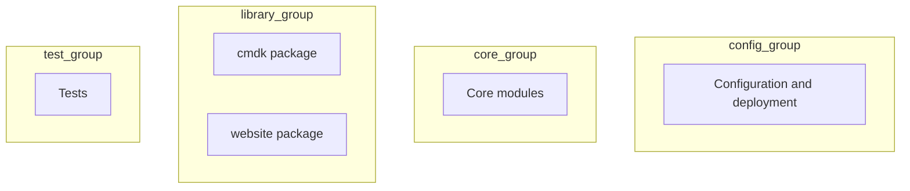

# Architecture report: dip/cmdk

> Automated static analysis. **Observed** = directly seen in files/imports/AST; **Inferred** = interpretation from that evidence. Repository code was not executed.

## 1. Repository at a glance

| Item | Value |
| --- | --- |
| Repository | dip/cmdk |
| Description | Fast, unstyled command menu React component. |
| Language | TypeScript |
| Stars | 13147 |
| Licence | MIT |
| Analysed commit / branch | dd2250ed608443e8f32bafc5fa2d1d07a3746aa3 / main |
| Framework(s) | Next.js, React |
| Files analysed | 70 |
| Components | 5 |

## 2. Architecture in one minute

dip/cmdk - Fast, unstyled command menu React component.. This repository was analysed statically from 70 file(s) (0 Python). Detected technologies (observed from imports/manifests): GitHub Actions, Next.js, React, TypeScript. Files are grouped into 5 component(s): cmdk package, Configuration and deployment, Core modules, Tests, website package. Findings below distinguish observed facts from inferred interpretation.

## 3. High-level block diagram

## 4. Main components

### cmdk package (`cmdk`)

- **Kind:** library
- **Status:** Observed
- **Confidence:** 0.85
- **Responsibility:** Groups 3 file(s) under cmdk package (observed from repository paths and static analysis).
- **Paths:** `cmdk/src/command-score.ts`, `cmdk/src/index.tsx`, `cmdk/tsup.config.ts`
- **Evidence:** [cmdk/src/command-score.ts](https://github.com/dip/cmdk/blob/dd2250ed608443e8f32bafc5fa2d1d07a3746aa3/cmdk/src/command-score.ts); [cmdk/src/index.tsx](https://github.com/dip/cmdk/blob/dd2250ed608443e8f32bafc5fa2d1d07a3746aa3/cmdk/src/index.tsx); [cmdk/tsup.config.ts](https://github.com/dip/cmdk/blob/dd2250ed608443e8f32bafc5fa2d1d07a3746aa3/cmdk/tsup.config.ts)

### Configuration and deployment (`config`)

- **Kind:** config
- **Status:** Observed
- **Confidence:** 0.85
- **Responsibility:** Groups 8 file(s) under configuration and deployment (observed from repository paths and static analysis).
- **Paths:** `cmdk/package.json`, `package.json`, `pnpm-workspace.yaml`, `tsconfig.json`, `website/.eslintrc.json`, `website/package.json`, `website/tsconfig.json`, `website/vercel.json`
- **Evidence:** [cmdk/package.json](https://github.com/dip/cmdk/blob/dd2250ed608443e8f32bafc5fa2d1d07a3746aa3/cmdk/package.json); [package.json](https://github.com/dip/cmdk/blob/dd2250ed608443e8f32bafc5fa2d1d07a3746aa3/package.json); [pnpm-workspace.yaml](https://github.com/dip/cmdk/blob/dd2250ed608443e8f32bafc5fa2d1d07a3746aa3/pnpm-workspace.yaml); [tsconfig.json](https://github.com/dip/cmdk/blob/dd2250ed608443e8f32bafc5fa2d1d07a3746aa3/tsconfig.json); [website/.eslintrc.json](https://github.com/dip/cmdk/blob/dd2250ed608443e8f32bafc5fa2d1d07a3746aa3/website/.eslintrc.json); [website/package.json](https://github.com/dip/cmdk/blob/dd2250ed608443e8f32bafc5fa2d1d07a3746aa3/website/package.json); [website/tsconfig.json](https://github.com/dip/cmdk/blob/dd2250ed608443e8f32bafc5fa2d1d07a3746aa3/website/tsconfig.json); [website/vercel.json](https://github.com/dip/cmdk/blob/dd2250ed608443e8f32bafc5fa2d1d07a3746aa3/website/vercel.json)

### Core modules (`core`)

- **Kind:** core
- **Status:** Observed
- **Confidence:** 0.85
- **Responsibility:** Groups 1 file(s) under core modules (observed from repository paths and static analysis).
- **Paths:** `playwright.config.ts`
- **Evidence:** [playwright.config.ts](https://github.com/dip/cmdk/blob/dd2250ed608443e8f32bafc5fa2d1d07a3746aa3/playwright.config.ts)

### Tests (`tests`)

- **Kind:** test
- **Status:** Observed
- **Confidence:** 0.85
- **Responsibility:** Groups 22 file(s) under tests (observed from repository paths and static analysis).
- **Paths:** `test/basic.test.ts`, `test/dialog.test.ts`, `test/group.test.ts`, `test/item.test.ts`, `test/keybind.test.ts`, `test/next-env.d.ts`, `test/numeric.test.ts`, `test/package.json`, `test/pages/_app.tsx`, `test/pages/dialog.tsx`, `test/pages/group.tsx`, `test/pages/huge.tsx`, `test/pages/index.tsx`, `test/pages/item-advanced.tsx`, `test/pages/item.tsx`, `test/pages/keybinds.tsx`, `test/pages/numeric.tsx`, `test/pages/portal.tsx`, `test/pages/props.tsx`, `test/props.test.ts`, `test/style.css`, `test/tsconfig.json`
- **Evidence:** [test/basic.test.ts](https://github.com/dip/cmdk/blob/dd2250ed608443e8f32bafc5fa2d1d07a3746aa3/test/basic.test.ts); [test/dialog.test.ts](https://github.com/dip/cmdk/blob/dd2250ed608443e8f32bafc5fa2d1d07a3746aa3/test/dialog.test.ts); [test/group.test.ts](https://github.com/dip/cmdk/blob/dd2250ed608443e8f32bafc5fa2d1d07a3746aa3/test/group.test.ts); [test/item.test.ts](https://github.com/dip/cmdk/blob/dd2250ed608443e8f32bafc5fa2d1d07a3746aa3/test/item.test.ts); [test/keybind.test.ts](https://github.com/dip/cmdk/blob/dd2250ed608443e8f32bafc5fa2d1d07a3746aa3/test/keybind.test.ts); [test/next-env.d.ts](https://github.com/dip/cmdk/blob/dd2250ed608443e8f32bafc5fa2d1d07a3746aa3/test/next-env.d.ts); [test/numeric.test.ts](https://github.com/dip/cmdk/blob/dd2250ed608443e8f32bafc5fa2d1d07a3746aa3/test/numeric.test.ts); [test/package.json](https://github.com/dip/cmdk/blob/dd2250ed608443e8f32bafc5fa2d1d07a3746aa3/test/package.json)

### website package (`website`)

- **Kind:** library
- **Status:** Observed
- **Confidence:** 0.85
- **Responsibility:** Groups 12 file(s) under website package (observed from repository paths and static analysis).
- **Paths:** `website/components/cmdk/framer.tsx`, `website/components/cmdk/linear.tsx`, `website/components/cmdk/raycast.tsx`, `website/components/cmdk/vercel.tsx`, `website/components/code/index.tsx`, `website/components/icons/index.tsx`, `website/components/index.ts`, `website/next-env.d.ts`, `website/next.config.js`, `website/pages/_app.tsx`, `website/pages/_document.tsx`, `website/pages/index.tsx`
- **Evidence:** [website/components/cmdk/framer.tsx](https://github.com/dip/cmdk/blob/dd2250ed608443e8f32bafc5fa2d1d07a3746aa3/website/components/cmdk/framer.tsx); [website/components/cmdk/linear.tsx](https://github.com/dip/cmdk/blob/dd2250ed608443e8f32bafc5fa2d1d07a3746aa3/website/components/cmdk/linear.tsx); [website/components/cmdk/raycast.tsx](https://github.com/dip/cmdk/blob/dd2250ed608443e8f32bafc5fa2d1d07a3746aa3/website/components/cmdk/raycast.tsx); [website/components/cmdk/vercel.tsx](https://github.com/dip/cmdk/blob/dd2250ed608443e8f32bafc5fa2d1d07a3746aa3/website/components/cmdk/vercel.tsx); [website/components/code/index.tsx](https://github.com/dip/cmdk/blob/dd2250ed608443e8f32bafc5fa2d1d07a3746aa3/website/components/code/index.tsx); [website/components/icons/index.tsx](https://github.com/dip/cmdk/blob/dd2250ed608443e8f32bafc5fa2d1d07a3746aa3/website/components/icons/index.tsx); [website/components/index.ts](https://github.com/dip/cmdk/blob/dd2250ed608443e8f32bafc5fa2d1d07a3746aa3/website/components/index.ts); [website/next-env.d.ts](https://github.com/dip/cmdk/blob/dd2250ed608443e8f32bafc5fa2d1d07a3746aa3/website/next-env.d.ts)

## 5. Execution flow

**Observed** entry point(s):

- [cmdk/src/index.tsx](https://github.com/dip/cmdk/blob/dd2250ed608443e8f32bafc5fa2d1d07a3746aa3/cmdk/src/index.tsx)
- [website/components/code/index.tsx](https://github.com/dip/cmdk/blob/dd2250ed608443e8f32bafc5fa2d1d07a3746aa3/website/components/code/index.tsx)
- [website/components/icons/index.tsx](https://github.com/dip/cmdk/blob/dd2250ed608443e8f32bafc5fa2d1d07a3746aa3/website/components/icons/index.tsx)
- [website/components/index.ts](https://github.com/dip/cmdk/blob/dd2250ed608443e8f32bafc5fa2d1d07a3746aa3/website/components/index.ts)
- [website/pages/index.tsx](https://github.com/dip/cmdk/blob/dd2250ed608443e8f32bafc5fa2d1d07a3746aa3/website/pages/index.tsx)

Representative flow (derived from observed entry points and the import graph; steps beyond the entry point are **Inferred**):

1. Execution starts at an observed entry point listed above, if present.
2. No internal import relationships between components were observed.

## 6. Project structure

### `(root)`

- `.gitignore` - other (155 bytes)
- `.prettierignore` - other (46 bytes)
- `.prettierrc.js` - source, JavaScript (115 bytes)
- `ARCHITECTURE.md` - docs (4020 bytes)
- `LICENSE.md` - docs (1069 bytes)
- `README.md` - docs (13979 bytes)
- `package.json` - manifest (811 bytes)
- `playwright.config.ts` - source, TypeScript (678 bytes)
- `pnpm-workspace.yaml` - config (46 bytes)
- `tsconfig.json` - config (534 bytes)

### `.github`

- `.github/FUNDING.yml` - config (20 bytes)
- `.github/workflows/test.yml` - ci, YAML (691 bytes)

### `.husky`

- `.husky/pre-commit` - other (59 bytes)

### `cmdk`

- `cmdk/package.json` - manifest (1221 bytes)
- `cmdk/src/command-score.ts` - source, TypeScript (5761 bytes)
- `cmdk/src/index.tsx` - source, TypeScript (32341 bytes)
- `cmdk/tsup.config.ts` - source, TypeScript (180 bytes)

### `test`

- `test/basic.test.ts` - test, TypeScript (2882 bytes)
- `test/dialog.test.ts` - test, TypeScript (356 bytes)
- `test/group.test.ts` - test, TypeScript (1225 bytes)
- `test/item.test.ts` - test, TypeScript (2946 bytes)
- `test/keybind.test.ts` - test, TypeScript (7218 bytes)
- `test/next-env.d.ts` - test, TypeScript (201 bytes)
- `test/numeric.test.ts` - test, TypeScript (962 bytes)
- `test/package.json` - test (371 bytes)
- `test/pages/_app.tsx` - test, TypeScript (119 bytes)
- `test/pages/dialog.tsx` - test, TypeScript (625 bytes)
- `test/pages/group.tsx` - test, TypeScript (1262 bytes)
- `test/pages/huge.tsx` - test, TypeScript (786 bytes)
- `test/pages/index.tsx` - test, TypeScript (705 bytes)
- `test/pages/item-advanced.tsx` - test, TypeScript (652 bytes)
- `test/pages/item.tsx` - test, TypeScript (1325 bytes)
- `test/pages/keybinds.tsx` - test, TypeScript (1257 bytes)
- `test/pages/numeric.tsx` - test, TypeScript (598 bytes)
- `test/pages/portal.tsx` - test, TypeScript (2628 bytes)
- `test/pages/props.tsx` - test, TypeScript (1737 bytes)
- `test/props.test.ts` - test, TypeScript (2038 bytes)
- `test/style.css` - test (52 bytes)
- `test/tsconfig.json` - test (531 bytes)

### `website`

- `website/.eslintrc.json` - config (40 bytes)
- `website/.gitignore` - other (371 bytes)
- `website/README.md` - docs (1569 bytes)
- `website/components/cmdk/framer.tsx` - source, TypeScript (12086 bytes)
- `website/components/cmdk/linear.tsx` - source, TypeScript (6351 bytes)
- `website/components/cmdk/raycast.tsx` - source, TypeScript (12077 bytes)
- `website/components/cmdk/vercel.tsx` - source, TypeScript (7042 bytes)
- `website/components/code/code.module.scss` - other (1314 bytes)
- `website/components/code/index.tsx` - source, TypeScript (1620 bytes)
- `website/components/icons/icons.module.scss` - other (953 bytes)
- `website/components/icons/index.tsx` - source, TypeScript (7439 bytes)
- `website/components/index.ts` - source, TypeScript (168 bytes)
- `website/next-env.d.ts` - source, TypeScript (201 bytes)
- `website/next.config.js` - source, JavaScript (137 bytes)
- `website/package.json` - manifest (1148 bytes)
- `website/pages/_app.tsx` - source, TypeScript (1196 bytes)
- `website/pages/_document.tsx` - source, TypeScript (499 bytes)
- `website/pages/index.tsx` - source, TypeScript (14042 bytes)
- `website/public/favicon.svg` - other (3783 bytes)
- `website/public/grid.svg` - other (1626 bytes)
- `website/public/line.svg` - other (1979 bytes)
- `website/public/robots.txt` - docs (24 bytes)
- `website/public/vercel.svg` - other (1101 bytes)
- `website/styles/cmdk/framer.scss` - other (4821 bytes)
- `website/styles/cmdk/linear.scss` - other (2729 bytes)
- `website/styles/cmdk/raycast.scss` - other (9957 bytes)
- `website/styles/cmdk/vercel.scss` - other (3019 bytes)
- `website/styles/globals.scss` - other (3691 bytes)
- `website/styles/index.module.scss` - other (8774 bytes)
- `website/tsconfig.json` - config (529 bytes)
- `website/vercel.json` - config (215 bytes)

## 7. Key dependencies and integrations

| Name | Category | Status | Confidence | Evidence |
| --- | --- | --- | --- | --- |
| GitHub Actions | ci | Observed | 0.85 | [.github/workflows/test.yml](https://github.com/dip/cmdk/blob/dd2250ed608443e8f32bafc5fa2d1d07a3746aa3/.github/workflows/test.yml) |
| Next.js | framework | Observed | 0.90 | [test/package.json:5](https://github.com/dip/cmdk/blob/dd2250ed608443e8f32bafc5fa2d1d07a3746aa3/test/package.json#L5); [website/package.json:6](https://github.com/dip/cmdk/blob/dd2250ed608443e8f32bafc5fa2d1d07a3746aa3/website/package.json#L6) |
| React | framework | Observed | 0.90 | [cmdk/package.json:25](https://github.com/dip/cmdk/blob/dd2250ed608443e8f32bafc5fa2d1d07a3746aa3/cmdk/package.json#L25); [cmdk/package.json:26](https://github.com/dip/cmdk/blob/dd2250ed608443e8f32bafc5fa2d1d07a3746aa3/cmdk/package.json#L26); [test/package.json:8](https://github.com/dip/cmdk/blob/dd2250ed608443e8f32bafc5fa2d1d07a3746aa3/test/package.json#L8); [test/package.json:11](https://github.com/dip/cmdk/blob/dd2250ed608443e8f32bafc5fa2d1d07a3746aa3/test/package.json#L11) |
| TypeScript | tooling | Observed | 0.90 | [package.json:20](https://github.com/dip/cmdk/blob/dd2250ed608443e8f32bafc5fa2d1d07a3746aa3/package.json#L20); [test/package.json:16](https://github.com/dip/cmdk/blob/dd2250ed608443e8f32bafc5fa2d1d07a3746aa3/test/package.json#L16); [website/package.json:36](https://github.com/dip/cmdk/blob/dd2250ed608443e8f32bafc5fa2d1d07a3746aa3/website/package.json#L36) |

## 8. Data and state

No database, cache, queue, or persistent-state usage was observed in the analysed files. State handling, if any, may be in-memory or in files that were not analysed.

## 9. Configuration and deployment clues

- `.github/FUNDING.yml` (config)
- `.github/workflows/test.yml` (ci)
- `cmdk/package.json` (manifest)
- `package.json` (manifest)
- `pnpm-workspace.yaml` (config)
- `tsconfig.json` (config)
- `website/.eslintrc.json` (config)
- `website/package.json` (manifest)
- `website/tsconfig.json` (config)
- `website/vercel.json` (config)

## 10. Design observations

- Tests are present alongside source code (Observed from test file paths).

These observations are interpretations (**Inferred**) of the observed structure, not guarantees about runtime design.

## 11. Limitations and unknowns

- Static analysis only: repository code was not executed, installed, or imported at runtime.
- Components and relationships are inferred from file paths, imports, and AST structure; runtime behaviour, dynamic imports, and reflection may not be visible.
- 1 file(s) were skipped during inventory (1 x lockfile excluded).
- No clear application entry point was observed in the analysed files.
- Repository text was treated as untrusted data; no instructions found in repository files were followed, and likely secret values were redacted/excluded.
- JavaScript and TypeScript files were inventoried from paths and package manifests. They were not parsed with a full language AST, and repository code was not executed.

## 12. Source references

- [.github/workflows/test.yml](https://github.com/dip/cmdk/blob/dd2250ed608443e8f32bafc5fa2d1d07a3746aa3/.github/workflows/test.yml)
- [cmdk/package.json](https://github.com/dip/cmdk/blob/dd2250ed608443e8f32bafc5fa2d1d07a3746aa3/cmdk/package.json)
- [cmdk/package.json:25](https://github.com/dip/cmdk/blob/dd2250ed608443e8f32bafc5fa2d1d07a3746aa3/cmdk/package.json#L25)
- [cmdk/package.json:26](https://github.com/dip/cmdk/blob/dd2250ed608443e8f32bafc5fa2d1d07a3746aa3/cmdk/package.json#L26)
- [cmdk/src/command-score.ts](https://github.com/dip/cmdk/blob/dd2250ed608443e8f32bafc5fa2d1d07a3746aa3/cmdk/src/command-score.ts)
- [cmdk/src/index.tsx](https://github.com/dip/cmdk/blob/dd2250ed608443e8f32bafc5fa2d1d07a3746aa3/cmdk/src/index.tsx)
- [cmdk/tsup.config.ts](https://github.com/dip/cmdk/blob/dd2250ed608443e8f32bafc5fa2d1d07a3746aa3/cmdk/tsup.config.ts)
- [package.json](https://github.com/dip/cmdk/blob/dd2250ed608443e8f32bafc5fa2d1d07a3746aa3/package.json)
- [package.json:20](https://github.com/dip/cmdk/blob/dd2250ed608443e8f32bafc5fa2d1d07a3746aa3/package.json#L20)
- [playwright.config.ts](https://github.com/dip/cmdk/blob/dd2250ed608443e8f32bafc5fa2d1d07a3746aa3/playwright.config.ts)
- [pnpm-workspace.yaml](https://github.com/dip/cmdk/blob/dd2250ed608443e8f32bafc5fa2d1d07a3746aa3/pnpm-workspace.yaml)
- [test/basic.test.ts](https://github.com/dip/cmdk/blob/dd2250ed608443e8f32bafc5fa2d1d07a3746aa3/test/basic.test.ts)
- [test/dialog.test.ts](https://github.com/dip/cmdk/blob/dd2250ed608443e8f32bafc5fa2d1d07a3746aa3/test/dialog.test.ts)
- [test/group.test.ts](https://github.com/dip/cmdk/blob/dd2250ed608443e8f32bafc5fa2d1d07a3746aa3/test/group.test.ts)
- [test/item.test.ts](https://github.com/dip/cmdk/blob/dd2250ed608443e8f32bafc5fa2d1d07a3746aa3/test/item.test.ts)
- [test/keybind.test.ts](https://github.com/dip/cmdk/blob/dd2250ed608443e8f32bafc5fa2d1d07a3746aa3/test/keybind.test.ts)
- [test/next-env.d.ts](https://github.com/dip/cmdk/blob/dd2250ed608443e8f32bafc5fa2d1d07a3746aa3/test/next-env.d.ts)
- [test/numeric.test.ts](https://github.com/dip/cmdk/blob/dd2250ed608443e8f32bafc5fa2d1d07a3746aa3/test/numeric.test.ts)
- [test/package.json](https://github.com/dip/cmdk/blob/dd2250ed608443e8f32bafc5fa2d1d07a3746aa3/test/package.json)
- [test/package.json:5](https://github.com/dip/cmdk/blob/dd2250ed608443e8f32bafc5fa2d1d07a3746aa3/test/package.json#L5)
- [test/package.json:8](https://github.com/dip/cmdk/blob/dd2250ed608443e8f32bafc5fa2d1d07a3746aa3/test/package.json#L8)
- [test/package.json:11](https://github.com/dip/cmdk/blob/dd2250ed608443e8f32bafc5fa2d1d07a3746aa3/test/package.json#L11)
- [test/package.json:16](https://github.com/dip/cmdk/blob/dd2250ed608443e8f32bafc5fa2d1d07a3746aa3/test/package.json#L16)
- [tsconfig.json](https://github.com/dip/cmdk/blob/dd2250ed608443e8f32bafc5fa2d1d07a3746aa3/tsconfig.json)
- [website/.eslintrc.json](https://github.com/dip/cmdk/blob/dd2250ed608443e8f32bafc5fa2d1d07a3746aa3/website/.eslintrc.json)
- [website/components/cmdk/framer.tsx](https://github.com/dip/cmdk/blob/dd2250ed608443e8f32bafc5fa2d1d07a3746aa3/website/components/cmdk/framer.tsx)
- [website/components/cmdk/linear.tsx](https://github.com/dip/cmdk/blob/dd2250ed608443e8f32bafc5fa2d1d07a3746aa3/website/components/cmdk/linear.tsx)
- [website/components/cmdk/raycast.tsx](https://github.com/dip/cmdk/blob/dd2250ed608443e8f32bafc5fa2d1d07a3746aa3/website/components/cmdk/raycast.tsx)
- [website/components/cmdk/vercel.tsx](https://github.com/dip/cmdk/blob/dd2250ed608443e8f32bafc5fa2d1d07a3746aa3/website/components/cmdk/vercel.tsx)
- [website/components/code/index.tsx](https://github.com/dip/cmdk/blob/dd2250ed608443e8f32bafc5fa2d1d07a3746aa3/website/components/code/index.tsx)
- [website/components/icons/index.tsx](https://github.com/dip/cmdk/blob/dd2250ed608443e8f32bafc5fa2d1d07a3746aa3/website/components/icons/index.tsx)
- [website/components/index.ts](https://github.com/dip/cmdk/blob/dd2250ed608443e8f32bafc5fa2d1d07a3746aa3/website/components/index.ts)
- [website/next-env.d.ts](https://github.com/dip/cmdk/blob/dd2250ed608443e8f32bafc5fa2d1d07a3746aa3/website/next-env.d.ts)
- [website/package.json](https://github.com/dip/cmdk/blob/dd2250ed608443e8f32bafc5fa2d1d07a3746aa3/website/package.json)
- [website/package.json:6](https://github.com/dip/cmdk/blob/dd2250ed608443e8f32bafc5fa2d1d07a3746aa3/website/package.json#L6)
- [website/package.json:12](https://github.com/dip/cmdk/blob/dd2250ed608443e8f32bafc5fa2d1d07a3746aa3/website/package.json#L12)
- [website/package.json:21](https://github.com/dip/cmdk/blob/dd2250ed608443e8f32bafc5fa2d1d07a3746aa3/website/package.json#L21)
- [website/package.json:36](https://github.com/dip/cmdk/blob/dd2250ed608443e8f32bafc5fa2d1d07a3746aa3/website/package.json#L36)
- [website/pages/index.tsx](https://github.com/dip/cmdk/blob/dd2250ed608443e8f32bafc5fa2d1d07a3746aa3/website/pages/index.tsx)
- [website/tsconfig.json](https://github.com/dip/cmdk/blob/dd2250ed608443e8f32bafc5fa2d1d07a3746aa3/website/tsconfig.json)
- [website/vercel.json](https://github.com/dip/cmdk/blob/dd2250ed608443e8f32bafc5fa2d1d07a3746aa3/website/vercel.json)
