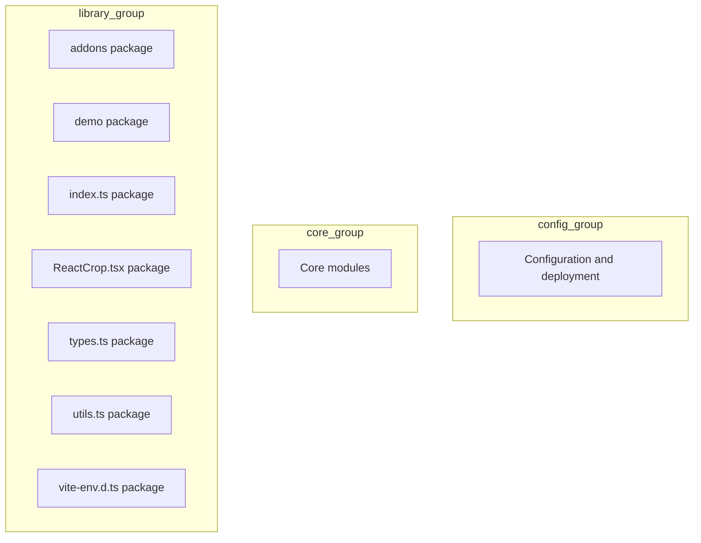

# Architecture report: dominictobias/react-image-crop

> Automated static analysis. **Observed** = directly seen in files/imports/AST; **Inferred** = interpretation from that evidence. Repository code was not executed.

## 1. Repository at a glance

| Item | Value |
| --- | --- |
| Repository | dominictobias/react-image-crop |
| Description | A responsive image cropping tool for React |
| Language | TypeScript |
| Stars | 4108 |
| Licence | ISC |
| Analysed commit / branch | 2cd4d49b36ec9a29a63b27394ec29ade5646dc99 / master |
| Framework(s) | React |
| Files analysed | 26 |
| Components | 9 |

## 2. Architecture in one minute

dominictobias/react-image-crop - A responsive image cropping tool for React. This repository was analysed statically from 26 file(s) (0 Python). Detected technologies (observed from imports/manifests): React, TypeScript, Vite. Files are grouped into 9 component(s): addons package, Configuration and deployment, Core modules, demo package, index.ts package, ReactCrop.tsx package, types.ts package, utils.ts package. Findings below distinguish observed facts from inferred interpretation.

## 3. High-level block diagram

## 4. Main components

### addons package (`addons`)

- **Kind:** library
- **Status:** Observed
- **Confidence:** 0.85
- **Responsibility:** Groups 1 file(s) under addons package (observed from repository paths and static analysis).
- **Paths:** `src/addons/browserCrop.ts`
- **Evidence:** [src/addons/browserCrop.ts](https://github.com/dominictobias/react-image-crop/blob/2cd4d49b36ec9a29a63b27394ec29ade5646dc99/src/addons/browserCrop.ts)

### Configuration and deployment (`config`)

- **Kind:** config
- **Status:** Observed
- **Confidence:** 0.85
- **Responsibility:** Groups 3 file(s) under configuration and deployment (observed from repository paths and static analysis).
- **Paths:** `package.json`, `tsconfig.json`, `tsconfig.node.json`
- **Evidence:** [package.json](https://github.com/dominictobias/react-image-crop/blob/2cd4d49b36ec9a29a63b27394ec29ade5646dc99/package.json); [tsconfig.json](https://github.com/dominictobias/react-image-crop/blob/2cd4d49b36ec9a29a63b27394ec29ade5646dc99/tsconfig.json); [tsconfig.node.json](https://github.com/dominictobias/react-image-crop/blob/2cd4d49b36ec9a29a63b27394ec29ade5646dc99/tsconfig.node.json)

### Core modules (`core`)

- **Kind:** core
- **Status:** Observed
- **Confidence:** 0.85
- **Responsibility:** Groups 1 file(s) under core modules (observed from repository paths and static analysis).
- **Paths:** `vite.config.ts`
- **Evidence:** [vite.config.ts](https://github.com/dominictobias/react-image-crop/blob/2cd4d49b36ec9a29a63b27394ec29ade5646dc99/vite.config.ts)

### demo package (`demo`)

- **Kind:** library
- **Status:** Observed
- **Confidence:** 0.85
- **Responsibility:** Groups 5 file(s) under demo package (observed from repository paths and static analysis).
- **Paths:** `src/demo/Demo.tsx`, `src/demo/canvasPreview.ts`, `src/demo/imgPreview.ts`, `src/demo/index.tsx`, `src/demo/useDebounceEffect.ts`
- **Evidence:** [src/demo/Demo.tsx](https://github.com/dominictobias/react-image-crop/blob/2cd4d49b36ec9a29a63b27394ec29ade5646dc99/src/demo/Demo.tsx); [src/demo/canvasPreview.ts](https://github.com/dominictobias/react-image-crop/blob/2cd4d49b36ec9a29a63b27394ec29ade5646dc99/src/demo/canvasPreview.ts); [src/demo/imgPreview.ts](https://github.com/dominictobias/react-image-crop/blob/2cd4d49b36ec9a29a63b27394ec29ade5646dc99/src/demo/imgPreview.ts); [src/demo/index.tsx](https://github.com/dominictobias/react-image-crop/blob/2cd4d49b36ec9a29a63b27394ec29ade5646dc99/src/demo/index.tsx); [src/demo/useDebounceEffect.ts](https://github.com/dominictobias/react-image-crop/blob/2cd4d49b36ec9a29a63b27394ec29ade5646dc99/src/demo/useDebounceEffect.ts)

### index.ts package (`index_ts`)

- **Kind:** library
- **Status:** Observed
- **Confidence:** 0.85
- **Responsibility:** Groups 1 file(s) under index.ts package (observed from repository paths and static analysis).
- **Paths:** `src/index.ts`
- **Evidence:** [src/index.ts](https://github.com/dominictobias/react-image-crop/blob/2cd4d49b36ec9a29a63b27394ec29ade5646dc99/src/index.ts)

### ReactCrop.tsx package (`reactcrop_tsx`)

- **Kind:** library
- **Status:** Observed
- **Confidence:** 0.85
- **Responsibility:** Groups 1 file(s) under reactcrop.tsx package (observed from repository paths and static analysis).
- **Paths:** `src/ReactCrop.tsx`
- **Evidence:** [src/ReactCrop.tsx](https://github.com/dominictobias/react-image-crop/blob/2cd4d49b36ec9a29a63b27394ec29ade5646dc99/src/ReactCrop.tsx)

### types.ts package (`types_ts`)

- **Kind:** library
- **Status:** Observed
- **Confidence:** 0.85
- **Responsibility:** Groups 1 file(s) under types.ts package (observed from repository paths and static analysis).
- **Paths:** `src/types.ts`
- **Evidence:** [src/types.ts](https://github.com/dominictobias/react-image-crop/blob/2cd4d49b36ec9a29a63b27394ec29ade5646dc99/src/types.ts)

### utils.ts package (`utils_ts`)

- **Kind:** library
- **Status:** Observed
- **Confidence:** 0.85
- **Responsibility:** Groups 1 file(s) under utils.ts package (observed from repository paths and static analysis).
- **Paths:** `src/utils.ts`
- **Evidence:** [src/utils.ts](https://github.com/dominictobias/react-image-crop/blob/2cd4d49b36ec9a29a63b27394ec29ade5646dc99/src/utils.ts)

### vite-env.d.ts package (`vite_env_d_ts`)

- **Kind:** library
- **Status:** Observed
- **Confidence:** 0.85
- **Responsibility:** Groups 1 file(s) under vite-env.d.ts package (observed from repository paths and static analysis).
- **Paths:** `src/vite-env.d.ts`
- **Evidence:** [src/vite-env.d.ts](https://github.com/dominictobias/react-image-crop/blob/2cd4d49b36ec9a29a63b27394ec29ade5646dc99/src/vite-env.d.ts)

## 5. Execution flow

**Observed** entry point(s):

- [src/demo/index.tsx](https://github.com/dominictobias/react-image-crop/blob/2cd4d49b36ec9a29a63b27394ec29ade5646dc99/src/demo/index.tsx)
- [src/index.ts](https://github.com/dominictobias/react-image-crop/blob/2cd4d49b36ec9a29a63b27394ec29ade5646dc99/src/index.ts)

Representative flow (derived from observed entry points and the import graph; steps beyond the entry point are **Inferred**):

1. Execution starts at an observed entry point listed above, if present.
2. No internal import relationships between components were observed.

## 6. Project structure

### `(root)`

- `.eslintrc.cjs` - source, JavaScript (374 bytes)
- `.gitignore` - other (218 bytes)
- `.npmignore` - other (28 bytes)
- `.prettierrc.yaml` - config (88 bytes)
- `LICENSE.md` - docs (784 bytes)
- `README.md` - docs (10555 bytes)
- `bun.lock` - other (69603 bytes)
- `index.html` - other (308 bytes)
- `package.json` - manifest (1769 bytes)
- `tsconfig.json` - config (586 bytes)
- `tsconfig.node.json` - config (236 bytes)
- `vite.config.ts` - source, TypeScript (1235 bytes)

### `.github`

- `.github/FUNDING.yml` - config (817 bytes)

### `src`

- `src/ReactCrop.scss` - other (6276 bytes)
- `src/ReactCrop.tsx` - source, TypeScript (26125 bytes)
- `src/addons/browserCrop.ts` - source, TypeScript (2373 bytes)
- `src/demo/Demo.tsx` - source, TypeScript (4278 bytes)
- `src/demo/canvasPreview.ts` - source, TypeScript (1646 bytes)
- `src/demo/imgPreview.ts` - source, TypeScript (803 bytes)
- `src/demo/index.scss` - other (136 bytes)
- `src/demo/index.tsx` - source, TypeScript (183 bytes)
- `src/demo/useDebounceEffect.ts` - source, TypeScript (320 bytes)
- `src/index.ts` - source, TypeScript (223 bytes)
- `src/types.ts` - source, TypeScript (369 bytes)
- `src/utils.ts` - source, TypeScript (10244 bytes)
- `src/vite-env.d.ts` - source, TypeScript (38 bytes)

## 7. Key dependencies and integrations

| Name | Category | Status | Confidence | Evidence |
| --- | --- | --- | --- | --- |
| React | framework | Observed | 0.90 | [package.json:2](https://github.com/dominictobias/react-image-crop/blob/2cd4d49b36ec9a29a63b27394ec29ade5646dc99/package.json#L2); [package.json:49](https://github.com/dominictobias/react-image-crop/blob/2cd4d49b36ec9a29a63b27394ec29ade5646dc99/package.json#L49) |
| TypeScript | tooling | Observed | 0.85 | [package.json:50](https://github.com/dominictobias/react-image-crop/blob/2cd4d49b36ec9a29a63b27394ec29ade5646dc99/package.json#L50) |
| Vite | tooling | Observed | 0.85 | [package.json:31](https://github.com/dominictobias/react-image-crop/blob/2cd4d49b36ec9a29a63b27394ec29ade5646dc99/package.json#L31) |

## 8. Data and state

No database, cache, queue, or persistent-state usage was observed in the analysed files. State handling, if any, may be in-memory or in files that were not analysed.

## 9. Configuration and deployment clues

- `.github/FUNDING.yml` (config)
- `.prettierrc.yaml` (config)
- `package.json` (manifest)
- `tsconfig.json` (config)
- `tsconfig.node.json` (config)

## 10. Design observations

- No strong design patterns could be established from the available evidence.

These observations are interpretations (**Inferred**) of the observed structure, not guarantees about runtime design.

## 11. Limitations and unknowns

- Static analysis only: repository code was not executed, installed, or imported at runtime.
- Components and relationships are inferred from file paths, imports, and AST structure; runtime behaviour, dynamic imports, and reflection may not be visible.
- 1 file(s) were skipped during inventory (1 x lockfile excluded).
- No clear application entry point was observed in the analysed files.
- Repository text was treated as untrusted data; no instructions found in repository files were followed, and likely secret values were redacted/excluded.
- JavaScript and TypeScript files were inventoried from paths and package manifests. They were not parsed with a full language AST, and repository code was not executed.

## 12. Source references

- [package.json](https://github.com/dominictobias/react-image-crop/blob/2cd4d49b36ec9a29a63b27394ec29ade5646dc99/package.json)
- [package.json:2](https://github.com/dominictobias/react-image-crop/blob/2cd4d49b36ec9a29a63b27394ec29ade5646dc99/package.json#L2)
- [package.json:31](https://github.com/dominictobias/react-image-crop/blob/2cd4d49b36ec9a29a63b27394ec29ade5646dc99/package.json#L31)
- [package.json:49](https://github.com/dominictobias/react-image-crop/blob/2cd4d49b36ec9a29a63b27394ec29ade5646dc99/package.json#L49)
- [package.json:50](https://github.com/dominictobias/react-image-crop/blob/2cd4d49b36ec9a29a63b27394ec29ade5646dc99/package.json#L50)
- [src/ReactCrop.tsx](https://github.com/dominictobias/react-image-crop/blob/2cd4d49b36ec9a29a63b27394ec29ade5646dc99/src/ReactCrop.tsx)
- [src/addons/browserCrop.ts](https://github.com/dominictobias/react-image-crop/blob/2cd4d49b36ec9a29a63b27394ec29ade5646dc99/src/addons/browserCrop.ts)
- [src/demo/Demo.tsx](https://github.com/dominictobias/react-image-crop/blob/2cd4d49b36ec9a29a63b27394ec29ade5646dc99/src/demo/Demo.tsx)
- [src/demo/canvasPreview.ts](https://github.com/dominictobias/react-image-crop/blob/2cd4d49b36ec9a29a63b27394ec29ade5646dc99/src/demo/canvasPreview.ts)
- [src/demo/imgPreview.ts](https://github.com/dominictobias/react-image-crop/blob/2cd4d49b36ec9a29a63b27394ec29ade5646dc99/src/demo/imgPreview.ts)
- [src/demo/index.tsx](https://github.com/dominictobias/react-image-crop/blob/2cd4d49b36ec9a29a63b27394ec29ade5646dc99/src/demo/index.tsx)
- [src/demo/useDebounceEffect.ts](https://github.com/dominictobias/react-image-crop/blob/2cd4d49b36ec9a29a63b27394ec29ade5646dc99/src/demo/useDebounceEffect.ts)
- [src/index.ts](https://github.com/dominictobias/react-image-crop/blob/2cd4d49b36ec9a29a63b27394ec29ade5646dc99/src/index.ts)
- [src/types.ts](https://github.com/dominictobias/react-image-crop/blob/2cd4d49b36ec9a29a63b27394ec29ade5646dc99/src/types.ts)
- [src/utils.ts](https://github.com/dominictobias/react-image-crop/blob/2cd4d49b36ec9a29a63b27394ec29ade5646dc99/src/utils.ts)
- [src/vite-env.d.ts](https://github.com/dominictobias/react-image-crop/blob/2cd4d49b36ec9a29a63b27394ec29ade5646dc99/src/vite-env.d.ts)
- [tsconfig.json](https://github.com/dominictobias/react-image-crop/blob/2cd4d49b36ec9a29a63b27394ec29ade5646dc99/tsconfig.json)
- [tsconfig.node.json](https://github.com/dominictobias/react-image-crop/blob/2cd4d49b36ec9a29a63b27394ec29ade5646dc99/tsconfig.node.json)
- [vite.config.ts](https://github.com/dominictobias/react-image-crop/blob/2cd4d49b36ec9a29a63b27394ec29ade5646dc99/vite.config.ts)
