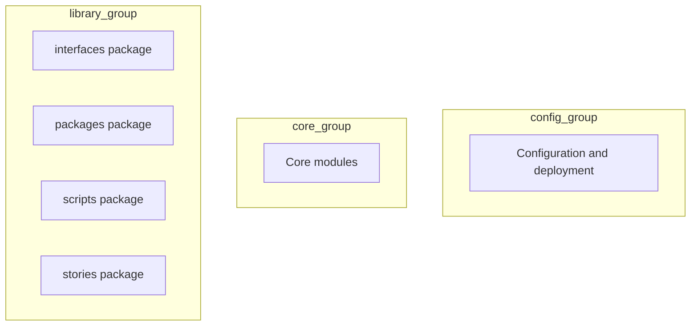

# Architecture report: draft-js-plugins/draft-js-plugins

> Automated static analysis. **Observed** = directly seen in files/imports/AST; **Inferred** = interpretation from that evidence. Repository code was not executed.

## 1. Repository at a glance

| Item | Value |
| --- | --- |
| Repository | draft-js-plugins/draft-js-plugins |
| Description | React Plugin Architecture for Draft.js including Slack-Like Emojis, FB-Like Mentions and Stickers |
| Language | TypeScript |
| Stars | 4084 |
| Licence | MIT |
| Analysed commit / branch | 6049db73855df56edf41cd5ece5369f97fac10e6 / master |
| Framework(s) | Next.js, React |
| Files analysed | 800 |
| Components | 6 |

## 2. Architecture in one minute

draft-js-plugins/draft-js-plugins - React Plugin Architecture for Draft.js including Slack-Like Emojis, FB-Like Mentions and Stickers. This repository was analysed statically from 800 file(s) (0 Python). Detected technologies (observed from imports/manifests): GitHub Actions, Next.js, React, Jest, TypeScript, webpack. Files are grouped into 6 component(s): Configuration and deployment, Core modules, interfaces package, packages package, scripts package, stories package. Findings below distinguish observed facts from inferred interpretation.

## 3. High-level block diagram

## 4. Main components

### Configuration and deployment (`config`)

- **Kind:** config
- **Status:** Observed
- **Confidence:** 0.85
- **Responsibility:** Groups 67 file(s) under configuration and deployment (observed from repository paths and static analysis).
- **Paths:** `package.json`, `packages/alignment/package.json`, `packages/alignment/tsconfig.json`, `packages/anchor/package.json`, `packages/anchor/tsconfig.json`, `packages/buttons/package.json`, `packages/buttons/tsconfig.json`, `packages/counter/package.json`, `packages/counter/tsconfig.json`, `packages/divider/package.json`, `packages/divider/tsconfig.json`, `packages/docs/package.json`, `packages/docs/public/data/mentionsA.json`, `packages/docs/public/data/mentionsB.json`, `packages/docs/public/data/mentionsC.json`, `packages/docs/tsconfig.json`, `packages/drag-n-drop-upload/package.json`, `packages/drag-n-drop-upload/tsconfig.json`, `packages/drag-n-drop/package.json`, `packages/drag-n-drop/tsconfig.json`, `packages/editor/package.json`, `packages/editor/tsconfig.json`, `packages/emoji/package.json`, `packages/emoji/tsconfig.json`, `packages/focus/package.json`, `packages/focus/tsconfig.json`, `packages/hashtag/package.json`, `packages/hashtag/tsconfig.json`, `packages/image/package.json`, `packages/image/tsconfig.json`, `packages/inline-toolbar/package.json`, `packages/inline-toolbar/tsconfig.json`, `packages/linkify/package.json`, `packages/linkify/tsconfig.json`, `packages/mention/package.json`, `packages/mention/tsconfig.json`, `packages/resizeable/package.json`, `packages/resizeable/tsconfig.json`, `packages/side-toolbar/package.json`, `packages/side-toolbar/tsconfig.json`, `packages/static-toolbar/package.json`, `packages/static-toolbar/tsconfig.json`, `packages/sticker/package.json`, `packages/sticker/tsconfig.json`, `packages/text-alignment/package.json`, `packages/text-alignment/tsconfig.json`, `packages/undo/package.json`, `packages/undo/tsconfig.json`, `packages/utils/package.json`, `packages/utils/tsconfig.json`, `packages/video/package.json`, `packages/video/tsconfig.json`, `stories/mentions-custom-component/public/data/mentionsA.json`, `stories/mentions-custom-component/public/data/mentionsB.json`, `stories/mentions-custom-component/public/data/mentionsC.json`, `stories/mentions-custom-styled/public/data/mentionsA.json`, `stories/mentions-custom-styled/public/data/mentionsB.json`, `stories/mentions-custom-styled/public/data/mentionsC.json`, `stories/mentions-remote/public/data/mentionsA.json`, `stories/mentions-remote/public/data/mentionsB.json`, `stories/mentions-remote/public/data/mentionsC.json`, `stories/mentions-with-whitespace/public/data/mentionsA.json`, `stories/mentions-with-whitespace/public/data/mentionsB.json`, `stories/mentions-with-whitespace/public/data/mentionsC.json`, `stories/public/data/mentionsA.json`, `stories/public/data/mentionsB.json`, `stories/public/data/mentionsC.json`
- **Evidence:** [package.json](https://github.com/draft-js-plugins/draft-js-plugins/blob/6049db73855df56edf41cd5ece5369f97fac10e6/package.json); [packages/alignment/package.json](https://github.com/draft-js-plugins/draft-js-plugins/blob/6049db73855df56edf41cd5ece5369f97fac10e6/packages/alignment/package.json); [packages/alignment/tsconfig.json](https://github.com/draft-js-plugins/draft-js-plugins/blob/6049db73855df56edf41cd5ece5369f97fac10e6/packages/alignment/tsconfig.json); [packages/anchor/package.json](https://github.com/draft-js-plugins/draft-js-plugins/blob/6049db73855df56edf41cd5ece5369f97fac10e6/packages/anchor/package.json); [packages/anchor/tsconfig.json](https://github.com/draft-js-plugins/draft-js-plugins/blob/6049db73855df56edf41cd5ece5369f97fac10e6/packages/anchor/tsconfig.json); [packages/buttons/package.json](https://github.com/draft-js-plugins/draft-js-plugins/blob/6049db73855df56edf41cd5ece5369f97fac10e6/packages/buttons/package.json); [packages/buttons/tsconfig.json](https://github.com/draft-js-plugins/draft-js-plugins/blob/6049db73855df56edf41cd5ece5369f97fac10e6/packages/buttons/tsconfig.json); [packages/counter/package.json](https://github.com/draft-js-plugins/draft-js-plugins/blob/6049db73855df56edf41cd5ece5369f97fac10e6/packages/counter/package.json)

### Core modules (`core`)

- **Kind:** core
- **Status:** Observed
- **Confidence:** 0.85
- **Responsibility:** Groups 5 file(s) under core modules (observed from repository paths and static analysis).
- **Paths:** `babel.config.js`, `jest.config.base.js`, `jest.config.js`, `jestHelper.js`, `rollup.config.js`
- **Evidence:** [babel.config.js](https://github.com/draft-js-plugins/draft-js-plugins/blob/6049db73855df56edf41cd5ece5369f97fac10e6/babel.config.js); [jest.config.base.js](https://github.com/draft-js-plugins/draft-js-plugins/blob/6049db73855df56edf41cd5ece5369f97fac10e6/jest.config.base.js); [jest.config.js](https://github.com/draft-js-plugins/draft-js-plugins/blob/6049db73855df56edf41cd5ece5369f97fac10e6/jest.config.js); [jestHelper.js](https://github.com/draft-js-plugins/draft-js-plugins/blob/6049db73855df56edf41cd5ece5369f97fac10e6/jestHelper.js); [rollup.config.js](https://github.com/draft-js-plugins/draft-js-plugins/blob/6049db73855df56edf41cd5ece5369f97fac10e6/rollup.config.js)

### interfaces package (`interfaces`)

- **Kind:** library
- **Status:** Observed
- **Confidence:** 0.85
- **Responsibility:** Groups 1 file(s) under interfaces package (observed from repository paths and static analysis).
- **Paths:** `interfaces/CSSModule.js`
- **Evidence:** [interfaces/CSSModule.js](https://github.com/draft-js-plugins/draft-js-plugins/blob/6049db73855df56edf41cd5ece5369f97fac10e6/interfaces/CSSModule.js)

### packages package (`packages`)

- **Kind:** library
- **Status:** Observed
- **Confidence:** 0.85
- **Responsibility:** Groups 248 file(s) under packages package (observed from repository paths and static analysis).
- **Paths:** `packages/alignment/jest.config.js`, `packages/alignment/src/AlignmentTool.tsx`, `packages/alignment/src/createDecorator.tsx`, `packages/alignment/src/index.tsx`, `packages/alignment/src/theme.ts`, `packages/anchor/jest.config.js`, `packages/anchor/src/components/AddLinkForm.tsx`, `packages/anchor/src/components/DefaultLinkButton.tsx`, `packages/anchor/src/components/Link.tsx`, `packages/anchor/src/components/LinkButton.tsx`, `packages/anchor/src/index.tsx`, `packages/anchor/src/linkStrategy.ts`, `packages/anchor/src/theme.ts`, `packages/anchor/src/utils/EditorUtils.ts`, `packages/anchor/src/utils/URLUtils.ts`, `packages/anchor/src/utils/mailRegex.ts`, `packages/anchor/src/utils/urlRegex.ts`, `packages/buttons/jest.config.js`, `packages/buttons/src/components/AlignBlockCenterButton.tsx`, `packages/buttons/src/components/AlignBlockDefaultButton.tsx`, `packages/buttons/src/components/AlignBlockLeftButton.tsx`, `packages/buttons/src/components/AlignBlockRightButton.tsx`, `packages/buttons/src/components/AlignTextCenterButton.tsx`, `packages/buttons/src/components/AlignTextLeftButton.tsx`, `packages/buttons/src/components/AlignTextRightButton.tsx`, `packages/buttons/src/components/BlockquoteButton.tsx`, `packages/buttons/src/components/BoldButton.tsx`, `packages/buttons/src/components/CodeBlockButton.tsx`, `packages/buttons/src/components/CodeButton.tsx`, `packages/buttons/src/components/HeadlineOneButton.tsx`, `packages/buttons/src/components/HeadlineThreeButton.tsx`, `packages/buttons/src/components/HeadlineTwoButton.tsx`, `packages/buttons/src/components/ItalicButton.tsx`, `packages/buttons/src/components/OrderedListButton.tsx`, `packages/buttons/src/components/SubButton.tsx`, `packages/buttons/src/components/SupButton.tsx`, `packages/buttons/src/components/UnderlineButton.tsx`, `packages/buttons/src/components/UnorderedListButton.tsx`, `packages/buttons/src/index.ts`, `packages/buttons/src/utils/createBlockAlignmentButton.tsx`, `packages/buttons/src/utils/createBlockStyleButton.tsx`, `packages/buttons/src/utils/createInlineStyleButton.tsx`, `packages/buttons/src/utils/createTextAlignmentButton.tsx`, `packages/counter/jest.config.js`, `packages/counter/src/CharCounter/__test__/index.test.tsx`, `packages/counter/src/CharCounter/index.tsx`, `packages/counter/src/CustomCounter/__test__/index.test.tsx`, `packages/counter/src/CustomCounter/index.tsx`, `packages/counter/src/LineCounter/__test__/index.test.tsx`, `packages/counter/src/LineCounter/index.tsx`, `packages/counter/src/WordCounter/__test__/index.test.tsx`, `packages/counter/src/WordCounter/index.tsx`, `packages/counter/src/index.tsx`, `packages/counter/src/theme.ts`, `packages/divider/jest.config.js`, `packages/divider/src/components/DefaultDivider.tsx`, `packages/divider/src/components/DividerButton.tsx`, `packages/divider/src/index.tsx`, `packages/divider/src/modifiers/addDivider.ts`, `packages/divider/src/theme.ts`, `packages/drag-n-drop-upload/jest.config.js`, `packages/drag-n-drop-upload/server.js`, `packages/drag-n-drop-upload/src/components/UploadPlaceholder.tsx`, `packages/drag-n-drop-upload/src/components/insertPlaceholder.ts`, `packages/drag-n-drop-upload/src/handleDroppedFiles.ts`, `packages/drag-n-drop-upload/src/index.ts`, `packages/drag-n-drop-upload/src/modifiers/modifyBlockData.ts`, `packages/drag-n-drop-upload/src/modifiers/removeBlock.ts`, `packages/drag-n-drop-upload/src/modifiers/replaceBlock.ts`, `packages/drag-n-drop-upload/src/utils/block.ts`, `packages/drag-n-drop-upload/src/utils/file.ts`, `packages/drag-n-drop/jest.config.js`, `packages/drag-n-drop/src/constants/index.ts`, `packages/drag-n-drop/src/createDecorator.tsx`, `packages/drag-n-drop/src/handleDrop.ts`, `packages/drag-n-drop/src/index.tsx`, `packages/drag-n-drop/src/modifiers/addBlock.ts`, `packages/drag-n-drop/src/modifiers/removeBlock.ts`, `packages/editor/jest.config.js`, `packages/editor/src/Editor/MultiDecorator.ts`, `packages/editor/src/Editor/PluginHooks.ts`, `packages/editor/src/Editor/__test__/MultiDecorator.test.ts`, `packages/editor/src/Editor/__test__/index.test.ts`, `packages/editor/src/Editor/createCompositeDecorator.tsx`, `packages/editor/src/Editor/defaultKeyBindings.ts`, `packages/editor/src/Editor/defaultKeyCommands.ts`, `packages/editor/src/Editor/index.tsx`, `packages/editor/src/Editor/resolveDecorators.ts`, `packages/editor/src/index.ts`, `packages/editor/src/utils/composeDecorators.ts`, `packages/editor/src/utils/createEditorStateWithText.ts`, `packages/emoji/jest.config.js`, `packages/emoji/src/@types/emoji-toolkit.d.ts`, `packages/emoji/src/@types/to-style.d.ts`, `packages/emoji/src/__test__/EmojiSelect.test.tsx`, `packages/emoji/src/__test__/emojiSuggestionsStrategy.test.ts`, `packages/emoji/src/components/Emoji/JoyPixelEmojiImage.tsx`, `packages/emoji/src/components/Emoji/JoyPixelEmojiInlineText.tsx`, `packages/emoji/src/components/Emoji/NativEmojiInlineText.tsx`, `packages/emoji/src/components/Emoji/NativeEmojiImage.tsx`, `packages/emoji/src/components/Emoji/index.tsx`, `packages/emoji/src/components/EmojiSelect/Popover/Entry/index.tsx`, `packages/emoji/src/components/EmojiSelect/Popover/Groups/Group/index.tsx`, `packages/emoji/src/components/EmojiSelect/Popover/Groups/index.tsx`, `packages/emoji/src/components/EmojiSelect/Popover/Nav/Entry/index.tsx`, `packages/emoji/src/components/EmojiSelect/Popover/Nav/index.tsx`, `packages/emoji/src/components/EmojiSelect/Popover/ToneSelect/index.tsx`, `packages/emoji/src/components/EmojiSelect/Popover/index.tsx`, `packages/emoji/src/components/EmojiSelect/index.tsx`, `packages/emoji/src/components/EmojiSuggestions/Entry/index.tsx`, `packages/emoji/src/components/EmojiSuggestions/Popover.tsx`, `packages/emoji/src/components/EmojiSuggestions/index.tsx`, `packages/emoji/src/components/EmojiSuggestionsPortal/index.tsx`, `packages/emoji/src/constants/defaultEmojiGroups.tsx`, `packages/emoji/src/constants/type.ts`, `packages/emoji/src/emojiStrategy.ts`, `packages/emoji/src/emojiSuggestionsStrategy.ts`, `packages/emoji/src/index.tsx`, `packages/emoji/src/modifiers/addEmoji.ts`, `packages/emoji/src/modifiers/attachImmutableEntitiesToEmojis.ts`, `packages/emoji/src/theme.ts`, `packages/emoji/src/utils/__test__/getWordAt.test.ts`, `packages/emoji/src/utils/createEmojisFromStrategy.ts`, `packages/emoji/src/utils/emojiList.ts`, `packages/emoji/src/utils/getSearchText.ts`, `packages/emoji/src/utils/getWordAt.ts`, `packages/emoji/src/utils/positionSuggestions.ts`, `packages/emoji/src/utils/warning.ts`, `packages/focus/jest.config.js`, `packages/focus/src/__test__/index.test.ts`, `packages/focus/src/createDecorator.tsx`, `packages/focus/src/index.tsx`, `packages/focus/src/modifiers/insertNewLine.ts`, `packages/focus/src/modifiers/removeBlock.ts`, `packages/focus/src/modifiers/setSelection.ts`, `packages/focus/src/modifiers/setSelectionToBlock.ts`, `packages/focus/src/theme.ts`, `packages/focus/src/utils/blockInSelection.ts`, `packages/focus/src/utils/createBlockKeyStore.ts`, `packages/focus/src/utils/getBlockMapKeys.ts`, `packages/focus/src/utils/getSelectedBlocksMapKeys.ts`, `packages/hashtag/jest.config.js`, `packages/hashtag/src/Hashtag.tsx`, `packages/hashtag/src/__test__/Hashtag.test.tsx`, `packages/hashtag/src/hashtagStrategy.ts`, `packages/hashtag/src/index.tsx`, `packages/hashtag/src/theme.ts`, `packages/hashtag/src/utils/__test__/extractHashtags.test.ts`, `packages/hashtag/src/utils/extractHashtags.ts`, `packages/hashtag/src/utils/hashtagRegex.ts`, `packages/image/jest.config.js`, `packages/image/src/Image.tsx`, `packages/image/src/index.tsx`, `packages/image/src/modifiers/addImage.ts`, `packages/inline-toolbar/jest.config.js`, `packages/inline-toolbar/src/components/Separator/index.tsx`, `packages/inline-toolbar/src/components/Toolbar/__test__/Toolbar.test.tsx`, `packages/inline-toolbar/src/components/Toolbar/index.tsx`, `packages/inline-toolbar/src/index.tsx`, `packages/inline-toolbar/src/theme.ts`, `packages/linkify/jest.config.js`, `packages/linkify/src/Link/Link.tsx`, `packages/linkify/src/Link/__test__/Link.test.tsx`, `packages/linkify/src/index.tsx`, `packages/linkify/src/linkStrategy.ts`, `packages/linkify/src/theme.tsx`, `packages/linkify/src/utils/__test__/extractLinks.test.ts`, `packages/linkify/src/utils/extractLinks.ts`, `packages/mention/jest.config.js`, `packages/mention/src/Mention.tsx`, `packages/mention/src/MentionSuggestions/Entry/Avatar/Avatar.tsx`, `packages/mention/src/MentionSuggestions/Entry/DefaultEntryComponent.tsx`, `packages/mention/src/MentionSuggestions/Entry/Entry.tsx`, `packages/mention/src/MentionSuggestions/MentionSuggestions.tsx`, `packages/mention/src/MentionSuggestions/Popover.tsx`, `packages/mention/src/MentionSuggestions/__test__/MentionSuggestions.test.tsx`, `packages/mention/src/MentionSuggestionsPortal.tsx`, `packages/mention/src/__test__/Mention.test.tsx`, `packages/mention/src/__test__/mentionSuggestionsStrategy.test.ts`, `packages/mention/src/defaultRegExp.ts`, `packages/mention/src/index.tsx`, `packages/mention/src/mentionStrategy.ts`, `packages/mention/src/mentionSuggestionsStrategy.ts`, `packages/mention/src/modifiers/addMention.ts`, `packages/mention/src/theme.ts`, `packages/mention/src/utils/__test__/getSearchTextAt.test.ts`, `packages/mention/src/utils/__test__/getTriggerForMention.test.ts`, `packages/mention/src/utils/__test__/getTypeByTrigger.test.ts`, `packages/mention/src/utils/decodeOffsetKey.ts`, `packages/mention/src/utils/defaultSuggestionsFilter.ts`, `packages/mention/src/utils/getSearchText.ts`, `packages/mention/src/utils/getSearchTextAt.ts`, `packages/mention/src/utils/getTriggerForMention.ts`, `packages/mention/src/utils/getTypeByTrigger.ts`, `packages/mention/src/utils/positionSuggestions.ts`, `packages/mention/src/utils/warning.ts`, `packages/resizeable/jest.config.js`, `packages/resizeable/src/createDecorator.tsx`, `packages/resizeable/src/index.ts`, `packages/side-toolbar/jest.config.js`, `packages/side-toolbar/src/components/BlockTypeSelect/BlockTypeSelect.tsx`, `packages/side-toolbar/src/components/BlockTypeSelect/SideToolbarButton.tsx`, `packages/side-toolbar/src/components/Toolbar/Popover.tsx`, `packages/side-toolbar/src/components/Toolbar/Toolbar.tsx`, `packages/side-toolbar/src/index.tsx`, `packages/side-toolbar/src/theme.ts`, `packages/static-toolbar/jest.config.js`, `packages/static-toolbar/src/components/Separator/index.tsx`, `packages/static-toolbar/src/components/Toolbar/__test__/Toolbar.test.tsx`, `packages/static-toolbar/src/components/Toolbar/index.tsx`, `packages/static-toolbar/src/index.tsx`, `packages/static-toolbar/src/theme.ts`, `packages/sticker/jest.config.js`, `packages/sticker/src/Sticker/index.tsx`, `packages/sticker/src/StickerSelect/StickerOption/index.tsx`, `packages/sticker/src/StickerSelect/index.tsx`, `packages/sticker/src/blockRendererFn.ts`, `packages/sticker/src/index.tsx`, `packages/sticker/src/modifiers/addSticker.ts`, `packages/sticker/src/modifiers/cleanupEmptyStickers.ts`, `packages/sticker/src/modifiers/removeSticker.ts`, `packages/sticker/src/theme.ts`, `packages/text-alignment/jest.config.js`, `packages/text-alignment/src/TextAlignmentComponent.tsx`, `packages/text-alignment/src/index.tsx`, `packages/text-alignment/src/theme.ts`, `packages/undo/jest.config.js`, `packages/undo/src/RedoButton/__test__/index.test.tsx`, `packages/undo/src/RedoButton/index.tsx`, `packages/undo/src/UndoButton/__test__/index.test.tsx`, `packages/undo/src/UndoButton/index.tsx`, `packages/undo/src/__test__/index.test.tsx`, `packages/undo/src/index.tsx`, `packages/undo/src/theme.ts`, `packages/utils/jest.config.js`, `packages/utils/src/__test__/createStore.test.ts`, `packages/utils/src/createStore.ts`, `packages/utils/src/findWithRegex.ts`, `packages/utils/src/index.ts`, `packages/video/jest.config.js`, `packages/video/src/__test__/createVideoPlugin.test.ts`, `packages/video/src/createVideoPlugin.tsx`, `packages/video/src/index.ts`, `packages/video/src/theme.ts`, `packages/video/src/video/components/DefaultVideoComponent.tsx`, `packages/video/src/video/constants/index.ts`, `packages/video/src/video/modifiers/addVideo.ts`, `packages/video/src/video/utils/index.ts`
- **Evidence:** [packages/alignment/jest.config.js](https://github.com/draft-js-plugins/draft-js-plugins/blob/6049db73855df56edf41cd5ece5369f97fac10e6/packages/alignment/jest.config.js); [packages/alignment/src/AlignmentTool.tsx](https://github.com/draft-js-plugins/draft-js-plugins/blob/6049db73855df56edf41cd5ece5369f97fac10e6/packages/alignment/src/AlignmentTool.tsx); [packages/alignment/src/createDecorator.tsx](https://github.com/draft-js-plugins/draft-js-plugins/blob/6049db73855df56edf41cd5ece5369f97fac10e6/packages/alignment/src/createDecorator.tsx); [packages/alignment/src/index.tsx](https://github.com/draft-js-plugins/draft-js-plugins/blob/6049db73855df56edf41cd5ece5369f97fac10e6/packages/alignment/src/index.tsx); [packages/alignment/src/theme.ts](https://github.com/draft-js-plugins/draft-js-plugins/blob/6049db73855df56edf41cd5ece5369f97fac10e6/packages/alignment/src/theme.ts); [packages/anchor/jest.config.js](https://github.com/draft-js-plugins/draft-js-plugins/blob/6049db73855df56edf41cd5ece5369f97fac10e6/packages/anchor/jest.config.js); [packages/anchor/src/components/AddLinkForm.tsx](https://github.com/draft-js-plugins/draft-js-plugins/blob/6049db73855df56edf41cd5ece5369f97fac10e6/packages/anchor/src/components/AddLinkForm.tsx); [packages/anchor/src/components/DefaultLinkButton.tsx](https://github.com/draft-js-plugins/draft-js-plugins/blob/6049db73855df56edf41cd5ece5369f97fac10e6/packages/anchor/src/components/DefaultLinkButton.tsx)

### scripts package (`scripts`)

- **Kind:** library
- **Status:** Observed
- **Confidence:** 0.85
- **Responsibility:** Groups 2 file(s) under scripts package (observed from repository paths and static analysis).
- **Paths:** `scripts/build-css.js`, `scripts/publishGithubPages.sh`
- **Evidence:** [scripts/build-css.js](https://github.com/draft-js-plugins/draft-js-plugins/blob/6049db73855df56edf41cd5ece5369f97fac10e6/scripts/build-css.js); [scripts/publishGithubPages.sh](https://github.com/draft-js-plugins/draft-js-plugins/blob/6049db73855df56edf41cd5ece5369f97fac10e6/scripts/publishGithubPages.sh)

### stories package (`stories`)

- **Kind:** library
- **Status:** Observed
- **Confidence:** 0.85
- **Responsibility:** Groups 81 file(s) under stories package (observed from repository paths and static analysis).
- **Paths:** `stories/adding-images/src/AddImageEditor.js`, `stories/adding-images/src/AddImageEditor.stories.tsx`, `stories/adding-images/src/ImageAdd/index.js`, `stories/adding-video/src/CustomAddVideoEditor.stories.tsx`, `stories/adding-video/src/CustomAddVideoEditor.tsx`, `stories/adding-video/src/VideoAdd/index.js`, `stories/align-drag-focus-and-resize-images/src/CustomImageEditor.stories.tsx`, `stories/align-drag-focus-and-resize-images/src/CustomImageEditor.tsx`, `stories/alignment/src/SimpleAlignmentEditor.stories.tsx`, `stories/alignment/src/SimpleAlignmentEditor.tsx`, `stories/alignment/src/colorBlockPlugin.js`, `stories/counter-plugin-simple/src/SimpleCounterEditor.stories.tsx`, `stories/counter-plugin-simple/src/SimpleCounterEditor.tsx`, `stories/displaying-images/src/SimpleImageEditor.stories.tsx`, `stories/displaying-images/src/SimpleImageEditor.tsx`, `stories/divider-with-side-toolbar/src/App.js`, `stories/divider-with-side-toolbar/src/DividerWithSideToolbar.stories.tsx`, `stories/drag-n-drop-upload/src/DragNDropImageEditorUpload.tsx`, `stories/drag-n-drop-upload/src/DragNDropUploadImageEditor.stories.tsx`, `stories/drag-n-drop-upload/src/customUpload.js`, `stories/drag-n-drop/src/DragNDropImageEditor.stories.tsx`, `stories/drag-n-drop/src/DragNDropImageEditor.tsx`, `stories/emoji-styled/src/CustomEmojiEditor.stories.tsx`, `stories/emoji-styled/src/CustomEmojiEditor.tsx`, `stories/emoji/src/SimpleEmojiEditor.stories.tsx`, `stories/emoji/src/SimpleEmojiEditor.tsx`, `stories/focus/src/SimpleFocusEditor.stories.tsx`, `stories/focus/src/SimpleFocusEditor.tsx`, `stories/focus/src/colorBlockPlugin.js`, `stories/hashtag-styled/src/CustomHashtagEditor.stories.tsx`, `stories/hashtag-styled/src/CustomHashtagEditor.tsx`, `stories/hashtag/src/SimpleHashtagEditor.stories.tsx`, `stories/hashtag/src/SimpleHashtagEditor.tsx`, `stories/inline-toolbar-custom-buttons/src/CustomInlineToolbarEditor.stories.tsx`, `stories/inline-toolbar-custom-buttons/src/CustomInlineToolbarEditor.tsx`, `stories/inline-toolbar-custom-styled/src/ThemedInlineToolbarEditor.stories.tsx`, `stories/inline-toolbar-custom-styled/src/ThemedInlineToolbarEditor.tsx`, `stories/inline-toolbar-relative-parent/src/RelativeParentInlineToolbarEditor.stories.tsx`, `stories/inline-toolbar-relative-parent/src/RelativeParentInlineToolbarEditor.tsx`, `stories/inline-toolbar-with-anchor-plugin/src/AnchorSimpleLinkPluginEditor.stories.tsx`, `stories/inline-toolbar-with-anchor-plugin/src/AnchorSimpleLinkPluginEditor.tsx`, `stories/inline-toolbar/src/SimpleInlineToolbarEditor.stories.tsx`, `stories/inline-toolbar/src/SimpleInlineToolbarEditor.tsx`, `stories/kitchensink/src/KitchenSink.stories.tsx`, `stories/kitchensink/src/KitchenSink.tsx`, `stories/kitchensink/src/initialState.ts`, `stories/kitchensink/src/mentions.ts`, `stories/kitchensink/src/stickers.ts`, `stories/linkify-configured/src/CustomLinkifyEditor.stories.tsx`, `stories/linkify-configured/src/CustomLinkifyEditor.tsx`, `stories/linkify/src/SimpleLinkifyEditor.stories.tsx`, `stories/linkify/src/SimpleLinkifyEditor.tsx`, `stories/mentions-custom-component/src/CustomComponentMentionEditor.stories.tsx`, `stories/mentions-custom-component/src/CustomComponentMentionEditor.tsx`, `stories/mentions-custom-component/src/mentions.ts`, `stories/mentions-custom-container-component/src/CustomComponentMentionEditor.stories.tsx`, `stories/mentions-custom-container-component/src/CustomContainerComponentMentionEditor.tsx`, `stories/mentions-custom-container-component/src/mentions.ts`, `stories/mentions-custom-styled/src/CustomMentionEditor.js`, `stories/mentions-custom-styled/src/CustomMentionEditor.stories.tsx`, `stories/mentions-custom-styled/src/mentions.ts`, `stories/mentions-custom-trigger/src/MentionEditorWithCustomTrigger.stories.tsx`, `stories/mentions-custom-trigger/src/MentionEditorWithCustomTrigger.tsx`, `stories/mentions-custom-trigger/src/mentions.ts`, `stories/mentions-multi-triggers/src/MentionMultiTriggers.stories.tsx`, `stories/mentions-multi-triggers/src/MentionMultiTriggers.tsx`, `stories/mentions-multi-triggers/src/mentions.ts`, `stories/mentions-remote/src/RemoteMentionEditor.stories.tsx`, `stories/mentions-remote/src/RemoteMentionEditor.tsx`, `stories/mentions-trigger-in-trigger/MentionsTriggerInTrigger.stories.tsx`, `stories/mentions-trigger-in-trigger/MentionsTriggerInTrigger.tsx`, `stories/mentions-trigger-in-trigger/mentions.ts`, `stories/mentions-with-whitespace/src/MentionEditorWithWhitespaceSupport.stories.tsx`, `stories/mentions-with-whitespace/src/MentionEditorWithWhitespaceSupport.tsx`, `stories/mentions-with-whitespace/src/mentions.ts`, `stories/mentions/src/SimpleMentionEditor.stories.tsx`, `stories/mentions/src/SimpleMentionEditor.tsx`, `stories/mentions/src/mentions.ts`, `stories/resizable/src/ResizableEditor.js`, `stories/resizable/src/ResizableEditor.stories.tsx`, `stories/resizable/src/colorBlockPlugin.js`
- **Evidence:** [stories/adding-images/src/AddImageEditor.js](https://github.com/draft-js-plugins/draft-js-plugins/blob/6049db73855df56edf41cd5ece5369f97fac10e6/stories/adding-images/src/AddImageEditor.js); [stories/adding-images/src/AddImageEditor.stories.tsx](https://github.com/draft-js-plugins/draft-js-plugins/blob/6049db73855df56edf41cd5ece5369f97fac10e6/stories/adding-images/src/AddImageEditor.stories.tsx); [stories/adding-images/src/ImageAdd/index.js](https://github.com/draft-js-plugins/draft-js-plugins/blob/6049db73855df56edf41cd5ece5369f97fac10e6/stories/adding-images/src/ImageAdd/index.js); [stories/adding-video/src/CustomAddVideoEditor.stories.tsx](https://github.com/draft-js-plugins/draft-js-plugins/blob/6049db73855df56edf41cd5ece5369f97fac10e6/stories/adding-video/src/CustomAddVideoEditor.stories.tsx); [stories/adding-video/src/CustomAddVideoEditor.tsx](https://github.com/draft-js-plugins/draft-js-plugins/blob/6049db73855df56edf41cd5ece5369f97fac10e6/stories/adding-video/src/CustomAddVideoEditor.tsx); [stories/adding-video/src/VideoAdd/index.js](https://github.com/draft-js-plugins/draft-js-plugins/blob/6049db73855df56edf41cd5ece5369f97fac10e6/stories/adding-video/src/VideoAdd/index.js); [stories/align-drag-focus-and-resize-images/src/CustomImageEditor.stories.tsx](https://github.com/draft-js-plugins/draft-js-plugins/blob/6049db73855df56edf41cd5ece5369f97fac10e6/stories/align-drag-focus-and-resize-images/src/CustomImageEditor.stories.tsx); [stories/align-drag-focus-and-resize-images/src/CustomImageEditor.tsx](https://github.com/draft-js-plugins/draft-js-plugins/blob/6049db73855df56edf41cd5ece5369f97fac10e6/stories/align-drag-focus-and-resize-images/src/CustomImageEditor.tsx)

## 5. Execution flow

**Observed** entry point(s):

- [.storybook/main.js](https://github.com/draft-js-plugins/draft-js-plugins/blob/6049db73855df56edf41cd5ece5369f97fac10e6/.storybook/main.js)
- [packages/alignment/src/index.tsx](https://github.com/draft-js-plugins/draft-js-plugins/blob/6049db73855df56edf41cd5ece5369f97fac10e6/packages/alignment/src/index.tsx)
- [packages/anchor/src/index.tsx](https://github.com/draft-js-plugins/draft-js-plugins/blob/6049db73855df56edf41cd5ece5369f97fac10e6/packages/anchor/src/index.tsx)
- [packages/buttons/src/index.ts](https://github.com/draft-js-plugins/draft-js-plugins/blob/6049db73855df56edf41cd5ece5369f97fac10e6/packages/buttons/src/index.ts)
- [packages/counter/src/index.tsx](https://github.com/draft-js-plugins/draft-js-plugins/blob/6049db73855df56edf41cd5ece5369f97fac10e6/packages/counter/src/index.tsx)
- [packages/divider/src/index.tsx](https://github.com/draft-js-plugins/draft-js-plugins/blob/6049db73855df56edf41cd5ece5369f97fac10e6/packages/divider/src/index.tsx)
- [packages/drag-n-drop-upload/server.js](https://github.com/draft-js-plugins/draft-js-plugins/blob/6049db73855df56edf41cd5ece5369f97fac10e6/packages/drag-n-drop-upload/server.js)
- [packages/drag-n-drop-upload/src/index.ts](https://github.com/draft-js-plugins/draft-js-plugins/blob/6049db73855df56edf41cd5ece5369f97fac10e6/packages/drag-n-drop-upload/src/index.ts)
- [packages/drag-n-drop/src/index.tsx](https://github.com/draft-js-plugins/draft-js-plugins/blob/6049db73855df56edf41cd5ece5369f97fac10e6/packages/drag-n-drop/src/index.tsx)
- [packages/editor/src/index.ts](https://github.com/draft-js-plugins/draft-js-plugins/blob/6049db73855df56edf41cd5ece5369f97fac10e6/packages/editor/src/index.ts)
- [packages/emoji/src/index.tsx](https://github.com/draft-js-plugins/draft-js-plugins/blob/6049db73855df56edf41cd5ece5369f97fac10e6/packages/emoji/src/index.tsx)
- [packages/focus/src/index.tsx](https://github.com/draft-js-plugins/draft-js-plugins/blob/6049db73855df56edf41cd5ece5369f97fac10e6/packages/focus/src/index.tsx)

Representative flow (derived from observed entry points and the import graph; steps beyond the entry point are **Inferred**):

1. Execution starts at an observed entry point listed above, if present.
2. No internal import relationships between components were observed.

## 6. Project structure

### `(root)`

- `.editorconfig` - config (414 bytes)
- `.eslintignore` - other (92 bytes)
- `.eslintrc.js` - source, JavaScript (5123 bytes)
- `.gitignore` - other (454 bytes)
- `.nvmrc` - other (2 bytes)
- `.prettierrc.js` - source, JavaScript (140 bytes)
- `CHANGELOG.md` - docs (200 bytes)
- `CODE_OF_CONDUCT.md` - docs (3082 bytes)
- `CONTRIBUTING.md` - docs (7146 bytes)
- `FAQ.md` - docs (5347 bytes)
- `HOW_TO_CREATE_A_PLUGIN.md` - docs (5507 bytes)
- `LICENSE` - docs (1057 bytes)
- `README.md` - docs (7997 bytes)
- `babel.config.js` - source, JavaScript (609 bytes)
- `jest.config.base.js` - source, JavaScript (906 bytes)
- `jest.config.js` - source, JavaScript (244 bytes)
- `jestHelper.js` - source, JavaScript (92 bytes)
- `package.json` - manifest (3372 bytes)
- `rollup.config.js` - source, JavaScript (1191 bytes)

### `.changeset`

- `.changeset/README.md` - docs (512 bytes)
- `.changeset/config.json` - config (262 bytes)

### `.github`

- `.github/ISSUE_TEMPLATE/bug_report.md` - docs (672 bytes)
- `.github/ISSUE_TEMPLATE/config.yml` - config (215 bytes)
- `.github/ISSUE_TEMPLATE/feature_request.md` - docs (391 bytes)
- `.github/PULL_REQUEST_TEMPLATE.md` - docs (911 bytes)
- `.github/dependabot.yml` - config (1078 bytes)
- `.github/stale.yml` - config (1956 bytes)
- `.github/workflows/dependabot-auto-merge.yml` - ci, YAML (435 bytes)
- `.github/workflows/deployWebsite.yml` - ci, YAML (1042 bytes)
- `.github/workflows/release.yml` - ci, YAML (955 bytes)
- `.github/workflows/stale.yml` - ci, YAML (406 bytes)
- `.github/workflows/tests.yml` - ci, YAML (838 bytes)

### `.husky`

- `.husky/.gitignore` - other (2 bytes)
- `.husky/pre-commit` - other (58 bytes)

### `.storybook`

- `.storybook/main.js` - source, JavaScript (189 bytes)
- `.storybook/preview-head.html` - other (95 bytes)
- `.storybook/preview.js` - source, JavaScript (34 bytes)
- `.storybook/webpack.config.js` - source, JavaScript (2319 bytes)

### `interfaces`

- `interfaces/CSSModule.js` - source, JavaScript (81 bytes)

### `packages`

- `packages/alignment/.gitignore` - other (6 bytes)
- `packages/alignment/CHANGELOG.md` - docs (1424 bytes)
- `packages/alignment/LICENSE` - docs (1057 bytes)
- `packages/alignment/README.md` - docs (146 bytes)
- `packages/alignment/jest.config.js` - source, JavaScript (181 bytes)
- `packages/alignment/package.json` - manifest (1249 bytes)
- `packages/alignment/src/AlignmentTool.tsx` - source, TypeScript (3657 bytes)
- `packages/alignment/src/createDecorator.tsx` - source, TypeScript (3494 bytes)
- `packages/alignment/src/index.tsx` - source, TypeScript (2762 bytes)
- `packages/alignment/src/theme.ts` - source, TypeScript (1700 bytes)
- `packages/alignment/tsconfig.json` - config (109 bytes)
- `packages/anchor/.gitignore` - other (6 bytes)
- `packages/anchor/CHANGELOG.md` - docs (1597 bytes)
- `packages/anchor/LICENSE` - docs (1057 bytes)
- `packages/anchor/README.md` - docs (428 bytes)
- `packages/anchor/jest.config.js` - source, JavaScript (181 bytes)
- `packages/anchor/package.json` - manifest (1300 bytes)
- `packages/anchor/src/components/AddLinkForm.tsx` - source, TypeScript (3102 bytes)
- `packages/anchor/src/components/DefaultLinkButton.tsx` - source, TypeScript (1369 bytes)
- `packages/anchor/src/components/Link.tsx` - source, TypeScript (1041 bytes)
- `packages/anchor/src/components/LinkButton.tsx` - source, TypeScript (2098 bytes)
- `packages/anchor/src/index.tsx` - source, TypeScript (2490 bytes)
- `packages/anchor/src/linkStrategy.ts` - source, TypeScript (545 bytes)
- `packages/anchor/src/theme.ts` - source, TypeScript (579 bytes)
- `packages/anchor/src/utils/EditorUtils.ts` - source, TypeScript (1621 bytes)
- `packages/anchor/src/utils/URLUtils.ts` - source, TypeScript (509 bytes)
- `packages/anchor/src/utils/mailRegex.ts` - source, TypeScript (149 bytes)
- `packages/anchor/src/utils/urlRegex.ts` - source, TypeScript (2667 bytes)
- `packages/anchor/tsconfig.json` - config (109 bytes)
- `packages/buttons/.gitignore` - other (6 bytes)
- `packages/buttons/CHANGELOG.md` - docs (1288 bytes)
- `packages/buttons/LICENSE` - docs (1057 bytes)
- `packages/buttons/README.md` - docs (473 bytes)
- `packages/buttons/jest.config.js` - source, JavaScript (181 bytes)
- `packages/buttons/package.json` - manifest (1057 bytes)
- `packages/buttons/src/components/AlignBlockCenterButton.tsx` - source, TypeScript (482 bytes)
- `packages/buttons/src/components/AlignBlockDefaultButton.tsx` - source, TypeScript (483 bytes)
- `packages/buttons/src/components/AlignBlockLeftButton.tsx` - source, TypeScript (586 bytes)
- `packages/buttons/src/components/AlignBlockRightButton.tsx` - source, TypeScript (575 bytes)
- `packages/buttons/src/components/AlignTextCenterButton.tsx` - source, TypeScript (461 bytes)
- `packages/buttons/src/components/AlignTextLeftButton.tsx` - source, TypeScript (460 bytes)
- `packages/buttons/src/components/AlignTextRightButton.tsx` - source, TypeScript (460 bytes)
- `packages/buttons/src/components/BlockquoteButton.tsx` - source, TypeScript (421 bytes)
- `packages/buttons/src/components/BoldButton.tsx` - source, TypeScript (603 bytes)
- `packages/buttons/src/components/CodeBlockButton.tsx` - source, TypeScript (473 bytes)
- `packages/buttons/src/components/CodeButton.tsx` - source, TypeScript (466 bytes)
- `packages/buttons/src/components/HeadlineOneButton.tsx` - source, TypeScript (160 bytes)
- `packages/buttons/src/components/HeadlineThreeButton.tsx` - source, TypeScript (162 bytes)
- `packages/buttons/src/components/HeadlineTwoButton.tsx` - source, TypeScript (160 bytes)
- `packages/buttons/src/components/ItalicButton.tsx` - source, TypeScript (424 bytes)
- `packages/buttons/src/components/OrderedListButton.tsx` - source, TypeScript (526 bytes)
- `packages/buttons/src/components/SubButton.tsx` - source, TypeScript (227 bytes)
- `packages/buttons/src/components/SupButton.tsx` - source, TypeScript (229 bytes)
- `packages/buttons/src/components/UnderlineButton.tsx` - source, TypeScript (494 bytes)
- `packages/buttons/src/components/UnorderedListButton.tsx` - source, TypeScript (663 bytes)
- `packages/buttons/src/index.ts` - source, TypeScript (2939 bytes)
- `packages/buttons/src/utils/createBlockAlignmentButton.tsx` - source, TypeScript (1272 bytes)
- `packages/buttons/src/utils/createBlockStyleButton.tsx` - source, TypeScript (1681 bytes)
- `packages/buttons/src/utils/createInlineStyleButton.tsx` - source, TypeScript (1510 bytes)
- `packages/buttons/src/utils/createTextAlignmentButton.tsx` - source, TypeScript (2773 bytes)
- `packages/buttons/tsconfig.json` - config (109 bytes)
- `packages/counter/.gitignore` - other (6 bytes)
- `packages/counter/CHANGELOG.md` - docs (802 bytes)
- `packages/counter/LICENSE` - docs (1057 bytes)
- `packages/counter/README.md` - docs (220 bytes)
- `packages/counter/jest.config.js` - source, JavaScript (181 bytes)
- `packages/counter/package.json` - manifest (1286 bytes)
- `packages/counter/src/CharCounter/__test__/index.test.tsx` - source, TypeScript (1347 bytes)
- `packages/counter/src/CharCounter/index.tsx` - source, TypeScript (1616 bytes)
- `packages/counter/src/CustomCounter/__test__/index.test.tsx` - source, TypeScript (2029 bytes)
- `packages/counter/src/CustomCounter/index.tsx` - source, TypeScript (1261 bytes)
- `packages/counter/src/LineCounter/__test__/index.test.tsx` - source, TypeScript (919 bytes)
- `packages/counter/src/LineCounter/index.tsx` - source, TypeScript (1318 bytes)
- `packages/counter/src/WordCounter/__test__/index.test.tsx` - source, TypeScript (952 bytes)
- `packages/counter/src/WordCounter/index.tsx` - source, TypeScript (1509 bytes)
- `packages/counter/src/index.tsx` - source, TypeScript (2496 bytes)
- `packages/counter/src/theme.ts` - source, TypeScript (266 bytes)
- `packages/counter/tsconfig.json` - config (109 bytes)
- `packages/divider/.gitignore` - other (6 bytes)
- `packages/divider/CHANGELOG.md` - docs (882 bytes)
- `packages/divider/README.md` - docs (144 bytes)
- `packages/divider/jest.config.js` - source, JavaScript (181 bytes)
- `packages/divider/package.json` - manifest (1191 bytes)
- `packages/divider/src/components/DefaultDivider.tsx` - source, TypeScript (1726 bytes)
- `packages/divider/src/components/DividerButton.tsx` - source, TypeScript (2324 bytes)
- `packages/divider/src/index.tsx` - source, TypeScript (2009 bytes)
- `packages/divider/src/modifiers/addDivider.ts` - source, TypeScript (714 bytes)
- `packages/divider/src/theme.ts` - source, TypeScript (565 bytes)
- `packages/divider/tsconfig.json` - config (109 bytes)
- `packages/docs/README.md` - docs (740 bytes)
- `packages/docs/components/AlternateContainer/AlternateContainer.module.css` - docs (90 bytes)
- `packages/docs/components/AlternateContainer/AlternateContainer.tsx` - docs (564 bytes)
- `packages/docs/components/Code/Code.module.css` - docs (386 bytes)
- `packages/docs/components/Code/Code.tsx` - docs (796 bytes)
- `packages/docs/components/Container/Container.module.css` - docs (67 bytes)
- `packages/docs/components/Container/Container.tsx` - docs (528 bytes)
- `packages/docs/components/ContainerBox/ContainerBox.module.css` - docs (113 bytes)
- `packages/docs/components/ContainerBox/ContainerBox.tsx` - docs (308 bytes)
- `packages/docs/components/EditOnGithub.tsx` - docs (469 bytes)
- `packages/docs/components/Examples/alignment/SimpleAlignmentEditor/colorBlockPlugin.js` - docs (1626 bytes)
- `packages/docs/components/Examples/alignment/SimpleAlignmentEditor/editorStyles.module.css` - docs (368 bytes)
- `packages/docs/components/Examples/alignment/SimpleAlignmentEditor/index.js` - docs (2824 bytes)
- `packages/docs/components/Examples/alignment/ThemedAlignmentEditor/alignmentToolStyles.module.css` - docs (715 bytes)
- `packages/docs/components/Examples/alignment/ThemedAlignmentEditor/buttonStyles.module.css` - docs (410 bytes)
- `packages/docs/components/Examples/alignment/ThemedAlignmentEditor/colorBlockPlugin.js` - docs (1626 bytes)
- `packages/docs/components/Examples/alignment/ThemedAlignmentEditor/editorStyles.module.css` - docs (368 bytes)
- `packages/docs/components/Examples/alignment/ThemedAlignmentEditor/index.js` - docs (3005 bytes)
- `packages/docs/components/Examples/alignment/webpackConfig.js` - docs (150 bytes)
- `packages/docs/components/Examples/anchor/CustomInlineToolbarEditor/buttonStyles.module.css` - docs (410 bytes)
- `packages/docs/components/Examples/anchor/CustomInlineToolbarEditor/editorStyles.module.css` - docs (281 bytes)
- `packages/docs/components/Examples/anchor/CustomInlineToolbarEditor/index.js` - docs (2006 bytes)
- `packages/docs/components/Examples/anchor/CustomInlineToolbarEditor/linkStyles.module.css` - docs (340 bytes)
- `packages/docs/components/Examples/anchor/CustomInlineToolbarEditor/toolbarStyles.module.css` - docs (682 bytes)
- `packages/docs/components/Examples/anchor/SimpleLinkPluginEditor/editorStyles.module.css` - docs (281 bytes)
- `packages/docs/components/Examples/anchor/SimpleLinkPluginEditor/index.js` - docs (1745 bytes)
- `packages/docs/components/Examples/anchor/gettingStarted.js` - docs (988 bytes)
- `packages/docs/components/Examples/counter/CustomCounterEditor/counterStyles.module.css` - docs (381 bytes)
- `packages/docs/components/Examples/counter/CustomCounterEditor/editorStyles.module.css` - docs (281 bytes)
- `packages/docs/components/Examples/counter/CustomCounterEditor/index.js` - docs (2027 bytes)
- `packages/docs/components/Examples/counter/SimpleCounterEditor/editorStyles.module.css` - docs (281 bytes)
- `packages/docs/components/Examples/counter/SimpleCounterEditor/index.js` - docs (1804 bytes)
- `packages/docs/components/Examples/counter/gettingStarted.js` - docs (887 bytes)
- `packages/docs/components/Examples/counter/webpackConfig.js` - docs (150 bytes)
- `packages/docs/components/Examples/divider/DividerWithSideToolbarEditor/editorStyles.module.css` - docs (281 bytes)
- `packages/docs/components/Examples/divider/DividerWithSideToolbarEditor/index.js` - docs (2384 bytes)
- `packages/docs/components/Examples/divider/gettingStarted.js` - docs (575 bytes)
- `packages/docs/components/Examples/divider/webpackConfig.js` - docs (150 bytes)
- `packages/docs/components/Examples/drag-n-drop/CustomImageEditor/editorStyles.module.css` - docs (318 bytes)
- `packages/docs/components/Examples/drag-n-drop/CustomImageEditor/index.js` - docs (2459 bytes)
- `packages/docs/components/Examples/drag-n-drop/gettingStarted.js` - docs (563 bytes)
- `packages/docs/components/Examples/drag-n-drop/webpackConfig.js` - docs (150 bytes)
- `packages/docs/components/Examples/emoji/CustomEmojiEditor/editorStyles.module.css` - docs (317 bytes)
- `packages/docs/components/Examples/emoji/CustomEmojiEditor/index.js` - docs (1300 bytes)
- `packages/docs/components/Examples/emoji/SimpleEmojiEditor/editorStyles.module.css` - docs (318 bytes)
- `packages/docs/components/Examples/emoji/SimpleEmojiEditor/index.js` - docs (1256 bytes)
- `packages/docs/components/Examples/emoji/gettingStarted.js` - docs (1077 bytes)
- `packages/docs/components/Examples/emoji/webpackConfig.js` - docs (150 bytes)
- `packages/docs/components/Examples/focus/SimpleFocusEditor/colorBlockPlugin.js` - docs (1626 bytes)
- `packages/docs/components/Examples/focus/SimpleFocusEditor/editorStyles.module.css` - docs (318 bytes)
- `packages/docs/components/Examples/focus/SimpleFocusEditor/index.js` - docs (2115 bytes)
- `packages/docs/components/Examples/focus/webpackConfig.js` - docs (150 bytes)
- `packages/docs/components/Examples/hashtag/CustomHashtagEditor/editorStyles.module.css` - docs (281 bytes)
- `packages/docs/components/Examples/hashtag/CustomHashtagEditor/hashtagStyles.module.css` - docs (55 bytes)
- `packages/docs/components/Examples/hashtag/CustomHashtagEditor/index.js` - docs (1076 bytes)
- `packages/docs/components/Examples/hashtag/SimpleHashtagEditor/editorStyles.module.css` - docs (281 bytes)
- `packages/docs/components/Examples/hashtag/SimpleHashtagEditor/index.js` - docs (1059 bytes)
- `packages/docs/components/Examples/hashtag/gettingStarted.js` - docs (670 bytes)
- `packages/docs/components/Examples/hashtag/webpackConfig.js` - docs (150 bytes)
- `packages/docs/components/Examples/image/AddImageEditor/ImageAdd/index.js` - docs (2158 bytes)
- `packages/docs/components/Examples/image/AddImageEditor/ImageAdd/styles.module.css` - docs (1809 bytes)
- `packages/docs/components/Examples/image/AddImageEditor/editorStyles.module.css` - docs (318 bytes)
- `packages/docs/components/Examples/image/AddImageEditor/index.js` - docs (1308 bytes)
- `packages/docs/components/Examples/image/CustomImageEditor/editorStyles.module.css` - docs (318 bytes)
- `packages/docs/components/Examples/image/CustomImageEditor/index.js` - docs (3070 bytes)
- `packages/docs/components/Examples/image/CustomImageEditor/mockUpload.js` - docs (1197 bytes)
- `packages/docs/components/Examples/image/SimpleImageEditor/editorStyles.module.css` - docs (318 bytes)
- `packages/docs/components/Examples/image/SimpleImageEditor/index.js` - docs (2006 bytes)
- `packages/docs/components/Examples/image/gettingStarted.js` - docs (563 bytes)
- `packages/docs/components/Examples/image/webpackConfig.js` - docs (150 bytes)
- `packages/docs/components/Examples/inline-toolbar/CustomInlineToolbarEditor/editorStyles.module.css` - docs (575 bytes)
- `packages/docs/components/Examples/inline-toolbar/CustomInlineToolbarEditor/index.js` - docs (4108 bytes)
- `packages/docs/components/Examples/inline-toolbar/SimpleInlineToolbarEditor/editorStyles.module.css` - docs (281 bytes)
- `packages/docs/components/Examples/inline-toolbar/SimpleInlineToolbarEditor/index.tsx` - docs (1544 bytes)
- `packages/docs/components/Examples/inline-toolbar/ThemedInlineToolbarEditor/buttonStyles.module.css` - docs (410 bytes)
- `packages/docs/components/Examples/inline-toolbar/ThemedInlineToolbarEditor/editorStyles.module.css` - docs (281 bytes)
- `packages/docs/components/Examples/inline-toolbar/ThemedInlineToolbarEditor/index.js` - docs (1561 bytes)
- `packages/docs/components/Examples/inline-toolbar/ThemedInlineToolbarEditor/toolbarStyles.module.css` - docs (682 bytes)
- `packages/docs/components/Examples/inline-toolbar/gettingStarted.js` - docs (707 bytes)
- `packages/docs/components/Examples/inline-toolbar/webpackConfig.js` - docs (150 bytes)
- `packages/docs/components/Examples/linkify/CustomComponentLinkifyEditor/editorStyles.module.css` - docs (281 bytes)
- `packages/docs/components/Examples/linkify/CustomComponentLinkifyEditor/index.js` - docs (1243 bytes)
- `packages/docs/components/Examples/linkify/CustomLinkifyEditor/editorStyles.module.css` - docs (281 bytes)
- `packages/docs/components/Examples/linkify/CustomLinkifyEditor/index.js` - docs (933 bytes)
- `packages/docs/components/Examples/linkify/SimpleLinkifyEditor/editorStyles.module.css` - docs (281 bytes)
- `packages/docs/components/Examples/linkify/SimpleLinkifyEditor/index.js` - docs (913 bytes)
- `packages/docs/components/Examples/linkify/gettingStarted.js` - docs (670 bytes)
- `packages/docs/components/Examples/linkify/webpackConfig.js` - docs (150 bytes)
- `packages/docs/components/Examples/mention/CustomComponentMentionEditor/CustomComponentMentionEditor.module.css` - docs (281 bytes)
- `packages/docs/components/Examples/mention/CustomComponentMentionEditor/CustomComponentMentionEditor.tsx` - docs (2183 bytes)
- `packages/docs/components/Examples/mention/CustomComponentMentionEditor/Mentions.ts` - docs (1098 bytes)
- `packages/docs/components/Examples/mention/CustomMentionEditor/CustomMentionEditor.module.css` - docs (281 bytes)
- `packages/docs/components/Examples/mention/CustomMentionEditor/CustomMentionEditor.tsx` - docs (3541 bytes)
- `packages/docs/components/Examples/mention/CustomMentionEditor/Mentions.ts` - docs (1564 bytes)
- `packages/docs/components/Examples/mention/CustomMentionEditor/MentionsStyles.module.css` - docs (1281 bytes)
- `packages/docs/components/Examples/mention/MultiMentionTriggers/Mentions.ts` - docs (1137 bytes)
- `packages/docs/components/Examples/mention/MultiMentionTriggers/MultiMentionTriggers.module.css` - docs (309 bytes)
- `packages/docs/components/Examples/mention/MultiMentionTriggers/MultiMentionTriggers.tsx` - docs (2023 bytes)
- `packages/docs/components/Examples/mention/RemoteMentionEditor/RemoteMentionEditor.module.css` - docs (281 bytes)
- `packages/docs/components/Examples/mention/RemoteMentionEditor/RemoteMentionEditor.tsx` - docs (2237 bytes)
- `packages/docs/components/Examples/mention/SimpleMentionEditor/Mentions.ts` - docs (1079 bytes)
- `packages/docs/components/Examples/mention/SimpleMentionEditor/SimpleMentionEditor.module.css` - docs (281 bytes)
- `packages/docs/components/Examples/mention/SimpleMentionEditor/SimpleMentionEditor.tsx` - docs (1792 bytes)
- `packages/docs/components/Examples/mention/webpackConfig.js` - docs (150 bytes)
- `packages/docs/components/Examples/resizeable/SimpleResizeableEditor/colorBlockPlugin.js` - docs (1627 bytes)
- `packages/docs/components/Examples/resizeable/SimpleResizeableEditor/editorStyles.module.css` - docs (318 bytes)
- `packages/docs/components/Examples/resizeable/SimpleResizeableEditor/index.js` - docs (2262 bytes)
- `packages/docs/components/Examples/side-toolbar/CustomSideToolbarEditor/blockTypeSelectStyles.module.css` - docs (1080 bytes)
- `packages/docs/components/Examples/side-toolbar/CustomSideToolbarEditor/buttonStyles.module.css` - docs (446 bytes)
- `packages/docs/components/Examples/side-toolbar/CustomSideToolbarEditor/editorStyles.module.css` - docs (281 bytes)
- `packages/docs/components/Examples/side-toolbar/CustomSideToolbarEditor/index.js` - docs (2305 bytes)
- `packages/docs/components/Examples/side-toolbar/CustomSideToolbarEditor/toolbarStyles.module.css` - docs (35 bytes)
- `packages/docs/components/Examples/side-toolbar/SimpleSideToolbarEditor/editorStyles.module.css` - docs (281 bytes)
- `packages/docs/components/Examples/side-toolbar/SimpleSideToolbarEditor/index.js` - docs (1362 bytes)
- `packages/docs/components/Examples/side-toolbar/gettingStarted.js` - docs (695 bytes)
- `packages/docs/components/Examples/side-toolbar/webpackConfig.js` - docs (150 bytes)
- `packages/docs/components/Examples/static-toolbar/CustomToolbarEditor/editorStyles.module.css` - docs (575 bytes)
- `packages/docs/components/Examples/static-toolbar/CustomToolbarEditor/index.js` - docs (3737 bytes)
- `packages/docs/components/Examples/static-toolbar/SimpleToolbarEditor/editorStyles.module.css` - docs (281 bytes)
- `packages/docs/components/Examples/static-toolbar/SimpleToolbarEditor/index.js` - docs (1433 bytes)
- `packages/docs/components/Examples/static-toolbar/ThemedToolbarEditor/buttonStyles.module.css` - docs (410 bytes)
- `packages/docs/components/Examples/static-toolbar/ThemedToolbarEditor/editorStyles.module.css` - docs (281 bytes)
- `packages/docs/components/Examples/static-toolbar/ThemedToolbarEditor/index.js` - docs (1560 bytes)
- `packages/docs/components/Examples/static-toolbar/ThemedToolbarEditor/toolbarStyles.module.css` - docs (429 bytes)
- `packages/docs/components/Examples/static-toolbar/gettingStarted.js` - docs (677 bytes)
- `packages/docs/components/Examples/static-toolbar/webpackConfig.js` - docs (150 bytes)
- `packages/docs/components/Examples/sticker/CustomStickerEditor/editorStyles.module.css` - docs (318 bytes)
- `packages/docs/components/Examples/sticker/CustomStickerEditor/index.js` - docs (1160 bytes)
- `packages/docs/components/Examples/sticker/CustomStickerEditor/stickers.js` - docs (954 bytes)
- `packages/docs/components/Examples/sticker/SimpleStickerEditor/editorStyles.module.css` - docs (318 bytes)
- `packages/docs/components/Examples/sticker/SimpleStickerEditor/index.js` - docs (1160 bytes)
- `packages/docs/components/Examples/sticker/SimpleStickerEditor/stickers.js` - docs (954 bytes)
- `packages/docs/components/Examples/sticker/gettingStarted.js` - docs (1036 bytes)
- `packages/docs/components/Examples/sticker/webpackConfig.js` - docs (150 bytes)
- `packages/docs/components/Examples/text-alignment/CustomStaticToolbarPlugin/alignmentStyles.module.css` - docs (337 bytes)
- `packages/docs/components/Examples/text-alignment/CustomStaticToolbarPlugin/buttonStyles.module.css` - docs (410 bytes)
- `packages/docs/components/Examples/text-alignment/CustomStaticToolbarPlugin/editorStyles.module.css` - docs (281 bytes)
- `packages/docs/components/Examples/text-alignment/CustomStaticToolbarPlugin/index.js` - docs (2012 bytes)
- `packages/docs/components/Examples/text-alignment/CustomStaticToolbarPlugin/toolbarStyles.module.css` - docs (429 bytes)
- `packages/docs/components/Examples/text-alignment/SimpleTextAlignmentPlugin/editorStyles.module.css` - docs (281 bytes)
- `packages/docs/components/Examples/text-alignment/SimpleTextAlignmentPlugin/index.js` - docs (1763 bytes)
- `packages/docs/components/Examples/text-alignment/SimpleTextAlignmentPlugin/toolbarStyles.module.css` - docs (429 bytes)
- `packages/docs/components/Examples/text-alignment/gettingStarted.js` - docs (915 bytes)
- `packages/docs/components/Examples/undo/CustomUndoEditor/buttonStyles.module.css` - docs (464 bytes)
- `packages/docs/components/Examples/undo/CustomUndoEditor/editorStyles.module.css` - docs (318 bytes)
- `packages/docs/components/Examples/undo/CustomUndoEditor/index.js` - docs (1288 bytes)
- `packages/docs/components/Examples/undo/SimpleUndoEditor/editorStyles.module.css` - docs (318 bytes)
- `packages/docs/components/Examples/undo/SimpleUndoEditor/index.js` - docs (1099 bytes)
- `packages/docs/components/Examples/undo/gettingStarted.js` - docs (764 bytes)
- `packages/docs/components/Examples/undo/webpackConfig.js` - docs (150 bytes)
- `packages/docs/components/Examples/video/CustomAddVideoVideoEditor/VideoAdd/index.js` - docs (2167 bytes)
- `packages/docs/components/Examples/video/CustomAddVideoVideoEditor/VideoAdd/styles.module.css` - docs (1948 bytes)
- `packages/docs/components/Examples/video/CustomAddVideoVideoEditor/editorStyles.module.css` - docs (281 bytes)
- `packages/docs/components/Examples/video/CustomAddVideoVideoEditor/index.js` - docs (1135 bytes)
- `packages/docs/components/Examples/video/CustomVideoEditor/editorStyles.module.css` - docs (281 bytes)
- `packages/docs/components/Examples/video/CustomVideoEditor/index.js` - docs (3404 bytes)
- `packages/docs/components/Examples/video/SimpleVideoEditor/editorStyles.module.css` - docs (281 bytes)
- `packages/docs/components/Examples/video/SimpleVideoEditor/index.js` - docs (2004 bytes)
- `packages/docs/components/Examples/video/gettingStarted.js` - docs (660 bytes)
- `packages/docs/components/Examples/video/webpackConfig.js` - docs (150 bytes)
- `packages/docs/components/Footer/Footer.module.css` - docs (311 bytes)
- `packages/docs/components/Footer/Footer.tsx` - docs (513 bytes)
- `packages/docs/components/GithubButton/GithubButton.tsx` - docs (1309 bytes)
- `packages/docs/components/Heading/Heading.module.css` - docs (285 bytes)
- `packages/docs/components/Heading/Heading.tsx` - docs (547 bytes)
- `packages/docs/components/InlineCode/InlineCode.module.css` - docs (146 bytes)
- `packages/docs/components/InlineCode/InlineCode.tsx` - docs (576 bytes)
- `packages/docs/components/Link/Link.module.css` - docs (171 bytes)
- `packages/docs/components/Link/Link.tsx` - docs (579 bytes)
- `packages/docs/components/Menu/Menu.module.css` - docs (880 bytes)
- `packages/docs/components/Menu/Menu.tsx` - docs (2072 bytes)
- `packages/docs/components/Pen/Pen.module.css` - docs (151 bytes)
- `packages/docs/components/Pen/Pen.tsx` - docs (4207 bytes)
- `packages/docs/components/PluginPageFrame/PluginPageFrame.tsx` - docs (705 bytes)
- `packages/docs/components/Separator/Separator.tsx` - docs (1689 bytes)
- `packages/docs/components/Separator/Seperator.module.css` - docs (957 bytes)
- `packages/docs/components/SocialBar/SocialBar.module.css` - docs (201 bytes)
- `packages/docs/components/SocialBar/SocialBar.tsx` - docs (1392 bytes)
- `packages/docs/components/UnicornEditor/InitialState.ts` - docs (1868 bytes)
- `packages/docs/components/UnicornEditor/Mentions.ts` - docs (1053 bytes)
- `packages/docs/components/UnicornEditor/Stickers.ts` - docs (908 bytes)
- `packages/docs/components/UnicornEditor/UnicornEditor.module.css` - docs (843 bytes)
- `packages/docs/components/UnicornEditor/UnicornEditor.tsx` - docs (4188 bytes)
- `packages/docs/env.d.ts` - docs (89 bytes)
- `packages/docs/next-env.d.ts` - docs (201 bytes)
- `packages/docs/next.config.js` - docs (161 bytes)
- `packages/docs/package.json` - manifest (729 bytes)
- `packages/docs/pages/_app.tsx` - docs (1221 bytes)
- `packages/docs/pages/_document.tsx` - docs (1739 bytes)
- `packages/docs/pages/index.tsx` - docs (8299 bytes)
- `packages/docs/pages/plugin/alignment/index.js` - docs (6397 bytes)
- `packages/docs/pages/plugin/alignment/styles.module.css` - docs (570 bytes)
- `packages/docs/pages/plugin/anchor/index.js` - docs (5744 bytes)
- `packages/docs/pages/plugin/anchor/styles.module.css` - docs (500 bytes)
- `packages/docs/pages/plugin/counter/index.js` - docs (7472 bytes)
- `packages/docs/pages/plugin/counter/styles.module.css` - docs (549 bytes)
- `packages/docs/pages/plugin/divider/index.js` - docs (4948 bytes)
- `packages/docs/pages/plugin/divider/styles.module.css` - docs (570 bytes)
- `packages/docs/pages/plugin/drag-n-drop/index.js` - docs (4100 bytes)
- `packages/docs/pages/plugin/drag-n-drop/styles.module.css` - docs (570 bytes)
- `packages/docs/pages/plugin/emoji/index.js` - docs (21751 bytes)
- `packages/docs/pages/plugin/emoji/styles.module.css` - docs (588 bytes)
- `packages/docs/pages/plugin/focus/index.js` - docs (5218 bytes)
- `packages/docs/pages/plugin/focus/styles.module.css` - docs (570 bytes)
- `packages/docs/pages/plugin/hashtag/index.js` - docs (7148 bytes)
- `packages/docs/pages/plugin/hashtag/styles.module.css` - docs (481 bytes)
- `packages/docs/pages/plugin/image/index.js` - docs (8381 bytes)
- `packages/docs/pages/plugin/image/styles.module.css` - docs (570 bytes)
- `packages/docs/pages/plugin/inline-toolbar/index.js` - docs (5863 bytes)
- `packages/docs/pages/plugin/inline-toolbar/styles.module.css` - docs (500 bytes)
- `packages/docs/pages/plugin/linkify/index.js` - docs (8102 bytes)
- `packages/docs/pages/plugin/linkify/styles.module.css` - docs (526 bytes)
- `packages/docs/pages/plugin/mention/Mention.module.css` - docs (481 bytes)
- `packages/docs/pages/plugin/mention/index.tsx` - docs (19657 bytes)
- `packages/docs/pages/plugin/resizeable/index.js` - docs (4229 bytes)
- `packages/docs/pages/plugin/resizeable/styles.module.css` - docs (570 bytes)
- `packages/docs/pages/plugin/side-toolbar/index.js` - docs (8510 bytes)
- `packages/docs/pages/plugin/side-toolbar/styles.module.css` - docs (481 bytes)
- `packages/docs/pages/plugin/static-toolbar/index.js` - docs (6335 bytes)
- `packages/docs/pages/plugin/static-toolbar/styles.module.css` - docs (500 bytes)
- `packages/docs/pages/plugin/sticker/index.js` - docs (8872 bytes)
- `packages/docs/pages/plugin/sticker/styles.module.css` - docs (570 bytes)
- `packages/docs/pages/plugin/text-alignment/index.js` - docs (5147 bytes)
- `packages/docs/pages/plugin/text-alignment/styles.module.css` - docs (570 bytes)
- `packages/docs/pages/plugin/undo/index.js` - docs (6087 bytes)
- `packages/docs/pages/plugin/undo/styles.module.css` - docs (500 bytes)
- `packages/docs/pages/plugin/video/index.js` - docs (4297 bytes)
- `packages/docs/pages/plugin/video/styles.module.css` - docs (500 bytes)
- `packages/docs/public/data/mentionsA.json` - config (979 bytes)
- `packages/docs/public/data/mentionsB.json` - config (501 bytes)
- `packages/docs/public/data/mentionsC.json` - config (327 bytes)
- `packages/docs/styles/Home.module.css` - docs (1301 bytes)
- `packages/docs/styles/draft.css` - docs (5863 bytes)
- `packages/docs/styles/globals.css` - docs (213 bytes)
- `packages/docs/styles/normalize.css` - docs (6954 bytes)
- `packages/docs/tsconfig.json` - config (557 bytes)
- `packages/drag-n-drop-upload/.gitignore` - other (6 bytes)
- `packages/drag-n-drop-upload/CHANGELOG.md` - docs (1158 bytes)
- `packages/drag-n-drop-upload/LICENSE` - docs (1057 bytes)
- `packages/drag-n-drop-upload/README.md` - docs (327 bytes)
- `packages/drag-n-drop-upload/jest.config.js` - source, JavaScript (181 bytes)
- `packages/drag-n-drop-upload/package.json` - manifest (1057 bytes)
- `packages/drag-n-drop-upload/server.js` - source, JavaScript (1237 bytes)
- `packages/drag-n-drop-upload/src/components/UploadPlaceholder.tsx` - source, TypeScript (576 bytes)
- `packages/drag-n-drop-upload/src/components/insertPlaceholder.ts` - source, TypeScript (1168 bytes)
- `packages/drag-n-drop-upload/src/handleDroppedFiles.ts` - source, TypeScript (4409 bytes)
- `packages/drag-n-drop-upload/src/index.ts` - source, TypeScript (1646 bytes)
- `packages/drag-n-drop-upload/src/modifiers/modifyBlockData.ts` - source, TypeScript (508 bytes)
- `packages/drag-n-drop-upload/src/modifiers/removeBlock.ts` - source, TypeScript (853 bytes)
- `packages/drag-n-drop-upload/src/modifiers/replaceBlock.ts` - source, TypeScript (739 bytes)
- `packages/drag-n-drop-upload/src/utils/block.ts` - source, TypeScript (558 bytes)
- `packages/drag-n-drop-upload/src/utils/file.ts` - source, TypeScript (1387 bytes)
- `packages/drag-n-drop-upload/tsconfig.json` - config (109 bytes)
- `packages/drag-n-drop/.gitignore` - other (6 bytes)
- `packages/drag-n-drop/CHANGELOG.md` - docs (1019 bytes)
- `packages/drag-n-drop/LICENSE` - docs (1057 bytes)
- `packages/drag-n-drop/README.md` - docs (274 bytes)
- `packages/drag-n-drop/jest.config.js` - source, JavaScript (181 bytes)
- `packages/drag-n-drop/package.json` - manifest (1098 bytes)
- `packages/drag-n-drop/src/constants/index.ts` - source, TypeScript (110 bytes)
- `packages/drag-n-drop/src/createDecorator.tsx` - source, TypeScript (2175 bytes)
- `packages/drag-n-drop/src/handleDrop.ts` - source, TypeScript (1796 bytes)
- `packages/drag-n-drop/src/index.tsx` - source, TypeScript (657 bytes)
- `packages/drag-n-drop/src/modifiers/addBlock.ts` - source, TypeScript (3204 bytes)
- `packages/drag-n-drop/src/modifiers/removeBlock.ts` - source, TypeScript (1219 bytes)
- `packages/drag-n-drop/tsconfig.json` - config (109 bytes)
- `packages/editor/.gitignore` - other (6 bytes)
- `packages/editor/CHANGELOG.md` - docs (4741 bytes)
- `packages/editor/LICENSE` - docs (1057 bytes)
- `packages/editor/README.md` - docs (62 bytes)
- `packages/editor/jest.config.js` - source, JavaScript (181 bytes)
- `packages/editor/package.json` - manifest (1183 bytes)
- `packages/editor/src/Editor/MultiDecorator.ts` - source, TypeScript (1966 bytes)
- `packages/editor/src/Editor/PluginHooks.ts` - source, TypeScript (6076 bytes)
- `packages/editor/src/Editor/__test__/MultiDecorator.test.ts` - source, TypeScript (1574 bytes)
- `packages/editor/src/Editor/__test__/index.test.ts` - source, TypeScript (22011 bytes)
- `packages/editor/src/Editor/createCompositeDecorator.tsx` - source, TypeScript (958 bytes)
- `packages/editor/src/Editor/defaultKeyBindings.ts` - source, TypeScript (229 bytes)
- `packages/editor/src/Editor/defaultKeyCommands.ts` - source, TypeScript (804 bytes)
- `packages/editor/src/Editor/index.tsx` - source, TypeScript (9148 bytes)
- `packages/editor/src/Editor/resolveDecorators.ts` - source, TypeScript (1686 bytes)
- `packages/editor/src/index.ts` - source, TypeScript (4578 bytes)
- `packages/editor/src/utils/composeDecorators.ts` - source, TypeScript (929 bytes)
- `packages/editor/src/utils/createEditorStateWithText.ts` - source, TypeScript (524 bytes)
- `packages/editor/tsconfig.json` - config (109 bytes)
- `packages/emoji/.gitignore` - other (6 bytes)
- `packages/emoji/CHANGELOG.md` - docs (11102 bytes)
- `packages/emoji/LICENSE` - docs (1057 bytes)
- `packages/emoji/README.md` - docs (241 bytes)
- `packages/emoji/jest.config.js` - source, JavaScript (181 bytes)
- `packages/emoji/package.json` - manifest (1764 bytes)
- `packages/emoji/src/@types/emoji-toolkit.d.ts` - source, TypeScript (1883 bytes)
- `packages/emoji/src/@types/to-style.d.ts` - source, TypeScript (250 bytes)
- `packages/emoji/src/__test__/EmojiSelect.test.tsx` - source, TypeScript (3478 bytes)
- `packages/emoji/src/__test__/emojiSuggestionsStrategy.test.ts` - source, TypeScript (1773 bytes)
- `packages/emoji/src/components/Emoji/JoyPixelEmojiImage.tsx` - source, TypeScript (500 bytes)
- `packages/emoji/src/components/Emoji/JoyPixelEmojiInlineText.tsx` - source, TypeScript (937 bytes)
- `packages/emoji/src/components/Emoji/NativEmojiInlineText.tsx` - source, TypeScript (318 bytes)
- `packages/emoji/src/components/Emoji/NativeEmojiImage.tsx` - source, TypeScript (240 bytes)
- `packages/emoji/src/components/Emoji/index.tsx` - source, TypeScript (651 bytes)
- `packages/emoji/src/components/EmojiSelect/Popover/Entry/index.tsx` - source, TypeScript (2862 bytes)
- `packages/emoji/src/components/EmojiSelect/Popover/Groups/Group/index.tsx` - source, TypeScript (2981 bytes)
- `packages/emoji/src/components/EmojiSelect/Popover/Groups/index.tsx` - source, TypeScript (5214 bytes)
- `packages/emoji/src/components/EmojiSelect/Popover/Nav/Entry/index.tsx` - source, TypeScript (1341 bytes)
- `packages/emoji/src/components/EmojiSelect/Popover/Nav/index.tsx` - source, TypeScript (1165 bytes)
- `packages/emoji/src/components/EmojiSelect/Popover/ToneSelect/index.tsx` - source, TypeScript (3822 bytes)
- `packages/emoji/src/components/EmojiSelect/Popover/index.tsx` - source, TypeScript (6593 bytes)
- `packages/emoji/src/components/EmojiSelect/index.tsx` - source, TypeScript (4946 bytes)
- `packages/emoji/src/components/EmojiSuggestions/Entry/index.tsx` - source, TypeScript (1779 bytes)
- `packages/emoji/src/components/EmojiSuggestions/Popover.tsx` - source, TypeScript (1113 bytes)
- `packages/emoji/src/components/EmojiSuggestions/index.tsx` - source, TypeScript (14366 bytes)
- `packages/emoji/src/components/EmojiSuggestionsPortal/index.tsx` - source, TypeScript (1059 bytes)
- `packages/emoji/src/constants/defaultEmojiGroups.tsx` - source, TypeScript (1191 bytes)
- `packages/emoji/src/constants/type.ts` - source, TypeScript (108 bytes)
- `packages/emoji/src/emojiStrategy.ts` - source, TypeScript (533 bytes)
- `packages/emoji/src/emojiSuggestionsStrategy.ts` - source, TypeScript (303 bytes)
- `packages/emoji/src/index.tsx` - source, TypeScript (9396 bytes)
- `packages/emoji/src/modifiers/addEmoji.ts` - source, TypeScript (2995 bytes)
- `packages/emoji/src/modifiers/attachImmutableEntitiesToEmojis.ts` - source, TypeScript (2078 bytes)
- `packages/emoji/src/theme.ts` - source, TypeScript (7812 bytes)
- `packages/emoji/src/utils/__test__/getWordAt.test.ts` - source, TypeScript (642 bytes)
- `packages/emoji/src/utils/createEmojisFromStrategy.ts` - source, TypeScript (1681 bytes)
- `packages/emoji/src/utils/emojiList.ts` - source, TypeScript (1719 bytes)
- `packages/emoji/src/utils/getSearchText.ts` - source, TypeScript (542 bytes)
- `packages/emoji/src/utils/getWordAt.ts` - source, TypeScript (801 bytes)
- `packages/emoji/src/utils/positionSuggestions.ts` - source, TypeScript (2101 bytes)
- `packages/emoji/src/utils/warning.ts` - source, TypeScript (209 bytes)
- `packages/emoji/tsconfig.json` - config (109 bytes)
- `packages/focus/.gitignore` - other (29 bytes)
- `packages/focus/CHANGELOG.md` - docs (1541 bytes)
- `packages/focus/LICENSE` - docs (1057 bytes)
- `packages/focus/README.md` - docs (138 bytes)
- `packages/focus/jest.config.js` - source, JavaScript (181 bytes)
- `packages/focus/package.json` - manifest (1211 bytes)
- `packages/focus/src/__test__/index.test.ts` - source, TypeScript (5108 bytes)
- `packages/focus/src/createDecorator.tsx` - source, TypeScript (2296 bytes)
- `packages/focus/src/index.tsx` - source, TypeScript (9501 bytes)
- `packages/focus/src/modifiers/insertNewLine.ts` - source, TypeScript (1592 bytes)
- `packages/focus/src/modifiers/removeBlock.ts` - source, TypeScript (1855 bytes)
- `packages/focus/src/modifiers/setSelection.ts` - source, TypeScript (1811 bytes)
- `packages/focus/src/modifiers/setSelectionToBlock.ts` - source, TypeScript (1253 bytes)
- `packages/focus/src/theme.ts` - source, TypeScript (392 bytes)
- `packages/focus/src/utils/blockInSelection.ts` - source, TypeScript (301 bytes)
- `packages/focus/src/utils/createBlockKeyStore.ts` - source, TypeScript (594 bytes)
- `packages/focus/src/utils/getBlockMapKeys.ts` - source, TypeScript (359 bytes)
- `packages/focus/src/utils/getSelectedBlocksMapKeys.ts` - source, TypeScript (403 bytes)
- `packages/focus/tsconfig.json` - config (109 bytes)
- `packages/hashtag/.gitignore` - other (6 bytes)
- `packages/hashtag/CHANGELOG.md` - docs (1926 bytes)
- `packages/hashtag/LICENSE` - docs (1057 bytes)
- `packages/hashtag/README.md` - docs (190 bytes)
- `packages/hashtag/jest.config.js` - source, JavaScript (181 bytes)
- `packages/hashtag/package.json` - manifest (1221 bytes)
- `packages/hashtag/src/Hashtag.tsx` - source, TypeScript (1545 bytes)
- `packages/hashtag/src/__test__/Hashtag.test.tsx` - source, TypeScript (1111 bytes)
- `packages/hashtag/src/hashtagStrategy.ts` - source, TypeScript (407 bytes)
- `packages/hashtag/src/index.tsx` - source, TypeScript (1334 bytes)
- `packages/hashtag/src/theme.ts` - source, TypeScript (187 bytes)
- `packages/hashtag/src/utils/__test__/extractHashtags.test.ts` - source, TypeScript (637 bytes)
- `packages/hashtag/src/utils/extractHashtags.ts` - source, TypeScript (862 bytes)
- `packages/hashtag/src/utils/hashtagRegex.ts` - source, TypeScript (8847 bytes)
- `packages/hashtag/tsconfig.json` - config (109 bytes)
- `packages/image/.gitignore` - other (6 bytes)
- `packages/image/CHANGELOG.md` - docs (1432 bytes)
- `packages/image/LICENSE` - docs (1057 bytes)
- `packages/image/README.md` - docs (138 bytes)
- `packages/image/jest.config.js` - source, JavaScript (181 bytes)
- `packages/image/package.json` - manifest (1195 bytes)
- `packages/image/src/Image.tsx` - source, TypeScript (2058 bytes)
- `packages/image/src/index.tsx` - source, TypeScript (1543 bytes)
- `packages/image/src/modifiers/addImage.ts` - source, TypeScript (685 bytes)
- `packages/image/tsconfig.json` - config (109 bytes)
- `packages/inline-toolbar/.gitignore` - other (37 bytes)
- `packages/inline-toolbar/CHANGELOG.md` - docs (1708 bytes)
- `packages/inline-toolbar/LICENSE` - docs (1057 bytes)
- `packages/inline-toolbar/README.md` - docs (149 bytes)
- `packages/inline-toolbar/jest.config.js` - source, JavaScript (181 bytes)
- `packages/inline-toolbar/package.json` - manifest (1268 bytes)
- `packages/inline-toolbar/src/components/Separator/index.tsx` - source, TypeScript (386 bytes)
- `packages/inline-toolbar/src/components/Toolbar/__test__/Toolbar.test.tsx` - source, TypeScript (1715 bytes)
- `packages/inline-toolbar/src/components/Toolbar/index.tsx` - source, TypeScript (5936 bytes)
- `packages/inline-toolbar/src/index.tsx` - source, TypeScript (1879 bytes)
- `packages/inline-toolbar/src/theme.ts` - source, TypeScript (1634 bytes)
- `packages/inline-toolbar/tsconfig.json` - config (109 bytes)
- `packages/linkify/.gitignore` - other (6 bytes)
- `packages/linkify/CHANGELOG.md` - docs (2262 bytes)
- `packages/linkify/LICENSE` - docs (1057 bytes)
- `packages/linkify/README.md` - docs (226 bytes)
- `packages/linkify/jest.config.js` - source, JavaScript (181 bytes)
- `packages/linkify/package.json` - manifest (1294 bytes)
- `packages/linkify/src/Link/Link.tsx` - source, TypeScript (2294 bytes)
- `packages/linkify/src/Link/__test__/Link.test.tsx` - source, TypeScript (3071 bytes)
- `packages/linkify/src/index.tsx` - source, TypeScript (1843 bytes)
- `packages/linkify/src/linkStrategy.ts` - source, TypeScript (509 bytes)
- `packages/linkify/src/theme.tsx` - source, TypeScript (404 bytes)
- `packages/linkify/src/utils/__test__/extractLinks.test.ts` - source, TypeScript (753 bytes)
- `packages/linkify/src/utils/extractLinks.ts` - source, TypeScript (365 bytes)
- `packages/linkify/tsconfig.json` - config (109 bytes)
- `packages/mention/.gitignore` - other (6 bytes)
- `packages/mention/CHANGELOG.md` - docs (15625 bytes)
- `packages/mention/LICENSE` - docs (1057 bytes)
- `packages/mention/README.md` - docs (198 bytes)
- `packages/mention/jest.config.js` - source, JavaScript (181 bytes)
- `packages/mention/package.json` - manifest (1412 bytes)
- `packages/mention/src/Mention.tsx` - source, TypeScript (2024 bytes)
- `packages/mention/src/MentionSuggestions/Entry/Avatar/Avatar.tsx` - source, TypeScript (517 bytes)
- `packages/mention/src/MentionSuggestions/Entry/DefaultEntryComponent.tsx` - source, TypeScript (858 bytes)
- `packages/mention/src/MentionSuggestions/Entry/Entry.tsx` - source, TypeScript (2692 bytes)
- `packages/mention/src/MentionSuggestions/MentionSuggestions.tsx` - source, TypeScript (14262 bytes)
- `packages/mention/src/MentionSuggestions/Popover.tsx` - source, TypeScript (1312 bytes)
- `packages/mention/src/MentionSuggestions/__test__/MentionSuggestions.test.tsx` - source, TypeScript (4043 bytes)
- `packages/mention/src/MentionSuggestionsPortal.tsx` - source, TypeScript (2602 bytes)
- `packages/mention/src/__test__/Mention.test.tsx` - source, TypeScript (2098 bytes)
- `packages/mention/src/__test__/mentionSuggestionsStrategy.test.ts` - source, TypeScript (8257 bytes)
- `packages/mention/src/defaultRegExp.ts` - source, TypeScript (1629 bytes)
- `packages/mention/src/index.tsx` - source, TypeScript (7595 bytes)
- `packages/mention/src/mentionStrategy.ts` - source, TypeScript (631 bytes)
- `packages/mention/src/mentionSuggestionsStrategy.ts` - source, TypeScript (3088 bytes)
- `packages/mention/src/modifiers/addMention.ts` - source, TypeScript (1967 bytes)
- `packages/mention/src/theme.ts` - source, TypeScript (2283 bytes)
- `packages/mention/src/utils/__test__/getSearchTextAt.test.ts` - source, TypeScript (1572 bytes)
- `packages/mention/src/utils/__test__/getTriggerForMention.test.ts` - source, TypeScript (2360 bytes)
- `packages/mention/src/utils/__test__/getTypeByTrigger.test.ts` - source, TypeScript (533 bytes)
- `packages/mention/src/utils/decodeOffsetKey.ts` - source, TypeScript (377 bytes)
- `packages/mention/src/utils/defaultSuggestionsFilter.ts` - source, TypeScript (761 bytes)
- `packages/mention/src/utils/getSearchText.ts` - source, TypeScript (581 bytes)
- `packages/mention/src/utils/getSearchTextAt.ts` - source, TypeScript (1050 bytes)
- `packages/mention/src/utils/getTriggerForMention.ts` - source, TypeScript (3163 bytes)
- `packages/mention/src/utils/getTypeByTrigger.ts` - source, TypeScript (130 bytes)
- `packages/mention/src/utils/positionSuggestions.ts` - source, TypeScript (2111 bytes)
- `packages/mention/src/utils/warning.ts` - source, TypeScript (210 bytes)
- `packages/mention/tsconfig.json` - config (109 bytes)
- `packages/resizeable/.gitignore` - other (6 bytes)
- `packages/resizeable/CHANGELOG.md` - docs (1823 bytes)
- `packages/resizeable/LICENSE` - docs (1057 bytes)
- `packages/resizeable/README.md` - docs (147 bytes)
- `packages/resizeable/jest.config.js` - source, JavaScript (181 bytes)
- `packages/resizeable/package.json` - manifest (1039 bytes)
- `packages/resizeable/src/createDecorator.tsx` - source, TypeScript (10187 bytes)
- `packages/resizeable/src/index.ts` - source, TypeScript (2568 bytes)
- `packages/resizeable/tsconfig.json` - config (109 bytes)
- `packages/side-toolbar/.gitignore` - other (6 bytes)
- `packages/side-toolbar/CHANGELOG.md` - docs (1781 bytes)
- `packages/side-toolbar/LICENSE` - docs (1057 bytes)
- `packages/side-toolbar/README.md` - docs (147 bytes)
- `packages/side-toolbar/jest.config.js` - source, JavaScript (181 bytes)
- `packages/side-toolbar/package.json` - manifest (1304 bytes)
- `packages/side-toolbar/src/components/BlockTypeSelect/BlockTypeSelect.tsx` - source, TypeScript (2810 bytes)
- `packages/side-toolbar/src/components/BlockTypeSelect/SideToolbarButton.tsx` - source, TypeScript (632 bytes)
- `packages/side-toolbar/src/components/Toolbar/Popover.tsx` - source, TypeScript (1007 bytes)
- `packages/side-toolbar/src/components/Toolbar/Toolbar.tsx` - source, TypeScript (4239 bytes)
- `packages/side-toolbar/src/index.tsx` - source, TypeScript (2987 bytes)
- `packages/side-toolbar/src/theme.ts` - source, TypeScript (2862 bytes)
- `packages/side-toolbar/tsconfig.json` - config (109 bytes)
- `packages/static-toolbar/.gitignore` - other (37 bytes)
- `packages/static-toolbar/CHANGELOG.md` - docs (1010 bytes)
- `packages/static-toolbar/README.md` - docs (156 bytes)
- `packages/static-toolbar/jest.config.js` - source, JavaScript (181 bytes)
- `packages/static-toolbar/package.json` - manifest (1259 bytes)
- `packages/static-toolbar/src/components/Separator/index.tsx` - source, TypeScript (393 bytes)
- `packages/static-toolbar/src/components/Toolbar/__test__/Toolbar.test.tsx` - source, TypeScript (1690 bytes)
- `packages/static-toolbar/src/components/Toolbar/index.tsx` - source, TypeScript (2855 bytes)
- `packages/static-toolbar/src/index.tsx` - source, TypeScript (1632 bytes)
- `packages/static-toolbar/src/theme.ts` - source, TypeScript (1346 bytes)
- `packages/static-toolbar/tsconfig.json` - config (109 bytes)
- `packages/sticker/.gitignore` - other (6 bytes)
- `packages/sticker/CHANGELOG.md` - docs (1720 bytes)
- `packages/sticker/LICENSE` - docs (1057 bytes)
- `packages/sticker/README.md` - docs (1976 bytes)
- `packages/sticker/jest.config.js` - source, JavaScript (181 bytes)
- `packages/sticker/package.json` - manifest (1185 bytes)
- `packages/sticker/src/Sticker/index.tsx` - source, TypeScript (1630 bytes)
- `packages/sticker/src/StickerSelect/StickerOption/index.tsx` - source, TypeScript (815 bytes)
- `packages/sticker/src/StickerSelect/index.tsx` - source, TypeScript (3580 bytes)
- `packages/sticker/src/blockRendererFn.ts` - source, TypeScript (690 bytes)
- `packages/sticker/src/index.tsx` - source, TypeScript (2571 bytes)
- `packages/sticker/src/modifiers/addSticker.ts` - source, TypeScript (3348 bytes)
- `packages/sticker/src/modifiers/cleanupEmptyStickers.ts` - source, TypeScript (1413 bytes)
- `packages/sticker/src/modifiers/removeSticker.ts` - source, TypeScript (1547 bytes)
- `packages/sticker/src/theme.ts` - source, TypeScript (2987 bytes)
- `packages/sticker/tsconfig.json` - config (109 bytes)
- `packages/text-alignment/.gitignore` - other (6 bytes)
- `packages/text-alignment/CHANGELOG.md` - docs (632 bytes)
- `packages/text-alignment/LICENSE` - docs (1057 bytes)
- `packages/text-alignment/README.md` - docs (146 bytes)
- `packages/text-alignment/jest.config.js` - source, JavaScript (181 bytes)
- `packages/text-alignment/package.json` - manifest (1220 bytes)
- `packages/text-alignment/src/TextAlignmentComponent.tsx` - source, TypeScript (686 bytes)
- `packages/text-alignment/src/index.tsx` - source, TypeScript (1718 bytes)
- `packages/text-alignment/src/theme.ts` - source, TypeScript (646 bytes)
- `packages/text-alignment/tsconfig.json` - config (109 bytes)
- `packages/undo/.gitignore` - other (6 bytes)
- `packages/undo/CHANGELOG.md` - docs (1459 bytes)
- `packages/undo/LICENSE` - docs (1057 bytes)
- `packages/undo/README.md` - docs (192 bytes)
- `packages/undo/jest.config.js` - source, JavaScript (181 bytes)
- `packages/undo/package.json` - manifest (1203 bytes)
- `packages/undo/src/RedoButton/__test__/index.test.tsx` - source, TypeScript (2590 bytes)
- `packages/undo/src/RedoButton/index.tsx` - source, TypeScript (1258 bytes)
- `packages/undo/src/UndoButton/__test__/index.test.tsx` - source, TypeScript (2590 bytes)
- `packages/undo/src/UndoButton/index.tsx` - source, TypeScript (1258 bytes)
- `packages/undo/src/__test__/index.test.tsx` - source, TypeScript (1625 bytes)
- `packages/undo/src/index.tsx` - source, TypeScript (2091 bytes)
- `packages/undo/src/theme.ts` - source, TypeScript (759 bytes)
- `packages/undo/tsconfig.json` - config (109 bytes)
- `packages/utils/.gitignore` - other (6 bytes)
- `packages/utils/CHANGELOG.md` - docs (585 bytes)
- `packages/utils/LICENSE` - docs (1065 bytes)
- `packages/utils/README.md` - docs (28 bytes)
- `packages/utils/jest.config.js` - source, JavaScript (181 bytes)
- `packages/utils/package.json` - manifest (988 bytes)
- `packages/utils/src/__test__/createStore.test.ts` - source, TypeScript (752 bytes)
- `packages/utils/src/createStore.ts` - source, TypeScript (1591 bytes)
- `packages/utils/src/findWithRegex.ts` - source, TypeScript (682 bytes)
- `packages/utils/src/index.ts` - source, TypeScript (2556 bytes)
- `packages/utils/tsconfig.json` - config (109 bytes)
- `packages/video/.gitignore` - other (6 bytes)
- `packages/video/CHANGELOG.md` - docs (953 bytes)
- `packages/video/LICENSE` - docs (1057 bytes)
- `packages/video/README.md` - docs (385 bytes)
- `packages/video/jest.config.js` - source, JavaScript (181 bytes)
- `packages/video/package.json` - manifest (1113 bytes)
- `packages/video/src/__test__/createVideoPlugin.test.ts` - source, TypeScript (962 bytes)
- `packages/video/src/createVideoPlugin.tsx` - source, TypeScript (1958 bytes)
- `packages/video/src/index.ts` - source, TypeScript (88 bytes)
- `packages/video/src/theme.ts` - source, TypeScript (587 bytes)
- `packages/video/src/video/components/DefaultVideoComponent.tsx` - source, TypeScript (2792 bytes)
- `packages/video/src/video/constants/index.ts` - source, TypeScript (88 bytes)
- `packages/video/src/video/modifiers/addVideo.ts` - source, TypeScript (630 bytes)
- `packages/video/src/video/utils/index.ts` - source, TypeScript (1007 bytes)
- `packages/video/tsconfig.json` - config (109 bytes)

### `scripts`

- `scripts/build-css.js` - source, JavaScript (629 bytes)
- `scripts/publishGithubPages.sh` - source, Shell (484 bytes)

### `stories`

- `stories/adding-images/src/AddImageEditor.js` - source, JavaScript (1270 bytes)
- `stories/adding-images/src/AddImageEditor.stories.tsx` - source, TypeScript (299 bytes)
- `stories/adding-images/src/ImageAdd/index.js` - source, JavaScript (2178 bytes)
- `stories/adding-images/src/ImageAdd/styles.css` - other (1805 bytes)
- `stories/adding-images/src/editorStyles.css` - other (318 bytes)
- `stories/adding-video/src/CustomAddVideoEditor.stories.tsx` - source, TypeScript (326 bytes)
- `stories/adding-video/src/CustomAddVideoEditor.tsx` - source, TypeScript (1137 bytes)
- `stories/adding-video/src/VideoAdd/index.js` - source, JavaScript (2190 bytes)
- `stories/adding-video/src/VideoAdd/styles.css` - other (1948 bytes)
- `stories/adding-video/src/editorStyles.css` - other (281 bytes)
- `stories/align-drag-focus-and-resize-images/src/CustomImageEditor.stories.tsx` - source, TypeScript (351 bytes)
- `stories/align-drag-focus-and-resize-images/src/CustomImageEditor.tsx` - source, TypeScript (2862 bytes)
- `stories/align-drag-focus-and-resize-images/src/editorStyles.css` - other (318 bytes)
- `stories/alignment/src/SimpleAlignmentEditor.stories.tsx` - source, TypeScript (317 bytes)
- `stories/alignment/src/SimpleAlignmentEditor.tsx` - source, TypeScript (2954 bytes)
- `stories/alignment/src/colorBlockPlugin.js` - source, JavaScript (1628 bytes)
- `stories/alignment/src/editorStyles.css` - other (368 bytes)
- `stories/blockTypeSelectStyles.css` - other (1080 bytes)
- `stories/buttonStyles.css` - other (446 bytes)
- `stories/counter-plugin-simple/src/SimpleCounterEditor.stories.tsx` - source, TypeScript (305 bytes)
- `stories/counter-plugin-simple/src/SimpleCounterEditor.tsx` - source, TypeScript (1847 bytes)
- `stories/counter-plugin-simple/src/editorStyles.css` - other (281 bytes)
- `stories/displaying-images/src/SimpleImageEditor.stories.tsx` - source, TypeScript (293 bytes)
- `stories/displaying-images/src/SimpleImageEditor.tsx` - source, TypeScript (2042 bytes)
- `stories/displaying-images/src/editorStyles.css` - other (318 bytes)
- `stories/divider-with-side-toolbar/src/App.js` - source, JavaScript (2356 bytes)
- `stories/divider-with-side-toolbar/src/DividerWithSideToolbar.stories.tsx` - source, TypeScript (315 bytes)
- `stories/divider-with-side-toolbar/src/editorStyles.css` - other (281 bytes)
- `stories/drag-n-drop-upload/src/DragNDropImageEditorUpload.tsx` - source, TypeScript (2956 bytes)
- `stories/drag-n-drop-upload/src/DragNDropUploadImageEditor.stories.tsx` - source, TypeScript (322 bytes)
- `stories/drag-n-drop-upload/src/customUpload.js` - source, JavaScript (1390 bytes)
- `stories/drag-n-drop-upload/src/editorStyles.css` - other (318 bytes)
- `stories/drag-n-drop/src/DragNDropImageEditor.stories.tsx` - source, TypeScript (326 bytes)
- `stories/drag-n-drop/src/DragNDropImageEditor.tsx` - source, TypeScript (2494 bytes)
- `stories/drag-n-drop/src/editorStyles.css` - other (318 bytes)
- `stories/editorStyles.css` - other (281 bytes)
- `stories/emoji-styled/src/CustomEmojiEditor.stories.tsx` - source, TypeScript (313 bytes)
- `stories/emoji-styled/src/CustomEmojiEditor.tsx` - source, TypeScript (1309 bytes)
- `stories/emoji-styled/src/editorStyles.css` - other (317 bytes)
- `stories/emoji-styled/src/emojiStyles.css` - other (283 bytes)
- `stories/emoji/src/SimpleEmojiEditor.stories.tsx` - source, TypeScript (317 bytes)
- `stories/emoji/src/SimpleEmojiEditor.tsx` - source, TypeScript (1370 bytes)
- `stories/emoji/src/editorStyles.css` - other (318 bytes)
- `stories/focus/src/SimpleFocusEditor.stories.tsx` - source, TypeScript (293 bytes)
- `stories/focus/src/SimpleFocusEditor.tsx` - source, TypeScript (2137 bytes)
- `stories/focus/src/colorBlockPlugin.js` - source, JavaScript (1463 bytes)
- `stories/focus/src/editorStyles.css` - other (318 bytes)
- `stories/hashtag-styled/src/CustomHashtagEditor.stories.tsx` - source, TypeScript (319 bytes)
- `stories/hashtag-styled/src/CustomHashtagEditor.tsx` - source, TypeScript (1111 bytes)
- `stories/hashtag-styled/src/editorStyles.css` - other (281 bytes)
- `stories/hashtag-styled/src/hashtagStyles.css` - other (55 bytes)
- `stories/hashtag/src/SimpleHashtagEditor.stories.tsx` - source, TypeScript (305 bytes)
- `stories/hashtag/src/SimpleHashtagEditor.tsx` - source, TypeScript (1101 bytes)
- `stories/hashtag/src/editorStyles.css` - other (281 bytes)
- `stories/inline-toolbar-custom-buttons/src/CustomInlineToolbarEditor.stories.tsx` - source, TypeScript (366 bytes)
- `stories/inline-toolbar-custom-buttons/src/CustomInlineToolbarEditor.tsx` - source, TypeScript (4006 bytes)
- `stories/inline-toolbar-custom-buttons/src/editorStyles.css` - other (575 bytes)
- `stories/inline-toolbar-custom-styled/src/ThemedInlineToolbarEditor.stories.tsx` - source, TypeScript (350 bytes)
- `stories/inline-toolbar-custom-styled/src/ThemedInlineToolbarEditor.tsx` - source, TypeScript (1324 bytes)
- `stories/inline-toolbar-custom-styled/src/buttonStyles.css` - other (410 bytes)
- `stories/inline-toolbar-custom-styled/src/editorStyles.css` - other (281 bytes)
- `stories/inline-toolbar-custom-styled/src/toolbarStyles.css` - other (682 bytes)
- `stories/inline-toolbar-relative-parent/src/RelativeParentInlineToolbarEditor.stories.tsx` - source, TypeScript (390 bytes)
- `stories/inline-toolbar-relative-parent/src/RelativeParentInlineToolbarEditor.tsx` - source, TypeScript (1272 bytes)
- `stories/inline-toolbar-relative-parent/src/editorStyles.css` - other (331 bytes)
- `stories/inline-toolbar-with-anchor-plugin/src/AnchorSimpleLinkPluginEditor.stories.tsx` - source, TypeScript (339 bytes)
- `stories/inline-toolbar-with-anchor-plugin/src/AnchorSimpleLinkPluginEditor.tsx` - source, TypeScript (1709 bytes)
- `stories/inline-toolbar-with-anchor-plugin/src/editorStyles.css` - other (281 bytes)
- `stories/inline-toolbar/src/SimpleInlineToolbarEditor.stories.tsx` - source, TypeScript (351 bytes)
- `stories/inline-toolbar/src/SimpleInlineToolbarEditor.tsx` - source, TypeScript (1155 bytes)
- `stories/inline-toolbar/src/editorStyles.css` - other (281 bytes)
- `stories/kitchensink/src/KitchenSink.stories.tsx` - source, TypeScript (251 bytes)
- `stories/kitchensink/src/KitchenSink.tsx` - source, TypeScript (3027 bytes)
- `stories/kitchensink/src/initialState.ts` - source, TypeScript (1923 bytes)
- `stories/kitchensink/src/mentions.ts` - source, TypeScript (1079 bytes)
- `stories/kitchensink/src/stickers.ts` - source, TypeScript (936 bytes)
- `stories/kitchensink/src/styles.css` - other (843 bytes)
- `stories/linkify-configured/src/CustomLinkifyEditor.stories.tsx` - source, TypeScript (360 bytes)
- `stories/linkify-configured/src/CustomLinkifyEditor.tsx` - source, TypeScript (1149 bytes)
- `stories/linkify-configured/src/editorStyles.css` - other (281 bytes)
- `stories/linkify/src/SimpleLinkifyEditor.stories.tsx` - source, TypeScript (305 bytes)
- `stories/linkify/src/SimpleLinkifyEditor.tsx` - source, TypeScript (1040 bytes)
- `stories/linkify/src/editorStyles.css` - other (281 bytes)
- `stories/mentions-custom-component/public/data/mentionsA.json` - config (979 bytes)
- `stories/mentions-custom-component/public/data/mentionsB.json` - config (501 bytes)
- `stories/mentions-custom-component/public/data/mentionsC.json` - config (327 bytes)
- `stories/mentions-custom-component/src/CustomComponentMentionEditor.stories.tsx` - source, TypeScript (348 bytes)
- `stories/mentions-custom-component/src/CustomComponentMentionEditor.tsx` - source, TypeScript (1798 bytes)
- `stories/mentions-custom-component/src/editorStyles.css` - other (281 bytes)
- `stories/mentions-custom-component/src/mentions.ts` - source, TypeScript (1025 bytes)
- `stories/mentions-custom-container-component/src/CustomComponentMentionEditor.stories.tsx` - source, TypeScript (394 bytes)
- `stories/mentions-custom-container-component/src/CustomContainerComponentMentionEditor.tsx` - source, TypeScript (1770 bytes)
- `stories/mentions-custom-container-component/src/editorStyles.css` - other (281 bytes)
- `stories/mentions-custom-container-component/src/mentions.ts` - source, TypeScript (1025 bytes)
- `stories/mentions-custom-styled/public/data/mentionsA.json` - config (979 bytes)
- `stories/mentions-custom-styled/public/data/mentionsB.json` - config (501 bytes)
- `stories/mentions-custom-styled/public/data/mentionsC.json` - config (327 bytes)
- `stories/mentions-custom-styled/src/CustomMentionEditor.js` - source, JavaScript (2539 bytes)
- `stories/mentions-custom-styled/src/CustomMentionEditor.stories.tsx` - source, TypeScript (320 bytes)
- `stories/mentions-custom-styled/src/editorStyles.css` - other (281 bytes)
- `stories/mentions-custom-styled/src/mentions.ts` - source, TypeScript (1026 bytes)
- `stories/mentions-custom-styled/src/mentionsStyles.css` - other (1281 bytes)
- `stories/mentions-custom-trigger/src/MentionEditorWithCustomTrigger.stories.tsx` - source, TypeScript (354 bytes)
- `stories/mentions-custom-trigger/src/MentionEditorWithCustomTrigger.tsx` - source, TypeScript (1765 bytes)
- `stories/mentions-custom-trigger/src/editorStyles.css` - other (281 bytes)
- `stories/mentions-custom-trigger/src/mentions.ts` - source, TypeScript (1006 bytes)
- `stories/mentions-multi-triggers/src/MentionMultiTriggers.stories.tsx` - source, TypeScript (312 bytes)
- `stories/mentions-multi-triggers/src/MentionMultiTriggers.tsx` - source, TypeScript (1852 bytes)
- `stories/mentions-multi-triggers/src/editorStyles.css` - other (281 bytes)
- `stories/mentions-multi-triggers/src/mentions.ts` - source, TypeScript (1137 bytes)
- `stories/mentions-remote/public/data/mentionsA.json` - config (979 bytes)
- `stories/mentions-remote/public/data/mentionsB.json` - config (501 bytes)
- `stories/mentions-remote/public/data/mentionsC.json` - config (327 bytes)
- `stories/mentions-remote/src/RemoteMentionEditor.stories.tsx` - source, TypeScript (344 bytes)
- `stories/mentions-remote/src/RemoteMentionEditor.tsx` - source, TypeScript (1964 bytes)
- `stories/mentions-remote/src/editorStyles.css` - other (281 bytes)
- `stories/mentions-trigger-in-trigger/MentionsTriggerInTrigger.stories.tsx` - source, TypeScript (348 bytes)
- `stories/mentions-trigger-in-trigger/MentionsTriggerInTrigger.tsx` - source, TypeScript (1842 bytes)
- `stories/mentions-trigger-in-trigger/editorStyles.css` - other (281 bytes)
- `stories/mentions-trigger-in-trigger/mentions.ts` - source, TypeScript (1147 bytes)
- `stories/mentions-with-whitespace/public/data/mentionsA.json` - config (979 bytes)
- `stories/mentions-with-whitespace/public/data/mentionsB.json` - config (501 bytes)
- `stories/mentions-with-whitespace/public/data/mentionsC.json` - config (327 bytes)
- `stories/mentions-with-whitespace/src/MentionEditorWithWhitespaceSupport.stories.tsx` - source, TypeScript (364 bytes)
- `stories/mentions-with-whitespace/src/MentionEditorWithWhitespaceSupport.tsx` - source, TypeScript (3244 bytes)
- `stories/mentions-with-whitespace/src/editorStyles.css` - other (281 bytes)
- `stories/mentions-with-whitespace/src/mentions.ts` - source, TypeScript (1073 bytes)
- `stories/mentions-with-whitespace/src/mentionsStyles.css` - other (1281 bytes)
- `stories/mentions/src/SimpleMentionEditor.stories.tsx` - source, TypeScript (306 bytes)
- `stories/mentions/src/SimpleMentionEditor.tsx` - source, TypeScript (1611 bytes)
- `stories/mentions/src/editorStyles.css` - other (281 bytes)
- `stories/mentions/src/mentions.ts` - source, TypeScript (1006 bytes)
- `stories/public/data/mentionsA.json` - config (1051 bytes)
- `stories/public/data/mentionsB.json` - config (1051 bytes)
- `stories/public/data/mentionsC.json` - config (1051 bytes)
- `stories/resizable/src/ResizableEditor.js` - source, JavaScript (2255 bytes)
- `stories/resizable/src/ResizableEditor.stories.tsx` - source, TypeScript (286 bytes)
- `stories/resizable/src/colorBlockPlugin.js` - source, JavaScript (1627 bytes)
- `stories/resizable/src/editorStyles.css` - other (318 bytes)

## 7. Key dependencies and integrations

| Name | Category | Status | Confidence | Evidence |
| --- | --- | --- | --- | --- |
| GitHub Actions | ci | Observed | 0.90 | [.github/workflows/dependabot-auto-merge.yml](https://github.com/draft-js-plugins/draft-js-plugins/blob/6049db73855df56edf41cd5ece5369f97fac10e6/.github/workflows/dependabot-auto-merge.yml); [.github/workflows/deployWebsite.yml](https://github.com/draft-js-plugins/draft-js-plugins/blob/6049db73855df56edf41cd5ece5369f97fac10e6/.github/workflows/deployWebsite.yml); [.github/workflows/release.yml](https://github.com/draft-js-plugins/draft-js-plugins/blob/6049db73855df56edf41cd5ece5369f97fac10e6/.github/workflows/release.yml); [.github/workflows/stale.yml](https://github.com/draft-js-plugins/draft-js-plugins/blob/6049db73855df56edf41cd5ece5369f97fac10e6/.github/workflows/stale.yml) |
| Next.js | framework | Observed | 0.85 | [packages/docs/package.json:6](https://github.com/draft-js-plugins/draft-js-plugins/blob/6049db73855df56edf41cd5ece5369f97fac10e6/packages/docs/package.json#L6) |
| React | framework | Observed | 0.90 | [package.json:13](https://github.com/draft-js-plugins/draft-js-plugins/blob/6049db73855df56edf41cd5ece5369f97fac10e6/package.json#L13); [package.json:14](https://github.com/draft-js-plugins/draft-js-plugins/blob/6049db73855df56edf41cd5ece5369f97fac10e6/package.json#L14); [packages/alignment/package.json:22](https://github.com/draft-js-plugins/draft-js-plugins/blob/6049db73855df56edf41cd5ece5369f97fac10e6/packages/alignment/package.json#L22); [packages/alignment/package.json:44](https://github.com/draft-js-plugins/draft-js-plugins/blob/6049db73855df56edf41cd5ece5369f97fac10e6/packages/alignment/package.json#L44) |
| Jest | tooling | Observed | 0.85 | [package.json:28](https://github.com/draft-js-plugins/draft-js-plugins/blob/6049db73855df56edf41cd5ece5369f97fac10e6/package.json#L28) |
| TypeScript | tooling | Observed | 0.85 | [package.json:21](https://github.com/draft-js-plugins/draft-js-plugins/blob/6049db73855df56edf41cd5ece5369f97fac10e6/package.json#L21) |
| webpack | tooling | Observed | 0.85 | [package.json:25](https://github.com/draft-js-plugins/draft-js-plugins/blob/6049db73855df56edf41cd5ece5369f97fac10e6/package.json#L25) |

## 8. Data and state

No database, cache, queue, or persistent-state usage was observed in the analysed files. State handling, if any, may be in-memory or in files that were not analysed.

## 9. Configuration and deployment clues

- `.changeset/config.json` (config)
- `.editorconfig` (config)
- `.github/ISSUE_TEMPLATE/config.yml` (config)
- `.github/dependabot.yml` (config)
- `.github/stale.yml` (config)
- `.github/workflows/dependabot-auto-merge.yml` (ci)
- `.github/workflows/deployWebsite.yml` (ci)
- `.github/workflows/release.yml` (ci)
- `.github/workflows/stale.yml` (ci)
- `.github/workflows/tests.yml` (ci)
- `package.json` (manifest)
- `packages/alignment/package.json` (manifest)
- `packages/alignment/tsconfig.json` (config)
- `packages/anchor/package.json` (manifest)
- `packages/anchor/tsconfig.json` (config)
- `packages/buttons/package.json` (manifest)
- `packages/buttons/tsconfig.json` (config)
- `packages/counter/package.json` (manifest)
- `packages/counter/tsconfig.json` (config)
- `packages/divider/package.json` (manifest)
- `packages/divider/tsconfig.json` (config)
- `packages/docs/package.json` (manifest)
- `packages/docs/public/data/mentionsA.json` (config)
- `packages/docs/public/data/mentionsB.json` (config)
- `packages/docs/public/data/mentionsC.json` (config)
- `packages/docs/tsconfig.json` (config)
- `packages/drag-n-drop-upload/package.json` (manifest)
- `packages/drag-n-drop-upload/tsconfig.json` (config)
- `packages/drag-n-drop/package.json` (manifest)
- `packages/drag-n-drop/tsconfig.json` (config)
- `packages/editor/package.json` (manifest)
- `packages/editor/tsconfig.json` (config)
- `packages/emoji/package.json` (manifest)
- `packages/emoji/tsconfig.json` (config)
- `packages/focus/package.json` (manifest)
- `packages/focus/tsconfig.json` (config)
- `packages/hashtag/package.json` (manifest)
- `packages/hashtag/tsconfig.json` (config)
- `packages/image/package.json` (manifest)
- `packages/image/tsconfig.json` (config)
- `packages/inline-toolbar/package.json` (manifest)
- `packages/inline-toolbar/tsconfig.json` (config)
- `packages/linkify/package.json` (manifest)
- `packages/linkify/tsconfig.json` (config)
- `packages/mention/package.json` (manifest)
- `packages/mention/tsconfig.json` (config)
- `packages/resizeable/package.json` (manifest)
- `packages/resizeable/tsconfig.json` (config)
- `packages/side-toolbar/package.json` (manifest)
- `packages/side-toolbar/tsconfig.json` (config)
- `packages/static-toolbar/package.json` (manifest)
- `packages/static-toolbar/tsconfig.json` (config)
- `packages/sticker/package.json` (manifest)
- `packages/sticker/tsconfig.json` (config)
- `packages/text-alignment/package.json` (manifest)
- `packages/text-alignment/tsconfig.json` (config)
- `packages/undo/package.json` (manifest)
- `packages/undo/tsconfig.json` (config)
- `packages/utils/package.json` (manifest)
- `packages/utils/tsconfig.json` (config)
- `packages/video/package.json` (manifest)
- `packages/video/tsconfig.json` (config)
- `stories/mentions-custom-component/public/data/mentionsA.json` (config)
- `stories/mentions-custom-component/public/data/mentionsB.json` (config)
- `stories/mentions-custom-component/public/data/mentionsC.json` (config)
- `stories/mentions-custom-styled/public/data/mentionsA.json` (config)
- `stories/mentions-custom-styled/public/data/mentionsB.json` (config)
- `stories/mentions-custom-styled/public/data/mentionsC.json` (config)
- `stories/mentions-remote/public/data/mentionsA.json` (config)
- `stories/mentions-remote/public/data/mentionsB.json` (config)
- `stories/mentions-remote/public/data/mentionsC.json` (config)
- `stories/mentions-with-whitespace/public/data/mentionsA.json` (config)
- `stories/mentions-with-whitespace/public/data/mentionsB.json` (config)
- `stories/mentions-with-whitespace/public/data/mentionsC.json` (config)
- `stories/public/data/mentionsA.json` (config)
- `stories/public/data/mentionsB.json` (config)
- `stories/public/data/mentionsC.json` (config)

## 10. Design observations

- No strong design patterns could be established from the available evidence.

These observations are interpretations (**Inferred**) of the observed structure, not guarantees about runtime design.

## 11. Limitations and unknowns

- Static analysis only: repository code was not executed, installed, or imported at runtime.
- Components and relationships are inferred from file paths, imports, and AST structure; runtime behaviour, dynamic imports, and reflection may not be visible.
- No clear application entry point was observed in the analysed files.
- Repository text was treated as untrusted data; no instructions found in repository files were followed, and likely secret values were redacted/excluded.
- JavaScript and TypeScript files were inventoried from paths and package manifests. They were not parsed with a full language AST, and repository code was not executed.
- The GitHub repository was marked archived at selection time.

## 12. Source references

- [.github/workflows/dependabot-auto-merge.yml](https://github.com/draft-js-plugins/draft-js-plugins/blob/6049db73855df56edf41cd5ece5369f97fac10e6/.github/workflows/dependabot-auto-merge.yml)
- [.github/workflows/deployWebsite.yml](https://github.com/draft-js-plugins/draft-js-plugins/blob/6049db73855df56edf41cd5ece5369f97fac10e6/.github/workflows/deployWebsite.yml)
- [.github/workflows/release.yml](https://github.com/draft-js-plugins/draft-js-plugins/blob/6049db73855df56edf41cd5ece5369f97fac10e6/.github/workflows/release.yml)
- [.github/workflows/stale.yml](https://github.com/draft-js-plugins/draft-js-plugins/blob/6049db73855df56edf41cd5ece5369f97fac10e6/.github/workflows/stale.yml)
- [.github/workflows/tests.yml](https://github.com/draft-js-plugins/draft-js-plugins/blob/6049db73855df56edf41cd5ece5369f97fac10e6/.github/workflows/tests.yml)
- [.storybook/main.js](https://github.com/draft-js-plugins/draft-js-plugins/blob/6049db73855df56edf41cd5ece5369f97fac10e6/.storybook/main.js)
- [babel.config.js](https://github.com/draft-js-plugins/draft-js-plugins/blob/6049db73855df56edf41cd5ece5369f97fac10e6/babel.config.js)
- [interfaces/CSSModule.js](https://github.com/draft-js-plugins/draft-js-plugins/blob/6049db73855df56edf41cd5ece5369f97fac10e6/interfaces/CSSModule.js)
- [jest.config.base.js](https://github.com/draft-js-plugins/draft-js-plugins/blob/6049db73855df56edf41cd5ece5369f97fac10e6/jest.config.base.js)
- [jest.config.js](https://github.com/draft-js-plugins/draft-js-plugins/blob/6049db73855df56edf41cd5ece5369f97fac10e6/jest.config.js)
- [jestHelper.js](https://github.com/draft-js-plugins/draft-js-plugins/blob/6049db73855df56edf41cd5ece5369f97fac10e6/jestHelper.js)
- [package.json](https://github.com/draft-js-plugins/draft-js-plugins/blob/6049db73855df56edf41cd5ece5369f97fac10e6/package.json)
- [package.json:13](https://github.com/draft-js-plugins/draft-js-plugins/blob/6049db73855df56edf41cd5ece5369f97fac10e6/package.json#L13)
- [package.json:14](https://github.com/draft-js-plugins/draft-js-plugins/blob/6049db73855df56edf41cd5ece5369f97fac10e6/package.json#L14)
- [package.json:21](https://github.com/draft-js-plugins/draft-js-plugins/blob/6049db73855df56edf41cd5ece5369f97fac10e6/package.json#L21)
- [package.json:25](https://github.com/draft-js-plugins/draft-js-plugins/blob/6049db73855df56edf41cd5ece5369f97fac10e6/package.json#L25)
- [package.json:28](https://github.com/draft-js-plugins/draft-js-plugins/blob/6049db73855df56edf41cd5ece5369f97fac10e6/package.json#L28)
- [packages/alignment/jest.config.js](https://github.com/draft-js-plugins/draft-js-plugins/blob/6049db73855df56edf41cd5ece5369f97fac10e6/packages/alignment/jest.config.js)
- [packages/alignment/package.json](https://github.com/draft-js-plugins/draft-js-plugins/blob/6049db73855df56edf41cd5ece5369f97fac10e6/packages/alignment/package.json)
- [packages/alignment/package.json:22](https://github.com/draft-js-plugins/draft-js-plugins/blob/6049db73855df56edf41cd5ece5369f97fac10e6/packages/alignment/package.json#L22)
- [packages/alignment/package.json:44](https://github.com/draft-js-plugins/draft-js-plugins/blob/6049db73855df56edf41cd5ece5369f97fac10e6/packages/alignment/package.json#L44)
- [packages/alignment/src/AlignmentTool.tsx](https://github.com/draft-js-plugins/draft-js-plugins/blob/6049db73855df56edf41cd5ece5369f97fac10e6/packages/alignment/src/AlignmentTool.tsx)
- [packages/alignment/src/createDecorator.tsx](https://github.com/draft-js-plugins/draft-js-plugins/blob/6049db73855df56edf41cd5ece5369f97fac10e6/packages/alignment/src/createDecorator.tsx)
- [packages/alignment/src/index.tsx](https://github.com/draft-js-plugins/draft-js-plugins/blob/6049db73855df56edf41cd5ece5369f97fac10e6/packages/alignment/src/index.tsx)
- [packages/alignment/src/theme.ts](https://github.com/draft-js-plugins/draft-js-plugins/blob/6049db73855df56edf41cd5ece5369f97fac10e6/packages/alignment/src/theme.ts)
- [packages/alignment/tsconfig.json](https://github.com/draft-js-plugins/draft-js-plugins/blob/6049db73855df56edf41cd5ece5369f97fac10e6/packages/alignment/tsconfig.json)
- [packages/anchor/jest.config.js](https://github.com/draft-js-plugins/draft-js-plugins/blob/6049db73855df56edf41cd5ece5369f97fac10e6/packages/anchor/jest.config.js)
- [packages/anchor/package.json](https://github.com/draft-js-plugins/draft-js-plugins/blob/6049db73855df56edf41cd5ece5369f97fac10e6/packages/anchor/package.json)
- [packages/anchor/package.json:23](https://github.com/draft-js-plugins/draft-js-plugins/blob/6049db73855df56edf41cd5ece5369f97fac10e6/packages/anchor/package.json#L23)
- [packages/anchor/package.json:49](https://github.com/draft-js-plugins/draft-js-plugins/blob/6049db73855df56edf41cd5ece5369f97fac10e6/packages/anchor/package.json#L49)
- [packages/anchor/src/components/AddLinkForm.tsx](https://github.com/draft-js-plugins/draft-js-plugins/blob/6049db73855df56edf41cd5ece5369f97fac10e6/packages/anchor/src/components/AddLinkForm.tsx)
- [packages/anchor/src/components/DefaultLinkButton.tsx](https://github.com/draft-js-plugins/draft-js-plugins/blob/6049db73855df56edf41cd5ece5369f97fac10e6/packages/anchor/src/components/DefaultLinkButton.tsx)
- [packages/anchor/src/index.tsx](https://github.com/draft-js-plugins/draft-js-plugins/blob/6049db73855df56edf41cd5ece5369f97fac10e6/packages/anchor/src/index.tsx)
- [packages/anchor/tsconfig.json](https://github.com/draft-js-plugins/draft-js-plugins/blob/6049db73855df56edf41cd5ece5369f97fac10e6/packages/anchor/tsconfig.json)
- [packages/buttons/package.json](https://github.com/draft-js-plugins/draft-js-plugins/blob/6049db73855df56edf41cd5ece5369f97fac10e6/packages/buttons/package.json)
- [packages/buttons/package.json:22](https://github.com/draft-js-plugins/draft-js-plugins/blob/6049db73855df56edf41cd5ece5369f97fac10e6/packages/buttons/package.json#L22)
- [packages/buttons/package.json:42](https://github.com/draft-js-plugins/draft-js-plugins/blob/6049db73855df56edf41cd5ece5369f97fac10e6/packages/buttons/package.json#L42)
- [packages/buttons/src/index.ts](https://github.com/draft-js-plugins/draft-js-plugins/blob/6049db73855df56edf41cd5ece5369f97fac10e6/packages/buttons/src/index.ts)
- [packages/buttons/tsconfig.json](https://github.com/draft-js-plugins/draft-js-plugins/blob/6049db73855df56edf41cd5ece5369f97fac10e6/packages/buttons/tsconfig.json)
- [packages/counter/package.json](https://github.com/draft-js-plugins/draft-js-plugins/blob/6049db73855df56edf41cd5ece5369f97fac10e6/packages/counter/package.json)
- [packages/counter/src/index.tsx](https://github.com/draft-js-plugins/draft-js-plugins/blob/6049db73855df56edf41cd5ece5369f97fac10e6/packages/counter/src/index.tsx)
- [packages/divider/src/index.tsx](https://github.com/draft-js-plugins/draft-js-plugins/blob/6049db73855df56edf41cd5ece5369f97fac10e6/packages/divider/src/index.tsx)
- [packages/docs/package.json:6](https://github.com/draft-js-plugins/draft-js-plugins/blob/6049db73855df56edf41cd5ece5369f97fac10e6/packages/docs/package.json#L6)
- [packages/drag-n-drop-upload/server.js](https://github.com/draft-js-plugins/draft-js-plugins/blob/6049db73855df56edf41cd5ece5369f97fac10e6/packages/drag-n-drop-upload/server.js)
- [packages/drag-n-drop-upload/src/index.ts](https://github.com/draft-js-plugins/draft-js-plugins/blob/6049db73855df56edf41cd5ece5369f97fac10e6/packages/drag-n-drop-upload/src/index.ts)
- [packages/drag-n-drop/src/index.tsx](https://github.com/draft-js-plugins/draft-js-plugins/blob/6049db73855df56edf41cd5ece5369f97fac10e6/packages/drag-n-drop/src/index.tsx)
- [packages/editor/src/index.ts](https://github.com/draft-js-plugins/draft-js-plugins/blob/6049db73855df56edf41cd5ece5369f97fac10e6/packages/editor/src/index.ts)
- [packages/emoji/src/index.tsx](https://github.com/draft-js-plugins/draft-js-plugins/blob/6049db73855df56edf41cd5ece5369f97fac10e6/packages/emoji/src/index.tsx)
- [packages/focus/src/index.tsx](https://github.com/draft-js-plugins/draft-js-plugins/blob/6049db73855df56edf41cd5ece5369f97fac10e6/packages/focus/src/index.tsx)
- [rollup.config.js](https://github.com/draft-js-plugins/draft-js-plugins/blob/6049db73855df56edf41cd5ece5369f97fac10e6/rollup.config.js)
- [scripts/build-css.js](https://github.com/draft-js-plugins/draft-js-plugins/blob/6049db73855df56edf41cd5ece5369f97fac10e6/scripts/build-css.js)
- [scripts/publishGithubPages.sh](https://github.com/draft-js-plugins/draft-js-plugins/blob/6049db73855df56edf41cd5ece5369f97fac10e6/scripts/publishGithubPages.sh)
- [stories/adding-images/src/AddImageEditor.js](https://github.com/draft-js-plugins/draft-js-plugins/blob/6049db73855df56edf41cd5ece5369f97fac10e6/stories/adding-images/src/AddImageEditor.js)
- [stories/adding-images/src/AddImageEditor.stories.tsx](https://github.com/draft-js-plugins/draft-js-plugins/blob/6049db73855df56edf41cd5ece5369f97fac10e6/stories/adding-images/src/AddImageEditor.stories.tsx)
- [stories/adding-images/src/ImageAdd/index.js](https://github.com/draft-js-plugins/draft-js-plugins/blob/6049db73855df56edf41cd5ece5369f97fac10e6/stories/adding-images/src/ImageAdd/index.js)
- [stories/adding-video/src/CustomAddVideoEditor.stories.tsx](https://github.com/draft-js-plugins/draft-js-plugins/blob/6049db73855df56edf41cd5ece5369f97fac10e6/stories/adding-video/src/CustomAddVideoEditor.stories.tsx)
- [stories/adding-video/src/CustomAddVideoEditor.tsx](https://github.com/draft-js-plugins/draft-js-plugins/blob/6049db73855df56edf41cd5ece5369f97fac10e6/stories/adding-video/src/CustomAddVideoEditor.tsx)
- [stories/adding-video/src/VideoAdd/index.js](https://github.com/draft-js-plugins/draft-js-plugins/blob/6049db73855df56edf41cd5ece5369f97fac10e6/stories/adding-video/src/VideoAdd/index.js)
- [stories/align-drag-focus-and-resize-images/src/CustomImageEditor.stories.tsx](https://github.com/draft-js-plugins/draft-js-plugins/blob/6049db73855df56edf41cd5ece5369f97fac10e6/stories/align-drag-focus-and-resize-images/src/CustomImageEditor.stories.tsx)
- [stories/align-drag-focus-and-resize-images/src/CustomImageEditor.tsx](https://github.com/draft-js-plugins/draft-js-plugins/blob/6049db73855df56edf41cd5ece5369f97fac10e6/stories/align-drag-focus-and-resize-images/src/CustomImageEditor.tsx)
