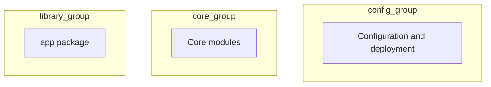

# Architecture report: duxianwei520/react

> Automated static analysis. **Observed** = directly seen in files/imports/AST; **Inferred** = interpretation from that evidence. Repository code was not executed.

## 1. Repository at a glance

| Item | Value |
| --- | --- |
| Repository | duxianwei520/react |
| Description |  React+vite+redux+ant design+axios+less全家桶后台管理框架 |
| Language | JavaScript |
| Stars | 5339 |
| Licence | MIT |
| Analysed commit / branch | a385305a9b281949dac3525edd940cec5089e2f6 / master |
| Framework(s) | React |
| Files analysed | 107 |
| Components | 3 |

## 2. Architecture in one minute

duxianwei520/react -  React+vite+redux+ant design+axios+less全家桶后台管理框架. This repository was analysed statically from 107 file(s) (0 Python). Detected technologies (observed from imports/manifests): React, axios, React Router, Redux, Redux Toolkit, Vite. Files are grouped into 3 component(s): app package, Configuration and deployment, Core modules. Findings below distinguish observed facts from inferred interpretation.

## 3. High-level block diagram

## 4. Main components

### app package (`app`)

- **Kind:** library
- **Status:** Observed
- **Confidence:** 0.85
- **Responsibility:** Groups 75 file(s) under app package (observed from repository paths and static analysis).
- **Paths:** `app/apis/common.js`, `app/apis/manage.js`, `app/client.jsx`, `app/components/draw/draw.js`, `app/components/draw/draw2.0.js`, `app/components/logo/logo.js`, `app/components/tableList/tableList.js`, `app/middleware/configureStore.js`, `app/middleware/history.js`, `app/middleware/index.js`, `app/middleware/logger.js`, `app/mocks/apis/base/index.js`, `app/mocks/apis/base/login.js`, `app/mocks/apis/base/logout.js`, `app/mocks/apis/base/menu.js`, `app/mocks/apis/base/staff.js`, `app/mocks/apis/fail.js`, `app/mocks/apis/success.js`, `app/mocks/apis/sys/moduleManage/fetchModuleDetail.js`, `app/mocks/apis/sys/moduleManage/fetchModuleList.js`, `app/mocks/apis/sys/moduleManage/index.js`, `app/mocks/apis/sys/roleManage/fetchButtonList.js`, `app/mocks/apis/sys/roleManage/fetchModuleListInRole.js`, `app/mocks/apis/sys/roleManage/fetchRoleDetail.js`, `app/mocks/apis/sys/roleManage/fetchTreeList.js`, `app/mocks/apis/sys/roleManage/index.js`, `app/mocks/apis/sys/userManage/fetchRoleList.js`, `app/mocks/apis/sys/userManage/fetchUserDepttList.js`, `app/mocks/apis/sys/userManage/fetchUserDetail.js`, `app/mocks/apis/sys/userManage/fetchUserList.js`, `app/mocks/apis/sys/userManage/index.js`, `app/mocks/apis/tableList.js`, `app/mocks/http.js`, `app/mocks/interfaceFilter.js`, `app/mocks/interfaceMap.js`, `app/pages/base/app.js`, `app/pages/base/app/header.js`, `app/pages/base/app/leftNav.js`, `app/pages/base/app/modal/editPassword.js`, `app/pages/base/app/modal/userInfo.js`, `app/pages/base/app/tabList.js`, `app/pages/base/developing.js`, `app/pages/base/example.js`, `app/pages/base/index.js`, `app/pages/base/login.js`, `app/pages/base/notfound.js`, `app/pages/base/socket.js`, `app/pages/base/socketReceive.js`, `app/pages/example.js`, `app/pages/menu/echarts.js`, `app/pages/menu/editor.js`, `app/pages/menu/index.js`, `app/pages/set/index.js`, `app/pages/set/moduleManage/index.js`, `app/pages/set/moduleManage/modal/addButtonModal.js`, `app/pages/set/moduleManage/modal/buttonModal.js`, `app/pages/set/moduleManage/modal/moduleAdd.js`, `app/pages/set/moduleManage/moduleList.js`, `app/pages/set/roleManage/index.js`, `app/pages/set/roleManage/modal/buttonModal.js`, `app/pages/set/roleManage/modal/roleAdd.js`, `app/pages/set/roleManage/peopleTreeList.js`, `app/pages/set/roleManage/roleCheckbox.js`, `app/pages/set/roleManage/roleList.js`, `app/pages/set/roleManage/roleModuleList.js`, `app/pages/set/userManage/index.js`, `app/pages/set/userManage/modal/addPolice.js`, `app/pages/set/userManage/modal/selectRole.js`, `app/pages/set/userManage/treeList.js`, `app/redux/actions/common.js`, `app/redux/actions/tabList.js`, `app/redux/reducers/common.js`, `app/redux/reducers/index.js`, `app/redux/reducers/tabList.js`, `app/utils/withRouter.js`
- **Evidence:** [app/apis/common.js](https://github.com/duxianwei520/react/blob/a385305a9b281949dac3525edd940cec5089e2f6/app/apis/common.js); [app/apis/manage.js](https://github.com/duxianwei520/react/blob/a385305a9b281949dac3525edd940cec5089e2f6/app/apis/manage.js); [app/client.jsx](https://github.com/duxianwei520/react/blob/a385305a9b281949dac3525edd940cec5089e2f6/app/client.jsx); [app/components/draw/draw.js](https://github.com/duxianwei520/react/blob/a385305a9b281949dac3525edd940cec5089e2f6/app/components/draw/draw.js); [app/components/draw/draw2.0.js](https://github.com/duxianwei520/react/blob/a385305a9b281949dac3525edd940cec5089e2f6/app/components/draw/draw2.0.js); [app/components/logo/logo.js](https://github.com/duxianwei520/react/blob/a385305a9b281949dac3525edd940cec5089e2f6/app/components/logo/logo.js); [app/components/tableList/tableList.js](https://github.com/duxianwei520/react/blob/a385305a9b281949dac3525edd940cec5089e2f6/app/components/tableList/tableList.js); [app/middleware/configureStore.js](https://github.com/duxianwei520/react/blob/a385305a9b281949dac3525edd940cec5089e2f6/app/middleware/configureStore.js)

### Configuration and deployment (`config`)

- **Kind:** config
- **Status:** Observed
- **Confidence:** 0.85
- **Responsibility:** Groups 8 file(s) under configuration and deployment (observed from repository paths and static analysis).
- **Paths:** `_config.yml`, `app/configs/ajax.js`, `app/configs/common.js`, `app/configs/config.js`, `app/configs/regular.config.js`, `app/configs/router.config.jsx`, `app/configs/socket.js`, `package.json`
- **Evidence:** [_config.yml](https://github.com/duxianwei520/react/blob/a385305a9b281949dac3525edd940cec5089e2f6/_config.yml); [app/configs/ajax.js](https://github.com/duxianwei520/react/blob/a385305a9b281949dac3525edd940cec5089e2f6/app/configs/ajax.js); [app/configs/common.js](https://github.com/duxianwei520/react/blob/a385305a9b281949dac3525edd940cec5089e2f6/app/configs/common.js); [app/configs/config.js](https://github.com/duxianwei520/react/blob/a385305a9b281949dac3525edd940cec5089e2f6/app/configs/config.js); [app/configs/regular.config.js](https://github.com/duxianwei520/react/blob/a385305a9b281949dac3525edd940cec5089e2f6/app/configs/regular.config.js); [app/configs/router.config.jsx](https://github.com/duxianwei520/react/blob/a385305a9b281949dac3525edd940cec5089e2f6/app/configs/router.config.jsx); [app/configs/socket.js](https://github.com/duxianwei520/react/blob/a385305a9b281949dac3525edd940cec5089e2f6/app/configs/socket.js); [package.json](https://github.com/duxianwei520/react/blob/a385305a9b281949dac3525edd940cec5089e2f6/package.json)

### Core modules (`core`)

- **Kind:** core
- **Status:** Observed
- **Confidence:** 0.85
- **Responsibility:** Groups 3 file(s) under core modules (observed from repository paths and static analysis).
- **Paths:** `babel.config.js`, `postcss.config.js`, `vite.config.js`
- **Evidence:** [babel.config.js](https://github.com/duxianwei520/react/blob/a385305a9b281949dac3525edd940cec5089e2f6/babel.config.js); [postcss.config.js](https://github.com/duxianwei520/react/blob/a385305a9b281949dac3525edd940cec5089e2f6/postcss.config.js); [vite.config.js](https://github.com/duxianwei520/react/blob/a385305a9b281949dac3525edd940cec5089e2f6/vite.config.js)

## 5. Execution flow

**Observed** entry point(s):

- [app/middleware/index.js](https://github.com/duxianwei520/react/blob/a385305a9b281949dac3525edd940cec5089e2f6/app/middleware/index.js)
- [app/pages/base/app.js](https://github.com/duxianwei520/react/blob/a385305a9b281949dac3525edd940cec5089e2f6/app/pages/base/app.js)
- [app/pages/base/index.js](https://github.com/duxianwei520/react/blob/a385305a9b281949dac3525edd940cec5089e2f6/app/pages/base/index.js)
- [app/pages/menu/index.js](https://github.com/duxianwei520/react/blob/a385305a9b281949dac3525edd940cec5089e2f6/app/pages/menu/index.js)
- [app/pages/set/index.js](https://github.com/duxianwei520/react/blob/a385305a9b281949dac3525edd940cec5089e2f6/app/pages/set/index.js)
- [app/redux/reducers/index.js](https://github.com/duxianwei520/react/blob/a385305a9b281949dac3525edd940cec5089e2f6/app/redux/reducers/index.js)

Representative flow (derived from observed entry points and the import graph; steps beyond the entry point are **Inferred**):

1. Execution starts at an observed entry point listed above, if present.
2. No internal import relationships between components were observed.

## 6. Project structure

### `(root)`

- `.eslintignore` - other (217 bytes)
- `.eslintrc.json` - config (2462 bytes)
- `.gitattributes` - other (51 bytes)
- `.gitignore` - other (786 bytes)
- `.lintstagedrc` - other (87 bytes)
- `.travis.yml` - ci, YAML (115 bytes)
- `LICENSE` - docs (1076 bytes)
- `_config.yml` - config (26 bytes)
- `babel.config.js` - source, JavaScript (404 bytes)
- `index.html` - other (285 bytes)
- `package.json` - manifest (2634 bytes)
- `postcss.config.js` - source, JavaScript (97 bytes)
- `readme.md` - docs (4080 bytes)
- `vite.config.js` - source, JavaScript (2583 bytes)

### `.circleci`

- `.circleci/config.yml` - ci, YAML (1494 bytes)

### `app`

- `app/apis/common.js` - source, JavaScript (4702 bytes)
- `app/apis/manage.js` - source, JavaScript (2927 bytes)
- `app/client.jsx` - source, JavaScript (389 bytes)
- `app/components/draw/README.md` - docs (1059 bytes)
- `app/components/draw/draw.js` - source, JavaScript (5954 bytes)
- `app/components/draw/draw.less` - other (6445 bytes)
- `app/components/draw/draw2.0.js` - source, JavaScript (4511 bytes)
- `app/components/logo/logo.css` - other (2026 bytes)
- `app/components/logo/logo.js` - source, JavaScript (5033 bytes)
- `app/components/tableList/tableList.js` - source, JavaScript (2287 bytes)
- `app/configs/ajax.js` - source, JavaScript (8232 bytes)
- `app/configs/common.js` - source, JavaScript (3898 bytes)
- `app/configs/config.js` - source, JavaScript (727 bytes)
- `app/configs/regular.config.js` - source, JavaScript (3011 bytes)
- `app/configs/router.config.jsx` - source, JavaScript (1855 bytes)
- `app/configs/socket.js` - source, JavaScript (2594 bytes)
- `app/index.html` - other (212 bytes)
- `app/middleware/configureStore.js` - source, JavaScript (818 bytes)
- `app/middleware/history.js` - source, JavaScript (104 bytes)
- `app/middleware/index.js` - source, JavaScript (143 bytes)
- `app/middleware/logger.js` - source, JavaScript (117 bytes)
- `app/mocks/apis/base/index.js` - source, JavaScript (171 bytes)
- `app/mocks/apis/base/login.js` - source, JavaScript (111 bytes)
- `app/mocks/apis/base/logout.js` - source, JavaScript (74 bytes)
- `app/mocks/apis/base/menu.js` - source, JavaScript (1229 bytes)
- `app/mocks/apis/base/staff.js` - source, JavaScript (738 bytes)
- `app/mocks/apis/fail.js` - source, JavaScript (72 bytes)
- `app/mocks/apis/success.js` - source, JavaScript (72 bytes)
- `app/mocks/apis/sys/moduleManage/fetchModuleDetail.js` - source, JavaScript (221 bytes)
- `app/mocks/apis/sys/moduleManage/fetchModuleList.js` - source, JavaScript (1013 bytes)
- `app/mocks/apis/sys/moduleManage/index.js` - source, JavaScript (464 bytes)
- `app/mocks/apis/sys/roleManage/fetchButtonList.js` - source, JavaScript (501 bytes)
- `app/mocks/apis/sys/roleManage/fetchModuleListInRole.js` - source, JavaScript (1787 bytes)
- `app/mocks/apis/sys/roleManage/fetchRoleDetail.js` - source, JavaScript (262 bytes)
- `app/mocks/apis/sys/roleManage/fetchTreeList.js` - source, JavaScript (1827 bytes)
- `app/mocks/apis/sys/roleManage/index.js` - source, JavaScript (724 bytes)
- `app/mocks/apis/sys/userManage/fetchRoleList.js` - source, JavaScript (545 bytes)
- `app/mocks/apis/sys/userManage/fetchUserDepttList.js` - source, JavaScript (1644 bytes)
- `app/mocks/apis/sys/userManage/fetchUserDetail.js` - source, JavaScript (342 bytes)
- `app/mocks/apis/sys/userManage/fetchUserList.js` - source, JavaScript (3138 bytes)
- `app/mocks/apis/sys/userManage/index.js` - source, JavaScript (697 bytes)
- `app/mocks/apis/tableList.js` - source, JavaScript (286 bytes)
- `app/mocks/http.js` - source, JavaScript (1488 bytes)
- `app/mocks/interfaceFilter.js` - source, JavaScript (458 bytes)
- `app/mocks/interfaceMap.js` - source, JavaScript (2258 bytes)
- `app/pages/base/app.js` - source, JavaScript (5118 bytes)
- `app/pages/base/app/header.js` - source, JavaScript (4348 bytes)
- `app/pages/base/app/leftNav.js` - source, JavaScript (4709 bytes)
- `app/pages/base/app/modal/editPassword.js` - source, JavaScript (3443 bytes)
- `app/pages/base/app/modal/userInfo.js` - source, JavaScript (4719 bytes)
- `app/pages/base/app/tabList.js` - source, JavaScript (1516 bytes)
- `app/pages/base/developing.js` - source, JavaScript (637 bytes)
- `app/pages/base/example.js` - source, JavaScript (848 bytes)
- `app/pages/base/index.js` - source, JavaScript (281 bytes)
- `app/pages/base/login.js` - source, JavaScript (5691 bytes)
- `app/pages/base/notfound.js` - source, JavaScript (867 bytes)
- `app/pages/base/socket.js` - source, JavaScript (552 bytes)
- `app/pages/base/socketReceive.js` - source, JavaScript (680 bytes)
- `app/pages/example.js` - source, JavaScript (592 bytes)
- `app/pages/menu/echarts.js` - source, JavaScript (17632 bytes)
- `app/pages/menu/editor.js` - source, JavaScript (4921 bytes)
- `app/pages/menu/index.js` - source, JavaScript (94 bytes)
- `app/pages/set/index.js` - source, JavaScript (194 bytes)
- `app/pages/set/moduleManage/index.js` - source, JavaScript (8812 bytes)
- `app/pages/set/moduleManage/modal/addButtonModal.js` - source, JavaScript (2654 bytes)
- `app/pages/set/moduleManage/modal/buttonModal.js` - source, JavaScript (3449 bytes)
- `app/pages/set/moduleManage/modal/moduleAdd.js` - source, JavaScript (4357 bytes)
- `app/pages/set/moduleManage/moduleList.js` - source, JavaScript (2670 bytes)
- `app/pages/set/roleManage/index.js` - source, JavaScript (15048 bytes)
- `app/pages/set/roleManage/modal/buttonModal.js` - source, JavaScript (3539 bytes)
- `app/pages/set/roleManage/modal/roleAdd.js` - source, JavaScript (3390 bytes)
- `app/pages/set/roleManage/peopleTreeList.js` - source, JavaScript (910 bytes)
- `app/pages/set/roleManage/roleCheckbox.js` - source, JavaScript (1079 bytes)
- `app/pages/set/roleManage/roleList.js` - source, JavaScript (2134 bytes)
- `app/pages/set/roleManage/roleModuleList.js` - source, JavaScript (8949 bytes)
- `app/pages/set/userManage/index.js` - source, JavaScript (10626 bytes)
- `app/pages/set/userManage/modal/addPolice.js` - source, JavaScript (5557 bytes)
- `app/pages/set/userManage/modal/selectRole.js` - source, JavaScript (1820 bytes)
- `app/pages/set/userManage/treeList.js` - source, JavaScript (1768 bytes)
- `app/redux/actions/common.js` - source, JavaScript (346 bytes)
- `app/redux/actions/tabList.js` - source, JavaScript (103 bytes)
- `app/redux/reducers/common.js` - source, JavaScript (1722 bytes)
- `app/redux/reducers/index.js` - source, JavaScript (243 bytes)
- `app/redux/reducers/tabList.js` - source, JavaScript (1845 bytes)
- `app/resource/iconfont/iconfont.svg` - other (113993 bytes)
- `app/styles/RichEditor.less` - other (1434 bytes)
- `app/styles/base.less` - other (27564 bytes)
- `app/styles/login.less` - other (2195 bytes)
- `app/styles/personalCenter.less` - other (838 bytes)
- `app/styles/set.less` - other (4379 bytes)
- `app/styles/theme.less` - other (4117 bytes)
- `app/utils/withRouter.js` - source, JavaScript (464 bytes)

## 7. Key dependencies and integrations

| Name | Category | Status | Confidence | Evidence |
| --- | --- | --- | --- | --- |
| React | framework | Observed | 0.90 | [package.json:2](https://github.com/duxianwei520/react/blob/a385305a9b281949dac3525edd940cec5089e2f6/package.json#L2); [package.json:89](https://github.com/duxianwei520/react/blob/a385305a9b281949dac3525edd940cec5089e2f6/package.json#L89) |
| axios | library | Observed | 0.85 | [package.json:72](https://github.com/duxianwei520/react/blob/a385305a9b281949dac3525edd940cec5089e2f6/package.json#L72) |
| React Router | library | Observed | 0.85 | [package.json:91](https://github.com/duxianwei520/react/blob/a385305a9b281949dac3525edd940cec5089e2f6/package.json#L91) |
| Redux | library | Observed | 0.85 | [package.json:70](https://github.com/duxianwei520/react/blob/a385305a9b281949dac3525edd940cec5089e2f6/package.json#L70) |
| Redux Toolkit | library | Observed | 0.85 | [package.json:70](https://github.com/duxianwei520/react/blob/a385305a9b281949dac3525edd940cec5089e2f6/package.json#L70) |
| Vite | tooling | Observed | 0.85 | [package.json:13](https://github.com/duxianwei520/react/blob/a385305a9b281949dac3525edd940cec5089e2f6/package.json#L13) |

## 8. Data and state

No database, cache, queue, or persistent-state usage was observed in the analysed files. State handling, if any, may be in-memory or in files that were not analysed.

## 9. Configuration and deployment clues

- `.circleci/config.yml` (ci)
- `.eslintrc.json` (config)
- `.travis.yml` (ci)
- `_config.yml` (config)
- `package.json` (manifest)

## 10. Design observations

- No strong design patterns could be established from the available evidence.

These observations are interpretations (**Inferred**) of the observed structure, not guarantees about runtime design.

## 11. Limitations and unknowns

- Static analysis only: repository code was not executed, installed, or imported at runtime.
- Components and relationships are inferred from file paths, imports, and AST structure; runtime behaviour, dynamic imports, and reflection may not be visible.
- No clear application entry point was observed in the analysed files.
- Repository text was treated as untrusted data; no instructions found in repository files were followed, and likely secret values were redacted/excluded.
- JavaScript and TypeScript files were inventoried from paths and package manifests. They were not parsed with a full language AST, and repository code was not executed.

## 12. Source references

- [_config.yml](https://github.com/duxianwei520/react/blob/a385305a9b281949dac3525edd940cec5089e2f6/_config.yml)
- [app/apis/common.js](https://github.com/duxianwei520/react/blob/a385305a9b281949dac3525edd940cec5089e2f6/app/apis/common.js)
- [app/apis/manage.js](https://github.com/duxianwei520/react/blob/a385305a9b281949dac3525edd940cec5089e2f6/app/apis/manage.js)
- [app/client.jsx](https://github.com/duxianwei520/react/blob/a385305a9b281949dac3525edd940cec5089e2f6/app/client.jsx)
- [app/components/draw/draw.js](https://github.com/duxianwei520/react/blob/a385305a9b281949dac3525edd940cec5089e2f6/app/components/draw/draw.js)
- [app/components/draw/draw2.0.js](https://github.com/duxianwei520/react/blob/a385305a9b281949dac3525edd940cec5089e2f6/app/components/draw/draw2.0.js)
- [app/components/logo/logo.js](https://github.com/duxianwei520/react/blob/a385305a9b281949dac3525edd940cec5089e2f6/app/components/logo/logo.js)
- [app/components/tableList/tableList.js](https://github.com/duxianwei520/react/blob/a385305a9b281949dac3525edd940cec5089e2f6/app/components/tableList/tableList.js)
- [app/configs/ajax.js](https://github.com/duxianwei520/react/blob/a385305a9b281949dac3525edd940cec5089e2f6/app/configs/ajax.js)
- [app/configs/common.js](https://github.com/duxianwei520/react/blob/a385305a9b281949dac3525edd940cec5089e2f6/app/configs/common.js)
- [app/configs/config.js](https://github.com/duxianwei520/react/blob/a385305a9b281949dac3525edd940cec5089e2f6/app/configs/config.js)
- [app/configs/regular.config.js](https://github.com/duxianwei520/react/blob/a385305a9b281949dac3525edd940cec5089e2f6/app/configs/regular.config.js)
- [app/configs/router.config.jsx](https://github.com/duxianwei520/react/blob/a385305a9b281949dac3525edd940cec5089e2f6/app/configs/router.config.jsx)
- [app/configs/socket.js](https://github.com/duxianwei520/react/blob/a385305a9b281949dac3525edd940cec5089e2f6/app/configs/socket.js)
- [app/middleware/configureStore.js](https://github.com/duxianwei520/react/blob/a385305a9b281949dac3525edd940cec5089e2f6/app/middleware/configureStore.js)
- [app/middleware/index.js](https://github.com/duxianwei520/react/blob/a385305a9b281949dac3525edd940cec5089e2f6/app/middleware/index.js)
- [app/pages/base/app.js](https://github.com/duxianwei520/react/blob/a385305a9b281949dac3525edd940cec5089e2f6/app/pages/base/app.js)
- [app/pages/base/index.js](https://github.com/duxianwei520/react/blob/a385305a9b281949dac3525edd940cec5089e2f6/app/pages/base/index.js)
- [app/pages/menu/index.js](https://github.com/duxianwei520/react/blob/a385305a9b281949dac3525edd940cec5089e2f6/app/pages/menu/index.js)
- [app/pages/set/index.js](https://github.com/duxianwei520/react/blob/a385305a9b281949dac3525edd940cec5089e2f6/app/pages/set/index.js)
- [app/redux/reducers/index.js](https://github.com/duxianwei520/react/blob/a385305a9b281949dac3525edd940cec5089e2f6/app/redux/reducers/index.js)
- [babel.config.js](https://github.com/duxianwei520/react/blob/a385305a9b281949dac3525edd940cec5089e2f6/babel.config.js)
- [package.json](https://github.com/duxianwei520/react/blob/a385305a9b281949dac3525edd940cec5089e2f6/package.json)
- [package.json:2](https://github.com/duxianwei520/react/blob/a385305a9b281949dac3525edd940cec5089e2f6/package.json#L2)
- [package.json:13](https://github.com/duxianwei520/react/blob/a385305a9b281949dac3525edd940cec5089e2f6/package.json#L13)
- [package.json:70](https://github.com/duxianwei520/react/blob/a385305a9b281949dac3525edd940cec5089e2f6/package.json#L70)
- [package.json:72](https://github.com/duxianwei520/react/blob/a385305a9b281949dac3525edd940cec5089e2f6/package.json#L72)
- [package.json:89](https://github.com/duxianwei520/react/blob/a385305a9b281949dac3525edd940cec5089e2f6/package.json#L89)
- [package.json:91](https://github.com/duxianwei520/react/blob/a385305a9b281949dac3525edd940cec5089e2f6/package.json#L91)
- [postcss.config.js](https://github.com/duxianwei520/react/blob/a385305a9b281949dac3525edd940cec5089e2f6/postcss.config.js)
- [vite.config.js](https://github.com/duxianwei520/react/blob/a385305a9b281949dac3525edd940cec5089e2f6/vite.config.js)
