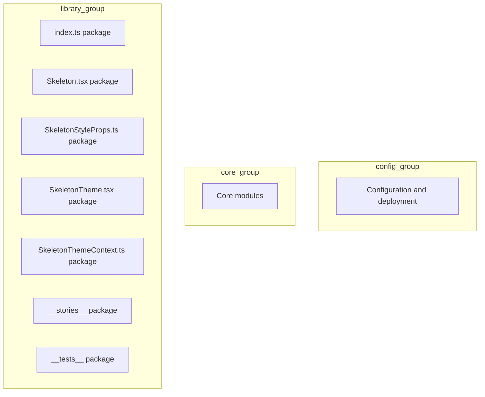

# Architecture report: dvtng/react-loading-skeleton

> Automated static analysis. **Observed** = directly seen in files/imports/AST; **Inferred** = interpretation from that evidence. Repository code was not executed.

## 1. Repository at a glance

| Item | Value |
| --- | --- |
| Repository | dvtng/react-loading-skeleton |
| Description | Create skeleton screens that automatically adapt to your app! |
| Language | TypeScript |
| Stars | 4213 |
| Licence | MIT |
| Analysed commit / branch | f8b040dade9cfaad7e3e6fbc50243d79f508f1ca / master |
| Framework(s) | React |
| Files analysed | 43 |
| Components | 9 |

## 2. Architecture in one minute

dvtng/react-loading-skeleton - Create skeleton screens that automatically adapt to your app!. This repository was analysed statically from 43 file(s) (0 Python). Detected technologies (observed from imports/manifests): GitHub Actions, React, TypeScript, Vite, Vitest. Files are grouped into 9 component(s): Configuration and deployment, Core modules, index.ts package, Skeleton.tsx package, SkeletonStyleProps.ts package, SkeletonTheme.tsx package, SkeletonThemeContext.ts package, __stories__ package. Findings below distinguish observed facts from inferred interpretation.

## 3. High-level block diagram

## 4. Main components

### Configuration and deployment (`config`)

- **Kind:** config
- **Status:** Observed
- **Confidence:** 0.85
- **Responsibility:** Groups 2 file(s) under configuration and deployment (observed from repository paths and static analysis).
- **Paths:** `package.json`, `tsconfig.json`
- **Evidence:** [package.json](https://github.com/dvtng/react-loading-skeleton/blob/f8b040dade9cfaad7e3e6fbc50243d79f508f1ca/package.json); [tsconfig.json](https://github.com/dvtng/react-loading-skeleton/blob/f8b040dade9cfaad7e3e6fbc50243d79f508f1ca/tsconfig.json)

### Core modules (`core`)

- **Kind:** core
- **Status:** Observed
- **Confidence:** 0.85
- **Responsibility:** Groups 2 file(s) under core modules (observed from repository paths and static analysis).
- **Paths:** `rollup.config.js`, `vite.config.ts`
- **Evidence:** [rollup.config.js](https://github.com/dvtng/react-loading-skeleton/blob/f8b040dade9cfaad7e3e6fbc50243d79f508f1ca/rollup.config.js); [vite.config.ts](https://github.com/dvtng/react-loading-skeleton/blob/f8b040dade9cfaad7e3e6fbc50243d79f508f1ca/vite.config.ts)

### index.ts package (`index_ts`)

- **Kind:** library
- **Status:** Observed
- **Confidence:** 0.85
- **Responsibility:** Groups 1 file(s) under index.ts package (observed from repository paths and static analysis).
- **Paths:** `src/index.ts`
- **Evidence:** [src/index.ts](https://github.com/dvtng/react-loading-skeleton/blob/f8b040dade9cfaad7e3e6fbc50243d79f508f1ca/src/index.ts)

### Skeleton.tsx package (`skeleton_tsx`)

- **Kind:** library
- **Status:** Observed
- **Confidence:** 0.85
- **Responsibility:** Groups 1 file(s) under skeleton.tsx package (observed from repository paths and static analysis).
- **Paths:** `src/Skeleton.tsx`
- **Evidence:** [src/Skeleton.tsx](https://github.com/dvtng/react-loading-skeleton/blob/f8b040dade9cfaad7e3e6fbc50243d79f508f1ca/src/Skeleton.tsx)

### SkeletonStyleProps.ts package (`skeletonstyleprops_ts`)

- **Kind:** library
- **Status:** Observed
- **Confidence:** 0.85
- **Responsibility:** Groups 1 file(s) under skeletonstyleprops.ts package (observed from repository paths and static analysis).
- **Paths:** `src/SkeletonStyleProps.ts`
- **Evidence:** [src/SkeletonStyleProps.ts](https://github.com/dvtng/react-loading-skeleton/blob/f8b040dade9cfaad7e3e6fbc50243d79f508f1ca/src/SkeletonStyleProps.ts)

### SkeletonTheme.tsx package (`skeletontheme_tsx`)

- **Kind:** library
- **Status:** Observed
- **Confidence:** 0.85
- **Responsibility:** Groups 1 file(s) under skeletontheme.tsx package (observed from repository paths and static analysis).
- **Paths:** `src/SkeletonTheme.tsx`
- **Evidence:** [src/SkeletonTheme.tsx](https://github.com/dvtng/react-loading-skeleton/blob/f8b040dade9cfaad7e3e6fbc50243d79f508f1ca/src/SkeletonTheme.tsx)

### SkeletonThemeContext.ts package (`skeletonthemecontext_ts`)

- **Kind:** library
- **Status:** Observed
- **Confidence:** 0.85
- **Responsibility:** Groups 1 file(s) under skeletonthemecontext.ts package (observed from repository paths and static analysis).
- **Paths:** `src/SkeletonThemeContext.ts`
- **Evidence:** [src/SkeletonThemeContext.ts](https://github.com/dvtng/react-loading-skeleton/blob/f8b040dade9cfaad7e3e6fbc50243d79f508f1ca/src/SkeletonThemeContext.ts)

### __stories__ package (`stories`)

- **Kind:** library
- **Status:** Observed
- **Confidence:** 0.85
- **Responsibility:** Groups 7 file(s) under __stories__ package (observed from repository paths and static analysis).
- **Paths:** `src/__stories__/Post.stories.tsx`, `src/__stories__/Skeleton.stories.tsx`, `src/__stories__/SkeletonTheme.stories.tsx`, `src/__stories__/components/Box.tsx`, `src/__stories__/components/Post.tsx`, `src/__stories__/components/SideBySide.tsx`, `src/__stories__/components/index.ts`
- **Evidence:** [src/__stories__/Post.stories.tsx](https://github.com/dvtng/react-loading-skeleton/blob/f8b040dade9cfaad7e3e6fbc50243d79f508f1ca/src/__stories__/Post.stories.tsx); [src/__stories__/Skeleton.stories.tsx](https://github.com/dvtng/react-loading-skeleton/blob/f8b040dade9cfaad7e3e6fbc50243d79f508f1ca/src/__stories__/Skeleton.stories.tsx); [src/__stories__/SkeletonTheme.stories.tsx](https://github.com/dvtng/react-loading-skeleton/blob/f8b040dade9cfaad7e3e6fbc50243d79f508f1ca/src/__stories__/SkeletonTheme.stories.tsx); [src/__stories__/components/Box.tsx](https://github.com/dvtng/react-loading-skeleton/blob/f8b040dade9cfaad7e3e6fbc50243d79f508f1ca/src/__stories__/components/Box.tsx); [src/__stories__/components/Post.tsx](https://github.com/dvtng/react-loading-skeleton/blob/f8b040dade9cfaad7e3e6fbc50243d79f508f1ca/src/__stories__/components/Post.tsx); [src/__stories__/components/SideBySide.tsx](https://github.com/dvtng/react-loading-skeleton/blob/f8b040dade9cfaad7e3e6fbc50243d79f508f1ca/src/__stories__/components/SideBySide.tsx); [src/__stories__/components/index.ts](https://github.com/dvtng/react-loading-skeleton/blob/f8b040dade9cfaad7e3e6fbc50243d79f508f1ca/src/__stories__/components/index.ts)

### __tests__ package (`tests`)

- **Kind:** library
- **Status:** Observed
- **Confidence:** 0.85
- **Responsibility:** Groups 4 file(s) under __tests__ package (observed from repository paths and static analysis).
- **Paths:** `src/__tests__/Skeleton.test.tsx`, `src/__tests__/SkeletonTheme.test.tsx`, `src/__tests__/__helpers__/index.ts`, `src/__tests__/index.test.tsx`
- **Evidence:** [src/__tests__/Skeleton.test.tsx](https://github.com/dvtng/react-loading-skeleton/blob/f8b040dade9cfaad7e3e6fbc50243d79f508f1ca/src/__tests__/Skeleton.test.tsx); [src/__tests__/SkeletonTheme.test.tsx](https://github.com/dvtng/react-loading-skeleton/blob/f8b040dade9cfaad7e3e6fbc50243d79f508f1ca/src/__tests__/SkeletonTheme.test.tsx); [src/__tests__/__helpers__/index.ts](https://github.com/dvtng/react-loading-skeleton/blob/f8b040dade9cfaad7e3e6fbc50243d79f508f1ca/src/__tests__/__helpers__/index.ts); [src/__tests__/index.test.tsx](https://github.com/dvtng/react-loading-skeleton/blob/f8b040dade9cfaad7e3e6fbc50243d79f508f1ca/src/__tests__/index.test.tsx)

## 5. Execution flow

**Observed** entry point(s):

- [.storybook/main.ts](https://github.com/dvtng/react-loading-skeleton/blob/f8b040dade9cfaad7e3e6fbc50243d79f508f1ca/.storybook/main.ts)
- [src/__stories__/components/index.ts](https://github.com/dvtng/react-loading-skeleton/blob/f8b040dade9cfaad7e3e6fbc50243d79f508f1ca/src/__stories__/components/index.ts)
- [src/index.ts](https://github.com/dvtng/react-loading-skeleton/blob/f8b040dade9cfaad7e3e6fbc50243d79f508f1ca/src/index.ts)

Representative flow (derived from observed entry points and the import graph; steps beyond the entry point are **Inferred**):

1. Execution starts at an observed entry point listed above, if present.
2. No internal import relationships between components were observed.

## 6. Project structure

### `(root)`

- `.editorconfig` - config (147 bytes)
- `.eslintrc.cjs` - source, JavaScript (1724 bytes)
- `.gitignore` - other (107 bytes)
- `.prettierignore` - other (5 bytes)
- `.prettierrc.cjs` - source, JavaScript (43 bytes)
- `.swcrc` - other (206 bytes)
- `.yarnrc.yml` - config (66 bytes)
- `CHANGELOG.md` - docs (4337 bytes)
- `CONTRIBUTING.md` - docs (932 bytes)
- `LICENSE` - docs (1050 bytes)
- `README.md` - docs (10451 bytes)
- `package.json` - manifest (2969 bytes)
- `rollup.config.js` - source, JavaScript (2037 bytes)
- `tsconfig.json` - config (592 bytes)
- `vite.config.ts` - source, TypeScript (295 bytes)

### `.github`

- `.github/CODE_OF_CONDUCT.md` - docs (5483 bytes)
- `.github/ISSUE_TEMPLATE/bug_report.md` - docs (497 bytes)
- `.github/ISSUE_TEMPLATE/feature_request.md` - docs (594 bytes)
- `.github/workflows/ci.yml` - ci, YAML (565 bytes)

### `.husky`

- `.husky/pre-commit` - other (59 bytes)

### `.storybook`

- `.storybook/main.ts` - source, TypeScript (361 bytes)
- `.storybook/preview.ts` - source, TypeScript (341 bytes)
- `.storybook/storybook.css` - other (36 bytes)

### `assets`

- `assets/logo-inkscape-src.svg` - other (3362 bytes)
- `assets/logo.svg` - other (2333 bytes)

### `src`

- `src/Skeleton.tsx` - source, TypeScript (4648 bytes)
- `src/SkeletonStyleProps.ts` - source, TypeScript (318 bytes)
- `src/SkeletonTheme.tsx` - source, TypeScript (496 bytes)
- `src/SkeletonThemeContext.ts` - source, TypeScript (192 bytes)
- `src/__stories__/Post.stories.tsx` - source, TypeScript (474 bytes)
- `src/__stories__/Skeleton.stories.tsx` - source, TypeScript (12348 bytes)
- `src/__stories__/SkeletonTheme.stories.tsx` - source, TypeScript (2568 bytes)
- `src/__stories__/components/Box.tsx` - source, TypeScript (338 bytes)
- `src/__stories__/components/Post.tsx` - source, TypeScript (918 bytes)
- `src/__stories__/components/SideBySide.tsx` - source, TypeScript (771 bytes)
- `src/__stories__/components/index.ts` - source, TypeScript (86 bytes)
- `src/__stories__/styles/Skeleton.stories.css` - other (96 bytes)
- `src/__tests__/Skeleton.test.tsx` - source, TypeScript (4631 bytes)
- `src/__tests__/SkeletonTheme.test.tsx` - source, TypeScript (2149 bytes)
- `src/__tests__/__helpers__/index.ts` - source, TypeScript (730 bytes)
- `src/__tests__/index.test.tsx` - source, TypeScript (625 bytes)
- `src/index.ts` - source, TypeScript (197 bytes)
- `src/skeleton.css` - other (1255 bytes)

## 7. Key dependencies and integrations

| Name | Category | Status | Confidence | Evidence |
| --- | --- | --- | --- | --- |
| GitHub Actions | ci | Observed | 0.85 | [.github/workflows/ci.yml](https://github.com/dvtng/react-loading-skeleton/blob/f8b040dade9cfaad7e3e6fbc50243d79f508f1ca/.github/workflows/ci.yml) |
| React | framework | Observed | 0.90 | [package.json:2](https://github.com/dvtng/react-loading-skeleton/blob/f8b040dade9cfaad7e3e6fbc50243d79f508f1ca/package.json#L2); [package.json:68](https://github.com/dvtng/react-loading-skeleton/blob/f8b040dade9cfaad7e3e6fbc50243d79f508f1ca/package.json#L68) |
| TypeScript | tooling | Observed | 0.85 | [package.json:57](https://github.com/dvtng/react-loading-skeleton/blob/f8b040dade9cfaad7e3e6fbc50243d79f508f1ca/package.json#L57) |
| Vite | tooling | Observed | 0.85 | [package.json:45](https://github.com/dvtng/react-loading-skeleton/blob/f8b040dade9cfaad7e3e6fbc50243d79f508f1ca/package.json#L45) |
| Vitest | tooling | Observed | 0.85 | [package.json:45](https://github.com/dvtng/react-loading-skeleton/blob/f8b040dade9cfaad7e3e6fbc50243d79f508f1ca/package.json#L45) |

## 8. Data and state

No database, cache, queue, or persistent-state usage was observed in the analysed files. State handling, if any, may be in-memory or in files that were not analysed.

## 9. Configuration and deployment clues

- `.editorconfig` (config)
- `.github/workflows/ci.yml` (ci)
- `.yarnrc.yml` (config)
- `package.json` (manifest)
- `tsconfig.json` (config)

## 10. Design observations

- No strong design patterns could be established from the available evidence.

These observations are interpretations (**Inferred**) of the observed structure, not guarantees about runtime design.

## 11. Limitations and unknowns

- Static analysis only: repository code was not executed, installed, or imported at runtime.
- Components and relationships are inferred from file paths, imports, and AST structure; runtime behaviour, dynamic imports, and reflection may not be visible.
- No clear application entry point was observed in the analysed files.
- Repository text was treated as untrusted data; no instructions found in repository files were followed, and likely secret values were redacted/excluded.
- JavaScript and TypeScript files were inventoried from paths and package manifests. They were not parsed with a full language AST, and repository code was not executed.

## 12. Source references

- [.github/workflows/ci.yml](https://github.com/dvtng/react-loading-skeleton/blob/f8b040dade9cfaad7e3e6fbc50243d79f508f1ca/.github/workflows/ci.yml)
- [.storybook/main.ts](https://github.com/dvtng/react-loading-skeleton/blob/f8b040dade9cfaad7e3e6fbc50243d79f508f1ca/.storybook/main.ts)
- [package.json](https://github.com/dvtng/react-loading-skeleton/blob/f8b040dade9cfaad7e3e6fbc50243d79f508f1ca/package.json)
- [package.json:2](https://github.com/dvtng/react-loading-skeleton/blob/f8b040dade9cfaad7e3e6fbc50243d79f508f1ca/package.json#L2)
- [package.json:45](https://github.com/dvtng/react-loading-skeleton/blob/f8b040dade9cfaad7e3e6fbc50243d79f508f1ca/package.json#L45)
- [package.json:57](https://github.com/dvtng/react-loading-skeleton/blob/f8b040dade9cfaad7e3e6fbc50243d79f508f1ca/package.json#L57)
- [package.json:68](https://github.com/dvtng/react-loading-skeleton/blob/f8b040dade9cfaad7e3e6fbc50243d79f508f1ca/package.json#L68)
- [rollup.config.js](https://github.com/dvtng/react-loading-skeleton/blob/f8b040dade9cfaad7e3e6fbc50243d79f508f1ca/rollup.config.js)
- [src/Skeleton.tsx](https://github.com/dvtng/react-loading-skeleton/blob/f8b040dade9cfaad7e3e6fbc50243d79f508f1ca/src/Skeleton.tsx)
- [src/SkeletonStyleProps.ts](https://github.com/dvtng/react-loading-skeleton/blob/f8b040dade9cfaad7e3e6fbc50243d79f508f1ca/src/SkeletonStyleProps.ts)
- [src/SkeletonTheme.tsx](https://github.com/dvtng/react-loading-skeleton/blob/f8b040dade9cfaad7e3e6fbc50243d79f508f1ca/src/SkeletonTheme.tsx)
- [src/SkeletonThemeContext.ts](https://github.com/dvtng/react-loading-skeleton/blob/f8b040dade9cfaad7e3e6fbc50243d79f508f1ca/src/SkeletonThemeContext.ts)
- [src/__stories__/Post.stories.tsx](https://github.com/dvtng/react-loading-skeleton/blob/f8b040dade9cfaad7e3e6fbc50243d79f508f1ca/src/__stories__/Post.stories.tsx)
- [src/__stories__/Skeleton.stories.tsx](https://github.com/dvtng/react-loading-skeleton/blob/f8b040dade9cfaad7e3e6fbc50243d79f508f1ca/src/__stories__/Skeleton.stories.tsx)
- [src/__stories__/SkeletonTheme.stories.tsx](https://github.com/dvtng/react-loading-skeleton/blob/f8b040dade9cfaad7e3e6fbc50243d79f508f1ca/src/__stories__/SkeletonTheme.stories.tsx)
- [src/__stories__/components/Box.tsx](https://github.com/dvtng/react-loading-skeleton/blob/f8b040dade9cfaad7e3e6fbc50243d79f508f1ca/src/__stories__/components/Box.tsx)
- [src/__stories__/components/Post.tsx](https://github.com/dvtng/react-loading-skeleton/blob/f8b040dade9cfaad7e3e6fbc50243d79f508f1ca/src/__stories__/components/Post.tsx)
- [src/__stories__/components/SideBySide.tsx](https://github.com/dvtng/react-loading-skeleton/blob/f8b040dade9cfaad7e3e6fbc50243d79f508f1ca/src/__stories__/components/SideBySide.tsx)
- [src/__stories__/components/index.ts](https://github.com/dvtng/react-loading-skeleton/blob/f8b040dade9cfaad7e3e6fbc50243d79f508f1ca/src/__stories__/components/index.ts)
- [src/__tests__/Skeleton.test.tsx](https://github.com/dvtng/react-loading-skeleton/blob/f8b040dade9cfaad7e3e6fbc50243d79f508f1ca/src/__tests__/Skeleton.test.tsx)
- [src/__tests__/SkeletonTheme.test.tsx](https://github.com/dvtng/react-loading-skeleton/blob/f8b040dade9cfaad7e3e6fbc50243d79f508f1ca/src/__tests__/SkeletonTheme.test.tsx)
- [src/__tests__/__helpers__/index.ts](https://github.com/dvtng/react-loading-skeleton/blob/f8b040dade9cfaad7e3e6fbc50243d79f508f1ca/src/__tests__/__helpers__/index.ts)
- [src/__tests__/index.test.tsx](https://github.com/dvtng/react-loading-skeleton/blob/f8b040dade9cfaad7e3e6fbc50243d79f508f1ca/src/__tests__/index.test.tsx)
- [src/index.ts](https://github.com/dvtng/react-loading-skeleton/blob/f8b040dade9cfaad7e3e6fbc50243d79f508f1ca/src/index.ts)
- [tsconfig.json](https://github.com/dvtng/react-loading-skeleton/blob/f8b040dade9cfaad7e3e6fbc50243d79f508f1ca/tsconfig.json)
- [vite.config.ts](https://github.com/dvtng/react-loading-skeleton/blob/f8b040dade9cfaad7e3e6fbc50243d79f508f1ca/vite.config.ts)
