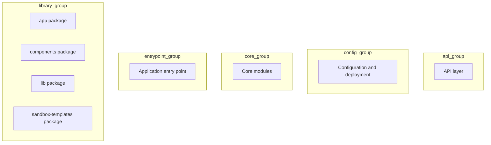

# Architecture report: e2b-dev/fragments

> Automated static analysis. **Observed** = directly seen in files/imports/AST; **Inferred** = interpretation from that evidence. Repository code was not executed.

## 1. Repository at a glance

| Item | Value |
| --- | --- |
| Repository | e2b-dev/fragments |
| Description | Open-source Next.js template for building apps that are fully generated by AI. By E2B. |
| Language | TypeScript |
| Stars | 6412 |
| Licence | Apache-2.0 |
| Analysed commit / branch | 3b11c7fcd4dcc37b2f1effde35960cf6ec4bd3c7 / main |
| Framework(s) | Next.js, React |
| Files analysed | 118 |
| Components | 8 |

## 2. Architecture in one minute

e2b-dev/fragments - Open-source Next.js template for building apps that are fully generated by AI. By E2B.. This repository was analysed statically from 118 file(s) (2 Python). Detected technologies (observed from imports/manifests): GitHub Actions, Next.js, React, Tailwind CSS, TypeScript. Files are grouped into 8 component(s): API layer, app package, components package, Configuration and deployment, Core modules, Application entry point, lib package, sandbox-templates package. Findings below distinguish observed facts from inferred interpretation.

## 3. High-level block diagram

## 4. Main components

### API layer (`api_layer`)

- **Kind:** api
- **Status:** Observed
- **Confidence:** 0.85
- **Responsibility:** Groups 4 file(s) under api layer (observed from repository paths and static analysis).
- **Paths:** `app/api/chat/route.ts`, `app/api/morph-chat/route.ts`, `app/api/routes.test.ts`, `app/api/sandbox/route.ts`
- **Evidence:** [app/api/chat/route.ts](https://github.com/e2b-dev/fragments/blob/3b11c7fcd4dcc37b2f1effde35960cf6ec4bd3c7/app/api/chat/route.ts); [app/api/morph-chat/route.ts](https://github.com/e2b-dev/fragments/blob/3b11c7fcd4dcc37b2f1effde35960cf6ec4bd3c7/app/api/morph-chat/route.ts); [app/api/routes.test.ts](https://github.com/e2b-dev/fragments/blob/3b11c7fcd4dcc37b2f1effde35960cf6ec4bd3c7/app/api/routes.test.ts); [app/api/sandbox/route.ts](https://github.com/e2b-dev/fragments/blob/3b11c7fcd4dcc37b2f1effde35960cf6ec4bd3c7/app/api/sandbox/route.ts)

### app package (`app`)

- **Kind:** library
- **Status:** Observed
- **Confidence:** 0.85
- **Responsibility:** Groups 5 file(s) under app package (observed from repository paths and static analysis).
- **Paths:** `app/actions/publish.ts`, `app/actions/validate-email.ts`, `app/layout.tsx`, `app/page.tsx`, `app/providers.tsx`
- **Evidence:** [app/actions/publish.ts](https://github.com/e2b-dev/fragments/blob/3b11c7fcd4dcc37b2f1effde35960cf6ec4bd3c7/app/actions/publish.ts); [app/actions/validate-email.ts](https://github.com/e2b-dev/fragments/blob/3b11c7fcd4dcc37b2f1effde35960cf6ec4bd3c7/app/actions/validate-email.ts); [app/layout.tsx](https://github.com/e2b-dev/fragments/blob/3b11c7fcd4dcc37b2f1effde35960cf6ec4bd3c7/app/layout.tsx); [app/page.tsx](https://github.com/e2b-dev/fragments/blob/3b11c7fcd4dcc37b2f1effde35960cf6ec4bd3c7/app/page.tsx); [app/providers.tsx](https://github.com/e2b-dev/fragments/blob/3b11c7fcd4dcc37b2f1effde35960cf6ec4bd3c7/app/providers.tsx)

### components package (`components`)

- **Kind:** library
- **Status:** Observed
- **Confidence:** 0.85
- **Responsibility:** Groups 37 file(s) under components package (observed from repository paths and static analysis).
- **Paths:** `components/auth-dialog.tsx`, `components/auth.tsx`, `components/chat-input.tsx`, `components/chat-picker.tsx`, `components/chat-settings.tsx`, `components/chat.tsx`, `components/code-view.tsx`, `components/deploy-dialog.tsx`, `components/fragment-code.tsx`, `components/fragment-interpreter.tsx`, `components/fragment-preview.tsx`, `components/fragment-web.tsx`, `components/icons.tsx`, `components/logo.tsx`, `components/navbar.tsx`, `components/preview.tsx`, `components/repo-banner.tsx`, `components/ui/alert.tsx`, `components/ui/avatar.tsx`, `components/ui/button.tsx`, `components/ui/card.tsx`, `components/ui/copy-button.tsx`, `components/ui/dialog.tsx`, `components/ui/dropdown-menu.tsx`, `components/ui/input.tsx`, `components/ui/label.tsx`, `components/ui/select.tsx`, `components/ui/separator.tsx`, `components/ui/skeleton.tsx`, `components/ui/switch.tsx`, `components/ui/tabs.tsx`, `components/ui/textarea.tsx`, `components/ui/theme-toggle.tsx`, `components/ui/toast.tsx`, `components/ui/toaster.tsx`, `components/ui/tooltip.tsx`, `components/ui/use-toast.ts`
- **Evidence:** [components/auth-dialog.tsx](https://github.com/e2b-dev/fragments/blob/3b11c7fcd4dcc37b2f1effde35960cf6ec4bd3c7/components/auth-dialog.tsx); [components/auth.tsx](https://github.com/e2b-dev/fragments/blob/3b11c7fcd4dcc37b2f1effde35960cf6ec4bd3c7/components/auth.tsx); [components/chat-input.tsx](https://github.com/e2b-dev/fragments/blob/3b11c7fcd4dcc37b2f1effde35960cf6ec4bd3c7/components/chat-input.tsx); [components/chat-picker.tsx](https://github.com/e2b-dev/fragments/blob/3b11c7fcd4dcc37b2f1effde35960cf6ec4bd3c7/components/chat-picker.tsx); [components/chat-settings.tsx](https://github.com/e2b-dev/fragments/blob/3b11c7fcd4dcc37b2f1effde35960cf6ec4bd3c7/components/chat-settings.tsx); [components/chat.tsx](https://github.com/e2b-dev/fragments/blob/3b11c7fcd4dcc37b2f1effde35960cf6ec4bd3c7/components/chat.tsx); [components/code-view.tsx](https://github.com/e2b-dev/fragments/blob/3b11c7fcd4dcc37b2f1effde35960cf6ec4bd3c7/components/code-view.tsx); [components/deploy-dialog.tsx](https://github.com/e2b-dev/fragments/blob/3b11c7fcd4dcc37b2f1effde35960cf6ec4bd3c7/components/deploy-dialog.tsx)

### Configuration and deployment (`config`)

- **Kind:** config
- **Status:** Observed
- **Confidence:** 0.85
- **Responsibility:** Groups 8 file(s) under configuration and deployment (observed from repository paths and static analysis).
- **Paths:** `components.json`, `lib/models.json`, `package.json`, `sandbox-templates/gradio-developer/package.json`, `sandbox-templates/nextjs-developer/package.json`, `sandbox-templates/streamlit-developer/package.json`, `sandbox-templates/vue-developer/package.json`, `tsconfig.json`
- **Evidence:** [components.json](https://github.com/e2b-dev/fragments/blob/3b11c7fcd4dcc37b2f1effde35960cf6ec4bd3c7/components.json); [lib/models.json](https://github.com/e2b-dev/fragments/blob/3b11c7fcd4dcc37b2f1effde35960cf6ec4bd3c7/lib/models.json); [package.json](https://github.com/e2b-dev/fragments/blob/3b11c7fcd4dcc37b2f1effde35960cf6ec4bd3c7/package.json); [sandbox-templates/gradio-developer/package.json](https://github.com/e2b-dev/fragments/blob/3b11c7fcd4dcc37b2f1effde35960cf6ec4bd3c7/sandbox-templates/gradio-developer/package.json); [sandbox-templates/nextjs-developer/package.json](https://github.com/e2b-dev/fragments/blob/3b11c7fcd4dcc37b2f1effde35960cf6ec4bd3c7/sandbox-templates/nextjs-developer/package.json); [sandbox-templates/streamlit-developer/package.json](https://github.com/e2b-dev/fragments/blob/3b11c7fcd4dcc37b2f1effde35960cf6ec4bd3c7/sandbox-templates/streamlit-developer/package.json); [sandbox-templates/vue-developer/package.json](https://github.com/e2b-dev/fragments/blob/3b11c7fcd4dcc37b2f1effde35960cf6ec4bd3c7/sandbox-templates/vue-developer/package.json); [tsconfig.json](https://github.com/e2b-dev/fragments/blob/3b11c7fcd4dcc37b2f1effde35960cf6ec4bd3c7/tsconfig.json)

### Core modules (`core`)

- **Kind:** core
- **Status:** Observed
- **Confidence:** 0.85
- **Responsibility:** Groups 4 file(s) under core modules (observed from repository paths and static analysis).
- **Paths:** `middleware.ts`, `next.config.mjs`, `postcss.config.mjs`, `tailwind.config.ts`
- **Evidence:** [middleware.ts](https://github.com/e2b-dev/fragments/blob/3b11c7fcd4dcc37b2f1effde35960cf6ec4bd3c7/middleware.ts); [next.config.mjs](https://github.com/e2b-dev/fragments/blob/3b11c7fcd4dcc37b2f1effde35960cf6ec4bd3c7/next.config.mjs); [postcss.config.mjs](https://github.com/e2b-dev/fragments/blob/3b11c7fcd4dcc37b2f1effde35960cf6ec4bd3c7/postcss.config.mjs); [tailwind.config.ts](https://github.com/e2b-dev/fragments/blob/3b11c7fcd4dcc37b2f1effde35960cf6ec4bd3c7/tailwind.config.ts)

### Application entry point (`entrypoint`)

- **Kind:** entrypoint
- **Status:** Observed
- **Confidence:** 0.85
- **Responsibility:** Groups 2 file(s) under application entry point (observed from repository paths and static analysis). Observed top-level functions: greet.
- **Paths:** `sandbox-templates/gradio-developer/app.py`, `sandbox-templates/streamlit-developer/app.py`
- **Evidence:** [sandbox-templates/gradio-developer/app.py:4](https://github.com/e2b-dev/fragments/blob/3b11c7fcd4dcc37b2f1effde35960cf6ec4bd3c7/sandbox-templates/gradio-developer/app.py#L4); [sandbox-templates/streamlit-developer/app.py](https://github.com/e2b-dev/fragments/blob/3b11c7fcd4dcc37b2f1effde35960cf6ec4bd3c7/sandbox-templates/streamlit-developer/app.py)

### lib package (`lib`)

- **Kind:** library
- **Status:** Observed
- **Confidence:** 0.85
- **Responsibility:** Groups 16 file(s) under lib package (observed from repository paths and static analysis).
- **Paths:** `lib/api-errors.ts`, `lib/auth.ts`, `lib/duration.ts`, `lib/messages.ts`, `lib/models.test.ts`, `lib/models.ts`, `lib/morph.ts`, `lib/prompt.ts`, `lib/ratelimit.ts`, `lib/request-schema.test.ts`, `lib/request-schema.ts`, `lib/schema.ts`, `lib/supabase.ts`, `lib/templates.ts`, `lib/types.ts`, `lib/utils.ts`
- **Evidence:** [lib/api-errors.ts](https://github.com/e2b-dev/fragments/blob/3b11c7fcd4dcc37b2f1effde35960cf6ec4bd3c7/lib/api-errors.ts); [lib/auth.ts](https://github.com/e2b-dev/fragments/blob/3b11c7fcd4dcc37b2f1effde35960cf6ec4bd3c7/lib/auth.ts); [lib/duration.ts](https://github.com/e2b-dev/fragments/blob/3b11c7fcd4dcc37b2f1effde35960cf6ec4bd3c7/lib/duration.ts); [lib/messages.ts](https://github.com/e2b-dev/fragments/blob/3b11c7fcd4dcc37b2f1effde35960cf6ec4bd3c7/lib/messages.ts); [lib/models.test.ts](https://github.com/e2b-dev/fragments/blob/3b11c7fcd4dcc37b2f1effde35960cf6ec4bd3c7/lib/models.test.ts); [lib/models.ts](https://github.com/e2b-dev/fragments/blob/3b11c7fcd4dcc37b2f1effde35960cf6ec4bd3c7/lib/models.ts); [lib/morph.ts](https://github.com/e2b-dev/fragments/blob/3b11c7fcd4dcc37b2f1effde35960cf6ec4bd3c7/lib/morph.ts); [lib/prompt.ts](https://github.com/e2b-dev/fragments/blob/3b11c7fcd4dcc37b2f1effde35960cf6ec4bd3c7/lib/prompt.ts)

### sandbox-templates package (`sandbox_templates`)

- **Kind:** library
- **Status:** Observed
- **Confidence:** 0.85
- **Responsibility:** Groups 13 file(s) under sandbox-templates package (observed from repository paths and static analysis).
- **Paths:** `sandbox-templates/gradio-developer/build.dev.ts`, `sandbox-templates/gradio-developer/build.prod.ts`, `sandbox-templates/gradio-developer/template.ts`, `sandbox-templates/nextjs-developer/build.dev.ts`, `sandbox-templates/nextjs-developer/build.prod.ts`, `sandbox-templates/nextjs-developer/template.ts`, `sandbox-templates/streamlit-developer/build.dev.ts`, `sandbox-templates/streamlit-developer/build.prod.ts`, `sandbox-templates/streamlit-developer/template.ts`, `sandbox-templates/vue-developer/build.dev.ts`, `sandbox-templates/vue-developer/build.prod.ts`, `sandbox-templates/vue-developer/nuxt.config.ts`, `sandbox-templates/vue-developer/template.ts`
- **Evidence:** [sandbox-templates/gradio-developer/build.dev.ts](https://github.com/e2b-dev/fragments/blob/3b11c7fcd4dcc37b2f1effde35960cf6ec4bd3c7/sandbox-templates/gradio-developer/build.dev.ts); [sandbox-templates/gradio-developer/build.prod.ts](https://github.com/e2b-dev/fragments/blob/3b11c7fcd4dcc37b2f1effde35960cf6ec4bd3c7/sandbox-templates/gradio-developer/build.prod.ts); [sandbox-templates/gradio-developer/template.ts](https://github.com/e2b-dev/fragments/blob/3b11c7fcd4dcc37b2f1effde35960cf6ec4bd3c7/sandbox-templates/gradio-developer/template.ts); [sandbox-templates/nextjs-developer/build.dev.ts](https://github.com/e2b-dev/fragments/blob/3b11c7fcd4dcc37b2f1effde35960cf6ec4bd3c7/sandbox-templates/nextjs-developer/build.dev.ts); [sandbox-templates/nextjs-developer/build.prod.ts](https://github.com/e2b-dev/fragments/blob/3b11c7fcd4dcc37b2f1effde35960cf6ec4bd3c7/sandbox-templates/nextjs-developer/build.prod.ts); [sandbox-templates/nextjs-developer/template.ts](https://github.com/e2b-dev/fragments/blob/3b11c7fcd4dcc37b2f1effde35960cf6ec4bd3c7/sandbox-templates/nextjs-developer/template.ts); [sandbox-templates/streamlit-developer/build.dev.ts](https://github.com/e2b-dev/fragments/blob/3b11c7fcd4dcc37b2f1effde35960cf6ec4bd3c7/sandbox-templates/streamlit-developer/build.dev.ts); [sandbox-templates/streamlit-developer/build.prod.ts](https://github.com/e2b-dev/fragments/blob/3b11c7fcd4dcc37b2f1effde35960cf6ec4bd3c7/sandbox-templates/streamlit-developer/build.prod.ts)

## 5. Execution flow

**Observed** entry point(s):

- [app/page.tsx](https://github.com/e2b-dev/fragments/blob/3b11c7fcd4dcc37b2f1effde35960cf6ec4bd3c7/app/page.tsx)

Representative flow (derived from observed entry points and the import graph; steps beyond the entry point are **Inferred**):

1. Execution starts at an observed entry point listed above, if present.
2. No internal import relationships between components were observed.

## 6. Project structure

### `(root)`

- `.env.template` - config (993 bytes)
- `.eslintrc.json` - config (40 bytes)
- `.gitignore` - other (390 bytes)
- `.prettierrc` - other (99 bytes)
- `CODEOWNERS` - other (129 bytes)
- `LICENSE` - docs (11347 bytes)
- `README.md` - docs (6686 bytes)
- `components.json` - config (415 bytes)
- `middleware.ts` - source, TypeScript (601 bytes)
- `next.config.mjs` - source, JavaScript (294 bytes)
- `package.json` - manifest (2366 bytes)
- `postcss.config.mjs` - source, JavaScript (133 bytes)
- `renovate.json5` - other (1099 bytes)
- `tailwind.config.ts` - source, TypeScript (2491 bytes)
- `tsconfig.json` - config (574 bytes)

### `.github`

- `.github/workflows/validate-renovate-config.yaml` - ci, YAML (374 bytes)

### `app`

- `app/actions/publish.ts` - source, TypeScript (1232 bytes)
- `app/actions/validate-email.ts` - source, TypeScript (1253 bytes)
- `app/api/chat/route.ts` - source, TypeScript (2073 bytes)
- `app/api/morph-chat/route.ts` - source, TypeScript (3317 bytes)
- `app/api/routes.test.ts` - source, TypeScript (7540 bytes)
- `app/api/sandbox/route.ts` - source, TypeScript (2419 bytes)
- `app/globals.css` - other (1745 bytes)
- `app/icon.svg` - other (573 bytes)
- `app/layout.tsx` - source, TypeScript (1160 bytes)
- `app/page.tsx` - source, TypeScript (11169 bytes)
- `app/providers.tsx` - source, TypeScript (939 bytes)

### `components`

- `components/auth-dialog.tsx` - source, TypeScript (1635 bytes)
- `components/auth.tsx` - source, TypeScript (20767 bytes)
- `components/chat-input.tsx` - source, TypeScript (8916 bytes)
- `components/chat-picker.tsx` - source, TypeScript (3767 bytes)
- `components/chat-settings.tsx` - source, TypeScript (7109 bytes)
- `components/chat.tsx` - source, TypeScript (3077 bytes)
- `components/code-theme.css` - other (2657 bytes)
- `components/code-view.tsx` - source, TypeScript (816 bytes)
- `components/deploy-dialog.tsx` - source, TypeScript (3963 bytes)
- `components/fragment-code.tsx` - source, TypeScript (2976 bytes)
- `components/fragment-interpreter.tsx` - source, TypeScript (2377 bytes)
- `components/fragment-preview.tsx` - source, TypeScript (562 bytes)
- `components/fragment-web.tsx` - source, TypeScript (2035 bytes)
- `components/icons.tsx` - source, TypeScript (1612 bytes)
- `components/logo.tsx` - source, TypeScript (5695 bytes)
- `components/navbar.tsx` - source, TypeScript (5494 bytes)
- `components/preview.tsx` - source, TypeScript (4435 bytes)
- `components/repo-banner.tsx` - source, TypeScript (1470 bytes)
- `components/ui/alert.tsx` - source, TypeScript (1576 bytes)
- `components/ui/avatar.tsx` - source, TypeScript (1419 bytes)
- `components/ui/button.tsx` - source, TypeScript (1837 bytes)
- `components/ui/card.tsx` - source, TypeScript (1847 bytes)
- `components/ui/copy-button.tsx` - source, TypeScript (897 bytes)
- `components/ui/dialog.tsx` - source, TypeScript (3893 bytes)
- `components/ui/dropdown-menu.tsx` - source, TypeScript (7366 bytes)
- `components/ui/input.tsx` - source, TypeScript (788 bytes)
- `components/ui/label.tsx` - source, TypeScript (724 bytes)
- `components/ui/select.tsx` - source, TypeScript (5674 bytes)
- `components/ui/separator.tsx` - source, TypeScript (770 bytes)
- `components/ui/skeleton.tsx` - source, TypeScript (266 bytes)
- `components/ui/switch.tsx` - source, TypeScript (1163 bytes)
- `components/ui/tabs.tsx` - source, TypeScript (1886 bytes)
- `components/ui/textarea.tsx` - source, TypeScript (732 bytes)
- `components/ui/theme-toggle.tsx` - source, TypeScript (994 bytes)
- `components/ui/toast.tsx` - source, TypeScript (4859 bytes)
- `components/ui/toaster.tsx` - source, TypeScript (794 bytes)
- `components/ui/tooltip.tsx` - source, TypeScript (1138 bytes)
- `components/ui/use-toast.ts` - source, TypeScript (3948 bytes)

### `lib`

- `lib/api-errors.ts` - source, TypeScript (2276 bytes)
- `lib/auth.ts` - source, TypeScript (2827 bytes)
- `lib/duration.ts` - source, TypeScript (852 bytes)
- `lib/messages.ts` - source, TypeScript (1112 bytes)
- `lib/models.json` - config (10432 bytes)
- `lib/models.test.ts` - source, TypeScript (5486 bytes)
- `lib/models.ts` - source, TypeScript (3871 bytes)
- `lib/morph.ts` - source, TypeScript (1345 bytes)
- `lib/prompt.ts` - source, TypeScript (532 bytes)
- `lib/ratelimit.ts` - source, TypeScript (639 bytes)
- `lib/request-schema.test.ts` - source, TypeScript (512 bytes)
- `lib/request-schema.ts` - source, TypeScript (3239 bytes)
- `lib/schema.ts` - source, TypeScript (3774 bytes)
- `lib/supabase.ts` - source, TypeScript (251 bytes)
- `lib/templates.ts` - source, TypeScript (2373 bytes)
- `lib/types.ts` - source, TypeScript (464 bytes)
- `lib/utils.ts` - source, TypeScript (395 bytes)

### `public`

- `public/thirdparty/logos/anthropic.svg` - other (297 bytes)
- `public/thirdparty/logos/deepseek.svg` - other (2164 bytes)
- `public/thirdparty/logos/fireworks.svg` - other (820 bytes)
- `public/thirdparty/logos/fireworksai.svg` - other (1315 bytes)
- `public/thirdparty/logos/google.svg` - other (743 bytes)
- `public/thirdparty/logos/groq.svg` - other (481 bytes)
- `public/thirdparty/logos/mistral.svg` - other (2388 bytes)
- `public/thirdparty/logos/ollama.svg` - other (4785 bytes)
- `public/thirdparty/logos/openai.svg` - other (1586 bytes)
- `public/thirdparty/logos/togetherai.svg` - other (560 bytes)
- `public/thirdparty/logos/vertex.svg` - other (1012 bytes)
- `public/thirdparty/logos/xai.svg` - other (478 bytes)
- `public/thirdparty/templates/code-interpreter-v1.svg` - other (9605 bytes)
- `public/thirdparty/templates/gradio-developer.svg` - other (2308 bytes)
- `public/thirdparty/templates/nextjs-developer.svg` - other (3044 bytes)
- `public/thirdparty/templates/streamlit-developer.svg` - other (1720 bytes)
- `public/thirdparty/templates/vue-developer.svg` - other (1186 bytes)

### `sandbox-templates`

- `sandbox-templates/gradio-developer/app.py` - source, Python (240 bytes)
- `sandbox-templates/gradio-developer/build.dev.ts` - source, TypeScript (301 bytes)
- `sandbox-templates/gradio-developer/build.prod.ts` - source, TypeScript (292 bytes)
- `sandbox-templates/gradio-developer/package.json` - manifest (184 bytes)
- `sandbox-templates/gradio-developer/template.ts` - source, TypeScript (395 bytes)
- `sandbox-templates/nextjs-developer/build.dev.ts` - source, TypeScript (301 bytes)
- `sandbox-templates/nextjs-developer/build.prod.ts` - source, TypeScript (292 bytes)
- `sandbox-templates/nextjs-developer/package.json` - manifest (184 bytes)
- `sandbox-templates/nextjs-developer/template.ts` - source, TypeScript (555 bytes)
- `sandbox-templates/streamlit-developer/app.py` - source, Python (84 bytes)
- `sandbox-templates/streamlit-developer/build.dev.ts` - source, TypeScript (301 bytes)
- `sandbox-templates/streamlit-developer/build.prod.ts` - source, TypeScript (292 bytes)
- `sandbox-templates/streamlit-developer/package.json` - manifest (189 bytes)
- `sandbox-templates/streamlit-developer/template.ts` - source, TypeScript (405 bytes)
- `sandbox-templates/vue-developer/build.dev.ts` - source, TypeScript (301 bytes)
- `sandbox-templates/vue-developer/build.prod.ts` - source, TypeScript (292 bytes)
- `sandbox-templates/vue-developer/nuxt.config.ts` - source, TypeScript (389 bytes)
- `sandbox-templates/vue-developer/package.json` - manifest (181 bytes)
- `sandbox-templates/vue-developer/template.ts` - source, TypeScript (508 bytes)

## 7. Key dependencies and integrations

| Name | Category | Status | Confidence | Evidence |
| --- | --- | --- | --- | --- |
| GitHub Actions | ci | Observed | 0.85 | [.github/workflows/validate-renovate-config.yaml](https://github.com/e2b-dev/fragments/blob/3b11c7fcd4dcc37b2f1effde35960cf6ec4bd3c7/.github/workflows/validate-renovate-config.yaml) |
| Next.js | framework | Observed | 0.85 | [package.json:9](https://github.com/e2b-dev/fragments/blob/3b11c7fcd4dcc37b2f1effde35960cf6ec4bd3c7/package.json#L9) |
| React | framework | Observed | 0.90 | [package.json:24](https://github.com/e2b-dev/fragments/blob/3b11c7fcd4dcc37b2f1effde35960cf6ec4bd3c7/package.json#L24); [package.json:55](https://github.com/e2b-dev/fragments/blob/3b11c7fcd4dcc37b2f1effde35960cf6ec4bd3c7/package.json#L55) |
| Tailwind CSS | library | Observed | 0.85 | [package.json:59](https://github.com/e2b-dev/fragments/blob/3b11c7fcd4dcc37b2f1effde35960cf6ec4bd3c7/package.json#L59) |
| TypeScript | tooling | Observed | 0.85 | [package.json:74](https://github.com/e2b-dev/fragments/blob/3b11c7fcd4dcc37b2f1effde35960cf6ec4bd3c7/package.json#L74) |

## 8. Data and state

No database, cache, queue, or persistent-state usage was observed in the analysed files. State handling, if any, may be in-memory or in files that were not analysed.

## 9. Configuration and deployment clues

- `.env.template` (config)
- `.eslintrc.json` (config)
- `.github/workflows/validate-renovate-config.yaml` (ci)
- `components.json` (config)
- `lib/models.json` (config)
- `package.json` (manifest)
- `sandbox-templates/gradio-developer/package.json` (manifest)
- `sandbox-templates/nextjs-developer/package.json` (manifest)
- `sandbox-templates/streamlit-developer/package.json` (manifest)
- `sandbox-templates/vue-developer/package.json` (manifest)
- `tsconfig.json` (config)

Environment variable *names* seen in example env files (values never recorded):

- `.env.template`: `ANTHROPIC_API_KEY`, `E2B_API_KEY`, `FIREWORKS_API_KEY`, `GOOGLE_AI_API_KEY`, `GOOGLE_VERTEX_CREDENTIALS`, `GROQ_API_KEY`, `KV_REST_API_TOKEN`, `KV_REST_API_URL`, `MISTRAL_API_KEY`, `NEXT_PUBLIC_GTM_ID`, `NEXT_PUBLIC_POSTHOG_HOST`, `NEXT_PUBLIC_POSTHOG_KEY`, `NEXT_PUBLIC_SITE_URL`, `OLLAMA_BASE_URL`, `OPENAI_API_KEY`, `RATE_LIMIT_MAX_REQUESTS`, `RATE_LIMIT_WINDOW`, `SUPABASE_ANON_KEY`, `SUPABASE_URL`, `TOGETHER_API_KEY`, `XAI_API_KEY`

## 10. Design observations

- An entry/API layer is separated from other code (Inferred from paths and decorators).

These observations are interpretations (**Inferred**) of the observed structure, not guarantees about runtime design.

## 11. Limitations and unknowns

- Static analysis only: repository code was not executed, installed, or imported at runtime.
- Components and relationships are inferred from file paths, imports, and AST structure; runtime behaviour, dynamic imports, and reflection may not be visible.
- 4 file(s) were skipped during inventory (4 x lockfile excluded).
- No clear application entry point was observed in the analysed files.
- Repository text was treated as untrusted data; no instructions found in repository files were followed, and likely secret values were redacted/excluded.

## 12. Source references

- [.github/workflows/validate-renovate-config.yaml](https://github.com/e2b-dev/fragments/blob/3b11c7fcd4dcc37b2f1effde35960cf6ec4bd3c7/.github/workflows/validate-renovate-config.yaml)
- [app/actions/publish.ts](https://github.com/e2b-dev/fragments/blob/3b11c7fcd4dcc37b2f1effde35960cf6ec4bd3c7/app/actions/publish.ts)
- [app/actions/validate-email.ts](https://github.com/e2b-dev/fragments/blob/3b11c7fcd4dcc37b2f1effde35960cf6ec4bd3c7/app/actions/validate-email.ts)
- [app/api/chat/route.ts](https://github.com/e2b-dev/fragments/blob/3b11c7fcd4dcc37b2f1effde35960cf6ec4bd3c7/app/api/chat/route.ts)
- [app/api/morph-chat/route.ts](https://github.com/e2b-dev/fragments/blob/3b11c7fcd4dcc37b2f1effde35960cf6ec4bd3c7/app/api/morph-chat/route.ts)
- [app/api/routes.test.ts](https://github.com/e2b-dev/fragments/blob/3b11c7fcd4dcc37b2f1effde35960cf6ec4bd3c7/app/api/routes.test.ts)
- [app/api/sandbox/route.ts](https://github.com/e2b-dev/fragments/blob/3b11c7fcd4dcc37b2f1effde35960cf6ec4bd3c7/app/api/sandbox/route.ts)
- [app/layout.tsx](https://github.com/e2b-dev/fragments/blob/3b11c7fcd4dcc37b2f1effde35960cf6ec4bd3c7/app/layout.tsx)
- [app/page.tsx](https://github.com/e2b-dev/fragments/blob/3b11c7fcd4dcc37b2f1effde35960cf6ec4bd3c7/app/page.tsx)
- [app/providers.tsx](https://github.com/e2b-dev/fragments/blob/3b11c7fcd4dcc37b2f1effde35960cf6ec4bd3c7/app/providers.tsx)
- [components.json](https://github.com/e2b-dev/fragments/blob/3b11c7fcd4dcc37b2f1effde35960cf6ec4bd3c7/components.json)
- [components/auth-dialog.tsx](https://github.com/e2b-dev/fragments/blob/3b11c7fcd4dcc37b2f1effde35960cf6ec4bd3c7/components/auth-dialog.tsx)
- [components/auth.tsx](https://github.com/e2b-dev/fragments/blob/3b11c7fcd4dcc37b2f1effde35960cf6ec4bd3c7/components/auth.tsx)
- [components/chat-input.tsx](https://github.com/e2b-dev/fragments/blob/3b11c7fcd4dcc37b2f1effde35960cf6ec4bd3c7/components/chat-input.tsx)
- [components/chat-picker.tsx](https://github.com/e2b-dev/fragments/blob/3b11c7fcd4dcc37b2f1effde35960cf6ec4bd3c7/components/chat-picker.tsx)
- [components/chat-settings.tsx](https://github.com/e2b-dev/fragments/blob/3b11c7fcd4dcc37b2f1effde35960cf6ec4bd3c7/components/chat-settings.tsx)
- [components/chat.tsx](https://github.com/e2b-dev/fragments/blob/3b11c7fcd4dcc37b2f1effde35960cf6ec4bd3c7/components/chat.tsx)
- [components/code-view.tsx](https://github.com/e2b-dev/fragments/blob/3b11c7fcd4dcc37b2f1effde35960cf6ec4bd3c7/components/code-view.tsx)
- [components/deploy-dialog.tsx](https://github.com/e2b-dev/fragments/blob/3b11c7fcd4dcc37b2f1effde35960cf6ec4bd3c7/components/deploy-dialog.tsx)
- [lib/api-errors.ts](https://github.com/e2b-dev/fragments/blob/3b11c7fcd4dcc37b2f1effde35960cf6ec4bd3c7/lib/api-errors.ts)
- [lib/auth.ts](https://github.com/e2b-dev/fragments/blob/3b11c7fcd4dcc37b2f1effde35960cf6ec4bd3c7/lib/auth.ts)
- [lib/duration.ts](https://github.com/e2b-dev/fragments/blob/3b11c7fcd4dcc37b2f1effde35960cf6ec4bd3c7/lib/duration.ts)
- [lib/messages.ts](https://github.com/e2b-dev/fragments/blob/3b11c7fcd4dcc37b2f1effde35960cf6ec4bd3c7/lib/messages.ts)
- [lib/models.json](https://github.com/e2b-dev/fragments/blob/3b11c7fcd4dcc37b2f1effde35960cf6ec4bd3c7/lib/models.json)
- [lib/models.test.ts](https://github.com/e2b-dev/fragments/blob/3b11c7fcd4dcc37b2f1effde35960cf6ec4bd3c7/lib/models.test.ts)
- [lib/models.ts](https://github.com/e2b-dev/fragments/blob/3b11c7fcd4dcc37b2f1effde35960cf6ec4bd3c7/lib/models.ts)
- [lib/morph.ts](https://github.com/e2b-dev/fragments/blob/3b11c7fcd4dcc37b2f1effde35960cf6ec4bd3c7/lib/morph.ts)
- [lib/prompt.ts](https://github.com/e2b-dev/fragments/blob/3b11c7fcd4dcc37b2f1effde35960cf6ec4bd3c7/lib/prompt.ts)
- [middleware.ts](https://github.com/e2b-dev/fragments/blob/3b11c7fcd4dcc37b2f1effde35960cf6ec4bd3c7/middleware.ts)
- [next.config.mjs](https://github.com/e2b-dev/fragments/blob/3b11c7fcd4dcc37b2f1effde35960cf6ec4bd3c7/next.config.mjs)
- [package.json](https://github.com/e2b-dev/fragments/blob/3b11c7fcd4dcc37b2f1effde35960cf6ec4bd3c7/package.json)
- [package.json:9](https://github.com/e2b-dev/fragments/blob/3b11c7fcd4dcc37b2f1effde35960cf6ec4bd3c7/package.json#L9)
- [package.json:24](https://github.com/e2b-dev/fragments/blob/3b11c7fcd4dcc37b2f1effde35960cf6ec4bd3c7/package.json#L24)
- [package.json:55](https://github.com/e2b-dev/fragments/blob/3b11c7fcd4dcc37b2f1effde35960cf6ec4bd3c7/package.json#L55)
- [package.json:59](https://github.com/e2b-dev/fragments/blob/3b11c7fcd4dcc37b2f1effde35960cf6ec4bd3c7/package.json#L59)
- [package.json:74](https://github.com/e2b-dev/fragments/blob/3b11c7fcd4dcc37b2f1effde35960cf6ec4bd3c7/package.json#L74)
- [postcss.config.mjs](https://github.com/e2b-dev/fragments/blob/3b11c7fcd4dcc37b2f1effde35960cf6ec4bd3c7/postcss.config.mjs)
- [sandbox-templates/gradio-developer/app.py:4](https://github.com/e2b-dev/fragments/blob/3b11c7fcd4dcc37b2f1effde35960cf6ec4bd3c7/sandbox-templates/gradio-developer/app.py#L4)
- [sandbox-templates/gradio-developer/build.dev.ts](https://github.com/e2b-dev/fragments/blob/3b11c7fcd4dcc37b2f1effde35960cf6ec4bd3c7/sandbox-templates/gradio-developer/build.dev.ts)
- [sandbox-templates/gradio-developer/build.prod.ts](https://github.com/e2b-dev/fragments/blob/3b11c7fcd4dcc37b2f1effde35960cf6ec4bd3c7/sandbox-templates/gradio-developer/build.prod.ts)
- [sandbox-templates/gradio-developer/package.json](https://github.com/e2b-dev/fragments/blob/3b11c7fcd4dcc37b2f1effde35960cf6ec4bd3c7/sandbox-templates/gradio-developer/package.json)
- [sandbox-templates/gradio-developer/template.ts](https://github.com/e2b-dev/fragments/blob/3b11c7fcd4dcc37b2f1effde35960cf6ec4bd3c7/sandbox-templates/gradio-developer/template.ts)
- [sandbox-templates/nextjs-developer/build.dev.ts](https://github.com/e2b-dev/fragments/blob/3b11c7fcd4dcc37b2f1effde35960cf6ec4bd3c7/sandbox-templates/nextjs-developer/build.dev.ts)
- [sandbox-templates/nextjs-developer/build.prod.ts](https://github.com/e2b-dev/fragments/blob/3b11c7fcd4dcc37b2f1effde35960cf6ec4bd3c7/sandbox-templates/nextjs-developer/build.prod.ts)
- [sandbox-templates/nextjs-developer/package.json](https://github.com/e2b-dev/fragments/blob/3b11c7fcd4dcc37b2f1effde35960cf6ec4bd3c7/sandbox-templates/nextjs-developer/package.json)
- [sandbox-templates/nextjs-developer/template.ts](https://github.com/e2b-dev/fragments/blob/3b11c7fcd4dcc37b2f1effde35960cf6ec4bd3c7/sandbox-templates/nextjs-developer/template.ts)
- [sandbox-templates/streamlit-developer/app.py](https://github.com/e2b-dev/fragments/blob/3b11c7fcd4dcc37b2f1effde35960cf6ec4bd3c7/sandbox-templates/streamlit-developer/app.py)
- [sandbox-templates/streamlit-developer/build.dev.ts](https://github.com/e2b-dev/fragments/blob/3b11c7fcd4dcc37b2f1effde35960cf6ec4bd3c7/sandbox-templates/streamlit-developer/build.dev.ts)
- [sandbox-templates/streamlit-developer/build.prod.ts](https://github.com/e2b-dev/fragments/blob/3b11c7fcd4dcc37b2f1effde35960cf6ec4bd3c7/sandbox-templates/streamlit-developer/build.prod.ts)
- [sandbox-templates/streamlit-developer/package.json](https://github.com/e2b-dev/fragments/blob/3b11c7fcd4dcc37b2f1effde35960cf6ec4bd3c7/sandbox-templates/streamlit-developer/package.json)
- [sandbox-templates/vue-developer/package.json](https://github.com/e2b-dev/fragments/blob/3b11c7fcd4dcc37b2f1effde35960cf6ec4bd3c7/sandbox-templates/vue-developer/package.json)
- [tailwind.config.ts](https://github.com/e2b-dev/fragments/blob/3b11c7fcd4dcc37b2f1effde35960cf6ec4bd3c7/tailwind.config.ts)
- [tsconfig.json](https://github.com/e2b-dev/fragments/blob/3b11c7fcd4dcc37b2f1effde35960cf6ec4bd3c7/tsconfig.json)
