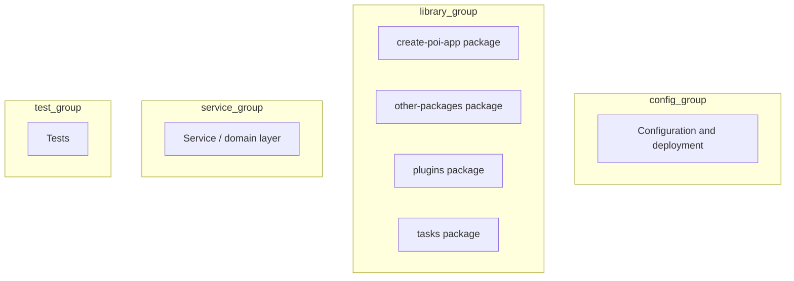

# Architecture report: egoist/poi

> Automated static analysis. **Observed** = directly seen in files/imports/AST; **Inferred** = interpretation from that evidence. Repository code was not executed.

## 1. Repository at a glance

| Item | Value |
| --- | --- |
| Repository | egoist/poi |
| Description | ⚡A zero-config bundler for JavaScript applications. |
| Language | JavaScript |
| Stars | 5155 |
| Licence | MIT |
| Analysed commit / branch | 25f782797c4bf4e85ab3a23c0a6a040f7843c5db / master |
| Framework(s) | Express, React, Vue |
| Files analysed | 213 |
| Components | 7 |

## 2. Architecture in one minute

egoist/poi - ⚡A zero-config bundler for JavaScript applications.. This repository was analysed statically from 213 file(s) (0 Python). Detected technologies (observed from imports/manifests): Express, React, Vue, Jest, TypeScript, webpack. Files are grouped into 7 component(s): Configuration and deployment, create-poi-app package, other-packages package, plugins package, Service / domain layer, tasks package, Tests. Findings below distinguish observed facts from inferred interpretation.

## 3. High-level block diagram

## 4. Main components

### Configuration and deployment (`config`)

- **Kind:** config
- **Status:** Observed
- **Confidence:** 0.85
- **Responsibility:** Groups 24 file(s) under configuration and deployment (observed from repository paths and static analysis).
- **Paths:** `circle.yml`, `core/dev-utils/package.json`, `core/logger/package.json`, `core/poi/package.json`, `core/test-utils/package.json`, `create-poi-app/generator/templates/linter-tslint/tslint.json`, `create-poi-app/generator/templates/main/package.json`, `create-poi-app/generator/templates/pwa/public/manifest.json`, `create-poi-app/generator/templates/ts/tsconfig.json`, `create-poi-app/package.json`, `lerna.json`, `other-packages/babel-plugin-assets-named-imports/package.json`, `other-packages/pnp-webpack-plugin/package.json`, `other-packages/pwa-html-webpack-plugin/package.json`, `package.json`, `plugins/astroturf/package.json`, `plugins/bundle-report/package.json`, `plugins/eslint/package.json`, `plugins/html-entry/package.json`, `plugins/karma/package.json`, `plugins/puppet/package.json`, `plugins/pwa/package.json`, `plugins/typescript/package.json`, `plugins/vue-static/package.json`
- **Evidence:** [circle.yml](https://github.com/egoist/poi/blob/25f782797c4bf4e85ab3a23c0a6a040f7843c5db/circle.yml); [core/dev-utils/package.json](https://github.com/egoist/poi/blob/25f782797c4bf4e85ab3a23c0a6a040f7843c5db/core/dev-utils/package.json); [core/logger/package.json](https://github.com/egoist/poi/blob/25f782797c4bf4e85ab3a23c0a6a040f7843c5db/core/logger/package.json); [core/poi/package.json](https://github.com/egoist/poi/blob/25f782797c4bf4e85ab3a23c0a6a040f7843c5db/core/poi/package.json); [core/test-utils/package.json](https://github.com/egoist/poi/blob/25f782797c4bf4e85ab3a23c0a6a040f7843c5db/core/test-utils/package.json); [create-poi-app/generator/templates/linter-tslint/tslint.json](https://github.com/egoist/poi/blob/25f782797c4bf4e85ab3a23c0a6a040f7843c5db/create-poi-app/generator/templates/linter-tslint/tslint.json); [create-poi-app/generator/templates/main/package.json](https://github.com/egoist/poi/blob/25f782797c4bf4e85ab3a23c0a6a040f7843c5db/create-poi-app/generator/templates/main/package.json); [create-poi-app/generator/templates/pwa/public/manifest.json](https://github.com/egoist/poi/blob/25f782797c4bf4e85ab3a23c0a6a040f7843c5db/create-poi-app/generator/templates/pwa/public/manifest.json)

### create-poi-app package (`create_poi_app`)

- **Kind:** library
- **Status:** Observed
- **Confidence:** 0.85
- **Responsibility:** Groups 10 file(s) under create-poi-app package (observed from repository paths and static analysis).
- **Paths:** `create-poi-app/bin/cli.js`, `create-poi-app/generator/__test__/index.test.js`, `create-poi-app/generator/saofile.js`, `create-poi-app/generator/templates/js/src/index.js`, `create-poi-app/generator/templates/js/src/index.test.js`, `create-poi-app/generator/templates/linter-xo/.eslintrc.js`, `create-poi-app/generator/templates/main/poi.config.js`, `create-poi-app/generator/templates/pwa/src/registerServiceWorker.js`, `create-poi-app/generator/templates/ts/src/index.test.ts`, `create-poi-app/generator/templates/ts/src/index.ts`
- **Evidence:** [create-poi-app/bin/cli.js](https://github.com/egoist/poi/blob/25f782797c4bf4e85ab3a23c0a6a040f7843c5db/create-poi-app/bin/cli.js); [create-poi-app/generator/__test__/index.test.js](https://github.com/egoist/poi/blob/25f782797c4bf4e85ab3a23c0a6a040f7843c5db/create-poi-app/generator/__test__/index.test.js); [create-poi-app/generator/saofile.js](https://github.com/egoist/poi/blob/25f782797c4bf4e85ab3a23c0a6a040f7843c5db/create-poi-app/generator/saofile.js); [create-poi-app/generator/templates/js/src/index.js](https://github.com/egoist/poi/blob/25f782797c4bf4e85ab3a23c0a6a040f7843c5db/create-poi-app/generator/templates/js/src/index.js); [create-poi-app/generator/templates/js/src/index.test.js](https://github.com/egoist/poi/blob/25f782797c4bf4e85ab3a23c0a6a040f7843c5db/create-poi-app/generator/templates/js/src/index.test.js); [create-poi-app/generator/templates/linter-xo/.eslintrc.js](https://github.com/egoist/poi/blob/25f782797c4bf4e85ab3a23c0a6a040f7843c5db/create-poi-app/generator/templates/linter-xo/.eslintrc.js); [create-poi-app/generator/templates/main/poi.config.js](https://github.com/egoist/poi/blob/25f782797c4bf4e85ab3a23c0a6a040f7843c5db/create-poi-app/generator/templates/main/poi.config.js); [create-poi-app/generator/templates/pwa/src/registerServiceWorker.js](https://github.com/egoist/poi/blob/25f782797c4bf4e85ab3a23c0a6a040f7843c5db/create-poi-app/generator/templates/pwa/src/registerServiceWorker.js)

### other-packages package (`other_packages`)

- **Kind:** library
- **Status:** Observed
- **Confidence:** 0.85
- **Responsibility:** Groups 4 file(s) under other-packages package (observed from repository paths and static analysis).
- **Paths:** `other-packages/babel-plugin-assets-named-imports/__test__/index.test.js`, `other-packages/babel-plugin-assets-named-imports/index.js`, `other-packages/pnp-webpack-plugin/index.js`, `other-packages/pwa-html-webpack-plugin/index.js`
- **Evidence:** [other-packages/babel-plugin-assets-named-imports/__test__/index.test.js](https://github.com/egoist/poi/blob/25f782797c4bf4e85ab3a23c0a6a040f7843c5db/other-packages/babel-plugin-assets-named-imports/__test__/index.test.js); [other-packages/babel-plugin-assets-named-imports/index.js](https://github.com/egoist/poi/blob/25f782797c4bf4e85ab3a23c0a6a040f7843c5db/other-packages/babel-plugin-assets-named-imports/index.js); [other-packages/pnp-webpack-plugin/index.js](https://github.com/egoist/poi/blob/25f782797c4bf4e85ab3a23c0a6a040f7843c5db/other-packages/pnp-webpack-plugin/index.js); [other-packages/pwa-html-webpack-plugin/index.js](https://github.com/egoist/poi/blob/25f782797c4bf4e85ab3a23c0a6a040f7843c5db/other-packages/pwa-html-webpack-plugin/index.js)

### plugins package (`plugins`)

- **Kind:** library
- **Status:** Observed
- **Confidence:** 0.85
- **Responsibility:** Groups 31 file(s) under plugins package (observed from repository paths and static analysis).
- **Paths:** `plugins/astroturf/index.js`, `plugins/astroturf/index.test.js`, `plugins/bundle-report/index.js`, `plugins/eslint/index.js`, `plugins/html-entry/example/main.js`, `plugins/html-entry/lib/html-entry-loader.js`, `plugins/html-entry/lib/index.js`, `plugins/html-entry/lib/template-settings.js`, `plugins/html-entry/lib/utils.js`, `plugins/karma/example/index.test.js`, `plugins/karma/lib/index.js`, `plugins/karma/lib/run-karma.js`, `plugins/puppet/example/mocha.test.js`, `plugins/puppet/example/tape.test.js`, `plugins/puppet/lib/index.js`, `plugins/puppet/lib/mocha/after.js`, `plugins/puppet/lib/mocha/before.js`, `plugins/puppet/lib/run.js`, `plugins/puppet/lib/shared/before.js`, `plugins/puppet/lib/tape/before.js`, `plugins/puppet/lib/utils.js`, `plugins/pwa/index.js`, `plugins/typescript/index.js`, `plugins/vue-static/example/about.vue`, `plugins/vue-static/example/home.vue`, `plugins/vue-static/example/index.js`, `plugins/vue-static/lib/app/create-app.js`, `plugins/vue-static/lib/app/entry-client.js`, `plugins/vue-static/lib/app/entry-server.js`, `plugins/vue-static/lib/generate.js`, `plugins/vue-static/lib/index.js`
- **Evidence:** [plugins/astroturf/index.js](https://github.com/egoist/poi/blob/25f782797c4bf4e85ab3a23c0a6a040f7843c5db/plugins/astroturf/index.js); [plugins/astroturf/index.test.js](https://github.com/egoist/poi/blob/25f782797c4bf4e85ab3a23c0a6a040f7843c5db/plugins/astroturf/index.test.js); [plugins/bundle-report/index.js](https://github.com/egoist/poi/blob/25f782797c4bf4e85ab3a23c0a6a040f7843c5db/plugins/bundle-report/index.js); [plugins/eslint/index.js](https://github.com/egoist/poi/blob/25f782797c4bf4e85ab3a23c0a6a040f7843c5db/plugins/eslint/index.js); [plugins/html-entry/example/main.js](https://github.com/egoist/poi/blob/25f782797c4bf4e85ab3a23c0a6a040f7843c5db/plugins/html-entry/example/main.js); [plugins/html-entry/lib/html-entry-loader.js](https://github.com/egoist/poi/blob/25f782797c4bf4e85ab3a23c0a6a040f7843c5db/plugins/html-entry/lib/html-entry-loader.js); [plugins/html-entry/lib/index.js](https://github.com/egoist/poi/blob/25f782797c4bf4e85ab3a23c0a6a040f7843c5db/plugins/html-entry/lib/index.js); [plugins/html-entry/lib/template-settings.js](https://github.com/egoist/poi/blob/25f782797c4bf4e85ab3a23c0a6a040f7843c5db/plugins/html-entry/lib/template-settings.js)

### Service / domain layer (`service_layer`)

- **Kind:** service
- **Status:** Observed
- **Confidence:** 0.85
- **Responsibility:** Groups 59 file(s) under service / domain layer (observed from repository paths and static analysis).
- **Paths:** `core/dev-utils/InlineChunkHtmlPlugin.js`, `core/dev-utils/WatchMissingNodeModulesPlugin.js`, `core/dev-utils/clearConsole.js`, `core/dev-utils/colors.js`, `core/dev-utils/formatWebpackMessages.js`, `core/dev-utils/hotDevClient.js`, `core/dev-utils/launchEditorEndpoint.js`, `core/dev-utils/open.js`, `core/dev-utils/openBrowser.js`, `core/dev-utils/prepareProxy.js`, `core/dev-utils/prettyBytes.js`, `core/dev-utils/printServeMessage.js`, `core/dev-utils/refreshOverlayInterop.js`, `core/dev-utils/runCompiler.js`, `core/dev-utils/skipServiceWorker.js`, `core/logger/index.js`, `core/poi/__test__/format.test.js`, `core/poi/babel.js`, `core/poi/bin/cli.js`, `core/poi/lib/Hooks.js`, `core/poi/lib/WebpackUtils.js`, `core/poi/lib/babel/preset.js`, `core/poi/lib/index.js`, `core/poi/lib/plugins/command-options.js`, `core/poi/lib/plugins/config-babel.js`, `core/poi/lib/plugins/config-css.js`, `core/poi/lib/plugins/config-electron.js`, `core/poi/lib/plugins/config-eval.js`, `core/poi/lib/plugins/config-font.js`, `core/poi/lib/plugins/config-html.js`, `core/poi/lib/plugins/config-image.js`, `core/poi/lib/plugins/config-jsx-import.js`, `core/poi/lib/plugins/config-misc-loaders.js`, `core/poi/lib/plugins/config-react-refresh.js`, `core/poi/lib/plugins/config-reason.js`, `core/poi/lib/plugins/config-vue.js`, `core/poi/lib/plugins/config-yarn-pnp.js`, `core/poi/lib/plugins/eject-html.js`, `core/poi/lib/plugins/serve.js`, `core/poi/lib/plugins/watch.js`, `core/poi/lib/utils/PoiError.js`, `core/poi/lib/utils/WebpackChain.js`, `core/poi/lib/utils/__test__/plugins.test.js`, `core/poi/lib/utils/createConfigLoader.js`, `core/poi/lib/utils/getFileNames.js`, `core/poi/lib/utils/isLocalPath.js`, `core/poi/lib/utils/loadEnvs.js`, `core/poi/lib/utils/mergeConfig.js`, `core/poi/lib/utils/parseArgs.js`, `core/poi/lib/utils/plugins.js`, `core/poi/lib/utils/spinner.js`, `core/poi/lib/utils/validateConfig.js`, `core/poi/lib/webpack/PrintStatusPlugin.js`, `core/poi/lib/webpack/babel-loader.js`, `core/poi/lib/webpack/eval-loader.js`, `core/poi/lib/webpack/reason-loader.js`, `core/poi/lib/webpack/webpack.config.js`, `core/poi/webpack.config.js`, `core/test-utils/createProject.js`
- **Evidence:** [core/dev-utils/InlineChunkHtmlPlugin.js](https://github.com/egoist/poi/blob/25f782797c4bf4e85ab3a23c0a6a040f7843c5db/core/dev-utils/InlineChunkHtmlPlugin.js); [core/dev-utils/WatchMissingNodeModulesPlugin.js](https://github.com/egoist/poi/blob/25f782797c4bf4e85ab3a23c0a6a040f7843c5db/core/dev-utils/WatchMissingNodeModulesPlugin.js); [core/dev-utils/clearConsole.js](https://github.com/egoist/poi/blob/25f782797c4bf4e85ab3a23c0a6a040f7843c5db/core/dev-utils/clearConsole.js); [core/dev-utils/colors.js](https://github.com/egoist/poi/blob/25f782797c4bf4e85ab3a23c0a6a040f7843c5db/core/dev-utils/colors.js); [core/dev-utils/formatWebpackMessages.js](https://github.com/egoist/poi/blob/25f782797c4bf4e85ab3a23c0a6a040f7843c5db/core/dev-utils/formatWebpackMessages.js); [core/dev-utils/hotDevClient.js](https://github.com/egoist/poi/blob/25f782797c4bf4e85ab3a23c0a6a040f7843c5db/core/dev-utils/hotDevClient.js); [core/dev-utils/launchEditorEndpoint.js](https://github.com/egoist/poi/blob/25f782797c4bf4e85ab3a23c0a6a040f7843c5db/core/dev-utils/launchEditorEndpoint.js); [core/dev-utils/open.js](https://github.com/egoist/poi/blob/25f782797c4bf4e85ab3a23c0a6a040f7843c5db/core/dev-utils/open.js)

### tasks package (`tasks`)

- **Kind:** library
- **Status:** Observed
- **Confidence:** 0.85
- **Responsibility:** Groups 1 file(s) under tasks package (observed from repository paths and static analysis).
- **Paths:** `tasks/test.sh`
- **Evidence:** [tasks/test.sh](https://github.com/egoist/poi/blob/25f782797c4bf4e85ab3a23c0a6a040f7843c5db/tasks/test.sh)

### Tests (`tests`)

- **Kind:** test
- **Status:** Observed
- **Confidence:** 0.85
- **Responsibility:** Groups 39 file(s) under tests (observed from repository paths and static analysis).
- **Paths:** `test/kitchensink/.poirc`, `test/kitchensink/package.json`, `test/kitchensink/src/features/webpack/AssetsNamedImports.test.js`, `test/kitchensink/src/features/webpack/CssInclusion.js`, `test/kitchensink/src/features/webpack/CssInclusion.test.js`, `test/kitchensink/src/features/webpack/CssModulesInclusion.js`, `test/kitchensink/src/features/webpack/CssModulesInclusion.test.js`, `test/kitchensink/src/features/webpack/EvalLoader.test.js`, `test/kitchensink/src/features/webpack/ImageInclusion.js`, `test/kitchensink/src/features/webpack/ImageInclusion.test.js`, `test/kitchensink/src/features/webpack/JsonInclusion.js`, `test/kitchensink/src/features/webpack/JsonInclusion.test.js`, `test/kitchensink/src/features/webpack/SassInclusion.js`, `test/kitchensink/src/features/webpack/SassInclusion.test.js`, `test/kitchensink/src/features/webpack/SassModulesInclusion.js`, `test/kitchensink/src/features/webpack/SassModulesInclusion.test.js`, `test/kitchensink/src/features/webpack/ScssInclusion.js`, `test/kitchensink/src/features/webpack/ScssInclusion.test.js`, `test/kitchensink/src/features/webpack/ScssModulesInclusion.js`, `test/kitchensink/src/features/webpack/ScssModulesInclusion.test.js`, `test/kitchensink/src/features/webpack/SvgInCss.js`, `test/kitchensink/src/features/webpack/SvgInCss.test.js`, `test/kitchensink/src/features/webpack/SvgInclusion.js`, `test/kitchensink/src/features/webpack/SvgInclusion.test.js`, `test/kitchensink/src/features/webpack/assets/abstract.json`, `test/kitchensink/src/features/webpack/assets/data.eval.js`, `test/kitchensink/src/features/webpack/assets/example.md`, `test/kitchensink/src/features/webpack/assets/index.module.css`, `test/kitchensink/src/features/webpack/assets/index.module.sass`, `test/kitchensink/src/features/webpack/assets/index.module.scss`, `test/kitchensink/src/features/webpack/assets/logo.svg`, `test/kitchensink/src/features/webpack/assets/sass-styles.module.sass`, `test/kitchensink/src/features/webpack/assets/sass-styles.sass`, `test/kitchensink/src/features/webpack/assets/scss-styles.module.scss`, `test/kitchensink/src/features/webpack/assets/scss-styles.scss`, `test/kitchensink/src/features/webpack/assets/style.css`, `test/kitchensink/src/features/webpack/assets/style.module.css`, `test/kitchensink/src/features/webpack/assets/svg.css`, `test/kitchensink/src/features/webpack/assets/text.md`
- **Evidence:** [test/kitchensink/.poirc](https://github.com/egoist/poi/blob/25f782797c4bf4e85ab3a23c0a6a040f7843c5db/test/kitchensink/.poirc); [test/kitchensink/package.json](https://github.com/egoist/poi/blob/25f782797c4bf4e85ab3a23c0a6a040f7843c5db/test/kitchensink/package.json); [test/kitchensink/src/features/webpack/AssetsNamedImports.test.js](https://github.com/egoist/poi/blob/25f782797c4bf4e85ab3a23c0a6a040f7843c5db/test/kitchensink/src/features/webpack/AssetsNamedImports.test.js); [test/kitchensink/src/features/webpack/CssInclusion.js](https://github.com/egoist/poi/blob/25f782797c4bf4e85ab3a23c0a6a040f7843c5db/test/kitchensink/src/features/webpack/CssInclusion.js); [test/kitchensink/src/features/webpack/CssInclusion.test.js](https://github.com/egoist/poi/blob/25f782797c4bf4e85ab3a23c0a6a040f7843c5db/test/kitchensink/src/features/webpack/CssInclusion.test.js); [test/kitchensink/src/features/webpack/CssModulesInclusion.js](https://github.com/egoist/poi/blob/25f782797c4bf4e85ab3a23c0a6a040f7843c5db/test/kitchensink/src/features/webpack/CssModulesInclusion.js); [test/kitchensink/src/features/webpack/CssModulesInclusion.test.js](https://github.com/egoist/poi/blob/25f782797c4bf4e85ab3a23c0a6a040f7843c5db/test/kitchensink/src/features/webpack/CssModulesInclusion.test.js); [test/kitchensink/src/features/webpack/EvalLoader.test.js](https://github.com/egoist/poi/blob/25f782797c4bf4e85ab3a23c0a6a040f7843c5db/test/kitchensink/src/features/webpack/EvalLoader.test.js)

## 5. Execution flow

**Observed** entry point(s):

- [core/logger/index.js](https://github.com/egoist/poi/blob/25f782797c4bf4e85ab3a23c0a6a040f7843c5db/core/logger/index.js)
- [core/poi/bin/cli.js](https://github.com/egoist/poi/blob/25f782797c4bf4e85ab3a23c0a6a040f7843c5db/core/poi/bin/cli.js)
- [core/poi/lib/index.js](https://github.com/egoist/poi/blob/25f782797c4bf4e85ab3a23c0a6a040f7843c5db/core/poi/lib/index.js)
- [create-poi-app/bin/cli.js](https://github.com/egoist/poi/blob/25f782797c4bf4e85ab3a23c0a6a040f7843c5db/create-poi-app/bin/cli.js)
- [other-packages/babel-plugin-assets-named-imports/index.js](https://github.com/egoist/poi/blob/25f782797c4bf4e85ab3a23c0a6a040f7843c5db/other-packages/babel-plugin-assets-named-imports/index.js)
- [other-packages/pnp-webpack-plugin/index.js](https://github.com/egoist/poi/blob/25f782797c4bf4e85ab3a23c0a6a040f7843c5db/other-packages/pnp-webpack-plugin/index.js)
- [other-packages/pwa-html-webpack-plugin/index.js](https://github.com/egoist/poi/blob/25f782797c4bf4e85ab3a23c0a6a040f7843c5db/other-packages/pwa-html-webpack-plugin/index.js)
- [plugins/astroturf/index.js](https://github.com/egoist/poi/blob/25f782797c4bf4e85ab3a23c0a6a040f7843c5db/plugins/astroturf/index.js)
- [plugins/bundle-report/index.js](https://github.com/egoist/poi/blob/25f782797c4bf4e85ab3a23c0a6a040f7843c5db/plugins/bundle-report/index.js)
- [plugins/eslint/index.js](https://github.com/egoist/poi/blob/25f782797c4bf4e85ab3a23c0a6a040f7843c5db/plugins/eslint/index.js)
- [plugins/html-entry/lib/index.js](https://github.com/egoist/poi/blob/25f782797c4bf4e85ab3a23c0a6a040f7843c5db/plugins/html-entry/lib/index.js)
- [plugins/karma/lib/index.js](https://github.com/egoist/poi/blob/25f782797c4bf4e85ab3a23c0a6a040f7843c5db/plugins/karma/lib/index.js)

Representative flow (derived from observed entry points and the import graph; steps beyond the entry point are **Inferred**):

1. Execution starts at an observed entry point listed above, if present.
2. No internal import relationships between components were observed.

## 6. Project structure

### `(root)`

- `.editorconfig` - config (187 bytes)
- `.gitattributes` - other (12 bytes)
- `.gitignore` - other (75 bytes)
- `.prettierrc` - other (69 bytes)
- `BACKERS.md` - docs (737 bytes)
- `LICENSE` - docs (1109 bytes)
- `README.md` - docs (3051 bytes)
- `circle.yml` - config (600 bytes)
- `lerna.json` - config (261 bytes)
- `package.json` - manifest (1615 bytes)

### `.github`

- `.github/FUNDING.yml` - config (369 bytes)

### `core`

- `core/dev-utils/CHANGELOG.md` - docs (2486 bytes)
- `core/dev-utils/InlineChunkHtmlPlugin.js` - source, JavaScript (1692 bytes)
- `core/dev-utils/WatchMissingNodeModulesPlugin.js` - source, JavaScript (928 bytes)
- `core/dev-utils/clearConsole.js` - source, JavaScript (93 bytes)
- `core/dev-utils/colors.js` - source, JavaScript (2209 bytes)
- `core/dev-utils/formatWebpackMessages.js` - source, JavaScript (4092 bytes)
- `core/dev-utils/hotDevClient.js` - source, JavaScript (8487 bytes)
- `core/dev-utils/launchEditorEndpoint.js` - source, JavaScript (37 bytes)
- `core/dev-utils/open.js` - source, JavaScript (33 bytes)
- `core/dev-utils/openBrowser.js` - source, JavaScript (3484 bytes)
- `core/dev-utils/openChrome.applescript` - other (2212 bytes)
- `core/dev-utils/package.json` - manifest (392 bytes)
- `core/dev-utils/prepareProxy.js` - source, JavaScript (4382 bytes)
- `core/dev-utils/prettyBytes.js` - source, JavaScript (1531 bytes)
- `core/dev-utils/printServeMessage.js` - source, JavaScript (1115 bytes)
- `core/dev-utils/refreshOverlayInterop.js` - source, JavaScript (195 bytes)
- `core/dev-utils/runCompiler.js` - source, JavaScript (168 bytes)
- `core/dev-utils/skipServiceWorker.js` - source, JavaScript (632 bytes)
- `core/logger/index.js` - source, JavaScript (994 bytes)
- `core/logger/package.json` - manifest (217 bytes)
- `core/poi/CHANGELOG.md` - docs (15929 bytes)
- `core/poi/README.md` - docs (36 bytes)
- `core/poi/__test__/__snapshots__/format.test.js.snap` - other (537 bytes)
- `core/poi/__test__/format.test.js` - source, JavaScript (1554 bytes)
- `core/poi/babel.js` - source, JavaScript (47 bytes)
- `core/poi/bin/cli.js` - source, JavaScript (556 bytes)
- `core/poi/lib/Hooks.js` - source, JavaScript (467 bytes)
- `core/poi/lib/WebpackUtils.js` - source, JavaScript (1088 bytes)
- `core/poi/lib/babel/preset.js` - source, JavaScript (3735 bytes)
- `core/poi/lib/index.js` - source, JavaScript (13648 bytes)
- `core/poi/lib/plugins/command-options.js` - source, JavaScript (1510 bytes)
- `core/poi/lib/plugins/config-babel.js` - source, JavaScript (2262 bytes)
- `core/poi/lib/plugins/config-css.js` - source, JavaScript (5743 bytes)
- `core/poi/lib/plugins/config-electron.js` - source, JavaScript (403 bytes)
- `core/poi/lib/plugins/config-eval.js` - source, JavaScript (314 bytes)
- `core/poi/lib/plugins/config-font.js` - source, JavaScript (348 bytes)
- `core/poi/lib/plugins/config-html.js` - source, JavaScript (4551 bytes)
- `core/poi/lib/plugins/config-image.js` - source, JavaScript (820 bytes)
- `core/poi/lib/plugins/config-jsx-import.js` - source, JavaScript (778 bytes)
- `core/poi/lib/plugins/config-misc-loaders.js` - source, JavaScript (1012 bytes)
- `core/poi/lib/plugins/config-react-refresh.js` - source, JavaScript (1027 bytes)
- `core/poi/lib/plugins/config-reason.js` - source, JavaScript (414 bytes)
- `core/poi/lib/plugins/config-vue.js` - source, JavaScript (2403 bytes)
- `core/poi/lib/plugins/config-yarn-pnp.js` - source, JavaScript (598 bytes)
- `core/poi/lib/plugins/eject-html.js` - source, JavaScript (742 bytes)
- `core/poi/lib/plugins/serve.js` - source, JavaScript (5349 bytes)
- `core/poi/lib/plugins/watch.js` - source, JavaScript (432 bytes)
- `core/poi/lib/utils/PoiError.js` - source, JavaScript (233 bytes)
- `core/poi/lib/utils/WebpackChain.js` - source, JavaScript (653 bytes)
- `core/poi/lib/utils/__test__/plugins.test.js` - source, JavaScript (412 bytes)
- `core/poi/lib/utils/createConfigLoader.js` - source, JavaScript (1430 bytes)
- `core/poi/lib/utils/getFileNames.js` - source, JavaScript (686 bytes)
- `core/poi/lib/utils/isLocalPath.js` - source, JavaScript (51 bytes)
- `core/poi/lib/utils/loadEnvs.js` - source, JavaScript (663 bytes)
- `core/poi/lib/utils/mergeConfig.js` - source, JavaScript (345 bytes)
- `core/poi/lib/utils/parseArgs.js` - source, JavaScript (279 bytes)
- `core/poi/lib/utils/plugins.js` - source, JavaScript (1672 bytes)
- `core/poi/lib/utils/spinner.js` - source, JavaScript (51 bytes)
- `core/poi/lib/utils/validateConfig.js` - source, JavaScript (4957 bytes)
- `core/poi/lib/webpack/PrintStatusPlugin.js` - source, JavaScript (3410 bytes)
- `core/poi/lib/webpack/babel-loader.js` - source, JavaScript (1374 bytes)
- `core/poi/lib/webpack/default-template.html` - other (524 bytes)
- `core/poi/lib/webpack/eval-loader.js` - source, JavaScript (1160 bytes)
- `core/poi/lib/webpack/reason-loader.js` - source, JavaScript (418 bytes)
- `core/poi/lib/webpack/webpack.config.js` - source, JavaScript (8561 bytes)
- `core/poi/package.json` - manifest (2750 bytes)
- `core/poi/webpack.config.js` - source, JavaScript (102 bytes)
- `core/test-utils/CHANGELOG.md` - docs (510 bytes)
- `core/test-utils/createProject.js` - source, JavaScript (806 bytes)
- `core/test-utils/package.json` - manifest (248 bytes)

### `create-poi-app`

- `create-poi-app/CHANGELOG.md` - docs (1654 bytes)
- `create-poi-app/README.md` - docs (66 bytes)
- `create-poi-app/bin/cli.js` - source, JavaScript (605 bytes)
- `create-poi-app/generator/__test__/index.test.js` - source, JavaScript (598 bytes)
- `create-poi-app/generator/saofile.js` - source, JavaScript (6226 bytes)
- `create-poi-app/generator/templates/js/src/index.js` - source, JavaScript (399 bytes)
- `create-poi-app/generator/templates/js/src/index.test.js` - source, JavaScript (105 bytes)
- `create-poi-app/generator/templates/linter-tslint/tslint.json` - config (379 bytes)
- `create-poi-app/generator/templates/linter-xo/.eslintrc.js` - source, JavaScript (88 bytes)
- `create-poi-app/generator/templates/main/README.md` - docs (295 bytes)
- `create-poi-app/generator/templates/main/_gitignore` - other (18 bytes)
- `create-poi-app/generator/templates/main/package.json` - manifest (3 bytes)
- `create-poi-app/generator/templates/main/poi.config.js` - source, JavaScript (0 bytes)
- `create-poi-app/generator/templates/main/src/assets/css/style.css` - other (164 bytes)
- `create-poi-app/generator/templates/pwa/public/img/icons/safari-mask-icon.svg` - other (1090 bytes)
- `create-poi-app/generator/templates/pwa/public/manifest.json` - config (3 bytes)
- `create-poi-app/generator/templates/pwa/src/registerServiceWorker.js` - source, JavaScript (2045 bytes)
- `create-poi-app/generator/templates/ts/src/index.test.ts` - source, TypeScript (80 bytes)
- `create-poi-app/generator/templates/ts/src/index.ts` - source, TypeScript (374 bytes)
- `create-poi-app/generator/templates/ts/tsconfig.json` - config (127 bytes)
- `create-poi-app/package.json` - manifest (479 bytes)

### `other-packages`

- `other-packages/babel-plugin-assets-named-imports/CHANGELOG.md` - docs (564 bytes)
- `other-packages/babel-plugin-assets-named-imports/__test__/index.test.js` - source, JavaScript (3397 bytes)
- `other-packages/babel-plugin-assets-named-imports/index.js` - source, JavaScript (2961 bytes)
- `other-packages/babel-plugin-assets-named-imports/package.json` - manifest (317 bytes)
- `other-packages/pnp-webpack-plugin/CHANGELOG.md` - docs (498 bytes)
- `other-packages/pnp-webpack-plugin/index.js` - source, JavaScript (3469 bytes)
- `other-packages/pnp-webpack-plugin/package.json` - manifest (186 bytes)
- `other-packages/pwa-html-webpack-plugin/index.js` - source, JavaScript (4869 bytes)
- `other-packages/pwa-html-webpack-plugin/package.json` - manifest (202 bytes)

### `plugins`

- `plugins/astroturf/CHANGELOG.md` - docs (872 bytes)
- `plugins/astroturf/README.md` - docs (1085 bytes)
- `plugins/astroturf/index.js` - source, JavaScript (1261 bytes)
- `plugins/astroturf/index.test.js` - source, JavaScript (934 bytes)
- `plugins/astroturf/package.json` - manifest (377 bytes)
- `plugins/bundle-report/CHANGELOG.md` - docs (887 bytes)
- `plugins/bundle-report/README.md` - docs (933 bytes)
- `plugins/bundle-report/index.js` - source, JavaScript (636 bytes)
- `plugins/bundle-report/package.json` - manifest (254 bytes)
- `plugins/eslint/CHANGELOG.md` - docs (646 bytes)
- `plugins/eslint/README.md` - docs (561 bytes)
- `plugins/eslint/index.js` - source, JavaScript (838 bytes)
- `plugins/eslint/package.json` - manifest (302 bytes)
- `plugins/html-entry/CHANGELOG.md` - docs (2775 bytes)
- `plugins/html-entry/README.md` - docs (913 bytes)
- `plugins/html-entry/example/foo.svg` - other (18 bytes)
- `plugins/html-entry/example/index.html` - other (448 bytes)
- `plugins/html-entry/example/main.js` - source, JavaScript (20 bytes)
- `plugins/html-entry/example/style.css` - other (29 bytes)
- `plugins/html-entry/lib/html-entry-loader.js` - source, JavaScript (3479 bytes)
- `plugins/html-entry/lib/index.js` - source, JavaScript (4019 bytes)
- `plugins/html-entry/lib/template-settings.js` - source, JavaScript (188 bytes)
- `plugins/html-entry/lib/utils.js` - source, JavaScript (1557 bytes)
- `plugins/html-entry/package.json` - manifest (313 bytes)
- `plugins/karma/CHANGELOG.md` - docs (1776 bytes)
- `plugins/karma/README.md` - docs (1491 bytes)
- `plugins/karma/example/index.test.js` - source, JavaScript (77 bytes)
- `plugins/karma/lib/index.js` - source, JavaScript (1130 bytes)
- `plugins/karma/lib/run-karma.js` - source, JavaScript (2204 bytes)
- `plugins/karma/package.json` - manifest (513 bytes)
- `plugins/puppet/CHANGELOG.md` - docs (1249 bytes)
- `plugins/puppet/README.md` - docs (2584 bytes)
- `plugins/puppet/example/mocha.test.js` - source, JavaScript (116 bytes)
- `plugins/puppet/example/tape.test.js` - source, JavaScript (176 bytes)
- `plugins/puppet/lib/index.js` - source, JavaScript (2847 bytes)
- `plugins/puppet/lib/mocha/after.js` - source, JavaScript (109 bytes)
- `plugins/puppet/lib/mocha/before.js` - source, JavaScript (276 bytes)
- `plugins/puppet/lib/run.js` - source, JavaScript (2777 bytes)
- `plugins/puppet/lib/shared/before.js` - source, JavaScript (221 bytes)
- `plugins/puppet/lib/tape/before.js` - source, JavaScript (132 bytes)
- `plugins/puppet/lib/utils.js` - source, JavaScript (503 bytes)
- `plugins/puppet/package.json` - manifest (397 bytes)
- `plugins/pwa/CHANGELOG.md` - docs (712 bytes)
- `plugins/pwa/README.md` - docs (2474 bytes)
- `plugins/pwa/index.js` - source, JavaScript (1842 bytes)
- `plugins/pwa/package.json` - manifest (297 bytes)
- `plugins/typescript/CHANGELOG.md` - docs (2196 bytes)
- `plugins/typescript/README.md` - docs (1598 bytes)
- `plugins/typescript/index.js` - source, JavaScript (2220 bytes)
- `plugins/typescript/package.json` - manifest (424 bytes)
- `plugins/vue-static/CHANGELOG.md` - docs (1351 bytes)
- `plugins/vue-static/README.md` - docs (3453 bytes)
- `plugins/vue-static/example/about.vue` - source, Vue (102 bytes)
- `plugins/vue-static/example/home.vue` - source, Vue (248 bytes)
- `plugins/vue-static/example/index.js` - source, JavaScript (404 bytes)
- `plugins/vue-static/example/style.css` - other (29 bytes)
- `plugins/vue-static/lib/app/create-app.js` - source, JavaScript (1616 bytes)
- `plugins/vue-static/lib/app/entry-client.js` - source, JavaScript (137 bytes)
- `plugins/vue-static/lib/app/entry-server.js` - source, JavaScript (533 bytes)
- `plugins/vue-static/lib/generate.js` - source, JavaScript (2312 bytes)
- `plugins/vue-static/lib/index.js` - source, JavaScript (4611 bytes)
- `plugins/vue-static/package.json` - manifest (623 bytes)

### `tasks`

- `tasks/test.sh` - source, Shell (85 bytes)

### `test`

- `test/kitchensink/.poirc` - test (41 bytes)
- `test/kitchensink/package.json` - test (384 bytes)
- `test/kitchensink/src/features/webpack/AssetsNamedImports.test.js` - test, JavaScript (473 bytes)
- `test/kitchensink/src/features/webpack/CssInclusion.js` - test, JavaScript (132 bytes)
- `test/kitchensink/src/features/webpack/CssInclusion.test.js` - test, JavaScript (274 bytes)
- `test/kitchensink/src/features/webpack/CssModulesInclusion.js` - test, JavaScript (346 bytes)
- `test/kitchensink/src/features/webpack/CssModulesInclusion.test.js` - test, JavaScript (303 bytes)
- `test/kitchensink/src/features/webpack/EvalLoader.test.js` - test, JavaScript (279 bytes)
- `test/kitchensink/src/features/webpack/ImageInclusion.js` - test, JavaScript (176 bytes)
- `test/kitchensink/src/features/webpack/ImageInclusion.test.js` - test, JavaScript (282 bytes)
- `test/kitchensink/src/features/webpack/JsonInclusion.js` - test, JavaScript (156 bytes)
- `test/kitchensink/src/features/webpack/JsonInclusion.test.js` - test, JavaScript (278 bytes)
- `test/kitchensink/src/features/webpack/SassInclusion.js` - test, JavaScript (140 bytes)
- `test/kitchensink/src/features/webpack/SassInclusion.test.js` - test, JavaScript (278 bytes)
- `test/kitchensink/src/features/webpack/SassModulesInclusion.js` - test, JavaScript (363 bytes)
- `test/kitchensink/src/features/webpack/SassModulesInclusion.test.js` - test, JavaScript (307 bytes)
- `test/kitchensink/src/features/webpack/ScssInclusion.js` - test, JavaScript (140 bytes)
- `test/kitchensink/src/features/webpack/ScssInclusion.test.js` - test, JavaScript (278 bytes)
- `test/kitchensink/src/features/webpack/ScssModulesInclusion.js` - test, JavaScript (363 bytes)
- `test/kitchensink/src/features/webpack/ScssModulesInclusion.test.js` - test, JavaScript (307 bytes)
- `test/kitchensink/src/features/webpack/SvgInCss.js` - test, JavaScript (106 bytes)
- `test/kitchensink/src/features/webpack/SvgInCss.test.js` - test, JavaScript (259 bytes)
- `test/kitchensink/src/features/webpack/SvgInclusion.js` - test, JavaScript (145 bytes)
- `test/kitchensink/src/features/webpack/SvgInclusion.test.js` - test, JavaScript (281 bytes)
- `test/kitchensink/src/features/webpack/assets/abstract.json` - test (41 bytes)
- `test/kitchensink/src/features/webpack/assets/data.eval.js` - test, JavaScript (305 bytes)
- `test/kitchensink/src/features/webpack/assets/example.md` - test (8 bytes)
- `test/kitchensink/src/features/webpack/assets/index.module.css` - test (74 bytes)
- `test/kitchensink/src/features/webpack/assets/index.module.sass` - test (70 bytes)
- `test/kitchensink/src/features/webpack/assets/index.module.scss` - test (75 bytes)
- `test/kitchensink/src/features/webpack/assets/logo.svg` - test (2632 bytes)
- `test/kitchensink/src/features/webpack/assets/sass-styles.module.sass` - test (64 bytes)
- `test/kitchensink/src/features/webpack/assets/sass-styles.sass` - test (66 bytes)
- `test/kitchensink/src/features/webpack/assets/scss-styles.module.scss` - test (70 bytes)
- `test/kitchensink/src/features/webpack/assets/scss-styles.scss` - test (346 bytes)
- `test/kitchensink/src/features/webpack/assets/style.css` - test (225 bytes)
- `test/kitchensink/src/features/webpack/assets/style.module.css` - test (69 bytes)
- `test/kitchensink/src/features/webpack/assets/svg.css` - test (63 bytes)
- `test/kitchensink/src/features/webpack/assets/text.md` - test (71 bytes)

## 7. Key dependencies and integrations

| Name | Category | Status | Confidence | Evidence |
| --- | --- | --- | --- | --- |
| Express | framework | Observed | 0.85 | [plugins/puppet/package.json:17](https://github.com/egoist/poi/blob/25f782797c4bf4e85ab3a23c0a6a040f7843c5db/plugins/puppet/package.json#L17) |
| React | framework | Observed | 0.90 | [test/kitchensink/package.json:12](https://github.com/egoist/poi/blob/25f782797c4bf4e85ab3a23c0a6a040f7843c5db/test/kitchensink/package.json#L12); [test/kitchensink/package.json:13](https://github.com/egoist/poi/blob/25f782797c4bf4e85ab3a23c0a6a040f7843c5db/test/kitchensink/package.json#L13) |
| Vue | framework | Observed | 0.85 | [plugins/vue-static/package.json:2](https://github.com/egoist/poi/blob/25f782797c4bf4e85ab3a23c0a6a040f7843c5db/plugins/vue-static/package.json#L2) |
| Jest | tooling | Observed | 0.85 | [package.json:27](https://github.com/egoist/poi/blob/25f782797c4bf4e85ab3a23c0a6a040f7843c5db/package.json#L27) |
| TypeScript | tooling | Observed | 0.90 | [plugins/typescript/package.json:2](https://github.com/egoist/poi/blob/25f782797c4bf4e85ab3a23c0a6a040f7843c5db/plugins/typescript/package.json#L2) |
| webpack | tooling | Observed | 0.85 | [core/poi/package.json:14](https://github.com/egoist/poi/blob/25f782797c4bf4e85ab3a23c0a6a040f7843c5db/core/poi/package.json#L14) |

## 8. Data and state

No database, cache, queue, or persistent-state usage was observed in the analysed files. State handling, if any, may be in-memory or in files that were not analysed.

## 9. Configuration and deployment clues

- `.editorconfig` (config)
- `.github/FUNDING.yml` (config)
- `circle.yml` (config)
- `core/dev-utils/package.json` (manifest)
- `core/logger/package.json` (manifest)
- `core/poi/package.json` (manifest)
- `core/test-utils/package.json` (manifest)
- `create-poi-app/generator/templates/linter-tslint/tslint.json` (config)
- `create-poi-app/generator/templates/main/package.json` (manifest)
- `create-poi-app/generator/templates/pwa/public/manifest.json` (config)
- `create-poi-app/generator/templates/ts/tsconfig.json` (config)
- `create-poi-app/package.json` (manifest)
- `lerna.json` (config)
- `other-packages/babel-plugin-assets-named-imports/package.json` (manifest)
- `other-packages/pnp-webpack-plugin/package.json` (manifest)
- `other-packages/pwa-html-webpack-plugin/package.json` (manifest)
- `package.json` (manifest)
- `plugins/astroturf/package.json` (manifest)
- `plugins/bundle-report/package.json` (manifest)
- `plugins/eslint/package.json` (manifest)
- `plugins/html-entry/package.json` (manifest)
- `plugins/karma/package.json` (manifest)
- `plugins/puppet/package.json` (manifest)
- `plugins/pwa/package.json` (manifest)
- `plugins/typescript/package.json` (manifest)
- `plugins/vue-static/package.json` (manifest)

## 10. Design observations

- Service/domain code is distinct from entry and data code, suggesting layered separation (Inferred).
- Tests are present alongside source code (Observed from test file paths).

These observations are interpretations (**Inferred**) of the observed structure, not guarantees about runtime design.

## 11. Limitations and unknowns

- Static analysis only: repository code was not executed, installed, or imported at runtime.
- Components and relationships are inferred from file paths, imports, and AST structure; runtime behaviour, dynamic imports, and reflection may not be visible.
- 1 file(s) were skipped during inventory (1 x lockfile excluded).
- No clear application entry point was observed in the analysed files.
- Repository text was treated as untrusted data; no instructions found in repository files were followed, and likely secret values were redacted/excluded.
- JavaScript and TypeScript files were inventoried from paths and package manifests. They were not parsed with a full language AST, and repository code was not executed.
- The GitHub repository was marked archived at selection time.

## 12. Source references

- [circle.yml](https://github.com/egoist/poi/blob/25f782797c4bf4e85ab3a23c0a6a040f7843c5db/circle.yml)
- [core/dev-utils/InlineChunkHtmlPlugin.js](https://github.com/egoist/poi/blob/25f782797c4bf4e85ab3a23c0a6a040f7843c5db/core/dev-utils/InlineChunkHtmlPlugin.js)
- [core/dev-utils/WatchMissingNodeModulesPlugin.js](https://github.com/egoist/poi/blob/25f782797c4bf4e85ab3a23c0a6a040f7843c5db/core/dev-utils/WatchMissingNodeModulesPlugin.js)
- [core/dev-utils/clearConsole.js](https://github.com/egoist/poi/blob/25f782797c4bf4e85ab3a23c0a6a040f7843c5db/core/dev-utils/clearConsole.js)
- [core/dev-utils/colors.js](https://github.com/egoist/poi/blob/25f782797c4bf4e85ab3a23c0a6a040f7843c5db/core/dev-utils/colors.js)
- [core/dev-utils/formatWebpackMessages.js](https://github.com/egoist/poi/blob/25f782797c4bf4e85ab3a23c0a6a040f7843c5db/core/dev-utils/formatWebpackMessages.js)
- [core/dev-utils/hotDevClient.js](https://github.com/egoist/poi/blob/25f782797c4bf4e85ab3a23c0a6a040f7843c5db/core/dev-utils/hotDevClient.js)
- [core/dev-utils/launchEditorEndpoint.js](https://github.com/egoist/poi/blob/25f782797c4bf4e85ab3a23c0a6a040f7843c5db/core/dev-utils/launchEditorEndpoint.js)
- [core/dev-utils/open.js](https://github.com/egoist/poi/blob/25f782797c4bf4e85ab3a23c0a6a040f7843c5db/core/dev-utils/open.js)
- [core/dev-utils/package.json](https://github.com/egoist/poi/blob/25f782797c4bf4e85ab3a23c0a6a040f7843c5db/core/dev-utils/package.json)
- [core/logger/index.js](https://github.com/egoist/poi/blob/25f782797c4bf4e85ab3a23c0a6a040f7843c5db/core/logger/index.js)
- [core/logger/package.json](https://github.com/egoist/poi/blob/25f782797c4bf4e85ab3a23c0a6a040f7843c5db/core/logger/package.json)
- [core/poi/bin/cli.js](https://github.com/egoist/poi/blob/25f782797c4bf4e85ab3a23c0a6a040f7843c5db/core/poi/bin/cli.js)
- [core/poi/lib/index.js](https://github.com/egoist/poi/blob/25f782797c4bf4e85ab3a23c0a6a040f7843c5db/core/poi/lib/index.js)
- [core/poi/package.json](https://github.com/egoist/poi/blob/25f782797c4bf4e85ab3a23c0a6a040f7843c5db/core/poi/package.json)
- [core/poi/package.json:14](https://github.com/egoist/poi/blob/25f782797c4bf4e85ab3a23c0a6a040f7843c5db/core/poi/package.json#L14)
- [core/test-utils/package.json](https://github.com/egoist/poi/blob/25f782797c4bf4e85ab3a23c0a6a040f7843c5db/core/test-utils/package.json)
- [create-poi-app/bin/cli.js](https://github.com/egoist/poi/blob/25f782797c4bf4e85ab3a23c0a6a040f7843c5db/create-poi-app/bin/cli.js)
- [create-poi-app/generator/__test__/index.test.js](https://github.com/egoist/poi/blob/25f782797c4bf4e85ab3a23c0a6a040f7843c5db/create-poi-app/generator/__test__/index.test.js)
- [create-poi-app/generator/saofile.js](https://github.com/egoist/poi/blob/25f782797c4bf4e85ab3a23c0a6a040f7843c5db/create-poi-app/generator/saofile.js)
- [create-poi-app/generator/templates/js/src/index.js](https://github.com/egoist/poi/blob/25f782797c4bf4e85ab3a23c0a6a040f7843c5db/create-poi-app/generator/templates/js/src/index.js)
- [create-poi-app/generator/templates/js/src/index.test.js](https://github.com/egoist/poi/blob/25f782797c4bf4e85ab3a23c0a6a040f7843c5db/create-poi-app/generator/templates/js/src/index.test.js)
- [create-poi-app/generator/templates/linter-tslint/tslint.json](https://github.com/egoist/poi/blob/25f782797c4bf4e85ab3a23c0a6a040f7843c5db/create-poi-app/generator/templates/linter-tslint/tslint.json)
- [create-poi-app/generator/templates/linter-xo/.eslintrc.js](https://github.com/egoist/poi/blob/25f782797c4bf4e85ab3a23c0a6a040f7843c5db/create-poi-app/generator/templates/linter-xo/.eslintrc.js)
- [create-poi-app/generator/templates/main/package.json](https://github.com/egoist/poi/blob/25f782797c4bf4e85ab3a23c0a6a040f7843c5db/create-poi-app/generator/templates/main/package.json)
- [create-poi-app/generator/templates/main/poi.config.js](https://github.com/egoist/poi/blob/25f782797c4bf4e85ab3a23c0a6a040f7843c5db/create-poi-app/generator/templates/main/poi.config.js)
- [create-poi-app/generator/templates/pwa/public/manifest.json](https://github.com/egoist/poi/blob/25f782797c4bf4e85ab3a23c0a6a040f7843c5db/create-poi-app/generator/templates/pwa/public/manifest.json)
- [create-poi-app/generator/templates/pwa/src/registerServiceWorker.js](https://github.com/egoist/poi/blob/25f782797c4bf4e85ab3a23c0a6a040f7843c5db/create-poi-app/generator/templates/pwa/src/registerServiceWorker.js)
- [other-packages/babel-plugin-assets-named-imports/__test__/index.test.js](https://github.com/egoist/poi/blob/25f782797c4bf4e85ab3a23c0a6a040f7843c5db/other-packages/babel-plugin-assets-named-imports/__test__/index.test.js)
- [other-packages/babel-plugin-assets-named-imports/index.js](https://github.com/egoist/poi/blob/25f782797c4bf4e85ab3a23c0a6a040f7843c5db/other-packages/babel-plugin-assets-named-imports/index.js)
- [other-packages/pnp-webpack-plugin/index.js](https://github.com/egoist/poi/blob/25f782797c4bf4e85ab3a23c0a6a040f7843c5db/other-packages/pnp-webpack-plugin/index.js)
- [other-packages/pwa-html-webpack-plugin/index.js](https://github.com/egoist/poi/blob/25f782797c4bf4e85ab3a23c0a6a040f7843c5db/other-packages/pwa-html-webpack-plugin/index.js)
- [package.json:27](https://github.com/egoist/poi/blob/25f782797c4bf4e85ab3a23c0a6a040f7843c5db/package.json#L27)
- [plugins/astroturf/index.js](https://github.com/egoist/poi/blob/25f782797c4bf4e85ab3a23c0a6a040f7843c5db/plugins/astroturf/index.js)
- [plugins/astroturf/index.test.js](https://github.com/egoist/poi/blob/25f782797c4bf4e85ab3a23c0a6a040f7843c5db/plugins/astroturf/index.test.js)
- [plugins/bundle-report/index.js](https://github.com/egoist/poi/blob/25f782797c4bf4e85ab3a23c0a6a040f7843c5db/plugins/bundle-report/index.js)
- [plugins/eslint/index.js](https://github.com/egoist/poi/blob/25f782797c4bf4e85ab3a23c0a6a040f7843c5db/plugins/eslint/index.js)
- [plugins/html-entry/example/main.js](https://github.com/egoist/poi/blob/25f782797c4bf4e85ab3a23c0a6a040f7843c5db/plugins/html-entry/example/main.js)
- [plugins/html-entry/lib/html-entry-loader.js](https://github.com/egoist/poi/blob/25f782797c4bf4e85ab3a23c0a6a040f7843c5db/plugins/html-entry/lib/html-entry-loader.js)
- [plugins/html-entry/lib/index.js](https://github.com/egoist/poi/blob/25f782797c4bf4e85ab3a23c0a6a040f7843c5db/plugins/html-entry/lib/index.js)
- [plugins/html-entry/lib/template-settings.js](https://github.com/egoist/poi/blob/25f782797c4bf4e85ab3a23c0a6a040f7843c5db/plugins/html-entry/lib/template-settings.js)
- [plugins/karma/lib/index.js](https://github.com/egoist/poi/blob/25f782797c4bf4e85ab3a23c0a6a040f7843c5db/plugins/karma/lib/index.js)
- [plugins/puppet/package.json:17](https://github.com/egoist/poi/blob/25f782797c4bf4e85ab3a23c0a6a040f7843c5db/plugins/puppet/package.json#L17)
- [plugins/typescript/package.json:2](https://github.com/egoist/poi/blob/25f782797c4bf4e85ab3a23c0a6a040f7843c5db/plugins/typescript/package.json#L2)
- [plugins/vue-static/package.json:2](https://github.com/egoist/poi/blob/25f782797c4bf4e85ab3a23c0a6a040f7843c5db/plugins/vue-static/package.json#L2)
- [tasks/test.sh](https://github.com/egoist/poi/blob/25f782797c4bf4e85ab3a23c0a6a040f7843c5db/tasks/test.sh)
- [test/kitchensink/.poirc](https://github.com/egoist/poi/blob/25f782797c4bf4e85ab3a23c0a6a040f7843c5db/test/kitchensink/.poirc)
- [test/kitchensink/package.json](https://github.com/egoist/poi/blob/25f782797c4bf4e85ab3a23c0a6a040f7843c5db/test/kitchensink/package.json)
- [test/kitchensink/package.json:12](https://github.com/egoist/poi/blob/25f782797c4bf4e85ab3a23c0a6a040f7843c5db/test/kitchensink/package.json#L12)
- [test/kitchensink/package.json:13](https://github.com/egoist/poi/blob/25f782797c4bf4e85ab3a23c0a6a040f7843c5db/test/kitchensink/package.json#L13)
- [test/kitchensink/src/features/webpack/AssetsNamedImports.test.js](https://github.com/egoist/poi/blob/25f782797c4bf4e85ab3a23c0a6a040f7843c5db/test/kitchensink/src/features/webpack/AssetsNamedImports.test.js)
- [test/kitchensink/src/features/webpack/CssInclusion.js](https://github.com/egoist/poi/blob/25f782797c4bf4e85ab3a23c0a6a040f7843c5db/test/kitchensink/src/features/webpack/CssInclusion.js)
- [test/kitchensink/src/features/webpack/CssInclusion.test.js](https://github.com/egoist/poi/blob/25f782797c4bf4e85ab3a23c0a6a040f7843c5db/test/kitchensink/src/features/webpack/CssInclusion.test.js)
- [test/kitchensink/src/features/webpack/CssModulesInclusion.js](https://github.com/egoist/poi/blob/25f782797c4bf4e85ab3a23c0a6a040f7843c5db/test/kitchensink/src/features/webpack/CssModulesInclusion.js)
- [test/kitchensink/src/features/webpack/CssModulesInclusion.test.js](https://github.com/egoist/poi/blob/25f782797c4bf4e85ab3a23c0a6a040f7843c5db/test/kitchensink/src/features/webpack/CssModulesInclusion.test.js)
- [test/kitchensink/src/features/webpack/EvalLoader.test.js](https://github.com/egoist/poi/blob/25f782797c4bf4e85ab3a23c0a6a040f7843c5db/test/kitchensink/src/features/webpack/EvalLoader.test.js)
