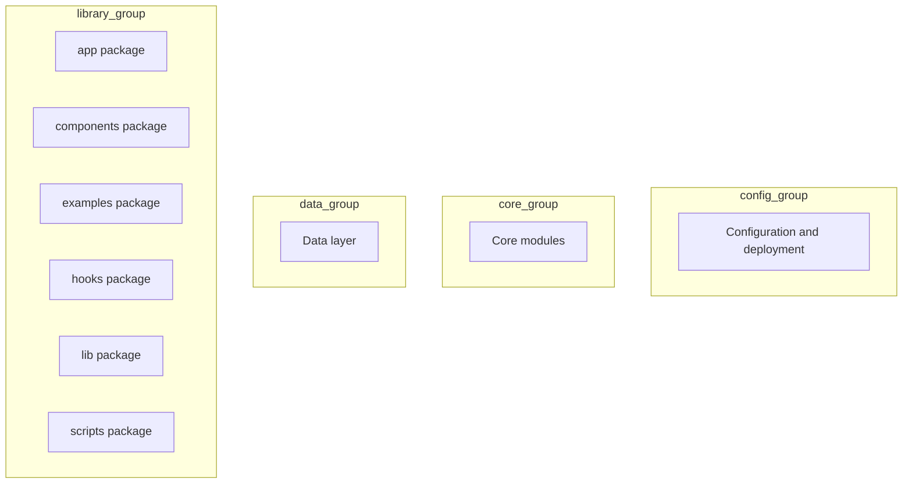

# Architecture report: ekmas/neobrutalism-components

> Automated static analysis. **Observed** = directly seen in files/imports/AST; **Inferred** = interpretation from that evidence. Repository code was not executed.

## 1. Repository at a glance

| Item | Value |
| --- | --- |
| Repository | ekmas/neobrutalism-components |
| Description | A collection of neobrutalism-styled Tailwind components. |
| Language | TypeScript |
| Stars | 5651 |
| Licence | MIT |
| Analysed commit / branch | 3306a802724874a85f93079702b2795370a279d4 / main |
| Framework(s) | Next.js, React |
| Files analysed | 747 |
| Components | 9 |

## 2. Architecture in one minute

ekmas/neobrutalism-components - A collection of neobrutalism-styled Tailwind components.. This repository was analysed statically from 747 file(s) (0 Python). Detected technologies (observed from imports/manifests): Next.js, React, Tailwind CSS, TypeScript. Files are grouped into 9 component(s): app package, components package, Configuration and deployment, Core modules, Data layer, examples package, hooks package, lib package. Findings below distinguish observed facts from inferred interpretation.

## 3. High-level block diagram

## 4. Main components

### app package (`app`)

- **Kind:** library
- **Status:** Observed
- **Confidence:** 0.85
- **Responsibility:** Groups 24 file(s) under app package (observed from repository paths and static analysis).
- **Paths:** `src/app/charts/examples.tsx`, `src/app/charts/page.tsx`, `src/app/layout.tsx`, `src/app/not-found.tsx`, `src/app/page.tsx`, `src/app/showcase/page.tsx`, `src/app/sitemap.ts`, `src/app/stars/copy-btn.tsx`, `src/app/stars/page.tsx`, `src/app/stars/shadcn-btn.tsx`, `src/app/stars/stars-grid.tsx`, `src/app/styling/demos/alert.tsx`, `src/app/styling/demos/chat.tsx`, `src/app/styling/demos/collapsible.tsx`, `src/app/styling/demos/input-group-textarea.tsx`, `src/app/styling/demos/input-group.tsx`, `src/app/styling/demos/items.tsx`, `src/app/styling/demos/scroll-area.tsx`, `src/app/styling/demos/settings.tsx`, `src/app/styling/demos/slider.tsx`, `src/app/styling/example-components.tsx`, `src/app/styling/page.tsx`, `src/app/styling/styling.tsx`, `src/app/templates/page.tsx`
- **Evidence:** [src/app/charts/examples.tsx](https://github.com/ekmas/neobrutalism-components/blob/3306a802724874a85f93079702b2795370a279d4/src/app/charts/examples.tsx); [src/app/charts/page.tsx](https://github.com/ekmas/neobrutalism-components/blob/3306a802724874a85f93079702b2795370a279d4/src/app/charts/page.tsx); [src/app/layout.tsx](https://github.com/ekmas/neobrutalism-components/blob/3306a802724874a85f93079702b2795370a279d4/src/app/layout.tsx); [src/app/not-found.tsx](https://github.com/ekmas/neobrutalism-components/blob/3306a802724874a85f93079702b2795370a279d4/src/app/not-found.tsx); [src/app/page.tsx](https://github.com/ekmas/neobrutalism-components/blob/3306a802724874a85f93079702b2795370a279d4/src/app/page.tsx); [src/app/showcase/page.tsx](https://github.com/ekmas/neobrutalism-components/blob/3306a802724874a85f93079702b2795370a279d4/src/app/showcase/page.tsx); [src/app/sitemap.ts](https://github.com/ekmas/neobrutalism-components/blob/3306a802724874a85f93079702b2795370a279d4/src/app/sitemap.ts); [src/app/stars/copy-btn.tsx](https://github.com/ekmas/neobrutalism-components/blob/3306a802724874a85f93079702b2795370a279d4/src/app/stars/copy-btn.tsx)

### components package (`components`)

- **Kind:** library
- **Status:** Observed
- **Confidence:** 0.85
- **Responsibility:** Groups 121 file(s) under components package (observed from repository paths and static analysis).
- **Paths:** `src/components/app/component-preview.tsx`, `src/components/app/copy-button.tsx`, `src/components/app/docs-tabs.tsx`, `src/components/app/hero-components.tsx`, `src/components/app/landing/star-field.tsx`, `src/components/app/mdx-components.tsx`, `src/components/app/navbar.tsx`, `src/components/app/page.tsx`, `src/components/app/pagination.tsx`, `src/components/app/pre.tsx`, `src/components/app/scroll-to-top.tsx`, `src/components/app/search.tsx`, `src/components/app/set-styling-pref.tsx`, `src/components/app/shadcn-cli-command.tsx`, `src/components/app/showcase-container.tsx`, `src/components/app/sidebar.tsx`, `src/components/app/styling-customizer.tsx`, `src/components/app/toc.tsx`, `src/components/stars/s1.tsx`, `src/components/stars/s10.tsx`, `src/components/stars/s11.tsx`, `src/components/stars/s12.tsx`, `src/components/stars/s13.tsx`, `src/components/stars/s14.tsx`, `src/components/stars/s15.tsx`, `src/components/stars/s16.tsx`, `src/components/stars/s17.tsx`, `src/components/stars/s18.tsx`, `src/components/stars/s19.tsx`, `src/components/stars/s2.tsx`, `src/components/stars/s20.tsx`, `src/components/stars/s21.tsx`, `src/components/stars/s22.tsx`, `src/components/stars/s23.tsx`, `src/components/stars/s24.tsx`, `src/components/stars/s25.tsx`, `src/components/stars/s26.tsx`, `src/components/stars/s27.tsx`, `src/components/stars/s28.tsx`, `src/components/stars/s29.tsx`, `src/components/stars/s3.tsx`, `src/components/stars/s30.tsx`, `src/components/stars/s31.tsx`, `src/components/stars/s32.tsx`, `src/components/stars/s33.tsx`, `src/components/stars/s34.tsx`, `src/components/stars/s35.tsx`, `src/components/stars/s36.tsx`, `src/components/stars/s37.tsx`, `src/components/stars/s38.tsx`, `src/components/stars/s39.tsx`, `src/components/stars/s4.tsx`, `src/components/stars/s40.tsx`, `src/components/stars/s5.tsx`, `src/components/stars/s6.tsx`, `src/components/stars/s7.tsx`, `src/components/stars/s8.tsx`, `src/components/stars/s9.tsx`, `src/components/ui/accordion.tsx`, `src/components/ui/alert-dialog.tsx`, `src/components/ui/alert.tsx`, `src/components/ui/attachment.tsx`, `src/components/ui/avatar.tsx`, `src/components/ui/badge.tsx`, `src/components/ui/breadcrumb.tsx`, `src/components/ui/bubble.tsx`, `src/components/ui/button-group.tsx`, `src/components/ui/button.tsx`, `src/components/ui/calendar.tsx`, `src/components/ui/card.tsx`, `src/components/ui/carousel.tsx`, `src/components/ui/chart.tsx`, `src/components/ui/checkbox.tsx`, `src/components/ui/collapsible.tsx`, `src/components/ui/combobox.tsx`, `src/components/ui/command.tsx`, `src/components/ui/context-menu.tsx`, `src/components/ui/data-table.tsx`, `src/components/ui/dialog.tsx`, `src/components/ui/direction.tsx`, `src/components/ui/drawer.tsx`, `src/components/ui/dropdown-menu.tsx`, `src/components/ui/empty.tsx`, `src/components/ui/field.tsx`, `src/components/ui/form.tsx`, `src/components/ui/hover-card.tsx`, `src/components/ui/image-card.tsx`, `src/components/ui/input-group.tsx`, `src/components/ui/input-otp.tsx`, `src/components/ui/input.tsx`, `src/components/ui/item.tsx`, `src/components/ui/kbd.tsx`, `src/components/ui/label.tsx`, `src/components/ui/marker.tsx`, `src/components/ui/marquee.tsx`, `src/components/ui/menubar.tsx`, `src/components/ui/message-scroller.tsx`, `src/components/ui/message.tsx`, `src/components/ui/native-select.tsx`, `src/components/ui/navigation-menu.tsx`, `src/components/ui/pagination.tsx`, `src/components/ui/popover.tsx`, `src/components/ui/progress.tsx`, `src/components/ui/questionnaire.tsx`, `src/components/ui/radio-group.tsx`, `src/components/ui/resizable.tsx`, `src/components/ui/scroll-area.tsx`, `src/components/ui/select.tsx`, `src/components/ui/sheet.tsx`, `src/components/ui/sidebar.tsx`, `src/components/ui/skeleton.tsx`, `src/components/ui/slider.tsx`, `src/components/ui/spinner.tsx`, `src/components/ui/switch.tsx`, `src/components/ui/table.tsx`, `src/components/ui/tabs.tsx`, `src/components/ui/textarea.tsx`, `src/components/ui/toast.tsx`, `src/components/ui/toggle-group.tsx`, `src/components/ui/toggle.tsx`, `src/components/ui/tooltip.tsx`
- **Evidence:** [src/components/app/component-preview.tsx](https://github.com/ekmas/neobrutalism-components/blob/3306a802724874a85f93079702b2795370a279d4/src/components/app/component-preview.tsx); [src/components/app/copy-button.tsx](https://github.com/ekmas/neobrutalism-components/blob/3306a802724874a85f93079702b2795370a279d4/src/components/app/copy-button.tsx); [src/components/app/docs-tabs.tsx](https://github.com/ekmas/neobrutalism-components/blob/3306a802724874a85f93079702b2795370a279d4/src/components/app/docs-tabs.tsx); [src/components/app/hero-components.tsx](https://github.com/ekmas/neobrutalism-components/blob/3306a802724874a85f93079702b2795370a279d4/src/components/app/hero-components.tsx); [src/components/app/landing/star-field.tsx](https://github.com/ekmas/neobrutalism-components/blob/3306a802724874a85f93079702b2795370a279d4/src/components/app/landing/star-field.tsx); [src/components/app/mdx-components.tsx](https://github.com/ekmas/neobrutalism-components/blob/3306a802724874a85f93079702b2795370a279d4/src/components/app/mdx-components.tsx); [src/components/app/navbar.tsx](https://github.com/ekmas/neobrutalism-components/blob/3306a802724874a85f93079702b2795370a279d4/src/components/app/navbar.tsx); [src/components/app/page.tsx](https://github.com/ekmas/neobrutalism-components/blob/3306a802724874a85f93079702b2795370a279d4/src/components/app/page.tsx)

### Configuration and deployment (`config`)

- **Kind:** config
- **Status:** Observed
- **Confidence:** 0.85
- **Responsibility:** Groups 145 file(s) under configuration and deployment (observed from repository paths and static analysis).
- **Paths:** `package.json`, `public/r/accordion.json`, `public/r/alert-dialog.json`, `public/r/alert.json`, `public/r/attachment.json`, `public/r/avatar.json`, `public/r/badge.json`, `public/r/breadcrumb.json`, `public/r/bubble.json`, `public/r/button-group.json`, `public/r/button.json`, `public/r/calendar.json`, `public/r/card.json`, `public/r/carousel.json`, `public/r/chart.json`, `public/r/checkbox.json`, `public/r/collapsible.json`, `public/r/command.json`, `public/r/context-menu.json`, `public/r/dialog.json`, `public/r/direction.json`, `public/r/drawer.json`, `public/r/dropdown-menu.json`, `public/r/empty.json`, `public/r/field.json`, `public/r/form.json`, `public/r/hover-card.json`, `public/r/image-card.json`, `public/r/input-group.json`, `public/r/input-otp.json`, `public/r/input.json`, `public/r/item.json`, `public/r/kbd.json`, `public/r/label.json`, `public/r/marker.json`, `public/r/marquee.json`, `public/r/menubar.json`, `public/r/message-scroller.json`, `public/r/message.json`, `public/r/native-select.json`, `public/r/navigation-menu.json`, `public/r/nbutton.json`, `public/r/ncard.json`, `public/r/ndialog.json`, `public/r/ninput.json`, `public/r/nlabel.json`, `public/r/nsheet.json`, `public/r/nskeleton.json`, `public/r/ntextarea.json`, `public/r/ntoggle.json`, `public/r/ntooltip.json`, `public/r/pagination.json`, `public/r/popover.json`, `public/r/progress.json`, `public/r/questionnaire.json`, `public/r/radio-group.json`, `public/r/resizable.json`, `public/r/s1.json`, `public/r/s10.json`, `public/r/s11.json`, `public/r/s12.json`, `public/r/s13.json`, `public/r/s14.json`, `public/r/s15.json`, `public/r/s16.json`, `public/r/s17.json`, `public/r/s18.json`, `public/r/s19.json`, `public/r/s2.json`, `public/r/s20.json`, `public/r/s21.json`, `public/r/s22.json`, `public/r/s23.json`, `public/r/s24.json`, `public/r/s25.json`, `public/r/s26.json`, `public/r/s27.json`, `public/r/s28.json`, `public/r/s29.json`, `public/r/s3.json`, `public/r/s30.json`, `public/r/s31.json`, `public/r/s32.json`, `public/r/s33.json`, `public/r/s34.json`, `public/r/s35.json`, `public/r/s36.json`, `public/r/s37.json`, `public/r/s38.json`, `public/r/s39.json`, `public/r/s4.json`, `public/r/s40.json`, `public/r/s5.json`, `public/r/s6.json`, `public/r/s7.json`, `public/r/s8.json`, `public/r/s9.json`, `public/r/scroll-area.json`, `public/r/select.json`, `public/r/sheet.json`, `public/r/sidebar.json`, `public/r/skeleton.json`, `public/r/slider.json`, `public/r/spinner.json`, `public/r/styling/amber-duotone.json`, `public/r/styling/amber.json`, `public/r/styling/blue.json`, `public/r/styling/cyan-duotone.json`, `public/r/styling/cyan.json`, `public/r/styling/emerald-duotone.json`, `public/r/styling/emerald.json`, `public/r/styling/fuchsia-duotone.json`, `public/r/styling/fuchsia.json`, `public/r/styling/green-duotone.json`, `public/r/styling/green.json`, `public/r/styling/indigo.json`, `public/r/styling/lime-duotone.json`, `public/r/styling/lime.json`, `public/r/styling/orange-duotone.json`, `public/r/styling/orange.json`, `public/r/styling/pink.json`, `public/r/styling/purple.json`, `public/r/styling/red-duotone.json`, `public/r/styling/red.json`, `public/r/styling/rose-duotone.json`, `public/r/styling/rose.json`, `public/r/styling/sky-duotone.json`, `public/r/styling/sky.json`, `public/r/styling/teal-duotone.json`, `public/r/styling/teal.json`, `public/r/styling/violet-duotone.json`, `public/r/styling/violet.json`, `public/r/styling/yellow-duotone.json`, `public/r/styling/yellow.json`, `public/r/switch.json`, `public/r/table.json`, `public/r/tabs.json`, `public/r/textarea.json`, `public/r/toast.json`, `public/r/toggle-group.json`, `public/r/toggle.json`, `public/r/tooltip.json`, `registry.json`, `src/data/theme.json`, `tsconfig.json`
- **Evidence:** [package.json](https://github.com/ekmas/neobrutalism-components/blob/3306a802724874a85f93079702b2795370a279d4/package.json); [public/r/accordion.json](https://github.com/ekmas/neobrutalism-components/blob/3306a802724874a85f93079702b2795370a279d4/public/r/accordion.json); [public/r/alert-dialog.json](https://github.com/ekmas/neobrutalism-components/blob/3306a802724874a85f93079702b2795370a279d4/public/r/alert-dialog.json); [public/r/alert.json](https://github.com/ekmas/neobrutalism-components/blob/3306a802724874a85f93079702b2795370a279d4/public/r/alert.json); [public/r/attachment.json](https://github.com/ekmas/neobrutalism-components/blob/3306a802724874a85f93079702b2795370a279d4/public/r/attachment.json); [public/r/avatar.json](https://github.com/ekmas/neobrutalism-components/blob/3306a802724874a85f93079702b2795370a279d4/public/r/avatar.json); [public/r/badge.json](https://github.com/ekmas/neobrutalism-components/blob/3306a802724874a85f93079702b2795370a279d4/public/r/badge.json); [public/r/breadcrumb.json](https://github.com/ekmas/neobrutalism-components/blob/3306a802724874a85f93079702b2795370a279d4/public/r/breadcrumb.json)

### Core modules (`core`)

- **Kind:** core
- **Status:** Observed
- **Confidence:** 0.85
- **Responsibility:** Groups 3 file(s) under core modules (observed from repository paths and static analysis).
- **Paths:** `next.config.mjs`, `postcss.config.js`, `velite.config.ts`
- **Evidence:** [next.config.mjs](https://github.com/ekmas/neobrutalism-components/blob/3306a802724874a85f93079702b2795370a279d4/next.config.mjs); [postcss.config.js](https://github.com/ekmas/neobrutalism-components/blob/3306a802724874a85f93079702b2795370a279d4/postcss.config.js); [velite.config.ts](https://github.com/ekmas/neobrutalism-components/blob/3306a802724874a85f93079702b2795370a279d4/velite.config.ts)

### Data layer (`data_layer`)

- **Kind:** data
- **Status:** Observed
- **Confidence:** 0.85
- **Responsibility:** Groups 9 file(s) under data layer (observed from repository paths and static analysis).
- **Paths:** `src/data/charts.ts`, `src/data/colors.ts`, `src/data/components.ts`, `src/data/fonts.ts`, `src/data/registry.ts`, `src/data/reviews.ts`, `src/data/showcase.ts`, `src/data/sidebar-links.ts`, `src/data/stars.ts`
- **Evidence:** [src/data/charts.ts](https://github.com/ekmas/neobrutalism-components/blob/3306a802724874a85f93079702b2795370a279d4/src/data/charts.ts); [src/data/colors.ts](https://github.com/ekmas/neobrutalism-components/blob/3306a802724874a85f93079702b2795370a279d4/src/data/colors.ts); [src/data/components.ts](https://github.com/ekmas/neobrutalism-components/blob/3306a802724874a85f93079702b2795370a279d4/src/data/components.ts); [src/data/fonts.ts](https://github.com/ekmas/neobrutalism-components/blob/3306a802724874a85f93079702b2795370a279d4/src/data/fonts.ts); [src/data/registry.ts](https://github.com/ekmas/neobrutalism-components/blob/3306a802724874a85f93079702b2795370a279d4/src/data/registry.ts); [src/data/reviews.ts](https://github.com/ekmas/neobrutalism-components/blob/3306a802724874a85f93079702b2795370a279d4/src/data/reviews.ts); [src/data/showcase.ts](https://github.com/ekmas/neobrutalism-components/blob/3306a802724874a85f93079702b2795370a279d4/src/data/showcase.ts); [src/data/sidebar-links.ts](https://github.com/ekmas/neobrutalism-components/blob/3306a802724874a85f93079702b2795370a279d4/src/data/sidebar-links.ts)

### examples package (`examples`)

- **Kind:** library
- **Status:** Observed
- **Confidence:** 0.85
- **Responsibility:** Groups 352 file(s) under examples package (observed from repository paths and static analysis).
- **Paths:** `src/examples/stars/s1.tsx`, `src/examples/stars/s10.tsx`, `src/examples/stars/s11.tsx`, `src/examples/stars/s12.tsx`, `src/examples/stars/s13.tsx`, `src/examples/stars/s14.tsx`, `src/examples/stars/s15.tsx`, `src/examples/stars/s16.tsx`, `src/examples/stars/s17.tsx`, `src/examples/stars/s18.tsx`, `src/examples/stars/s19.tsx`, `src/examples/stars/s2.tsx`, `src/examples/stars/s20.tsx`, `src/examples/stars/s21.tsx`, `src/examples/stars/s22.tsx`, `src/examples/stars/s23.tsx`, `src/examples/stars/s24.tsx`, `src/examples/stars/s25.tsx`, `src/examples/stars/s26.tsx`, `src/examples/stars/s27.tsx`, `src/examples/stars/s28.tsx`, `src/examples/stars/s29.tsx`, `src/examples/stars/s3.tsx`, `src/examples/stars/s30.tsx`, `src/examples/stars/s31.tsx`, `src/examples/stars/s32.tsx`, `src/examples/stars/s33.tsx`, `src/examples/stars/s34.tsx`, `src/examples/stars/s35.tsx`, `src/examples/stars/s36.tsx`, `src/examples/stars/s37.tsx`, `src/examples/stars/s38.tsx`, `src/examples/stars/s39.tsx`, `src/examples/stars/s4.tsx`, `src/examples/stars/s40.tsx`, `src/examples/stars/s5.tsx`, `src/examples/stars/s6.tsx`, `src/examples/stars/s7.tsx`, `src/examples/stars/s8.tsx`, `src/examples/stars/s9.tsx`, `src/examples/ui/accordion/basic.tsx`, `src/examples/ui/accordion/disabled.tsx`, `src/examples/ui/accordion/index.tsx`, `src/examples/ui/accordion/multiple.tsx`, `src/examples/ui/alert-dialog/basic.tsx`, `src/examples/ui/alert-dialog/destructive.tsx`, `src/examples/ui/alert-dialog/index.tsx`, `src/examples/ui/alert-dialog/media.tsx`, `src/examples/ui/alert-dialog/small-with-media.tsx`, `src/examples/ui/alert-dialog/small.tsx`, `src/examples/ui/alert/description-only.tsx`, `src/examples/ui/alert/destructive.tsx`, `src/examples/ui/alert/icon-description.tsx`, `src/examples/ui/alert/icon-title.tsx`, `src/examples/ui/alert/index.tsx`, `src/examples/ui/alert/long-description.tsx`, `src/examples/ui/alert/long-title-and-description.tsx`, `src/examples/ui/alert/long-title.tsx`, `src/examples/ui/alert/with-button.tsx`, `src/examples/ui/attachment/image.tsx`, `src/examples/ui/attachment/index.tsx`, `src/examples/ui/attachment/states.tsx`, `src/examples/ui/attachment/vertical.tsx`, `src/examples/ui/avatar/avatar-group-count.tsx`, `src/examples/ui/avatar/avatar-group-with-icon.tsx`, `src/examples/ui/avatar/avatar-group.tsx`, `src/examples/ui/avatar/badge-with-icon.tsx`, `src/examples/ui/avatar/badge.tsx`, `src/examples/ui/avatar/basic.tsx`, `src/examples/ui/avatar/dropdown.tsx`, `src/examples/ui/avatar/fallback.tsx`, `src/examples/ui/avatar/index.tsx`, `src/examples/ui/avatar/sizes.tsx`, `src/examples/ui/badge/index.tsx`, `src/examples/ui/badge/neutral.tsx`, `src/examples/ui/badge/with-icon.tsx`, `src/examples/ui/breadcrumb/basic.tsx`, `src/examples/ui/breadcrumb/collapsed.tsx`, `src/examples/ui/breadcrumb/custom-separator.tsx`, `src/examples/ui/breadcrumb/dropdown.tsx`, `src/examples/ui/breadcrumb/index.tsx`, `src/examples/ui/breadcrumb/link-component.tsx`, `src/examples/ui/bubble/as-button.tsx`, `src/examples/ui/bubble/index.tsx`, `src/examples/ui/bubble/variants.tsx`, `src/examples/ui/bubble/with-reactions.tsx`, `src/examples/ui/button-group/index.tsx`, `src/examples/ui/button-group/vertical.tsx`, `src/examples/ui/button-group/with-dropdown.tsx`, `src/examples/ui/button-group/with-input.tsx`, `src/examples/ui/button-group/with-text.tsx`, `src/examples/ui/button/icon.tsx`, `src/examples/ui/button/index.tsx`, `src/examples/ui/button/neutral.tsx`, `src/examples/ui/button/no-shadow.tsx`, `src/examples/ui/button/reverse.tsx`, `src/examples/ui/button/size.tsx`, `src/examples/ui/button/with-icon.tsx`, `src/examples/ui/calendar/index.tsx`, `src/examples/ui/calendar/range.tsx`, `src/examples/ui/card/image.tsx`, `src/examples/ui/card/index.tsx`, `src/examples/ui/card/size.tsx`, `src/examples/ui/card/spacing.tsx`, `src/examples/ui/carousel/api.tsx`, `src/examples/ui/carousel/index.tsx`, `src/examples/ui/carousel/orientation.tsx`, `src/examples/ui/carousel/sizes.tsx`, `src/examples/ui/carousel/spacing.tsx`, `src/examples/ui/chart/chart-area-axes.tsx`, `src/examples/ui/chart/chart-area-default.tsx`, `src/examples/ui/chart/chart-area-icons.tsx`, `src/examples/ui/chart/chart-area-interactive.tsx`, `src/examples/ui/chart/chart-area-legend.tsx`, `src/examples/ui/chart/chart-area-linear.tsx`, `src/examples/ui/chart/chart-area-stacked-expand.tsx`, `src/examples/ui/chart/chart-area-stacked.tsx`, `src/examples/ui/chart/chart-area-step.tsx`, `src/examples/ui/chart/chart-bar-active.tsx`, `src/examples/ui/chart/chart-bar-default.tsx`, `src/examples/ui/chart/chart-bar-horizontal.tsx`, `src/examples/ui/chart/chart-bar-interactive.tsx`, `src/examples/ui/chart/chart-bar-label-custom.tsx`, `src/examples/ui/chart/chart-bar-label.tsx`, `src/examples/ui/chart/chart-bar-mixed.tsx`, `src/examples/ui/chart/chart-bar-multiple.tsx`, `src/examples/ui/chart/chart-bar-negative.tsx`, `src/examples/ui/chart/chart-bar-stacked.tsx`, `src/examples/ui/chart/chart-line-default.tsx`, `src/examples/ui/chart/chart-line-dots-colors.tsx`, `src/examples/ui/chart/chart-line-dots-custom.tsx`, `src/examples/ui/chart/chart-line-dots.tsx`, `src/examples/ui/chart/chart-line-interactive.tsx`, `src/examples/ui/chart/chart-line-label-custom.tsx`, `src/examples/ui/chart/chart-line-label.tsx`, `src/examples/ui/chart/chart-line-linear.tsx`, `src/examples/ui/chart/chart-line-multiple.tsx`, `src/examples/ui/chart/chart-line-step.tsx`, `src/examples/ui/chart/chart-pie-donut-active.tsx`, `src/examples/ui/chart/chart-pie-donut-text.tsx`, `src/examples/ui/chart/chart-pie-donut.tsx`, `src/examples/ui/chart/chart-pie-label-custom.tsx`, `src/examples/ui/chart/chart-pie-label-list.tsx`, `src/examples/ui/chart/chart-pie-label.tsx`, `src/examples/ui/chart/chart-pie-legend.tsx`, `src/examples/ui/chart/chart-pie-simple.tsx`, `src/examples/ui/chart/chart-pie-stacked.tsx`, `src/examples/ui/chart/chart-tooltip-advanced.tsx`, `src/examples/ui/chart/chart-tooltip-default.tsx`, `src/examples/ui/chart/chart-tooltip-formatter.tsx`, `src/examples/ui/chart/chart-tooltip-icons.tsx`, `src/examples/ui/chart/chart-tooltip-indicator-line.tsx`, `src/examples/ui/chart/chart-tooltip-indicator-none.tsx`, `src/examples/ui/chart/chart-tooltip-label-custom.tsx`, `src/examples/ui/chart/chart-tooltip-label-formatter.tsx`, `src/examples/ui/chart/chart-tooltip-label-none.tsx`, `src/examples/ui/checkbox/basic.tsx`, `src/examples/ui/checkbox/description.tsx`, `src/examples/ui/checkbox/disabled.tsx`, `src/examples/ui/checkbox/group.tsx`, `src/examples/ui/checkbox/index.tsx`, `src/examples/ui/checkbox/invalid-state.tsx`, `src/examples/ui/checkbox/table.tsx`, `src/examples/ui/collapsible/basic.tsx`, `src/examples/ui/collapsible/index.tsx`, `src/examples/ui/collapsible/settings-panel.tsx`, `src/examples/ui/combobox/index.tsx`, `src/examples/ui/combobox/multiselect.tsx`, `src/examples/ui/combobox/timezones.tsx`, `src/examples/ui/combobox/users.tsx`, `src/examples/ui/command/basic.tsx`, `src/examples/ui/command/groups.tsx`, `src/examples/ui/command/index.tsx`, `src/examples/ui/command/scrollable.tsx`, `src/examples/ui/command/shortcuts.tsx`, `src/examples/ui/context-menu/basic.tsx`, `src/examples/ui/context-menu/checkboxes.tsx`, `src/examples/ui/context-menu/destructive.tsx`, `src/examples/ui/context-menu/groups.tsx`, `src/examples/ui/context-menu/icons.tsx`, `src/examples/ui/context-menu/index.tsx`, `src/examples/ui/context-menu/radio.tsx`, `src/examples/ui/context-menu/shortcuts.tsx`, `src/examples/ui/context-menu/sides.tsx`, `src/examples/ui/context-menu/submenu.tsx`, `src/examples/ui/data-table.tsx`, `src/examples/ui/date-picker/basic.tsx`, `src/examples/ui/date-picker/date-of-birth.tsx`, `src/examples/ui/date-picker/index.tsx`, `src/examples/ui/date-picker/input.tsx`, `src/examples/ui/date-picker/range-picker.tsx`, `src/examples/ui/date-picker/time-picker.tsx`, `src/examples/ui/dialog/index.tsx`, `src/examples/ui/dialog/scrollable-content.tsx`, `src/examples/ui/dialog/sticky-footer.tsx`, `src/examples/ui/direction.tsx`, `src/examples/ui/drawer/index.tsx`, `src/examples/ui/drawer/nested.tsx`, `src/examples/ui/drawer/non-modal.tsx`, `src/examples/ui/drawer/position.tsx`, `src/examples/ui/drawer/responsive.tsx`, `src/examples/ui/drawer/scrollable-content.tsx`, `src/examples/ui/drawer/snap-points.tsx`, `src/examples/ui/drawer/swipe-handle.tsx`, `src/examples/ui/dropdown-menu/checkboxes.tsx`, `src/examples/ui/dropdown-menu/index.tsx`, `src/examples/ui/dropdown-menu/radio.tsx`, `src/examples/ui/empty/index.tsx`, `src/examples/ui/empty/with-input.tsx`, `src/examples/ui/field/choice-card.tsx`, `src/examples/ui/field/horizontal.tsx`, `src/examples/ui/field/index.tsx`, `src/examples/ui/field/with-error.tsx`, `src/examples/ui/form/array.tsx`, `src/examples/ui/form/basic.tsx`, `src/examples/ui/form/checkbox.tsx`, `src/examples/ui/form/complex.tsx`, `src/examples/ui/form/index.tsx`, `src/examples/ui/form/input.tsx`, `src/examples/ui/form/radio-group.tsx`, `src/examples/ui/form/select.tsx`, `src/examples/ui/form/switch.tsx`, `src/examples/ui/form/textarea.tsx`, `src/examples/ui/hover-card/basic.tsx`, `src/examples/ui/hover-card/index.tsx`, `src/examples/ui/hover-card/sides.tsx`, `src/examples/ui/image-card.tsx`, `src/examples/ui/input-group/block-start.tsx`, `src/examples/ui/input-group/index.tsx`, `src/examples/ui/input-group/textarea.tsx`, `src/examples/ui/input-group/with-button.tsx`, `src/examples/ui/input-otp/alphanumeric.tsx`, `src/examples/ui/input-otp/controlled.tsx`, `src/examples/ui/input-otp/disabled.tsx`, `src/examples/ui/input-otp/four-digits.tsx`, `src/examples/ui/input-otp/index.tsx`, `src/examples/ui/input-otp/invalid.tsx`, `src/examples/ui/input-otp/pattern.tsx`, `src/examples/ui/input-otp/separator.tsx`, `src/examples/ui/input/disabled.tsx`, `src/examples/ui/input/file.tsx`, `src/examples/ui/input/index.tsx`, `src/examples/ui/input/with-button.tsx`, `src/examples/ui/input/with-label.tsx`, `src/examples/ui/item/as-link.tsx`, `src/examples/ui/item/group.tsx`, `src/examples/ui/item/index.tsx`, `src/examples/ui/item/with-image.tsx`, `src/examples/ui/kbd/group.tsx`, `src/examples/ui/kbd/in-tooltip.tsx`, `src/examples/ui/kbd/index.tsx`, `src/examples/ui/kbd/with-icon.tsx`, `src/examples/ui/label/index.tsx`, `src/examples/ui/marker/index.tsx`, `src/examples/ui/marker/separator.tsx`, `src/examples/ui/marker/with-spinner.tsx`, `src/examples/ui/marquee.tsx`, `src/examples/ui/menubar/checkbox.tsx`, `src/examples/ui/menubar/index.tsx`, `src/examples/ui/menubar/radio.tsx`, `src/examples/ui/menubar/submenu.tsx`, `src/examples/ui/menubar/with-icons.tsx`, `src/examples/ui/message-scroller/add-messages.tsx`, `src/examples/ui/message-scroller/index.tsx`, `src/examples/ui/message/group.tsx`, `src/examples/ui/message/header-footer.tsx`, `src/examples/ui/message/index.tsx`, `src/examples/ui/message/with-actions.tsx`, `src/examples/ui/native-select/disabled.tsx`, `src/examples/ui/native-select/index.tsx`, `src/examples/ui/native-select/with-optgroup.tsx`, `src/examples/ui/navigation-menu.tsx`, `src/examples/ui/pagination/icons-only.tsx`, `src/examples/ui/pagination/index.tsx`, `src/examples/ui/pagination/simple.tsx`, `src/examples/ui/popover/align.tsx`, `src/examples/ui/popover/basic.tsx`, `src/examples/ui/popover/index.tsx`, `src/examples/ui/popover/with-form.tsx`, `src/examples/ui/progress/controlled.tsx`, `src/examples/ui/progress/index.tsx`, `src/examples/ui/progress/label.tsx`, `src/examples/ui/questionnaire/controlled.tsx`, `src/examples/ui/questionnaire/index.tsx`, `src/examples/ui/questionnaire/single-step.tsx`, `src/examples/ui/questionnaire/validation.tsx`, `src/examples/ui/radio-group/choice-card.tsx`, `src/examples/ui/radio-group/description.tsx`, `src/examples/ui/radio-group/disabled.tsx`, `src/examples/ui/radio-group/fieldset.tsx`, `src/examples/ui/radio-group/index.tsx`, `src/examples/ui/radio-group/invalid.tsx`, `src/examples/ui/resizable.tsx`, `src/examples/ui/scroll-area/horizontal.tsx`, `src/examples/ui/scroll-area/index.tsx`, `src/examples/ui/select/disabled.tsx`, `src/examples/ui/select/index.tsx`, `src/examples/ui/select/large-list.tsx`, `src/examples/ui/select/with-icon.tsx`, `src/examples/ui/sheet/index.tsx`, `src/examples/ui/sheet/no-close-button.tsx`, `src/examples/ui/sheet/side.tsx`, `src/examples/ui/sidebar/page.tsx`, `src/examples/ui/sidebar/sidebar.tsx`, `src/examples/ui/skeleton/index.tsx`, `src/examples/ui/slider/controlled.tsx`, `src/examples/ui/slider/index.tsx`, `src/examples/ui/slider/two-thumbs.tsx`, `src/examples/ui/slider/vertical.tsx`, `src/examples/ui/spinner/in-button.tsx`, `src/examples/ui/spinner/index.tsx`, `src/examples/ui/spinner/size.tsx`, `src/examples/ui/spinner/with-badge.tsx`, `src/examples/ui/switch/choice-card.tsx`, `src/examples/ui/switch/description.tsx`, `src/examples/ui/switch/disabled.tsx`, `src/examples/ui/switch/index.tsx`, `src/examples/ui/switch/invalid.tsx`, `src/examples/ui/switch/size.tsx`, `src/examples/ui/table/actions.tsx`, `src/examples/ui/table/footer.tsx`, `src/examples/ui/table/index.tsx`, `src/examples/ui/tabs/disabled.tsx`, `src/examples/ui/tabs/icons.tsx`, `src/examples/ui/tabs/index.tsx`, `src/examples/ui/tabs/vertical.tsx`, `src/examples/ui/textarea/button.tsx`, `src/examples/ui/textarea/disabled.tsx`, `src/examples/ui/textarea/field.tsx`, `src/examples/ui/textarea/index.tsx`, `src/examples/ui/textarea/invalid.tsx`, `src/examples/ui/toast/action.tsx`, `src/examples/ui/toast/index.tsx`, `src/examples/ui/toast/promise.tsx`, `src/examples/ui/toast/types.tsx`, `src/examples/ui/toggle-group/custom.tsx`, `src/examples/ui/toggle-group/disabled.tsx`, `src/examples/ui/toggle-group/index.tsx`, `src/examples/ui/toggle-group/outline.tsx`, `src/examples/ui/toggle-group/single.tsx`, `src/examples/ui/toggle-group/size.tsx`, `src/examples/ui/toggle-group/spacing.tsx`, `src/examples/ui/toggle-group/vertical.tsx`, `src/examples/ui/toggle/disabled.tsx`, `src/examples/ui/toggle/index.tsx`, `src/examples/ui/toggle/outline.tsx`, `src/examples/ui/toggle/size.tsx`, `src/examples/ui/toggle/with-text.tsx`, `src/examples/ui/tooltip/disabled-button.tsx`, `src/examples/ui/tooltip/index.tsx`, `src/examples/ui/tooltip/side.tsx`, `src/examples/ui/tooltip/with-keyboard-shortcut.tsx`
- **Evidence:** [src/examples/stars/s1.tsx](https://github.com/ekmas/neobrutalism-components/blob/3306a802724874a85f93079702b2795370a279d4/src/examples/stars/s1.tsx); [src/examples/stars/s10.tsx](https://github.com/ekmas/neobrutalism-components/blob/3306a802724874a85f93079702b2795370a279d4/src/examples/stars/s10.tsx); [src/examples/stars/s11.tsx](https://github.com/ekmas/neobrutalism-components/blob/3306a802724874a85f93079702b2795370a279d4/src/examples/stars/s11.tsx); [src/examples/stars/s12.tsx](https://github.com/ekmas/neobrutalism-components/blob/3306a802724874a85f93079702b2795370a279d4/src/examples/stars/s12.tsx); [src/examples/stars/s13.tsx](https://github.com/ekmas/neobrutalism-components/blob/3306a802724874a85f93079702b2795370a279d4/src/examples/stars/s13.tsx); [src/examples/stars/s14.tsx](https://github.com/ekmas/neobrutalism-components/blob/3306a802724874a85f93079702b2795370a279d4/src/examples/stars/s14.tsx); [src/examples/stars/s15.tsx](https://github.com/ekmas/neobrutalism-components/blob/3306a802724874a85f93079702b2795370a279d4/src/examples/stars/s15.tsx); [src/examples/stars/s16.tsx](https://github.com/ekmas/neobrutalism-components/blob/3306a802724874a85f93079702b2795370a279d4/src/examples/stars/s16.tsx)

### hooks package (`hooks`)

- **Kind:** library
- **Status:** Observed
- **Confidence:** 0.85
- **Responsibility:** Groups 1 file(s) under hooks package (observed from repository paths and static analysis).
- **Paths:** `src/hooks/use-mobile.ts`
- **Evidence:** [src/hooks/use-mobile.ts](https://github.com/ekmas/neobrutalism-components/blob/3306a802724874a85f93079702b2795370a279d4/src/hooks/use-mobile.ts)

### lib package (`lib`)

- **Kind:** library
- **Status:** Observed
- **Confidence:** 0.85
- **Responsibility:** Groups 3 file(s) under lib package (observed from repository paths and static analysis).
- **Paths:** `src/lib/google-fonts.ts`, `src/lib/site.ts`, `src/lib/utils.ts`
- **Evidence:** [src/lib/google-fonts.ts](https://github.com/ekmas/neobrutalism-components/blob/3306a802724874a85f93079702b2795370a279d4/src/lib/google-fonts.ts); [src/lib/site.ts](https://github.com/ekmas/neobrutalism-components/blob/3306a802724874a85f93079702b2795370a279d4/src/lib/site.ts); [src/lib/utils.ts](https://github.com/ekmas/neobrutalism-components/blob/3306a802724874a85f93079702b2795370a279d4/src/lib/utils.ts)

### scripts package (`scripts`)

- **Kind:** library
- **Status:** Observed
- **Confidence:** 0.85
- **Responsibility:** Groups 4 file(s) under scripts package (observed from repository paths and static analysis).
- **Paths:** `src/scripts/add-registry-styles.ts`, `src/scripts/generate-charts-ts.ts`, `src/scripts/generate-registry-json.ts`, `src/scripts/generate-stars-ts.ts`
- **Evidence:** [src/scripts/add-registry-styles.ts](https://github.com/ekmas/neobrutalism-components/blob/3306a802724874a85f93079702b2795370a279d4/src/scripts/add-registry-styles.ts); [src/scripts/generate-charts-ts.ts](https://github.com/ekmas/neobrutalism-components/blob/3306a802724874a85f93079702b2795370a279d4/src/scripts/generate-charts-ts.ts); [src/scripts/generate-registry-json.ts](https://github.com/ekmas/neobrutalism-components/blob/3306a802724874a85f93079702b2795370a279d4/src/scripts/generate-registry-json.ts); [src/scripts/generate-stars-ts.ts](https://github.com/ekmas/neobrutalism-components/blob/3306a802724874a85f93079702b2795370a279d4/src/scripts/generate-stars-ts.ts)

## 5. Execution flow

**Observed** entry point(s):

- [src/app/charts/page.tsx](https://github.com/ekmas/neobrutalism-components/blob/3306a802724874a85f93079702b2795370a279d4/src/app/charts/page.tsx)
- [src/app/page.tsx](https://github.com/ekmas/neobrutalism-components/blob/3306a802724874a85f93079702b2795370a279d4/src/app/page.tsx)
- [src/app/showcase/page.tsx](https://github.com/ekmas/neobrutalism-components/blob/3306a802724874a85f93079702b2795370a279d4/src/app/showcase/page.tsx)
- [src/app/stars/page.tsx](https://github.com/ekmas/neobrutalism-components/blob/3306a802724874a85f93079702b2795370a279d4/src/app/stars/page.tsx)
- [src/app/styling/page.tsx](https://github.com/ekmas/neobrutalism-components/blob/3306a802724874a85f93079702b2795370a279d4/src/app/styling/page.tsx)
- [src/app/templates/page.tsx](https://github.com/ekmas/neobrutalism-components/blob/3306a802724874a85f93079702b2795370a279d4/src/app/templates/page.tsx)
- [src/components/app/page.tsx](https://github.com/ekmas/neobrutalism-components/blob/3306a802724874a85f93079702b2795370a279d4/src/components/app/page.tsx)

Representative flow (derived from observed entry points and the import graph; steps beyond the entry point are **Inferred**):

1. Execution starts at an observed entry point listed above, if present.
2. No internal import relationships between components were observed.

## 6. Project structure

### `(root)`

- `.eslintrc.json` - config (91 bytes)
- `.gitignore` - other (470 bytes)
- `.prettierignore` - other (82 bytes)
- `.prettierrc.js` - source, JavaScript (498 bytes)
- `CONTRIBUTING.md` - docs (3 bytes)
- `LICENSE` - docs (1072 bytes)
- `README.md` - docs (532 bytes)
- `next.config.mjs` - source, JavaScript (1327 bytes)
- `package.json` - manifest (2369 bytes)
- `postcss.config.js` - source, JavaScript (71 bytes)
- `registry.json` - config (32621 bytes)
- `tsconfig.json` - config (730 bytes)
- `velite.config.ts` - source, TypeScript (2412 bytes)

### `public`

- `public/r/accordion.json` - config (2643 bytes)
- `public/r/alert-dialog.json` - config (5651 bytes)
- `public/r/alert.json` - config (1904 bytes)
- `public/r/attachment.json` - config (6553 bytes)
- `public/r/avatar.json` - config (3268 bytes)
- `public/r/badge.json` - config (1579 bytes)
- `public/r/breadcrumb.json` - config (2870 bytes)
- `public/r/bubble.json` - config (4098 bytes)
- `public/r/button-group.json` - config (3314 bytes)
- `public/r/button.json` - config (2414 bytes)
- `public/r/calendar.json` - config (7235 bytes)
- `public/r/card.json` - config (2708 bytes)
- `public/r/carousel.json` - config (6400 bytes)
- `public/r/chart.json` - config (11649 bytes)
- `public/r/checkbox.json` - config (1498 bytes)
- `public/r/collapsible.json` - config (1124 bytes)
- `public/r/command.json` - config (5275 bytes)
- `public/r/context-menu.json` - config (11084 bytes)
- `public/r/dialog.json` - config (4381 bytes)
- `public/r/direction.json` - config (425 bytes)
- `public/r/drawer.json` - config (12079 bytes)
- `public/r/dropdown-menu.json` - config (10355 bytes)
- `public/r/empty.json` - config (2981 bytes)
- `public/r/field.json` - config (7057 bytes)
- `public/r/form.json` - config (4867 bytes)
- `public/r/hover-card.json` - config (2301 bytes)
- `public/r/image-card.json` - config (883 bytes)
- `public/r/input-group.json` - config (6903 bytes)
- `public/r/input-otp.json` - config (2496 bytes)
- `public/r/input.json` - config (1017 bytes)
- `public/r/item.json` - config (5173 bytes)
- `public/r/kbd.json` - config (1197 bytes)
- `public/r/label.json` - config (781 bytes)
- `public/r/marker.json` - config (2428 bytes)
- `public/r/marquee.json` - config (1274 bytes)
- `public/r/menubar.json` - config (11115 bytes)
- `public/r/message-scroller.json` - config (4558 bytes)
- `public/r/message.json` - config (2705 bytes)
- `public/r/native-select.json` - config (2349 bytes)
- `public/r/navigation-menu.json` - config (6980 bytes)
- `public/r/nbutton.json` - config (2394 bytes)
- `public/r/ncard.json` - config (2709 bytes)
- `public/r/ndialog.json` - config (4361 bytes)
- `public/r/ninput.json` - config (1018 bytes)
- `public/r/nlabel.json` - config (762 bytes)
- `public/r/nsheet.json` - config (4722 bytes)
- `public/r/nskeleton.json` - config (628 bytes)
- `public/r/ntextarea.json` - config (963 bytes)
- `public/r/ntoggle.json` - config (2213 bytes)
- `public/r/ntooltip.json` - config (2578 bytes)
- `public/r/pagination.json` - config (3303 bytes)
- `public/r/popover.json` - config (3143 bytes)
- `public/r/progress.json` - config (2428 bytes)
- `public/r/questionnaire.json` - config (10684 bytes)
- `public/r/radio-group.json` - config (1780 bytes)
- `public/r/resizable.json` - config (2338 bytes)
- `public/r/s1.json` - config (2133 bytes)
- `public/r/s10.json` - config (2113 bytes)
- `public/r/s11.json` - config (2103 bytes)
- `public/r/s12.json` - config (2180 bytes)
- `public/r/s13.json` - config (2717 bytes)
- `public/r/s14.json` - config (2550 bytes)
- `public/r/s15.json` - config (3122 bytes)
- `public/r/s16.json` - config (2206 bytes)
- `public/r/s17.json` - config (2236 bytes)
- `public/r/s18.json` - config (3269 bytes)
- `public/r/s19.json` - config (2170 bytes)
- `public/r/s2.json` - config (1939 bytes)
- `public/r/s20.json` - config (2123 bytes)
- `public/r/s21.json` - config (2761 bytes)
- `public/r/s22.json` - config (2182 bytes)
- `public/r/s23.json` - config (2306 bytes)
- `public/r/s24.json` - config (2129 bytes)
- `public/r/s25.json` - config (2179 bytes)
- `public/r/s26.json` - config (3800 bytes)
- `public/r/s27.json` - config (2112 bytes)
- `public/r/s28.json` - config (2138 bytes)
- `public/r/s29.json` - config (3215 bytes)
- `public/r/s3.json` - config (2658 bytes)
- `public/r/s30.json` - config (3878 bytes)
- `public/r/s31.json` - config (2877 bytes)
- `public/r/s32.json` - config (3131 bytes)
- `public/r/s33.json` - config (3149 bytes)
- `public/r/s34.json` - config (2884 bytes)
- `public/r/s35.json` - config (2391 bytes)
- `public/r/s36.json` - config (4366 bytes)
- `public/r/s37.json` - config (2787 bytes)
- `public/r/s38.json` - config (4805 bytes)
- `public/r/s39.json` - config (2556 bytes)
- `public/r/s4.json` - config (2080 bytes)
- `public/r/s40.json` - config (2341 bytes)
- `public/r/s5.json` - config (1911 bytes)
- `public/r/s6.json` - config (1991 bytes)
- `public/r/s7.json` - config (1895 bytes)
- `public/r/s8.json` - config (2100 bytes)
- `public/r/s9.json` - config (1997 bytes)
- `public/r/scroll-area.json` - config (1947 bytes)
- `public/r/select.json` - config (7220 bytes)
- `public/r/sheet.json` - config (4721 bytes)
- `public/r/sidebar.json` - config (23269 bytes)
- `public/r/skeleton.json` - config (627 bytes)
- `public/r/slider.json` - config (2716 bytes)
- `public/r/spinner.json` - config (728 bytes)
- `public/r/styling/amber-duotone.json` - config (3182 bytes)
- `public/r/styling/amber.json` - config (3165 bytes)
- `public/r/styling/blue.json` - config (3165 bytes)
- `public/r/styling/cyan-duotone.json` - config (3181 bytes)
- `public/r/styling/cyan.json` - config (3165 bytes)
- `public/r/styling/emerald-duotone.json` - config (3188 bytes)
- `public/r/styling/emerald.json` - config (3171 bytes)
- `public/r/styling/fuchsia-duotone.json` - config (3187 bytes)
- `public/r/styling/fuchsia.json` - config (3172 bytes)
- `public/r/styling/green-duotone.json` - config (3182 bytes)
- `public/r/styling/green.json` - config (3166 bytes)
- `public/r/styling/indigo.json` - config (3170 bytes)
- `public/r/styling/lime-duotone.json` - config (3181 bytes)
- `public/r/styling/lime.json` - config (3163 bytes)
- `public/r/styling/orange-duotone.json` - config (3185 bytes)
- `public/r/styling/orange.json` - config (3168 bytes)
- `public/r/styling/pink.json` - config (3164 bytes)
- `public/r/styling/purple.json` - config (3170 bytes)
- `public/r/styling/red-duotone.json` - config (3180 bytes)
- `public/r/styling/red.json` - config (3162 bytes)
- `public/r/styling/rose-duotone.json` - config (3182 bytes)
- `public/r/styling/rose.json` - config (3166 bytes)
- `public/r/styling/sky-duotone.json` - config (3180 bytes)
- `public/r/styling/sky.json` - config (3163 bytes)
- `public/r/styling/teal-duotone.json` - config (3182 bytes)
- `public/r/styling/teal.json` - config (3165 bytes)
- `public/r/styling/violet-duotone.json` - config (3186 bytes)
- `public/r/styling/violet.json` - config (3169 bytes)
- `public/r/styling/yellow-duotone.json` - config (3185 bytes)
- `public/r/styling/yellow.json` - config (3167 bytes)
- `public/r/switch.json` - config (1708 bytes)
- `public/r/table.json` - config (2895 bytes)
- `public/r/tabs.json` - config (3999 bytes)
- `public/r/textarea.json` - config (985 bytes)
- `public/r/toast.json` - config (8251 bytes)
- `public/r/toggle-group.json` - config (3764 bytes)
- `public/r/toggle.json` - config (2233 bytes)
- `public/r/tooltip.json` - config (2588 bytes)

### `src`

- `src/app/charts/examples.tsx` - source, TypeScript (8416 bytes)
- `src/app/charts/page.tsx` - source, TypeScript (848 bytes)
- `src/app/docs/[[...slug]]/page.tsx` - docs (5733 bytes)
- `src/app/docs/layout.tsx` - docs (729 bytes)
- `src/app/layout.tsx` - source, TypeScript (1929 bytes)
- `src/app/not-found.tsx` - source, TypeScript (1175 bytes)
- `src/app/page.tsx` - source, TypeScript (2352 bytes)
- `src/app/showcase/page.tsx` - source, TypeScript (1135 bytes)
- `src/app/sitemap.ts` - source, TypeScript (820 bytes)
- `src/app/stars/copy-btn.tsx` - source, TypeScript (895 bytes)
- `src/app/stars/page.tsx` - source, TypeScript (842 bytes)
- `src/app/stars/shadcn-btn.tsx` - source, TypeScript (1495 bytes)
- `src/app/stars/stars-grid.tsx` - source, TypeScript (2591 bytes)
- `src/app/styling/demos/alert.tsx` - source, TypeScript (448 bytes)
- `src/app/styling/demos/chat.tsx` - source, TypeScript (1618 bytes)
- `src/app/styling/demos/collapsible.tsx` - source, TypeScript (1716 bytes)
- `src/app/styling/demos/input-group-textarea.tsx` - source, TypeScript (724 bytes)
- `src/app/styling/demos/input-group.tsx` - source, TypeScript (523 bytes)
- `src/app/styling/demos/items.tsx` - source, TypeScript (1249 bytes)
- `src/app/styling/demos/scroll-area.tsx` - source, TypeScript (1225 bytes)
- `src/app/styling/demos/settings.tsx` - source, TypeScript (1434 bytes)
- `src/app/styling/demos/slider.tsx` - source, TypeScript (430 bytes)
- `src/app/styling/example-components.tsx` - source, TypeScript (1170 bytes)
- `src/app/styling/page.tsx` - source, TypeScript (738 bytes)
- `src/app/styling/styling.tsx` - source, TypeScript (20180 bytes)
- `src/app/templates/page.tsx` - source, TypeScript (498 bytes)
- `src/components/app/component-preview.tsx` - source, TypeScript (2038 bytes)
- `src/components/app/copy-button.tsx` - source, TypeScript (694 bytes)
- `src/components/app/docs-tabs.tsx` - source, TypeScript (1465 bytes)
- `src/components/app/hero-components.tsx` - source, TypeScript (11464 bytes)
- `src/components/app/landing/star-field.tsx` - source, TypeScript (4716 bytes)
- `src/components/app/mdx-components.tsx` - source, TypeScript (3142 bytes)
- `src/components/app/navbar.tsx` - source, TypeScript (5264 bytes)
- `src/components/app/page.tsx` - source, TypeScript (1651 bytes)
- `src/components/app/pagination.tsx` - source, TypeScript (1068 bytes)
- `src/components/app/pre.tsx` - source, TypeScript (831 bytes)
- `src/components/app/scroll-to-top.tsx` - source, TypeScript (241 bytes)
- `src/components/app/search.tsx` - source, TypeScript (3008 bytes)
- `src/components/app/set-styling-pref.tsx` - source, TypeScript (1475 bytes)
- `src/components/app/shadcn-cli-command.tsx` - source, TypeScript (2300 bytes)
- `src/components/app/showcase-container.tsx` - source, TypeScript (2208 bytes)
- `src/components/app/sidebar.tsx` - source, TypeScript (1532 bytes)
- `src/components/app/styling-customizer.tsx` - source, TypeScript (5491 bytes)
- `src/components/app/toc.tsx` - source, TypeScript (2132 bytes)
- `src/components/stars/s1.tsx` - source, TypeScript (1776 bytes)
- `src/components/stars/s10.tsx` - source, TypeScript (1752 bytes)
- `src/components/stars/s11.tsx` - source, TypeScript (1742 bytes)
- `src/components/stars/s12.tsx` - source, TypeScript (1819 bytes)
- `src/components/stars/s13.tsx` - source, TypeScript (2356 bytes)
- `src/components/stars/s14.tsx` - source, TypeScript (2189 bytes)
- `src/components/stars/s15.tsx` - source, TypeScript (2761 bytes)
- `src/components/stars/s16.tsx` - source, TypeScript (1845 bytes)
- `src/components/stars/s17.tsx` - source, TypeScript (1875 bytes)
- `src/components/stars/s18.tsx` - source, TypeScript (2908 bytes)
- `src/components/stars/s19.tsx` - source, TypeScript (1803 bytes)
- `src/components/stars/s2.tsx` - source, TypeScript (1582 bytes)
- `src/components/stars/s20.tsx` - source, TypeScript (1756 bytes)
- `src/components/stars/s21.tsx` - source, TypeScript (2394 bytes)
- `src/components/stars/s22.tsx` - source, TypeScript (1821 bytes)
- `src/components/stars/s23.tsx` - source, TypeScript (1945 bytes)
- `src/components/stars/s24.tsx` - source, TypeScript (1762 bytes)
- `src/components/stars/s25.tsx` - source, TypeScript (1818 bytes)
- `src/components/stars/s26.tsx` - source, TypeScript (3439 bytes)
- `src/components/stars/s27.tsx` - source, TypeScript (1751 bytes)
- `src/components/stars/s28.tsx` - source, TypeScript (1771 bytes)
- `src/components/stars/s29.tsx` - source, TypeScript (2854 bytes)
- `src/components/stars/s3.tsx` - source, TypeScript (2301 bytes)
- `src/components/stars/s30.tsx` - source, TypeScript (3517 bytes)
- `src/components/stars/s31.tsx` - source, TypeScript (2516 bytes)
- `src/components/stars/s32.tsx` - source, TypeScript (2764 bytes)
- `src/components/stars/s33.tsx` - source, TypeScript (2788 bytes)
- `src/components/stars/s34.tsx` - source, TypeScript (2517 bytes)
- `src/components/stars/s35.tsx` - source, TypeScript (2030 bytes)
- `src/components/stars/s36.tsx` - source, TypeScript (4005 bytes)
- `src/components/stars/s37.tsx` - source, TypeScript (2426 bytes)
- `src/components/stars/s38.tsx` - source, TypeScript (4444 bytes)
- `src/components/stars/s39.tsx` - source, TypeScript (2195 bytes)
- `src/components/stars/s4.tsx` - source, TypeScript (1723 bytes)
- `src/components/stars/s40.tsx` - source, TypeScript (1974 bytes)
- `src/components/stars/s5.tsx` - source, TypeScript (1554 bytes)
- `src/components/stars/s6.tsx` - source, TypeScript (1634 bytes)
- `src/components/stars/s7.tsx` - source, TypeScript (1538 bytes)
- `src/components/stars/s8.tsx` - source, TypeScript (1743 bytes)
- `src/components/stars/s9.tsx` - source, TypeScript (1640 bytes)
- `src/components/ui/accordion.tsx` - source, TypeScript (2231 bytes)
- `src/components/ui/alert-dialog.tsx` - source, TypeScript (4989 bytes)
- `src/components/ui/alert.tsx` - source, TypeScript (1552 bytes)
- `src/components/ui/attachment.tsx` - source, TypeScript (5821 bytes)
- `src/components/ui/avatar.tsx` - source, TypeScript (2793 bytes)
- `src/components/ui/badge.tsx` - source, TypeScript (1247 bytes)
- `src/components/ui/breadcrumb.tsx` - source, TypeScript (2373 bytes)
- `src/components/ui/bubble.tsx` - source, TypeScript (3556 bytes)
- `src/components/ui/button-group.tsx` - source, TypeScript (2817 bytes)
- `src/components/ui/button.tsx` - source, TypeScript (2010 bytes)
- `src/components/ui/calendar.tsx` - source, TypeScript (6901 bytes)
- `src/components/ui/card.tsx` - source, TypeScript (2305 bytes)
- `src/components/ui/carousel.tsx` - source, TypeScript (5639 bytes)
- `src/components/ui/chart.tsx` - source, TypeScript (10740 bytes)
- `src/components/ui/checkbox.tsx` - source, TypeScript (1136 bytes)
- `src/components/ui/collapsible.tsx` - source, TypeScript (765 bytes)
- `src/components/ui/combobox.tsx` - source, TypeScript (2265 bytes)
- `src/components/ui/command.tsx` - source, TypeScript (4658 bytes)
- `src/components/ui/context-menu.tsx` - source, TypeScript (10348 bytes)
- `src/components/ui/data-table.tsx` - source, TypeScript (10064 bytes)
- `src/components/ui/dialog.tsx` - source, TypeScript (3879 bytes)
- `src/components/ui/direction.tsx` - source, TypeScript (103 bytes)
- `src/components/ui/drawer.tsx` - source, TypeScript (11437 bytes)
- `src/components/ui/dropdown-menu.tsx` - source, TypeScript (9639 bytes)
- `src/components/ui/empty.tsx` - source, TypeScript (2518 bytes)
- `src/components/ui/field.tsx` - source, TypeScript (6320 bytes)
- `src/components/ui/form.tsx` - source, TypeScript (4151 bytes)
- `src/components/ui/hover-card.tsx` - source, TypeScript (1899 bytes)
- `src/components/ui/image-card.tsx` - source, TypeScript (581 bytes)
- `src/components/ui/input-group.tsx` - source, TypeScript (6119 bytes)
- `src/components/ui/input-otp.tsx` - source, TypeScript (2070 bytes)
- `src/components/ui/input.tsx` - source, TypeScript (734 bytes)
- `src/components/ui/item.tsx` - source, TypeScript (4572 bytes)
- `src/components/ui/kbd.tsx` - source, TypeScript (905 bytes)
- `src/components/ui/label.tsx` - source, TypeScript (453 bytes)
- `src/components/ui/marker.tsx` - source, TypeScript (1975 bytes)
- `src/components/ui/marquee.tsx` - source, TypeScript (810 bytes)
- `src/components/ui/menubar.tsx` - source, TypeScript (10380 bytes)
- `src/components/ui/message-scroller.tsx` - source, TypeScript (3945 bytes)
- `src/components/ui/message.tsx` - source, TypeScript (2307 bytes)
- `src/components/ui/native-select.tsx` - source, TypeScript (1919 bytes)
- `src/components/ui/navigation-menu.tsx` - source, TypeScript (6402 bytes)
- `src/components/ui/pagination.tsx` - source, TypeScript (2745 bytes)
- `src/components/ui/popover.tsx` - source, TypeScript (2695 bytes)
- `src/components/ui/progress.tsx` - source, TypeScript (1994 bytes)
- `src/components/ui/questionnaire.tsx` - source, TypeScript (9783 bytes)
- `src/components/ui/radio-group.tsx` - source, TypeScript (1389 bytes)
- `src/components/ui/resizable.tsx` - source, TypeScript (1927 bytes)
- `src/components/ui/scroll-area.tsx` - source, TypeScript (1536 bytes)
- `src/components/ui/select.tsx` - source, TypeScript (6635 bytes)
- `src/components/ui/sheet.tsx` - source, TypeScript (4191 bytes)
- `src/components/ui/sidebar.tsx` - source, TypeScript (20878 bytes)
- `src/components/ui/skeleton.tsx` - source, TypeScript (340 bytes)
- `src/components/ui/slider.tsx` - source, TypeScript (2317 bytes)
- `src/components/ui/spinner.tsx` - source, TypeScript (389 bytes)
- `src/components/ui/switch.tsx` - source, TypeScript (1327 bytes)
- `src/components/ui/table.tsx` - source, TypeScript (2473 bytes)
- `src/components/ui/tabs.tsx` - source, TypeScript (3573 bytes)
- `src/components/ui/textarea.tsx` - source, TypeScript (694 bytes)
- `src/components/ui/toast.tsx` - source, TypeScript (7531 bytes)
- `src/components/ui/toggle-group.tsx` - source, TypeScript (3197 bytes)
- `src/components/ui/toggle.tsx` - source, TypeScript (1828 bytes)
- `src/components/ui/tooltip.tsx` - source, TypeScript (2179 bytes)
- `src/data/charts.ts` - source, TypeScript (162725 bytes)
- `src/data/colors.ts` - source, TypeScript (7202 bytes)
- `src/data/components.ts` - source, TypeScript (32301 bytes)
- `src/data/fonts.ts` - source, TypeScript (1381 bytes)
- `src/data/registry.ts` - source, TypeScript (27469 bytes)
- `src/data/reviews.ts` - source, TypeScript (1587 bytes)
- `src/data/showcase.ts` - source, TypeScript (431 bytes)
- `src/data/sidebar-links.ts` - source, TypeScript (1436 bytes)
- `src/data/stars.ts` - source, TypeScript (92894 bytes)
- `src/data/theme.json` - config (9152 bytes)
- `src/examples/stars/docs/custom-width-height.tsx` - docs (226 bytes)
- `src/examples/stars/docs/default.tsx` - docs (127 bytes)
- `src/examples/stars/docs/with-stroke.tsx` - docs (161 bytes)
- `src/examples/stars/s1.tsx` - source, TypeScript (221 bytes)
- `src/examples/stars/s10.tsx` - source, TypeScript (225 bytes)
- `src/examples/stars/s11.tsx` - source, TypeScript (225 bytes)
- `src/examples/stars/s12.tsx` - source, TypeScript (225 bytes)
- `src/examples/stars/s13.tsx` - source, TypeScript (225 bytes)
- `src/examples/stars/s14.tsx` - source, TypeScript (225 bytes)
- `src/examples/stars/s15.tsx` - source, TypeScript (225 bytes)
- `src/examples/stars/s16.tsx` - source, TypeScript (225 bytes)
- `src/examples/stars/s17.tsx` - source, TypeScript (225 bytes)
- `src/examples/stars/s18.tsx` - source, TypeScript (225 bytes)
- `src/examples/stars/s19.tsx` - source, TypeScript (225 bytes)
- `src/examples/stars/s2.tsx` - source, TypeScript (221 bytes)
- `src/examples/stars/s20.tsx` - source, TypeScript (225 bytes)
- `src/examples/stars/s21.tsx` - source, TypeScript (225 bytes)
- `src/examples/stars/s22.tsx` - source, TypeScript (225 bytes)
- `src/examples/stars/s23.tsx` - source, TypeScript (225 bytes)
- `src/examples/stars/s24.tsx` - source, TypeScript (225 bytes)
- `src/examples/stars/s25.tsx` - source, TypeScript (225 bytes)
- `src/examples/stars/s26.tsx` - source, TypeScript (225 bytes)
- `src/examples/stars/s27.tsx` - source, TypeScript (225 bytes)
- `src/examples/stars/s28.tsx` - source, TypeScript (225 bytes)
- `src/examples/stars/s29.tsx` - source, TypeScript (225 bytes)
- `src/examples/stars/s3.tsx` - source, TypeScript (221 bytes)
- `src/examples/stars/s30.tsx` - source, TypeScript (225 bytes)
- `src/examples/stars/s31.tsx` - source, TypeScript (225 bytes)
- `src/examples/stars/s32.tsx` - source, TypeScript (225 bytes)
- `src/examples/stars/s33.tsx` - source, TypeScript (225 bytes)
- `src/examples/stars/s34.tsx` - source, TypeScript (225 bytes)
- `src/examples/stars/s35.tsx` - source, TypeScript (225 bytes)
- `src/examples/stars/s36.tsx` - source, TypeScript (225 bytes)
- `src/examples/stars/s37.tsx` - source, TypeScript (225 bytes)
- `src/examples/stars/s38.tsx` - source, TypeScript (225 bytes)
- `src/examples/stars/s39.tsx` - source, TypeScript (225 bytes)
- `src/examples/stars/s4.tsx` - source, TypeScript (221 bytes)
- `src/examples/stars/s40.tsx` - source, TypeScript (225 bytes)
- `src/examples/stars/s5.tsx` - source, TypeScript (221 bytes)
- `src/examples/stars/s6.tsx` - source, TypeScript (221 bytes)
- `src/examples/stars/s7.tsx` - source, TypeScript (221 bytes)
- `src/examples/stars/s8.tsx` - source, TypeScript (221 bytes)
- `src/examples/stars/s9.tsx` - source, TypeScript (221 bytes)
- `src/examples/ui/accordion/basic.tsx` - source, TypeScript (1268 bytes)
- `src/examples/ui/accordion/disabled.tsx` - source, TypeScript (1321 bytes)
- `src/examples/ui/accordion/index.tsx` - source, TypeScript (471 bytes)
- `src/examples/ui/accordion/multiple.tsx` - source, TypeScript (1370 bytes)
- `src/examples/ui/alert-dialog/basic.tsx` - source, TypeScript (1062 bytes)
- `src/examples/ui/alert-dialog/destructive.tsx` - source, TypeScript (1318 bytes)
- `src/examples/ui/alert-dialog/index.tsx` - source, TypeScript (1016 bytes)
- `src/examples/ui/alert-dialog/media.tsx` - source, TypeScript (1167 bytes)
- `src/examples/ui/alert-dialog/small-with-media.tsx` - source, TypeScript (1209 bytes)
- `src/examples/ui/alert-dialog/small.tsx` - source, TypeScript (1045 bytes)
- `src/examples/ui/alert/description-only.tsx` - source, TypeScript (271 bytes)
- `src/examples/ui/alert/destructive.tsx` - source, TypeScript (423 bytes)
- `src/examples/ui/alert/icon-description.tsx` - source, TypeScript (352 bytes)
- `src/examples/ui/alert/icon-title.tsx` - source, TypeScript (285 bytes)
- `src/examples/ui/alert/index.tsx` - source, TypeScript (412 bytes)
- `src/examples/ui/alert/long-description.tsx` - source, TypeScript (443 bytes)
- `src/examples/ui/alert/long-title-and-description.tsx` - source, TypeScript (950 bytes)
- `src/examples/ui/alert/long-title.tsx` - source, TypeScript (427 bytes)
- `src/examples/ui/alert/with-button.tsx` - source, TypeScript (639 bytes)
- `src/examples/ui/attachment/image.tsx` - source, TypeScript (871 bytes)
- `src/examples/ui/attachment/index.tsx` - source, TypeScript (767 bytes)
- `src/examples/ui/attachment/states.tsx` - source, TypeScript (2297 bytes)
- `src/examples/ui/attachment/vertical.tsx` - source, TypeScript (1067 bytes)
- `src/examples/ui/avatar/avatar-group-count.tsx` - source, TypeScript (786 bytes)
- `src/examples/ui/avatar/avatar-group-with-icon.tsx` - source, TypeScript (856 bytes)
- `src/examples/ui/avatar/avatar-group.tsx` - source, TypeScript (715 bytes)
- `src/examples/ui/avatar/badge-with-icon.tsx` - source, TypeScript (441 bytes)
- `src/examples/ui/avatar/badge.tsx` - source, TypeScript (367 bytes)
- `src/examples/ui/avatar/basic.tsx` - source, TypeScript (332 bytes)
- `src/examples/ui/avatar/dropdown.tsx` - source, TypeScript (1172 bytes)
- `src/examples/ui/avatar/fallback.tsx` - source, TypeScript (198 bytes)
- `src/examples/ui/avatar/index.tsx` - source, TypeScript (275 bytes)
- `src/examples/ui/avatar/sizes.tsx` - source, TypeScript (683 bytes)
- `src/examples/ui/badge/index.tsx` - source, TypeScript (117 bytes)
- `src/examples/ui/badge/neutral.tsx` - source, TypeScript (144 bytes)
- `src/examples/ui/badge/with-icon.tsx` - source, TypeScript (209 bytes)
- `src/examples/ui/breadcrumb/basic.tsx` - source, TypeScript (693 bytes)
- `src/examples/ui/breadcrumb/collapsed.tsx` - source, TypeScript (940 bytes)
- `src/examples/ui/breadcrumb/custom-separator.tsx` - source, TypeScript (945 bytes)
- `src/examples/ui/breadcrumb/dropdown.tsx` - source, TypeScript (1566 bytes)
- `src/examples/ui/breadcrumb/index.tsx` - source, TypeScript (1468 bytes)
- `src/examples/ui/breadcrumb/link-component.tsx` - source, TypeScript (843 bytes)
- `src/examples/ui/bubble/as-button.tsx` - source, TypeScript (590 bytes)
- `src/examples/ui/bubble/index.tsx` - source, TypeScript (523 bytes)
- `src/examples/ui/bubble/variants.tsx` - source, TypeScript (695 bytes)
- `src/examples/ui/bubble/with-reactions.tsx` - source, TypeScript (879 bytes)
- `src/examples/ui/button-group/index.tsx` - source, TypeScript (351 bytes)
- `src/examples/ui/button-group/vertical.tsx` - source, TypeScript (524 bytes)
- `src/examples/ui/button-group/with-dropdown.tsx` - source, TypeScript (882 bytes)
- `src/examples/ui/button-group/with-input.tsx` - source, TypeScript (476 bytes)
- `src/examples/ui/button-group/with-text.tsx` - source, TypeScript (333 bytes)
- `src/examples/ui/button/icon.tsx` - source, TypeScript (228 bytes)
- `src/examples/ui/button/index.tsx` - source, TypeScript (123 bytes)
- `src/examples/ui/button/neutral.tsx` - source, TypeScript (148 bytes)
- `src/examples/ui/button/no-shadow.tsx` - source, TypeScript (150 bytes)
- `src/examples/ui/button/reverse.tsx` - source, TypeScript (148 bytes)
- `src/examples/ui/button/size.tsx` - source, TypeScript (1030 bytes)
- `src/examples/ui/button/with-icon.tsx` - source, TypeScript (205 bytes)
- `src/examples/ui/calendar/index.tsx` - source, TypeScript (281 bytes)
- `src/examples/ui/calendar/range.tsx` - source, TypeScript (679 bytes)
- `src/examples/ui/card/image.tsx` - source, TypeScript (1066 bytes)
- `src/examples/ui/card/index.tsx` - source, TypeScript (1912 bytes)
- `src/examples/ui/card/size.tsx` - source, TypeScript (1568 bytes)
- `src/examples/ui/card/spacing.tsx` - source, TypeScript (3175 bytes)
- `src/examples/ui/carousel/api.tsx` - source, TypeScript (1551 bytes)
- `src/examples/ui/carousel/index.tsx` - source, TypeScript (999 bytes)
- `src/examples/ui/carousel/orientation.tsx` - source, TypeScript (994 bytes)
- `src/examples/ui/carousel/sizes.tsx` - source, TypeScript (982 bytes)
- `src/examples/ui/carousel/spacing.tsx` - source, TypeScript (949 bytes)
- `src/examples/ui/chart/chart-area-axes.tsx` - source, TypeScript (3123 bytes)
- `src/examples/ui/chart/chart-area-default.tsx` - source, TypeScript (2500 bytes)
- `src/examples/ui/chart/chart-area-icons.tsx` - source, TypeScript (3180 bytes)
- `src/examples/ui/chart/chart-area-interactive.tsx` - source, TypeScript (9266 bytes)
- `src/examples/ui/chart/chart-area-legend.tsx` - source, TypeScript (3125 bytes)
- `src/examples/ui/chart/chart-area-linear.tsx` - source, TypeScript (2517 bytes)
- `src/examples/ui/chart/chart-area-stacked-expand.tsx` - source, TypeScript (3541 bytes)
- `src/examples/ui/chart/chart-area-stacked.tsx` - source, TypeScript (3021 bytes)
- `src/examples/ui/chart/chart-area-step.tsx` - source, TypeScript (2567 bytes)
- `src/examples/ui/chart/chart-bar-active.tsx` - source, TypeScript (3085 bytes)
- `src/examples/ui/chart/chart-bar-default.tsx` - source, TypeScript (2039 bytes)
- `src/examples/ui/chart/chart-bar-horizontal.tsx` - source, TypeScript (2227 bytes)
- `src/examples/ui/chart/chart-bar-interactive.tsx` - source, TypeScript (8954 bytes)
- `src/examples/ui/chart/chart-bar-label-custom.tsx` - source, TypeScript (2987 bytes)
- `src/examples/ui/chart/chart-bar-label.tsx` - source, TypeScript (2356 bytes)
- `src/examples/ui/chart/chart-bar-mixed.tsx` - source, TypeScript (2680 bytes)
- `src/examples/ui/chart/chart-bar-multiple.tsx` - source, TypeScript (2285 bytes)
- `src/examples/ui/chart/chart-bar-negative.tsx` - source, TypeScript (2221 bytes)
- `src/examples/ui/chart/chart-bar-stacked.tsx` - source, TypeScript (2595 bytes)
- `src/examples/ui/chart/chart-line-default.tsx` - source, TypeScript (2362 bytes)
- `src/examples/ui/chart/chart-line-dots-colors.tsx` - source, TypeScript (3147 bytes)
- `src/examples/ui/chart/chart-line-dots-custom.tsx` - source, TypeScript (3094 bytes)
- `src/examples/ui/chart/chart-line-dots.tsx` - source, TypeScript (2644 bytes)
- `src/examples/ui/chart/chart-line-interactive.tsx` - source, TypeScript (9307 bytes)
- `src/examples/ui/chart/chart-line-label-custom.tsx` - source, TypeScript (3291 bytes)
- `src/examples/ui/chart/chart-line-label.tsx` - source, TypeScript (2884 bytes)
- `src/examples/ui/chart/chart-line-linear.tsx` - source, TypeScript (2376 bytes)
- `src/examples/ui/chart/chart-line-multiple.tsx` - source, TypeScript (2820 bytes)
- `src/examples/ui/chart/chart-line-step.tsx` - source, TypeScript (2373 bytes)
- `src/examples/ui/chart/chart-pie-donut-active.tsx` - source, TypeScript (2905 bytes)
- `src/examples/ui/chart/chart-pie-donut-text.tsx` - source, TypeScript (3691 bytes)
- `src/examples/ui/chart/chart-pie-donut.tsx` - source, TypeScript (2382 bytes)
- `src/examples/ui/chart/chart-pie-label-custom.tsx` - source, TypeScript (2923 bytes)
- `src/examples/ui/chart/chart-pie-label-list.tsx` - source, TypeScript (2675 bytes)
- `src/examples/ui/chart/chart-pie-label.tsx` - source, TypeScript (2309 bytes)
- `src/examples/ui/chart/chart-pie-legend.tsx` - source, TypeScript (2019 bytes)
- `src/examples/ui/chart/chart-pie-simple.tsx` - source, TypeScript (2295 bytes)
- `src/examples/ui/chart/chart-pie-stacked.tsx` - source, TypeScript (3255 bytes)
- `src/examples/ui/chart/chart-tooltip-advanced.tsx` - source, TypeScript (3836 bytes)
- `src/examples/ui/chart/chart-tooltip-default.tsx` - source, TypeScript (2387 bytes)
- `src/examples/ui/chart/chart-tooltip-formatter.tsx` - source, TypeScript (2825 bytes)
- `src/examples/ui/chart/chart-tooltip-icons.tsx` - source, TypeScript (2290 bytes)
- `src/examples/ui/chart/chart-tooltip-indicator-line.tsx` - source, TypeScript (2384 bytes)
- `src/examples/ui/chart/chart-tooltip-indicator-none.tsx` - source, TypeScript (2228 bytes)
- `src/examples/ui/chart/chart-tooltip-label-custom.tsx` - source, TypeScript (2366 bytes)
- `src/examples/ui/chart/chart-tooltip-label-formatter.tsx` - source, TypeScript (2642 bytes)
- `src/examples/ui/chart/chart-tooltip-label-none.tsx` - source, TypeScript (2226 bytes)
- `src/examples/ui/checkbox/basic.tsx` - source, TypeScript (487 bytes)
- `src/examples/ui/checkbox/description.tsx` - source, TypeScript (776 bytes)
- `src/examples/ui/checkbox/disabled.tsx` - source, TypeScript (556 bytes)
- `src/examples/ui/checkbox/group.tsx` - source, TypeScript (2077 bytes)
- `src/examples/ui/checkbox/index.tsx` - source, TypeScript (118 bytes)
- `src/examples/ui/checkbox/invalid-state.tsx` - source, TypeScript (564 bytes)
- `src/examples/ui/checkbox/table.tsx` - source, TypeScript (2543 bytes)
- `src/examples/ui/collapsible/basic.tsx` - source, TypeScript (1237 bytes)
- `src/examples/ui/collapsible/index.tsx` - source, TypeScript (1679 bytes)
- `src/examples/ui/collapsible/settings-panel.tsx` - source, TypeScript (2771 bytes)
- `src/examples/ui/combobox/index.tsx` - source, TypeScript (2419 bytes)
- `src/examples/ui/combobox/multiselect.tsx` - source, TypeScript (3125 bytes)
- `src/examples/ui/combobox/timezones.tsx` - source, TypeScript (4531 bytes)
- `src/examples/ui/combobox/users.tsx` - source, TypeScript (3396 bytes)
- `src/examples/ui/command/basic.tsx` - source, TypeScript (983 bytes)
- `src/examples/ui/command/groups.tsx` - source, TypeScript (1982 bytes)
- `src/examples/ui/command/index.tsx` - source, TypeScript (2369 bytes)
- `src/examples/ui/command/scrollable.tsx` - source, TypeScript (5191 bytes)
- `src/examples/ui/command/shortcuts.tsx` - source, TypeScript (1442 bytes)
- `src/examples/ui/context-menu/basic.tsx` - source, TypeScript (927 bytes)
- `src/examples/ui/context-menu/checkboxes.tsx` - source, TypeScript (1092 bytes)
- `src/examples/ui/context-menu/destructive.tsx` - source, TypeScript (1272 bytes)
- `src/examples/ui/context-menu/groups.tsx` - source, TypeScript (2440 bytes)
- `src/examples/ui/context-menu/icons.tsx` - source, TypeScript (1405 bytes)
- `src/examples/ui/context-menu/index.tsx` - source, TypeScript (2684 bytes)
- `src/examples/ui/context-menu/radio.tsx` - source, TypeScript (1819 bytes)
- `src/examples/ui/context-menu/shortcuts.tsx` - source, TypeScript (1595 bytes)
- `src/examples/ui/context-menu/sides.tsx` - source, TypeScript (3314 bytes)
- `src/examples/ui/context-menu/submenu.tsx` - source, TypeScript (1935 bytes)
- `src/examples/ui/data-table.tsx` - source, TypeScript (127 bytes)
- `src/examples/ui/date-picker/basic.tsx` - source, TypeScript (1153 bytes)
- `src/examples/ui/date-picker/date-of-birth.tsx` - source, TypeScript (1383 bytes)
- `src/examples/ui/date-picker/index.tsx` - source, TypeScript (926 bytes)
- `src/examples/ui/date-picker/input.tsx` - source, TypeScript (2814 bytes)
- `src/examples/ui/date-picker/range-picker.tsx` - source, TypeScript (1747 bytes)
- `src/examples/ui/date-picker/time-picker.tsx` - source, TypeScript (2057 bytes)
- `src/examples/ui/dialog/index.tsx` - source, TypeScript (1496 bytes)
- `src/examples/ui/dialog/scrollable-content.tsx` - source, TypeScript (1543 bytes)
- `src/examples/ui/dialog/sticky-footer.tsx` - source, TypeScript (1644 bytes)
- `src/examples/ui/direction.tsx` - source, TypeScript (952 bytes)
- `src/examples/ui/drawer/index.tsx` - source, TypeScript (1073 bytes)
- `src/examples/ui/drawer/nested.tsx` - source, TypeScript (4717 bytes)
- `src/examples/ui/drawer/non-modal.tsx` - source, TypeScript (963 bytes)
- `src/examples/ui/drawer/position.tsx` - source, TypeScript (895 bytes)
- `src/examples/ui/drawer/responsive.tsx` - source, TypeScript (2327 bytes)
- `src/examples/ui/drawer/scrollable-content.tsx` - source, TypeScript (1690 bytes)
- `src/examples/ui/drawer/snap-points.tsx` - source, TypeScript (1177 bytes)
- `src/examples/ui/drawer/swipe-handle.tsx` - source, TypeScript (1025 bytes)
- `src/examples/ui/dropdown-menu/checkboxes.tsx` - source, TypeScript (2246 bytes)
- `src/examples/ui/dropdown-menu/index.tsx` - source, TypeScript (3382 bytes)
- `src/examples/ui/dropdown-menu/radio.tsx` - source, TypeScript (1186 bytes)
- `src/examples/ui/empty/index.tsx` - source, TypeScript (802 bytes)
- `src/examples/ui/empty/with-input.tsx` - source, TypeScript (947 bytes)
- `src/examples/ui/field/choice-card.tsx` - source, TypeScript (1225 bytes)
- `src/examples/ui/field/horizontal.tsx` - source, TypeScript (1068 bytes)
- `src/examples/ui/field/index.tsx` - source, TypeScript (1613 bytes)
- `src/examples/ui/field/with-error.tsx` - source, TypeScript (706 bytes)
- `src/examples/ui/form/array.tsx` - source, TypeScript (4947 bytes)
- `src/examples/ui/form/basic.tsx` - source, TypeScript (4315 bytes)
- `src/examples/ui/form/checkbox.tsx` - source, TypeScript (5131 bytes)
- `src/examples/ui/form/complex.tsx` - source, TypeScript (9324 bytes)
- `src/examples/ui/form/index.tsx` - source, TypeScript (1435 bytes)
- `src/examples/ui/form/input.tsx` - source, TypeScript (3151 bytes)
- `src/examples/ui/form/radio-group.tsx` - source, TypeScript (4216 bytes)
- `src/examples/ui/form/select.tsx` - source, TypeScript (4447 bytes)
- `src/examples/ui/form/switch.tsx` - source, TypeScript (3143 bytes)
- `src/examples/ui/form/textarea.tsx` - source, TypeScript (3035 bytes)
- `src/examples/ui/hover-card/basic.tsx` - source, TypeScript (717 bytes)
- `src/examples/ui/hover-card/index.tsx` - source, TypeScript (461 bytes)
- `src/examples/ui/hover-card/sides.tsx` - source, TypeScript (1061 bytes)
- `src/examples/ui/image-card.tsx` - source, TypeScript (325 bytes)
- `src/examples/ui/input-group/block-start.tsx` - source, TypeScript (552 bytes)
- `src/examples/ui/input-group/index.tsx` - source, TypeScript (514 bytes)
- `src/examples/ui/input-group/textarea.tsx` - source, TypeScript (726 bytes)
- `src/examples/ui/input-group/with-button.tsx` - source, TypeScript (900 bytes)
- `src/examples/ui/input-otp/alphanumeric.tsx` - source, TypeScript (665 bytes)
- `src/examples/ui/input-otp/controlled.tsx` - source, TypeScript (887 bytes)
- `src/examples/ui/input-otp/disabled.tsx` - source, TypeScript (588 bytes)
- `src/examples/ui/input-otp/four-digits.tsx` - source, TypeScript (479 bytes)
- `src/examples/ui/input-otp/index.tsx` - source, TypeScript (542 bytes)
- `src/examples/ui/input-otp/invalid.tsx` - source, TypeScript (834 bytes)
- `src/examples/ui/input-otp/pattern.tsx` - source, TypeScript (749 bytes)
- `src/examples/ui/input-otp/separator.tsx` - source, TypeScript (624 bytes)
- `src/examples/ui/input/disabled.tsx` - source, TypeScript (220 bytes)
- `src/examples/ui/input/file.tsx` - source, TypeScript (315 bytes)
- `src/examples/ui/input/index.tsx` - source, TypeScript (161 bytes)
- `src/examples/ui/input/with-button.tsx` - source, TypeScript (368 bytes)
- `src/examples/ui/input/with-label.tsx` - source, TypeScript (333 bytes)
- `src/examples/ui/item/as-link.tsx` - source, TypeScript (693 bytes)
- `src/examples/ui/item/group.tsx` - source, TypeScript (1085 bytes)
- `src/examples/ui/item/index.tsx` - source, TypeScript (705 bytes)
- `src/examples/ui/item/with-image.tsx` - source, TypeScript (761 bytes)
- `src/examples/ui/kbd/group.tsx` - source, TypeScript (206 bytes)
- `src/examples/ui/kbd/in-tooltip.tsx` - source, TypeScript (845 bytes)
- `src/examples/ui/kbd/index.tsx` - source, TypeScript (223 bytes)
- `src/examples/ui/kbd/with-icon.tsx` - source, TypeScript (382 bytes)
- `src/examples/ui/label/index.tsx` - source, TypeScript (339 bytes)
- `src/examples/ui/marker/index.tsx` - source, TypeScript (377 bytes)
- `src/examples/ui/marker/separator.tsx` - source, TypeScript (278 bytes)
- `src/examples/ui/marker/with-spinner.tsx` - source, TypeScript (403 bytes)
- `src/examples/ui/marquee.tsx` - source, TypeScript (192 bytes)
- `src/examples/ui/menubar/checkbox.tsx` - source, TypeScript (1249 bytes)
- `src/examples/ui/menubar/index.tsx` - source, TypeScript (3610 bytes)
- `src/examples/ui/menubar/radio.tsx` - source, TypeScript (1471 bytes)
- `src/examples/ui/menubar/submenu.tsx` - source, TypeScript (1786 bytes)
- `src/examples/ui/menubar/with-icons.tsx` - source, TypeScript (1475 bytes)
- `src/examples/ui/message-scroller/add-messages.tsx` - source, TypeScript (4074 bytes)
- `src/examples/ui/message-scroller/index.tsx` - source, TypeScript (3131 bytes)
- `src/examples/ui/message/group.tsx` - source, TypeScript (1685 bytes)
- `src/examples/ui/message/header-footer.tsx` - source, TypeScript (1341 bytes)
- `src/examples/ui/message/index.tsx` - source, TypeScript (1315 bytes)
- `src/examples/ui/message/with-actions.tsx` - source, TypeScript (1808 bytes)
- `src/examples/ui/native-select/disabled.tsx` - source, TypeScript (504 bytes)
- `src/examples/ui/native-select/index.tsx` - source, TypeScript (662 bytes)
- `src/examples/ui/native-select/with-optgroup.tsx` - source, TypeScript (910 bytes)
- `src/examples/ui/navigation-menu.tsx` - source, TypeScript (5106 bytes)
- `src/examples/ui/pagination/icons-only.tsx` - source, TypeScript (1443 bytes)
- `src/examples/ui/pagination/index.tsx` - source, TypeScript (1022 bytes)
- `src/examples/ui/pagination/simple.tsx` - source, TypeScript (829 bytes)
- `src/examples/ui/popover/align.tsx` - source, TypeScript (1015 bytes)
- `src/examples/ui/popover/basic.tsx` - source, TypeScript (678 bytes)
- `src/examples/ui/popover/index.tsx` - source, TypeScript (1942 bytes)
- `src/examples/ui/popover/with-form.tsx` - source, TypeScript (1300 bytes)
- `src/examples/ui/progress/controlled.tsx` - source, TypeScript (541 bytes)
- `src/examples/ui/progress/index.tsx` - source, TypeScript (385 bytes)
- `src/examples/ui/progress/label.tsx` - source, TypeScript (300 bytes)
- `src/examples/ui/questionnaire/controlled.tsx` - source, TypeScript (3492 bytes)
- `src/examples/ui/questionnaire/index.tsx` - source, TypeScript (4360 bytes)
- `src/examples/ui/questionnaire/single-step.tsx` - source, TypeScript (2141 bytes)
- `src/examples/ui/questionnaire/validation.tsx` - source, TypeScript (2691 bytes)
- `src/examples/ui/radio-group/choice-card.tsx` - source, TypeScript (1447 bytes)
- `src/examples/ui/radio-group/description.tsx` - source, TypeScript (1276 bytes)
- `src/examples/ui/radio-group/disabled.tsx` - source, TypeScript (953 bytes)
- `src/examples/ui/radio-group/fieldset.tsx` - source, TypeScript (1289 bytes)
- `src/examples/ui/radio-group/index.tsx` - source, TypeScript (730 bytes)
- `src/examples/ui/radio-group/invalid.tsx` - source, TypeScript (1330 bytes)
- `src/examples/ui/resizable.tsx` - source, TypeScript (1231 bytes)
- `src/examples/ui/scroll-area/horizontal.tsx` - source, TypeScript (1623 bytes)
- `src/examples/ui/scroll-area/index.tsx` - source, TypeScript (750 bytes)
- `src/examples/ui/select/disabled.tsx` - source, TypeScript (825 bytes)
- `src/examples/ui/select/index.tsx` - source, TypeScript (893 bytes)
- `src/examples/ui/select/large-list.tsx` - source, TypeScript (628 bytes)
- `src/examples/ui/select/with-icon.tsx` - source, TypeScript (1064 bytes)
- `src/examples/ui/sheet/index.tsx` - source, TypeScript (1351 bytes)
- `src/examples/ui/sheet/no-close-button.tsx` - source, TypeScript (711 bytes)
- `src/examples/ui/sheet/side.tsx` - source, TypeScript (2225 bytes)
- `src/examples/ui/sidebar/page.tsx` - source, TypeScript (1860 bytes)
- `src/examples/ui/sidebar/sidebar.tsx` - source, TypeScript (12815 bytes)
- `src/examples/ui/skeleton/index.tsx` - source, TypeScript (393 bytes)
- `src/examples/ui/slider/controlled.tsx` - source, TypeScript (758 bytes)
- `src/examples/ui/slider/index.tsx` - source, TypeScript (149 bytes)
- `src/examples/ui/slider/two-thumbs.tsx` - source, TypeScript (176 bytes)
- `src/examples/ui/slider/vertical.tsx` - source, TypeScript (204 bytes)
- `src/examples/ui/spinner/in-button.tsx` - source, TypeScript (409 bytes)
- `src/examples/ui/spinner/index.tsx` - source, TypeScript (114 bytes)
- `src/examples/ui/spinner/size.tsx` - source, TypeScript (280 bytes)
- `src/examples/ui/spinner/with-badge.tsx` - source, TypeScript (378 bytes)
- `src/examples/ui/switch/choice-card.tsx` - source, TypeScript (1172 bytes)
- `src/examples/ui/switch/description.tsx` - source, TypeScript (606 bytes)
- `src/examples/ui/switch/disabled.tsx` - source, TypeScript (386 bytes)
- `src/examples/ui/switch/index.tsx` - source, TypeScript (307 bytes)
- `src/examples/ui/switch/invalid.tsx` - source, TypeScript (609 bytes)
- `src/examples/ui/switch/size.tsx` - source, TypeScript (598 bytes)
- `src/examples/ui/table/actions.tsx` - source, TypeScript (2020 bytes)
- `src/examples/ui/table/footer.tsx` - source, TypeScript (2095 bytes)
- `src/examples/ui/table/index.tsx` - source, TypeScript (2118 bytes)
- `src/examples/ui/tabs/disabled.tsx` - source, TypeScript (369 bytes)
- `src/examples/ui/tabs/icons.tsx` - source, TypeScript (485 bytes)
- `src/examples/ui/tabs/index.tsx` - source, TypeScript (2467 bytes)
- `src/examples/ui/tabs/vertical.tsx` - source, TypeScript (443 bytes)
- `src/examples/ui/textarea/button.tsx` - source, TypeScript (318 bytes)
- `src/examples/ui/textarea/disabled.tsx` - source, TypeScript (423 bytes)
- `src/examples/ui/textarea/field.tsx` - source, TypeScript (452 bytes)
- `src/examples/ui/textarea/index.tsx` - source, TypeScript (156 bytes)
- `src/examples/ui/textarea/invalid.tsx` - source, TypeScript (514 bytes)
- `src/examples/ui/toast/action.tsx` - source, TypeScript (619 bytes)
- `src/examples/ui/toast/index.tsx` - source, TypeScript (621 bytes)
- `src/examples/ui/toast/promise.tsx` - source, TypeScript (748 bytes)
- `src/examples/ui/toast/types.tsx` - source, TypeScript (1525 bytes)
- `src/examples/ui/toggle-group/custom.tsx` - source, TypeScript (2202 bytes)
- `src/examples/ui/toggle-group/disabled.tsx` - source, TypeScript (613 bytes)
- `src/examples/ui/toggle-group/index.tsx` - source, TypeScript (621 bytes)
- `src/examples/ui/toggle-group/outline.tsx` - source, TypeScript (426 bytes)
- `src/examples/ui/toggle-group/single.tsx` - source, TypeScript (513 bytes)
- `src/examples/ui/toggle-group/size.tsx` - source, TypeScript (1229 bytes)
- `src/examples/ui/toggle-group/spacing.tsx` - source, TypeScript (642 bytes)
- `src/examples/ui/toggle-group/vertical.tsx` - source, TypeScript (654 bytes)
- `src/examples/ui/toggle/disabled.tsx` - source, TypeScript (249 bytes)
- `src/examples/ui/toggle/index.tsx` - source, TypeScript (232 bytes)
- `src/examples/ui/toggle/outline.tsx` - source, TypeScript (459 bytes)
- `src/examples/ui/toggle/size.tsx` - source, TypeScript (482 bytes)
- `src/examples/ui/toggle/with-text.tsx` - source, TypeScript (244 bytes)
- `src/examples/ui/tooltip/disabled-button.tsx` - source, TypeScript (600 bytes)
- `src/examples/ui/tooltip/index.tsx` - source, TypeScript (481 bytes)
- `src/examples/ui/tooltip/side.tsx` - source, TypeScript (785 bytes)
- `src/examples/ui/tooltip/with-keyboard-shortcut.tsx` - source, TypeScript (607 bytes)
- `src/hooks/use-mobile.ts` - source, TypeScript (565 bytes)
- `src/lib/google-fonts.ts` - source, TypeScript (2114 bytes)
- `src/lib/site.ts` - source, TypeScript (726 bytes)
- `src/lib/utils.ts` - source, TypeScript (734 bytes)
- `src/markdown/components/accordion.mdx` - other (1754 bytes)
- `src/markdown/components/alert-dialog.mdx` - other (3066 bytes)
- `src/markdown/components/alert.mdx` - other (2324 bytes)
- `src/markdown/components/attachment.mdx` - other (1803 bytes)
- `src/markdown/components/avatar.mdx` - other (3177 bytes)
- `src/markdown/components/badge.mdx` - other (971 bytes)
- `src/markdown/components/breadcrumb.mdx` - other (3303 bytes)
- `src/markdown/components/bubble.mdx` - other (1335 bytes)
- `src/markdown/components/button-group.mdx` - other (1586 bytes)
- `src/markdown/components/button.mdx` - other (1789 bytes)
- `src/markdown/components/calendar.mdx` - other (1468 bytes)
- `src/markdown/components/card.mdx` - other (3099 bytes)
- `src/markdown/components/carousel.mdx` - other (4635 bytes)
- `src/markdown/components/chart.mdx` - other (664 bytes)
- `src/markdown/components/checkbox.mdx` - other (2172 bytes)
- `src/markdown/components/collapsible.mdx` - other (2608 bytes)
- `src/markdown/components/combobox.mdx` - other (1209 bytes)
- `src/markdown/components/command.mdx` - other (3635 bytes)
- `src/markdown/components/context-menu.mdx` - other (4769 bytes)
- `src/markdown/components/data-table.mdx` - other (1566 bytes)
- `src/markdown/components/date-picker.mdx` - other (2828 bytes)
- `src/markdown/components/dialog.mdx` - other (2286 bytes)
- `src/markdown/components/direction.mdx` - other (1574 bytes)
- `src/markdown/components/drawer.mdx` - other (3995 bytes)
- `src/markdown/components/dropdown-menu.mdx` - other (4168 bytes)
- `src/markdown/components/empty.mdx` - other (1161 bytes)
- `src/markdown/components/field.mdx` - other (2423 bytes)
- `src/markdown/components/form.mdx` - other (4612 bytes)
- `src/markdown/components/hover-card.mdx` - other (1548 bytes)
- `src/markdown/components/image-card.mdx` - other (643 bytes)
- `src/markdown/components/input-group.mdx` - other (1847 bytes)
- `src/markdown/components/input-otp.mdx` - other (2858 bytes)
- `src/markdown/components/input.mdx` - other (1348 bytes)
- `src/markdown/components/item.mdx` - other (1522 bytes)
- `src/markdown/components/kbd.mdx` - other (1161 bytes)
- `src/markdown/components/label.mdx` - other (849 bytes)
- `src/markdown/components/marker.mdx` - other (1135 bytes)
- `src/markdown/components/marquee.mdx` - other (1148 bytes)
- `src/markdown/components/menubar.mdx` - other (4690 bytes)
- `src/markdown/components/message-scroller.mdx` - other (1916 bytes)
- `src/markdown/components/message.mdx` - other (1733 bytes)
- `src/markdown/components/native-select.mdx` - other (1363 bytes)
- `src/markdown/components/navigation-menu.mdx` - other (564 bytes)
- `src/markdown/components/pagination.mdx` - other (2000 bytes)
- `src/markdown/components/popover.mdx` - other (2978 bytes)
- `src/markdown/components/progress.mdx` - other (1411 bytes)
- `src/markdown/components/questionnaire.mdx` - other (3514 bytes)
- `src/markdown/components/radio-group.mdx` - other (2646 bytes)
- `src/markdown/components/resizable.mdx` - other (1780 bytes)
- `src/markdown/components/scroll-area.mdx` - other (1557 bytes)
- `src/markdown/components/select.mdx` - other (1853 bytes)
- `src/markdown/components/sheet.mdx` - other (2374 bytes)
- `src/markdown/components/sidebar.mdx` - other (778 bytes)
- `src/markdown/components/skeleton.mdx` - other (918 bytes)
- `src/markdown/components/slider.mdx` - other (1194 bytes)
- `src/markdown/components/spinner.mdx` - other (1213 bytes)
- `src/markdown/components/switch.mdx` - other (2191 bytes)
- `src/markdown/components/table.mdx` - other (3003 bytes)
- `src/markdown/components/tabs.mdx` - other (3487 bytes)
- `src/markdown/components/textarea.mdx` - other (1803 bytes)
- `src/markdown/components/toast.mdx` - other (2810 bytes)
- `src/markdown/components/toggle-group.mdx` - other (2487 bytes)
- `src/markdown/components/toggle.mdx` - other (1387 bytes)
- `src/markdown/components/tooltip.mdx` - other (1799 bytes)
- `src/markdown/docs/changelog.mdx` - docs (4818 bytes)
- `src/markdown/docs/figma.mdx` - docs (234 bytes)
- `src/markdown/docs/index.mdx` - docs (798 bytes)
- `src/markdown/docs/installation.mdx` - docs (2157 bytes)
- `src/markdown/docs/migrating-to-base-ui.mdx` - docs (13222 bytes)
- `src/markdown/docs/stars.mdx` - docs (2252 bytes)
- `src/scripts/add-registry-styles.ts` - source, TypeScript (5741 bytes)
- `src/scripts/generate-charts-ts.ts` - source, TypeScript (3024 bytes)
- `src/scripts/generate-registry-json.ts` - source, TypeScript (674 bytes)
- `src/scripts/generate-stars-ts.ts` - source, TypeScript (2136 bytes)
- `src/styling/code.css` - other (2192 bytes)
- `src/styling/globals.css` - other (7766 bytes)
- `src/styling/marquee.css` - other (1432 bytes)

## 7. Key dependencies and integrations

| Name | Category | Status | Confidence | Evidence |
| --- | --- | --- | --- | --- |
| Next.js | framework | Observed | 0.85 | [package.json:5](https://github.com/ekmas/neobrutalism-components/blob/3306a802724874a85f93079702b2795370a279d4/package.json#L5) |
| React | framework | Observed | 0.90 | [package.json:17](https://github.com/ekmas/neobrutalism-components/blob/3306a802724874a85f93079702b2795370a279d4/package.json#L17); [package.json:33](https://github.com/ekmas/neobrutalism-components/blob/3306a802724874a85f93079702b2795370a279d4/package.json#L33) |
| Tailwind CSS | library | Observed | 0.85 | [package.json:27](https://github.com/ekmas/neobrutalism-components/blob/3306a802724874a85f93079702b2795370a279d4/package.json#L27) |
| TypeScript | tooling | Observed | 0.85 | [package.json:65](https://github.com/ekmas/neobrutalism-components/blob/3306a802724874a85f93079702b2795370a279d4/package.json#L65) |

## 8. Data and state

- Data component `data_layer` (Observed): Groups 9 file(s) under data layer (observed from repository paths and static analysis).

## 9. Configuration and deployment clues

- `.eslintrc.json` (config)
- `package.json` (manifest)
- `public/r/accordion.json` (config)
- `public/r/alert-dialog.json` (config)
- `public/r/alert.json` (config)
- `public/r/attachment.json` (config)
- `public/r/avatar.json` (config)
- `public/r/badge.json` (config)
- `public/r/breadcrumb.json` (config)
- `public/r/bubble.json` (config)
- `public/r/button-group.json` (config)
- `public/r/button.json` (config)
- `public/r/calendar.json` (config)
- `public/r/card.json` (config)
- `public/r/carousel.json` (config)
- `public/r/chart.json` (config)
- `public/r/checkbox.json` (config)
- `public/r/collapsible.json` (config)
- `public/r/command.json` (config)
- `public/r/context-menu.json` (config)
- `public/r/dialog.json` (config)
- `public/r/direction.json` (config)
- `public/r/drawer.json` (config)
- `public/r/dropdown-menu.json` (config)
- `public/r/empty.json` (config)
- `public/r/field.json` (config)
- `public/r/form.json` (config)
- `public/r/hover-card.json` (config)
- `public/r/image-card.json` (config)
- `public/r/input-group.json` (config)
- `public/r/input-otp.json` (config)
- `public/r/input.json` (config)
- `public/r/item.json` (config)
- `public/r/kbd.json` (config)
- `public/r/label.json` (config)
- `public/r/marker.json` (config)
- `public/r/marquee.json` (config)
- `public/r/menubar.json` (config)
- `public/r/message-scroller.json` (config)
- `public/r/message.json` (config)
- `public/r/native-select.json` (config)
- `public/r/navigation-menu.json` (config)
- `public/r/nbutton.json` (config)
- `public/r/ncard.json` (config)
- `public/r/ndialog.json` (config)
- `public/r/ninput.json` (config)
- `public/r/nlabel.json` (config)
- `public/r/nsheet.json` (config)
- `public/r/nskeleton.json` (config)
- `public/r/ntextarea.json` (config)
- `public/r/ntoggle.json` (config)
- `public/r/ntooltip.json` (config)
- `public/r/pagination.json` (config)
- `public/r/popover.json` (config)
- `public/r/progress.json` (config)
- `public/r/questionnaire.json` (config)
- `public/r/radio-group.json` (config)
- `public/r/resizable.json` (config)
- `public/r/s1.json` (config)
- `public/r/s10.json` (config)
- `public/r/s11.json` (config)
- `public/r/s12.json` (config)
- `public/r/s13.json` (config)
- `public/r/s14.json` (config)
- `public/r/s15.json` (config)
- `public/r/s16.json` (config)
- `public/r/s17.json` (config)
- `public/r/s18.json` (config)
- `public/r/s19.json` (config)
- `public/r/s2.json` (config)
- `public/r/s20.json` (config)
- `public/r/s21.json` (config)
- `public/r/s22.json` (config)
- `public/r/s23.json` (config)
- `public/r/s24.json` (config)
- `public/r/s25.json` (config)
- `public/r/s26.json` (config)
- `public/r/s27.json` (config)
- `public/r/s28.json` (config)
- `public/r/s29.json` (config)
- `public/r/s3.json` (config)
- `public/r/s30.json` (config)
- `public/r/s31.json` (config)
- `public/r/s32.json` (config)
- `public/r/s33.json` (config)
- `public/r/s34.json` (config)
- `public/r/s35.json` (config)
- `public/r/s36.json` (config)
- `public/r/s37.json` (config)
- `public/r/s38.json` (config)
- `public/r/s39.json` (config)
- `public/r/s4.json` (config)
- `public/r/s40.json` (config)
- `public/r/s5.json` (config)
- `public/r/s6.json` (config)
- `public/r/s7.json` (config)
- `public/r/s8.json` (config)
- `public/r/s9.json` (config)
- `public/r/scroll-area.json` (config)
- `public/r/select.json` (config)
- `public/r/sheet.json` (config)
- `public/r/sidebar.json` (config)
- `public/r/skeleton.json` (config)
- `public/r/slider.json` (config)
- `public/r/spinner.json` (config)
- `public/r/styling/amber-duotone.json` (config)
- `public/r/styling/amber.json` (config)
- `public/r/styling/blue.json` (config)
- `public/r/styling/cyan-duotone.json` (config)
- `public/r/styling/cyan.json` (config)
- `public/r/styling/emerald-duotone.json` (config)
- `public/r/styling/emerald.json` (config)
- `public/r/styling/fuchsia-duotone.json` (config)
- `public/r/styling/fuchsia.json` (config)
- `public/r/styling/green-duotone.json` (config)
- `public/r/styling/green.json` (config)
- `public/r/styling/indigo.json` (config)
- `public/r/styling/lime-duotone.json` (config)
- `public/r/styling/lime.json` (config)
- `public/r/styling/orange-duotone.json` (config)
- `public/r/styling/orange.json` (config)
- `public/r/styling/pink.json` (config)
- `public/r/styling/purple.json` (config)
- `public/r/styling/red-duotone.json` (config)
- `public/r/styling/red.json` (config)
- `public/r/styling/rose-duotone.json` (config)
- `public/r/styling/rose.json` (config)
- `public/r/styling/sky-duotone.json` (config)
- `public/r/styling/sky.json` (config)
- `public/r/styling/teal-duotone.json` (config)
- `public/r/styling/teal.json` (config)
- `public/r/styling/violet-duotone.json` (config)
- `public/r/styling/violet.json` (config)
- `public/r/styling/yellow-duotone.json` (config)
- `public/r/styling/yellow.json` (config)
- `public/r/switch.json` (config)
- `public/r/table.json` (config)
- `public/r/tabs.json` (config)
- `public/r/textarea.json` (config)
- `public/r/toast.json` (config)
- `public/r/toggle-group.json` (config)
- `public/r/toggle.json` (config)
- `public/r/tooltip.json` (config)
- `registry.json` (config)
- `src/data/theme.json` (config)
- `tsconfig.json` (config)

## 10. Design observations

- Data-related code is grouped separately, suggesting a data-layer boundary (Inferred).

These observations are interpretations (**Inferred**) of the observed structure, not guarantees about runtime design.

## 11. Limitations and unknowns

- Static analysis only: repository code was not executed, installed, or imported at runtime.
- Components and relationships are inferred from file paths, imports, and AST structure; runtime behaviour, dynamic imports, and reflection may not be visible.
- No clear application entry point was observed in the analysed files.
- Repository text was treated as untrusted data; no instructions found in repository files were followed, and likely secret values were redacted/excluded.
- JavaScript and TypeScript files were inventoried from paths and package manifests. They were not parsed with a full language AST, and repository code was not executed.

## 12. Source references

- [next.config.mjs](https://github.com/ekmas/neobrutalism-components/blob/3306a802724874a85f93079702b2795370a279d4/next.config.mjs)
- [package.json](https://github.com/ekmas/neobrutalism-components/blob/3306a802724874a85f93079702b2795370a279d4/package.json)
- [package.json:5](https://github.com/ekmas/neobrutalism-components/blob/3306a802724874a85f93079702b2795370a279d4/package.json#L5)
- [package.json:17](https://github.com/ekmas/neobrutalism-components/blob/3306a802724874a85f93079702b2795370a279d4/package.json#L17)
- [package.json:27](https://github.com/ekmas/neobrutalism-components/blob/3306a802724874a85f93079702b2795370a279d4/package.json#L27)
- [package.json:33](https://github.com/ekmas/neobrutalism-components/blob/3306a802724874a85f93079702b2795370a279d4/package.json#L33)
- [package.json:65](https://github.com/ekmas/neobrutalism-components/blob/3306a802724874a85f93079702b2795370a279d4/package.json#L65)
- [postcss.config.js](https://github.com/ekmas/neobrutalism-components/blob/3306a802724874a85f93079702b2795370a279d4/postcss.config.js)
- [public/r/accordion.json](https://github.com/ekmas/neobrutalism-components/blob/3306a802724874a85f93079702b2795370a279d4/public/r/accordion.json)
- [public/r/alert-dialog.json](https://github.com/ekmas/neobrutalism-components/blob/3306a802724874a85f93079702b2795370a279d4/public/r/alert-dialog.json)
- [public/r/alert.json](https://github.com/ekmas/neobrutalism-components/blob/3306a802724874a85f93079702b2795370a279d4/public/r/alert.json)
- [public/r/attachment.json](https://github.com/ekmas/neobrutalism-components/blob/3306a802724874a85f93079702b2795370a279d4/public/r/attachment.json)
- [public/r/avatar.json](https://github.com/ekmas/neobrutalism-components/blob/3306a802724874a85f93079702b2795370a279d4/public/r/avatar.json)
- [public/r/badge.json](https://github.com/ekmas/neobrutalism-components/blob/3306a802724874a85f93079702b2795370a279d4/public/r/badge.json)
- [public/r/breadcrumb.json](https://github.com/ekmas/neobrutalism-components/blob/3306a802724874a85f93079702b2795370a279d4/public/r/breadcrumb.json)
- [src/app/charts/examples.tsx](https://github.com/ekmas/neobrutalism-components/blob/3306a802724874a85f93079702b2795370a279d4/src/app/charts/examples.tsx)
- [src/app/charts/page.tsx](https://github.com/ekmas/neobrutalism-components/blob/3306a802724874a85f93079702b2795370a279d4/src/app/charts/page.tsx)
- [src/app/layout.tsx](https://github.com/ekmas/neobrutalism-components/blob/3306a802724874a85f93079702b2795370a279d4/src/app/layout.tsx)
- [src/app/not-found.tsx](https://github.com/ekmas/neobrutalism-components/blob/3306a802724874a85f93079702b2795370a279d4/src/app/not-found.tsx)
- [src/app/page.tsx](https://github.com/ekmas/neobrutalism-components/blob/3306a802724874a85f93079702b2795370a279d4/src/app/page.tsx)
- [src/app/showcase/page.tsx](https://github.com/ekmas/neobrutalism-components/blob/3306a802724874a85f93079702b2795370a279d4/src/app/showcase/page.tsx)
- [src/app/sitemap.ts](https://github.com/ekmas/neobrutalism-components/blob/3306a802724874a85f93079702b2795370a279d4/src/app/sitemap.ts)
- [src/app/stars/copy-btn.tsx](https://github.com/ekmas/neobrutalism-components/blob/3306a802724874a85f93079702b2795370a279d4/src/app/stars/copy-btn.tsx)
- [src/app/stars/page.tsx](https://github.com/ekmas/neobrutalism-components/blob/3306a802724874a85f93079702b2795370a279d4/src/app/stars/page.tsx)
- [src/app/styling/page.tsx](https://github.com/ekmas/neobrutalism-components/blob/3306a802724874a85f93079702b2795370a279d4/src/app/styling/page.tsx)
- [src/app/templates/page.tsx](https://github.com/ekmas/neobrutalism-components/blob/3306a802724874a85f93079702b2795370a279d4/src/app/templates/page.tsx)
- [src/components/app/component-preview.tsx](https://github.com/ekmas/neobrutalism-components/blob/3306a802724874a85f93079702b2795370a279d4/src/components/app/component-preview.tsx)
- [src/components/app/copy-button.tsx](https://github.com/ekmas/neobrutalism-components/blob/3306a802724874a85f93079702b2795370a279d4/src/components/app/copy-button.tsx)
- [src/components/app/docs-tabs.tsx](https://github.com/ekmas/neobrutalism-components/blob/3306a802724874a85f93079702b2795370a279d4/src/components/app/docs-tabs.tsx)
- [src/components/app/hero-components.tsx](https://github.com/ekmas/neobrutalism-components/blob/3306a802724874a85f93079702b2795370a279d4/src/components/app/hero-components.tsx)
- [src/components/app/landing/star-field.tsx](https://github.com/ekmas/neobrutalism-components/blob/3306a802724874a85f93079702b2795370a279d4/src/components/app/landing/star-field.tsx)
- [src/components/app/mdx-components.tsx](https://github.com/ekmas/neobrutalism-components/blob/3306a802724874a85f93079702b2795370a279d4/src/components/app/mdx-components.tsx)
- [src/components/app/navbar.tsx](https://github.com/ekmas/neobrutalism-components/blob/3306a802724874a85f93079702b2795370a279d4/src/components/app/navbar.tsx)
- [src/components/app/page.tsx](https://github.com/ekmas/neobrutalism-components/blob/3306a802724874a85f93079702b2795370a279d4/src/components/app/page.tsx)
- [src/data/charts.ts](https://github.com/ekmas/neobrutalism-components/blob/3306a802724874a85f93079702b2795370a279d4/src/data/charts.ts)
- [src/data/colors.ts](https://github.com/ekmas/neobrutalism-components/blob/3306a802724874a85f93079702b2795370a279d4/src/data/colors.ts)
- [src/data/components.ts](https://github.com/ekmas/neobrutalism-components/blob/3306a802724874a85f93079702b2795370a279d4/src/data/components.ts)
- [src/data/fonts.ts](https://github.com/ekmas/neobrutalism-components/blob/3306a802724874a85f93079702b2795370a279d4/src/data/fonts.ts)
- [src/data/registry.ts](https://github.com/ekmas/neobrutalism-components/blob/3306a802724874a85f93079702b2795370a279d4/src/data/registry.ts)
- [src/data/reviews.ts](https://github.com/ekmas/neobrutalism-components/blob/3306a802724874a85f93079702b2795370a279d4/src/data/reviews.ts)
- [src/data/showcase.ts](https://github.com/ekmas/neobrutalism-components/blob/3306a802724874a85f93079702b2795370a279d4/src/data/showcase.ts)
- [src/data/sidebar-links.ts](https://github.com/ekmas/neobrutalism-components/blob/3306a802724874a85f93079702b2795370a279d4/src/data/sidebar-links.ts)
- [src/examples/stars/s1.tsx](https://github.com/ekmas/neobrutalism-components/blob/3306a802724874a85f93079702b2795370a279d4/src/examples/stars/s1.tsx)
- [src/examples/stars/s10.tsx](https://github.com/ekmas/neobrutalism-components/blob/3306a802724874a85f93079702b2795370a279d4/src/examples/stars/s10.tsx)
- [src/examples/stars/s11.tsx](https://github.com/ekmas/neobrutalism-components/blob/3306a802724874a85f93079702b2795370a279d4/src/examples/stars/s11.tsx)
- [src/examples/stars/s12.tsx](https://github.com/ekmas/neobrutalism-components/blob/3306a802724874a85f93079702b2795370a279d4/src/examples/stars/s12.tsx)
- [src/examples/stars/s13.tsx](https://github.com/ekmas/neobrutalism-components/blob/3306a802724874a85f93079702b2795370a279d4/src/examples/stars/s13.tsx)
- [src/examples/stars/s14.tsx](https://github.com/ekmas/neobrutalism-components/blob/3306a802724874a85f93079702b2795370a279d4/src/examples/stars/s14.tsx)
- [src/examples/stars/s15.tsx](https://github.com/ekmas/neobrutalism-components/blob/3306a802724874a85f93079702b2795370a279d4/src/examples/stars/s15.tsx)
- [src/examples/stars/s16.tsx](https://github.com/ekmas/neobrutalism-components/blob/3306a802724874a85f93079702b2795370a279d4/src/examples/stars/s16.tsx)
- [src/hooks/use-mobile.ts](https://github.com/ekmas/neobrutalism-components/blob/3306a802724874a85f93079702b2795370a279d4/src/hooks/use-mobile.ts)
- [src/lib/google-fonts.ts](https://github.com/ekmas/neobrutalism-components/blob/3306a802724874a85f93079702b2795370a279d4/src/lib/google-fonts.ts)
- [src/lib/site.ts](https://github.com/ekmas/neobrutalism-components/blob/3306a802724874a85f93079702b2795370a279d4/src/lib/site.ts)
- [src/lib/utils.ts](https://github.com/ekmas/neobrutalism-components/blob/3306a802724874a85f93079702b2795370a279d4/src/lib/utils.ts)
- [src/scripts/add-registry-styles.ts](https://github.com/ekmas/neobrutalism-components/blob/3306a802724874a85f93079702b2795370a279d4/src/scripts/add-registry-styles.ts)
- [src/scripts/generate-charts-ts.ts](https://github.com/ekmas/neobrutalism-components/blob/3306a802724874a85f93079702b2795370a279d4/src/scripts/generate-charts-ts.ts)
- [src/scripts/generate-registry-json.ts](https://github.com/ekmas/neobrutalism-components/blob/3306a802724874a85f93079702b2795370a279d4/src/scripts/generate-registry-json.ts)
- [src/scripts/generate-stars-ts.ts](https://github.com/ekmas/neobrutalism-components/blob/3306a802724874a85f93079702b2795370a279d4/src/scripts/generate-stars-ts.ts)
- [velite.config.ts](https://github.com/ekmas/neobrutalism-components/blob/3306a802724874a85f93079702b2795370a279d4/velite.config.ts)
