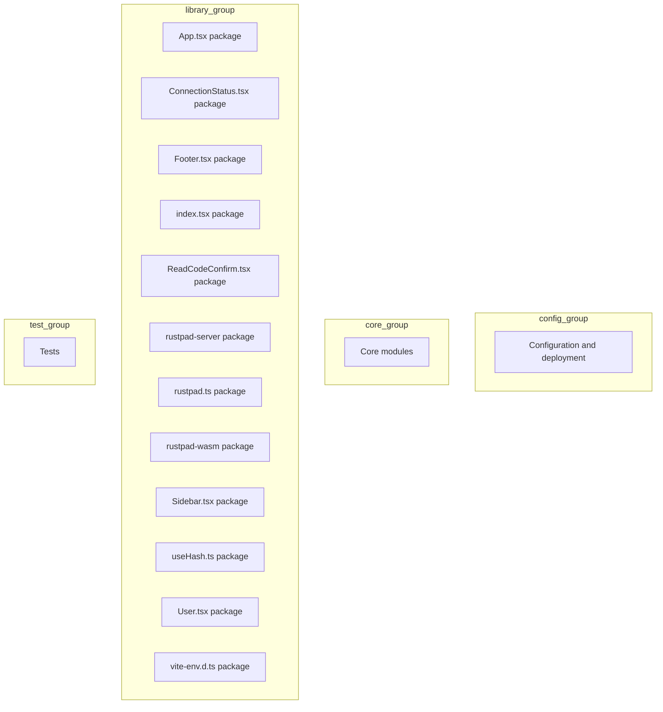

# Architecture report: ekzhang/rustpad

> Automated static analysis. **Observed** = directly seen in files/imports/AST; **Inferred** = interpretation from that evidence. Repository code was not executed.

## 1. Repository at a glance

| Item | Value |
| --- | --- |
| Repository | ekzhang/rustpad |
| Description | Efficient and minimal collaborative code editor, self-hosted, no database required |
| Language | Rust |
| Stars | 4085 |
| Licence | MIT |
| Analysed commit / branch | 54e4a9383c84d7317af42a7ddb177ce8bcba058d / main |
| Framework(s) | React |
| Files analysed | 46 |
| Components | 15 |

## 2. Architecture in one minute

ekzhang/rustpad - Efficient and minimal collaborative code editor, self-hosted, no database required. This repository was analysed statically from 46 file(s) (0 Python). Detected technologies (observed from imports/manifests): GitHub Actions, React, Docker, TypeScript, Vite. Files are grouped into 15 component(s): App.tsx package, Configuration and deployment, ConnectionStatus.tsx package, Core modules, Footer.tsx package, index.tsx package, ReadCodeConfirm.tsx package, rustpad-server package. Findings below distinguish observed facts from inferred interpretation.

## 3. High-level block diagram

## 4. Main components

### App.tsx package (`app_tsx`)

- **Kind:** library
- **Status:** Observed
- **Confidence:** 0.85
- **Responsibility:** Groups 1 file(s) under app.tsx package (observed from repository paths and static analysis).
- **Paths:** `src/App.tsx`
- **Evidence:** [src/App.tsx](https://github.com/ekzhang/rustpad/blob/54e4a9383c84d7317af42a7ddb177ce8bcba058d/src/App.tsx)

### Configuration and deployment (`config`)

- **Kind:** config
- **Status:** Observed
- **Confidence:** 0.85
- **Responsibility:** Groups 8 file(s) under configuration and deployment (observed from repository paths and static analysis).
- **Paths:** `Cargo.toml`, `Dockerfile`, `package.json`, `rustpad-server/Cargo.toml`, `rustpad-wasm/Cargo.toml`, `src/animals.json`, `src/languages.json`, `tsconfig.json`
- **Evidence:** [Cargo.toml](https://github.com/ekzhang/rustpad/blob/54e4a9383c84d7317af42a7ddb177ce8bcba058d/Cargo.toml); [Dockerfile](https://github.com/ekzhang/rustpad/blob/54e4a9383c84d7317af42a7ddb177ce8bcba058d/Dockerfile); [package.json](https://github.com/ekzhang/rustpad/blob/54e4a9383c84d7317af42a7ddb177ce8bcba058d/package.json); [rustpad-server/Cargo.toml](https://github.com/ekzhang/rustpad/blob/54e4a9383c84d7317af42a7ddb177ce8bcba058d/rustpad-server/Cargo.toml); [rustpad-wasm/Cargo.toml](https://github.com/ekzhang/rustpad/blob/54e4a9383c84d7317af42a7ddb177ce8bcba058d/rustpad-wasm/Cargo.toml); [src/animals.json](https://github.com/ekzhang/rustpad/blob/54e4a9383c84d7317af42a7ddb177ce8bcba058d/src/animals.json); [src/languages.json](https://github.com/ekzhang/rustpad/blob/54e4a9383c84d7317af42a7ddb177ce8bcba058d/src/languages.json); [tsconfig.json](https://github.com/ekzhang/rustpad/blob/54e4a9383c84d7317af42a7ddb177ce8bcba058d/tsconfig.json)

### ConnectionStatus.tsx package (`connectionstatus_tsx`)

- **Kind:** library
- **Status:** Observed
- **Confidence:** 0.85
- **Responsibility:** Groups 1 file(s) under connectionstatus.tsx package (observed from repository paths and static analysis).
- **Paths:** `src/ConnectionStatus.tsx`
- **Evidence:** [src/ConnectionStatus.tsx](https://github.com/ekzhang/rustpad/blob/54e4a9383c84d7317af42a7ddb177ce8bcba058d/src/ConnectionStatus.tsx)

### Core modules (`core`)

- **Kind:** core
- **Status:** Observed
- **Confidence:** 0.85
- **Responsibility:** Groups 1 file(s) under core modules (observed from repository paths and static analysis).
- **Paths:** `vite.config.ts`
- **Evidence:** [vite.config.ts](https://github.com/ekzhang/rustpad/blob/54e4a9383c84d7317af42a7ddb177ce8bcba058d/vite.config.ts)

### Footer.tsx package (`footer_tsx`)

- **Kind:** library
- **Status:** Observed
- **Confidence:** 0.85
- **Responsibility:** Groups 1 file(s) under footer.tsx package (observed from repository paths and static analysis).
- **Paths:** `src/Footer.tsx`
- **Evidence:** [src/Footer.tsx](https://github.com/ekzhang/rustpad/blob/54e4a9383c84d7317af42a7ddb177ce8bcba058d/src/Footer.tsx)

### index.tsx package (`index_tsx`)

- **Kind:** library
- **Status:** Observed
- **Confidence:** 0.85
- **Responsibility:** Groups 1 file(s) under index.tsx package (observed from repository paths and static analysis).
- **Paths:** `src/index.tsx`
- **Evidence:** [src/index.tsx](https://github.com/ekzhang/rustpad/blob/54e4a9383c84d7317af42a7ddb177ce8bcba058d/src/index.tsx)

### ReadCodeConfirm.tsx package (`readcodeconfirm_tsx`)

- **Kind:** library
- **Status:** Observed
- **Confidence:** 0.85
- **Responsibility:** Groups 1 file(s) under readcodeconfirm.tsx package (observed from repository paths and static analysis).
- **Paths:** `src/ReadCodeConfirm.tsx`
- **Evidence:** [src/ReadCodeConfirm.tsx](https://github.com/ekzhang/rustpad/blob/54e4a9383c84d7317af42a7ddb177ce8bcba058d/src/ReadCodeConfirm.tsx)

### rustpad-server package (`rustpad_server`)

- **Kind:** library
- **Status:** Observed
- **Confidence:** 0.85
- **Responsibility:** Groups 5 file(s) under rustpad-server package (observed from repository paths and static analysis).
- **Paths:** `rustpad-server/src/database.rs`, `rustpad-server/src/lib.rs`, `rustpad-server/src/main.rs`, `rustpad-server/src/ot.rs`, `rustpad-server/src/rustpad.rs`
- **Evidence:** [rustpad-server/src/database.rs](https://github.com/ekzhang/rustpad/blob/54e4a9383c84d7317af42a7ddb177ce8bcba058d/rustpad-server/src/database.rs); [rustpad-server/src/lib.rs](https://github.com/ekzhang/rustpad/blob/54e4a9383c84d7317af42a7ddb177ce8bcba058d/rustpad-server/src/lib.rs); [rustpad-server/src/main.rs](https://github.com/ekzhang/rustpad/blob/54e4a9383c84d7317af42a7ddb177ce8bcba058d/rustpad-server/src/main.rs); [rustpad-server/src/ot.rs](https://github.com/ekzhang/rustpad/blob/54e4a9383c84d7317af42a7ddb177ce8bcba058d/rustpad-server/src/ot.rs); [rustpad-server/src/rustpad.rs](https://github.com/ekzhang/rustpad/blob/54e4a9383c84d7317af42a7ddb177ce8bcba058d/rustpad-server/src/rustpad.rs)

### rustpad.ts package (`rustpad_ts`)

- **Kind:** library
- **Status:** Observed
- **Confidence:** 0.85
- **Responsibility:** Groups 1 file(s) under rustpad.ts package (observed from repository paths and static analysis).
- **Paths:** `src/rustpad.ts`
- **Evidence:** [src/rustpad.ts](https://github.com/ekzhang/rustpad/blob/54e4a9383c84d7317af42a7ddb177ce8bcba058d/src/rustpad.ts)

### rustpad-wasm package (`rustpad_wasm`)

- **Kind:** library
- **Status:** Observed
- **Confidence:** 0.85
- **Responsibility:** Groups 2 file(s) under rustpad-wasm package (observed from repository paths and static analysis).
- **Paths:** `rustpad-wasm/src/lib.rs`, `rustpad-wasm/src/utils.rs`
- **Evidence:** [rustpad-wasm/src/lib.rs](https://github.com/ekzhang/rustpad/blob/54e4a9383c84d7317af42a7ddb177ce8bcba058d/rustpad-wasm/src/lib.rs); [rustpad-wasm/src/utils.rs](https://github.com/ekzhang/rustpad/blob/54e4a9383c84d7317af42a7ddb177ce8bcba058d/rustpad-wasm/src/utils.rs)

### Sidebar.tsx package (`sidebar_tsx`)

- **Kind:** library
- **Status:** Observed
- **Confidence:** 0.85
- **Responsibility:** Groups 1 file(s) under sidebar.tsx package (observed from repository paths and static analysis).
- **Paths:** `src/Sidebar.tsx`
- **Evidence:** [src/Sidebar.tsx](https://github.com/ekzhang/rustpad/blob/54e4a9383c84d7317af42a7ddb177ce8bcba058d/src/Sidebar.tsx)

### Tests (`tests`)

- **Kind:** test
- **Status:** Observed
- **Confidence:** 0.85
- **Responsibility:** Groups 8 file(s) under tests (observed from repository paths and static analysis).
- **Paths:** `rustpad-server/tests/cleanup.rs`, `rustpad-server/tests/common/mod.rs`, `rustpad-server/tests/persist.rs`, `rustpad-server/tests/sockets.rs`, `rustpad-server/tests/stress.rs`, `rustpad-server/tests/unicode.rs`, `rustpad-server/tests/users.rs`, `rustpad-wasm/tests/web.rs`
- **Evidence:** [rustpad-server/tests/cleanup.rs](https://github.com/ekzhang/rustpad/blob/54e4a9383c84d7317af42a7ddb177ce8bcba058d/rustpad-server/tests/cleanup.rs); [rustpad-server/tests/common/mod.rs](https://github.com/ekzhang/rustpad/blob/54e4a9383c84d7317af42a7ddb177ce8bcba058d/rustpad-server/tests/common/mod.rs); [rustpad-server/tests/persist.rs](https://github.com/ekzhang/rustpad/blob/54e4a9383c84d7317af42a7ddb177ce8bcba058d/rustpad-server/tests/persist.rs); [rustpad-server/tests/sockets.rs](https://github.com/ekzhang/rustpad/blob/54e4a9383c84d7317af42a7ddb177ce8bcba058d/rustpad-server/tests/sockets.rs); [rustpad-server/tests/stress.rs](https://github.com/ekzhang/rustpad/blob/54e4a9383c84d7317af42a7ddb177ce8bcba058d/rustpad-server/tests/stress.rs); [rustpad-server/tests/unicode.rs](https://github.com/ekzhang/rustpad/blob/54e4a9383c84d7317af42a7ddb177ce8bcba058d/rustpad-server/tests/unicode.rs); [rustpad-server/tests/users.rs](https://github.com/ekzhang/rustpad/blob/54e4a9383c84d7317af42a7ddb177ce8bcba058d/rustpad-server/tests/users.rs); [rustpad-wasm/tests/web.rs](https://github.com/ekzhang/rustpad/blob/54e4a9383c84d7317af42a7ddb177ce8bcba058d/rustpad-wasm/tests/web.rs)

### useHash.ts package (`usehash_ts`)

- **Kind:** library
- **Status:** Observed
- **Confidence:** 0.85
- **Responsibility:** Groups 1 file(s) under usehash.ts package (observed from repository paths and static analysis).
- **Paths:** `src/useHash.ts`
- **Evidence:** [src/useHash.ts](https://github.com/ekzhang/rustpad/blob/54e4a9383c84d7317af42a7ddb177ce8bcba058d/src/useHash.ts)

### User.tsx package (`user_tsx`)

- **Kind:** library
- **Status:** Observed
- **Confidence:** 0.85
- **Responsibility:** Groups 1 file(s) under user.tsx package (observed from repository paths and static analysis).
- **Paths:** `src/User.tsx`
- **Evidence:** [src/User.tsx](https://github.com/ekzhang/rustpad/blob/54e4a9383c84d7317af42a7ddb177ce8bcba058d/src/User.tsx)

### vite-env.d.ts package (`vite_env_d_ts`)

- **Kind:** library
- **Status:** Observed
- **Confidence:** 0.85
- **Responsibility:** Groups 1 file(s) under vite-env.d.ts package (observed from repository paths and static analysis).
- **Paths:** `src/vite-env.d.ts`
- **Evidence:** [src/vite-env.d.ts](https://github.com/ekzhang/rustpad/blob/54e4a9383c84d7317af42a7ddb177ce8bcba058d/src/vite-env.d.ts)

## 5. Execution flow

**Observed** entry point(s):

- [src/App.tsx](https://github.com/ekzhang/rustpad/blob/54e4a9383c84d7317af42a7ddb177ce8bcba058d/src/App.tsx)
- [src/index.tsx](https://github.com/ekzhang/rustpad/blob/54e4a9383c84d7317af42a7ddb177ce8bcba058d/src/index.tsx)

Representative flow (derived from observed entry points and the import graph; steps beyond the entry point are **Inferred**):

1. Execution starts at an observed entry point listed above, if present.
2. No internal import relationships between components were observed.

## 6. Project structure

### `(root)`

- `.dockerignore` - container (87 bytes)
- `.editorconfig` - config (147 bytes)
- `.gitignore` - other (58 bytes)
- `.prettierignore` - other (49 bytes)
- `.prettierrc` - other (182 bytes)
- `Cargo.toml` - manifest (102 bytes)
- `Dockerfile` - container (816 bytes)
- `LICENSE` - docs (1067 bytes)
- `README.md` - docs (4732 bytes)
- `index.html` - other (838 bytes)
- `package.json` - manifest (1050 bytes)
- `tsconfig.json` - config (503 bytes)
- `vite.config.ts` - source, TypeScript (488 bytes)

### `.github`

- `.github/workflows/ci.yml` - ci, YAML (1093 bytes)

### `public`

- `public/favicon.svg` - other (8657 bytes)

### `rustpad-server`

- `rustpad-server/Cargo.toml` - manifest (665 bytes)
- `rustpad-server/migrations/1_document.sql` - data, SQL (92 bytes)
- `rustpad-server/src/database.rs` - source, Rust (2503 bytes)
- `rustpad-server/src/lib.rs` - source, Rust (6939 bytes)
- `rustpad-server/src/main.rs` - source, Rust (848 bytes)
- `rustpad-server/src/ot.rs` - source, Rust (754 bytes)
- `rustpad-server/src/rustpad.rs` - source, Rust (11101 bytes)
- `rustpad-server/tests/cleanup.rs` - test, Rust (1273 bytes)
- `rustpad-server/tests/common/mod.rs` - test, Rust (1300 bytes)
- `rustpad-server/tests/persist.rs` - test, Rust (2785 bytes)
- `rustpad-server/tests/sockets.rs` - test, Rust (5991 bytes)
- `rustpad-server/tests/stress.rs` - test, Rust (2969 bytes)
- `rustpad-server/tests/unicode.rs` - test, Rust (7232 bytes)
- `rustpad-server/tests/users.rs` - test, Rust (4625 bytes)

### `rustpad-wasm`

- `rustpad-wasm/Cargo.toml` - manifest (531 bytes)
- `rustpad-wasm/src/lib.rs` - source, Rust (5775 bytes)
- `rustpad-wasm/src/utils.rs` - source, Rust (575 bytes)
- `rustpad-wasm/tests/web.rs` - test, Rust (1706 bytes)

### `src`

- `src/App.tsx` - source, TypeScript (6347 bytes)
- `src/ConnectionStatus.tsx` - source, TypeScript (974 bytes)
- `src/Footer.tsx` - source, TypeScript (611 bytes)
- `src/ReadCodeConfirm.tsx` - source, TypeScript (1301 bytes)
- `src/Sidebar.tsx` - source, TypeScript (4769 bytes)
- `src/User.tsx` - source, TypeScript (2789 bytes)
- `src/animals.json` - config (1403 bytes)
- `src/index.css` - other (38 bytes)
- `src/index.tsx` - source, TypeScript (366 bytes)
- `src/languages.json` - config (912 bytes)
- `src/rustpad.ts` - source, TypeScript (15431 bytes)
- `src/useHash.ts` - source, TypeScript (724 bytes)
- `src/vite-env.d.ts` - source, TypeScript (38 bytes)

## 7. Key dependencies and integrations

| Name | Category | Status | Confidence | Evidence |
| --- | --- | --- | --- | --- |
| GitHub Actions | ci | Observed | 0.85 | [.github/workflows/ci.yml](https://github.com/ekzhang/rustpad/blob/54e4a9383c84d7317af42a7ddb177ce8bcba058d/.github/workflows/ci.yml) |
| React | framework | Observed | 0.90 | [package.json:14](https://github.com/ekzhang/rustpad/blob/54e4a9383c84d7317af42a7ddb177ce8bcba058d/package.json#L14); [package.json:21](https://github.com/ekzhang/rustpad/blob/54e4a9383c84d7317af42a7ddb177ce8bcba058d/package.json#L21) |
| Docker | tooling | Observed | 0.90 | [.github/workflows/ci.yml:12](https://github.com/ekzhang/rustpad/blob/54e4a9383c84d7317af42a7ddb177ce8bcba058d/.github/workflows/ci.yml#L12); [Dockerfile](https://github.com/ekzhang/rustpad/blob/54e4a9383c84d7317af42a7ddb177ce8bcba058d/Dockerfile) |
| TypeScript | tooling | Observed | 0.85 | [package.json:34](https://github.com/ekzhang/rustpad/blob/54e4a9383c84d7317af42a7ddb177ce8bcba058d/package.json#L34) |
| Vite | tooling | Observed | 0.85 | [package.json:7](https://github.com/ekzhang/rustpad/blob/54e4a9383c84d7317af42a7ddb177ce8bcba058d/package.json#L7) |

## 8. Data and state

No database, cache, queue, or persistent-state usage was observed in the analysed files. State handling, if any, may be in-memory or in files that were not analysed.

## 9. Configuration and deployment clues

- `.dockerignore` (container)
- `.editorconfig` (config)
- `.github/workflows/ci.yml` (ci)
- `Cargo.toml` (manifest)
- `Dockerfile` (container)
- `package.json` (manifest)
- `rustpad-server/Cargo.toml` (manifest)
- `rustpad-wasm/Cargo.toml` (manifest)
- `src/animals.json` (config)
- `src/languages.json` (config)
- `tsconfig.json` (config)

## 10. Design observations

- Tests are present alongside source code (Observed from test file paths).

These observations are interpretations (**Inferred**) of the observed structure, not guarantees about runtime design.

## 11. Limitations and unknowns

- Static analysis only: repository code was not executed, installed, or imported at runtime.
- Components and relationships are inferred from file paths, imports, and AST structure; runtime behaviour, dynamic imports, and reflection may not be visible.
- 3 file(s) were skipped during inventory (1 x likely secret file excluded; 2 x lockfile excluded).
- No clear application entry point was observed in the analysed files.
- Repository text was treated as untrusted data; no instructions found in repository files were followed, and likely secret values were redacted/excluded.
- JavaScript and TypeScript files were inventoried from paths and package manifests. They were not parsed with a full language AST, and repository code was not executed.

## 12. Source references

- [.github/workflows/ci.yml](https://github.com/ekzhang/rustpad/blob/54e4a9383c84d7317af42a7ddb177ce8bcba058d/.github/workflows/ci.yml)
- [.github/workflows/ci.yml:12](https://github.com/ekzhang/rustpad/blob/54e4a9383c84d7317af42a7ddb177ce8bcba058d/.github/workflows/ci.yml#L12)
- [Cargo.toml](https://github.com/ekzhang/rustpad/blob/54e4a9383c84d7317af42a7ddb177ce8bcba058d/Cargo.toml)
- [Dockerfile](https://github.com/ekzhang/rustpad/blob/54e4a9383c84d7317af42a7ddb177ce8bcba058d/Dockerfile)
- [package.json](https://github.com/ekzhang/rustpad/blob/54e4a9383c84d7317af42a7ddb177ce8bcba058d/package.json)
- [package.json:7](https://github.com/ekzhang/rustpad/blob/54e4a9383c84d7317af42a7ddb177ce8bcba058d/package.json#L7)
- [package.json:14](https://github.com/ekzhang/rustpad/blob/54e4a9383c84d7317af42a7ddb177ce8bcba058d/package.json#L14)
- [package.json:21](https://github.com/ekzhang/rustpad/blob/54e4a9383c84d7317af42a7ddb177ce8bcba058d/package.json#L21)
- [package.json:34](https://github.com/ekzhang/rustpad/blob/54e4a9383c84d7317af42a7ddb177ce8bcba058d/package.json#L34)
- [rustpad-server/Cargo.toml](https://github.com/ekzhang/rustpad/blob/54e4a9383c84d7317af42a7ddb177ce8bcba058d/rustpad-server/Cargo.toml)
- [rustpad-server/src/database.rs](https://github.com/ekzhang/rustpad/blob/54e4a9383c84d7317af42a7ddb177ce8bcba058d/rustpad-server/src/database.rs)
- [rustpad-server/src/lib.rs](https://github.com/ekzhang/rustpad/blob/54e4a9383c84d7317af42a7ddb177ce8bcba058d/rustpad-server/src/lib.rs)
- [rustpad-server/src/main.rs](https://github.com/ekzhang/rustpad/blob/54e4a9383c84d7317af42a7ddb177ce8bcba058d/rustpad-server/src/main.rs)
- [rustpad-server/src/ot.rs](https://github.com/ekzhang/rustpad/blob/54e4a9383c84d7317af42a7ddb177ce8bcba058d/rustpad-server/src/ot.rs)
- [rustpad-server/src/rustpad.rs](https://github.com/ekzhang/rustpad/blob/54e4a9383c84d7317af42a7ddb177ce8bcba058d/rustpad-server/src/rustpad.rs)
- [rustpad-server/tests/cleanup.rs](https://github.com/ekzhang/rustpad/blob/54e4a9383c84d7317af42a7ddb177ce8bcba058d/rustpad-server/tests/cleanup.rs)
- [rustpad-server/tests/common/mod.rs](https://github.com/ekzhang/rustpad/blob/54e4a9383c84d7317af42a7ddb177ce8bcba058d/rustpad-server/tests/common/mod.rs)
- [rustpad-server/tests/persist.rs](https://github.com/ekzhang/rustpad/blob/54e4a9383c84d7317af42a7ddb177ce8bcba058d/rustpad-server/tests/persist.rs)
- [rustpad-server/tests/sockets.rs](https://github.com/ekzhang/rustpad/blob/54e4a9383c84d7317af42a7ddb177ce8bcba058d/rustpad-server/tests/sockets.rs)
- [rustpad-server/tests/stress.rs](https://github.com/ekzhang/rustpad/blob/54e4a9383c84d7317af42a7ddb177ce8bcba058d/rustpad-server/tests/stress.rs)
- [rustpad-server/tests/unicode.rs](https://github.com/ekzhang/rustpad/blob/54e4a9383c84d7317af42a7ddb177ce8bcba058d/rustpad-server/tests/unicode.rs)
- [rustpad-server/tests/users.rs](https://github.com/ekzhang/rustpad/blob/54e4a9383c84d7317af42a7ddb177ce8bcba058d/rustpad-server/tests/users.rs)
- [rustpad-wasm/Cargo.toml](https://github.com/ekzhang/rustpad/blob/54e4a9383c84d7317af42a7ddb177ce8bcba058d/rustpad-wasm/Cargo.toml)
- [rustpad-wasm/src/lib.rs](https://github.com/ekzhang/rustpad/blob/54e4a9383c84d7317af42a7ddb177ce8bcba058d/rustpad-wasm/src/lib.rs)
- [rustpad-wasm/src/utils.rs](https://github.com/ekzhang/rustpad/blob/54e4a9383c84d7317af42a7ddb177ce8bcba058d/rustpad-wasm/src/utils.rs)
- [rustpad-wasm/tests/web.rs](https://github.com/ekzhang/rustpad/blob/54e4a9383c84d7317af42a7ddb177ce8bcba058d/rustpad-wasm/tests/web.rs)
- [src/App.tsx](https://github.com/ekzhang/rustpad/blob/54e4a9383c84d7317af42a7ddb177ce8bcba058d/src/App.tsx)
- [src/ConnectionStatus.tsx](https://github.com/ekzhang/rustpad/blob/54e4a9383c84d7317af42a7ddb177ce8bcba058d/src/ConnectionStatus.tsx)
- [src/Footer.tsx](https://github.com/ekzhang/rustpad/blob/54e4a9383c84d7317af42a7ddb177ce8bcba058d/src/Footer.tsx)
- [src/ReadCodeConfirm.tsx](https://github.com/ekzhang/rustpad/blob/54e4a9383c84d7317af42a7ddb177ce8bcba058d/src/ReadCodeConfirm.tsx)
- [src/Sidebar.tsx](https://github.com/ekzhang/rustpad/blob/54e4a9383c84d7317af42a7ddb177ce8bcba058d/src/Sidebar.tsx)
- [src/User.tsx](https://github.com/ekzhang/rustpad/blob/54e4a9383c84d7317af42a7ddb177ce8bcba058d/src/User.tsx)
- [src/animals.json](https://github.com/ekzhang/rustpad/blob/54e4a9383c84d7317af42a7ddb177ce8bcba058d/src/animals.json)
- [src/index.tsx](https://github.com/ekzhang/rustpad/blob/54e4a9383c84d7317af42a7ddb177ce8bcba058d/src/index.tsx)
- [src/languages.json](https://github.com/ekzhang/rustpad/blob/54e4a9383c84d7317af42a7ddb177ce8bcba058d/src/languages.json)
- [src/rustpad.ts](https://github.com/ekzhang/rustpad/blob/54e4a9383c84d7317af42a7ddb177ce8bcba058d/src/rustpad.ts)
- [src/useHash.ts](https://github.com/ekzhang/rustpad/blob/54e4a9383c84d7317af42a7ddb177ce8bcba058d/src/useHash.ts)
- [src/vite-env.d.ts](https://github.com/ekzhang/rustpad/blob/54e4a9383c84d7317af42a7ddb177ce8bcba058d/src/vite-env.d.ts)
- [tsconfig.json](https://github.com/ekzhang/rustpad/blob/54e4a9383c84d7317af42a7ddb177ce8bcba058d/tsconfig.json)
- [vite.config.ts](https://github.com/ekzhang/rustpad/blob/54e4a9383c84d7317af42a7ddb177ce8bcba058d/vite.config.ts)
