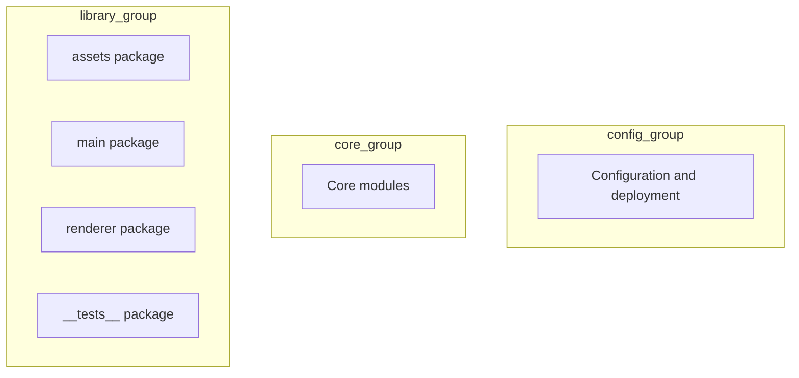

# Architecture report: electron-react-boilerplate/electron-react-boilerplate

> Automated static analysis. **Observed** = directly seen in files/imports/AST; **Inferred** = interpretation from that evidence. Repository code was not executed.

## 1. Repository at a glance

| Item | Value |
| --- | --- |
| Repository | electron-react-boilerplate/electron-react-boilerplate |
| Description | A Foundation for Scalable Cross-Platform Apps |
| Language | TypeScript |
| Stars | 24250 |
| Licence | MIT |
| Analysed commit / branch | e5b8242d8b21a4290c3a1f18ae3b64167e9de04a / main |
| Framework(s) | Electron, React |
| Files analysed | 53 |
| Components | 6 |

## 2. Architecture in one minute

electron-react-boilerplate/electron-react-boilerplate - A Foundation for Scalable Cross-Platform Apps. This repository was analysed statically from 53 file(s) (0 Python). Detected technologies (observed from imports/manifests): GitHub Actions, Electron, React, React Router, Jest, TypeScript. Files are grouped into 6 component(s): assets package, Configuration and deployment, Core modules, main package, renderer package, __tests__ package. Findings below distinguish observed facts from inferred interpretation.

## 3. High-level block diagram

## 4. Main components

### assets package (`assets`)

- **Kind:** library
- **Status:** Observed
- **Confidence:** 0.85
- **Responsibility:** Groups 1 file(s) under assets package (observed from repository paths and static analysis).
- **Paths:** `assets/assets.d.ts`
- **Evidence:** [assets/assets.d.ts](https://github.com/electron-react-boilerplate/electron-react-boilerplate/blob/e5b8242d8b21a4290c3a1f18ae3b64167e9de04a/assets/assets.d.ts)

### Configuration and deployment (`config`)

- **Kind:** config
- **Status:** Observed
- **Confidence:** 0.85
- **Responsibility:** Groups 3 file(s) under configuration and deployment (observed from repository paths and static analysis).
- **Paths:** `package.json`, `release/app/package.json`, `tsconfig.json`
- **Evidence:** [package.json](https://github.com/electron-react-boilerplate/electron-react-boilerplate/blob/e5b8242d8b21a4290c3a1f18ae3b64167e9de04a/package.json); [release/app/package.json](https://github.com/electron-react-boilerplate/electron-react-boilerplate/blob/e5b8242d8b21a4290c3a1f18ae3b64167e9de04a/release/app/package.json); [tsconfig.json](https://github.com/electron-react-boilerplate/electron-react-boilerplate/blob/e5b8242d8b21a4290c3a1f18ae3b64167e9de04a/tsconfig.json)

### Core modules (`core`)

- **Kind:** core
- **Status:** Observed
- **Confidence:** 0.85
- **Responsibility:** Groups 3 file(s) under core modules (observed from repository paths and static analysis).
- **Paths:** `electron.vite.config.ts`, `eslint.config.js`, `jest.config.js`
- **Evidence:** [electron.vite.config.ts](https://github.com/electron-react-boilerplate/electron-react-boilerplate/blob/e5b8242d8b21a4290c3a1f18ae3b64167e9de04a/electron.vite.config.ts); [eslint.config.js](https://github.com/electron-react-boilerplate/electron-react-boilerplate/blob/e5b8242d8b21a4290c3a1f18ae3b64167e9de04a/eslint.config.js); [jest.config.js](https://github.com/electron-react-boilerplate/electron-react-boilerplate/blob/e5b8242d8b21a4290c3a1f18ae3b64167e9de04a/jest.config.js)

### main package (`main`)

- **Kind:** library
- **Status:** Observed
- **Confidence:** 0.85
- **Responsibility:** Groups 5 file(s) under main package (observed from repository paths and static analysis).
- **Paths:** `src/main/main.ts`, `src/main/menu.ts`, `src/main/preload.ts`, `src/main/updates.ts`, `src/main/util.ts`
- **Evidence:** [src/main/main.ts](https://github.com/electron-react-boilerplate/electron-react-boilerplate/blob/e5b8242d8b21a4290c3a1f18ae3b64167e9de04a/src/main/main.ts); [src/main/menu.ts](https://github.com/electron-react-boilerplate/electron-react-boilerplate/blob/e5b8242d8b21a4290c3a1f18ae3b64167e9de04a/src/main/menu.ts); [src/main/preload.ts](https://github.com/electron-react-boilerplate/electron-react-boilerplate/blob/e5b8242d8b21a4290c3a1f18ae3b64167e9de04a/src/main/preload.ts); [src/main/updates.ts](https://github.com/electron-react-boilerplate/electron-react-boilerplate/blob/e5b8242d8b21a4290c3a1f18ae3b64167e9de04a/src/main/updates.ts); [src/main/util.ts](https://github.com/electron-react-boilerplate/electron-react-boilerplate/blob/e5b8242d8b21a4290c3a1f18ae3b64167e9de04a/src/main/util.ts)

### renderer package (`renderer`)

- **Kind:** library
- **Status:** Observed
- **Confidence:** 0.85
- **Responsibility:** Groups 3 file(s) under renderer package (observed from repository paths and static analysis).
- **Paths:** `src/renderer/App.tsx`, `src/renderer/index.tsx`, `src/renderer/preload.d.ts`
- **Evidence:** [src/renderer/App.tsx](https://github.com/electron-react-boilerplate/electron-react-boilerplate/blob/e5b8242d8b21a4290c3a1f18ae3b64167e9de04a/src/renderer/App.tsx); [src/renderer/index.tsx](https://github.com/electron-react-boilerplate/electron-react-boilerplate/blob/e5b8242d8b21a4290c3a1f18ae3b64167e9de04a/src/renderer/index.tsx); [src/renderer/preload.d.ts](https://github.com/electron-react-boilerplate/electron-react-boilerplate/blob/e5b8242d8b21a4290c3a1f18ae3b64167e9de04a/src/renderer/preload.d.ts)

### __tests__ package (`tests`)

- **Kind:** library
- **Status:** Observed
- **Confidence:** 0.85
- **Responsibility:** Groups 2 file(s) under __tests__ package (observed from repository paths and static analysis).
- **Paths:** `src/__tests__/App.test.tsx`, `src/__tests__/updates.test.ts`
- **Evidence:** [src/__tests__/App.test.tsx](https://github.com/electron-react-boilerplate/electron-react-boilerplate/blob/e5b8242d8b21a4290c3a1f18ae3b64167e9de04a/src/__tests__/App.test.tsx); [src/__tests__/updates.test.ts](https://github.com/electron-react-boilerplate/electron-react-boilerplate/blob/e5b8242d8b21a4290c3a1f18ae3b64167e9de04a/src/__tests__/updates.test.ts)

## 5. Execution flow

**Observed** entry point(s):

- [src/main/main.ts](https://github.com/electron-react-boilerplate/electron-react-boilerplate/blob/e5b8242d8b21a4290c3a1f18ae3b64167e9de04a/src/main/main.ts)
- [src/renderer/App.tsx](https://github.com/electron-react-boilerplate/electron-react-boilerplate/blob/e5b8242d8b21a4290c3a1f18ae3b64167e9de04a/src/renderer/App.tsx)
- [src/renderer/index.tsx](https://github.com/electron-react-boilerplate/electron-react-boilerplate/blob/e5b8242d8b21a4290c3a1f18ae3b64167e9de04a/src/renderer/index.tsx)

Representative flow (derived from observed entry points and the import graph; steps beyond the entry point are **Inferred**):

1. Execution starts at an observed entry point listed above, if present.
2. No internal import relationships between components were observed.

## 6. Project structure

### `(root)`

- `.editorconfig` - config (188 bytes)
- `.gitattributes` - other (188 bytes)
- `.gitignore` - other (370 bytes)
- `CHANGELOG.md` - docs (17633 bytes)
- `CODE_OF_CONDUCT.md` - docs (3366 bytes)
- `LICENSE` - docs (1101 bytes)
- `README.md` - docs (16381 bytes)
- `electron.vite.config.ts` - source, TypeScript (1650 bytes)
- `eslint.config.js` - source, JavaScript (2482 bytes)
- `jest.config.js` - source, JavaScript (1088 bytes)
- `package.json` - manifest (5523 bytes)
- `tsconfig.json` - config (744 bytes)

### `.erb`

- `.erb/configs/paths.ts` - source, TypeScript (1136 bytes)
- `.erb/img/erb-banner.svg` - other (24636 bytes)
- `.erb/img/palette-sponsor-banner.svg` - other (33593 bytes)
- `.erb/mocks/fileMock.js` - source, JavaScript (33 bytes)
- `.erb/mocks/svgComponentMock.js` - source, JavaScript (24 bytes)
- `.erb/scripts/check-build-exists.ts` - source, TypeScript (806 bytes)
- `.erb/scripts/electron-rebuild.js` - source, JavaScript (585 bytes)
- `.erb/scripts/link-modules.ts` - source, TypeScript (422 bytes)
- `.erb/scripts/notarize.js` - source, JavaScript (989 bytes)
- `.erb/scripts/register.cjs` - source, JavaScript (408 bytes)
- `.erb/scripts/smoke-test.cjs` - source, JavaScript (4555 bytes)
- `.erb/tooling/README.md` - docs (1261 bytes)
- `.erb/tooling/package.json` - manifest (449 bytes)

### `.github`

- `.github/FUNDING.yml` - config (162 bytes)
- `.github/ISSUE_TEMPLATE/1-Bug_report.md` - docs (1894 bytes)
- `.github/ISSUE_TEMPLATE/2-Question.md` - docs (411 bytes)
- `.github/ISSUE_TEMPLATE/3-Feature_request.md` - docs (402 bytes)
- `.github/config.yml` - config (121 bytes)
- `.github/stale.yml` - config (688 bytes)
- `.github/workflows/codeql-analysis.yml` - ci, YAML (2751 bytes)
- `.github/workflows/publish.yml` - ci, YAML (1303 bytes)
- `.github/workflows/test.yml` - ci, YAML (949 bytes)

### `.vscode`

- `.vscode/extensions.json` - config (81 bytes)
- `.vscode/launch.json` - config (684 bytes)
- `.vscode/settings.json` - config (644 bytes)

### `assets`

- `assets/assets.d.ts` - source, TypeScript (669 bytes)
- `assets/entitlements.mac.plist` - other (251 bytes)
- `assets/icon.svg` - other (3373 bytes)

### `release`

- `release/app/package.json` - manifest (658 bytes)

### `src`

- `src/__tests__/App.test.tsx` - source, TypeScript (668 bytes)
- `src/__tests__/updates.test.ts` - source, TypeScript (1300 bytes)
- `src/main/main.ts` - source, TypeScript (3415 bytes)
- `src/main/menu.ts` - source, TypeScript (3888 bytes)
- `src/main/preload.ts` - source, TypeScript (919 bytes)
- `src/main/updates.ts` - source, TypeScript (611 bytes)
- `src/main/util.ts` - source, TypeScript (389 bytes)
- `src/renderer/App.css` - other (1065 bytes)
- `src/renderer/App.tsx` - source, TypeScript (1169 bytes)
- `src/renderer/index.html` - other (328 bytes)
- `src/renderer/index.tsx` - source, TypeScript (392 bytes)
- `src/renderer/preload.d.ts` - source, TypeScript (139 bytes)

## 7. Key dependencies and integrations

| Name | Category | Status | Confidence | Evidence |
| --- | --- | --- | --- | --- |
| GitHub Actions | ci | Observed | 0.90 | [.github/workflows/codeql-analysis.yml](https://github.com/electron-react-boilerplate/electron-react-boilerplate/blob/e5b8242d8b21a4290c3a1f18ae3b64167e9de04a/.github/workflows/codeql-analysis.yml); [.github/workflows/publish.yml](https://github.com/electron-react-boilerplate/electron-react-boilerplate/blob/e5b8242d8b21a4290c3a1f18ae3b64167e9de04a/.github/workflows/publish.yml); [.github/workflows/test.yml](https://github.com/electron-react-boilerplate/electron-react-boilerplate/blob/e5b8242d8b21a4290c3a1f18ae3b64167e9de04a/.github/workflows/test.yml) |
| Electron | framework | Observed | 0.85 | [package.json:2](https://github.com/electron-react-boilerplate/electron-react-boilerplate/blob/e5b8242d8b21a4290c3a1f18ae3b64167e9de04a/package.json#L2) |
| React | framework | Observed | 0.90 | [package.json:2](https://github.com/electron-react-boilerplate/electron-react-boilerplate/blob/e5b8242d8b21a4290c3a1f18ae3b64167e9de04a/package.json#L2); [package.json:72](https://github.com/electron-react-boilerplate/electron-react-boilerplate/blob/e5b8242d8b21a4290c3a1f18ae3b64167e9de04a/package.json#L72) |
| React Router | library | Observed | 0.85 | [package.json:73](https://github.com/electron-react-boilerplate/electron-react-boilerplate/blob/e5b8242d8b21a4290c3a1f18ae3b64167e9de04a/package.json#L73) |
| Jest | tooling | Observed | 0.85 | [package.json:45](https://github.com/electron-react-boilerplate/electron-react-boilerplate/blob/e5b8242d8b21a4290c3a1f18ae3b64167e9de04a/package.json#L45) |
| TypeScript | tooling | Observed | 0.90 | [.erb/tooling/package.json:5](https://github.com/electron-react-boilerplate/electron-react-boilerplate/blob/e5b8242d8b21a4290c3a1f18ae3b64167e9de04a/.erb/tooling/package.json#L5); [package.json:8](https://github.com/electron-react-boilerplate/electron-react-boilerplate/blob/e5b8242d8b21a4290c3a1f18ae3b64167e9de04a/package.json#L8) |
| Vite | tooling | Observed | 0.85 | [package.json:13](https://github.com/electron-react-boilerplate/electron-react-boilerplate/blob/e5b8242d8b21a4290c3a1f18ae3b64167e9de04a/package.json#L13) |

## 8. Data and state

No database, cache, queue, or persistent-state usage was observed in the analysed files. State handling, if any, may be in-memory or in files that were not analysed.

## 9. Configuration and deployment clues

- `.editorconfig` (config)
- `.erb/tooling/package.json` (manifest)
- `.github/FUNDING.yml` (config)
- `.github/config.yml` (config)
- `.github/stale.yml` (config)
- `.github/workflows/codeql-analysis.yml` (ci)
- `.github/workflows/publish.yml` (ci)
- `.github/workflows/test.yml` (ci)
- `.vscode/extensions.json` (config)
- `.vscode/launch.json` (config)
- `.vscode/settings.json` (config)
- `package.json` (manifest)
- `release/app/package.json` (manifest)
- `tsconfig.json` (config)

## 10. Design observations

- No strong design patterns could be established from the available evidence.

These observations are interpretations (**Inferred**) of the observed structure, not guarantees about runtime design.

## 11. Limitations and unknowns

- Static analysis only: repository code was not executed, installed, or imported at runtime.
- Components and relationships are inferred from file paths, imports, and AST structure; runtime behaviour, dynamic imports, and reflection may not be visible.
- 1 file(s) were skipped during inventory (1 x lockfile excluded).
- No clear application entry point was observed in the analysed files.
- Repository text was treated as untrusted data; no instructions found in repository files were followed, and likely secret values were redacted/excluded.
- JavaScript and TypeScript files were inventoried from paths and package manifests. They were not parsed with a full language AST, and repository code was not executed.

## 12. Source references

- [.erb/tooling/package.json:5](https://github.com/electron-react-boilerplate/electron-react-boilerplate/blob/e5b8242d8b21a4290c3a1f18ae3b64167e9de04a/.erb/tooling/package.json#L5)
- [.github/workflows/codeql-analysis.yml](https://github.com/electron-react-boilerplate/electron-react-boilerplate/blob/e5b8242d8b21a4290c3a1f18ae3b64167e9de04a/.github/workflows/codeql-analysis.yml)
- [.github/workflows/publish.yml](https://github.com/electron-react-boilerplate/electron-react-boilerplate/blob/e5b8242d8b21a4290c3a1f18ae3b64167e9de04a/.github/workflows/publish.yml)
- [.github/workflows/test.yml](https://github.com/electron-react-boilerplate/electron-react-boilerplate/blob/e5b8242d8b21a4290c3a1f18ae3b64167e9de04a/.github/workflows/test.yml)
- [assets/assets.d.ts](https://github.com/electron-react-boilerplate/electron-react-boilerplate/blob/e5b8242d8b21a4290c3a1f18ae3b64167e9de04a/assets/assets.d.ts)
- [electron.vite.config.ts](https://github.com/electron-react-boilerplate/electron-react-boilerplate/blob/e5b8242d8b21a4290c3a1f18ae3b64167e9de04a/electron.vite.config.ts)
- [eslint.config.js](https://github.com/electron-react-boilerplate/electron-react-boilerplate/blob/e5b8242d8b21a4290c3a1f18ae3b64167e9de04a/eslint.config.js)
- [jest.config.js](https://github.com/electron-react-boilerplate/electron-react-boilerplate/blob/e5b8242d8b21a4290c3a1f18ae3b64167e9de04a/jest.config.js)
- [package.json](https://github.com/electron-react-boilerplate/electron-react-boilerplate/blob/e5b8242d8b21a4290c3a1f18ae3b64167e9de04a/package.json)
- [package.json:2](https://github.com/electron-react-boilerplate/electron-react-boilerplate/blob/e5b8242d8b21a4290c3a1f18ae3b64167e9de04a/package.json#L2)
- [package.json:8](https://github.com/electron-react-boilerplate/electron-react-boilerplate/blob/e5b8242d8b21a4290c3a1f18ae3b64167e9de04a/package.json#L8)
- [package.json:13](https://github.com/electron-react-boilerplate/electron-react-boilerplate/blob/e5b8242d8b21a4290c3a1f18ae3b64167e9de04a/package.json#L13)
- [package.json:45](https://github.com/electron-react-boilerplate/electron-react-boilerplate/blob/e5b8242d8b21a4290c3a1f18ae3b64167e9de04a/package.json#L45)
- [package.json:72](https://github.com/electron-react-boilerplate/electron-react-boilerplate/blob/e5b8242d8b21a4290c3a1f18ae3b64167e9de04a/package.json#L72)
- [package.json:73](https://github.com/electron-react-boilerplate/electron-react-boilerplate/blob/e5b8242d8b21a4290c3a1f18ae3b64167e9de04a/package.json#L73)
- [release/app/package.json](https://github.com/electron-react-boilerplate/electron-react-boilerplate/blob/e5b8242d8b21a4290c3a1f18ae3b64167e9de04a/release/app/package.json)
- [src/__tests__/App.test.tsx](https://github.com/electron-react-boilerplate/electron-react-boilerplate/blob/e5b8242d8b21a4290c3a1f18ae3b64167e9de04a/src/__tests__/App.test.tsx)
- [src/__tests__/updates.test.ts](https://github.com/electron-react-boilerplate/electron-react-boilerplate/blob/e5b8242d8b21a4290c3a1f18ae3b64167e9de04a/src/__tests__/updates.test.ts)
- [src/main/main.ts](https://github.com/electron-react-boilerplate/electron-react-boilerplate/blob/e5b8242d8b21a4290c3a1f18ae3b64167e9de04a/src/main/main.ts)
- [src/main/menu.ts](https://github.com/electron-react-boilerplate/electron-react-boilerplate/blob/e5b8242d8b21a4290c3a1f18ae3b64167e9de04a/src/main/menu.ts)
- [src/main/preload.ts](https://github.com/electron-react-boilerplate/electron-react-boilerplate/blob/e5b8242d8b21a4290c3a1f18ae3b64167e9de04a/src/main/preload.ts)
- [src/main/updates.ts](https://github.com/electron-react-boilerplate/electron-react-boilerplate/blob/e5b8242d8b21a4290c3a1f18ae3b64167e9de04a/src/main/updates.ts)
- [src/main/util.ts](https://github.com/electron-react-boilerplate/electron-react-boilerplate/blob/e5b8242d8b21a4290c3a1f18ae3b64167e9de04a/src/main/util.ts)
- [src/renderer/App.tsx](https://github.com/electron-react-boilerplate/electron-react-boilerplate/blob/e5b8242d8b21a4290c3a1f18ae3b64167e9de04a/src/renderer/App.tsx)
- [src/renderer/index.tsx](https://github.com/electron-react-boilerplate/electron-react-boilerplate/blob/e5b8242d8b21a4290c3a1f18ae3b64167e9de04a/src/renderer/index.tsx)
- [src/renderer/preload.d.ts](https://github.com/electron-react-boilerplate/electron-react-boilerplate/blob/e5b8242d8b21a4290c3a1f18ae3b64167e9de04a/src/renderer/preload.d.ts)
- [tsconfig.json](https://github.com/electron-react-boilerplate/electron-react-boilerplate/blob/e5b8242d8b21a4290c3a1f18ae3b64167e9de04a/tsconfig.json)
