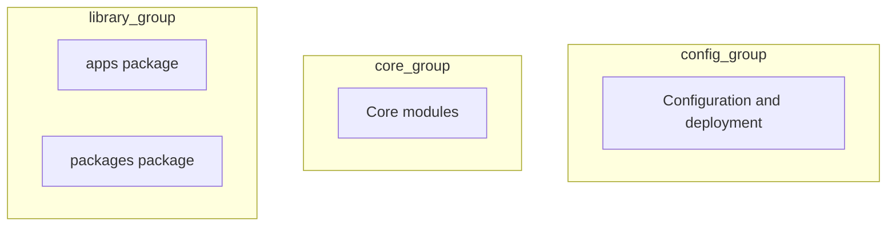

# Architecture report: elrumordelaluz/reactour

> Automated static analysis. **Observed** = directly seen in files/imports/AST; **Inferred** = interpretation from that evidence. Repository code was not executed.

## 1. Repository at a glance

| Item | Value |
| --- | --- |
| Repository | elrumordelaluz/reactour |
| Description | Tourist Guide into your React Components |
| Language | TypeScript |
| Stars | 4098 |
| Licence | MIT |
| Analysed commit / branch | f38832ffd0b610e98dbed01d9dff6b058b1ec1a4 / main |
| Framework(s) | Next.js, React |
| Files analysed | 197 |
| Components | 4 |

## 2. Architecture in one minute

elrumordelaluz/reactour - Tourist Guide into your React Components. This repository was analysed statically from 197 file(s) (0 Python). Detected technologies (observed from imports/manifests): GitHub Actions, Next.js, React, Tailwind CSS, TypeScript, Vitest. Files are grouped into 4 component(s): apps package, Configuration and deployment, Core modules, packages package. Findings below distinguish observed facts from inferred interpretation.

## 3. High-level block diagram

## 4. Main components

### apps package (`apps`)

- **Kind:** library
- **Status:** Observed
- **Confidence:** 0.85
- **Responsibility:** Groups 34 file(s) under apps package (observed from repository paths and static analysis).
- **Paths:** `apps/web/.eslintrc.js`, `apps/web/components/Box.tsx`, `apps/web/components/Button.tsx`, `apps/web/components/Dropdown.js`, `apps/web/components/Footer.js`, `apps/web/components/Heading.js`, `apps/web/components/Home.tsx`, `apps/web/components/Image.js`, `apps/web/components/ImagesRow.js`, `apps/web/components/Logo.js`, `apps/web/components/Portal.tsx`, `apps/web/components/Row.js`, `apps/web/components/Scrollable.js`, `apps/web/components/Section.tsx`, `apps/web/components/Tabs.js`, `apps/web/components/Text.tsx`, `apps/web/components/Tooltip.js`, `apps/web/components/config.tsx`, `apps/web/components/settings.js`, `apps/web/hooks.tsx`, `apps/web/icons/Ball.tsx`, `apps/web/icons/Beach.tsx`, `apps/web/icons/Boat.tsx`, `apps/web/icons/Guide.tsx`, `apps/web/icons/Icecream.tsx`, `apps/web/icons/index.tsx`, `apps/web/next-env.d.ts`, `apps/web/next.config.js`, `apps/web/pages/_app.tsx`, `apps/web/pages/index.tsx`, `apps/web/pages/mask.tsx`, `apps/web/pages/popover.tsx`, `apps/web/pages/utils.tsx`, `apps/web/utils.js`
- **Evidence:** [apps/web/.eslintrc.js](https://github.com/elrumordelaluz/reactour/blob/f38832ffd0b610e98dbed01d9dff6b058b1ec1a4/apps/web/.eslintrc.js); [apps/web/components/Box.tsx](https://github.com/elrumordelaluz/reactour/blob/f38832ffd0b610e98dbed01d9dff6b058b1ec1a4/apps/web/components/Box.tsx); [apps/web/components/Button.tsx](https://github.com/elrumordelaluz/reactour/blob/f38832ffd0b610e98dbed01d9dff6b058b1ec1a4/apps/web/components/Button.tsx); [apps/web/components/Dropdown.js](https://github.com/elrumordelaluz/reactour/blob/f38832ffd0b610e98dbed01d9dff6b058b1ec1a4/apps/web/components/Dropdown.js); [apps/web/components/Footer.js](https://github.com/elrumordelaluz/reactour/blob/f38832ffd0b610e98dbed01d9dff6b058b1ec1a4/apps/web/components/Footer.js); [apps/web/components/Heading.js](https://github.com/elrumordelaluz/reactour/blob/f38832ffd0b610e98dbed01d9dff6b058b1ec1a4/apps/web/components/Heading.js); [apps/web/components/Home.tsx](https://github.com/elrumordelaluz/reactour/blob/f38832ffd0b610e98dbed01d9dff6b058b1ec1a4/apps/web/components/Home.tsx); [apps/web/components/Image.js](https://github.com/elrumordelaluz/reactour/blob/f38832ffd0b610e98dbed01d9dff6b058b1ec1a4/apps/web/components/Image.js)

### Configuration and deployment (`config`)

- **Kind:** config
- **Status:** Observed
- **Confidence:** 0.85
- **Responsibility:** Groups 24 file(s) under configuration and deployment (observed from repository paths and static analysis).
- **Paths:** `FUNDING.yml`, `apps/docs/package.json`, `apps/docs/tsconfig.json`, `apps/web/package.json`, `apps/web/public/manifest.json`, `apps/web/tsconfig.json`, `package.json`, `packages/config/eslint-preset.js`, `packages/config/package.json`, `packages/mask/package.json`, `packages/mask/tsconfig.json`, `packages/popover/package.json`, `packages/popover/tsconfig.json`, `packages/tour/package.json`, `packages/tour/tsconfig.json`, `packages/tsconfig/base.json`, `packages/tsconfig/nextjs.json`, `packages/tsconfig/package.json`, `packages/tsconfig/react-library.json`, `packages/utils/package.json`, `packages/utils/tsconfig.json`, `pnpm-workspace.yaml`, `turbo.json`, `vercel.json`
- **Evidence:** [FUNDING.yml](https://github.com/elrumordelaluz/reactour/blob/f38832ffd0b610e98dbed01d9dff6b058b1ec1a4/FUNDING.yml); [apps/docs/package.json](https://github.com/elrumordelaluz/reactour/blob/f38832ffd0b610e98dbed01d9dff6b058b1ec1a4/apps/docs/package.json); [apps/docs/tsconfig.json](https://github.com/elrumordelaluz/reactour/blob/f38832ffd0b610e98dbed01d9dff6b058b1ec1a4/apps/docs/tsconfig.json); [apps/web/package.json](https://github.com/elrumordelaluz/reactour/blob/f38832ffd0b610e98dbed01d9dff6b058b1ec1a4/apps/web/package.json); [apps/web/public/manifest.json](https://github.com/elrumordelaluz/reactour/blob/f38832ffd0b610e98dbed01d9dff6b058b1ec1a4/apps/web/public/manifest.json); [apps/web/tsconfig.json](https://github.com/elrumordelaluz/reactour/blob/f38832ffd0b610e98dbed01d9dff6b058b1ec1a4/apps/web/tsconfig.json); [package.json](https://github.com/elrumordelaluz/reactour/blob/f38832ffd0b610e98dbed01d9dff6b058b1ec1a4/package.json); [packages/config/eslint-preset.js](https://github.com/elrumordelaluz/reactour/blob/f38832ffd0b610e98dbed01d9dff6b058b1ec1a4/packages/config/eslint-preset.js)

### Core modules (`core`)

- **Kind:** core
- **Status:** Observed
- **Confidence:** 0.85
- **Responsibility:** Groups 2 file(s) under core modules (observed from repository paths and static analysis).
- **Paths:** `vitest.setup.ts`, `vitest.shared.ts`
- **Evidence:** [vitest.setup.ts](https://github.com/elrumordelaluz/reactour/blob/f38832ffd0b610e98dbed01d9dff6b058b1ec1a4/vitest.setup.ts); [vitest.shared.ts](https://github.com/elrumordelaluz/reactour/blob/f38832ffd0b610e98dbed01d9dff6b058b1ec1a4/vitest.shared.ts)

### packages package (`packages`)

- **Kind:** library
- **Status:** Observed
- **Confidence:** 0.85
- **Responsibility:** Groups 51 file(s) under packages package (observed from repository paths and static analysis).
- **Paths:** `packages/mask/Mask.tsx`, `packages/mask/__tests__/Mask.test.tsx`, `packages/mask/index.tsx`, `packages/mask/styles.tsx`, `packages/mask/vitest.config.ts`, `packages/popover/Popover.tsx`, `packages/popover/__tests__/Popover.test.tsx`, `packages/popover/index.tsx`, `packages/popover/styles.tsx`, `packages/popover/vitest.config.ts`, `packages/tour/Context.tsx`, `packages/tour/Keyboard.tsx`, `packages/tour/Tour.tsx`, `packages/tour/__tests__/Badge.test.tsx`, `packages/tour/__tests__/Close.test.tsx`, `packages/tour/__tests__/Content.test.tsx`, `packages/tour/__tests__/Context.test.tsx`, `packages/tour/__tests__/Keyboard.test.tsx`, `packages/tour/__tests__/Navigation.test.tsx`, `packages/tour/__tests__/PopoverContent.test.tsx`, `packages/tour/__tests__/Tour.test.tsx`, `packages/tour/__tests__/useSizes.test.tsx`, `packages/tour/__tests__/withTour.test.tsx`, `packages/tour/components/Badge.tsx`, `packages/tour/components/Close.tsx`, `packages/tour/components/Content.tsx`, `packages/tour/components/Navigation.tsx`, `packages/tour/components/PopoverContent.tsx`, `packages/tour/components/index.tsx`, `packages/tour/hooks.tsx`, `packages/tour/index.tsx`, `packages/tour/styles.tsx`, `packages/tour/types.tsx`, `packages/tour/vitest.config.ts`, `packages/tour/withTour.tsx`, `packages/utils/Observables.tsx`, `packages/utils/Portal.tsx`, `packages/utils/__tests__/Observables.test.tsx`, `packages/utils/__tests__/Portal.test.tsx`, `packages/utils/__tests__/helpers.test.ts`, `packages/utils/__tests__/smoothScroll.test.ts`, `packages/utils/__tests__/useIntersectionObserver.test.tsx`, `packages/utils/__tests__/useRect.test.tsx`, `packages/utils/build.config.ts`, `packages/utils/helpers.tsx`, `packages/utils/index.tsx`, `packages/utils/smoothScroll.tsx`, `packages/utils/types.tsx`, `packages/utils/useIntersectionObserver.tsx`, `packages/utils/useRect.tsx`, `packages/utils/vitest.config.ts`
- **Evidence:** [packages/mask/Mask.tsx](https://github.com/elrumordelaluz/reactour/blob/f38832ffd0b610e98dbed01d9dff6b058b1ec1a4/packages/mask/Mask.tsx); [packages/mask/__tests__/Mask.test.tsx](https://github.com/elrumordelaluz/reactour/blob/f38832ffd0b610e98dbed01d9dff6b058b1ec1a4/packages/mask/__tests__/Mask.test.tsx); [packages/mask/index.tsx](https://github.com/elrumordelaluz/reactour/blob/f38832ffd0b610e98dbed01d9dff6b058b1ec1a4/packages/mask/index.tsx); [packages/mask/styles.tsx](https://github.com/elrumordelaluz/reactour/blob/f38832ffd0b610e98dbed01d9dff6b058b1ec1a4/packages/mask/styles.tsx); [packages/mask/vitest.config.ts](https://github.com/elrumordelaluz/reactour/blob/f38832ffd0b610e98dbed01d9dff6b058b1ec1a4/packages/mask/vitest.config.ts); [packages/popover/Popover.tsx](https://github.com/elrumordelaluz/reactour/blob/f38832ffd0b610e98dbed01d9dff6b058b1ec1a4/packages/popover/Popover.tsx); [packages/popover/__tests__/Popover.test.tsx](https://github.com/elrumordelaluz/reactour/blob/f38832ffd0b610e98dbed01d9dff6b058b1ec1a4/packages/popover/__tests__/Popover.test.tsx); [packages/popover/index.tsx](https://github.com/elrumordelaluz/reactour/blob/f38832ffd0b610e98dbed01d9dff6b058b1ec1a4/packages/popover/index.tsx)

## 5. Execution flow

**Observed** entry point(s):

- [apps/web/icons/index.tsx](https://github.com/elrumordelaluz/reactour/blob/f38832ffd0b610e98dbed01d9dff6b058b1ec1a4/apps/web/icons/index.tsx)
- [apps/web/pages/index.tsx](https://github.com/elrumordelaluz/reactour/blob/f38832ffd0b610e98dbed01d9dff6b058b1ec1a4/apps/web/pages/index.tsx)
- [packages/mask/index.tsx](https://github.com/elrumordelaluz/reactour/blob/f38832ffd0b610e98dbed01d9dff6b058b1ec1a4/packages/mask/index.tsx)
- [packages/popover/index.tsx](https://github.com/elrumordelaluz/reactour/blob/f38832ffd0b610e98dbed01d9dff6b058b1ec1a4/packages/popover/index.tsx)
- [packages/tour/components/index.tsx](https://github.com/elrumordelaluz/reactour/blob/f38832ffd0b610e98dbed01d9dff6b058b1ec1a4/packages/tour/components/index.tsx)
- [packages/tour/index.tsx](https://github.com/elrumordelaluz/reactour/blob/f38832ffd0b610e98dbed01d9dff6b058b1ec1a4/packages/tour/index.tsx)
- [packages/utils/index.tsx](https://github.com/elrumordelaluz/reactour/blob/f38832ffd0b610e98dbed01d9dff6b058b1ec1a4/packages/utils/index.tsx)

Representative flow (derived from observed entry points and the import graph; steps beyond the entry point are **Inferred**):

1. Execution starts at an observed entry point listed above, if present.
2. No internal import relationships between components were observed.

## 6. Project structure

### `(root)`

- `.babelrc` - other (157 bytes)
- `.eslintignore` - other (72 bytes)
- `.eslintrc.json` - config (313 bytes)
- `.gitignore` - other (397 bytes)
- `.prettierrc.json` - config (132 bytes)
- `CODE_OF_CONDUCT.md` - docs (5201 bytes)
- `CONTRIBUTING.md` - docs (3625 bytes)
- `FUNDING.yml` - config (23 bytes)
- `LICENSE` - docs (1072 bytes)
- `README.md` - docs (1450 bytes)
- `logo.svg` - other (16033 bytes)
- `package.json` - manifest (1750 bytes)
- `pnpm-workspace.yaml` - config (40 bytes)
- `turbo.json` - config (527 bytes)
- `vercel.json` - config (90 bytes)
- `vitest.setup.ts` - source, TypeScript (42 bytes)
- `vitest.shared.ts` - source, TypeScript (766 bytes)

### `.changeset`

- `.changeset/README.md` - docs (510 bytes)
- `.changeset/config.json` - config (271 bytes)

### `.github`

- `.github/ISSUE_TEMPLATE/bug_report.md` - docs (829 bytes)
- `.github/ISSUE_TEMPLATE/feature_request.md` - docs (593 bytes)
- `.github/workflows/ci.yml` - ci, YAML (1039 bytes)
- `.github/workflows/nextjs.yml` - ci, YAML (1813 bytes)

### `apps`

- `apps/docs/app/_meta.ts` - docs (286 bytes)
- `apps/docs/app/examples/page.mdx` - docs (1631 bytes)
- `apps/docs/app/globals.css` - docs (602 bytes)
- `apps/docs/app/layout.js` - docs (7314 bytes)
- `apps/docs/app/mask/_meta.ts` - docs (80 bytes)
- `apps/docs/app/mask/props/page.mdx` - docs (3462 bytes)
- `apps/docs/app/mask/quickstart/page.mdx` - docs (494 bytes)
- `apps/docs/app/page.mdx` - docs (1744 bytes)
- `apps/docs/app/popover/_meta.ts` - docs (83 bytes)
- `apps/docs/app/popover/props/page.mdx` - docs (3227 bytes)
- `apps/docs/app/popover/quickstart/page.mdx` - docs (415 bytes)
- `apps/docs/app/quickstart/page.mdx` - docs (1704 bytes)
- `apps/docs/app/tour/_meta.ts` - docs (104 bytes)
- `apps/docs/app/tour/examples/page.mdx` - docs (2773 bytes)
- `apps/docs/app/tour/hooks/page.mdx` - docs (2374 bytes)
- `apps/docs/app/tour/props/page.mdx` - docs (17686 bytes)
- `apps/docs/app/tour/quickstart/page.mdx` - docs (1224 bytes)
- `apps/docs/components/demos/files/close-click.tsx` - docs (667 bytes)
- `apps/docs/components/demos/files/custom-badge.tsx` - docs (484 bytes)
- `apps/docs/components/demos/files/custom-handlers.tsx` - docs (735 bytes)
- `apps/docs/components/demos/files/custom-prev-next.tsx` - docs (1395 bytes)
- `apps/docs/components/demos/files/custom-styles.tsx` - docs (904 bytes)
- `apps/docs/components/demos/files/defaults.tsx` - docs (2702 bytes)
- `apps/docs/components/demos/files/disable-dots-nav.tsx` - docs (408 bytes)
- `apps/docs/components/demos/files/disable-interaction.tsx` - docs (541 bytes)
- `apps/docs/components/demos/files/disable-keyboard.tsx` - docs (1742 bytes)
- `apps/docs/components/demos/files/index.tsx` - docs (1527 bytes)
- `apps/docs/components/demos/files/mask-click.tsx` - docs (665 bytes)
- `apps/docs/components/demos/files/padding.tsx` - docs (486 bytes)
- `apps/docs/components/demos/files/rtl.tsx` - docs (379 bytes)
- `apps/docs/components/demos/files/scroll-lock.tsx` - docs (1777 bytes)
- `apps/docs/components/demos/files/scroll-smooth.tsx` - docs (1554 bytes)
- `apps/docs/components/demos/files/start-at.tsx` - docs (391 bytes)
- `apps/docs/components/demos/files/toggle-nav-parts.tsx` - docs (2395 bytes)
- `apps/docs/components/demos/index.tsx` - docs (1034 bytes)
- `apps/docs/components/table/index.tsx` - docs (1404 bytes)
- `apps/docs/components/table/style.module.css` - docs (225 bytes)
- `apps/docs/mdx-components.js` - docs (325 bytes)
- `apps/docs/next-env.d.ts` - docs (251 bytes)
- `apps/docs/next.config.mjs` - docs (272 bytes)
- `apps/docs/package.json` - manifest (770 bytes)
- `apps/docs/postcss.config.mjs` - docs (91 bytes)
- `apps/docs/public/assets/syntax-highlighting.svg` - docs (54374 bytes)
- `apps/docs/public/logo.svg` - docs (3455 bytes)
- `apps/docs/tsconfig.json` - config (799 bytes)
- `apps/web/.eslintrc.js` - source, JavaScript (59 bytes)
- `apps/web/CHANGELOG.md` - docs (239 bytes)
- `apps/web/README.md` - docs (1369 bytes)
- `apps/web/components/Box.tsx` - source, TypeScript (441 bytes)
- `apps/web/components/Button.tsx` - source, TypeScript (1499 bytes)
- `apps/web/components/Dropdown.js` - source, JavaScript (1272 bytes)
- `apps/web/components/Footer.js` - source, JavaScript (233 bytes)
- `apps/web/components/Heading.js` - source, JavaScript (420 bytes)
- `apps/web/components/Home.tsx` - source, TypeScript (14158 bytes)
- `apps/web/components/Image.js` - source, JavaScript (132 bytes)
- `apps/web/components/ImagesRow.js` - source, JavaScript (969 bytes)
- `apps/web/components/Logo.js` - source, JavaScript (7734 bytes)
- `apps/web/components/Portal.tsx` - source, TypeScript (1006 bytes)
- `apps/web/components/Row.js` - source, JavaScript (103 bytes)
- `apps/web/components/Scrollable.js` - source, JavaScript (313 bytes)
- `apps/web/components/Section.tsx` - source, TypeScript (534 bytes)
- `apps/web/components/Tabs.js` - source, JavaScript (989 bytes)
- `apps/web/components/Text.tsx` - source, TypeScript (385 bytes)
- `apps/web/components/Tooltip.js` - source, JavaScript (530 bytes)
- `apps/web/components/config.tsx` - source, TypeScript (5144 bytes)
- `apps/web/components/logo.svg` - other (2632 bytes)
- `apps/web/components/settings.js` - source, JavaScript (395 bytes)
- `apps/web/hooks.tsx` - source, TypeScript (500 bytes)
- `apps/web/icons/Ball.tsx` - source, TypeScript (1698 bytes)
- `apps/web/icons/Beach.tsx` - source, TypeScript (2032 bytes)
- `apps/web/icons/Boat.tsx` - source, TypeScript (904 bytes)
- `apps/web/icons/Guide.tsx` - source, TypeScript (1562 bytes)
- `apps/web/icons/Icecream.tsx` - source, TypeScript (1990 bytes)
- `apps/web/icons/index.tsx` - source, TypeScript (217 bytes)
- `apps/web/next-env.d.ts` - source, TypeScript (253 bytes)
- `apps/web/next.config.js` - source, JavaScript (446 bytes)
- `apps/web/package.json` - manifest (1151 bytes)
- `apps/web/pages/_app.tsx` - source, TypeScript (707 bytes)
- `apps/web/pages/index.tsx` - source, TypeScript (3584 bytes)
- `apps/web/pages/mask.tsx` - source, TypeScript (13746 bytes)
- `apps/web/pages/popover.tsx` - source, TypeScript (13977 bytes)
- `apps/web/pages/utils.tsx` - source, TypeScript (974 bytes)
- `apps/web/public/.nojekyll` - other (0 bytes)
- `apps/web/public/CNAME` - other (15 bytes)
- `apps/web/public/manifest.json` - config (476 bytes)
- `apps/web/public/robots.txt` - docs (67 bytes)
- `apps/web/styles.css` - other (3827 bytes)
- `apps/web/tsconfig.json` - config (243 bytes)
- `apps/web/utils.js` - source, JavaScript (10497 bytes)

### `packages`

- `packages/config/CHANGELOG.md` - docs (68 bytes)
- `packages/config/eslint-preset.js` - source, JavaScript (228 bytes)
- `packages/config/package.json` - manifest (277 bytes)
- `packages/mask/CHANGELOG.md` - docs (838 bytes)
- `packages/mask/LICENSE` - docs (1071 bytes)
- `packages/mask/Mask.tsx` - source, TypeScript (3504 bytes)
- `packages/mask/README.md` - docs (3156 bytes)
- `packages/mask/__tests__/Mask.test.tsx` - source, TypeScript (4866 bytes)
- `packages/mask/index.tsx` - source, TypeScript (142 bytes)
- `packages/mask/logo.svg` - other (15688 bytes)
- `packages/mask/package.json` - manifest (1309 bytes)
- `packages/mask/styles.tsx` - source, TypeScript (1907 bytes)
- `packages/mask/tsconfig.json` - config (125 bytes)
- `packages/mask/vitest.config.ts` - source, TypeScript (46 bytes)
- `packages/popover/CHANGELOG.md` - docs (1172 bytes)
- `packages/popover/LICENSE` - docs (1071 bytes)
- `packages/popover/Popover.tsx` - source, TypeScript (5954 bytes)
- `packages/popover/README.md` - docs (2753 bytes)
- `packages/popover/__tests__/Popover.test.tsx` - source, TypeScript (7206 bytes)
- `packages/popover/index.tsx` - source, TypeScript (307 bytes)
- `packages/popover/logo.svg` - other (19758 bytes)
- `packages/popover/package.json` - manifest (1321 bytes)
- `packages/popover/styles.css` - other (427 bytes)
- `packages/popover/styles.tsx` - source, TypeScript (899 bytes)
- `packages/popover/tsconfig.json` - config (125 bytes)
- `packages/popover/vitest.config.ts` - source, TypeScript (46 bytes)
- `packages/tour/CHANGELOG.md` - docs (2926 bytes)
- `packages/tour/Context.tsx` - source, TypeScript (1547 bytes)
- `packages/tour/Keyboard.tsx` - source, TypeScript (2149 bytes)
- `packages/tour/LICENSE` - docs (1071 bytes)
- `packages/tour/README.md` - docs (23100 bytes)
- `packages/tour/Tour.tsx` - source, TypeScript (6435 bytes)
- `packages/tour/__tests__/Badge.test.tsx` - source, TypeScript (719 bytes)
- `packages/tour/__tests__/Close.test.tsx` - source, TypeScript (816 bytes)
- `packages/tour/__tests__/Content.test.tsx` - source, TypeScript (1367 bytes)
- `packages/tour/__tests__/Context.test.tsx` - source, TypeScript (5442 bytes)
- `packages/tour/__tests__/Keyboard.test.tsx` - source, TypeScript (3906 bytes)
- `packages/tour/__tests__/Navigation.test.tsx` - source, TypeScript (6013 bytes)
- `packages/tour/__tests__/PopoverContent.test.tsx` - source, TypeScript (4188 bytes)
- `packages/tour/__tests__/Tour.test.tsx` - source, TypeScript (9092 bytes)
- `packages/tour/__tests__/useSizes.test.tsx` - source, TypeScript (6457 bytes)
- `packages/tour/__tests__/withTour.test.tsx` - source, TypeScript (1511 bytes)
- `packages/tour/components/Badge.tsx` - source, TypeScript (377 bytes)
- `packages/tour/components/Close.tsx` - source, TypeScript (1028 bytes)
- `packages/tour/components/Content.tsx` - source, TypeScript (647 bytes)
- `packages/tour/components/Navigation.tsx` - source, TypeScript (4455 bytes)
- `packages/tour/components/PopoverContent.tsx` - source, TypeScript (2510 bytes)
- `packages/tour/components/index.tsx` - source, TypeScript (877 bytes)
- `packages/tour/hooks.tsx` - source, TypeScript (5053 bytes)
- `packages/tour/index.tsx` - source, TypeScript (427 bytes)
- `packages/tour/package.json` - manifest (1552 bytes)
- `packages/tour/styles.css` - other (181 bytes)
- `packages/tour/styles.tsx` - source, TypeScript (3211 bytes)
- `packages/tour/tsconfig.json` - config (182 bytes)
- `packages/tour/types.tsx` - source, TypeScript (5402 bytes)
- `packages/tour/vitest.config.ts` - source, TypeScript (46 bytes)
- `packages/tour/withTour.tsx` - source, TypeScript (310 bytes)
- `packages/tsconfig/CHANGELOG.md` - docs (181 bytes)
- `packages/tsconfig/README.md` - docs (106 bytes)
- `packages/tsconfig/base.json` - config (521 bytes)
- `packages/tsconfig/nextjs.json` - config (568 bytes)
- `packages/tsconfig/package.json` - manifest (226 bytes)
- `packages/tsconfig/react-library.json` - config (230 bytes)
- `packages/utils/CHANGELOG.md` - docs (674 bytes)
- `packages/utils/LICENSE` - docs (1071 bytes)
- `packages/utils/Observables.tsx` - source, TypeScript (2520 bytes)
- `packages/utils/Portal.tsx` - source, TypeScript (1006 bytes)
- `packages/utils/README.md` - docs (4121 bytes)
- `packages/utils/__tests__/Observables.test.tsx` - source, TypeScript (2494 bytes)
- `packages/utils/__tests__/Portal.test.tsx` - source, TypeScript (1457 bytes)
- `packages/utils/__tests__/helpers.test.ts` - source, TypeScript (4131 bytes)
- `packages/utils/__tests__/smoothScroll.test.ts` - source, TypeScript (1835 bytes)
- `packages/utils/__tests__/useIntersectionObserver.test.tsx` - source, TypeScript (3313 bytes)
- `packages/utils/__tests__/useRect.test.tsx` - source, TypeScript (4676 bytes)
- `packages/utils/build.config.ts` - source, TypeScript (100 bytes)
- `packages/utils/helpers.tsx` - source, TypeScript (2567 bytes)
- `packages/utils/index.tsx` - source, TypeScript (841 bytes)
- `packages/utils/logo.svg` - other (13800 bytes)
- `packages/utils/package.json` - manifest (1453 bytes)
- `packages/utils/smoothScroll.tsx` - source, TypeScript (832 bytes)
- `packages/utils/tsconfig.json` - config (182 bytes)
- `packages/utils/types.tsx` - source, TypeScript (476 bytes)
- `packages/utils/useIntersectionObserver.tsx` - source, TypeScript (959 bytes)
- `packages/utils/useRect.tsx` - source, TypeScript (1576 bytes)
- `packages/utils/vitest.config.ts` - source, TypeScript (46 bytes)

## 7. Key dependencies and integrations

| Name | Category | Status | Confidence | Evidence |
| --- | --- | --- | --- | --- |
| GitHub Actions | ci | Observed | 0.90 | [.github/workflows/ci.yml](https://github.com/elrumordelaluz/reactour/blob/f38832ffd0b610e98dbed01d9dff6b058b1ec1a4/.github/workflows/ci.yml); [.github/workflows/nextjs.yml](https://github.com/elrumordelaluz/reactour/blob/f38832ffd0b610e98dbed01d9dff6b058b1ec1a4/.github/workflows/nextjs.yml) |
| Next.js | framework | Observed | 0.90 | [apps/docs/package.json:13](https://github.com/elrumordelaluz/reactour/blob/f38832ffd0b610e98dbed01d9dff6b058b1ec1a4/apps/docs/package.json#L13); [apps/web/package.json:6](https://github.com/elrumordelaluz/reactour/blob/f38832ffd0b610e98dbed01d9dff6b058b1ec1a4/apps/web/package.json#L6) |
| React | framework | Observed | 0.90 | [apps/docs/package.json:4](https://github.com/elrumordelaluz/reactour/blob/f38832ffd0b610e98dbed01d9dff6b058b1ec1a4/apps/docs/package.json#L4); [apps/docs/package.json:18](https://github.com/elrumordelaluz/reactour/blob/f38832ffd0b610e98dbed01d9dff6b058b1ec1a4/apps/docs/package.json#L18); [apps/web/package.json:13](https://github.com/elrumordelaluz/reactour/blob/f38832ffd0b610e98dbed01d9dff6b058b1ec1a4/apps/web/package.json#L13); [apps/web/package.json:28](https://github.com/elrumordelaluz/reactour/blob/f38832ffd0b610e98dbed01d9dff6b058b1ec1a4/apps/web/package.json#L28) |
| Tailwind CSS | library | Observed | 0.85 | [apps/docs/package.json:12](https://github.com/elrumordelaluz/reactour/blob/f38832ffd0b610e98dbed01d9dff6b058b1ec1a4/apps/docs/package.json#L12) |
| TypeScript | tooling | Observed | 0.90 | [apps/web/package.json:38](https://github.com/elrumordelaluz/reactour/blob/f38832ffd0b610e98dbed01d9dff6b058b1ec1a4/apps/web/package.json#L38); [package.json:33](https://github.com/elrumordelaluz/reactour/blob/f38832ffd0b610e98dbed01d9dff6b058b1ec1a4/package.json#L33); [packages/mask/package.json:15](https://github.com/elrumordelaluz/reactour/blob/f38832ffd0b610e98dbed01d9dff6b058b1ec1a4/packages/mask/package.json#L15); [packages/popover/package.json:15](https://github.com/elrumordelaluz/reactour/blob/f38832ffd0b610e98dbed01d9dff6b058b1ec1a4/packages/popover/package.json#L15) |
| Vitest | tooling | Observed | 0.85 | [package.json:26](https://github.com/elrumordelaluz/reactour/blob/f38832ffd0b610e98dbed01d9dff6b058b1ec1a4/package.json#L26) |

## 8. Data and state

No database, cache, queue, or persistent-state usage was observed in the analysed files. State handling, if any, may be in-memory or in files that were not analysed.

## 9. Configuration and deployment clues

- `.changeset/config.json` (config)
- `.eslintrc.json` (config)
- `.github/workflows/ci.yml` (ci)
- `.github/workflows/nextjs.yml` (ci)
- `.prettierrc.json` (config)
- `FUNDING.yml` (config)
- `apps/docs/package.json` (manifest)
- `apps/docs/tsconfig.json` (config)
- `apps/web/package.json` (manifest)
- `apps/web/public/manifest.json` (config)
- `apps/web/tsconfig.json` (config)
- `package.json` (manifest)
- `packages/config/package.json` (manifest)
- `packages/mask/package.json` (manifest)
- `packages/mask/tsconfig.json` (config)
- `packages/popover/package.json` (manifest)
- `packages/popover/tsconfig.json` (config)
- `packages/tour/package.json` (manifest)
- `packages/tour/tsconfig.json` (config)
- `packages/tsconfig/base.json` (config)
- `packages/tsconfig/nextjs.json` (config)
- `packages/tsconfig/package.json` (manifest)
- `packages/tsconfig/react-library.json` (config)
- `packages/utils/package.json` (manifest)
- `packages/utils/tsconfig.json` (config)
- `pnpm-workspace.yaml` (config)
- `turbo.json` (config)
- `vercel.json` (config)

## 10. Design observations

- No strong design patterns could be established from the available evidence.

These observations are interpretations (**Inferred**) of the observed structure, not guarantees about runtime design.

## 11. Limitations and unknowns

- Static analysis only: repository code was not executed, installed, or imported at runtime.
- Components and relationships are inferred from file paths, imports, and AST structure; runtime behaviour, dynamic imports, and reflection may not be visible.
- No clear application entry point was observed in the analysed files.
- Repository text was treated as untrusted data; no instructions found in repository files were followed, and likely secret values were redacted/excluded.
- JavaScript and TypeScript files were inventoried from paths and package manifests. They were not parsed with a full language AST, and repository code was not executed.

## 12. Source references

- [.github/workflows/ci.yml](https://github.com/elrumordelaluz/reactour/blob/f38832ffd0b610e98dbed01d9dff6b058b1ec1a4/.github/workflows/ci.yml)
- [.github/workflows/nextjs.yml](https://github.com/elrumordelaluz/reactour/blob/f38832ffd0b610e98dbed01d9dff6b058b1ec1a4/.github/workflows/nextjs.yml)
- [FUNDING.yml](https://github.com/elrumordelaluz/reactour/blob/f38832ffd0b610e98dbed01d9dff6b058b1ec1a4/FUNDING.yml)
- [apps/docs/package.json](https://github.com/elrumordelaluz/reactour/blob/f38832ffd0b610e98dbed01d9dff6b058b1ec1a4/apps/docs/package.json)
- [apps/docs/package.json:4](https://github.com/elrumordelaluz/reactour/blob/f38832ffd0b610e98dbed01d9dff6b058b1ec1a4/apps/docs/package.json#L4)
- [apps/docs/package.json:12](https://github.com/elrumordelaluz/reactour/blob/f38832ffd0b610e98dbed01d9dff6b058b1ec1a4/apps/docs/package.json#L12)
- [apps/docs/package.json:13](https://github.com/elrumordelaluz/reactour/blob/f38832ffd0b610e98dbed01d9dff6b058b1ec1a4/apps/docs/package.json#L13)
- [apps/docs/package.json:18](https://github.com/elrumordelaluz/reactour/blob/f38832ffd0b610e98dbed01d9dff6b058b1ec1a4/apps/docs/package.json#L18)
- [apps/docs/tsconfig.json](https://github.com/elrumordelaluz/reactour/blob/f38832ffd0b610e98dbed01d9dff6b058b1ec1a4/apps/docs/tsconfig.json)
- [apps/web/.eslintrc.js](https://github.com/elrumordelaluz/reactour/blob/f38832ffd0b610e98dbed01d9dff6b058b1ec1a4/apps/web/.eslintrc.js)
- [apps/web/components/Box.tsx](https://github.com/elrumordelaluz/reactour/blob/f38832ffd0b610e98dbed01d9dff6b058b1ec1a4/apps/web/components/Box.tsx)
- [apps/web/components/Button.tsx](https://github.com/elrumordelaluz/reactour/blob/f38832ffd0b610e98dbed01d9dff6b058b1ec1a4/apps/web/components/Button.tsx)
- [apps/web/components/Dropdown.js](https://github.com/elrumordelaluz/reactour/blob/f38832ffd0b610e98dbed01d9dff6b058b1ec1a4/apps/web/components/Dropdown.js)
- [apps/web/components/Footer.js](https://github.com/elrumordelaluz/reactour/blob/f38832ffd0b610e98dbed01d9dff6b058b1ec1a4/apps/web/components/Footer.js)
- [apps/web/components/Heading.js](https://github.com/elrumordelaluz/reactour/blob/f38832ffd0b610e98dbed01d9dff6b058b1ec1a4/apps/web/components/Heading.js)
- [apps/web/components/Home.tsx](https://github.com/elrumordelaluz/reactour/blob/f38832ffd0b610e98dbed01d9dff6b058b1ec1a4/apps/web/components/Home.tsx)
- [apps/web/components/Image.js](https://github.com/elrumordelaluz/reactour/blob/f38832ffd0b610e98dbed01d9dff6b058b1ec1a4/apps/web/components/Image.js)
- [apps/web/icons/index.tsx](https://github.com/elrumordelaluz/reactour/blob/f38832ffd0b610e98dbed01d9dff6b058b1ec1a4/apps/web/icons/index.tsx)
- [apps/web/package.json](https://github.com/elrumordelaluz/reactour/blob/f38832ffd0b610e98dbed01d9dff6b058b1ec1a4/apps/web/package.json)
- [apps/web/package.json:6](https://github.com/elrumordelaluz/reactour/blob/f38832ffd0b610e98dbed01d9dff6b058b1ec1a4/apps/web/package.json#L6)
- [apps/web/package.json:13](https://github.com/elrumordelaluz/reactour/blob/f38832ffd0b610e98dbed01d9dff6b058b1ec1a4/apps/web/package.json#L13)
- [apps/web/package.json:28](https://github.com/elrumordelaluz/reactour/blob/f38832ffd0b610e98dbed01d9dff6b058b1ec1a4/apps/web/package.json#L28)
- [apps/web/package.json:38](https://github.com/elrumordelaluz/reactour/blob/f38832ffd0b610e98dbed01d9dff6b058b1ec1a4/apps/web/package.json#L38)
- [apps/web/pages/index.tsx](https://github.com/elrumordelaluz/reactour/blob/f38832ffd0b610e98dbed01d9dff6b058b1ec1a4/apps/web/pages/index.tsx)
- [apps/web/public/manifest.json](https://github.com/elrumordelaluz/reactour/blob/f38832ffd0b610e98dbed01d9dff6b058b1ec1a4/apps/web/public/manifest.json)
- [apps/web/tsconfig.json](https://github.com/elrumordelaluz/reactour/blob/f38832ffd0b610e98dbed01d9dff6b058b1ec1a4/apps/web/tsconfig.json)
- [package.json](https://github.com/elrumordelaluz/reactour/blob/f38832ffd0b610e98dbed01d9dff6b058b1ec1a4/package.json)
- [package.json:2](https://github.com/elrumordelaluz/reactour/blob/f38832ffd0b610e98dbed01d9dff6b058b1ec1a4/package.json#L2)
- [package.json:24](https://github.com/elrumordelaluz/reactour/blob/f38832ffd0b610e98dbed01d9dff6b058b1ec1a4/package.json#L24)
- [package.json:26](https://github.com/elrumordelaluz/reactour/blob/f38832ffd0b610e98dbed01d9dff6b058b1ec1a4/package.json#L26)
- [package.json:33](https://github.com/elrumordelaluz/reactour/blob/f38832ffd0b610e98dbed01d9dff6b058b1ec1a4/package.json#L33)
- [packages/config/eslint-preset.js](https://github.com/elrumordelaluz/reactour/blob/f38832ffd0b610e98dbed01d9dff6b058b1ec1a4/packages/config/eslint-preset.js)
- [packages/mask/Mask.tsx](https://github.com/elrumordelaluz/reactour/blob/f38832ffd0b610e98dbed01d9dff6b058b1ec1a4/packages/mask/Mask.tsx)
- [packages/mask/__tests__/Mask.test.tsx](https://github.com/elrumordelaluz/reactour/blob/f38832ffd0b610e98dbed01d9dff6b058b1ec1a4/packages/mask/__tests__/Mask.test.tsx)
- [packages/mask/index.tsx](https://github.com/elrumordelaluz/reactour/blob/f38832ffd0b610e98dbed01d9dff6b058b1ec1a4/packages/mask/index.tsx)
- [packages/mask/package.json:2](https://github.com/elrumordelaluz/reactour/blob/f38832ffd0b610e98dbed01d9dff6b058b1ec1a4/packages/mask/package.json#L2)
- [packages/mask/package.json:15](https://github.com/elrumordelaluz/reactour/blob/f38832ffd0b610e98dbed01d9dff6b058b1ec1a4/packages/mask/package.json#L15)
- [packages/mask/styles.tsx](https://github.com/elrumordelaluz/reactour/blob/f38832ffd0b610e98dbed01d9dff6b058b1ec1a4/packages/mask/styles.tsx)
- [packages/mask/vitest.config.ts](https://github.com/elrumordelaluz/reactour/blob/f38832ffd0b610e98dbed01d9dff6b058b1ec1a4/packages/mask/vitest.config.ts)
- [packages/popover/Popover.tsx](https://github.com/elrumordelaluz/reactour/blob/f38832ffd0b610e98dbed01d9dff6b058b1ec1a4/packages/popover/Popover.tsx)
- [packages/popover/__tests__/Popover.test.tsx](https://github.com/elrumordelaluz/reactour/blob/f38832ffd0b610e98dbed01d9dff6b058b1ec1a4/packages/popover/__tests__/Popover.test.tsx)
- [packages/popover/index.tsx](https://github.com/elrumordelaluz/reactour/blob/f38832ffd0b610e98dbed01d9dff6b058b1ec1a4/packages/popover/index.tsx)
- [packages/popover/package.json:2](https://github.com/elrumordelaluz/reactour/blob/f38832ffd0b610e98dbed01d9dff6b058b1ec1a4/packages/popover/package.json#L2)
- [packages/popover/package.json:15](https://github.com/elrumordelaluz/reactour/blob/f38832ffd0b610e98dbed01d9dff6b058b1ec1a4/packages/popover/package.json#L15)
- [packages/tour/components/index.tsx](https://github.com/elrumordelaluz/reactour/blob/f38832ffd0b610e98dbed01d9dff6b058b1ec1a4/packages/tour/components/index.tsx)
- [packages/tour/index.tsx](https://github.com/elrumordelaluz/reactour/blob/f38832ffd0b610e98dbed01d9dff6b058b1ec1a4/packages/tour/index.tsx)
- [packages/tour/package.json:16](https://github.com/elrumordelaluz/reactour/blob/f38832ffd0b610e98dbed01d9dff6b058b1ec1a4/packages/tour/package.json#L16)
- [packages/utils/index.tsx](https://github.com/elrumordelaluz/reactour/blob/f38832ffd0b610e98dbed01d9dff6b058b1ec1a4/packages/utils/index.tsx)
- [packages/utils/package.json:15](https://github.com/elrumordelaluz/reactour/blob/f38832ffd0b610e98dbed01d9dff6b058b1ec1a4/packages/utils/package.json#L15)
- [vitest.setup.ts](https://github.com/elrumordelaluz/reactour/blob/f38832ffd0b610e98dbed01d9dff6b058b1ec1a4/vitest.setup.ts)
- [vitest.shared.ts](https://github.com/elrumordelaluz/reactour/blob/f38832ffd0b610e98dbed01d9dff6b058b1ec1a4/vitest.shared.ts)
