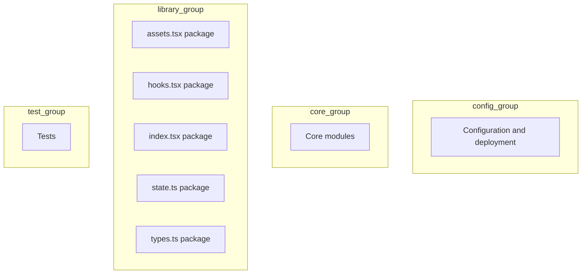

# Architecture report: emilkowalski/sonner

> Automated static analysis. **Observed** = directly seen in files/imports/AST; **Inferred** = interpretation from that evidence. Repository code was not executed.

## 1. Repository at a glance

| Item | Value |
| --- | --- |
| Repository | emilkowalski/sonner |
| Description | An opinionated toast component for React. |
| Language | TypeScript |
| Stars | 13217 |
| Licence | MIT |
| Analysed commit / branch | 8e4662b39255120b62138312058f5d77c0139a5e / main |
| Framework(s) | Next.js, React |
| Files analysed | 28 |
| Components | 8 |

## 2. Architecture in one minute

emilkowalski/sonner - An opinionated toast component for React.. This repository was analysed statically from 28 file(s) (0 Python). Detected technologies (observed from imports/manifests): GitHub Actions, Next.js, React, TypeScript. Files are grouped into 8 component(s): assets.tsx package, Configuration and deployment, Core modules, hooks.tsx package, index.tsx package, state.ts package, Tests, types.ts package. Findings below distinguish observed facts from inferred interpretation.

## 3. High-level block diagram

## 4. Main components

### assets.tsx package (`assets_tsx`)

- **Kind:** library
- **Status:** Observed
- **Confidence:** 0.85
- **Responsibility:** Groups 1 file(s) under assets.tsx package (observed from repository paths and static analysis).
- **Paths:** `src/assets.tsx`
- **Evidence:** [src/assets.tsx](https://github.com/emilkowalski/sonner/blob/8e4662b39255120b62138312058f5d77c0139a5e/src/assets.tsx)

### Configuration and deployment (`config`)

- **Kind:** config
- **Status:** Observed
- **Confidence:** 0.85
- **Responsibility:** Groups 5 file(s) under configuration and deployment (observed from repository paths and static analysis).
- **Paths:** `FUNDING.yml`, `package.json`, `pnpm-workspace.yaml`, `tsconfig.json`, `turbo.json`
- **Evidence:** [FUNDING.yml](https://github.com/emilkowalski/sonner/blob/8e4662b39255120b62138312058f5d77c0139a5e/FUNDING.yml); [package.json](https://github.com/emilkowalski/sonner/blob/8e4662b39255120b62138312058f5d77c0139a5e/package.json); [pnpm-workspace.yaml](https://github.com/emilkowalski/sonner/blob/8e4662b39255120b62138312058f5d77c0139a5e/pnpm-workspace.yaml); [tsconfig.json](https://github.com/emilkowalski/sonner/blob/8e4662b39255120b62138312058f5d77c0139a5e/tsconfig.json); [turbo.json](https://github.com/emilkowalski/sonner/blob/8e4662b39255120b62138312058f5d77c0139a5e/turbo.json)

### Core modules (`core`)

- **Kind:** core
- **Status:** Observed
- **Confidence:** 0.85
- **Responsibility:** Groups 1 file(s) under core modules (observed from repository paths and static analysis).
- **Paths:** `playwright.config.ts`
- **Evidence:** [playwright.config.ts](https://github.com/emilkowalski/sonner/blob/8e4662b39255120b62138312058f5d77c0139a5e/playwright.config.ts)

### hooks.tsx package (`hooks_tsx`)

- **Kind:** library
- **Status:** Observed
- **Confidence:** 0.85
- **Responsibility:** Groups 1 file(s) under hooks.tsx package (observed from repository paths and static analysis).
- **Paths:** `src/hooks.tsx`
- **Evidence:** [src/hooks.tsx](https://github.com/emilkowalski/sonner/blob/8e4662b39255120b62138312058f5d77c0139a5e/src/hooks.tsx)

### index.tsx package (`index_tsx`)

- **Kind:** library
- **Status:** Observed
- **Confidence:** 0.85
- **Responsibility:** Groups 1 file(s) under index.tsx package (observed from repository paths and static analysis).
- **Paths:** `src/index.tsx`
- **Evidence:** [src/index.tsx](https://github.com/emilkowalski/sonner/blob/8e4662b39255120b62138312058f5d77c0139a5e/src/index.tsx)

### state.ts package (`state_ts`)

- **Kind:** library
- **Status:** Observed
- **Confidence:** 0.85
- **Responsibility:** Groups 1 file(s) under state.ts package (observed from repository paths and static analysis).
- **Paths:** `src/state.ts`
- **Evidence:** [src/state.ts](https://github.com/emilkowalski/sonner/blob/8e4662b39255120b62138312058f5d77c0139a5e/src/state.ts)

### Tests (`tests`)

- **Kind:** test
- **Status:** Observed
- **Confidence:** 0.85
- **Responsibility:** Groups 11 file(s) under tests (observed from repository paths and static analysis).
- **Paths:** `test/.eslintrc.json`, `test/.gitignore`, `test/.vscode/settings.json`, `test/README.md`, `test/next.config.js`, `test/package.json`, `test/src/app/action.tsx`, `test/src/app/layout.tsx`, `test/src/app/page.tsx`, `test/tests/basic.spec.ts`, `test/tsconfig.json`
- **Evidence:** [test/.eslintrc.json](https://github.com/emilkowalski/sonner/blob/8e4662b39255120b62138312058f5d77c0139a5e/test/.eslintrc.json); [test/.gitignore](https://github.com/emilkowalski/sonner/blob/8e4662b39255120b62138312058f5d77c0139a5e/test/.gitignore); [test/.vscode/settings.json](https://github.com/emilkowalski/sonner/blob/8e4662b39255120b62138312058f5d77c0139a5e/test/.vscode/settings.json); [test/README.md](https://github.com/emilkowalski/sonner/blob/8e4662b39255120b62138312058f5d77c0139a5e/test/README.md); [test/next.config.js](https://github.com/emilkowalski/sonner/blob/8e4662b39255120b62138312058f5d77c0139a5e/test/next.config.js); [test/package.json](https://github.com/emilkowalski/sonner/blob/8e4662b39255120b62138312058f5d77c0139a5e/test/package.json); [test/src/app/action.tsx](https://github.com/emilkowalski/sonner/blob/8e4662b39255120b62138312058f5d77c0139a5e/test/src/app/action.tsx); [test/src/app/layout.tsx](https://github.com/emilkowalski/sonner/blob/8e4662b39255120b62138312058f5d77c0139a5e/test/src/app/layout.tsx)

### types.ts package (`types_ts`)

- **Kind:** library
- **Status:** Observed
- **Confidence:** 0.85
- **Responsibility:** Groups 1 file(s) under types.ts package (observed from repository paths and static analysis).
- **Paths:** `src/types.ts`
- **Evidence:** [src/types.ts](https://github.com/emilkowalski/sonner/blob/8e4662b39255120b62138312058f5d77c0139a5e/src/types.ts)

## 5. Execution flow

**Observed** entry point(s):

- [src/index.tsx](https://github.com/emilkowalski/sonner/blob/8e4662b39255120b62138312058f5d77c0139a5e/src/index.tsx)

Representative flow (derived from observed entry points and the import graph; steps beyond the entry point are **Inferred**):

1. Execution starts at an observed entry point listed above, if present.
2. No internal import relationships between components were observed.

## 6. Project structure

### `(root)`

- `.gitignore` - other (442 bytes)
- `.prettierrc.js` - source, JavaScript (115 bytes)
- `FUNDING.yml` - config (21 bytes)
- `LICENSE.md` - docs (1070 bytes)
- `README.md` - docs (1075 bytes)
- `package.json` - manifest (1796 bytes)
- `playwright.config.ts` - source, TypeScript (2058 bytes)
- `pnpm-workspace.yaml` - config (43 bytes)
- `tsconfig.json` - config (187 bytes)
- `turbo.json` - config (227 bytes)

### `.github`

- `.github/workflows/playwright.yml` - ci, YAML (662 bytes)

### `src`

- `src/assets.tsx` - source, TypeScript (3004 bytes)
- `src/hooks.tsx` - source, TypeScript (440 bytes)
- `src/index.tsx` - source, TypeScript (30900 bytes)
- `src/state.ts` - source, TypeScript (12149 bytes)
- `src/styles.css` - other (17681 bytes)
- `src/types.ts` - source, TypeScript (5243 bytes)

### `test`

- `test/.eslintrc.json` - test (40 bytes)
- `test/.gitignore` - test (440 bytes)
- `test/.vscode/settings.json` - test (145 bytes)
- `test/README.md` - test (1748 bytes)
- `test/next.config.js` - test, JavaScript (94 bytes)
- `test/package.json` - test (512 bytes)
- `test/src/app/action.tsx` - test, TypeScript (409 bytes)
- `test/src/app/layout.tsx` - test, TypeScript (268 bytes)
- `test/src/app/page.tsx` - test, TypeScript (15800 bytes)
- `test/tests/basic.spec.ts` - test, TypeScript (20199 bytes)
- `test/tsconfig.json` - test (669 bytes)

## 7. Key dependencies and integrations

| Name | Category | Status | Confidence | Evidence |
| --- | --- | --- | --- | --- |
| GitHub Actions | ci | Observed | 0.85 | [.github/workflows/playwright.yml](https://github.com/emilkowalski/sonner/blob/8e4662b39255120b62138312058f5d77c0139a5e/.github/workflows/playwright.yml) |
| Next.js | framework | Observed | 0.85 | [test/package.json:6](https://github.com/emilkowalski/sonner/blob/8e4662b39255120b62138312058f5d77c0139a5e/test/package.json#L6) |
| React | framework | Observed | 0.90 | [package.json:4](https://github.com/emilkowalski/sonner/blob/8e4662b39255120b62138312058f5d77c0139a5e/package.json#L4); [package.json:57](https://github.com/emilkowalski/sonner/blob/8e4662b39255120b62138312058f5d77c0139a5e/package.json#L57); [test/package.json:13](https://github.com/emilkowalski/sonner/blob/8e4662b39255120b62138312058f5d77c0139a5e/test/package.json#L13); [test/package.json:14](https://github.com/emilkowalski/sonner/blob/8e4662b39255120b62138312058f5d77c0139a5e/test/package.json#L14) |
| TypeScript | tooling | Observed | 0.90 | [package.json:59](https://github.com/emilkowalski/sonner/blob/8e4662b39255120b62138312058f5d77c0139a5e/package.json#L59); [test/package.json:22](https://github.com/emilkowalski/sonner/blob/8e4662b39255120b62138312058f5d77c0139a5e/test/package.json#L22) |

## 8. Data and state

No database, cache, queue, or persistent-state usage was observed in the analysed files. State handling, if any, may be in-memory or in files that were not analysed.

## 9. Configuration and deployment clues

- `.github/workflows/playwright.yml` (ci)
- `FUNDING.yml` (config)
- `package.json` (manifest)
- `pnpm-workspace.yaml` (config)
- `tsconfig.json` (config)
- `turbo.json` (config)

## 10. Design observations

- Tests are present alongside source code (Observed from test file paths).

These observations are interpretations (**Inferred**) of the observed structure, not guarantees about runtime design.

## 11. Limitations and unknowns

- Static analysis only: repository code was not executed, installed, or imported at runtime.
- Components and relationships are inferred from file paths, imports, and AST structure; runtime behaviour, dynamic imports, and reflection may not be visible.
- 2 file(s) were skipped during inventory (1 x likely secret file excluded; 1 x lockfile excluded).
- No clear application entry point was observed in the analysed files.
- Repository text was treated as untrusted data; no instructions found in repository files were followed, and likely secret values were redacted/excluded.
- JavaScript and TypeScript files were inventoried from paths and package manifests. They were not parsed with a full language AST, and repository code was not executed.

## 12. Source references

- [.github/workflows/playwright.yml](https://github.com/emilkowalski/sonner/blob/8e4662b39255120b62138312058f5d77c0139a5e/.github/workflows/playwright.yml)
- [FUNDING.yml](https://github.com/emilkowalski/sonner/blob/8e4662b39255120b62138312058f5d77c0139a5e/FUNDING.yml)
- [package.json](https://github.com/emilkowalski/sonner/blob/8e4662b39255120b62138312058f5d77c0139a5e/package.json)
- [package.json:4](https://github.com/emilkowalski/sonner/blob/8e4662b39255120b62138312058f5d77c0139a5e/package.json#L4)
- [package.json:57](https://github.com/emilkowalski/sonner/blob/8e4662b39255120b62138312058f5d77c0139a5e/package.json#L57)
- [package.json:59](https://github.com/emilkowalski/sonner/blob/8e4662b39255120b62138312058f5d77c0139a5e/package.json#L59)
- [playwright.config.ts](https://github.com/emilkowalski/sonner/blob/8e4662b39255120b62138312058f5d77c0139a5e/playwright.config.ts)
- [pnpm-workspace.yaml](https://github.com/emilkowalski/sonner/blob/8e4662b39255120b62138312058f5d77c0139a5e/pnpm-workspace.yaml)
- [src/assets.tsx](https://github.com/emilkowalski/sonner/blob/8e4662b39255120b62138312058f5d77c0139a5e/src/assets.tsx)
- [src/hooks.tsx](https://github.com/emilkowalski/sonner/blob/8e4662b39255120b62138312058f5d77c0139a5e/src/hooks.tsx)
- [src/index.tsx](https://github.com/emilkowalski/sonner/blob/8e4662b39255120b62138312058f5d77c0139a5e/src/index.tsx)
- [src/state.ts](https://github.com/emilkowalski/sonner/blob/8e4662b39255120b62138312058f5d77c0139a5e/src/state.ts)
- [src/types.ts](https://github.com/emilkowalski/sonner/blob/8e4662b39255120b62138312058f5d77c0139a5e/src/types.ts)
- [test/.eslintrc.json](https://github.com/emilkowalski/sonner/blob/8e4662b39255120b62138312058f5d77c0139a5e/test/.eslintrc.json)
- [test/.gitignore](https://github.com/emilkowalski/sonner/blob/8e4662b39255120b62138312058f5d77c0139a5e/test/.gitignore)
- [test/.vscode/settings.json](https://github.com/emilkowalski/sonner/blob/8e4662b39255120b62138312058f5d77c0139a5e/test/.vscode/settings.json)
- [test/README.md](https://github.com/emilkowalski/sonner/blob/8e4662b39255120b62138312058f5d77c0139a5e/test/README.md)
- [test/next.config.js](https://github.com/emilkowalski/sonner/blob/8e4662b39255120b62138312058f5d77c0139a5e/test/next.config.js)
- [test/package.json](https://github.com/emilkowalski/sonner/blob/8e4662b39255120b62138312058f5d77c0139a5e/test/package.json)
- [test/package.json:6](https://github.com/emilkowalski/sonner/blob/8e4662b39255120b62138312058f5d77c0139a5e/test/package.json#L6)
- [test/package.json:13](https://github.com/emilkowalski/sonner/blob/8e4662b39255120b62138312058f5d77c0139a5e/test/package.json#L13)
- [test/package.json:14](https://github.com/emilkowalski/sonner/blob/8e4662b39255120b62138312058f5d77c0139a5e/test/package.json#L14)
- [test/package.json:22](https://github.com/emilkowalski/sonner/blob/8e4662b39255120b62138312058f5d77c0139a5e/test/package.json#L22)
- [test/src/app/action.tsx](https://github.com/emilkowalski/sonner/blob/8e4662b39255120b62138312058f5d77c0139a5e/test/src/app/action.tsx)
- [test/src/app/layout.tsx](https://github.com/emilkowalski/sonner/blob/8e4662b39255120b62138312058f5d77c0139a5e/test/src/app/layout.tsx)
- [tsconfig.json](https://github.com/emilkowalski/sonner/blob/8e4662b39255120b62138312058f5d77c0139a5e/tsconfig.json)
- [turbo.json](https://github.com/emilkowalski/sonner/blob/8e4662b39255120b62138312058f5d77c0139a5e/turbo.json)
