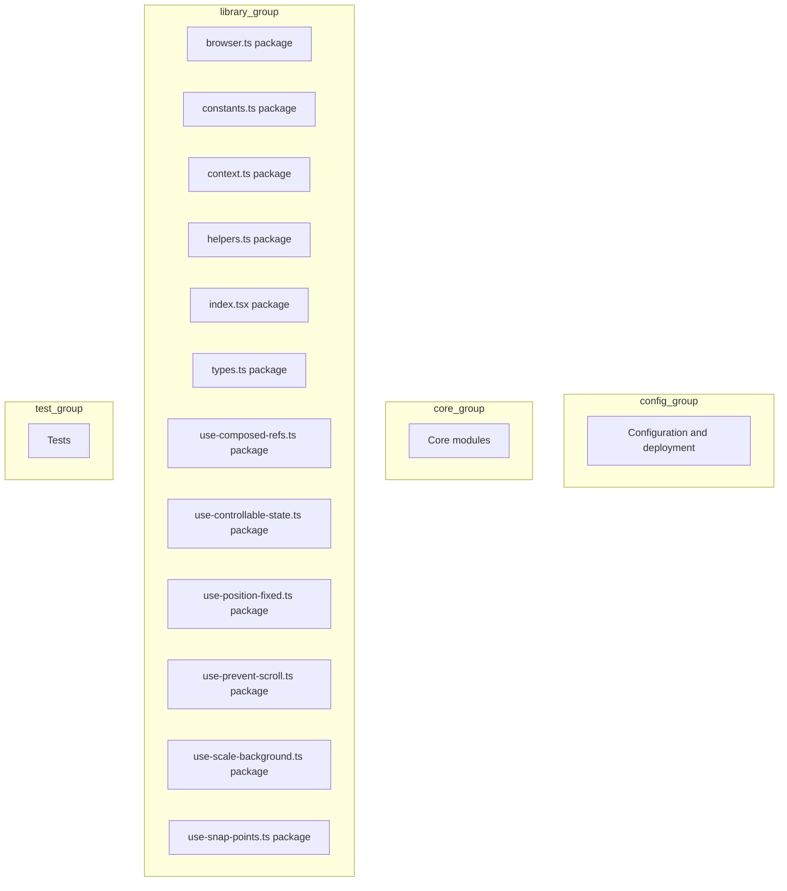

# Architecture report: emilkowalski/vaul

> Automated static analysis. **Observed** = directly seen in files/imports/AST; **Inferred** = interpretation from that evidence. Repository code was not executed.

## 1. Repository at a glance

| Item | Value |
| --- | --- |
| Repository | emilkowalski/vaul |
| Description | A drawer component for React. |
| Language | TypeScript |
| Stars | 8737 |
| Licence | MIT |
| Analysed commit / branch | 3e97aac6a38e4481bade71d7233ed6002e80f9b0 / main |
| Framework(s) | Next.js, React |
| Files analysed | 67 |
| Components | 15 |

## 2. Architecture in one minute

emilkowalski/vaul - A drawer component for React.. This repository was analysed statically from 67 file(s) (0 Python). Detected technologies (observed from imports/manifests): GitHub Actions, Next.js, React, Tailwind CSS, TypeScript. Files are grouped into 15 component(s): browser.ts package, Configuration and deployment, constants.ts package, context.ts package, Core modules, helpers.ts package, index.tsx package, Tests. Findings below distinguish observed facts from inferred interpretation.

## 3. High-level block diagram

## 4. Main components

### browser.ts package (`browser_ts`)

- **Kind:** library
- **Status:** Observed
- **Confidence:** 0.85
- **Responsibility:** Groups 1 file(s) under browser.ts package (observed from repository paths and static analysis).
- **Paths:** `src/browser.ts`
- **Evidence:** [src/browser.ts](https://github.com/emilkowalski/vaul/blob/3e97aac6a38e4481bade71d7233ed6002e80f9b0/src/browser.ts)

### Configuration and deployment (`config`)

- **Kind:** config
- **Status:** Observed
- **Confidence:** 0.85
- **Responsibility:** Groups 5 file(s) under configuration and deployment (observed from repository paths and static analysis).
- **Paths:** `FUNDING.yml`, `package.json`, `pnpm-workspace.yaml`, `tsconfig.json`, `turbo.json`
- **Evidence:** [FUNDING.yml](https://github.com/emilkowalski/vaul/blob/3e97aac6a38e4481bade71d7233ed6002e80f9b0/FUNDING.yml); [package.json](https://github.com/emilkowalski/vaul/blob/3e97aac6a38e4481bade71d7233ed6002e80f9b0/package.json); [pnpm-workspace.yaml](https://github.com/emilkowalski/vaul/blob/3e97aac6a38e4481bade71d7233ed6002e80f9b0/pnpm-workspace.yaml); [tsconfig.json](https://github.com/emilkowalski/vaul/blob/3e97aac6a38e4481bade71d7233ed6002e80f9b0/tsconfig.json); [turbo.json](https://github.com/emilkowalski/vaul/blob/3e97aac6a38e4481bade71d7233ed6002e80f9b0/turbo.json)

### constants.ts package (`constants_ts`)

- **Kind:** library
- **Status:** Observed
- **Confidence:** 0.85
- **Responsibility:** Groups 1 file(s) under constants.ts package (observed from repository paths and static analysis).
- **Paths:** `src/constants.ts`
- **Evidence:** [src/constants.ts](https://github.com/emilkowalski/vaul/blob/3e97aac6a38e4481bade71d7233ed6002e80f9b0/src/constants.ts)

### context.ts package (`context_ts`)

- **Kind:** library
- **Status:** Observed
- **Confidence:** 0.85
- **Responsibility:** Groups 1 file(s) under context.ts package (observed from repository paths and static analysis).
- **Paths:** `src/context.ts`
- **Evidence:** [src/context.ts](https://github.com/emilkowalski/vaul/blob/3e97aac6a38e4481bade71d7233ed6002e80f9b0/src/context.ts)

### Core modules (`core`)

- **Kind:** core
- **Status:** Observed
- **Confidence:** 0.85
- **Responsibility:** Groups 1 file(s) under core modules (observed from repository paths and static analysis).
- **Paths:** `playwright.config.ts`
- **Evidence:** [playwright.config.ts](https://github.com/emilkowalski/vaul/blob/3e97aac6a38e4481bade71d7233ed6002e80f9b0/playwright.config.ts)

### helpers.ts package (`helpers_ts`)

- **Kind:** library
- **Status:** Observed
- **Confidence:** 0.85
- **Responsibility:** Groups 1 file(s) under helpers.ts package (observed from repository paths and static analysis).
- **Paths:** `src/helpers.ts`
- **Evidence:** [src/helpers.ts](https://github.com/emilkowalski/vaul/blob/3e97aac6a38e4481bade71d7233ed6002e80f9b0/src/helpers.ts)

### index.tsx package (`index_tsx`)

- **Kind:** library
- **Status:** Observed
- **Confidence:** 0.85
- **Responsibility:** Groups 1 file(s) under index.tsx package (observed from repository paths and static analysis).
- **Paths:** `src/index.tsx`
- **Evidence:** [src/index.tsx](https://github.com/emilkowalski/vaul/blob/3e97aac6a38e4481bade71d7233ed6002e80f9b0/src/index.tsx)

### Tests (`tests`)

- **Kind:** test
- **Status:** Observed
- **Confidence:** 0.85
- **Responsibility:** Groups 41 file(s) under tests (observed from repository paths and static analysis).
- **Paths:** `test/.eslintrc.json`, `test/.gitignore`, `test/README.md`, `test/next.config.js`, `test/package.json`, `test/postcss.config.js`, `test/public/next.svg`, `test/public/vercel.svg`, `test/src/app/controlled/page.tsx`, `test/src/app/default-open/page.tsx`, `test/src/app/different-directions/page.tsx`, `test/src/app/globals.css`, `test/src/app/initial-snap/page.tsx`, `test/src/app/layout.tsx`, `test/src/app/nested-drawers/page.tsx`, `test/src/app/non-dismissible/page.tsx`, `test/src/app/open-another-drawer/page.tsx`, `test/src/app/page.tsx`, `test/src/app/parent-container/page.tsx`, `test/src/app/scrollable-page/page.tsx`, `test/src/app/scrollable-with-inputs/page.tsx`, `test/src/app/with-handle/page.tsx`, `test/src/app/with-modal-false/page.tsx`, `test/src/app/with-redirect/long-page/page.tsx`, `test/src/app/with-redirect/page.tsx`, `test/src/app/with-scaled-background/page.tsx`, `test/src/app/with-snap-points/page.tsx`, `test/src/app/without-scaled-background/page.tsx`, `test/tailwind.config.ts`, `test/tests/base.spec.ts`, `test/tests/constants.ts`, `test/tests/controlled.spec.ts`, `test/tests/helpers.ts`, `test/tests/initial-snap.spec.ts`, `test/tests/nested.spec.ts`, `test/tests/non-dismissible.spec.ts`, `test/tests/with-handle.spec.ts`, `test/tests/with-redirect.spec.ts`, `test/tests/with-scaled-background.spec.ts`, `test/tests/without-scaled-background.spec.ts`, `test/tsconfig.json`
- **Evidence:** [test/.eslintrc.json](https://github.com/emilkowalski/vaul/blob/3e97aac6a38e4481bade71d7233ed6002e80f9b0/test/.eslintrc.json); [test/.gitignore](https://github.com/emilkowalski/vaul/blob/3e97aac6a38e4481bade71d7233ed6002e80f9b0/test/.gitignore); [test/README.md](https://github.com/emilkowalski/vaul/blob/3e97aac6a38e4481bade71d7233ed6002e80f9b0/test/README.md); [test/next.config.js](https://github.com/emilkowalski/vaul/blob/3e97aac6a38e4481bade71d7233ed6002e80f9b0/test/next.config.js); [test/package.json](https://github.com/emilkowalski/vaul/blob/3e97aac6a38e4481bade71d7233ed6002e80f9b0/test/package.json); [test/postcss.config.js](https://github.com/emilkowalski/vaul/blob/3e97aac6a38e4481bade71d7233ed6002e80f9b0/test/postcss.config.js); [test/public/next.svg](https://github.com/emilkowalski/vaul/blob/3e97aac6a38e4481bade71d7233ed6002e80f9b0/test/public/next.svg); [test/public/vercel.svg](https://github.com/emilkowalski/vaul/blob/3e97aac6a38e4481bade71d7233ed6002e80f9b0/test/public/vercel.svg)

### types.ts package (`types_ts`)

- **Kind:** library
- **Status:** Observed
- **Confidence:** 0.85
- **Responsibility:** Groups 1 file(s) under types.ts package (observed from repository paths and static analysis).
- **Paths:** `src/types.ts`
- **Evidence:** [src/types.ts](https://github.com/emilkowalski/vaul/blob/3e97aac6a38e4481bade71d7233ed6002e80f9b0/src/types.ts)

### use-composed-refs.ts package (`use_composed_refs_ts`)

- **Kind:** library
- **Status:** Observed
- **Confidence:** 0.85
- **Responsibility:** Groups 1 file(s) under use-composed-refs.ts package (observed from repository paths and static analysis).
- **Paths:** `src/use-composed-refs.ts`
- **Evidence:** [src/use-composed-refs.ts](https://github.com/emilkowalski/vaul/blob/3e97aac6a38e4481bade71d7233ed6002e80f9b0/src/use-composed-refs.ts)

### use-controllable-state.ts package (`use_controllable_state_ts`)

- **Kind:** library
- **Status:** Observed
- **Confidence:** 0.85
- **Responsibility:** Groups 1 file(s) under use-controllable-state.ts package (observed from repository paths and static analysis).
- **Paths:** `src/use-controllable-state.ts`
- **Evidence:** [src/use-controllable-state.ts](https://github.com/emilkowalski/vaul/blob/3e97aac6a38e4481bade71d7233ed6002e80f9b0/src/use-controllable-state.ts)

### use-position-fixed.ts package (`use_position_fixed_ts`)

- **Kind:** library
- **Status:** Observed
- **Confidence:** 0.85
- **Responsibility:** Groups 1 file(s) under use-position-fixed.ts package (observed from repository paths and static analysis).
- **Paths:** `src/use-position-fixed.ts`
- **Evidence:** [src/use-position-fixed.ts](https://github.com/emilkowalski/vaul/blob/3e97aac6a38e4481bade71d7233ed6002e80f9b0/src/use-position-fixed.ts)

### use-prevent-scroll.ts package (`use_prevent_scroll_ts`)

- **Kind:** library
- **Status:** Observed
- **Confidence:** 0.85
- **Responsibility:** Groups 1 file(s) under use-prevent-scroll.ts package (observed from repository paths and static analysis).
- **Paths:** `src/use-prevent-scroll.ts`
- **Evidence:** [src/use-prevent-scroll.ts](https://github.com/emilkowalski/vaul/blob/3e97aac6a38e4481bade71d7233ed6002e80f9b0/src/use-prevent-scroll.ts)

### use-scale-background.ts package (`use_scale_background_ts`)

- **Kind:** library
- **Status:** Observed
- **Confidence:** 0.85
- **Responsibility:** Groups 1 file(s) under use-scale-background.ts package (observed from repository paths and static analysis).
- **Paths:** `src/use-scale-background.ts`
- **Evidence:** [src/use-scale-background.ts](https://github.com/emilkowalski/vaul/blob/3e97aac6a38e4481bade71d7233ed6002e80f9b0/src/use-scale-background.ts)

### use-snap-points.ts package (`use_snap_points_ts`)

- **Kind:** library
- **Status:** Observed
- **Confidence:** 0.85
- **Responsibility:** Groups 1 file(s) under use-snap-points.ts package (observed from repository paths and static analysis).
- **Paths:** `src/use-snap-points.ts`
- **Evidence:** [src/use-snap-points.ts](https://github.com/emilkowalski/vaul/blob/3e97aac6a38e4481bade71d7233ed6002e80f9b0/src/use-snap-points.ts)

## 5. Execution flow

**Observed** entry point(s):

- [src/index.tsx](https://github.com/emilkowalski/vaul/blob/3e97aac6a38e4481bade71d7233ed6002e80f9b0/src/index.tsx)

Representative flow (derived from observed entry points and the import graph; steps beyond the entry point are **Inferred**):

1. Execution starts at an observed entry point listed above, if present.
2. No internal import relationships between components were observed.

## 6. Project structure

### `(root)`

- `.eslintrc.js` - source, JavaScript (207 bytes)
- `.gitignore` - other (462 bytes)
- `.prettierrc.js` - source, JavaScript (115 bytes)
- `FUNDING.yml` - config (21 bytes)
- `LICENSE.md` - docs (1070 bytes)
- `README.md` - docs (220 bytes)
- `package.json` - manifest (1747 bytes)
- `playwright.config.ts` - source, TypeScript (1504 bytes)
- `pnpm-workspace.yaml` - config (29 bytes)
- `tsconfig.json` - config (208 bytes)
- `turbo.json` - config (206 bytes)

### `.github`

- `.github/workflows/playwright.yml` - ci, YAML (695 bytes)

### `.vscode`

- `.vscode/settings.json` - config (55 bytes)

### `src`

- `src/browser.ts` - source, TypeScript (1075 bytes)
- `src/constants.ts` - source, TypeScript (351 bytes)
- `src/context.ts` - source, TypeScript (2368 bytes)
- `src/helpers.ts` - source, TypeScript (3067 bytes)
- `src/index.tsx` - source, TypeScript (38337 bytes)
- `src/style.css` - other (6078 bytes)
- `src/types.ts` - source, TypeScript (186 bytes)
- `src/use-composed-refs.ts` - source, TypeScript (1057 bytes)
- `src/use-controllable-state.ts` - source, TypeScript (2082 bytes)
- `src/use-position-fixed.ts` - source, TypeScript (4520 bytes)
- `src/use-prevent-scroll.ts` - source, TypeScript (11419 bytes)
- `src/use-scale-background.ts` - source, TypeScript (2332 bytes)
- `src/use-snap-points.ts` - source, TypeScript (10133 bytes)

### `test`

- `test/.eslintrc.json` - test (40 bytes)
- `test/.gitignore` - test (368 bytes)
- `test/README.md` - test (1370 bytes)
- `test/next.config.js` - test, JavaScript (141 bytes)
- `test/package.json` - test (621 bytes)
- `test/postcss.config.js` - test, JavaScript (83 bytes)
- `test/public/next.svg` - test (1375 bytes)
- `test/public/vercel.svg` - test (629 bytes)
- `test/src/app/controlled/page.tsx` - test, TypeScript (8493 bytes)
- `test/src/app/default-open/page.tsx` - test, TypeScript (8225 bytes)
- `test/src/app/different-directions/page.tsx` - test, TypeScript (4749 bytes)
- `test/src/app/globals.css` - test (241 bytes)
- `test/src/app/initial-snap/page.tsx` - test, TypeScript (7754 bytes)
- `test/src/app/layout.tsx` - test, TypeScript (457 bytes)
- `test/src/app/nested-drawers/page.tsx` - test, TypeScript (8736 bytes)
- `test/src/app/non-dismissible/page.tsx` - test, TypeScript (4538 bytes)
- `test/src/app/open-another-drawer/page.tsx` - test, TypeScript (7813 bytes)
- `test/src/app/page.tsx` - test, TypeScript (952 bytes)
- `test/src/app/parent-container/page.tsx` - test, TypeScript (2544 bytes)
- `test/src/app/scrollable-page/page.tsx` - test, TypeScript (7342 bytes)
- `test/src/app/scrollable-with-inputs/page.tsx` - test, TypeScript (3350 bytes)
- `test/src/app/with-handle/page.tsx` - test, TypeScript (7821 bytes)
- `test/src/app/with-modal-false/page.tsx` - test, TypeScript (7737 bytes)
- `test/src/app/with-redirect/long-page/page.tsx` - test, TypeScript (313 bytes)
- `test/src/app/with-redirect/page.tsx` - test, TypeScript (1583 bytes)
- `test/src/app/with-scaled-background/page.tsx` - test, TypeScript (3447 bytes)
- `test/src/app/with-snap-points/page.tsx` - test, TypeScript (7746 bytes)
- `test/src/app/without-scaled-background/page.tsx` - test, TypeScript (4485 bytes)
- `test/tailwind.config.ts` - test, TypeScript (500 bytes)
- `test/tests/base.spec.ts` - test, TypeScript (2616 bytes)
- `test/tests/constants.ts` - test, TypeScript (39 bytes)
- `test/tests/controlled.spec.ts` - test, TypeScript (1225 bytes)
- `test/tests/helpers.ts` - test, TypeScript (818 bytes)
- `test/tests/initial-snap.spec.ts` - test, TypeScript (1469 bytes)
- `test/tests/nested.spec.ts` - test, TypeScript (780 bytes)
- `test/tests/non-dismissible.spec.ts` - test, TypeScript (1188 bytes)
- `test/tests/with-handle.spec.ts` - test, TypeScript (605 bytes)
- `test/tests/with-redirect.spec.ts` - test, TypeScript (633 bytes)
- `test/tests/with-scaled-background.spec.ts` - test, TypeScript (1056 bytes)
- `test/tests/without-scaled-background.spec.ts` - test, TypeScript (498 bytes)
- `test/tsconfig.json` - test (687 bytes)

## 7. Key dependencies and integrations

| Name | Category | Status | Confidence | Evidence |
| --- | --- | --- | --- | --- |
| GitHub Actions | ci | Observed | 0.85 | [.github/workflows/playwright.yml](https://github.com/emilkowalski/vaul/blob/3e97aac6a38e4481bade71d7233ed6002e80f9b0/.github/workflows/playwright.yml) |
| Next.js | framework | Observed | 0.85 | [test/package.json:6](https://github.com/emilkowalski/vaul/blob/3e97aac6a38e4481bade71d7233ed6002e80f9b0/test/package.json#L6) |
| React | framework | Observed | 0.90 | [package.json:4](https://github.com/emilkowalski/vaul/blob/3e97aac6a38e4481bade71d7233ed6002e80f9b0/package.json#L4); [package.json:52](https://github.com/emilkowalski/vaul/blob/3e97aac6a38e4481bade71d7233ed6002e80f9b0/package.json#L52); [test/package.json:13](https://github.com/emilkowalski/vaul/blob/3e97aac6a38e4481bade71d7233ed6002e80f9b0/test/package.json#L13); [test/package.json:14](https://github.com/emilkowalski/vaul/blob/3e97aac6a38e4481bade71d7233ed6002e80f9b0/test/package.json#L14) |
| Tailwind CSS | library | Observed | 0.85 | [test/package.json:26](https://github.com/emilkowalski/vaul/blob/3e97aac6a38e4481bade71d7233ed6002e80f9b0/test/package.json#L26) |
| TypeScript | tooling | Observed | 0.90 | [package.json:59](https://github.com/emilkowalski/vaul/blob/3e97aac6a38e4481bade71d7233ed6002e80f9b0/package.json#L59); [test/package.json:19](https://github.com/emilkowalski/vaul/blob/3e97aac6a38e4481bade71d7233ed6002e80f9b0/test/package.json#L19) |

## 8. Data and state

No database, cache, queue, or persistent-state usage was observed in the analysed files. State handling, if any, may be in-memory or in files that were not analysed.

## 9. Configuration and deployment clues

- `.github/workflows/playwright.yml` (ci)
- `.vscode/settings.json` (config)
- `FUNDING.yml` (config)
- `package.json` (manifest)
- `pnpm-workspace.yaml` (config)
- `tsconfig.json` (config)
- `turbo.json` (config)

## 10. Design observations

- Tests are present alongside source code (Observed from test file paths).

These observations are interpretations (**Inferred**) of the observed structure, not guarantees about runtime design.

## 11. Limitations and unknowns

- Static analysis only: repository code was not executed, installed, or imported at runtime.
- Components and relationships are inferred from file paths, imports, and AST structure; runtime behaviour, dynamic imports, and reflection may not be visible.
- 1 file(s) were skipped during inventory (1 x lockfile excluded).
- No clear application entry point was observed in the analysed files.
- Repository text was treated as untrusted data; no instructions found in repository files were followed, and likely secret values were redacted/excluded.
- JavaScript and TypeScript files were inventoried from paths and package manifests. They were not parsed with a full language AST, and repository code was not executed.

## 12. Source references

- [.github/workflows/playwright.yml](https://github.com/emilkowalski/vaul/blob/3e97aac6a38e4481bade71d7233ed6002e80f9b0/.github/workflows/playwright.yml)
- [FUNDING.yml](https://github.com/emilkowalski/vaul/blob/3e97aac6a38e4481bade71d7233ed6002e80f9b0/FUNDING.yml)
- [package.json](https://github.com/emilkowalski/vaul/blob/3e97aac6a38e4481bade71d7233ed6002e80f9b0/package.json)
- [package.json:4](https://github.com/emilkowalski/vaul/blob/3e97aac6a38e4481bade71d7233ed6002e80f9b0/package.json#L4)
- [package.json:52](https://github.com/emilkowalski/vaul/blob/3e97aac6a38e4481bade71d7233ed6002e80f9b0/package.json#L52)
- [package.json:59](https://github.com/emilkowalski/vaul/blob/3e97aac6a38e4481bade71d7233ed6002e80f9b0/package.json#L59)
- [playwright.config.ts](https://github.com/emilkowalski/vaul/blob/3e97aac6a38e4481bade71d7233ed6002e80f9b0/playwright.config.ts)
- [pnpm-workspace.yaml](https://github.com/emilkowalski/vaul/blob/3e97aac6a38e4481bade71d7233ed6002e80f9b0/pnpm-workspace.yaml)
- [src/browser.ts](https://github.com/emilkowalski/vaul/blob/3e97aac6a38e4481bade71d7233ed6002e80f9b0/src/browser.ts)
- [src/constants.ts](https://github.com/emilkowalski/vaul/blob/3e97aac6a38e4481bade71d7233ed6002e80f9b0/src/constants.ts)
- [src/context.ts](https://github.com/emilkowalski/vaul/blob/3e97aac6a38e4481bade71d7233ed6002e80f9b0/src/context.ts)
- [src/helpers.ts](https://github.com/emilkowalski/vaul/blob/3e97aac6a38e4481bade71d7233ed6002e80f9b0/src/helpers.ts)
- [src/index.tsx](https://github.com/emilkowalski/vaul/blob/3e97aac6a38e4481bade71d7233ed6002e80f9b0/src/index.tsx)
- [src/types.ts](https://github.com/emilkowalski/vaul/blob/3e97aac6a38e4481bade71d7233ed6002e80f9b0/src/types.ts)
- [src/use-composed-refs.ts](https://github.com/emilkowalski/vaul/blob/3e97aac6a38e4481bade71d7233ed6002e80f9b0/src/use-composed-refs.ts)
- [src/use-controllable-state.ts](https://github.com/emilkowalski/vaul/blob/3e97aac6a38e4481bade71d7233ed6002e80f9b0/src/use-controllable-state.ts)
- [src/use-position-fixed.ts](https://github.com/emilkowalski/vaul/blob/3e97aac6a38e4481bade71d7233ed6002e80f9b0/src/use-position-fixed.ts)
- [src/use-prevent-scroll.ts](https://github.com/emilkowalski/vaul/blob/3e97aac6a38e4481bade71d7233ed6002e80f9b0/src/use-prevent-scroll.ts)
- [src/use-scale-background.ts](https://github.com/emilkowalski/vaul/blob/3e97aac6a38e4481bade71d7233ed6002e80f9b0/src/use-scale-background.ts)
- [src/use-snap-points.ts](https://github.com/emilkowalski/vaul/blob/3e97aac6a38e4481bade71d7233ed6002e80f9b0/src/use-snap-points.ts)
- [test/.eslintrc.json](https://github.com/emilkowalski/vaul/blob/3e97aac6a38e4481bade71d7233ed6002e80f9b0/test/.eslintrc.json)
- [test/.gitignore](https://github.com/emilkowalski/vaul/blob/3e97aac6a38e4481bade71d7233ed6002e80f9b0/test/.gitignore)
- [test/README.md](https://github.com/emilkowalski/vaul/blob/3e97aac6a38e4481bade71d7233ed6002e80f9b0/test/README.md)
- [test/next.config.js](https://github.com/emilkowalski/vaul/blob/3e97aac6a38e4481bade71d7233ed6002e80f9b0/test/next.config.js)
- [test/package.json](https://github.com/emilkowalski/vaul/blob/3e97aac6a38e4481bade71d7233ed6002e80f9b0/test/package.json)
- [test/package.json:6](https://github.com/emilkowalski/vaul/blob/3e97aac6a38e4481bade71d7233ed6002e80f9b0/test/package.json#L6)
- [test/package.json:13](https://github.com/emilkowalski/vaul/blob/3e97aac6a38e4481bade71d7233ed6002e80f9b0/test/package.json#L13)
- [test/package.json:14](https://github.com/emilkowalski/vaul/blob/3e97aac6a38e4481bade71d7233ed6002e80f9b0/test/package.json#L14)
- [test/package.json:19](https://github.com/emilkowalski/vaul/blob/3e97aac6a38e4481bade71d7233ed6002e80f9b0/test/package.json#L19)
- [test/package.json:26](https://github.com/emilkowalski/vaul/blob/3e97aac6a38e4481bade71d7233ed6002e80f9b0/test/package.json#L26)
- [test/postcss.config.js](https://github.com/emilkowalski/vaul/blob/3e97aac6a38e4481bade71d7233ed6002e80f9b0/test/postcss.config.js)
- [test/public/next.svg](https://github.com/emilkowalski/vaul/blob/3e97aac6a38e4481bade71d7233ed6002e80f9b0/test/public/next.svg)
- [test/public/vercel.svg](https://github.com/emilkowalski/vaul/blob/3e97aac6a38e4481bade71d7233ed6002e80f9b0/test/public/vercel.svg)
- [tsconfig.json](https://github.com/emilkowalski/vaul/blob/3e97aac6a38e4481bade71d7233ed6002e80f9b0/tsconfig.json)
- [turbo.json](https://github.com/emilkowalski/vaul/blob/3e97aac6a38e4481bade71d7233ed6002e80f9b0/turbo.json)
