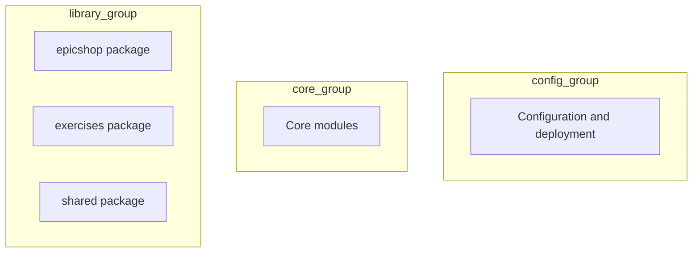

# Architecture report: epicweb-dev/advanced-react-patterns

> Automated static analysis. **Observed** = directly seen in files/imports/AST; **Inferred** = interpretation from that evidence. Repository code was not executed.

## 1. Repository at a glance

| Item | Value |
| --- | --- |
| Repository | epicweb-dev/advanced-react-patterns |
| Description | This is the latest advanced react patterns workshop |
| Language | TypeScript |
| Stars | 3517 |
| Licence | Other |
| Analysed commit / branch | 97a160158526e54f5829854b59b7281bfc777b91 / main |
| Framework(s) | React |
| Files analysed | 216 |
| Components | 5 |

## 2. Architecture in one minute

epicweb-dev/advanced-react-patterns - This is the latest advanced react patterns workshop. This repository was analysed statically from 216 file(s) (0 Python). Detected technologies (observed from imports/manifests): GitHub Actions, React, Docker, TypeScript. Files are grouped into 5 component(s): Configuration and deployment, Core modules, epicshop package, exercises package, shared package. Findings below distinguish observed facts from inferred interpretation.

## 3. High-level block diagram

## 4. Main components

### Configuration and deployment (`config`)

- **Kind:** config
- **Status:** Observed
- **Confidence:** 0.85
- **Responsibility:** Groups 7 file(s) under configuration and deployment (observed from repository paths and static analysis).
- **Paths:** `epicshop/Dockerfile`, `epicshop/fly.yaml`, `epicshop/package.json`, `epicshop/tsconfig.json`, `package.json`, `public/manifest.json`, `tsconfig.json`
- **Evidence:** [epicshop/Dockerfile](https://github.com/epicweb-dev/advanced-react-patterns/blob/97a160158526e54f5829854b59b7281bfc777b91/epicshop/Dockerfile); [epicshop/fly.yaml](https://github.com/epicweb-dev/advanced-react-patterns/blob/97a160158526e54f5829854b59b7281bfc777b91/epicshop/fly.yaml); [epicshop/package.json](https://github.com/epicweb-dev/advanced-react-patterns/blob/97a160158526e54f5829854b59b7281bfc777b91/epicshop/package.json); [epicshop/tsconfig.json](https://github.com/epicweb-dev/advanced-react-patterns/blob/97a160158526e54f5829854b59b7281bfc777b91/epicshop/tsconfig.json); [package.json](https://github.com/epicweb-dev/advanced-react-patterns/blob/97a160158526e54f5829854b59b7281bfc777b91/package.json); [public/manifest.json](https://github.com/epicweb-dev/advanced-react-patterns/blob/97a160158526e54f5829854b59b7281bfc777b91/public/manifest.json); [tsconfig.json](https://github.com/epicweb-dev/advanced-react-patterns/blob/97a160158526e54f5829854b59b7281bfc777b91/tsconfig.json)

### Core modules (`core`)

- **Kind:** core
- **Status:** Observed
- **Confidence:** 0.85
- **Responsibility:** Groups 2 file(s) under core modules (observed from repository paths and static analysis).
- **Paths:** `eslint.config.js`, `reset.d.ts`
- **Evidence:** [eslint.config.js](https://github.com/epicweb-dev/advanced-react-patterns/blob/97a160158526e54f5829854b59b7281bfc777b91/eslint.config.js); [reset.d.ts](https://github.com/epicweb-dev/advanced-react-patterns/blob/97a160158526e54f5829854b59b7281bfc777b91/reset.d.ts)

### epicshop package (`epicshop`)

- **Kind:** library
- **Status:** Observed
- **Confidence:** 0.85
- **Responsibility:** Groups 7 file(s) under epicshop package (observed from repository paths and static analysis).
- **Paths:** `epicshop/fix-watch.js`, `epicshop/fix.js`, `epicshop/in-browser-tests.spec.js`, `epicshop/playwright.config.js`, `epicshop/post-set-playground.js`, `epicshop/setup-custom.js`, `epicshop/update-deps.sh`
- **Evidence:** [epicshop/fix-watch.js](https://github.com/epicweb-dev/advanced-react-patterns/blob/97a160158526e54f5829854b59b7281bfc777b91/epicshop/fix-watch.js); [epicshop/fix.js](https://github.com/epicweb-dev/advanced-react-patterns/blob/97a160158526e54f5829854b59b7281bfc777b91/epicshop/fix.js); [epicshop/in-browser-tests.spec.js](https://github.com/epicweb-dev/advanced-react-patterns/blob/97a160158526e54f5829854b59b7281bfc777b91/epicshop/in-browser-tests.spec.js); [epicshop/playwright.config.js](https://github.com/epicweb-dev/advanced-react-patterns/blob/97a160158526e54f5829854b59b7281bfc777b91/epicshop/playwright.config.js); [epicshop/post-set-playground.js](https://github.com/epicweb-dev/advanced-react-patterns/blob/97a160158526e54f5829854b59b7281bfc777b91/epicshop/post-set-playground.js); [epicshop/setup-custom.js](https://github.com/epicweb-dev/advanced-react-patterns/blob/97a160158526e54f5829854b59b7281bfc777b91/epicshop/setup-custom.js); [epicshop/update-deps.sh](https://github.com/epicweb-dev/advanced-react-patterns/blob/97a160158526e54f5829854b59b7281bfc777b91/epicshop/update-deps.sh)

### exercises package (`exercises`)

- **Kind:** library
- **Status:** Observed
- **Confidence:** 0.85
- **Responsibility:** Groups 111 file(s) under exercises package (observed from repository paths and static analysis).
- **Paths:** `exercises/01.composition/01.problem.compose/index.tsx`, `exercises/01.composition/01.solution.compose/index.tsx`, `exercises/01.composition/01.solution.compose/ui-still-works.test.tsx`, `exercises/02.latest-ref/01.problem.ref/index.tsx`, `exercises/02.latest-ref/01.solution.ref/increments.test.tsx`, `exercises/02.latest-ref/01.solution.ref/index.tsx`, `exercises/02.latest-ref/01.solution.ref/step-change.test.tsx`, `exercises/03.compound-components/01.problem.context/app.tsx`, `exercises/03.compound-components/01.problem.context/index.tsx`, `exercises/03.compound-components/01.problem.context/toggle.tsx`, `exercises/03.compound-components/01.solution.context/app.tsx`, `exercises/03.compound-components/01.solution.context/index.tsx`, `exercises/03.compound-components/01.solution.context/toggle.test.tsx`, `exercises/03.compound-components/01.solution.context/toggle.tsx`, `exercises/03.compound-components/02.problem.validation/app.tsx`, `exercises/03.compound-components/02.problem.validation/index.tsx`, `exercises/03.compound-components/02.problem.validation/toggle.tsx`, `exercises/03.compound-components/02.solution.validation/app.tsx`, `exercises/03.compound-components/02.solution.validation/index.tsx`, `exercises/03.compound-components/02.solution.validation/toggle.test.tsx`, `exercises/03.compound-components/02.solution.validation/toggle.tsx`, `exercises/03.compound-components/02.solution.validation/validation.test.tsx`, `exercises/04.slots/01.problem.context/app.tsx`, `exercises/04.slots/01.problem.context/index.tsx`, `exercises/04.slots/01.problem.context/slots.tsx`, `exercises/04.slots/01.problem.context/text-field.tsx`, `exercises/04.slots/01.problem.context/toggle.tsx`, `exercises/04.slots/01.solution.context/app.tsx`, `exercises/04.slots/01.solution.context/index.test.tsx`, `exercises/04.slots/01.solution.context/index.tsx`, `exercises/04.slots/01.solution.context/slots.tsx`, `exercises/04.slots/01.solution.context/text-field.tsx`, `exercises/04.slots/01.solution.context/toggle.tsx`, `exercises/04.slots/02.problem.generic/app.tsx`, `exercises/04.slots/02.problem.generic/index.tsx`, `exercises/04.slots/02.problem.generic/slots.tsx`, `exercises/04.slots/02.problem.generic/text-field.tsx`, `exercises/04.slots/02.problem.generic/toggle.tsx`, `exercises/04.slots/02.solution.generic/app.tsx`, `exercises/04.slots/02.solution.generic/index.test.tsx`, `exercises/04.slots/02.solution.generic/index.tsx`, `exercises/04.slots/02.solution.generic/slots.tsx`, `exercises/04.slots/02.solution.generic/text-field.tsx`, `exercises/04.slots/02.solution.generic/toggle.tsx`, `exercises/04.slots/03.problem.prop/app.tsx`, `exercises/04.slots/03.problem.prop/index.tsx`, `exercises/04.slots/03.problem.prop/slots.tsx`, `exercises/04.slots/03.problem.prop/text-field.tsx`, `exercises/04.slots/03.problem.prop/toggle.tsx`, `exercises/04.slots/03.solution.prop/app.tsx`, `exercises/04.slots/03.solution.prop/index.test.tsx`, `exercises/04.slots/03.solution.prop/index.tsx`, `exercises/04.slots/03.solution.prop/slots.tsx`, `exercises/04.slots/03.solution.prop/text-field.tsx`, `exercises/04.slots/03.solution.prop/toggle.tsx`, `exercises/05.prop-getters/01.problem.collections/app.tsx`, `exercises/05.prop-getters/01.problem.collections/index.tsx`, `exercises/05.prop-getters/01.problem.collections/toggle.tsx`, `exercises/05.prop-getters/01.solution.collections/app.tsx`, `exercises/05.prop-getters/01.solution.collections/custom-button.test.tsx`, `exercises/05.prop-getters/01.solution.collections/index.tsx`, `exercises/05.prop-getters/01.solution.collections/toggle.test.tsx`, `exercises/05.prop-getters/01.solution.collections/toggle.tsx`, `exercises/05.prop-getters/02.problem.getters/app.tsx`, `exercises/05.prop-getters/02.problem.getters/index.tsx`, `exercises/05.prop-getters/02.problem.getters/toggle.tsx`, `exercises/05.prop-getters/02.solution.getters/app.tsx`, `exercises/05.prop-getters/02.solution.getters/custom-button.test.tsx`, `exercises/05.prop-getters/02.solution.getters/forwards-props.test.tsx`, `exercises/05.prop-getters/02.solution.getters/index.tsx`, `exercises/05.prop-getters/02.solution.getters/toggle.test.tsx`, `exercises/05.prop-getters/02.solution.getters/toggle.tsx`, `exercises/06.state-initializers/01.problem.initial/app.tsx`, `exercises/06.state-initializers/01.problem.initial/index.tsx`, `exercises/06.state-initializers/01.problem.initial/toggle.tsx`, `exercises/06.state-initializers/01.solution.initial/app.tsx`, `exercises/06.state-initializers/01.solution.initial/index.test.tsx`, `exercises/06.state-initializers/01.solution.initial/index.tsx`, `exercises/06.state-initializers/01.solution.initial/toggle.tsx`, `exercises/06.state-initializers/02.problem.stability/app.tsx`, `exercises/06.state-initializers/02.problem.stability/index.tsx`, `exercises/06.state-initializers/02.problem.stability/toggle.tsx`, `exercises/06.state-initializers/02.solution.stability/app.tsx`, `exercises/06.state-initializers/02.solution.stability/index.test.tsx`, `exercises/06.state-initializers/02.solution.stability/index.tsx`, `exercises/06.state-initializers/02.solution.stability/toggle.tsx`, `exercises/07.state-reducer/01.problem.reducer/app.tsx`, `exercises/07.state-reducer/01.problem.reducer/index.tsx`, `exercises/07.state-reducer/01.problem.reducer/toggle.tsx`, `exercises/07.state-reducer/01.solution.reducer/app.tsx`, `exercises/07.state-reducer/01.solution.reducer/click-limit.test.tsx`, `exercises/07.state-reducer/01.solution.reducer/index.tsx`, `exercises/07.state-reducer/01.solution.reducer/toggle.test.tsx`, `exercises/07.state-reducer/01.solution.reducer/toggle.tsx`, `exercises/07.state-reducer/02.problem.default/app.tsx`, `exercises/07.state-reducer/02.problem.default/index.tsx`, `exercises/07.state-reducer/02.problem.default/toggle.tsx`, `exercises/07.state-reducer/02.solution.default/app.tsx`, `exercises/07.state-reducer/02.solution.default/click-limit.test.tsx`, `exercises/07.state-reducer/02.solution.default/exporting-toggle-reducer.test.tsx`, `exercises/07.state-reducer/02.solution.default/index.tsx`, `exercises/07.state-reducer/02.solution.default/toggle.test.tsx`, `exercises/07.state-reducer/02.solution.default/toggle.tsx`, `exercises/08.control-props/01.problem.control/app.tsx`, `exercises/08.control-props/01.problem.control/index.tsx`, `exercises/08.control-props/01.problem.control/toggle.tsx`, `exercises/08.control-props/01.solution.control/app.tsx`, `exercises/08.control-props/01.solution.control/index.tsx`, `exercises/08.control-props/01.solution.control/synchronized.test.tsx`, `exercises/08.control-props/01.solution.control/toggle.tsx`, `exercises/08.control-props/01.solution.control/uncontrolled.test.tsx`
- **Evidence:** [exercises/01.composition/01.problem.compose/index.tsx](https://github.com/epicweb-dev/advanced-react-patterns/blob/97a160158526e54f5829854b59b7281bfc777b91/exercises/01.composition/01.problem.compose/index.tsx); [exercises/01.composition/01.solution.compose/index.tsx](https://github.com/epicweb-dev/advanced-react-patterns/blob/97a160158526e54f5829854b59b7281bfc777b91/exercises/01.composition/01.solution.compose/index.tsx); [exercises/01.composition/01.solution.compose/ui-still-works.test.tsx](https://github.com/epicweb-dev/advanced-react-patterns/blob/97a160158526e54f5829854b59b7281bfc777b91/exercises/01.composition/01.solution.compose/ui-still-works.test.tsx); [exercises/02.latest-ref/01.problem.ref/index.tsx](https://github.com/epicweb-dev/advanced-react-patterns/blob/97a160158526e54f5829854b59b7281bfc777b91/exercises/02.latest-ref/01.problem.ref/index.tsx); [exercises/02.latest-ref/01.solution.ref/increments.test.tsx](https://github.com/epicweb-dev/advanced-react-patterns/blob/97a160158526e54f5829854b59b7281bfc777b91/exercises/02.latest-ref/01.solution.ref/increments.test.tsx); [exercises/02.latest-ref/01.solution.ref/index.tsx](https://github.com/epicweb-dev/advanced-react-patterns/blob/97a160158526e54f5829854b59b7281bfc777b91/exercises/02.latest-ref/01.solution.ref/index.tsx); [exercises/02.latest-ref/01.solution.ref/step-change.test.tsx](https://github.com/epicweb-dev/advanced-react-patterns/blob/97a160158526e54f5829854b59b7281bfc777b91/exercises/02.latest-ref/01.solution.ref/step-change.test.tsx); [exercises/03.compound-components/01.problem.context/app.tsx](https://github.com/epicweb-dev/advanced-react-patterns/blob/97a160158526e54f5829854b59b7281bfc777b91/exercises/03.compound-components/01.problem.context/app.tsx)

### shared package (`shared`)

- **Kind:** library
- **Status:** Observed
- **Confidence:** 0.85
- **Responsibility:** Groups 5 file(s) under shared package (observed from repository paths and static analysis).
- **Paths:** `shared/sports.tsx`, `shared/switch.tsx`, `shared/toggle.test.tsx`, `shared/types.d.ts`, `shared/utils.tsx`
- **Evidence:** [shared/sports.tsx](https://github.com/epicweb-dev/advanced-react-patterns/blob/97a160158526e54f5829854b59b7281bfc777b91/shared/sports.tsx); [shared/switch.tsx](https://github.com/epicweb-dev/advanced-react-patterns/blob/97a160158526e54f5829854b59b7281bfc777b91/shared/switch.tsx); [shared/toggle.test.tsx](https://github.com/epicweb-dev/advanced-react-patterns/blob/97a160158526e54f5829854b59b7281bfc777b91/shared/toggle.test.tsx); [shared/types.d.ts](https://github.com/epicweb-dev/advanced-react-patterns/blob/97a160158526e54f5829854b59b7281bfc777b91/shared/types.d.ts); [shared/utils.tsx](https://github.com/epicweb-dev/advanced-react-patterns/blob/97a160158526e54f5829854b59b7281bfc777b91/shared/utils.tsx)

## 5. Execution flow

**Observed** entry point(s):

- [exercises/01.composition/01.problem.compose/index.tsx](https://github.com/epicweb-dev/advanced-react-patterns/blob/97a160158526e54f5829854b59b7281bfc777b91/exercises/01.composition/01.problem.compose/index.tsx)
- [exercises/01.composition/01.solution.compose/index.tsx](https://github.com/epicweb-dev/advanced-react-patterns/blob/97a160158526e54f5829854b59b7281bfc777b91/exercises/01.composition/01.solution.compose/index.tsx)
- [exercises/02.latest-ref/01.problem.ref/index.tsx](https://github.com/epicweb-dev/advanced-react-patterns/blob/97a160158526e54f5829854b59b7281bfc777b91/exercises/02.latest-ref/01.problem.ref/index.tsx)
- [exercises/02.latest-ref/01.solution.ref/index.tsx](https://github.com/epicweb-dev/advanced-react-patterns/blob/97a160158526e54f5829854b59b7281bfc777b91/exercises/02.latest-ref/01.solution.ref/index.tsx)
- [exercises/03.compound-components/01.problem.context/app.tsx](https://github.com/epicweb-dev/advanced-react-patterns/blob/97a160158526e54f5829854b59b7281bfc777b91/exercises/03.compound-components/01.problem.context/app.tsx)
- [exercises/03.compound-components/01.problem.context/index.tsx](https://github.com/epicweb-dev/advanced-react-patterns/blob/97a160158526e54f5829854b59b7281bfc777b91/exercises/03.compound-components/01.problem.context/index.tsx)
- [exercises/03.compound-components/01.solution.context/app.tsx](https://github.com/epicweb-dev/advanced-react-patterns/blob/97a160158526e54f5829854b59b7281bfc777b91/exercises/03.compound-components/01.solution.context/app.tsx)
- [exercises/03.compound-components/01.solution.context/index.tsx](https://github.com/epicweb-dev/advanced-react-patterns/blob/97a160158526e54f5829854b59b7281bfc777b91/exercises/03.compound-components/01.solution.context/index.tsx)
- [exercises/03.compound-components/02.problem.validation/app.tsx](https://github.com/epicweb-dev/advanced-react-patterns/blob/97a160158526e54f5829854b59b7281bfc777b91/exercises/03.compound-components/02.problem.validation/app.tsx)
- [exercises/03.compound-components/02.problem.validation/index.tsx](https://github.com/epicweb-dev/advanced-react-patterns/blob/97a160158526e54f5829854b59b7281bfc777b91/exercises/03.compound-components/02.problem.validation/index.tsx)
- [exercises/03.compound-components/02.solution.validation/app.tsx](https://github.com/epicweb-dev/advanced-react-patterns/blob/97a160158526e54f5829854b59b7281bfc777b91/exercises/03.compound-components/02.solution.validation/app.tsx)
- [exercises/03.compound-components/02.solution.validation/index.tsx](https://github.com/epicweb-dev/advanced-react-patterns/blob/97a160158526e54f5829854b59b7281bfc777b91/exercises/03.compound-components/02.solution.validation/index.tsx)

Representative flow (derived from observed entry points and the import graph; steps beyond the entry point are **Inferred**):

1. Execution starts at an observed entry point listed above, if present.
2. No internal import relationships between components were observed.

## 6. Project structure

### `(root)`

- `.gitattributes` - other (19 bytes)
- `.gitignore` - other (380 bytes)
- `LICENSE.md` - docs (246 bytes)
- `README.md` - docs (3576 bytes)
- `eslint.config.js` - source, JavaScript (329 bytes)
- `package.json` - manifest (2485 bytes)
- `reset.d.ts` - source, TypeScript (36 bytes)
- `tsconfig.json` - config (159 bytes)

### `.github`

- `.github/workflows/validate.yml` - ci, YAML (8348 bytes)

### `.vscode`

- `.vscode/extensions.json` - config (128 bytes)
- `.vscode/settings.kcd.json` - config (1702 bytes)

### `epicshop`

- `epicshop/.diffignore` - other (22 bytes)
- `epicshop/Dockerfile` - container (691 bytes)
- `epicshop/fix-watch.js` - source, JavaScript (1525 bytes)
- `epicshop/fix.js` - source, JavaScript (3136 bytes)
- `epicshop/fly.yaml` - config (890 bytes)
- `epicshop/in-browser-tests.spec.js` - source, JavaScript (299 bytes)
- `epicshop/package.json` - manifest (347 bytes)
- `epicshop/playwright.config.js` - source, JavaScript (851 bytes)
- `epicshop/post-set-playground.js` - source, JavaScript (200 bytes)
- `epicshop/setup-custom.js` - source, JavaScript (894 bytes)
- `epicshop/tsconfig.json` - config (96 bytes)
- `epicshop/update-deps.sh` - source, Shell (311 bytes)

### `exercises`

- `exercises/01.composition/01.problem.compose/README.mdx` - other (731 bytes)
- `exercises/01.composition/01.problem.compose/index.css` - other (2046 bytes)
- `exercises/01.composition/01.problem.compose/index.tsx` - source, TypeScript (3642 bytes)
- `exercises/01.composition/01.solution.compose/README.mdx` - other (471 bytes)
- `exercises/01.composition/01.solution.compose/index.css` - other (2046 bytes)
- `exercises/01.composition/01.solution.compose/index.tsx` - source, TypeScript (2655 bytes)
- `exercises/01.composition/01.solution.compose/ui-still-works.test.tsx` - source, TypeScript (1203 bytes)
- `exercises/01.composition/FINISHED.mdx` - other (217 bytes)
- `exercises/01.composition/README.mdx` - other (3878 bytes)
- `exercises/02.latest-ref/01.problem.ref/README.mdx` - other (3729 bytes)
- `exercises/02.latest-ref/01.problem.ref/index.tsx` - source, TypeScript (1711 bytes)
- `exercises/02.latest-ref/01.solution.ref/README.mdx` - other (483 bytes)
- `exercises/02.latest-ref/01.solution.ref/increments.test.tsx` - source, TypeScript (909 bytes)
- `exercises/02.latest-ref/01.solution.ref/index.tsx` - source, TypeScript (1361 bytes)
- `exercises/02.latest-ref/01.solution.ref/step-change.test.tsx` - source, TypeScript (942 bytes)
- `exercises/02.latest-ref/FINISHED.mdx` - other (181 bytes)
- `exercises/02.latest-ref/README.mdx` - other (6683 bytes)
- `exercises/03.compound-components/01.problem.context/README.mdx` - other (1788 bytes)
- `exercises/03.compound-components/01.problem.context/app.tsx` - source, TypeScript (263 bytes)
- `exercises/03.compound-components/01.problem.context/index.css` - other (30 bytes)
- `exercises/03.compound-components/01.problem.context/index.tsx` - source, TypeScript (196 bytes)
- `exercises/03.compound-components/01.problem.context/toggle.tsx` - source, TypeScript (1593 bytes)
- `exercises/03.compound-components/01.solution.context/README.mdx` - other (382 bytes)
- `exercises/03.compound-components/01.solution.context/app.tsx` - source, TypeScript (263 bytes)
- `exercises/03.compound-components/01.solution.context/index.css` - other (30 bytes)
- `exercises/03.compound-components/01.solution.context/index.tsx` - source, TypeScript (196 bytes)
- `exercises/03.compound-components/01.solution.context/toggle.test.tsx` - source, TypeScript (116 bytes)
- `exercises/03.compound-components/01.solution.context/toggle.tsx` - source, TypeScript (986 bytes)
- `exercises/03.compound-components/02.problem.validation/README.mdx` - other (1080 bytes)
- `exercises/03.compound-components/02.problem.validation/app.tsx` - source, TypeScript (263 bytes)
- `exercises/03.compound-components/02.problem.validation/index.css` - other (30 bytes)
- `exercises/03.compound-components/02.problem.validation/index.tsx` - source, TypeScript (196 bytes)
- `exercises/03.compound-components/02.problem.validation/toggle.tsx` - source, TypeScript (1445 bytes)
- `exercises/03.compound-components/02.solution.validation/README.mdx` - other (462 bytes)
- `exercises/03.compound-components/02.solution.validation/app.tsx` - source, TypeScript (263 bytes)
- `exercises/03.compound-components/02.solution.validation/index.css` - other (30 bytes)
- `exercises/03.compound-components/02.solution.validation/index.tsx` - source, TypeScript (196 bytes)
- `exercises/03.compound-components/02.solution.validation/toggle.test.tsx` - source, TypeScript (116 bytes)
- `exercises/03.compound-components/02.solution.validation/toggle.tsx` - source, TypeScript (1173 bytes)
- `exercises/03.compound-components/02.solution.validation/validation.test.tsx` - source, TypeScript (1363 bytes)
- `exercises/03.compound-components/FINISHED.mdx` - other (448 bytes)
- `exercises/03.compound-components/README.mdx` - other (2922 bytes)
- `exercises/04.slots/01.problem.context/README.mdx` - other (1493 bytes)
- `exercises/04.slots/01.problem.context/app.tsx` - source, TypeScript (756 bytes)
- `exercises/04.slots/01.problem.context/index.css` - other (30 bytes)
- `exercises/04.slots/01.problem.context/index.tsx` - source, TypeScript (196 bytes)
- `exercises/04.slots/01.problem.context/slots.tsx` - source, TypeScript (833 bytes)
- `exercises/04.slots/01.problem.context/text-field.tsx` - source, TypeScript (432 bytes)
- `exercises/04.slots/01.problem.context/toggle.tsx` - source, TypeScript (1173 bytes)
- `exercises/04.slots/01.solution.context/README.mdx` - other (229 bytes)
- `exercises/04.slots/01.solution.context/app.tsx` - source, TypeScript (603 bytes)
- `exercises/04.slots/01.solution.context/index.css` - other (30 bytes)
- `exercises/04.slots/01.solution.context/index.test.tsx` - source, TypeScript (1368 bytes)
- `exercises/04.slots/01.solution.context/index.tsx` - source, TypeScript (196 bytes)
- `exercises/04.slots/01.solution.context/slots.tsx` - source, TypeScript (730 bytes)
- `exercises/04.slots/01.solution.context/text-field.tsx` - source, TypeScript (339 bytes)
- `exercises/04.slots/01.solution.context/toggle.tsx` - source, TypeScript (1173 bytes)
- `exercises/04.slots/02.problem.generic/README.mdx` - other (862 bytes)
- `exercises/04.slots/02.problem.generic/app.tsx` - source, TypeScript (748 bytes)
- `exercises/04.slots/02.problem.generic/index.css` - other (30 bytes)
- `exercises/04.slots/02.problem.generic/index.tsx` - source, TypeScript (196 bytes)
- `exercises/04.slots/02.problem.generic/slots.tsx` - source, TypeScript (730 bytes)
- `exercises/04.slots/02.problem.generic/text-field.tsx` - source, TypeScript (339 bytes)
- `exercises/04.slots/02.problem.generic/toggle.tsx` - source, TypeScript (1652 bytes)
- `exercises/04.slots/02.solution.generic/README.mdx` - other (300 bytes)
- `exercises/04.slots/02.solution.generic/app.tsx` - source, TypeScript (505 bytes)
- `exercises/04.slots/02.solution.generic/index.css` - other (30 bytes)
- `exercises/04.slots/02.solution.generic/index.test.tsx` - source, TypeScript (1368 bytes)
- `exercises/04.slots/02.solution.generic/index.tsx` - source, TypeScript (196 bytes)
- `exercises/04.slots/02.solution.generic/slots.tsx` - source, TypeScript (730 bytes)
- `exercises/04.slots/02.solution.generic/text-field.tsx` - source, TypeScript (339 bytes)
- `exercises/04.slots/02.solution.generic/toggle.tsx` - source, TypeScript (1415 bytes)
- `exercises/04.slots/03.problem.prop/README.mdx` - other (1648 bytes)
- `exercises/04.slots/03.problem.prop/app.tsx` - source, TypeScript (651 bytes)
- `exercises/04.slots/03.problem.prop/index.css` - other (30 bytes)
- `exercises/04.slots/03.problem.prop/index.tsx` - source, TypeScript (196 bytes)
- `exercises/04.slots/03.problem.prop/slots.tsx` - source, TypeScript (1630 bytes)
- `exercises/04.slots/03.problem.prop/text-field.tsx` - source, TypeScript (339 bytes)
- `exercises/04.slots/03.problem.prop/toggle.tsx` - source, TypeScript (1654 bytes)
- `exercises/04.slots/03.solution.prop/README.mdx` - other (497 bytes)
- `exercises/04.slots/03.solution.prop/app.tsx` - source, TypeScript (489 bytes)
- `exercises/04.slots/03.solution.prop/index.css` - other (30 bytes)
- `exercises/04.slots/03.solution.prop/index.test.tsx` - source, TypeScript (1478 bytes)
- `exercises/04.slots/03.solution.prop/index.tsx` - source, TypeScript (196 bytes)
- `exercises/04.slots/03.solution.prop/slots.tsx` - source, TypeScript (1343 bytes)
- `exercises/04.slots/03.solution.prop/text-field.tsx` - source, TypeScript (339 bytes)
- `exercises/04.slots/03.solution.prop/toggle.tsx` - source, TypeScript (671 bytes)
- `exercises/04.slots/FINISHED.mdx` - other (256 bytes)
- `exercises/04.slots/README.mdx` - other (3695 bytes)
- `exercises/05.prop-getters/01.problem.collections/README.mdx` - other (825 bytes)
- `exercises/05.prop-getters/01.problem.collections/app.tsx` - source, TypeScript (328 bytes)
- `exercises/05.prop-getters/01.problem.collections/index.css` - other (30 bytes)
- `exercises/05.prop-getters/01.problem.collections/index.tsx` - source, TypeScript (196 bytes)
- `exercises/05.prop-getters/01.problem.collections/toggle.tsx` - source, TypeScript (302 bytes)
- `exercises/05.prop-getters/01.solution.collections/README.mdx` - other (297 bytes)
- `exercises/05.prop-getters/01.solution.collections/app.tsx` - source, TypeScript (328 bytes)
- `exercises/05.prop-getters/01.solution.collections/custom-button.test.tsx` - source, TypeScript (183 bytes)
- `exercises/05.prop-getters/01.solution.collections/index.css` - other (30 bytes)
- `exercises/05.prop-getters/01.solution.collections/index.tsx` - source, TypeScript (196 bytes)
- `exercises/05.prop-getters/01.solution.collections/toggle.test.tsx` - source, TypeScript (100 bytes)
- `exercises/05.prop-getters/01.solution.collections/toggle.tsx` - source, TypeScript (232 bytes)
- `exercises/05.prop-getters/02.problem.getters/README.mdx` - other (1308 bytes)
- `exercises/05.prop-getters/02.problem.getters/app.tsx` - source, TypeScript (560 bytes)
- `exercises/05.prop-getters/02.problem.getters/index.css` - other (30 bytes)
- `exercises/05.prop-getters/02.problem.getters/index.tsx` - source, TypeScript (196 bytes)
- `exercises/05.prop-getters/02.problem.getters/toggle.tsx` - source, TypeScript (615 bytes)
- `exercises/05.prop-getters/02.solution.getters/README.mdx` - other (378 bytes)
- `exercises/05.prop-getters/02.solution.getters/app.tsx` - source, TypeScript (443 bytes)
- `exercises/05.prop-getters/02.solution.getters/custom-button.test.tsx` - source, TypeScript (183 bytes)
- `exercises/05.prop-getters/02.solution.getters/forwards-props.test.tsx` - source, TypeScript (733 bytes)
- `exercises/05.prop-getters/02.solution.getters/index.css` - other (30 bytes)
- `exercises/05.prop-getters/02.solution.getters/index.tsx` - source, TypeScript (196 bytes)
- `exercises/05.prop-getters/02.solution.getters/toggle.test.tsx` - source, TypeScript (100 bytes)
- `exercises/05.prop-getters/02.solution.getters/toggle.tsx` - source, TypeScript (580 bytes)
- `exercises/05.prop-getters/FINISHED.mdx` - other (339 bytes)
- `exercises/05.prop-getters/README.mdx` - other (2047 bytes)
- `exercises/06.state-initializers/01.problem.initial/README.mdx` - other (616 bytes)
- `exercises/06.state-initializers/01.problem.initial/app.tsx` - source, TypeScript (474 bytes)
- `exercises/06.state-initializers/01.problem.initial/index.css` - other (30 bytes)
- `exercises/06.state-initializers/01.problem.initial/index.tsx` - source, TypeScript (196 bytes)
- `exercises/06.state-initializers/01.problem.initial/toggle.tsx` - source, TypeScript (1454 bytes)
- `exercises/06.state-initializers/01.solution.initial/README.mdx` - other (258 bytes)
- `exercises/06.state-initializers/01.solution.initial/app.tsx` - source, TypeScript (308 bytes)
- `exercises/06.state-initializers/01.solution.initial/index.css` - other (30 bytes)
- `exercises/06.state-initializers/01.solution.initial/index.test.tsx` - source, TypeScript (919 bytes)
- `exercises/06.state-initializers/01.solution.initial/index.tsx` - source, TypeScript (196 bytes)
- `exercises/06.state-initializers/01.solution.initial/toggle.tsx` - source, TypeScript (1117 bytes)
- `exercises/06.state-initializers/02.problem.stability/README.mdx` - other (867 bytes)
- `exercises/06.state-initializers/02.problem.stability/app.tsx` - source, TypeScript (497 bytes)
- `exercises/06.state-initializers/02.problem.stability/index.css` - other (30 bytes)
- `exercises/06.state-initializers/02.problem.stability/index.tsx` - source, TypeScript (196 bytes)
- `exercises/06.state-initializers/02.problem.stability/toggle.tsx` - source, TypeScript (1264 bytes)
- `exercises/06.state-initializers/02.solution.stability/README.mdx` - other (200 bytes)
- `exercises/06.state-initializers/02.solution.stability/app.tsx` - source, TypeScript (497 bytes)
- `exercises/06.state-initializers/02.solution.stability/index.css` - other (30 bytes)
- `exercises/06.state-initializers/02.solution.stability/index.test.tsx` - source, TypeScript (1260 bytes)
- `exercises/06.state-initializers/02.solution.stability/index.tsx` - source, TypeScript (196 bytes)
- `exercises/06.state-initializers/02.solution.stability/toggle.tsx` - source, TypeScript (1159 bytes)
- `exercises/06.state-initializers/FINISHED.mdx` - other (500 bytes)
- `exercises/06.state-initializers/README.mdx` - other (1748 bytes)
- `exercises/07.state-reducer/01.problem.reducer/README.mdx` - other (906 bytes)
- `exercises/07.state-reducer/01.problem.reducer/app.tsx` - source, TypeScript (1141 bytes)
- `exercises/07.state-reducer/01.problem.reducer/index.css` - other (30 bytes)
- `exercises/07.state-reducer/01.problem.reducer/index.tsx` - source, TypeScript (196 bytes)
- `exercises/07.state-reducer/01.problem.reducer/toggle.tsx` - source, TypeScript (1611 bytes)
- `exercises/07.state-reducer/01.solution.reducer/README.mdx` - other (385 bytes)
- `exercises/07.state-reducer/01.solution.reducer/app.tsx` - source, TypeScript (1001 bytes)
- `exercises/07.state-reducer/01.solution.reducer/click-limit.test.tsx` - source, TypeScript (1800 bytes)
- `exercises/07.state-reducer/01.solution.reducer/index.css` - other (30 bytes)
- `exercises/07.state-reducer/01.solution.reducer/index.tsx` - source, TypeScript (196 bytes)
- `exercises/07.state-reducer/01.solution.reducer/toggle.test.tsx` - source, TypeScript (100 bytes)
- `exercises/07.state-reducer/01.solution.reducer/toggle.tsx` - source, TypeScript (1393 bytes)
- `exercises/07.state-reducer/02.problem.default/README.mdx` - other (715 bytes)
- `exercises/07.state-reducer/02.problem.default/app.tsx` - source, TypeScript (1322 bytes)
- `exercises/07.state-reducer/02.problem.default/index.css` - other (30 bytes)
- `exercises/07.state-reducer/02.problem.default/index.tsx` - source, TypeScript (196 bytes)
- `exercises/07.state-reducer/02.problem.default/toggle.tsx` - source, TypeScript (1413 bytes)
- `exercises/07.state-reducer/02.solution.default/README.mdx` - other (681 bytes)
- `exercises/07.state-reducer/02.solution.default/app.tsx` - source, TypeScript (937 bytes)
- `exercises/07.state-reducer/02.solution.default/click-limit.test.tsx` - source, TypeScript (1800 bytes)
- `exercises/07.state-reducer/02.solution.default/exporting-toggle-reducer.test.tsx` - source, TypeScript (209 bytes)
- `exercises/07.state-reducer/02.solution.default/index.css` - other (30 bytes)
- `exercises/07.state-reducer/02.solution.default/index.tsx` - source, TypeScript (196 bytes)
- `exercises/07.state-reducer/02.solution.default/toggle.test.tsx` - source, TypeScript (100 bytes)
- `exercises/07.state-reducer/02.solution.default/toggle.tsx` - source, TypeScript (1399 bytes)
- `exercises/07.state-reducer/FINISHED.mdx` - other (249 bytes)
- `exercises/07.state-reducer/README.mdx` - other (1748 bytes)
- `exercises/08.control-props/01.problem.control/README.mdx` - other (438 bytes)
- `exercises/08.control-props/01.problem.control/app.tsx` - source, TypeScript (1097 bytes)
- `exercises/08.control-props/01.problem.control/index.css` - other (30 bytes)
- `exercises/08.control-props/01.problem.control/index.tsx` - source, TypeScript (196 bytes)
- `exercises/08.control-props/01.problem.control/toggle.tsx` - source, TypeScript (4071 bytes)
- `exercises/08.control-props/01.solution.control/README.mdx` - other (400 bytes)
- `exercises/08.control-props/01.solution.control/app.tsx` - source, TypeScript (1097 bytes)
- `exercises/08.control-props/01.solution.control/index.css` - other (30 bytes)
- `exercises/08.control-props/01.solution.control/index.tsx` - source, TypeScript (196 bytes)
- `exercises/08.control-props/01.solution.control/synchronized.test.tsx` - source, TypeScript (1029 bytes)
- `exercises/08.control-props/01.solution.control/toggle.tsx` - source, TypeScript (2179 bytes)
- `exercises/08.control-props/01.solution.control/uncontrolled.test.tsx` - source, TypeScript (550 bytes)
- `exercises/08.control-props/FINISHED.mdx` - other (348 bytes)
- `exercises/08.control-props/README.mdx` - other (2596 bytes)
- `exercises/FINISHED.mdx` - other (216 bytes)
- `exercises/README.mdx` - other (918 bytes)

### `public`

- `public/favicon.svg` - other (966 bytes)
- `public/logo.svg` - other (2382 bytes)
- `public/manifest.json` - config (299 bytes)
- `public/og/logo.svg` - other (13765 bytes)
- `public/switch.styles.css` - other (1272 bytes)

### `shared`

- `shared/sports.tsx` - source, TypeScript (2410 bytes)
- `shared/switch.tsx` - source, TypeScript (964 bytes)
- `shared/toggle.test.tsx` - source, TypeScript (2929 bytes)
- `shared/types.d.ts` - source, TypeScript (218 bytes)
- `shared/utils.tsx` - source, TypeScript (2502 bytes)

## 7. Key dependencies and integrations

| Name | Category | Status | Confidence | Evidence |
| --- | --- | --- | --- | --- |
| GitHub Actions | ci | Observed | 0.85 | [.github/workflows/validate.yml](https://github.com/epicweb-dev/advanced-react-patterns/blob/97a160158526e54f5829854b59b7281bfc777b91/.github/workflows/validate.yml) |
| React | framework | Observed | 0.90 | [package.json:2](https://github.com/epicweb-dev/advanced-react-patterns/blob/97a160158526e54f5829854b59b7281bfc777b91/package.json#L2); [package.json:52](https://github.com/epicweb-dev/advanced-react-patterns/blob/97a160158526e54f5829854b59b7281bfc777b91/package.json#L52) |
| Docker | tooling | Observed | 0.85 | [epicshop/Dockerfile](https://github.com/epicweb-dev/advanced-react-patterns/blob/97a160158526e54f5829854b59b7281bfc777b91/epicshop/Dockerfile) |
| TypeScript | tooling | Observed | 0.85 | [package.json:64](https://github.com/epicweb-dev/advanced-react-patterns/blob/97a160158526e54f5829854b59b7281bfc777b91/package.json#L64) |

## 8. Data and state

No database, cache, queue, or persistent-state usage was observed in the analysed files. State handling, if any, may be in-memory or in files that were not analysed.

## 9. Configuration and deployment clues

- `.github/workflows/validate.yml` (ci)
- `.vscode/extensions.json` (config)
- `.vscode/settings.kcd.json` (config)
- `epicshop/Dockerfile` (container)
- `epicshop/fly.yaml` (config)
- `epicshop/package.json` (manifest)
- `epicshop/tsconfig.json` (config)
- `package.json` (manifest)
- `public/manifest.json` (config)
- `tsconfig.json` (config)

## 10. Design observations

- No strong design patterns could be established from the available evidence.

These observations are interpretations (**Inferred**) of the observed structure, not guarantees about runtime design.

## 11. Limitations and unknowns

- Static analysis only: repository code was not executed, installed, or imported at runtime.
- Components and relationships are inferred from file paths, imports, and AST structure; runtime behaviour, dynamic imports, and reflection may not be visible.
- 2 file(s) were skipped during inventory (2 x likely secret file excluded).
- No clear application entry point was observed in the analysed files.
- Repository text was treated as untrusted data; no instructions found in repository files were followed, and likely secret values were redacted/excluded.
- JavaScript and TypeScript files were inventoried from paths and package manifests. They were not parsed with a full language AST, and repository code was not executed.

## 12. Source references

- [.github/workflows/validate.yml](https://github.com/epicweb-dev/advanced-react-patterns/blob/97a160158526e54f5829854b59b7281bfc777b91/.github/workflows/validate.yml)
- [epicshop/Dockerfile](https://github.com/epicweb-dev/advanced-react-patterns/blob/97a160158526e54f5829854b59b7281bfc777b91/epicshop/Dockerfile)
- [epicshop/fix-watch.js](https://github.com/epicweb-dev/advanced-react-patterns/blob/97a160158526e54f5829854b59b7281bfc777b91/epicshop/fix-watch.js)
- [epicshop/fix.js](https://github.com/epicweb-dev/advanced-react-patterns/blob/97a160158526e54f5829854b59b7281bfc777b91/epicshop/fix.js)
- [epicshop/fly.yaml](https://github.com/epicweb-dev/advanced-react-patterns/blob/97a160158526e54f5829854b59b7281bfc777b91/epicshop/fly.yaml)
- [epicshop/in-browser-tests.spec.js](https://github.com/epicweb-dev/advanced-react-patterns/blob/97a160158526e54f5829854b59b7281bfc777b91/epicshop/in-browser-tests.spec.js)
- [epicshop/package.json](https://github.com/epicweb-dev/advanced-react-patterns/blob/97a160158526e54f5829854b59b7281bfc777b91/epicshop/package.json)
- [epicshop/playwright.config.js](https://github.com/epicweb-dev/advanced-react-patterns/blob/97a160158526e54f5829854b59b7281bfc777b91/epicshop/playwright.config.js)
- [epicshop/post-set-playground.js](https://github.com/epicweb-dev/advanced-react-patterns/blob/97a160158526e54f5829854b59b7281bfc777b91/epicshop/post-set-playground.js)
- [epicshop/setup-custom.js](https://github.com/epicweb-dev/advanced-react-patterns/blob/97a160158526e54f5829854b59b7281bfc777b91/epicshop/setup-custom.js)
- [epicshop/tsconfig.json](https://github.com/epicweb-dev/advanced-react-patterns/blob/97a160158526e54f5829854b59b7281bfc777b91/epicshop/tsconfig.json)
- [epicshop/update-deps.sh](https://github.com/epicweb-dev/advanced-react-patterns/blob/97a160158526e54f5829854b59b7281bfc777b91/epicshop/update-deps.sh)
- [eslint.config.js](https://github.com/epicweb-dev/advanced-react-patterns/blob/97a160158526e54f5829854b59b7281bfc777b91/eslint.config.js)
- [exercises/01.composition/01.problem.compose/index.tsx](https://github.com/epicweb-dev/advanced-react-patterns/blob/97a160158526e54f5829854b59b7281bfc777b91/exercises/01.composition/01.problem.compose/index.tsx)
- [exercises/01.composition/01.solution.compose/index.tsx](https://github.com/epicweb-dev/advanced-react-patterns/blob/97a160158526e54f5829854b59b7281bfc777b91/exercises/01.composition/01.solution.compose/index.tsx)
- [exercises/01.composition/01.solution.compose/ui-still-works.test.tsx](https://github.com/epicweb-dev/advanced-react-patterns/blob/97a160158526e54f5829854b59b7281bfc777b91/exercises/01.composition/01.solution.compose/ui-still-works.test.tsx)
- [exercises/02.latest-ref/01.problem.ref/index.tsx](https://github.com/epicweb-dev/advanced-react-patterns/blob/97a160158526e54f5829854b59b7281bfc777b91/exercises/02.latest-ref/01.problem.ref/index.tsx)
- [exercises/02.latest-ref/01.solution.ref/increments.test.tsx](https://github.com/epicweb-dev/advanced-react-patterns/blob/97a160158526e54f5829854b59b7281bfc777b91/exercises/02.latest-ref/01.solution.ref/increments.test.tsx)
- [exercises/02.latest-ref/01.solution.ref/index.tsx](https://github.com/epicweb-dev/advanced-react-patterns/blob/97a160158526e54f5829854b59b7281bfc777b91/exercises/02.latest-ref/01.solution.ref/index.tsx)
- [exercises/02.latest-ref/01.solution.ref/step-change.test.tsx](https://github.com/epicweb-dev/advanced-react-patterns/blob/97a160158526e54f5829854b59b7281bfc777b91/exercises/02.latest-ref/01.solution.ref/step-change.test.tsx)
- [exercises/03.compound-components/01.problem.context/app.tsx](https://github.com/epicweb-dev/advanced-react-patterns/blob/97a160158526e54f5829854b59b7281bfc777b91/exercises/03.compound-components/01.problem.context/app.tsx)
- [exercises/03.compound-components/01.problem.context/index.tsx](https://github.com/epicweb-dev/advanced-react-patterns/blob/97a160158526e54f5829854b59b7281bfc777b91/exercises/03.compound-components/01.problem.context/index.tsx)
- [exercises/03.compound-components/01.solution.context/app.tsx](https://github.com/epicweb-dev/advanced-react-patterns/blob/97a160158526e54f5829854b59b7281bfc777b91/exercises/03.compound-components/01.solution.context/app.tsx)
- [exercises/03.compound-components/01.solution.context/index.tsx](https://github.com/epicweb-dev/advanced-react-patterns/blob/97a160158526e54f5829854b59b7281bfc777b91/exercises/03.compound-components/01.solution.context/index.tsx)
- [exercises/03.compound-components/02.problem.validation/app.tsx](https://github.com/epicweb-dev/advanced-react-patterns/blob/97a160158526e54f5829854b59b7281bfc777b91/exercises/03.compound-components/02.problem.validation/app.tsx)
- [exercises/03.compound-components/02.problem.validation/index.tsx](https://github.com/epicweb-dev/advanced-react-patterns/blob/97a160158526e54f5829854b59b7281bfc777b91/exercises/03.compound-components/02.problem.validation/index.tsx)
- [exercises/03.compound-components/02.solution.validation/app.tsx](https://github.com/epicweb-dev/advanced-react-patterns/blob/97a160158526e54f5829854b59b7281bfc777b91/exercises/03.compound-components/02.solution.validation/app.tsx)
- [exercises/03.compound-components/02.solution.validation/index.tsx](https://github.com/epicweb-dev/advanced-react-patterns/blob/97a160158526e54f5829854b59b7281bfc777b91/exercises/03.compound-components/02.solution.validation/index.tsx)
- [package.json](https://github.com/epicweb-dev/advanced-react-patterns/blob/97a160158526e54f5829854b59b7281bfc777b91/package.json)
- [package.json:2](https://github.com/epicweb-dev/advanced-react-patterns/blob/97a160158526e54f5829854b59b7281bfc777b91/package.json#L2)
- [package.json:52](https://github.com/epicweb-dev/advanced-react-patterns/blob/97a160158526e54f5829854b59b7281bfc777b91/package.json#L52)
- [package.json:64](https://github.com/epicweb-dev/advanced-react-patterns/blob/97a160158526e54f5829854b59b7281bfc777b91/package.json#L64)
- [public/manifest.json](https://github.com/epicweb-dev/advanced-react-patterns/blob/97a160158526e54f5829854b59b7281bfc777b91/public/manifest.json)
- [reset.d.ts](https://github.com/epicweb-dev/advanced-react-patterns/blob/97a160158526e54f5829854b59b7281bfc777b91/reset.d.ts)
- [shared/sports.tsx](https://github.com/epicweb-dev/advanced-react-patterns/blob/97a160158526e54f5829854b59b7281bfc777b91/shared/sports.tsx)
- [shared/switch.tsx](https://github.com/epicweb-dev/advanced-react-patterns/blob/97a160158526e54f5829854b59b7281bfc777b91/shared/switch.tsx)
- [shared/toggle.test.tsx](https://github.com/epicweb-dev/advanced-react-patterns/blob/97a160158526e54f5829854b59b7281bfc777b91/shared/toggle.test.tsx)
- [shared/types.d.ts](https://github.com/epicweb-dev/advanced-react-patterns/blob/97a160158526e54f5829854b59b7281bfc777b91/shared/types.d.ts)
- [shared/utils.tsx](https://github.com/epicweb-dev/advanced-react-patterns/blob/97a160158526e54f5829854b59b7281bfc777b91/shared/utils.tsx)
- [tsconfig.json](https://github.com/epicweb-dev/advanced-react-patterns/blob/97a160158526e54f5829854b59b7281bfc777b91/tsconfig.json)
