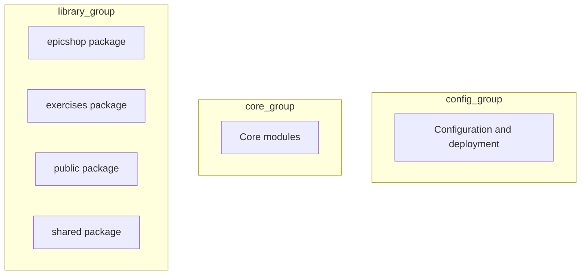

# Architecture report: epicweb-dev/react-fundamentals

> Automated static analysis. **Observed** = directly seen in files/imports/AST; **Inferred** = interpretation from that evidence. Repository code was not executed.

## 1. Repository at a glance

| Item | Value |
| --- | --- |
| Repository | epicweb-dev/react-fundamentals |
| Description | Material for my React Fundamentals Workshop |
| Language | TypeScript |
| Stars | 5310 |
| Licence | Other |
| Analysed commit / branch | bef2dbf208bf057d40e8080855e1bbbd8fb9d4b1 / main |
| Framework(s) | React |
| Files analysed | 274 |
| Components | 6 |

## 2. Architecture in one minute

epicweb-dev/react-fundamentals - Material for my React Fundamentals Workshop. This repository was analysed statically from 274 file(s) (0 Python). Detected technologies (observed from imports/manifests): GitHub Actions, React, Docker, TypeScript. Files are grouped into 6 component(s): Configuration and deployment, Core modules, epicshop package, exercises package, public package, shared package. Findings below distinguish observed facts from inferred interpretation.

## 3. High-level block diagram

## 4. Main components

### Configuration and deployment (`config`)

- **Kind:** config
- **Status:** Observed
- **Confidence:** 0.85
- **Responsibility:** Groups 5 file(s) under configuration and deployment (observed from repository paths and static analysis).
- **Paths:** `epicshop/Dockerfile`, `epicshop/fly.yaml`, `epicshop/package.json`, `package.json`, `tsconfig.json`
- **Evidence:** [epicshop/Dockerfile](https://github.com/epicweb-dev/react-fundamentals/blob/bef2dbf208bf057d40e8080855e1bbbd8fb9d4b1/epicshop/Dockerfile); [epicshop/fly.yaml](https://github.com/epicweb-dev/react-fundamentals/blob/bef2dbf208bf057d40e8080855e1bbbd8fb9d4b1/epicshop/fly.yaml); [epicshop/package.json](https://github.com/epicweb-dev/react-fundamentals/blob/bef2dbf208bf057d40e8080855e1bbbd8fb9d4b1/epicshop/package.json); [package.json](https://github.com/epicweb-dev/react-fundamentals/blob/bef2dbf208bf057d40e8080855e1bbbd8fb9d4b1/package.json); [tsconfig.json](https://github.com/epicweb-dev/react-fundamentals/blob/bef2dbf208bf057d40e8080855e1bbbd8fb9d4b1/tsconfig.json)

### Core modules (`core`)

- **Kind:** core
- **Status:** Observed
- **Confidence:** 0.85
- **Responsibility:** Groups 1 file(s) under core modules (observed from repository paths and static analysis).
- **Paths:** `eslint.config.js`
- **Evidence:** [eslint.config.js](https://github.com/epicweb-dev/react-fundamentals/blob/bef2dbf208bf057d40e8080855e1bbbd8fb9d4b1/eslint.config.js)

### epicshop package (`epicshop`)

- **Kind:** library
- **Status:** Observed
- **Confidence:** 0.85
- **Responsibility:** Groups 5 file(s) under epicshop package (observed from repository paths and static analysis).
- **Paths:** `epicshop/in-browser-tests.spec.js`, `epicshop/playwright.config.js`, `epicshop/post-set-playground.js`, `epicshop/setup-custom.js`, `epicshop/update-deps.sh`
- **Evidence:** [epicshop/in-browser-tests.spec.js](https://github.com/epicweb-dev/react-fundamentals/blob/bef2dbf208bf057d40e8080855e1bbbd8fb9d4b1/epicshop/in-browser-tests.spec.js); [epicshop/playwright.config.js](https://github.com/epicweb-dev/react-fundamentals/blob/bef2dbf208bf057d40e8080855e1bbbd8fb9d4b1/epicshop/playwright.config.js); [epicshop/post-set-playground.js](https://github.com/epicweb-dev/react-fundamentals/blob/bef2dbf208bf057d40e8080855e1bbbd8fb9d4b1/epicshop/post-set-playground.js); [epicshop/setup-custom.js](https://github.com/epicweb-dev/react-fundamentals/blob/bef2dbf208bf057d40e8080855e1bbbd8fb9d4b1/epicshop/setup-custom.js); [epicshop/update-deps.sh](https://github.com/epicweb-dev/react-fundamentals/blob/bef2dbf208bf057d40e8080855e1bbbd8fb9d4b1/epicshop/update-deps.sh)

### exercises package (`exercises`)

- **Kind:** library
- **Status:** Observed
- **Confidence:** 0.85
- **Responsibility:** Groups 116 file(s) under exercises package (observed from repository paths and static analysis).
- **Paths:** `exercises/01.js-hello-world/01.solution.hello/index.test.ts`, `exercises/01.js-hello-world/02.solution.root/index.test.ts`, `exercises/02.raw-react/01.solution.elements/index.test.ts`, `exercises/02.raw-react/02.solution.nesting/index.test.ts`, `exercises/02.raw-react/03.solution.deep-nesting/index.test.ts`, `exercises/03.using-jsx/01.solution.compiler/content.test.ts`, `exercises/03.using-jsx/01.solution.compiler/index.test.ts`, `exercises/03.using-jsx/02.solution.interpolation/content.test.ts`, `exercises/03.using-jsx/02.solution.interpolation/index.test.ts`, `exercises/03.using-jsx/03.solution.spread/content.test.ts`, `exercises/03.using-jsx/03.solution.spread/index.test.ts`, `exercises/03.using-jsx/04.solution.nesting/content.test.ts`, `exercises/03.using-jsx/05.solution.fragments/content.test.ts`, `exercises/03.using-jsx/05.solution.fragments/index.test.ts`, `exercises/04.components/01.solution.function/content.test.ts`, `exercises/04.components/01.solution.function/index.test.ts`, `exercises/04.components/02.solution.raw/content.test.ts`, `exercises/04.components/02.solution.raw/index.test.ts`, `exercises/04.components/03.solution.jsx/content.test.ts`, `exercises/04.components/03.solution.jsx/index.test.ts`, `exercises/04.components/04.solution.props/content.test.ts`, `exercises/05.typescript/01.problem.props/index.tsx`, `exercises/05.typescript/01.solution.props/calculator.test.ts`, `exercises/05.typescript/01.solution.props/index.tsx`, `exercises/05.typescript/02.problem.narrow/index.tsx`, `exercises/05.typescript/02.solution.narrow/calculator.test.ts`, `exercises/05.typescript/02.solution.narrow/index.tsx`, `exercises/05.typescript/03.problem.derive/index.tsx`, `exercises/05.typescript/03.solution.derive/calculator.test.ts`, `exercises/05.typescript/03.solution.derive/index.tsx`, `exercises/05.typescript/04.problem.default-props/index.tsx`, `exercises/05.typescript/04.solution.default-props/calculator.test.ts`, `exercises/05.typescript/04.solution.default-props/index.tsx`, `exercises/05.typescript/05.problem.function-types/index.tsx`, `exercises/05.typescript/05.solution.function-types/calculator.test.ts`, `exercises/05.typescript/05.solution.function-types/index.tsx`, `exercises/05.typescript/06.problem.satisfies/index.tsx`, `exercises/05.typescript/06.solution.satisfies/calculator.test.ts`, `exercises/05.typescript/06.solution.satisfies/index.tsx`, `exercises/06.styling/01.problem.style/index.tsx`, `exercises/06.styling/01.solution.style/boxes.test.ts`, `exercises/06.styling/01.solution.style/index.tsx`, `exercises/06.styling/02.problem.component/index.tsx`, `exercises/06.styling/02.solution.component/box.test.tsx`, `exercises/06.styling/02.solution.component/boxes.test.ts`, `exercises/06.styling/02.solution.component/index.tsx`, `exercises/06.styling/03.problem.size-prop/index.tsx`, `exercises/06.styling/03.solution.size-prop/box.test.tsx`, `exercises/06.styling/03.solution.size-prop/boxes.test.ts`, `exercises/06.styling/03.solution.size-prop/index.tsx`, `exercises/07.forms/01.problem.form/index.tsx`, `exercises/07.forms/01.solution.form/form.test.ts`, `exercises/07.forms/01.solution.form/index.tsx`, `exercises/07.forms/02.problem.action/api.server.ts`, `exercises/07.forms/02.problem.action/index.tsx`, `exercises/07.forms/02.solution.action/action.test.ts`, `exercises/07.forms/02.solution.action/api.server.ts`, `exercises/07.forms/02.solution.action/form.test.ts`, `exercises/07.forms/02.solution.action/index.tsx`, `exercises/07.forms/03.problem.types/api.server.ts`, `exercises/07.forms/03.problem.types/index.tsx`, `exercises/07.forms/03.solution.types/action.test.ts`, `exercises/07.forms/03.solution.types/api.server.ts`, `exercises/07.forms/03.solution.types/form.test.ts`, `exercises/07.forms/03.solution.types/index.tsx`, `exercises/07.forms/04.problem.submit/api.server.ts`, `exercises/07.forms/04.problem.submit/index.tsx`, `exercises/07.forms/04.solution.submit/action.test.ts`, `exercises/07.forms/04.solution.submit/api.server.ts`, `exercises/07.forms/04.solution.submit/api.test.ts`, `exercises/07.forms/04.solution.submit/form.test.ts`, `exercises/07.forms/04.solution.submit/index.tsx`, `exercises/07.forms/04.solution.submit/submit.test.ts`, `exercises/07.forms/05.problem.action/api.server.ts`, `exercises/07.forms/05.problem.action/index.tsx`, `exercises/07.forms/05.solution.action/action.test.ts`, `exercises/07.forms/05.solution.action/form.test.ts`, `exercises/07.forms/05.solution.action/index.tsx`, `exercises/08.inputs/01.problem.checkbox/index.tsx`, `exercises/08.inputs/01.solution.checkbox/action.test.ts`, `exercises/08.inputs/01.solution.checkbox/form.test.ts`, `exercises/08.inputs/01.solution.checkbox/index.tsx`, `exercises/08.inputs/02.problem.select/index.tsx`, `exercises/08.inputs/02.solution.select/action.test.ts`, `exercises/08.inputs/02.solution.select/form.test.ts`, `exercises/08.inputs/02.solution.select/index.tsx`, `exercises/08.inputs/03.problem.radio/index.tsx`, `exercises/08.inputs/03.solution.radio/action.test.ts`, `exercises/08.inputs/03.solution.radio/form.test.ts`, `exercises/08.inputs/03.solution.radio/index.tsx`, `exercises/08.inputs/04.problem.hidden/index.tsx`, `exercises/08.inputs/04.solution.hidden/action.test.ts`, `exercises/08.inputs/04.solution.hidden/form.test.ts`, `exercises/08.inputs/04.solution.hidden/index.tsx`, `exercises/08.inputs/05.problem.default-value/index.tsx`, `exercises/08.inputs/05.solution.default-value/action.test.ts`, `exercises/08.inputs/05.solution.default-value/form.test.ts`, `exercises/08.inputs/05.solution.default-value/index.tsx`, `exercises/09.errors/01.problem.composition/index.tsx`, `exercises/09.errors/01.solution.composition/error-boundary.test.ts`, `exercises/09.errors/01.solution.composition/index.tsx`, `exercises/09.errors/02.problem.show-boundary/index.tsx`, `exercises/09.errors/02.solution.show-boundary/error-boundary.test.ts`, `exercises/09.errors/02.solution.show-boundary/index.tsx`, `exercises/09.errors/03.problem.reset/index.tsx`, `exercises/09.errors/03.solution.reset/error-boundary.test.ts`, `exercises/09.errors/03.solution.reset/index.tsx`, `exercises/10.arrays/01.problem.key-prop/index.tsx`, `exercises/10.arrays/01.solution.key-prop/index.tsx`, `exercises/10.arrays/01.solution.key-prop/key.test.ts`, `exercises/10.arrays/02.problem.focus-state/index.tsx`, `exercises/10.arrays/02.solution.focus-state/index.tsx`, `exercises/10.arrays/02.solution.focus-state/key.test.ts`, `exercises/10.arrays/03.problem.key-reset/index.tsx`, `exercises/10.arrays/03.solution.key-reset/index.test.ts`, `exercises/10.arrays/03.solution.key-reset/index.tsx`
- **Evidence:** [exercises/01.js-hello-world/01.solution.hello/index.test.ts](https://github.com/epicweb-dev/react-fundamentals/blob/bef2dbf208bf057d40e8080855e1bbbd8fb9d4b1/exercises/01.js-hello-world/01.solution.hello/index.test.ts); [exercises/01.js-hello-world/02.solution.root/index.test.ts](https://github.com/epicweb-dev/react-fundamentals/blob/bef2dbf208bf057d40e8080855e1bbbd8fb9d4b1/exercises/01.js-hello-world/02.solution.root/index.test.ts); [exercises/02.raw-react/01.solution.elements/index.test.ts](https://github.com/epicweb-dev/react-fundamentals/blob/bef2dbf208bf057d40e8080855e1bbbd8fb9d4b1/exercises/02.raw-react/01.solution.elements/index.test.ts); [exercises/02.raw-react/02.solution.nesting/index.test.ts](https://github.com/epicweb-dev/react-fundamentals/blob/bef2dbf208bf057d40e8080855e1bbbd8fb9d4b1/exercises/02.raw-react/02.solution.nesting/index.test.ts); [exercises/02.raw-react/03.solution.deep-nesting/index.test.ts](https://github.com/epicweb-dev/react-fundamentals/blob/bef2dbf208bf057d40e8080855e1bbbd8fb9d4b1/exercises/02.raw-react/03.solution.deep-nesting/index.test.ts); [exercises/03.using-jsx/01.solution.compiler/content.test.ts](https://github.com/epicweb-dev/react-fundamentals/blob/bef2dbf208bf057d40e8080855e1bbbd8fb9d4b1/exercises/03.using-jsx/01.solution.compiler/content.test.ts); [exercises/03.using-jsx/01.solution.compiler/index.test.ts](https://github.com/epicweb-dev/react-fundamentals/blob/bef2dbf208bf057d40e8080855e1bbbd8fb9d4b1/exercises/03.using-jsx/01.solution.compiler/index.test.ts); [exercises/03.using-jsx/02.solution.interpolation/content.test.ts](https://github.com/epicweb-dev/react-fundamentals/blob/bef2dbf208bf057d40e8080855e1bbbd8fb9d4b1/exercises/03.using-jsx/02.solution.interpolation/content.test.ts)

### public package (`public`)

- **Kind:** library
- **Status:** Observed
- **Confidence:** 0.85
- **Responsibility:** Groups 2 file(s) under public package (observed from repository paths and static analysis).
- **Paths:** `public/react-dom/client.js`, `public/react.js`
- **Evidence:** [public/react-dom/client.js](https://github.com/epicweb-dev/react-fundamentals/blob/bef2dbf208bf057d40e8080855e1bbbd8fb9d4b1/public/react-dom/client.js); [public/react.js](https://github.com/epicweb-dev/react-fundamentals/blob/bef2dbf208bf057d40e8080855e1bbbd8fb9d4b1/public/react.js)

### shared package (`shared`)

- **Kind:** library
- **Status:** Observed
- **Confidence:** 0.85
- **Responsibility:** Groups 1 file(s) under shared package (observed from repository paths and static analysis).
- **Paths:** `shared/api-utils.ts`
- **Evidence:** [shared/api-utils.ts](https://github.com/epicweb-dev/react-fundamentals/blob/bef2dbf208bf057d40e8080855e1bbbd8fb9d4b1/shared/api-utils.ts)

## 5. Execution flow

**Observed** entry point(s):

- [exercises/05.typescript/01.problem.props/index.tsx](https://github.com/epicweb-dev/react-fundamentals/blob/bef2dbf208bf057d40e8080855e1bbbd8fb9d4b1/exercises/05.typescript/01.problem.props/index.tsx)
- [exercises/05.typescript/01.solution.props/index.tsx](https://github.com/epicweb-dev/react-fundamentals/blob/bef2dbf208bf057d40e8080855e1bbbd8fb9d4b1/exercises/05.typescript/01.solution.props/index.tsx)
- [exercises/05.typescript/02.problem.narrow/index.tsx](https://github.com/epicweb-dev/react-fundamentals/blob/bef2dbf208bf057d40e8080855e1bbbd8fb9d4b1/exercises/05.typescript/02.problem.narrow/index.tsx)
- [exercises/05.typescript/02.solution.narrow/index.tsx](https://github.com/epicweb-dev/react-fundamentals/blob/bef2dbf208bf057d40e8080855e1bbbd8fb9d4b1/exercises/05.typescript/02.solution.narrow/index.tsx)
- [exercises/05.typescript/03.problem.derive/index.tsx](https://github.com/epicweb-dev/react-fundamentals/blob/bef2dbf208bf057d40e8080855e1bbbd8fb9d4b1/exercises/05.typescript/03.problem.derive/index.tsx)
- [exercises/05.typescript/03.solution.derive/index.tsx](https://github.com/epicweb-dev/react-fundamentals/blob/bef2dbf208bf057d40e8080855e1bbbd8fb9d4b1/exercises/05.typescript/03.solution.derive/index.tsx)
- [exercises/05.typescript/04.problem.default-props/index.tsx](https://github.com/epicweb-dev/react-fundamentals/blob/bef2dbf208bf057d40e8080855e1bbbd8fb9d4b1/exercises/05.typescript/04.problem.default-props/index.tsx)
- [exercises/05.typescript/04.solution.default-props/index.tsx](https://github.com/epicweb-dev/react-fundamentals/blob/bef2dbf208bf057d40e8080855e1bbbd8fb9d4b1/exercises/05.typescript/04.solution.default-props/index.tsx)
- [exercises/05.typescript/05.problem.function-types/index.tsx](https://github.com/epicweb-dev/react-fundamentals/blob/bef2dbf208bf057d40e8080855e1bbbd8fb9d4b1/exercises/05.typescript/05.problem.function-types/index.tsx)
- [exercises/05.typescript/05.solution.function-types/index.tsx](https://github.com/epicweb-dev/react-fundamentals/blob/bef2dbf208bf057d40e8080855e1bbbd8fb9d4b1/exercises/05.typescript/05.solution.function-types/index.tsx)
- [exercises/05.typescript/06.problem.satisfies/index.tsx](https://github.com/epicweb-dev/react-fundamentals/blob/bef2dbf208bf057d40e8080855e1bbbd8fb9d4b1/exercises/05.typescript/06.problem.satisfies/index.tsx)
- [exercises/05.typescript/06.solution.satisfies/index.tsx](https://github.com/epicweb-dev/react-fundamentals/blob/bef2dbf208bf057d40e8080855e1bbbd8fb9d4b1/exercises/05.typescript/06.solution.satisfies/index.tsx)

Representative flow (derived from observed entry points and the import graph; steps beyond the entry point are **Inferred**):

1. Execution starts at an observed entry point listed above, if present.
2. No internal import relationships between components were observed.

## 6. Project structure

### `(root)`

- `.gitignore` - other (335 bytes)
- `.prettierignore` - other (123 bytes)
- `LICENSE.md` - docs (246 bytes)
- `README.md` - docs (3526 bytes)
- `eslint.config.js` - source, JavaScript (329 bytes)
- `package.json` - manifest (2175 bytes)
- `tsconfig.json` - config (145 bytes)

### `.github`

- `.github/workflows/validate.yml` - ci, YAML (8348 bytes)

### `.vscode`

- `.vscode/extensions.json` - config (142 bytes)

### `epicshop`

- `epicshop/.diffignore` - other (23 bytes)
- `epicshop/Dockerfile` - container (686 bytes)
- `epicshop/fly.yaml` - config (885 bytes)
- `epicshop/in-browser-tests.spec.js` - source, JavaScript (299 bytes)
- `epicshop/package.json` - manifest (357 bytes)
- `epicshop/playwright.config.js` - source, JavaScript (809 bytes)
- `epicshop/post-set-playground.js` - source, JavaScript (384 bytes)
- `epicshop/setup-custom.js` - source, JavaScript (894 bytes)
- `epicshop/update-deps.sh` - source, Shell (322 bytes)

### `exercises`

- `exercises/01.js-hello-world/01.problem.hello/README.mdx` - other (996 bytes)
- `exercises/01.js-hello-world/01.problem.hello/index.html` - other (1520 bytes)
- `exercises/01.js-hello-world/01.solution.hello/README.mdx` - other (298 bytes)
- `exercises/01.js-hello-world/01.solution.hello/index.html` - other (305 bytes)
- `exercises/01.js-hello-world/01.solution.hello/index.test.ts` - source, TypeScript (615 bytes)
- `exercises/01.js-hello-world/02.problem.root/README.mdx` - other (400 bytes)
- `exercises/01.js-hello-world/02.problem.root/index.html` - other (767 bytes)
- `exercises/01.js-hello-world/02.solution.root/README.mdx` - other (510 bytes)
- `exercises/01.js-hello-world/02.solution.root/index.html` - other (475 bytes)
- `exercises/01.js-hello-world/02.solution.root/index.test.ts` - source, TypeScript (943 bytes)
- `exercises/01.js-hello-world/FINISHED.mdx` - other (282 bytes)
- `exercises/01.js-hello-world/README.mdx` - other (2809 bytes)
- `exercises/02.raw-react/01.problem.elements/README.mdx` - other (2989 bytes)
- `exercises/02.raw-react/01.problem.elements/index.html` - other (1189 bytes)
- `exercises/02.raw-react/01.solution.elements/README.mdx` - other (306 bytes)
- `exercises/02.raw-react/01.solution.elements/index.html` - other (526 bytes)
- `exercises/02.raw-react/01.solution.elements/index.test.ts` - source, TypeScript (1011 bytes)
- `exercises/02.raw-react/02.problem.nesting/README.mdx` - other (838 bytes)
- `exercises/02.raw-react/02.problem.nesting/index.html` - other (891 bytes)
- `exercises/02.raw-react/02.solution.nesting/README.mdx` - other (277 bytes)
- `exercises/02.raw-react/02.solution.nesting/index.html` - other (600 bytes)
- `exercises/02.raw-react/02.solution.nesting/index.test.ts` - source, TypeScript (1144 bytes)
- `exercises/02.raw-react/03.problem.deep-nesting/README.mdx` - other (385 bytes)
- `exercises/02.raw-react/03.problem.deep-nesting/index.html` - other (864 bytes)
- `exercises/02.raw-react/03.solution.deep-nesting/README.mdx` - other (201 bytes)
- `exercises/02.raw-react/03.solution.deep-nesting/index.html` - other (723 bytes)
- `exercises/02.raw-react/03.solution.deep-nesting/index.test.ts` - source, TypeScript (1183 bytes)
- `exercises/02.raw-react/FINISHED.mdx` - other (225 bytes)
- `exercises/02.raw-react/README.mdx` - other (1965 bytes)
- `exercises/03.using-jsx/01.problem.compiler/README.mdx` - other (684 bytes)
- `exercises/03.using-jsx/01.problem.compiler/index.html` - other (1472 bytes)
- `exercises/03.using-jsx/01.solution.compiler/README.mdx` - other (1579 bytes)
- `exercises/03.using-jsx/01.solution.compiler/content.test.ts` - source, TypeScript (615 bytes)
- `exercises/03.using-jsx/01.solution.compiler/index.html` - other (567 bytes)
- `exercises/03.using-jsx/01.solution.compiler/index.test.ts` - source, TypeScript (1599 bytes)
- `exercises/03.using-jsx/02.problem.interpolation/README.mdx` - other (1078 bytes)
- `exercises/03.using-jsx/02.problem.interpolation/index.html` - other (676 bytes)
- `exercises/03.using-jsx/02.solution.interpolation/README.mdx` - other (316 bytes)
- `exercises/03.using-jsx/02.solution.interpolation/content.test.ts` - source, TypeScript (615 bytes)
- `exercises/03.using-jsx/02.solution.interpolation/index.html` - other (634 bytes)
- `exercises/03.using-jsx/02.solution.interpolation/index.test.ts` - source, TypeScript (826 bytes)
- `exercises/03.using-jsx/03.problem.spread/README.mdx` - other (844 bytes)
- `exercises/03.using-jsx/03.problem.spread/index.html` - other (704 bytes)
- `exercises/03.using-jsx/03.solution.spread/README.mdx` - other (347 bytes)
- `exercises/03.using-jsx/03.solution.spread/content.test.ts` - source, TypeScript (615 bytes)
- `exercises/03.using-jsx/03.solution.spread/index.html` - other (650 bytes)
- `exercises/03.using-jsx/03.solution.spread/index.test.ts` - source, TypeScript (509 bytes)
- `exercises/03.using-jsx/04.problem.nesting/README.mdx` - other (543 bytes)
- `exercises/03.using-jsx/04.problem.nesting/index.html` - other (846 bytes)
- `exercises/03.using-jsx/04.solution.nesting/README.mdx` - other (199 bytes)
- `exercises/03.using-jsx/04.solution.nesting/content.test.ts` - source, TypeScript (1222 bytes)
- `exercises/03.using-jsx/04.solution.nesting/index.html` - other (701 bytes)
- `exercises/03.using-jsx/05.problem.fragments/README.mdx` - other (1895 bytes)
- `exercises/03.using-jsx/05.problem.fragments/index.html` - other (783 bytes)
- `exercises/03.using-jsx/05.solution.fragments/README.mdx` - other (210 bytes)
- `exercises/03.using-jsx/05.solution.fragments/content.test.ts` - source, TypeScript (1077 bytes)
- `exercises/03.using-jsx/05.solution.fragments/index.html` - other (673 bytes)
- `exercises/03.using-jsx/05.solution.fragments/index.test.ts` - source, TypeScript (773 bytes)
- `exercises/03.using-jsx/FINISHED.mdx` - other (322 bytes)
- `exercises/03.using-jsx/README.mdx` - other (1122 bytes)
- `exercises/04.components/01.problem.function/README.mdx` - other (1013 bytes)
- `exercises/04.components/01.problem.function/index.html` - other (904 bytes)
- `exercises/04.components/01.solution.function/README.mdx` - other (525 bytes)
- `exercises/04.components/01.solution.function/content.test.ts` - source, TypeScript (896 bytes)
- `exercises/04.components/01.solution.function/index.html` - other (836 bytes)
- `exercises/04.components/01.solution.function/index.test.ts` - source, TypeScript (789 bytes)
- `exercises/04.components/02.problem.raw/README.mdx` - other (949 bytes)
- `exercises/04.components/02.problem.raw/index.html` - other (915 bytes)
- `exercises/04.components/02.solution.raw/README.mdx` - other (493 bytes)
- `exercises/04.components/02.solution.raw/content.test.ts` - source, TypeScript (896 bytes)
- `exercises/04.components/02.solution.raw/index.html` - other (879 bytes)
- `exercises/04.components/02.solution.raw/index.test.ts` - source, TypeScript (506 bytes)
- `exercises/04.components/03.problem.jsx/README.mdx` - other (2035 bytes)
- `exercises/04.components/03.problem.jsx/index.html` - other (909 bytes)
- `exercises/04.components/03.solution.jsx/README.mdx` - other (1539 bytes)
- `exercises/04.components/03.solution.jsx/content.test.ts` - source, TypeScript (896 bytes)
- `exercises/04.components/03.solution.jsx/index.html` - other (787 bytes)
- `exercises/04.components/03.solution.jsx/index.test.ts` - source, TypeScript (508 bytes)
- `exercises/04.components/04.problem.props/README.mdx` - other (584 bytes)
- `exercises/04.components/04.problem.props/index.html` - other (1320 bytes)
- `exercises/04.components/04.solution.props/README.mdx` - other (217 bytes)
- `exercises/04.components/04.solution.props/content.test.ts` - source, TypeScript (935 bytes)
- `exercises/04.components/04.solution.props/index.html` - other (1215 bytes)
- `exercises/04.components/FINISHED.mdx` - other (429 bytes)
- `exercises/04.components/README.mdx` - other (1093 bytes)
- `exercises/05.typescript/01.problem.props/README.mdx` - other (549 bytes)
- `exercises/05.typescript/01.problem.props/index.tsx` - source, TypeScript (1127 bytes)
- `exercises/05.typescript/01.solution.props/README.mdx` - other (262 bytes)
- `exercises/05.typescript/01.solution.props/calculator.test.ts` - source, TypeScript (961 bytes)
- `exercises/05.typescript/01.solution.props/index.tsx` - source, TypeScript (1045 bytes)
- `exercises/05.typescript/02.problem.narrow/README.mdx` - other (1577 bytes)
- `exercises/05.typescript/02.problem.narrow/index.tsx` - source, TypeScript (1116 bytes)
- `exercises/05.typescript/02.solution.narrow/README.mdx` - other (274 bytes)
- `exercises/05.typescript/02.solution.narrow/calculator.test.ts` - source, TypeScript (961 bytes)
- `exercises/05.typescript/02.solution.narrow/index.tsx` - source, TypeScript (1014 bytes)
- `exercises/05.typescript/03.problem.derive/README.mdx` - other (1433 bytes)
- `exercises/05.typescript/03.problem.derive/index.tsx` - source, TypeScript (1082 bytes)
- `exercises/05.typescript/03.solution.derive/README.mdx` - other (189 bytes)
- `exercises/05.typescript/03.solution.derive/calculator.test.ts` - source, TypeScript (961 bytes)
- `exercises/05.typescript/03.solution.derive/index.tsx` - source, TypeScript (1016 bytes)
- `exercises/05.typescript/04.problem.default-props/README.mdx` - other (1385 bytes)
- `exercises/05.typescript/04.problem.default-props/index.tsx` - source, TypeScript (1435 bytes)
- `exercises/05.typescript/04.solution.default-props/README.mdx` - other (238 bytes)
- `exercises/05.typescript/04.solution.default-props/calculator.test.ts` - source, TypeScript (958 bytes)
- `exercises/05.typescript/04.solution.default-props/index.tsx` - source, TypeScript (982 bytes)
- `exercises/05.typescript/05.problem.function-types/README.mdx` - other (1800 bytes)
- `exercises/05.typescript/05.problem.function-types/index.tsx` - source, TypeScript (1416 bytes)
- `exercises/05.typescript/05.solution.function-types/README.mdx` - other (248 bytes)
- `exercises/05.typescript/05.solution.function-types/calculator.test.ts` - source, TypeScript (958 bytes)
- `exercises/05.typescript/05.solution.function-types/index.tsx` - source, TypeScript (1014 bytes)
- `exercises/05.typescript/06.problem.satisfies/README.mdx` - other (1361 bytes)
- `exercises/05.typescript/06.problem.satisfies/index.tsx` - source, TypeScript (1185 bytes)
- `exercises/05.typescript/06.solution.satisfies/README.mdx` - other (161 bytes)
- `exercises/05.typescript/06.solution.satisfies/calculator.test.ts` - source, TypeScript (958 bytes)
- `exercises/05.typescript/06.solution.satisfies/index.tsx` - source, TypeScript (984 bytes)
- `exercises/05.typescript/FINISHED.mdx` - other (231 bytes)
- `exercises/05.typescript/README.mdx` - other (5442 bytes)
- `exercises/06.styling/01.problem.style/README.mdx` - other (597 bytes)
- `exercises/06.styling/01.problem.style/index.css` - other (265 bytes)
- `exercises/06.styling/01.problem.style/index.tsx` - source, TypeScript (1055 bytes)
- `exercises/06.styling/01.solution.style/README.mdx` - other (255 bytes)
- `exercises/06.styling/01.solution.style/boxes.test.ts` - source, TypeScript (1444 bytes)
- `exercises/06.styling/01.solution.style/index.css` - other (265 bytes)
- `exercises/06.styling/01.solution.style/index.tsx` - source, TypeScript (843 bytes)
- `exercises/06.styling/02.problem.component/README.mdx` - other (1764 bytes)
- `exercises/06.styling/02.problem.component/index.css` - other (262 bytes)
- `exercises/06.styling/02.problem.component/index.tsx` - source, TypeScript (1613 bytes)
- `exercises/06.styling/02.solution.component/README.mdx` - other (387 bytes)
- `exercises/06.styling/02.solution.component/box.test.tsx` - source, TypeScript (1683 bytes)
- `exercises/06.styling/02.solution.component/boxes.test.ts` - source, TypeScript (1444 bytes)
- `exercises/06.styling/02.solution.component/index.css` - other (262 bytes)
- `exercises/06.styling/02.solution.component/index.tsx` - source, TypeScript (777 bytes)
- `exercises/06.styling/03.problem.size-prop/README.mdx` - other (767 bytes)
- `exercises/06.styling/03.problem.size-prop/index.css` - other (262 bytes)
- `exercises/06.styling/03.problem.size-prop/index.tsx` - source, TypeScript (1381 bytes)
- `exercises/06.styling/03.solution.size-prop/README.mdx` - other (184 bytes)
- `exercises/06.styling/03.solution.size-prop/box.test.tsx` - source, TypeScript (1948 bytes)
- `exercises/06.styling/03.solution.size-prop/boxes.test.ts` - source, TypeScript (1444 bytes)
- `exercises/06.styling/03.solution.size-prop/index.css` - other (262 bytes)
- `exercises/06.styling/03.solution.size-prop/index.tsx` - source, TypeScript (890 bytes)
- `exercises/06.styling/FINISHED.mdx` - other (317 bytes)
- `exercises/06.styling/README.mdx` - other (3134 bytes)
- `exercises/07.forms/01.problem.form/README.mdx` - other (430 bytes)
- `exercises/07.forms/01.problem.form/index.tsx` - source, TypeScript (458 bytes)
- `exercises/07.forms/01.solution.form/README.mdx` - other (246 bytes)
- `exercises/07.forms/01.solution.form/form.test.ts` - source, TypeScript (580 bytes)
- `exercises/07.forms/01.solution.form/index.tsx` - source, TypeScript (370 bytes)
- `exercises/07.forms/02.problem.action/README.mdx` - other (1066 bytes)
- `exercises/07.forms/02.problem.action/api.server.ts` - source, TypeScript (209 bytes)
- `exercises/07.forms/02.problem.action/index.tsx` - source, TypeScript (428 bytes)
- `exercises/07.forms/02.solution.action/README.mdx` - other (320 bytes)
- `exercises/07.forms/02.solution.action/action.test.ts` - source, TypeScript (345 bytes)
- `exercises/07.forms/02.solution.action/api.server.ts` - source, TypeScript (209 bytes)
- `exercises/07.forms/02.solution.action/form.test.ts` - source, TypeScript (580 bytes)
- `exercises/07.forms/02.solution.action/index.tsx` - source, TypeScript (394 bytes)
- `exercises/07.forms/03.problem.types/README.mdx` - other (610 bytes)
- `exercises/07.forms/03.problem.types/api.server.ts` - source, TypeScript (209 bytes)
- `exercises/07.forms/03.problem.types/index.tsx` - source, TypeScript (590 bytes)
- `exercises/07.forms/03.solution.types/README.mdx` - other (827 bytes)
- `exercises/07.forms/03.solution.types/action.test.ts` - source, TypeScript (345 bytes)
- `exercises/07.forms/03.solution.types/api.server.ts` - source, TypeScript (209 bytes)
- `exercises/07.forms/03.solution.types/form.test.ts` - source, TypeScript (1908 bytes)
- `exercises/07.forms/03.solution.types/index.tsx` - source, TypeScript (1071 bytes)
- `exercises/07.forms/04.problem.submit/README.mdx` - other (5819 bytes)
- `exercises/07.forms/04.problem.submit/api.server.ts` - source, TypeScript (309 bytes)
- `exercises/07.forms/04.problem.submit/index.tsx` - source, TypeScript (1642 bytes)
- `exercises/07.forms/04.solution.submit/README.mdx` - other (287 bytes)
- `exercises/07.forms/04.solution.submit/action.test.ts` - source, TypeScript (350 bytes)
- `exercises/07.forms/04.solution.submit/api.server.ts` - source, TypeScript (200 bytes)
- `exercises/07.forms/04.solution.submit/api.test.ts` - source, TypeScript (382 bytes)
- `exercises/07.forms/04.solution.submit/form.test.ts` - source, TypeScript (1919 bytes)
- `exercises/07.forms/04.solution.submit/index.tsx` - source, TypeScript (1562 bytes)
- `exercises/07.forms/04.solution.submit/submit.test.ts` - source, TypeScript (1702 bytes)
- `exercises/07.forms/05.problem.action/README.mdx` - other (716 bytes)
- `exercises/07.forms/05.problem.action/api.server.ts` - source, TypeScript (200 bytes)
- `exercises/07.forms/05.problem.action/index.tsx` - source, TypeScript (1761 bytes)
- `exercises/07.forms/05.solution.action/README.mdx` - other (213 bytes)
- `exercises/07.forms/05.solution.action/action.test.ts` - source, TypeScript (2235 bytes)
- `exercises/07.forms/05.solution.action/form.test.ts` - source, TypeScript (1908 bytes)
- `exercises/07.forms/05.solution.action/index.tsx` - source, TypeScript (1159 bytes)
- `exercises/07.forms/FINISHED.mdx` - other (190 bytes)
- `exercises/07.forms/README.mdx` - other (2691 bytes)
- `exercises/08.inputs/01.problem.checkbox/README.mdx` - other (640 bytes)
- `exercises/08.inputs/01.problem.checkbox/index.tsx` - source, TypeScript (1287 bytes)
- `exercises/08.inputs/01.solution.checkbox/README.mdx` - other (356 bytes)
- `exercises/08.inputs/01.solution.checkbox/action.test.ts` - source, TypeScript (2365 bytes)
- `exercises/08.inputs/01.solution.checkbox/form.test.ts` - source, TypeScript (2174 bytes)
- `exercises/08.inputs/01.solution.checkbox/index.tsx` - source, TypeScript (1267 bytes)
- `exercises/08.inputs/02.problem.select/README.mdx` - other (376 bytes)
- `exercises/08.inputs/02.problem.select/index.tsx` - source, TypeScript (1527 bytes)
- `exercises/08.inputs/02.solution.select/README.mdx` - other (192 bytes)
- `exercises/08.inputs/02.solution.select/action.test.ts` - source, TypeScript (2539 bytes)
- `exercises/08.inputs/02.solution.select/form.test.ts` - source, TypeScript (2803 bytes)
- `exercises/08.inputs/02.solution.select/index.tsx` - source, TypeScript (1659 bytes)
- `exercises/08.inputs/03.problem.radio/README.mdx` - other (1167 bytes)
- `exercises/08.inputs/03.problem.radio/index.tsx` - source, TypeScript (1810 bytes)
- `exercises/08.inputs/03.solution.radio/README.mdx` - other (174 bytes)
- `exercises/08.inputs/03.solution.radio/action.test.ts` - source, TypeScript (2658 bytes)
- `exercises/08.inputs/03.solution.radio/form.test.ts` - source, TypeScript (3345 bytes)
- `exercises/08.inputs/03.solution.radio/index.tsx` - source, TypeScript (1919 bytes)
- `exercises/08.inputs/04.problem.hidden/README.mdx` - other (474 bytes)
- `exercises/08.inputs/04.problem.hidden/index.tsx` - source, TypeScript (1996 bytes)
- `exercises/08.inputs/04.solution.hidden/README.mdx` - other (865 bytes)
- `exercises/08.inputs/04.solution.hidden/action.test.ts` - source, TypeScript (2723 bytes)
- `exercises/08.inputs/04.solution.hidden/form.test.ts` - source, TypeScript (3594 bytes)
- `exercises/08.inputs/04.solution.hidden/index.tsx` - source, TypeScript (1971 bytes)
- `exercises/08.inputs/05.problem.default-value/README.mdx` - other (3000 bytes)
- `exercises/08.inputs/05.problem.default-value/index.tsx` - source, TypeScript (2269 bytes)
- `exercises/08.inputs/05.solution.default-value/README.mdx` - other (221 bytes)
- `exercises/08.inputs/05.solution.default-value/action.test.ts` - source, TypeScript (2635 bytes)
- `exercises/08.inputs/05.solution.default-value/form.test.ts` - source, TypeScript (3846 bytes)
- `exercises/08.inputs/05.solution.default-value/index.tsx` - source, TypeScript (2220 bytes)
- `exercises/08.inputs/FINISHED.mdx` - other (206 bytes)
- `exercises/08.inputs/README.mdx` - other (988 bytes)
- `exercises/09.errors/01.problem.composition/README.mdx` - other (1114 bytes)
- `exercises/09.errors/01.problem.composition/index.tsx` - source, TypeScript (3391 bytes)
- `exercises/09.errors/01.solution.composition/README.mdx` - other (351 bytes)
- `exercises/09.errors/01.solution.composition/error-boundary.test.ts` - source, TypeScript (528 bytes)
- `exercises/09.errors/01.solution.composition/index.tsx` - source, TypeScript (2921 bytes)
- `exercises/09.errors/02.problem.show-boundary/README.mdx` - other (1063 bytes)
- `exercises/09.errors/02.problem.show-boundary/index.tsx` - source, TypeScript (3108 bytes)
- `exercises/09.errors/02.solution.show-boundary/README.mdx` - other (259 bytes)
- `exercises/09.errors/02.solution.show-boundary/error-boundary.test.ts` - source, TypeScript (700 bytes)
- `exercises/09.errors/02.solution.show-boundary/index.tsx` - source, TypeScript (3008 bytes)
- `exercises/09.errors/03.problem.reset/README.mdx` - other (572 bytes)
- `exercises/09.errors/03.problem.reset/index.tsx` - source, TypeScript (3331 bytes)
- `exercises/09.errors/03.solution.reset/README.mdx` - other (609 bytes)
- `exercises/09.errors/03.solution.reset/error-boundary.test.ts` - source, TypeScript (1232 bytes)
- `exercises/09.errors/03.solution.reset/index.tsx` - source, TypeScript (3087 bytes)
- `exercises/09.errors/FINISHED.mdx` - other (211 bytes)
- `exercises/09.errors/README.mdx` - other (6876 bytes)
- `exercises/10.arrays/01.problem.key-prop/README.mdx` - other (2982 bytes)
- `exercises/10.arrays/01.problem.key-prop/index.tsx` - source, TypeScript (1295 bytes)
- `exercises/10.arrays/01.solution.key-prop/README.mdx` - other (1220 bytes)
- `exercises/10.arrays/01.solution.key-prop/index.tsx` - source, TypeScript (1138 bytes)
- `exercises/10.arrays/01.solution.key-prop/key.test.ts` - source, TypeScript (556 bytes)
- `exercises/10.arrays/02.problem.focus-state/README.mdx` - other (563 bytes)
- `exercises/10.arrays/02.problem.focus-state/index.tsx` - source, TypeScript (3645 bytes)
- `exercises/10.arrays/02.solution.focus-state/README.mdx` - other (388 bytes)
- `exercises/10.arrays/02.solution.focus-state/index.tsx` - source, TypeScript (3386 bytes)
- `exercises/10.arrays/02.solution.focus-state/key.test.ts` - source, TypeScript (541 bytes)
- `exercises/10.arrays/03.problem.key-reset/README.mdx` - other (588 bytes)
- `exercises/10.arrays/03.problem.key-reset/index.tsx` - source, TypeScript (427 bytes)
- `exercises/10.arrays/03.solution.key-reset/README.mdx` - other (333 bytes)
- `exercises/10.arrays/03.solution.key-reset/index.test.ts` - source, TypeScript (140 bytes)
- `exercises/10.arrays/03.solution.key-reset/index.tsx` - source, TypeScript (364 bytes)
- `exercises/10.arrays/FINISHED.mdx` - other (274 bytes)
- `exercises/10.arrays/README.mdx` - other (1993 bytes)
- `exercises/FINISHED.mdx` - other (164 bytes)
- `exercises/README.mdx` - other (1938 bytes)

### `public`

- `public/favicon.svg` - other (966 bytes)
- `public/logo.svg` - other (2382 bytes)
- `public/og/logo.svg` - other (13765 bytes)
- `public/react-dom/client.js` - source, JavaScript (114 bytes)
- `public/react.js` - source, JavaScript (92 bytes)

### `shared`

- `shared/api-utils.ts` - source, TypeScript (1664 bytes)

## 7. Key dependencies and integrations

| Name | Category | Status | Confidence | Evidence |
| --- | --- | --- | --- | --- |
| GitHub Actions | ci | Observed | 0.85 | [.github/workflows/validate.yml](https://github.com/epicweb-dev/react-fundamentals/blob/bef2dbf208bf057d40e8080855e1bbbd8fb9d4b1/.github/workflows/validate.yml) |
| React | framework | Observed | 0.90 | [package.json:2](https://github.com/epicweb-dev/react-fundamentals/blob/bef2dbf208bf057d40e8080855e1bbbd8fb9d4b1/package.json#L2); [package.json:51](https://github.com/epicweb-dev/react-fundamentals/blob/bef2dbf208bf057d40e8080855e1bbbd8fb9d4b1/package.json#L51) |
| Docker | tooling | Observed | 0.85 | [epicshop/Dockerfile](https://github.com/epicweb-dev/react-fundamentals/blob/bef2dbf208bf057d40e8080855e1bbbd8fb9d4b1/epicshop/Dockerfile) |
| TypeScript | tooling | Observed | 0.85 | [package.json:63](https://github.com/epicweb-dev/react-fundamentals/blob/bef2dbf208bf057d40e8080855e1bbbd8fb9d4b1/package.json#L63) |

## 8. Data and state

No database, cache, queue, or persistent-state usage was observed in the analysed files. State handling, if any, may be in-memory or in files that were not analysed.

## 9. Configuration and deployment clues

- `.github/workflows/validate.yml` (ci)
- `.vscode/extensions.json` (config)
- `epicshop/Dockerfile` (container)
- `epicshop/fly.yaml` (config)
- `epicshop/package.json` (manifest)
- `package.json` (manifest)
- `tsconfig.json` (config)

## 10. Design observations

- No strong design patterns could be established from the available evidence.

These observations are interpretations (**Inferred**) of the observed structure, not guarantees about runtime design.

## 11. Limitations and unknowns

- Static analysis only: repository code was not executed, installed, or imported at runtime.
- Components and relationships are inferred from file paths, imports, and AST structure; runtime behaviour, dynamic imports, and reflection may not be visible.
- 2 file(s) were skipped during inventory (2 x likely secret file excluded).
- No clear application entry point was observed in the analysed files.
- Repository text was treated as untrusted data; no instructions found in repository files were followed, and likely secret values were redacted/excluded.
- JavaScript and TypeScript files were inventoried from paths and package manifests. They were not parsed with a full language AST, and repository code was not executed.

## 12. Source references

- [.github/workflows/validate.yml](https://github.com/epicweb-dev/react-fundamentals/blob/bef2dbf208bf057d40e8080855e1bbbd8fb9d4b1/.github/workflows/validate.yml)
- [epicshop/Dockerfile](https://github.com/epicweb-dev/react-fundamentals/blob/bef2dbf208bf057d40e8080855e1bbbd8fb9d4b1/epicshop/Dockerfile)
- [epicshop/fly.yaml](https://github.com/epicweb-dev/react-fundamentals/blob/bef2dbf208bf057d40e8080855e1bbbd8fb9d4b1/epicshop/fly.yaml)
- [epicshop/in-browser-tests.spec.js](https://github.com/epicweb-dev/react-fundamentals/blob/bef2dbf208bf057d40e8080855e1bbbd8fb9d4b1/epicshop/in-browser-tests.spec.js)
- [epicshop/package.json](https://github.com/epicweb-dev/react-fundamentals/blob/bef2dbf208bf057d40e8080855e1bbbd8fb9d4b1/epicshop/package.json)
- [epicshop/playwright.config.js](https://github.com/epicweb-dev/react-fundamentals/blob/bef2dbf208bf057d40e8080855e1bbbd8fb9d4b1/epicshop/playwright.config.js)
- [epicshop/post-set-playground.js](https://github.com/epicweb-dev/react-fundamentals/blob/bef2dbf208bf057d40e8080855e1bbbd8fb9d4b1/epicshop/post-set-playground.js)
- [epicshop/setup-custom.js](https://github.com/epicweb-dev/react-fundamentals/blob/bef2dbf208bf057d40e8080855e1bbbd8fb9d4b1/epicshop/setup-custom.js)
- [epicshop/update-deps.sh](https://github.com/epicweb-dev/react-fundamentals/blob/bef2dbf208bf057d40e8080855e1bbbd8fb9d4b1/epicshop/update-deps.sh)
- [eslint.config.js](https://github.com/epicweb-dev/react-fundamentals/blob/bef2dbf208bf057d40e8080855e1bbbd8fb9d4b1/eslint.config.js)
- [exercises/01.js-hello-world/01.solution.hello/index.test.ts](https://github.com/epicweb-dev/react-fundamentals/blob/bef2dbf208bf057d40e8080855e1bbbd8fb9d4b1/exercises/01.js-hello-world/01.solution.hello/index.test.ts)
- [exercises/01.js-hello-world/02.solution.root/index.test.ts](https://github.com/epicweb-dev/react-fundamentals/blob/bef2dbf208bf057d40e8080855e1bbbd8fb9d4b1/exercises/01.js-hello-world/02.solution.root/index.test.ts)
- [exercises/02.raw-react/01.solution.elements/index.test.ts](https://github.com/epicweb-dev/react-fundamentals/blob/bef2dbf208bf057d40e8080855e1bbbd8fb9d4b1/exercises/02.raw-react/01.solution.elements/index.test.ts)
- [exercises/02.raw-react/02.solution.nesting/index.test.ts](https://github.com/epicweb-dev/react-fundamentals/blob/bef2dbf208bf057d40e8080855e1bbbd8fb9d4b1/exercises/02.raw-react/02.solution.nesting/index.test.ts)
- [exercises/02.raw-react/03.solution.deep-nesting/index.test.ts](https://github.com/epicweb-dev/react-fundamentals/blob/bef2dbf208bf057d40e8080855e1bbbd8fb9d4b1/exercises/02.raw-react/03.solution.deep-nesting/index.test.ts)
- [exercises/03.using-jsx/01.solution.compiler/content.test.ts](https://github.com/epicweb-dev/react-fundamentals/blob/bef2dbf208bf057d40e8080855e1bbbd8fb9d4b1/exercises/03.using-jsx/01.solution.compiler/content.test.ts)
- [exercises/03.using-jsx/01.solution.compiler/index.test.ts](https://github.com/epicweb-dev/react-fundamentals/blob/bef2dbf208bf057d40e8080855e1bbbd8fb9d4b1/exercises/03.using-jsx/01.solution.compiler/index.test.ts)
- [exercises/03.using-jsx/02.solution.interpolation/content.test.ts](https://github.com/epicweb-dev/react-fundamentals/blob/bef2dbf208bf057d40e8080855e1bbbd8fb9d4b1/exercises/03.using-jsx/02.solution.interpolation/content.test.ts)
- [exercises/05.typescript/01.problem.props/index.tsx](https://github.com/epicweb-dev/react-fundamentals/blob/bef2dbf208bf057d40e8080855e1bbbd8fb9d4b1/exercises/05.typescript/01.problem.props/index.tsx)
- [exercises/05.typescript/01.solution.props/index.tsx](https://github.com/epicweb-dev/react-fundamentals/blob/bef2dbf208bf057d40e8080855e1bbbd8fb9d4b1/exercises/05.typescript/01.solution.props/index.tsx)
- [exercises/05.typescript/02.problem.narrow/index.tsx](https://github.com/epicweb-dev/react-fundamentals/blob/bef2dbf208bf057d40e8080855e1bbbd8fb9d4b1/exercises/05.typescript/02.problem.narrow/index.tsx)
- [exercises/05.typescript/02.solution.narrow/index.tsx](https://github.com/epicweb-dev/react-fundamentals/blob/bef2dbf208bf057d40e8080855e1bbbd8fb9d4b1/exercises/05.typescript/02.solution.narrow/index.tsx)
- [exercises/05.typescript/03.problem.derive/index.tsx](https://github.com/epicweb-dev/react-fundamentals/blob/bef2dbf208bf057d40e8080855e1bbbd8fb9d4b1/exercises/05.typescript/03.problem.derive/index.tsx)
- [exercises/05.typescript/03.solution.derive/index.tsx](https://github.com/epicweb-dev/react-fundamentals/blob/bef2dbf208bf057d40e8080855e1bbbd8fb9d4b1/exercises/05.typescript/03.solution.derive/index.tsx)
- [exercises/05.typescript/04.problem.default-props/index.tsx](https://github.com/epicweb-dev/react-fundamentals/blob/bef2dbf208bf057d40e8080855e1bbbd8fb9d4b1/exercises/05.typescript/04.problem.default-props/index.tsx)
- [exercises/05.typescript/04.solution.default-props/index.tsx](https://github.com/epicweb-dev/react-fundamentals/blob/bef2dbf208bf057d40e8080855e1bbbd8fb9d4b1/exercises/05.typescript/04.solution.default-props/index.tsx)
- [exercises/05.typescript/05.problem.function-types/index.tsx](https://github.com/epicweb-dev/react-fundamentals/blob/bef2dbf208bf057d40e8080855e1bbbd8fb9d4b1/exercises/05.typescript/05.problem.function-types/index.tsx)
- [exercises/05.typescript/05.solution.function-types/index.tsx](https://github.com/epicweb-dev/react-fundamentals/blob/bef2dbf208bf057d40e8080855e1bbbd8fb9d4b1/exercises/05.typescript/05.solution.function-types/index.tsx)
- [exercises/05.typescript/06.problem.satisfies/index.tsx](https://github.com/epicweb-dev/react-fundamentals/blob/bef2dbf208bf057d40e8080855e1bbbd8fb9d4b1/exercises/05.typescript/06.problem.satisfies/index.tsx)
- [exercises/05.typescript/06.solution.satisfies/index.tsx](https://github.com/epicweb-dev/react-fundamentals/blob/bef2dbf208bf057d40e8080855e1bbbd8fb9d4b1/exercises/05.typescript/06.solution.satisfies/index.tsx)
- [package.json](https://github.com/epicweb-dev/react-fundamentals/blob/bef2dbf208bf057d40e8080855e1bbbd8fb9d4b1/package.json)
- [package.json:2](https://github.com/epicweb-dev/react-fundamentals/blob/bef2dbf208bf057d40e8080855e1bbbd8fb9d4b1/package.json#L2)
- [package.json:51](https://github.com/epicweb-dev/react-fundamentals/blob/bef2dbf208bf057d40e8080855e1bbbd8fb9d4b1/package.json#L51)
- [package.json:63](https://github.com/epicweb-dev/react-fundamentals/blob/bef2dbf208bf057d40e8080855e1bbbd8fb9d4b1/package.json#L63)
- [public/react-dom/client.js](https://github.com/epicweb-dev/react-fundamentals/blob/bef2dbf208bf057d40e8080855e1bbbd8fb9d4b1/public/react-dom/client.js)
- [public/react.js](https://github.com/epicweb-dev/react-fundamentals/blob/bef2dbf208bf057d40e8080855e1bbbd8fb9d4b1/public/react.js)
- [shared/api-utils.ts](https://github.com/epicweb-dev/react-fundamentals/blob/bef2dbf208bf057d40e8080855e1bbbd8fb9d4b1/shared/api-utils.ts)
- [tsconfig.json](https://github.com/epicweb-dev/react-fundamentals/blob/bef2dbf208bf057d40e8080855e1bbbd8fb9d4b1/tsconfig.json)
