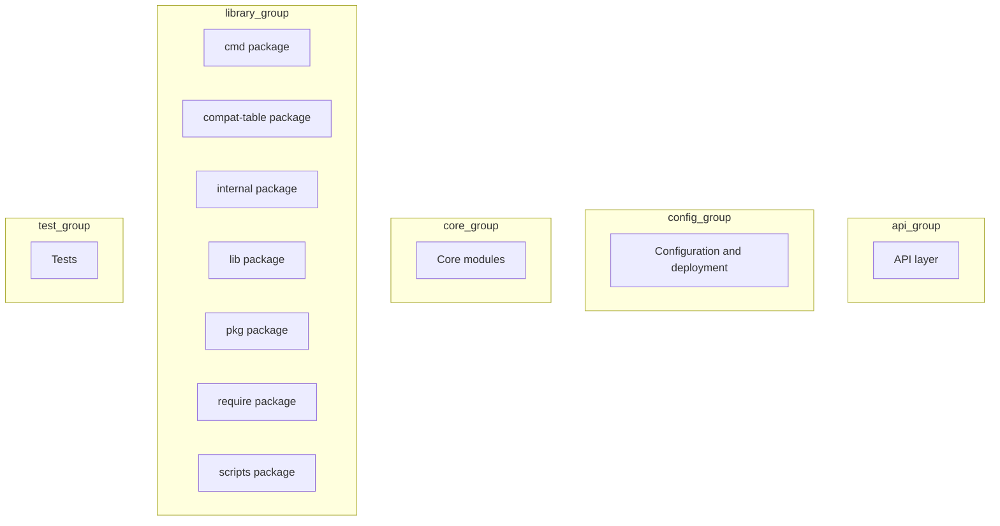

# Architecture report: evanw/esbuild

> Automated static analysis. **Observed** = directly seen in files/imports/AST; **Inferred** = interpretation from that evidence. Repository code was not executed.

## 1. Repository at a glance

| Item | Value |
| --- | --- |
| Repository | evanw/esbuild |
| Description | An extremely fast bundler for the web |
| Language | Go |
| Stars | 40133 |
| Licence | MIT |
| Analysed commit / branch | f6058f8364fe7ab91ca57a83e02577ed74c9cae4 / main |
| Framework(s) | React |
| Files analysed | 322 |
| Components | 11 |

## 2. Architecture in one minute

evanw/esbuild - An extremely fast bundler for the web. This repository was analysed statically from 322 file(s) (0 Python). Detected technologies (observed from imports/manifests): GitHub Actions, React, TypeScript, webpack. Files are grouped into 11 component(s): API layer, cmd package, compat-table package, Configuration and deployment, Core modules, internal package, lib package, pkg package. Findings below distinguish observed facts from inferred interpretation.

## 3. High-level block diagram

## 4. Main components

### API layer (`api_layer`)

- **Kind:** api
- **Status:** Observed
- **Confidence:** 0.85
- **Responsibility:** Groups 9 file(s) under api layer (observed from repository paths and static analysis).
- **Paths:** `pkg/api/api.go`, `pkg/api/api_impl.go`, `pkg/api/api_impl_test.go`, `pkg/api/api_js_table.go`, `pkg/api/api_test.go`, `pkg/api/favicon.go`, `pkg/api/serve_other.go`, `pkg/api/serve_wasm.go`, `pkg/api/watcher.go`
- **Evidence:** [pkg/api/api.go](https://github.com/evanw/esbuild/blob/f6058f8364fe7ab91ca57a83e02577ed74c9cae4/pkg/api/api.go); [pkg/api/api_impl.go](https://github.com/evanw/esbuild/blob/f6058f8364fe7ab91ca57a83e02577ed74c9cae4/pkg/api/api_impl.go); [pkg/api/api_impl_test.go](https://github.com/evanw/esbuild/blob/f6058f8364fe7ab91ca57a83e02577ed74c9cae4/pkg/api/api_impl_test.go); [pkg/api/api_js_table.go](https://github.com/evanw/esbuild/blob/f6058f8364fe7ab91ca57a83e02577ed74c9cae4/pkg/api/api_js_table.go); [pkg/api/api_test.go](https://github.com/evanw/esbuild/blob/f6058f8364fe7ab91ca57a83e02577ed74c9cae4/pkg/api/api_test.go); [pkg/api/favicon.go](https://github.com/evanw/esbuild/blob/f6058f8364fe7ab91ca57a83e02577ed74c9cae4/pkg/api/favicon.go); [pkg/api/serve_other.go](https://github.com/evanw/esbuild/blob/f6058f8364fe7ab91ca57a83e02577ed74c9cae4/pkg/api/serve_other.go); [pkg/api/serve_wasm.go](https://github.com/evanw/esbuild/blob/f6058f8364fe7ab91ca57a83e02577ed74c9cae4/pkg/api/serve_wasm.go)

### cmd package (`cmd`)

- **Kind:** library
- **Status:** Observed
- **Confidence:** 0.85
- **Responsibility:** Groups 7 file(s) under cmd package (observed from repository paths and static analysis).
- **Paths:** `cmd/esbuild/main.go`, `cmd/esbuild/main_other.go`, `cmd/esbuild/main_wasm.go`, `cmd/esbuild/service.go`, `cmd/esbuild/service_test.go`, `cmd/esbuild/stdio_protocol.go`, `cmd/esbuild/version.go`
- **Evidence:** [cmd/esbuild/main.go](https://github.com/evanw/esbuild/blob/f6058f8364fe7ab91ca57a83e02577ed74c9cae4/cmd/esbuild/main.go); [cmd/esbuild/main_other.go](https://github.com/evanw/esbuild/blob/f6058f8364fe7ab91ca57a83e02577ed74c9cae4/cmd/esbuild/main_other.go); [cmd/esbuild/main_wasm.go](https://github.com/evanw/esbuild/blob/f6058f8364fe7ab91ca57a83e02577ed74c9cae4/cmd/esbuild/main_wasm.go); [cmd/esbuild/service.go](https://github.com/evanw/esbuild/blob/f6058f8364fe7ab91ca57a83e02577ed74c9cae4/cmd/esbuild/service.go); [cmd/esbuild/service_test.go](https://github.com/evanw/esbuild/blob/f6058f8364fe7ab91ca57a83e02577ed74c9cae4/cmd/esbuild/service_test.go); [cmd/esbuild/stdio_protocol.go](https://github.com/evanw/esbuild/blob/f6058f8364fe7ab91ca57a83e02577ed74c9cae4/cmd/esbuild/stdio_protocol.go); [cmd/esbuild/version.go](https://github.com/evanw/esbuild/blob/f6058f8364fe7ab91ca57a83e02577ed74c9cae4/cmd/esbuild/version.go)

### compat-table package (`compat_table`)

- **Kind:** library
- **Status:** Observed
- **Confidence:** 0.85
- **Responsibility:** Groups 7 file(s) under compat-table package (observed from repository paths and static analysis).
- **Paths:** `compat-table/src/caniuse.ts`, `compat-table/src/compat-table.ts`, `compat-table/src/css_table.ts`, `compat-table/src/index.ts`, `compat-table/src/js_table.ts`, `compat-table/src/mdn.ts`, `compat-table/src/types.d.ts`
- **Evidence:** [compat-table/src/caniuse.ts](https://github.com/evanw/esbuild/blob/f6058f8364fe7ab91ca57a83e02577ed74c9cae4/compat-table/src/caniuse.ts); [compat-table/src/compat-table.ts](https://github.com/evanw/esbuild/blob/f6058f8364fe7ab91ca57a83e02577ed74c9cae4/compat-table/src/compat-table.ts); [compat-table/src/css_table.ts](https://github.com/evanw/esbuild/blob/f6058f8364fe7ab91ca57a83e02577ed74c9cae4/compat-table/src/css_table.ts); [compat-table/src/index.ts](https://github.com/evanw/esbuild/blob/f6058f8364fe7ab91ca57a83e02577ed74c9cae4/compat-table/src/index.ts); [compat-table/src/js_table.ts](https://github.com/evanw/esbuild/blob/f6058f8364fe7ab91ca57a83e02577ed74c9cae4/compat-table/src/js_table.ts); [compat-table/src/mdn.ts](https://github.com/evanw/esbuild/blob/f6058f8364fe7ab91ca57a83e02577ed74c9cae4/compat-table/src/mdn.ts); [compat-table/src/types.d.ts](https://github.com/evanw/esbuild/blob/f6058f8364fe7ab91ca57a83e02577ed74c9cae4/compat-table/src/types.d.ts)

### Configuration and deployment (`config`)

- **Kind:** config
- **Status:** Observed
- **Confidence:** 0.85
- **Responsibility:** Groups 49 file(s) under configuration and deployment (observed from repository paths and static analysis).
- **Paths:** `compat-table/package.json`, `compat-table/tsconfig.json`, `go.mod`, `internal/config/config.go`, `internal/config/globals.go`, `internal/resolver/testExpectations.json`, `lib/package.json`, `lib/tsconfig-deno.json`, `lib/tsconfig-nolib.json`, `lib/tsconfig.json`, `npm/@esbuild/aix-ppc64/package.json`, `npm/@esbuild/android-arm/package.json`, `npm/@esbuild/android-arm64/package.json`, `npm/@esbuild/android-x64/package.json`, `npm/@esbuild/darwin-arm64/package.json`, `npm/@esbuild/darwin-x64/package.json`, `npm/@esbuild/freebsd-arm64/package.json`, `npm/@esbuild/freebsd-x64/package.json`, `npm/@esbuild/linux-arm/package.json`, `npm/@esbuild/linux-arm64/package.json`, `npm/@esbuild/linux-ia32/package.json`, `npm/@esbuild/linux-loong64/package.json`, `npm/@esbuild/linux-mips64el/package.json`, `npm/@esbuild/linux-ppc64/package.json`, `npm/@esbuild/linux-riscv64/package.json`, `npm/@esbuild/linux-s390x/package.json`, `npm/@esbuild/linux-x64/package.json`, `npm/@esbuild/netbsd-arm64/package.json`, `npm/@esbuild/netbsd-x64/package.json`, `npm/@esbuild/openbsd-arm64/package.json`, `npm/@esbuild/openbsd-x64/package.json`, `npm/@esbuild/openharmony-arm64/package.json`, `npm/@esbuild/sunos-x64/package.json`, `npm/@esbuild/wasi-preview1/package.json`, `npm/@esbuild/win32-arm64/package.json`, `npm/@esbuild/win32-ia32/package.json`, `npm/@esbuild/win32-x64/package.json`, `npm/esbuild-wasm/package.json`, `npm/esbuild/package.json`, `require/old-ts/package.json`, `require/parcel2/package.json`, `require/rollup/package.json`, `require/webpack5/package.json`, `require/yarnpnp/foo/package.json`, `require/yarnpnp/package.json`, `require/yarnpnp/tsconfig.json`, `scripts/browser/package.json`, `scripts/package.json`, `scripts/tsconfig.json`
- **Evidence:** [compat-table/package.json](https://github.com/evanw/esbuild/blob/f6058f8364fe7ab91ca57a83e02577ed74c9cae4/compat-table/package.json); [compat-table/tsconfig.json](https://github.com/evanw/esbuild/blob/f6058f8364fe7ab91ca57a83e02577ed74c9cae4/compat-table/tsconfig.json); [go.mod](https://github.com/evanw/esbuild/blob/f6058f8364fe7ab91ca57a83e02577ed74c9cae4/go.mod); [internal/config/config.go](https://github.com/evanw/esbuild/blob/f6058f8364fe7ab91ca57a83e02577ed74c9cae4/internal/config/config.go); [internal/config/globals.go](https://github.com/evanw/esbuild/blob/f6058f8364fe7ab91ca57a83e02577ed74c9cae4/internal/config/globals.go); [internal/resolver/testExpectations.json](https://github.com/evanw/esbuild/blob/f6058f8364fe7ab91ca57a83e02577ed74c9cae4/internal/resolver/testExpectations.json); [lib/package.json](https://github.com/evanw/esbuild/blob/f6058f8364fe7ab91ca57a83e02577ed74c9cae4/lib/package.json); [lib/tsconfig-deno.json](https://github.com/evanw/esbuild/blob/f6058f8364fe7ab91ca57a83e02577ed74c9cae4/lib/tsconfig-deno.json)

### Core modules (`core`)

- **Kind:** core
- **Status:** Observed
- **Confidence:** 0.85
- **Responsibility:** Groups 1 file(s) under core modules (observed from repository paths and static analysis).
- **Paths:** `dl.sh`
- **Evidence:** [dl.sh](https://github.com/evanw/esbuild/blob/f6058f8364fe7ab91ca57a83e02577ed74c9cae4/dl.sh)

### internal package (`internal`)

- **Kind:** library
- **Status:** Observed
- **Confidence:** 0.85
- **Responsibility:** Groups 128 file(s) under internal package (observed from repository paths and static analysis).
- **Paths:** `internal/api_helpers/use_timer.go`, `internal/ast/ast.go`, `internal/bundler/bundler.go`, `internal/bundler_tests/bundler_css_test.go`, `internal/bundler_tests/bundler_dce_test.go`, `internal/bundler_tests/bundler_glob_test.go`, `internal/bundler_tests/bundler_importphase_test.go`, `internal/bundler_tests/bundler_importstar_test.go`, `internal/bundler_tests/bundler_importstar_ts_test.go`, `internal/bundler_tests/bundler_loader_test.go`, `internal/bundler_tests/bundler_lower_test.go`, `internal/bundler_tests/bundler_packagejson_test.go`, `internal/bundler_tests/bundler_splitting_test.go`, `internal/bundler_tests/bundler_test.go`, `internal/bundler_tests/bundler_ts_test.go`, `internal/bundler_tests/bundler_tsconfig_test.go`, `internal/bundler_tests/bundler_yarnpnp_test.go`, `internal/cache/cache.go`, `internal/cache/cache_ast.go`, `internal/cache/cache_fs.go`, `internal/cli_helpers/cli_helpers.go`, `internal/compat/compat.go`, `internal/compat/compat_test.go`, `internal/compat/css_table.go`, `internal/compat/js_table.go`, `internal/css_ast/css_ast.go`, `internal/css_ast/css_decl_table.go`, `internal/css_lexer/css_lexer.go`, `internal/css_lexer/css_lexer_test.go`, `internal/css_parser/css_color_spaces.go`, `internal/css_parser/css_decls.go`, `internal/css_parser/css_decls_animation.go`, `internal/css_parser/css_decls_border_radius.go`, `internal/css_parser/css_decls_box.go`, `internal/css_parser/css_decls_box_shadow.go`, `internal/css_parser/css_decls_color.go`, `internal/css_parser/css_decls_composes.go`, `internal/css_parser/css_decls_container.go`, `internal/css_parser/css_decls_font.go`, `internal/css_parser/css_decls_font_family.go`, `internal/css_parser/css_decls_font_weight.go`, `internal/css_parser/css_decls_gradient.go`, `internal/css_parser/css_decls_list_style.go`, `internal/css_parser/css_decls_transform.go`, `internal/css_parser/css_nesting.go`, `internal/css_parser/css_parser.go`, `internal/css_parser/css_parser_media.go`, `internal/css_parser/css_parser_selector.go`, `internal/css_parser/css_reduce_calc.go`, `internal/css_printer/css_printer.go`, `internal/css_printer/css_printer_test.go`, `internal/fs/error_other.go`, `internal/fs/error_wasm+windows.go`, `internal/fs/filepath.go`, `internal/fs/fs.go`, `internal/fs/fs_mock.go`, `internal/fs/fs_mock_test.go`, `internal/fs/fs_real.go`, `internal/fs/fs_zip.go`, `internal/fs/iswin_other.go`, `internal/fs/iswin_wasm.go`, `internal/fs/iswin_windows.go`, `internal/fs/modkey_other.go`, `internal/fs/modkey_unix.go`, `internal/graph/graph.go`, `internal/graph/input.go`, `internal/graph/meta.go`, `internal/helpers/bitset.go`, `internal/helpers/comment.go`, `internal/helpers/dataurl.go`, `internal/helpers/dataurl_test.go`, `internal/helpers/float.go`, `internal/helpers/glob.go`, `internal/helpers/hash.go`, `internal/helpers/joiner.go`, `internal/helpers/mime.go`, `internal/helpers/path.go`, `internal/helpers/quote.go`, `internal/helpers/serializer.go`, `internal/helpers/stack.go`, `internal/helpers/strings.go`, `internal/helpers/timer.go`, `internal/helpers/typos.go`, `internal/helpers/utf.go`, `internal/helpers/waitgroup.go`, `internal/js_ast/js_ast.go`, `internal/js_ast/js_ast_helpers.go`, `internal/js_ast/js_ast_test.go`, `internal/js_ast/js_ident.go`, `internal/js_ast/unicode.go`, `internal/js_lexer/js_lexer.go`, `internal/js_lexer/js_lexer_test.go`, `internal/js_lexer/tables.go`, `internal/js_parser/global_name_parser.go`, `internal/js_parser/js_parser_lower.go`, `internal/js_parser/js_parser_lower_class.go`, `internal/js_parser/js_parser_lower_test.go`, `internal/js_parser/json_parser.go`, `internal/js_parser/json_parser_test.go`, `internal/js_parser/sourcemap_parser.go`, `internal/js_parser/ts_parser.go`, `internal/js_parser/ts_parser_test.go`, `internal/js_printer/js_printer.go`, `internal/js_printer/js_printer_test.go`, `internal/linker/debug.go`, `internal/logger/logger.go`, `internal/logger/logger_darwin.go`, `internal/logger/logger_linux.go`, `internal/logger/logger_other.go`, `internal/logger/logger_test.go`, `internal/logger/logger_windows.go`, `internal/logger/msg_ids.go`, `internal/logger/style.go`, `internal/logger/style_clang.go`, `internal/logger/style_default.go`, `internal/logger/style_visualstudio.go`, `internal/renamer/renamer.go`, `internal/resolver/dataurl.go`, `internal/resolver/package_json.go`, `internal/resolver/resolver.go`, `internal/resolver/tsconfig_json.go`, `internal/resolver/yarnpnp.go`, `internal/resolver/yarnpnp_test.go`, `internal/runtime/runtime.go`, `internal/runtime/runtime_test.go`, `internal/sourcemap/sourcemap.go`, `internal/xxhash/xxhash.go`, `internal/xxhash/xxhash_other.go`
- **Evidence:** [internal/api_helpers/use_timer.go](https://github.com/evanw/esbuild/blob/f6058f8364fe7ab91ca57a83e02577ed74c9cae4/internal/api_helpers/use_timer.go); [internal/ast/ast.go](https://github.com/evanw/esbuild/blob/f6058f8364fe7ab91ca57a83e02577ed74c9cae4/internal/ast/ast.go); [internal/bundler/bundler.go](https://github.com/evanw/esbuild/blob/f6058f8364fe7ab91ca57a83e02577ed74c9cae4/internal/bundler/bundler.go); [internal/bundler_tests/bundler_css_test.go](https://github.com/evanw/esbuild/blob/f6058f8364fe7ab91ca57a83e02577ed74c9cae4/internal/bundler_tests/bundler_css_test.go); [internal/bundler_tests/bundler_dce_test.go](https://github.com/evanw/esbuild/blob/f6058f8364fe7ab91ca57a83e02577ed74c9cae4/internal/bundler_tests/bundler_dce_test.go); [internal/bundler_tests/bundler_glob_test.go](https://github.com/evanw/esbuild/blob/f6058f8364fe7ab91ca57a83e02577ed74c9cae4/internal/bundler_tests/bundler_glob_test.go); [internal/bundler_tests/bundler_importphase_test.go](https://github.com/evanw/esbuild/blob/f6058f8364fe7ab91ca57a83e02577ed74c9cae4/internal/bundler_tests/bundler_importphase_test.go); [internal/bundler_tests/bundler_importstar_test.go](https://github.com/evanw/esbuild/blob/f6058f8364fe7ab91ca57a83e02577ed74c9cae4/internal/bundler_tests/bundler_importstar_test.go)

### lib package (`lib`)

- **Kind:** library
- **Status:** Observed
- **Confidence:** 0.85
- **Responsibility:** Groups 10 file(s) under lib package (observed from repository paths and static analysis).
- **Paths:** `lib/npm/browser.ts`, `lib/npm/node-install.ts`, `lib/npm/node-platform.ts`, `lib/npm/node-shim.ts`, `lib/npm/node.ts`, `lib/shared/common.ts`, `lib/shared/stdio_protocol.ts`, `lib/shared/types.ts`, `lib/shared/uint8array_json_parser.ts`, `lib/shared/worker.ts`
- **Evidence:** [lib/npm/browser.ts](https://github.com/evanw/esbuild/blob/f6058f8364fe7ab91ca57a83e02577ed74c9cae4/lib/npm/browser.ts); [lib/npm/node-install.ts](https://github.com/evanw/esbuild/blob/f6058f8364fe7ab91ca57a83e02577ed74c9cae4/lib/npm/node-install.ts); [lib/npm/node-platform.ts](https://github.com/evanw/esbuild/blob/f6058f8364fe7ab91ca57a83e02577ed74c9cae4/lib/npm/node-platform.ts); [lib/npm/node-shim.ts](https://github.com/evanw/esbuild/blob/f6058f8364fe7ab91ca57a83e02577ed74c9cae4/lib/npm/node-shim.ts); [lib/npm/node.ts](https://github.com/evanw/esbuild/blob/f6058f8364fe7ab91ca57a83e02577ed74c9cae4/lib/npm/node.ts); [lib/shared/common.ts](https://github.com/evanw/esbuild/blob/f6058f8364fe7ab91ca57a83e02577ed74c9cae4/lib/shared/common.ts); [lib/shared/stdio_protocol.ts](https://github.com/evanw/esbuild/blob/f6058f8364fe7ab91ca57a83e02577ed74c9cae4/lib/shared/stdio_protocol.ts); [lib/shared/types.ts](https://github.com/evanw/esbuild/blob/f6058f8364fe7ab91ca57a83e02577ed74c9cae4/lib/shared/types.ts)

### pkg package (`pkg`)

- **Kind:** library
- **Status:** Observed
- **Confidence:** 0.85
- **Responsibility:** Groups 4 file(s) under pkg package (observed from repository paths and static analysis).
- **Paths:** `pkg/cli/cli.go`, `pkg/cli/cli_impl.go`, `pkg/cli/cli_js_table.go`, `pkg/cli/mangle_cache.go`
- **Evidence:** [pkg/cli/cli.go](https://github.com/evanw/esbuild/blob/f6058f8364fe7ab91ca57a83e02577ed74c9cae4/pkg/cli/cli.go); [pkg/cli/cli_impl.go](https://github.com/evanw/esbuild/blob/f6058f8364fe7ab91ca57a83e02577ed74c9cae4/pkg/cli/cli_impl.go); [pkg/cli/cli_js_table.go](https://github.com/evanw/esbuild/blob/f6058f8364fe7ab91ca57a83e02577ed74c9cae4/pkg/cli/cli_js_table.go); [pkg/cli/mangle_cache.go](https://github.com/evanw/esbuild/blob/f6058f8364fe7ab91ca57a83e02577ed74c9cae4/pkg/cli/mangle_cache.go)

### require package (`require`)

- **Kind:** library
- **Status:** Observed
- **Confidence:** 0.85
- **Responsibility:** Groups 3 file(s) under require package (observed from repository paths and static analysis).
- **Paths:** `require/yarnpnp/bar/index.js`, `require/yarnpnp/foo/index.js`, `require/yarnpnp/in.mjs`
- **Evidence:** [require/yarnpnp/bar/index.js](https://github.com/evanw/esbuild/blob/f6058f8364fe7ab91ca57a83e02577ed74c9cae4/require/yarnpnp/bar/index.js); [require/yarnpnp/foo/index.js](https://github.com/evanw/esbuild/blob/f6058f8364fe7ab91ca57a83e02577ed74c9cae4/require/yarnpnp/foo/index.js); [require/yarnpnp/in.mjs](https://github.com/evanw/esbuild/blob/f6058f8364fe7ab91ca57a83e02577ed74c9cae4/require/yarnpnp/in.mjs)

### scripts package (`scripts`)

- **Kind:** library
- **Status:** Observed
- **Confidence:** 0.85
- **Responsibility:** Groups 17 file(s) under scripts package (observed from repository paths and static analysis).
- **Paths:** `scripts/browser/browser-tests.js`, `scripts/decorator-tests.ts`, `scripts/destructuring-fuzzer.js`, `scripts/esbuild.js`, `scripts/gen-unicode-table.js`, `scripts/node-unref-tests.js`, `scripts/parse-ts-files.js`, `scripts/plugin-tests.js`, `scripts/register-test.js`, `scripts/terser-tests.js`, `scripts/test-yarnpnp.js`, `scripts/test262-async.js`, `scripts/test262.js`, `scripts/ts-type-tests.js`, `scripts/uglify-tests.js`, `scripts/verify-source-map.js`, `scripts/wasm-tests.js`
- **Evidence:** [scripts/browser/browser-tests.js](https://github.com/evanw/esbuild/blob/f6058f8364fe7ab91ca57a83e02577ed74c9cae4/scripts/browser/browser-tests.js); [scripts/decorator-tests.ts](https://github.com/evanw/esbuild/blob/f6058f8364fe7ab91ca57a83e02577ed74c9cae4/scripts/decorator-tests.ts); [scripts/destructuring-fuzzer.js](https://github.com/evanw/esbuild/blob/f6058f8364fe7ab91ca57a83e02577ed74c9cae4/scripts/destructuring-fuzzer.js); [scripts/esbuild.js](https://github.com/evanw/esbuild/blob/f6058f8364fe7ab91ca57a83e02577ed74c9cae4/scripts/esbuild.js); [scripts/gen-unicode-table.js](https://github.com/evanw/esbuild/blob/f6058f8364fe7ab91ca57a83e02577ed74c9cae4/scripts/gen-unicode-table.js); [scripts/node-unref-tests.js](https://github.com/evanw/esbuild/blob/f6058f8364fe7ab91ca57a83e02577ed74c9cae4/scripts/node-unref-tests.js); [scripts/parse-ts-files.js](https://github.com/evanw/esbuild/blob/f6058f8364fe7ab91ca57a83e02577ed74c9cae4/scripts/parse-ts-files.js); [scripts/plugin-tests.js](https://github.com/evanw/esbuild/blob/f6058f8364fe7ab91ca57a83e02577ed74c9cae4/scripts/plugin-tests.js)

### Tests (`tests`)

- **Kind:** test
- **Status:** Observed
- **Confidence:** 0.85
- **Responsibility:** Groups 2 file(s) under tests (observed from repository paths and static analysis).
- **Paths:** `internal/test/diff.go`, `internal/test/util.go`
- **Evidence:** [internal/test/diff.go](https://github.com/evanw/esbuild/blob/f6058f8364fe7ab91ca57a83e02577ed74c9cae4/internal/test/diff.go); [internal/test/util.go](https://github.com/evanw/esbuild/blob/f6058f8364fe7ab91ca57a83e02577ed74c9cae4/internal/test/util.go)

## 5. Execution flow

**Observed** entry point(s):

- [compat-table/src/index.ts](https://github.com/evanw/esbuild/blob/f6058f8364fe7ab91ca57a83e02577ed74c9cae4/compat-table/src/index.ts)
- [require/yarnpnp/bar/index.js](https://github.com/evanw/esbuild/blob/f6058f8364fe7ab91ca57a83e02577ed74c9cae4/require/yarnpnp/bar/index.js)
- [require/yarnpnp/foo/index.js](https://github.com/evanw/esbuild/blob/f6058f8364fe7ab91ca57a83e02577ed74c9cae4/require/yarnpnp/foo/index.js)

Representative flow (derived from observed entry points and the import graph; steps beyond the entry point are **Inferred**):

1. Execution starts at an observed entry point listed above, if present.
2. No internal import relationships between components were observed.

## 6. Project structure

### `(root)`

- `.editorconfig` - config (94 bytes)
- `.gitignore` - other (798 bytes)
- `CHANGELOG-2024.md` - docs (66456 bytes)
- `CHANGELOG-2025.md` - docs (69381 bytes)
- `CHANGELOG.md` - docs (29031 bytes)
- `LICENSE.md` - docs (1069 bytes)
- `Makefile` - other (57095 bytes)
- `README.md` - docs (2104 bytes)
- `RUNBOOK.md` - docs (3433 bytes)
- `dl.sh` - source, Shell (1249 bytes)
- `go.mod` - manifest (428 bytes)
- `go.sum` - other (207 bytes)
- `go.version` - other (7 bytes)
- `staticcheck.conf` - other (290 bytes)
- `version.txt` - docs (7 bytes)

### `.github`

- `.github/ISSUE_TEMPLATE/new-issue.md` - docs (586 bytes)
- `.github/workflows/ci.yml` - ci, YAML (7032 bytes)
- `.github/workflows/e2e.yml` - ci, YAML (950 bytes)
- `.github/workflows/publish.yml` - ci, YAML (2750 bytes)
- `.github/workflows/validate.yml` - ci, YAML (725 bytes)

### `cmd`

- `cmd/esbuild/main.go` - source, Go (17448 bytes)
- `cmd/esbuild/main_other.go` - source, Go (1268 bytes)
- `cmd/esbuild/main_wasm.go` - source, Go (807 bytes)
- `cmd/esbuild/service.go` - source, Go (42187 bytes)
- `cmd/esbuild/service_test.go` - source, Go (2715 bytes)
- `cmd/esbuild/stdio_protocol.go` - source, Go (4462 bytes)
- `cmd/esbuild/version.go` - source, Go (46 bytes)

### `compat-table`

- `compat-table/.gitignore` - other (28 bytes)
- `compat-table/README.md` - docs (283 bytes)
- `compat-table/package.json` - manifest (276 bytes)
- `compat-table/src/caniuse.ts` - source, TypeScript (4497 bytes)
- `compat-table/src/compat-table.ts` - source, TypeScript (7923 bytes)
- `compat-table/src/css_table.ts` - source, TypeScript (5456 bytes)
- `compat-table/src/index.ts` - source, TypeScript (20338 bytes)
- `compat-table/src/js_table.ts` - source, TypeScript (5035 bytes)
- `compat-table/src/mdn.ts` - source, TypeScript (11925 bytes)
- `compat-table/src/types.d.ts` - source, TypeScript (106 bytes)
- `compat-table/tsconfig.json` - config (161 bytes)

### `docs`

- `docs/architecture.md` - docs (33346 bytes)
- `docs/development.md` - docs (1488 bytes)

### `images`

- `images/benchmark-dark.svg` - other (2245 bytes)
- `images/benchmark-light.svg` - other (2050 bytes)
- `images/logo.svg` - other (241 bytes)
- `images/wordmark-dark.svg` - other (515 bytes)
- `images/wordmark-light.svg` - other (485 bytes)

### `internal`

- `internal/api_helpers/use_timer.go` - source, Go (346 bytes)
- `internal/ast/ast.go` - source, Go (23717 bytes)
- `internal/bundler/bundler.go` - source, Go (129760 bytes)
- `internal/bundler_tests/bundler_css_test.go` - source, Go (83798 bytes)
- `internal/bundler_tests/bundler_dce_test.go` - source, Go (133721 bytes)
- `internal/bundler_tests/bundler_glob_test.go` - source, Go (7391 bytes)
- `internal/bundler_tests/bundler_importphase_test.go` - source, Go (15546 bytes)
- `internal/bundler_tests/bundler_importstar_test.go` - source, Go (44125 bytes)
- `internal/bundler_tests/bundler_importstar_ts_test.go` - source, Go (10572 bytes)
- `internal/bundler_tests/bundler_loader_test.go` - source, Go (54096 bytes)
- `internal/bundler_tests/bundler_lower_test.go` - source, Go (80064 bytes)
- `internal/bundler_tests/bundler_packagejson_test.go` - source, Go (99549 bytes)
- `internal/bundler_tests/bundler_splitting_test.go` - source, Go (13860 bytes)
- `internal/bundler_tests/bundler_test.go` - source, Go (9880 bytes)
- `internal/bundler_tests/bundler_ts_test.go` - source, Go (72387 bytes)
- `internal/bundler_tests/bundler_tsconfig_test.go` - source, Go (72485 bytes)
- `internal/bundler_tests/bundler_yarnpnp_test.go` - source, Go (4815 bytes)
- `internal/bundler_tests/snapshots/snapshots_css.txt` - docs (58193 bytes)
- `internal/bundler_tests/snapshots/snapshots_dce.txt` - docs (73176 bytes)
- `internal/bundler_tests/snapshots/snapshots_default.txt` - docs (162546 bytes)
- `internal/bundler_tests/snapshots/snapshots_glob.txt` - docs (9477 bytes)
- `internal/bundler_tests/snapshots/snapshots_importphase.txt` - docs (1411 bytes)
- `internal/bundler_tests/snapshots/snapshots_importstar.txt` - docs (24269 bytes)
- `internal/bundler_tests/snapshots/snapshots_importstar_ts.txt` - docs (5850 bytes)
- `internal/bundler_tests/snapshots/snapshots_loader.txt` - docs (33232 bytes)
- `internal/bundler_tests/snapshots/snapshots_lower.txt` - docs (130579 bytes)
- `internal/bundler_tests/snapshots/snapshots_packagejson.txt` - docs (29902 bytes)
- `internal/bundler_tests/snapshots/snapshots_splitting.txt` - docs (11238 bytes)
- `internal/bundler_tests/snapshots/snapshots_ts.txt` - docs (47989 bytes)
- `internal/bundler_tests/snapshots/snapshots_tsconfig.txt` - docs (29236 bytes)
- `internal/bundler_tests/snapshots/snapshots_yarnpnp.txt` - docs (739 bytes)
- `internal/cache/cache.go` - source, Go (3660 bytes)
- `internal/cache/cache_ast.go` - source, Go (4642 bytes)
- `internal/cache/cache_fs.go` - source, Go (1330 bytes)
- `internal/cli_helpers/cli_helpers.go` - source, Go (1479 bytes)
- `internal/compat/compat.go` - source, Go (3663 bytes)
- `internal/compat/compat_test.go` - source, Go (4830 bytes)
- `internal/compat/css_table.go` - source, Go (15642 bytes)
- `internal/compat/js_table.go` - source, Go (36345 bytes)
- `internal/config/config.go` - source, Go (22108 bytes)
- `internal/config/globals.go` - source, Go (26353 bytes)
- `internal/css_ast/css_ast.go` - source, Go (42934 bytes)
- `internal/css_ast/css_decl_table.go` - source, Go (21498 bytes)
- `internal/css_lexer/css_lexer.go` - source, Go (25330 bytes)
- `internal/css_lexer/css_lexer_test.go` - source, Go (5412 bytes)
- `internal/css_parser/css_color_spaces.go` - source, Go (16212 bytes)
- `internal/css_parser/css_decls.go` - source, Go (17794 bytes)
- `internal/css_parser/css_decls_animation.go` - source, Go (3125 bytes)
- `internal/css_parser/css_decls_border_radius.go` - source, Go (6669 bytes)
- `internal/css_parser/css_decls_box.go` - source, Go (5643 bytes)
- `internal/css_parser/css_decls_box_shadow.go` - source, Go (2804 bytes)
- `internal/css_parser/css_decls_color.go` - source, Go (28216 bytes)
- `internal/css_parser/css_decls_composes.go` - source, Go (3017 bytes)
- `internal/css_parser/css_decls_container.go` - source, Go (1207 bytes)
- `internal/css_parser/css_decls_font.go` - source, Go (3792 bytes)
- `internal/css_parser/css_decls_font_family.go` - source, Go (4943 bytes)
- `internal/css_parser/css_decls_font_weight.go` - source, Go (459 bytes)
- `internal/css_parser/css_decls_gradient.go` - source, Go (28444 bytes)
- `internal/css_parser/css_decls_list_style.go` - source, Go (4743 bytes)
- `internal/css_parser/css_decls_transform.go` - source, Go (11704 bytes)
- `internal/css_parser/css_nesting.go` - source, Go (18320 bytes)
- `internal/css_parser/css_parser.go` - source, Go (77657 bytes)
- `internal/css_parser/css_parser_media.go` - source, Go (12822 bytes)
- `internal/css_parser/css_parser_selector.go` - source, Go (29659 bytes)
- `internal/css_parser/css_reduce_calc.go` - source, Go (18073 bytes)
- `internal/css_printer/css_printer.go` - source, Go (33747 bytes)
- `internal/css_printer/css_printer_test.go` - source, Go (24841 bytes)
- `internal/fs/error_other.go` - source, Go (151 bytes)
- `internal/fs/error_wasm+windows.go` - source, Go (537 bytes)
- `internal/fs/filepath.go` - source, Go (18251 bytes)
- `internal/fs/fs.go` - source, Go (8449 bytes)
- `internal/fs/fs_mock.go` - source, Go (6928 bytes)
- `internal/fs/fs_mock_test.go` - source, Go (6916 bytes)
- `internal/fs/fs_real.go` - source, Go (14465 bytes)
- `internal/fs/fs_zip.go` - source, Go (10621 bytes)
- `internal/fs/iswin_other.go` - source, Go (135 bytes)
- `internal/fs/iswin_wasm.go` - source, Go (507 bytes)
- `internal/fs/iswin_windows.go` - source, Go (94 bytes)
- `internal/fs/modkey_other.go` - source, Go (717 bytes)
- `internal/fs/modkey_unix.go` - source, Go (950 bytes)
- `internal/graph/graph.go` - source, Go (14557 bytes)
- `internal/graph/input.go` - source, Go (3876 bytes)
- `internal/graph/meta.go` - source, Go (8372 bytes)
- `internal/helpers/bitset.go` - source, Go (491 bytes)
- `internal/helpers/comment.go` - source, Go (493 bytes)
- `internal/helpers/dataurl.go` - source, Go (1760 bytes)
- `internal/helpers/dataurl_test.go` - source, Go (1432 bytes)
- `internal/helpers/float.go` - source, Go (3613 bytes)
- `internal/helpers/glob.go` - source, Go (1402 bytes)
- `internal/helpers/hash.go` - source, Go (391 bytes)
- `internal/helpers/joiner.go` - source, Go (1802 bytes)
- `internal/helpers/mime.go` - source, Go (1419 bytes)
- `internal/helpers/path.go` - source, Go (1775 bytes)
- `internal/helpers/quote.go` - source, Go (2917 bytes)
- `internal/helpers/serializer.go` - source, Go (458 bytes)
- `internal/helpers/stack.go` - source, Go (1103 bytes)
- `internal/helpers/strings.go` - source, Go (645 bytes)
- `internal/helpers/timer.go` - source, Go (1634 bytes)
- `internal/helpers/typos.go` - source, Go (903 bytes)
- `internal/helpers/utf.go` - source, Go (4913 bytes)
- `internal/helpers/waitgroup.go` - source, Go (980 bytes)
- `internal/js_ast/js_ast.go` - source, Go (50848 bytes)
- `internal/js_ast/js_ast_helpers.go` - source, Go (89329 bytes)
- `internal/js_ast/js_ast_test.go` - source, Go (1106 bytes)
- `internal/js_ast/js_ident.go` - source, Go (5756 bytes)
- `internal/js_ast/unicode.go` - source, Go (79483 bytes)
- `internal/js_lexer/js_lexer.go` - source, Go (66485 bytes)
- `internal/js_lexer/js_lexer_test.go` - source, Go (22842 bytes)
- `internal/js_lexer/tables.go` - source, Go (9934 bytes)
- `internal/js_parser/global_name_parser.go` - source, Go (1450 bytes)
- `internal/js_parser/js_parser_lower.go` - source, Go (74824 bytes)
- `internal/js_parser/js_parser_lower_class.go` - source, Go (99214 bytes)
- `internal/js_parser/js_parser_lower_test.go` - source, Go (56618 bytes)
- `internal/js_parser/json_parser.go` - source, Go (6580 bytes)
- `internal/js_parser/json_parser_test.go` - source, Go (9254 bytes)
- `internal/js_parser/sourcemap_parser.go` - source, Go (12958 bytes)
- `internal/js_parser/ts_parser.go` - source, Go (64482 bytes)
- `internal/js_parser/ts_parser_test.go` - source, Go (184424 bytes)
- `internal/js_printer/js_printer.go` - source, Go (135235 bytes)
- `internal/js_printer/js_printer_test.go` - source, Go (58170 bytes)
- `internal/linker/debug.go` - source, Go (4064 bytes)
- `internal/logger/logger.go` - source, Go (39598 bytes)
- `internal/logger/logger_darwin.go` - source, Go (664 bytes)
- `internal/logger/logger_linux.go` - source, Go (660 bytes)
- `internal/logger/logger_other.go` - source, Go (295 bytes)
- `internal/logger/logger_test.go` - source, Go (643 bytes)
- `internal/logger/logger_windows.go` - source, Go (4015 bytes)
- `internal/logger/msg_ids.go` - source, Go (15296 bytes)
- `internal/logger/style.go` - source, Go (6680 bytes)
- `internal/logger/style_clang.go` - source, Go (2247 bytes)
- `internal/logger/style_default.go` - source, Go (4826 bytes)
- `internal/logger/style_visualstudio.go` - source, Go (4274 bytes)
- `internal/renamer/renamer.go` - source, Go (20775 bytes)
- `internal/resolver/dataurl.go` - source, Go (1695 bytes)
- `internal/resolver/package_json.go` - source, Go (48798 bytes)
- `internal/resolver/resolver.go` - source, Go (112991 bytes)
- `internal/resolver/testExpectations.json` - config (9571 bytes)
- `internal/resolver/tsconfig_json.go` - source, Go (15300 bytes)
- `internal/resolver/yarnpnp.go` - source, Go (24924 bytes)
- `internal/resolver/yarnpnp_test.go` - source, Go (3298 bytes)
- `internal/runtime/runtime.go` - source, Go (24542 bytes)
- `internal/runtime/runtime_test.go` - source, Go (910 bytes)
- `internal/sourcemap/sourcemap.go` - source, Go (25258 bytes)
- `internal/test/diff.go` - test, Go (1908 bytes)
- `internal/test/util.go` - test, Go (860 bytes)
- `internal/xxhash/LICENSE.txt` - docs (1068 bytes)
- `internal/xxhash/README.md` - docs (76 bytes)
- `internal/xxhash/xxhash.go` - source, Go (5411 bytes)
- `internal/xxhash/xxhash_other.go` - source, Go (1516 bytes)

### `lib`

- `lib/README.md` - docs (276 bytes)
- `lib/npm/browser.ts` - source, TypeScript (7770 bytes)
- `lib/npm/node-install.ts` - source, TypeScript (14500 bytes)
- `lib/npm/node-platform.ts` - source, TypeScript (12914 bytes)
- `lib/npm/node-shim.ts` - source, TypeScript (347 bytes)
- `lib/npm/node.ts` - source, TypeScript (23124 bytes)
- `lib/package.json` - manifest (102 bytes)
- `lib/shared/common.ts` - source, TypeScript (78791 bytes)
- `lib/shared/stdio_protocol.ts` - source, TypeScript (10504 bytes)
- `lib/shared/types.ts` - source, TypeScript (23044 bytes)
- `lib/shared/uint8array_json_parser.ts` - source, TypeScript (9726 bytes)
- `lib/shared/worker.ts` - source, TypeScript (2946 bytes)
- `lib/tsconfig-deno.json` - config (324 bytes)
- `lib/tsconfig-nolib.json` - config (392 bytes)
- `lib/tsconfig.json` - config (255 bytes)

### `npm`

- `npm/@esbuild/aix-ppc64/README.md` - docs (151 bytes)
- `npm/@esbuild/aix-ppc64/package.json` - manifest (382 bytes)
- `npm/@esbuild/android-arm/README.md` - docs (116 bytes)
- `npm/@esbuild/android-arm/package.json` - manifest (364 bytes)
- `npm/@esbuild/android-arm64/README.md` - docs (147 bytes)
- `npm/@esbuild/android-arm64/package.json` - manifest (386 bytes)
- `npm/@esbuild/android-x64/README.md` - docs (116 bytes)
- `npm/@esbuild/android-x64/package.json` - manifest (364 bytes)
- `npm/@esbuild/darwin-arm64/README.md` - docs (145 bytes)
- `npm/@esbuild/darwin-arm64/package.json` - manifest (382 bytes)
- `npm/@esbuild/darwin-x64/README.md` - docs (141 bytes)
- `npm/@esbuild/darwin-x64/package.json` - manifest (374 bytes)
- `npm/@esbuild/freebsd-arm64/README.md` - docs (147 bytes)
- `npm/@esbuild/freebsd-arm64/package.json` - manifest (386 bytes)
- `npm/@esbuild/freebsd-x64/README.md` - docs (143 bytes)
- `npm/@esbuild/freebsd-x64/package.json` - manifest (378 bytes)
- `npm/@esbuild/linux-arm/README.md` - docs (138 bytes)
- `npm/@esbuild/linux-arm/package.json` - manifest (369 bytes)
- `npm/@esbuild/linux-arm64/README.md` - docs (145 bytes)
- `npm/@esbuild/linux-arm64/package.json` - manifest (380 bytes)
- `npm/@esbuild/linux-ia32/README.md` - docs (141 bytes)
- `npm/@esbuild/linux-ia32/package.json` - manifest (374 bytes)
- `npm/@esbuild/linux-loong64/README.md` - docs (151 bytes)
- `npm/@esbuild/linux-loong64/package.json` - manifest (390 bytes)
- `npm/@esbuild/linux-mips64el/README.md` - docs (160 bytes)
- `npm/@esbuild/linux-mips64el/package.json` - manifest (401 bytes)
- `npm/@esbuild/linux-ppc64/README.md` - docs (163 bytes)
- `npm/@esbuild/linux-ppc64/package.json` - manifest (398 bytes)
- `npm/@esbuild/linux-riscv64/README.md` - docs (148 bytes)
- `npm/@esbuild/linux-riscv64/package.json` - manifest (387 bytes)
- `npm/@esbuild/linux-s390x/README.md` - docs (158 bytes)
- `npm/@esbuild/linux-s390x/package.json` - manifest (393 bytes)
- `npm/@esbuild/linux-x64/README.md` - docs (141 bytes)
- `npm/@esbuild/linux-x64/package.json` - manifest (372 bytes)
- `npm/@esbuild/netbsd-arm64/README.md` - docs (408 bytes)
- `npm/@esbuild/netbsd-arm64/package.json` - manifest (383 bytes)
- `npm/@esbuild/netbsd-x64/README.md` - docs (403 bytes)
- `npm/@esbuild/netbsd-x64/package.json` - manifest (347 bytes)
- `npm/@esbuild/openbsd-arm64/README.md` - docs (147 bytes)
- `npm/@esbuild/openbsd-arm64/package.json` - manifest (386 bytes)
- `npm/@esbuild/openbsd-x64/README.md` - docs (143 bytes)
- `npm/@esbuild/openbsd-x64/package.json` - manifest (378 bytes)
- `npm/@esbuild/openharmony-arm64/README.md` - docs (122 bytes)
- `npm/@esbuild/openharmony-arm64/package.json` - manifest (382 bytes)
- `npm/@esbuild/sunos-x64/README.md` - docs (143 bytes)
- `npm/@esbuild/sunos-x64/package.json` - manifest (374 bytes)
- `npm/@esbuild/wasi-preview1/README.md` - docs (174 bytes)
- `npm/@esbuild/wasi-preview1/package.json` - manifest (290 bytes)
- `npm/@esbuild/win32-arm64/README.md` - docs (147 bytes)
- `npm/@esbuild/win32-arm64/package.json` - manifest (382 bytes)
- `npm/@esbuild/win32-ia32/README.md` - docs (143 bytes)
- `npm/@esbuild/win32-ia32/package.json` - manifest (376 bytes)
- `npm/@esbuild/win32-x64/README.md` - docs (143 bytes)
- `npm/@esbuild/win32-x64/package.json` - manifest (374 bytes)
- `npm/esbuild-wasm/LICENSE.md` - docs (1069 bytes)
- `npm/esbuild-wasm/README.md` - docs (226 bytes)
- `npm/esbuild-wasm/bin/esbuild` - other (3504 bytes)
- `npm/esbuild-wasm/package.json` - manifest (425 bytes)
- `npm/esbuild/LICENSE.md` - docs (1069 bytes)
- `npm/esbuild/README.md` - docs (175 bytes)
- `npm/esbuild/package.json` - manifest (3980 bytes)

### `pkg`

- `pkg/api/api.go` - source, Go (22821 bytes)
- `pkg/api/api_impl.go` - source, Go (82348 bytes)
- `pkg/api/api_impl_test.go` - source, Go (2014 bytes)
- `pkg/api/api_js_table.go` - source, Go (881 bytes)
- `pkg/api/api_test.go` - source, Go (8725 bytes)
- `pkg/api/favicon.go` - source, Go (2616 bytes)
- `pkg/api/serve_other.go` - source, Go (34293 bytes)
- `pkg/api/serve_wasm.go` - source, Go (448 bytes)
- `pkg/api/watcher.go` - source, Go (6444 bytes)
- `pkg/cli/cli.go` - source, Go (2994 bytes)
- `pkg/cli/cli_impl.go` - source, Go (49000 bytes)
- `pkg/cli/cli_js_table.go` - source, Go (479 bytes)
- `pkg/cli/mangle_cache.go` - source, Go (4558 bytes)

### `require`

- `require/old-ts/README.md` - docs (157 bytes)
- `require/old-ts/package.json` - manifest (54 bytes)
- `require/parcel2/.terserrc` - other (44 bytes)
- `require/parcel2/package.json` - manifest (78 bytes)
- `require/rollup/package.json` - manifest (88 bytes)
- `require/webpack5/package.json` - manifest (133 bytes)
- `require/yarnpnp/.gitignore` - other (24 bytes)
- `require/yarnpnp/bar/index.js` - source, JavaScript (37 bytes)
- `require/yarnpnp/foo/index.js` - source, JavaScript (21 bytes)
- `require/yarnpnp/foo/package.json` - manifest (40 bytes)
- `require/yarnpnp/in.mjs` - source, JavaScript (730 bytes)
- `require/yarnpnp/package.json` - manifest (308 bytes)
- `require/yarnpnp/tsconfig.json` - config (47 bytes)

### `scripts`

- `scripts/browser/browser-tests.js` - source, JavaScript (4695 bytes)
- `scripts/browser/index.html` - other (13664 bytes)
- `scripts/browser/package.json` - manifest (55 bytes)
- `scripts/dataurl-escapes.html` - other (2061 bytes)
- `scripts/decorator-tests.ts` - source, TypeScript (152930 bytes)
- `scripts/destructuring-fuzzer.js` - source, JavaScript (10378 bytes)
- `scripts/esbuild.js` - source, JavaScript (16220 bytes)
- `scripts/gen-unicode-table.js` - source, JavaScript (5910 bytes)
- `scripts/gradient-tests.css` - other (3114 bytes)
- `scripts/gradient-tests.html` - other (9693 bytes)
- `scripts/graph-debugger.html` - other (13451 bytes)
- `scripts/node-unref-tests.js` - source, JavaScript (3058 bytes)
- `scripts/package.json` - manifest (262 bytes)
- `scripts/parse-ts-files.js` - source, JavaScript (2051 bytes)
- `scripts/plugin-tests.js` - source, JavaScript (107841 bytes)
- `scripts/register-test.js` - source, JavaScript (3493 bytes)
- `scripts/terser-tests.js` - source, JavaScript (12158 bytes)
- `scripts/test-yarnpnp.js` - source, JavaScript (2896 bytes)
- `scripts/test262-async.js` - source, JavaScript (4351 bytes)
- `scripts/test262.js` - source, JavaScript (23631 bytes)
- `scripts/try.html` - other (11010 bytes)
- `scripts/ts-type-tests.js` - source, JavaScript (14672 bytes)
- `scripts/tsconfig.json` - config (106 bytes)
- `scripts/uglify-tests.js` - source, JavaScript (16382 bytes)
- `scripts/verify-source-map.js` - source, JavaScript (46397 bytes)
- `scripts/wasm-tests.js` - source, JavaScript (12019 bytes)

## 7. Key dependencies and integrations

| Name | Category | Status | Confidence | Evidence |
| --- | --- | --- | --- | --- |
| GitHub Actions | ci | Observed | 0.90 | [.github/workflows/ci.yml](https://github.com/evanw/esbuild/blob/f6058f8364fe7ab91ca57a83e02577ed74c9cae4/.github/workflows/ci.yml); [.github/workflows/e2e.yml](https://github.com/evanw/esbuild/blob/f6058f8364fe7ab91ca57a83e02577ed74c9cae4/.github/workflows/e2e.yml); [.github/workflows/publish.yml](https://github.com/evanw/esbuild/blob/f6058f8364fe7ab91ca57a83e02577ed74c9cae4/.github/workflows/publish.yml); [.github/workflows/validate.yml](https://github.com/evanw/esbuild/blob/f6058f8364fe7ab91ca57a83e02577ed74c9cae4/.github/workflows/validate.yml) |
| React | framework | Observed | 0.90 | [require/yarnpnp/package.json:12](https://github.com/evanw/esbuild/blob/f6058f8364fe7ab91ca57a83e02577ed74c9cae4/require/yarnpnp/package.json#L12); [require/yarnpnp/package.json:13](https://github.com/evanw/esbuild/blob/f6058f8364fe7ab91ca57a83e02577ed74c9cae4/require/yarnpnp/package.json#L13); [scripts/package.json:8](https://github.com/evanw/esbuild/blob/f6058f8364fe7ab91ca57a83e02577ed74c9cae4/scripts/package.json#L8) |
| TypeScript | tooling | Observed | 0.90 | [lib/package.json:5](https://github.com/evanw/esbuild/blob/f6058f8364fe7ab91ca57a83e02577ed74c9cae4/lib/package.json#L5); [require/old-ts/package.json:3](https://github.com/evanw/esbuild/blob/f6058f8364fe7ab91ca57a83e02577ed74c9cae4/require/old-ts/package.json#L3); [require/parcel2/package.json:4](https://github.com/evanw/esbuild/blob/f6058f8364fe7ab91ca57a83e02577ed74c9cae4/require/parcel2/package.json#L4); [require/webpack5/package.json:4](https://github.com/evanw/esbuild/blob/f6058f8364fe7ab91ca57a83e02577ed74c9cae4/require/webpack5/package.json#L4) |
| webpack | tooling | Observed | 0.85 | [require/webpack5/package.json:5](https://github.com/evanw/esbuild/blob/f6058f8364fe7ab91ca57a83e02577ed74c9cae4/require/webpack5/package.json#L5) |

## 8. Data and state

No database, cache, queue, or persistent-state usage was observed in the analysed files. State handling, if any, may be in-memory or in files that were not analysed.

## 9. Configuration and deployment clues

- `.editorconfig` (config)
- `.github/workflows/ci.yml` (ci)
- `.github/workflows/e2e.yml` (ci)
- `.github/workflows/publish.yml` (ci)
- `.github/workflows/validate.yml` (ci)
- `compat-table/package.json` (manifest)
- `compat-table/tsconfig.json` (config)
- `go.mod` (manifest)
- `internal/resolver/testExpectations.json` (config)
- `lib/package.json` (manifest)
- `lib/tsconfig-deno.json` (config)
- `lib/tsconfig-nolib.json` (config)
- `lib/tsconfig.json` (config)
- `npm/@esbuild/aix-ppc64/package.json` (manifest)
- `npm/@esbuild/android-arm/package.json` (manifest)
- `npm/@esbuild/android-arm64/package.json` (manifest)
- `npm/@esbuild/android-x64/package.json` (manifest)
- `npm/@esbuild/darwin-arm64/package.json` (manifest)
- `npm/@esbuild/darwin-x64/package.json` (manifest)
- `npm/@esbuild/freebsd-arm64/package.json` (manifest)
- `npm/@esbuild/freebsd-x64/package.json` (manifest)
- `npm/@esbuild/linux-arm/package.json` (manifest)
- `npm/@esbuild/linux-arm64/package.json` (manifest)
- `npm/@esbuild/linux-ia32/package.json` (manifest)
- `npm/@esbuild/linux-loong64/package.json` (manifest)
- `npm/@esbuild/linux-mips64el/package.json` (manifest)
- `npm/@esbuild/linux-ppc64/package.json` (manifest)
- `npm/@esbuild/linux-riscv64/package.json` (manifest)
- `npm/@esbuild/linux-s390x/package.json` (manifest)
- `npm/@esbuild/linux-x64/package.json` (manifest)
- `npm/@esbuild/netbsd-arm64/package.json` (manifest)
- `npm/@esbuild/netbsd-x64/package.json` (manifest)
- `npm/@esbuild/openbsd-arm64/package.json` (manifest)
- `npm/@esbuild/openbsd-x64/package.json` (manifest)
- `npm/@esbuild/openharmony-arm64/package.json` (manifest)
- `npm/@esbuild/sunos-x64/package.json` (manifest)
- `npm/@esbuild/wasi-preview1/package.json` (manifest)
- `npm/@esbuild/win32-arm64/package.json` (manifest)
- `npm/@esbuild/win32-ia32/package.json` (manifest)
- `npm/@esbuild/win32-x64/package.json` (manifest)
- `npm/esbuild-wasm/package.json` (manifest)
- `npm/esbuild/package.json` (manifest)
- `require/old-ts/package.json` (manifest)
- `require/parcel2/package.json` (manifest)
- `require/rollup/package.json` (manifest)
- `require/webpack5/package.json` (manifest)
- `require/yarnpnp/foo/package.json` (manifest)
- `require/yarnpnp/package.json` (manifest)
- `require/yarnpnp/tsconfig.json` (config)
- `scripts/browser/package.json` (manifest)
- `scripts/package.json` (manifest)
- `scripts/tsconfig.json` (config)

## 10. Design observations

- An entry/API layer is separated from other code (Inferred from paths and decorators).
- Tests are present alongside source code (Observed from test file paths).

These observations are interpretations (**Inferred**) of the observed structure, not guarantees about runtime design.

## 11. Limitations and unknowns

- Static analysis only: repository code was not executed, installed, or imported at runtime.
- Components and relationships are inferred from file paths, imports, and AST structure; runtime behaviour, dynamic imports, and reflection may not be visible.
- 9 file(s) were skipped during inventory (8 x lockfile excluded; 1 x vendored/generated directory excluded).
- No clear application entry point was observed in the analysed files.
- Repository text was treated as untrusted data; no instructions found in repository files were followed, and likely secret values were redacted/excluded.
- JavaScript and TypeScript files were inventoried from paths and package manifests. They were not parsed with a full language AST, and repository code was not executed.

## 12. Source references

- [.github/workflows/ci.yml](https://github.com/evanw/esbuild/blob/f6058f8364fe7ab91ca57a83e02577ed74c9cae4/.github/workflows/ci.yml)
- [.github/workflows/e2e.yml](https://github.com/evanw/esbuild/blob/f6058f8364fe7ab91ca57a83e02577ed74c9cae4/.github/workflows/e2e.yml)
- [.github/workflows/publish.yml](https://github.com/evanw/esbuild/blob/f6058f8364fe7ab91ca57a83e02577ed74c9cae4/.github/workflows/publish.yml)
- [.github/workflows/validate.yml](https://github.com/evanw/esbuild/blob/f6058f8364fe7ab91ca57a83e02577ed74c9cae4/.github/workflows/validate.yml)
- [cmd/esbuild/main.go](https://github.com/evanw/esbuild/blob/f6058f8364fe7ab91ca57a83e02577ed74c9cae4/cmd/esbuild/main.go)
- [cmd/esbuild/main_other.go](https://github.com/evanw/esbuild/blob/f6058f8364fe7ab91ca57a83e02577ed74c9cae4/cmd/esbuild/main_other.go)
- [cmd/esbuild/main_wasm.go](https://github.com/evanw/esbuild/blob/f6058f8364fe7ab91ca57a83e02577ed74c9cae4/cmd/esbuild/main_wasm.go)
- [cmd/esbuild/service.go](https://github.com/evanw/esbuild/blob/f6058f8364fe7ab91ca57a83e02577ed74c9cae4/cmd/esbuild/service.go)
- [cmd/esbuild/service_test.go](https://github.com/evanw/esbuild/blob/f6058f8364fe7ab91ca57a83e02577ed74c9cae4/cmd/esbuild/service_test.go)
- [cmd/esbuild/stdio_protocol.go](https://github.com/evanw/esbuild/blob/f6058f8364fe7ab91ca57a83e02577ed74c9cae4/cmd/esbuild/stdio_protocol.go)
- [cmd/esbuild/version.go](https://github.com/evanw/esbuild/blob/f6058f8364fe7ab91ca57a83e02577ed74c9cae4/cmd/esbuild/version.go)
- [compat-table/package.json](https://github.com/evanw/esbuild/blob/f6058f8364fe7ab91ca57a83e02577ed74c9cae4/compat-table/package.json)
- [compat-table/src/caniuse.ts](https://github.com/evanw/esbuild/blob/f6058f8364fe7ab91ca57a83e02577ed74c9cae4/compat-table/src/caniuse.ts)
- [compat-table/src/compat-table.ts](https://github.com/evanw/esbuild/blob/f6058f8364fe7ab91ca57a83e02577ed74c9cae4/compat-table/src/compat-table.ts)
- [compat-table/src/css_table.ts](https://github.com/evanw/esbuild/blob/f6058f8364fe7ab91ca57a83e02577ed74c9cae4/compat-table/src/css_table.ts)
- [compat-table/src/index.ts](https://github.com/evanw/esbuild/blob/f6058f8364fe7ab91ca57a83e02577ed74c9cae4/compat-table/src/index.ts)
- [compat-table/src/js_table.ts](https://github.com/evanw/esbuild/blob/f6058f8364fe7ab91ca57a83e02577ed74c9cae4/compat-table/src/js_table.ts)
- [compat-table/src/mdn.ts](https://github.com/evanw/esbuild/blob/f6058f8364fe7ab91ca57a83e02577ed74c9cae4/compat-table/src/mdn.ts)
- [compat-table/src/types.d.ts](https://github.com/evanw/esbuild/blob/f6058f8364fe7ab91ca57a83e02577ed74c9cae4/compat-table/src/types.d.ts)
- [compat-table/tsconfig.json](https://github.com/evanw/esbuild/blob/f6058f8364fe7ab91ca57a83e02577ed74c9cae4/compat-table/tsconfig.json)
- [dl.sh](https://github.com/evanw/esbuild/blob/f6058f8364fe7ab91ca57a83e02577ed74c9cae4/dl.sh)
- [go.mod](https://github.com/evanw/esbuild/blob/f6058f8364fe7ab91ca57a83e02577ed74c9cae4/go.mod)
- [internal/api_helpers/use_timer.go](https://github.com/evanw/esbuild/blob/f6058f8364fe7ab91ca57a83e02577ed74c9cae4/internal/api_helpers/use_timer.go)
- [internal/ast/ast.go](https://github.com/evanw/esbuild/blob/f6058f8364fe7ab91ca57a83e02577ed74c9cae4/internal/ast/ast.go)
- [internal/bundler/bundler.go](https://github.com/evanw/esbuild/blob/f6058f8364fe7ab91ca57a83e02577ed74c9cae4/internal/bundler/bundler.go)
- [internal/bundler_tests/bundler_css_test.go](https://github.com/evanw/esbuild/blob/f6058f8364fe7ab91ca57a83e02577ed74c9cae4/internal/bundler_tests/bundler_css_test.go)
- [internal/bundler_tests/bundler_dce_test.go](https://github.com/evanw/esbuild/blob/f6058f8364fe7ab91ca57a83e02577ed74c9cae4/internal/bundler_tests/bundler_dce_test.go)
- [internal/bundler_tests/bundler_glob_test.go](https://github.com/evanw/esbuild/blob/f6058f8364fe7ab91ca57a83e02577ed74c9cae4/internal/bundler_tests/bundler_glob_test.go)
- [internal/bundler_tests/bundler_importphase_test.go](https://github.com/evanw/esbuild/blob/f6058f8364fe7ab91ca57a83e02577ed74c9cae4/internal/bundler_tests/bundler_importphase_test.go)
- [internal/bundler_tests/bundler_importstar_test.go](https://github.com/evanw/esbuild/blob/f6058f8364fe7ab91ca57a83e02577ed74c9cae4/internal/bundler_tests/bundler_importstar_test.go)
- [internal/config/config.go](https://github.com/evanw/esbuild/blob/f6058f8364fe7ab91ca57a83e02577ed74c9cae4/internal/config/config.go)
- [internal/config/globals.go](https://github.com/evanw/esbuild/blob/f6058f8364fe7ab91ca57a83e02577ed74c9cae4/internal/config/globals.go)
- [internal/resolver/testExpectations.json](https://github.com/evanw/esbuild/blob/f6058f8364fe7ab91ca57a83e02577ed74c9cae4/internal/resolver/testExpectations.json)
- [internal/test/diff.go](https://github.com/evanw/esbuild/blob/f6058f8364fe7ab91ca57a83e02577ed74c9cae4/internal/test/diff.go)
- [internal/test/util.go](https://github.com/evanw/esbuild/blob/f6058f8364fe7ab91ca57a83e02577ed74c9cae4/internal/test/util.go)
- [lib/npm/browser.ts](https://github.com/evanw/esbuild/blob/f6058f8364fe7ab91ca57a83e02577ed74c9cae4/lib/npm/browser.ts)
- [lib/npm/node-install.ts](https://github.com/evanw/esbuild/blob/f6058f8364fe7ab91ca57a83e02577ed74c9cae4/lib/npm/node-install.ts)
- [lib/npm/node-platform.ts](https://github.com/evanw/esbuild/blob/f6058f8364fe7ab91ca57a83e02577ed74c9cae4/lib/npm/node-platform.ts)
- [lib/npm/node-shim.ts](https://github.com/evanw/esbuild/blob/f6058f8364fe7ab91ca57a83e02577ed74c9cae4/lib/npm/node-shim.ts)
- [lib/npm/node.ts](https://github.com/evanw/esbuild/blob/f6058f8364fe7ab91ca57a83e02577ed74c9cae4/lib/npm/node.ts)
- [lib/package.json](https://github.com/evanw/esbuild/blob/f6058f8364fe7ab91ca57a83e02577ed74c9cae4/lib/package.json)
- [lib/package.json:5](https://github.com/evanw/esbuild/blob/f6058f8364fe7ab91ca57a83e02577ed74c9cae4/lib/package.json#L5)
- [lib/shared/common.ts](https://github.com/evanw/esbuild/blob/f6058f8364fe7ab91ca57a83e02577ed74c9cae4/lib/shared/common.ts)
- [lib/shared/stdio_protocol.ts](https://github.com/evanw/esbuild/blob/f6058f8364fe7ab91ca57a83e02577ed74c9cae4/lib/shared/stdio_protocol.ts)
- [lib/shared/types.ts](https://github.com/evanw/esbuild/blob/f6058f8364fe7ab91ca57a83e02577ed74c9cae4/lib/shared/types.ts)
- [lib/tsconfig-deno.json](https://github.com/evanw/esbuild/blob/f6058f8364fe7ab91ca57a83e02577ed74c9cae4/lib/tsconfig-deno.json)
- [pkg/api/api.go](https://github.com/evanw/esbuild/blob/f6058f8364fe7ab91ca57a83e02577ed74c9cae4/pkg/api/api.go)
- [pkg/api/api_impl.go](https://github.com/evanw/esbuild/blob/f6058f8364fe7ab91ca57a83e02577ed74c9cae4/pkg/api/api_impl.go)
- [pkg/api/api_impl_test.go](https://github.com/evanw/esbuild/blob/f6058f8364fe7ab91ca57a83e02577ed74c9cae4/pkg/api/api_impl_test.go)
- [pkg/api/api_js_table.go](https://github.com/evanw/esbuild/blob/f6058f8364fe7ab91ca57a83e02577ed74c9cae4/pkg/api/api_js_table.go)
- [pkg/api/api_test.go](https://github.com/evanw/esbuild/blob/f6058f8364fe7ab91ca57a83e02577ed74c9cae4/pkg/api/api_test.go)
- [pkg/api/favicon.go](https://github.com/evanw/esbuild/blob/f6058f8364fe7ab91ca57a83e02577ed74c9cae4/pkg/api/favicon.go)
- [pkg/api/serve_other.go](https://github.com/evanw/esbuild/blob/f6058f8364fe7ab91ca57a83e02577ed74c9cae4/pkg/api/serve_other.go)
- [pkg/api/serve_wasm.go](https://github.com/evanw/esbuild/blob/f6058f8364fe7ab91ca57a83e02577ed74c9cae4/pkg/api/serve_wasm.go)
- [pkg/cli/cli.go](https://github.com/evanw/esbuild/blob/f6058f8364fe7ab91ca57a83e02577ed74c9cae4/pkg/cli/cli.go)
- [pkg/cli/cli_impl.go](https://github.com/evanw/esbuild/blob/f6058f8364fe7ab91ca57a83e02577ed74c9cae4/pkg/cli/cli_impl.go)
- [pkg/cli/cli_js_table.go](https://github.com/evanw/esbuild/blob/f6058f8364fe7ab91ca57a83e02577ed74c9cae4/pkg/cli/cli_js_table.go)
- [pkg/cli/mangle_cache.go](https://github.com/evanw/esbuild/blob/f6058f8364fe7ab91ca57a83e02577ed74c9cae4/pkg/cli/mangle_cache.go)
- [require/old-ts/package.json:3](https://github.com/evanw/esbuild/blob/f6058f8364fe7ab91ca57a83e02577ed74c9cae4/require/old-ts/package.json#L3)
- [require/parcel2/package.json:4](https://github.com/evanw/esbuild/blob/f6058f8364fe7ab91ca57a83e02577ed74c9cae4/require/parcel2/package.json#L4)
- [require/webpack5/package.json:4](https://github.com/evanw/esbuild/blob/f6058f8364fe7ab91ca57a83e02577ed74c9cae4/require/webpack5/package.json#L4)
- [require/webpack5/package.json:5](https://github.com/evanw/esbuild/blob/f6058f8364fe7ab91ca57a83e02577ed74c9cae4/require/webpack5/package.json#L5)
- [require/yarnpnp/bar/index.js](https://github.com/evanw/esbuild/blob/f6058f8364fe7ab91ca57a83e02577ed74c9cae4/require/yarnpnp/bar/index.js)
- [require/yarnpnp/foo/index.js](https://github.com/evanw/esbuild/blob/f6058f8364fe7ab91ca57a83e02577ed74c9cae4/require/yarnpnp/foo/index.js)
- [require/yarnpnp/in.mjs](https://github.com/evanw/esbuild/blob/f6058f8364fe7ab91ca57a83e02577ed74c9cae4/require/yarnpnp/in.mjs)
- [require/yarnpnp/package.json:12](https://github.com/evanw/esbuild/blob/f6058f8364fe7ab91ca57a83e02577ed74c9cae4/require/yarnpnp/package.json#L12)
- [require/yarnpnp/package.json:13](https://github.com/evanw/esbuild/blob/f6058f8364fe7ab91ca57a83e02577ed74c9cae4/require/yarnpnp/package.json#L13)
- [scripts/browser/browser-tests.js](https://github.com/evanw/esbuild/blob/f6058f8364fe7ab91ca57a83e02577ed74c9cae4/scripts/browser/browser-tests.js)
- [scripts/decorator-tests.ts](https://github.com/evanw/esbuild/blob/f6058f8364fe7ab91ca57a83e02577ed74c9cae4/scripts/decorator-tests.ts)
- [scripts/destructuring-fuzzer.js](https://github.com/evanw/esbuild/blob/f6058f8364fe7ab91ca57a83e02577ed74c9cae4/scripts/destructuring-fuzzer.js)
- [scripts/esbuild.js](https://github.com/evanw/esbuild/blob/f6058f8364fe7ab91ca57a83e02577ed74c9cae4/scripts/esbuild.js)
- [scripts/gen-unicode-table.js](https://github.com/evanw/esbuild/blob/f6058f8364fe7ab91ca57a83e02577ed74c9cae4/scripts/gen-unicode-table.js)
- [scripts/node-unref-tests.js](https://github.com/evanw/esbuild/blob/f6058f8364fe7ab91ca57a83e02577ed74c9cae4/scripts/node-unref-tests.js)
- [scripts/package.json:8](https://github.com/evanw/esbuild/blob/f6058f8364fe7ab91ca57a83e02577ed74c9cae4/scripts/package.json#L8)
- [scripts/package.json:10](https://github.com/evanw/esbuild/blob/f6058f8364fe7ab91ca57a83e02577ed74c9cae4/scripts/package.json#L10)
- [scripts/parse-ts-files.js](https://github.com/evanw/esbuild/blob/f6058f8364fe7ab91ca57a83e02577ed74c9cae4/scripts/parse-ts-files.js)
- [scripts/plugin-tests.js](https://github.com/evanw/esbuild/blob/f6058f8364fe7ab91ca57a83e02577ed74c9cae4/scripts/plugin-tests.js)
