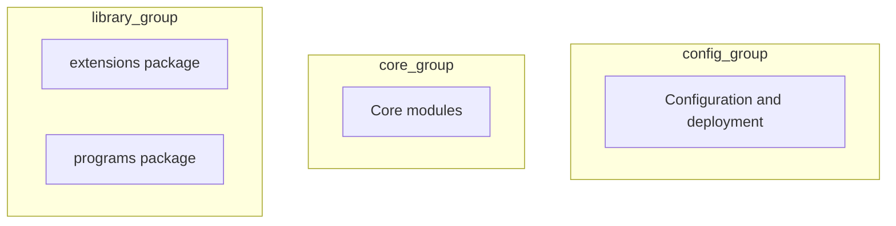

# Architecture report: extension-js/extension.js

> Automated static analysis. **Observed** = directly seen in files/imports/AST; **Inferred** = interpretation from that evidence. Repository code was not executed.

## 1. Repository at a glance

| Item | Value |
| --- | --- |
| Repository | extension-js/extension.js |
| Description | The cross-browser extension framework. |
| Language | TypeScript |
| Stars | 5211 |
| Licence | MIT |
| Analysed commit / branch | 2dac0905f63bfe36ecd265cac6f20ec74338ca2e / main |
| Framework(s) | React, Svelte, Vue |
| Files analysed | 799 |
| Components | 4 |

## 2. Architecture in one minute

extension-js/extension.js - The cross-browser extension framework.. This repository was analysed statically from 799 file(s) (0 Python). Detected technologies (observed from imports/manifests): GitHub Actions, React, Svelte, Vue, axios, Tailwind CSS. Files are grouped into 4 component(s): Configuration and deployment, Core modules, extensions package, programs package. Findings below distinguish observed facts from inferred interpretation.

## 3. High-level block diagram

## 4. Main components

### Configuration and deployment (`config`)

- **Kind:** config
- **Status:** Observed
- **Confidence:** 0.85
- **Responsibility:** Groups 17 file(s) under configuration and deployment (observed from repository paths and static analysis).
- **Paths:** `biome.json`, `context7.json`, `extensions/extension-js-devtools/package.json`, `extensions/extension-js-devtools/public/extension-js-session.json`, `extensions/extension-js-devtools/src/manifest.json`, `extensions/extension-js-devtools/tsconfig.json`, `extensions/extension-js-theme/manifest.json`, `extensions/extension-js-theme/package.json`, `package.json`, `pnpm-workspace.yaml`, `programs/create/package.json`, `programs/create/templates/javascript/.mcp.json`, `programs/create/templates/javascript/package.json`, `programs/create/templates/javascript/src/manifest.json`, `programs/create/tsconfig.json`, `programs/develop/package.json`, `programs/develop/plugin-perf-budgets/package.json`
- **Evidence:** [biome.json](https://github.com/extension-js/extension.js/blob/2dac0905f63bfe36ecd265cac6f20ec74338ca2e/biome.json); [context7.json](https://github.com/extension-js/extension.js/blob/2dac0905f63bfe36ecd265cac6f20ec74338ca2e/context7.json); [extensions/extension-js-devtools/package.json](https://github.com/extension-js/extension.js/blob/2dac0905f63bfe36ecd265cac6f20ec74338ca2e/extensions/extension-js-devtools/package.json); [extensions/extension-js-devtools/public/extension-js-session.json](https://github.com/extension-js/extension.js/blob/2dac0905f63bfe36ecd265cac6f20ec74338ca2e/extensions/extension-js-devtools/public/extension-js-session.json); [extensions/extension-js-devtools/src/manifest.json](https://github.com/extension-js/extension.js/blob/2dac0905f63bfe36ecd265cac6f20ec74338ca2e/extensions/extension-js-devtools/src/manifest.json); [extensions/extension-js-devtools/tsconfig.json](https://github.com/extension-js/extension.js/blob/2dac0905f63bfe36ecd265cac6f20ec74338ca2e/extensions/extension-js-devtools/tsconfig.json); [extensions/extension-js-theme/manifest.json](https://github.com/extension-js/extension.js/blob/2dac0905f63bfe36ecd265cac6f20ec74338ca2e/extensions/extension-js-theme/manifest.json); [extensions/extension-js-theme/package.json](https://github.com/extension-js/extension.js/blob/2dac0905f63bfe36ecd265cac6f20ec74338ca2e/extensions/extension-js-theme/package.json)

### Core modules (`core`)

- **Kind:** core
- **Status:** Observed
- **Confidence:** 0.85
- **Responsibility:** Groups 2 file(s) under core modules (observed from repository paths and static analysis).
- **Paths:** `eslint.config.mjs`, `playwright.config.ts`
- **Evidence:** [eslint.config.mjs](https://github.com/extension-js/extension.js/blob/2dac0905f63bfe36ecd265cac6f20ec74338ca2e/eslint.config.mjs); [playwright.config.ts](https://github.com/extension-js/extension.js/blob/2dac0905f63bfe36ecd265cac6f20ec74338ca2e/playwright.config.ts)

### extensions package (`extensions`)

- **Kind:** library
- **Status:** Observed
- **Confidence:** 0.85
- **Responsibility:** Groups 11 file(s) under extensions package (observed from repository paths and static analysis).
- **Paths:** `extensions/extension-js-devtools/pages/welcome/scripts.ts`, `extensions/extension-js-devtools/postcss.config.js`, `extensions/extension-js-devtools/src/background/define-initial-tab.ts`, `extensions/extension-js-devtools/src/background/index.ts`, `extensions/extension-js-devtools/src/background/manager-ui.ts`, `extensions/extension-js-devtools/src/background/session-flags.ts`, `extensions/extension-js-devtools/src/background/start-pages.ts`, `extensions/extension-js-devtools/src/images/logo.png.d.ts`, `extensions/extension-js-devtools/src/lib/utils.ts`, `extensions/extension-js-devtools/src/styles.d.css.ts`, `extensions/extension-js-devtools/src/types/assets.d.ts`
- **Evidence:** [extensions/extension-js-devtools/pages/welcome/scripts.ts](https://github.com/extension-js/extension.js/blob/2dac0905f63bfe36ecd265cac6f20ec74338ca2e/extensions/extension-js-devtools/pages/welcome/scripts.ts); [extensions/extension-js-devtools/postcss.config.js](https://github.com/extension-js/extension.js/blob/2dac0905f63bfe36ecd265cac6f20ec74338ca2e/extensions/extension-js-devtools/postcss.config.js); [extensions/extension-js-devtools/src/background/define-initial-tab.ts](https://github.com/extension-js/extension.js/blob/2dac0905f63bfe36ecd265cac6f20ec74338ca2e/extensions/extension-js-devtools/src/background/define-initial-tab.ts); [extensions/extension-js-devtools/src/background/index.ts](https://github.com/extension-js/extension.js/blob/2dac0905f63bfe36ecd265cac6f20ec74338ca2e/extensions/extension-js-devtools/src/background/index.ts); [extensions/extension-js-devtools/src/background/manager-ui.ts](https://github.com/extension-js/extension.js/blob/2dac0905f63bfe36ecd265cac6f20ec74338ca2e/extensions/extension-js-devtools/src/background/manager-ui.ts); [extensions/extension-js-devtools/src/background/session-flags.ts](https://github.com/extension-js/extension.js/blob/2dac0905f63bfe36ecd265cac6f20ec74338ca2e/extensions/extension-js-devtools/src/background/session-flags.ts); [extensions/extension-js-devtools/src/background/start-pages.ts](https://github.com/extension-js/extension.js/blob/2dac0905f63bfe36ecd265cac6f20ec74338ca2e/extensions/extension-js-devtools/src/background/start-pages.ts); [extensions/extension-js-devtools/src/images/logo.png.d.ts](https://github.com/extension-js/extension.js/blob/2dac0905f63bfe36ecd265cac6f20ec74338ca2e/extensions/extension-js-devtools/src/images/logo.png.d.ts)

### programs package (`programs`)

- **Kind:** library
- **Status:** Observed
- **Confidence:** 0.85
- **Responsibility:** Groups 696 file(s) under programs package (observed from repository paths and static analysis).
- **Paths:** `programs/create/__spec__/bundled-template-store-payload.spec.ts`, `programs/create/__spec__/create-failure-cleanup.spec.ts`, `programs/create/__spec__/create-install-order.spec.ts`, `programs/create/__spec__/create-into-existing-repo.spec.ts`, `programs/create/__spec__/default-scaffold-identity.spec.ts`, `programs/create/__spec__/examples-catalog-fixture.ts`, `programs/create/__spec__/examples-catalog.remote.spec.ts`, `programs/create/__spec__/failed-import-keeps-owner-files.spec.ts`, `programs/create/__spec__/forbid-network.ts`, `programs/create/__spec__/install-internal-deps.spec.ts`, `programs/create/__spec__/offline-registry-fixture.ts`, `programs/create/__spec__/package-manager-identity.spec.ts`, `programs/create/__spec__/package-manager-readme.spec.ts`, `programs/create/__spec__/package-manager-result.spec.ts`, `programs/create/create.spec.ts`, `programs/create/lib/__spec__/corepack-registry.spec.ts`, `programs/create/lib/__spec__/deno-manifest.spec.ts`, `programs/create/lib/__spec__/deno-next-steps.spec.ts`, `programs/create/lib/__spec__/install-runner.real.spec.ts`, `programs/create/lib/__spec__/install-runner.spec.ts`, `programs/create/lib/__spec__/messages-catalog.spec.ts`, `programs/create/lib/__spec__/next-steps-paths.spec.ts`, `programs/create/lib/__spec__/package-manager-probe.spec.ts`, `programs/create/lib/__spec__/project-name.spec.ts`, `programs/create/lib/__spec__/runtime-package-manager.spec.ts`, `programs/create/lib/__spec__/using-template-message.spec.ts`, `programs/create/lib/corepack-registry.ts`, `programs/create/lib/deno-manifest.ts`, `programs/create/lib/find-manifest-json.ts`, `programs/create/lib/git-identity.ts`, `programs/create/lib/install-runner.ts`, `programs/create/lib/messages.ts`, `programs/create/lib/messaging.ts`, `programs/create/lib/package-manager.ts`, `programs/create/lib/project-name.ts`, `programs/create/lib/utils.ts`, `programs/create/module.ts`, `programs/create/rslib.config.ts`, `programs/create/steps/__spec__/create-directory-conflict-frame.spec.ts`, `programs/create/steps/__spec__/create-failure-frames.spec.ts`, `programs/create/steps/__spec__/generate-extension-types.spec.ts`, `programs/create/steps/__spec__/import-external-template.cleanup.spec.ts`, `programs/create/steps/__spec__/import-external-template.codeload.spec.ts`, `programs/create/steps/__spec__/import-external-template.http.spec.ts`, `programs/create/steps/__spec__/import-external-template.init-alias.spec.ts`, `programs/create/steps/__spec__/import-external-template.local-directory.spec.ts`, `programs/create/steps/__spec__/import-external-template.lockfiles.spec.ts`, `programs/create/steps/__spec__/import-external-template.offline-fallback.spec.ts`, `programs/create/steps/__spec__/import-external-template.scaffolding.spec.ts`, `programs/create/steps/__spec__/initialize-git-repository.spec.ts`, `programs/create/steps/__spec__/install-dependencies.spec.ts`, `programs/create/steps/__spec__/scaffold-skips-build-output.spec.ts`, `programs/create/steps/__spec__/scaffold-type-definitions.spec.ts`, `programs/create/steps/__spec__/template-links-stay-inside.spec.ts`, `programs/create/steps/__spec__/write-deno-jsonc.spec.ts`, `programs/create/steps/__spec__/write-gitignore.spec.ts`, `programs/create/steps/__spec__/write-manifest-json.spec.ts`, `programs/create/steps/__spec__/write-package-json.spec.ts`, `programs/create/steps/__spec__/write-readme-file.spec.ts`, `programs/create/steps/__spec__/write-store-metadata.spec.ts`, `programs/create/steps/__spec__/write-template-provenance.spec.ts`, `programs/create/steps/create-directory.ts`, `programs/create/steps/generate-extension-types.ts`, `programs/create/steps/import-external-template.ts`, `programs/create/steps/initialize-git-repository.ts`, `programs/create/steps/install-dependencies.ts`, `programs/create/steps/install-internal-deps.ts`, `programs/create/steps/setup-built-in-tests.ts`, `programs/create/steps/write-deno-jsonc.ts`, `programs/create/steps/write-gitignore.ts`, `programs/create/steps/write-manifest-json.ts`, `programs/create/steps/write-package-json.ts`, `programs/create/steps/write-readme-file.ts`, `programs/create/steps/write-store-metadata.ts`, `programs/create/steps/write-template-provenance.ts`, `programs/create/templates/javascript/extension.config.js`, `programs/create/templates/javascript/src/background.js`, `programs/create/templates/javascript/src/content/ContentApp.js`, `programs/create/templates/javascript/src/content/scripts.js`, `programs/create/templates/javascript/src/sidebar/SidebarApp.js`, `programs/create/templates/javascript/src/sidebar/page-title.js`, `programs/create/templates/javascript/src/sidebar/scripts.js`, `programs/create/vitest.config.ts`, `programs/develop/__spec__/build-addon-lint-outcome.spec.ts`, `programs/develop/__spec__/build-addon-lint.spec.ts`, `programs/develop/__spec__/build-alias-false.spec.ts`, `programs/develop/__spec__/build-atomic-dist.spec.ts`, `programs/develop/__spec__/build-background-page-chunks.spec.ts`, `programs/develop/__spec__/build-base-href.spec.ts`, `programs/develop/__spec__/build-boot-registration-bytes.spec.ts`, `programs/develop/__spec__/build-broken-css-module.spec.ts`, `programs/develop/__spec__/build-browser-global-polyfill-warning.spec.ts`, `programs/develop/__spec__/build-chrome-settings-overrides.spec.ts`, `programs/develop/__spec__/build-code-named-assets.spec.ts`, `programs/develop/__spec__/build-coded-warnings.spec.ts`, `programs/develop/__spec__/build-config-hook-context.spec.ts`, `programs/develop/__spec__/build-config-layers.spec.ts`, `programs/develop/__spec__/build-config-resolved-and-raw.spec.ts`, `programs/develop/__spec__/build-content-script-css-symlink.spec.ts`, `programs/develop/__spec__/build-content-script-css-urls.spec.ts`, `programs/develop/__spec__/build-content-script-dynamic-import.spec.ts`, `programs/develop/__spec__/build-content-script-nested-css.spec.ts`, `programs/develop/__spec__/build-content-script-sheet-url.spec.ts`, `programs/develop/__spec__/build-content-script-unplaced-style-import.spec.ts`, `programs/develop/__spec__/build-content-script-war.spec.ts`, `programs/develop/__spec__/build-content-script-worker.spec.ts`, `programs/develop/__spec__/build-content-script.spec.ts`, `programs/develop/__spec__/build-cross-browser-warnings.spec.ts`, `programs/develop/__spec__/build-css-modules-minify.spec.ts`, `programs/develop/__spec__/build-css-parity-minimizer.spec.ts`, `programs/develop/__spec__/build-css-public-ref-source-map.spec.ts`, `programs/develop/__spec__/build-css-public-relative-refs.spec.ts`, `programs/develop/__spec__/build-css-unruled-asset-types.spec.ts`, `programs/develop/__spec__/build-declined-project-root.spec.ts`, `programs/develop/__spec__/build-define-option.spec.ts`, `programs/develop/__spec__/build-dependency-license-notices.spec.ts`, `programs/develop/__spec__/build-dev-manifest-fidelity.spec.ts`, `programs/develop/__spec__/build-dev-mode-typescript-content.spec.ts`, `programs/develop/__spec__/build-dev-only-entries.spec.ts`, `programs/develop/__spec__/build-dev-safari-background.spec.ts`, `programs/develop/__spec__/build-dev-sourcemaps.spec.ts`, `programs/develop/__spec__/build-diagnostic-codes.spec.ts`, `programs/develop/__spec__/build-edge-key.spec.ts`, `programs/develop/__spec__/build-env-injection.spec.ts`, `programs/develop/__spec__/build-env-public-secret.spec.ts`, `programs/develop/__spec__/build-env-value-escaping.spec.ts`, `programs/develop/__spec__/build-exclude-files.spec.ts`, `programs/develop/__spec__/build-family-translation.spec.ts`, `programs/develop/__spec__/build-folders-config.spec.ts`, `programs/develop/__spec__/build-framework-pages.spec.ts`, `programs/develop/__spec__/build-gecko-unsupported-apis.spec.ts`, `programs/develop/__spec__/build-html-asset-collision.spec.ts`, `programs/develop/__spec__/build-html-classic-scripts.spec.ts`, `programs/develop/__spec__/build-html-env-templating.spec.ts`, `programs/develop/__spec__/build-html-stylesheet-entry.spec.ts`, `programs/develop/__spec__/build-icon-collisions.spec.ts`, `programs/develop/__spec__/build-import-meta-url.spec.ts`, `programs/develop/__spec__/build-imported-main-world-registration.spec.ts`, `programs/develop/__spec__/build-include-files.spec.ts`, `programs/develop/__spec__/build-injected-main-world-file.spec.ts`, `programs/develop/__spec__/build-injected-script-dynamic-import.spec.ts`, `programs/develop/__spec__/build-injected-stylesheet-source.spec.ts`, `programs/develop/__spec__/build-locale-folder-without-messages.spec.ts`, `programs/develop/__spec__/build-loopback-origin.spec.ts`, `programs/develop/__spec__/build-main-world-inline-css-polyfill.spec.ts`, `programs/develop/__spec__/build-managed-schema-critical.spec.ts`, `programs/develop/__spec__/build-manifest-folder-refs.spec.ts`, `programs/develop/__spec__/build-manifest-mistyped-fields.spec.ts`, `programs/develop/__spec__/build-manifest-named-files.spec.ts`, `programs/develop/__spec__/build-manifest-resource-paths.spec.ts`, `programs/develop/__spec__/build-manifest-version-required.spec.ts`, `programs/develop/__spec__/build-minify-read-before-delete.spec.ts`, `programs/develop/__spec__/build-missing-build-constant-warning.spec.ts`, `programs/develop/__spec__/build-missing-icon-paths.spec.ts`, `programs/develop/__spec__/build-missing-manifest-pages.spec.ts`, `programs/develop/__spec__/build-module-interop.spec.ts`, `programs/develop/__spec__/build-mv2-content-security-policy.spec.ts`, `programs/develop/__spec__/build-mv2-host-permissions.spec.ts`, `programs/develop/__spec__/build-namespace-asset-import.spec.ts`, `programs/develop/__spec__/build-node-builtins.spec.ts`, `programs/develop/__spec__/build-one-copy-per-asset.spec.ts`, `programs/develop/__spec__/build-opera-unminified.spec.ts`, `programs/develop/__spec__/build-options-page-precedence.spec.ts`, `programs/develop/__spec__/build-out-dir.spec.ts`, `programs/develop/__spec__/build-output-repoint.spec.ts`, `programs/develop/__spec__/build-package-stylesheet-import.spec.ts`, `programs/develop/__spec__/build-page-action-surfaces.spec.ts`, `programs/develop/__spec__/build-page-css-public-refs.spec.ts`, `programs/develop/__spec__/build-page-registered-main-world.spec.ts`, `programs/develop/__spec__/build-page-request-shapes.spec.ts`, `programs/develop/__spec__/build-page-styles-side-effects-free.spec.ts`, `programs/develop/__spec__/build-pages-folder-manifest-page.spec.ts`, `programs/develop/__spec__/build-paired-surfaces.spec.ts`, `programs/develop/__spec__/build-perf-budget-surfaces.spec.ts`, `programs/develop/__spec__/build-perf-budget-wasm.spec.ts`, `programs/develop/__spec__/build-public-files-verbatim.spec.ts`, `programs/develop/__spec__/build-public-hosted-pages.spec.ts`, `programs/develop/__spec__/build-public-json-layouts.spec.ts`, `programs/develop/__spec__/build-public-json-plain-spelling.spec.ts`, `programs/develop/__spec__/build-public-json.spec.ts`, `programs/develop/__spec__/build-reported-size.spec.ts`, `programs/develop/__spec__/build-reproducible-module-ids.spec.ts`, `programs/develop/__spec__/build-root-absolute-compile.spec.ts`, `programs/develop/__spec__/build-root-absolute-page-refs.spec.ts`, `programs/develop/__spec__/build-root-absolute-refs.spec.ts`, `programs/develop/__spec__/build-runtime-chunk-guard.spec.ts`, `programs/develop/__spec__/build-runtime-main-world-bridge-pairing.spec.ts`, `programs/develop/__spec__/build-runtime-main-world-dynamic-import.spec.ts`, `programs/develop/__spec__/build-runtime-script-css-module.spec.ts`, `programs/develop/__spec__/build-runtime-surface-html.spec.ts`, `programs/develop/__spec__/build-safari-dropped-keys.spec.ts`, `programs/develop/__spec__/build-script-in-both-worlds.spec.ts`, `programs/develop/__spec__/build-scripts-folder-import-only.spec.ts`, `programs/develop/__spec__/build-shippable-dev-mode.spec.ts`, `programs/develop/__spec__/build-split-chunks-default.spec.ts`, `programs/develop/__spec__/build-split-chunks-gecko-cap.spec.ts`, `programs/develop/__spec__/build-split-chunks-warning.spec.ts`, `programs/develop/__spec__/build-surface-page-geturl.spec.ts`, `programs/develop/__spec__/build-svelte-content-styles.spec.ts`, `programs/develop/__spec__/build-svelte-rune-module.spec.ts`, `programs/develop/__spec__/build-swc-targets.spec.ts`, `programs/develop/__spec__/build-tabs-permission-by-field-read.spec.ts`, `programs/develop/__spec__/build-theme-experiment.spec.ts`, `programs/develop/__spec__/build-theme-images-collision.spec.ts`, `programs/develop/__spec__/build-toolchain-line.spec.ts`, `programs/develop/__spec__/build-traced-import-meta-url.spec.ts`, `programs/develop/__spec__/build-traced-runtime-compile.spec.ts`, `programs/develop/__spec__/build-undeclared-permission-warning.spec.ts`, `programs/develop/__spec__/build-unshipped-runtime-assets.spec.ts`, `programs/develop/__spec__/build-untraced-runtime-deps.spec.ts`, `programs/develop/__spec__/build-user-entry-cache-group.spec.ts`, `programs/develop/__spec__/build-user-entry-whole.spec.ts`, `programs/develop/__spec__/build-vue-runtime.spec.ts`, `programs/develop/__spec__/build-war-async-chunk-assets.spec.ts`, `programs/develop/__spec__/build-war-dynamic-url.spec.ts`, `programs/develop/__spec__/build-war-errors-beside-module-errors.spec.ts`, `programs/develop/__spec__/build-war-outside-root-one-copy.spec.ts`, `programs/develop/__spec__/build-war-sibling-folder-geturl.spec.ts`, `programs/develop/__spec__/build-war-sibling-folder-one-copy.spec.ts`, `programs/develop/__spec__/build-warning-frame.spec.ts`, `programs/develop/__spec__/build-wasm-url-import.spec.ts`, `programs/develop/__spec__/build-web-accessible-pages.spec.ts`, `programs/develop/__spec__/build-worker-base-uri.spec.ts`, `programs/develop/__spec__/build-workspace-sibling-sources.spec.ts`, `programs/develop/__spec__/build-zip-dist-manifest-name.spec.ts`, `programs/develop/__spec__/build-zip-source-twice.spec.ts`, `programs/develop/__spec__/command-build.spec.ts`, `programs/develop/__spec__/command-dev.spec.ts`, `programs/develop/__spec__/command-preview.spec.ts`, `programs/develop/__spec__/companion-extensions-to-load.spec.ts`, `programs/develop/__spec__/config-parity-and-override.spec.ts`, `programs/develop/__spec__/config-safari-options.spec.ts`, `programs/develop/__spec__/config-safari-parity.spec.ts`, `programs/develop/__spec__/contract-exports.spec.ts`, `programs/develop/__spec__/contracts-entry.spec.ts`, `programs/develop/__spec__/debug-line-sink.spec.ts`, `programs/develop/__spec__/dev-content-script-hash-stability.spec.ts`, `programs/develop/__spec__/dev-content-script-removed-entry.spec.ts`, `programs/develop/__spec__/dev-content-script-static-entry.spec.ts`, `programs/develop/__spec__/dev-imported-asset-reload.spec.ts`, `programs/develop/__spec__/dev-injected-permission-warning.spec.ts`, `programs/develop/__spec__/dev-linked-project-root.spec.ts`, `programs/develop/__spec__/dev-main-world-css-module.spec.ts`, `programs/develop/__spec__/dev-main-world-no-hmr.spec.ts`, `programs/develop/__spec__/dev-manifest-additions.spec.ts`, `programs/develop/__spec__/dev-public-folder-reload.spec.ts`, `programs/develop/__spec__/dev-second-browser-session.spec.ts`, `programs/develop/__spec__/dev-unrelated-writes.spec.ts`, `programs/develop/__spec__/devtools-panel-emit.spec.ts`, `programs/develop/__spec__/dist-contract.spec.ts`, `programs/develop/__spec__/dist-target-shape.spec.ts`, `programs/develop/__spec__/helpers/blank-out-literals.ts`, `programs/develop/__spec__/helpers/dev-watch-options.ts`, `programs/develop/__spec__/helpers/dev-watch-session.ts`, `programs/develop/__spec__/helpers/sourcemap-decode.ts`, `programs/develop/__spec__/helpers/temp-folders.ts`, `programs/develop/__spec__/helpers/workspace-package.ts`, `programs/develop/__spec__/html-ts-entry.spec.ts`, `programs/develop/__spec__/human-line-sink.spec.ts`, `programs/develop/__spec__/linked-root-comparisons.spec.ts`, `programs/develop/__spec__/loopback-origins.spec.ts`, `programs/develop/__spec__/manifest-entry.spec.ts`, `programs/develop/__spec__/manifest-output-contract.spec.ts`, `programs/develop/__spec__/messages-catalog.spec.ts`, `programs/develop/__spec__/preview-unpacked-dir.spec.ts`, `programs/develop/__spec__/public-manifest-refusal.spec.ts`, `programs/develop/__spec__/public-surface.spec.ts`, `programs/develop/__spec__/resolve-dependency-defaults.spec.ts`, `programs/develop/__spec__/rspack-config.spec.ts`, `programs/develop/__spec__/session-project-root.spec.ts`, `programs/develop/__spec__/setup/cleanup.ts`, `programs/develop/__spec__/spec-include-coverage.spec.ts`, `programs/develop/__spec__/start-run-receipt.spec.ts`, `programs/develop/__spec__/temp-folders.spec.ts`, `programs/develop/bridge-entry.ts`, `programs/develop/command-build.ts`, `programs/develop/command-dev.ts`, `programs/develop/command-preview.ts`, `programs/develop/contracts-entry.ts`, `programs/develop/dev-server/__spec__/auto-exit.spec.ts`, `programs/develop/dev-server/__spec__/cleanup-exit-code.spec.ts`, `programs/develop/dev-server/__spec__/compiler-hooks-manifest-gone.spec.ts`, `programs/develop/dev-server/__spec__/config-root-resolution.spec.ts`, `programs/develop/dev-server/__spec__/connectable-host.spec.ts`, `programs/develop/dev-server/__spec__/control-bridge-start-failure.spec.ts`, `programs/develop/dev-server/__spec__/cors.spec.ts`, `programs/develop/dev-server/__spec__/dev-additions-note.spec.ts`, `programs/develop/dev-server/__spec__/dev-middleware-body.spec.ts`, `programs/develop/dev-server/__spec__/emulator-files-restart.spec.ts`, `programs/develop/dev-server/__spec__/emulator-lane.spec.ts`, `programs/develop/dev-server/__spec__/fixtures/cleanup-exit-code-child.ts`, `programs/develop/dev-server/__spec__/html-refresh.spec.ts`, `programs/develop/dev-server/__spec__/late-boot-registration-line.spec.ts`, `programs/develop/dev-server/__spec__/lifecycle-stream.spec.ts`, `programs/develop/dev-server/__spec__/manifest-write-guard.unit.spec.ts`, `programs/develop/dev-server/__spec__/no-browser-banner.unit.spec.ts`, `programs/develop/dev-server/__spec__/no-browser-card-localized-name.spec.ts`, `programs/develop/dev-server/__spec__/output-fs-guard-refcount.spec.ts`, `programs/develop/dev-server/__spec__/port-conflict.spec.ts`, `programs/develop/dev-server/__spec__/port-manager.spec.ts`, `programs/develop/dev-server/__spec__/public-folder-off.spec.ts`, `programs/develop/dev-server/__spec__/ready-line-drift.spec.ts`, `programs/develop/dev-server/__spec__/real-dev-server-boot.spec.ts`, `programs/develop/dev-server/__spec__/reserved-listen-restart.spec.ts`, `programs/develop/dev-server/__spec__/reserved-listen.spec.ts`, `programs/develop/dev-server/__spec__/restart-notice-paths.spec.ts`, `programs/develop/dev-server/__spec__/restart-ready-contract.spec.ts`, `programs/develop/dev-server/__spec__/server-config-contract.unit.spec.ts`, `programs/develop/dev-server/__spec__/session-restart.spec.ts`, `programs/develop/dev-server/__spec__/session-start-prune.spec.ts`, `programs/develop/dev-server/auto-exit.ts`, `programs/develop/dev-server/cleanup.ts`, `programs/develop/dev-server/compiler-hooks.ts`, `programs/develop/dev-server/connectable-host.ts`, `programs/develop/dev-server/control-bridge/__spec__/actions-file.spec.ts`, `programs/develop/dev-server/control-bridge/__spec__/broker-act.spec.ts`, `programs/develop/dev-server/control-bridge/__spec__/broker-boot-registrations.spec.ts`, `programs/develop/dev-server/control-bridge/__spec__/broker-earlier-session-build.spec.ts`, `programs/develop/dev-server/control-bridge/__spec__/broker-latched-build.spec.ts`, `programs/develop/dev-server/control-bridge/__spec__/broker-wake-reload.spec.ts`, `programs/develop/dev-server/control-bridge/__spec__/broker-wake.spec.ts`, `programs/develop/dev-server/control-bridge/__spec__/broker.spec.ts`, `programs/develop/dev-server/control-bridge/__spec__/consumer-client.spec.ts`, `programs/develop/dev-server/control-bridge/__spec__/control-port-store.spec.ts`, `programs/develop/dev-server/control-bridge/__spec__/controller-client.spec.ts`, `programs/develop/dev-server/control-bridge/__spec__/late-flush-interleave.spec.ts`, `programs/develop/dev-server/control-bridge/__spec__/logs-file.spec.ts`, `programs/develop/dev-server/control-bridge/__spec__/logs-query.spec.ts`, `programs/develop/dev-server/control-bridge/__spec__/producer-runtime-boot-registrations.spec.ts`, `programs/develop/dev-server/control-bridge/__spec__/producer-runtime-declared-sheets.spec.ts`, `programs/develop/dev-server/control-bridge/__spec__/producer-runtime-page-tabs.spec.ts`, `programs/develop/dev-server/control-bridge/__spec__/producer-runtime-parked-logs.spec.ts`, `programs/develop/dev-server/control-bridge/__spec__/producer-runtime-registered-scripts.spec.ts`, `programs/develop/dev-server/control-bridge/__spec__/producer-runtime-script-addresses.spec.ts`, `programs/develop/dev-server/control-bridge/__spec__/producer-runtime-session-from-file.spec.ts`, `programs/develop/dev-server/control-bridge/__spec__/producer-runtime.spec.ts`, `programs/develop/dev-server/control-bridge/__spec__/production-control.spec.ts`, `programs/develop/dev-server/control-bridge/__spec__/ring-buffer.spec.ts`, `programs/develop/dev-server/control-bridge/__spec__/session-token.spec.ts`, `programs/develop/dev-server/control-bridge/__spec__/viewer-admission.spec.ts`, `programs/develop/dev-server/control-bridge/__spec__/ws-control-server.spec.ts`, `programs/develop/dev-server/control-bridge/actions-file.ts`, `programs/develop/dev-server/control-bridge/broker.ts`, `programs/develop/dev-server/control-bridge/consumer-client.ts`, `programs/develop/dev-server/control-bridge/contracts.ts`, `programs/develop/dev-server/control-bridge/control-port-store.ts`, `programs/develop/dev-server/control-bridge/controller-client.ts`, `programs/develop/dev-server/control-bridge/log-rule.ts`, `programs/develop/dev-server/control-bridge/logs-file.ts`, `programs/develop/dev-server/control-bridge/logs-query.ts`, `programs/develop/dev-server/control-bridge/loopback.ts`, `programs/develop/dev-server/control-bridge/producer-runtime.ts`, `programs/develop/dev-server/control-bridge/production-control.ts`, `programs/develop/dev-server/control-bridge/ring-buffer.ts`, `programs/develop/dev-server/control-bridge/session-token.ts`, `programs/develop/dev-server/control-bridge/ws-control-server.ts`, `programs/develop/dev-server/cors.ts`, `programs/develop/dev-server/dev-middleware-body.ts`, `programs/develop/dev-server/emulator-lane.ts`, `programs/develop/dev-server/frameworks.ts`, `programs/develop/dev-server/html-refresh.ts`, `programs/develop/dev-server/index.ts`, `programs/develop/dev-server/lifecycle-stream.ts`, `programs/develop/dev-server/messages.ts`, `programs/develop/dev-server/port-manager.ts`, `programs/develop/dev-server/reserved-listen.ts`, `programs/develop/dev-server/session-restart.ts`, `programs/develop/dev-server/session-start-prune.ts`, `programs/develop/lib/__spec__/addon-lint.spec.ts`, `programs/develop/lib/__spec__/addon-reviewer-note.spec.ts`, `programs/develop/lib/__spec__/asset-source-maps.spec.ts`, `programs/develop/lib/__spec__/atomic-dist-windows-lock.spec.ts`, `programs/develop/lib/__spec__/atomic-dist.spec.ts`, `programs/develop/lib/__spec__/branding.spec.ts`, `programs/develop/lib/__spec__/browser-normalization.spec.ts`, `programs/develop/lib/__spec__/browser-row.spec.ts`, `programs/develop/lib/__spec__/build-assets-tree.spec.ts`, `programs/develop/lib/__spec__/build-complete.spec.ts`, `programs/develop/lib/__spec__/build-warnings-details.spec.ts`, `programs/develop/lib/__spec__/card-shape.spec.ts`, `programs/develop/lib/__spec__/chunk-dependency-provenance.spec.ts`, `programs/develop/lib/__spec__/coded-warnings.spec.ts`, `programs/develop/lib/__spec__/companion-firefox-mv3-apis.spec.ts`, `programs/develop/lib/__spec__/config-loader.spec.ts`, `programs/develop/lib/__spec__/config-module-identity.spec.ts`, `programs/develop/lib/__spec__/config-resolved-plugin.spec.ts`, `programs/develop/lib/__spec__/config-typeless-package-warning.spec.ts`, `programs/develop/lib/__spec__/constants.spec.ts`, `programs/develop/lib/__spec__/corepack-registry.spec.ts`, `programs/develop/lib/__spec__/css-minimizer-options.spec.ts`, `programs/develop/lib/__spec__/dark-mode.spec.ts`, `programs/develop/lib/__spec__/dev-server-client-import.spec.ts`, `programs/develop/lib/__spec__/develop-context-root.spec.ts`, `programs/develop/lib/__spec__/development-artifacts.spec.ts`, `programs/develop/lib/__spec__/diagnostic-code.spec.ts`, `programs/develop/lib/__spec__/duplicate-output-files.spec.ts`, `programs/develop/lib/__spec__/emulator-browser-name.spec.ts`, `programs/develop/lib/__spec__/ensure-develop-artifacts.spec.ts`, `programs/develop/lib/__spec__/env-preload.spec.ts`, `programs/develop/lib/__spec__/extension-base-from-stack.spec.ts`, `programs/develop/lib/__spec__/extension-id.spec.ts`, `programs/develop/lib/__spec__/find-nearest-package.spec.ts`, `programs/develop/lib/__spec__/generate-extension-types.spec.ts`, `programs/develop/lib/__spec__/get-extension-config.spec.ts`, `programs/develop/lib/__spec__/get-project-path.spec.ts`, `programs/develop/lib/__spec__/human-output.spec.ts`, `programs/develop/lib/__spec__/keep-user-entries-whole.spec.ts`, `programs/develop/lib/__spec__/loader-source-maps.spec.ts`, `programs/develop/lib/__spec__/localized-manifest-name.spec.ts`, `programs/develop/lib/__spec__/manifest-utils.property.spec.ts`, `programs/develop/lib/__spec__/merge-options.spec.ts`, `programs/develop/lib/__spec__/msg-placeholders.spec.ts`, `programs/develop/lib/__spec__/needs-install.spec.ts`, `programs/develop/lib/__spec__/nested-failure-block.spec.ts`, `programs/develop/lib/__spec__/normalize-split-chunks.spec.ts`, `programs/develop/lib/__spec__/optional-deps-contracts.spec.ts`, `programs/develop/lib/__spec__/optional-deps-resolver.spec.ts`, `programs/develop/lib/__spec__/optional-deps-resolver.verbose.spec.ts`, `programs/develop/lib/__spec__/output-files.spec.ts`, `programs/develop/lib/__spec__/owns-manifest.spec.ts`, `programs/develop/lib/__spec__/package-json.spec.ts`, `programs/develop/lib/__spec__/package-manager.real.spec.ts`, `programs/develop/lib/__spec__/package-manager.spec.ts`, `programs/develop/lib/__spec__/parse-json-safe.spec.ts`, `programs/develop/lib/__spec__/platform-utils.ts`, `programs/develop/lib/__spec__/preview-output-path.spec.ts`, `programs/develop/lib/__spec__/project-manifest.spec.ts`, `programs/develop/lib/__spec__/real-path.spec.ts`, `programs/develop/lib/__spec__/remote-archive.spec.ts`, `programs/develop/lib/__spec__/rename-with-retry.spec.ts`, `programs/develop/lib/__spec__/resource-path.property.spec.ts`, `programs/develop/lib/__spec__/resource-path.spec.ts`, `programs/develop/lib/__spec__/rust-min-stack.spec.ts`, `programs/develop/lib/__spec__/safari-app-icon-identity.spec.ts`, `programs/develop/lib/__spec__/session-gitignore.spec.ts`, `programs/develop/lib/__spec__/session-paths.layout.spec.ts`, `programs/develop/lib/__spec__/stable-loader-paths.spec.ts`, `programs/develop/lib/__spec__/stats-handler.spec.ts`, `programs/develop/lib/__spec__/supported-surface.spec.ts`, `programs/develop/lib/__spec__/transpile-packages.spec.ts`, `programs/develop/lib/__spec__/validate-user-dependencies.spec.ts`, `programs/develop/lib/__spec__/workspace-members.spec.ts`, `programs/develop/lib/__spec__/zip-windows-lock.spec.ts`, `programs/develop/lib/__spec__/zip.spec.ts`, `programs/develop/lib/addon-lint.ts`, `programs/develop/lib/addon-reviewer-note.ts`, `programs/develop/lib/asset-source-maps.ts`, `programs/develop/lib/atomic-dist.ts`, `programs/develop/lib/branding.ts`, `programs/develop/lib/build-summary.ts`, `programs/develop/lib/build-toolchain.ts`, `programs/develop/lib/chunk-dependency-provenance.ts`, `programs/develop/lib/coded-error.ts`, `programs/develop/lib/coded-warnings.ts`, `programs/develop/lib/compilation-diagnostics.ts`, `programs/develop/lib/config-loader.ts`, `programs/develop/lib/config-resolved-plugin.ts`, `programs/develop/lib/constants.ts`, `programs/develop/lib/corepack-registry.ts`, `programs/develop/lib/css-minimizer-options.ts`, `programs/develop/lib/dark-mode.ts`, `programs/develop/lib/dev-additions.ts`, `programs/develop/lib/dev-server-client-import.ts`, `programs/develop/lib/develop-context.ts`, `programs/develop/lib/development-artifacts.ts`, `programs/develop/lib/diagnostic-code.ts`, `programs/develop/lib/duplicate-output-files.ts`, `programs/develop/lib/ensure-develop-artifacts.ts`, `programs/develop/lib/extension-base-from-stack.ts`, `programs/develop/lib/extension-env-template.d.ts`, `programs/develop/lib/extension-env-template.js`, `programs/develop/lib/extension-id.ts`, `programs/develop/lib/extensions-to-load.ts`, `programs/develop/lib/generate-extension-types.ts`, `programs/develop/lib/has-dependency.ts`, `programs/develop/lib/live-dev-session.ts`, `programs/develop/lib/loader-source-maps.ts`, `programs/develop/lib/localized-manifest-name.ts`, `programs/develop/lib/loopback-origins.ts`, `programs/develop/lib/manifest-utils.ts`, `programs/develop/lib/merge-options.ts`, `programs/develop/lib/messages.ts`, `programs/develop/lib/messaging.ts`, `programs/develop/lib/msg-placeholders.ts`, `programs/develop/lib/normalize-split-chunks.ts`, `programs/develop/lib/optional-dependency-types.ts`, `programs/develop/lib/optional-deps-contracts.ts`, `programs/develop/lib/optional-deps-resolver.ts`, `programs/develop/lib/output-files.ts`, `programs/develop/lib/package-json.ts`, `programs/develop/lib/package-manager.ts`, `programs/develop/lib/parse-json-safe.ts`, `programs/develop/lib/paths.ts`, `programs/develop/lib/project-manifest.ts`, `programs/develop/lib/project.ts`, `programs/develop/lib/real-path.ts`, `programs/develop/lib/remote-archive.ts`, `programs/develop/lib/rename-with-retry.ts`, `programs/develop/lib/resource-path.ts`, `programs/develop/lib/resource-query.ts`, `programs/develop/lib/rust-min-stack.ts`, `programs/develop/lib/safari-identity.ts`, `programs/develop/lib/sanitize.ts`, `programs/develop/lib/session-paths.ts`, `programs/develop/lib/session-project-root.ts`, `programs/develop/lib/split-chunks.ts`, `programs/develop/lib/stable-loader-paths.ts`, `programs/develop/lib/stats-handler.ts`, `programs/develop/lib/transpile-packages.ts`, `programs/develop/lib/validate-user-dependencies.ts`, `programs/develop/lib/zip.ts`, `programs/develop/manifest-entry.ts`, `programs/develop/module.ts`, `programs/develop/plugin-browsers/__spec__/boot-registrations-hold.unit.spec.ts`, `programs/develop/plugin-browsers/__spec__/classify.unit.spec.ts`, `programs/develop/plugin-browsers/__spec__/extension-load-retry.spec.ts`, `programs/develop/plugin-browsers/__spec__/launch-instance-id.unit.spec.ts`, `programs/develop/plugin-browsers/__spec__/launch-retry.unit.spec.ts`, `programs/develop/plugin-browsers/__spec__/main-world-restart-reload.unit.spec.ts`, `programs/develop/plugin-browsers/__spec__/renamed-content-scripts.unit.spec.ts`, `programs/develop/plugin-browsers/__spec__/restart-reload-once.unit.spec.ts`, `programs/develop/plugin-browsers/__spec__/rewritten-content-script-styles.unit.spec.ts`, `programs/develop/plugin-browsers/__spec__/safari-dev-coalesce.unit.spec.ts`, `programs/develop/plugin-browsers/index.ts`, `programs/develop/plugin-browsers/safari-dev-plugin.ts`, `programs/develop/plugin-compatibility/__spec__/browser-global-build-warning.spec.ts`, `programs/develop/plugin-compatibility/__spec__/compatibility-plugin.spec.ts`, `programs/develop/plugin-compatibility/__spec__/feature-polyfill.alias.spec.ts`, `programs/develop/plugin-compatibility/__spec__/feature-polyfill.spec.ts`, `programs/develop/plugin-compatibility/__spec__/free-browser-references.spec.ts`, `programs/develop/plugin-compatibility/compatibility-lib/free-browser-references.ts`, `programs/develop/plugin-compatibility/compatibility-lib/messages.ts`, `programs/develop/plugin-compatibility/compatibility-lib/native-browser-namespace.ts`, `programs/develop/plugin-compatibility/feature-browser-global.ts`, `programs/develop/plugin-compatibility/feature-polyfill.ts`, `programs/develop/plugin-compatibility/index.ts`, `programs/develop/plugin-compilation/__spec__/boring-first-line.spec.ts`, `programs/develop/plugin-compilation/__spec__/boring.spec.ts`, `programs/develop/plugin-compilation/__spec__/clean-dist.spec.ts`, `programs/develop/plugin-compilation/__spec__/compilation.spec.ts`, `programs/develop/plugin-compilation/__spec__/env-ignored-files.spec.ts`, `programs/develop/plugin-compilation/__spec__/env.spec.ts`, `programs/develop/plugin-compilation/__spec__/generate-zip.spec.ts`, `programs/develop/plugin-compilation/__spec__/resolve-file-requests.spec.ts`, `programs/develop/plugin-compilation/__spec__/warm-ancestor-watchers.spec.ts`, `programs/develop/plugin-compilation/__spec__/watch-env-files.spec.ts`, `programs/develop/plugin-compilation/__spec__/watch-project-config.spec.ts`, `programs/develop/plugin-compilation/__spec__/watch-real-project-path.spec.ts`, `programs/develop/plugin-compilation/__spec__/zip-edge-key.spec.ts`, `programs/develop/plugin-compilation/__spec__/zip-locale-honesty.spec.ts`, `programs/develop/plugin-compilation/__spec__/zip-name-slug.spec.ts`, `programs/develop/plugin-compilation/__spec__/zip-source-companions.spec.ts`, `programs/develop/plugin-compilation/__spec__/zip.spec.ts`, `programs/develop/plugin-compilation/boring.ts`, `programs/develop/plugin-compilation/clean-dist.ts`, `programs/develop/plugin-compilation/compilation-lib/messages.ts`, `programs/develop/plugin-compilation/env.ts`, `programs/develop/plugin-compilation/index.ts`, `programs/develop/plugin-compilation/node-builtins.ts`, `programs/develop/plugin-compilation/resolve-file-requests.ts`, `programs/develop/plugin-compilation/warm-ancestor-watchers.ts`, `programs/develop/plugin-compilation/watch-env-files.ts`, `programs/develop/plugin-compilation/watch-project-config.ts`, `programs/develop/plugin-compilation/watch-real-project-path.ts`, `programs/develop/plugin-compilation/zip-artifacts.ts`, `programs/develop/plugin-compilation/zip-edge-key.ts`, `programs/develop/plugin-compilation/zip.ts`, `programs/develop/plugin-css/__spec__/common-style-loaders.spec.ts`, `programs/develop/plugin-css/__spec__/css-in-content-script-loader.spec.ts`, `programs/develop/plugin-css/__spec__/css-in-html-loader.spec.ts`, `programs/develop/plugin-css/__spec__/css-lib/build-css-rules.spec.ts`, `programs/develop/plugin-css/__spec__/css-lib/dead-url-refs.spec.ts`, `programs/develop/plugin-css/__spec__/css-lib/line-rewrite-source-map.spec.ts`, `programs/develop/plugin-css/__spec__/css-lib/unplaced-style-imports.spec.ts`, `programs/develop/plugin-css/__spec__/css-parse-guard-loader.spec.ts`, `programs/develop/plugin-css/__spec__/css-tools/less.spec.ts`, `programs/develop/plugin-css/__spec__/css-tools/postcss-config-discovery.spec.ts`, `programs/develop/plugin-css/__spec__/css-tools/postcss.integration.spec.ts`, `programs/develop/plugin-css/__spec__/css-tools/postcss.project-plugin-resolution.spec.ts`, `programs/develop/plugin-css/__spec__/css-tools/postcss.spec.ts`, `programs/develop/plugin-css/__spec__/css-tools/sass.spec.ts`, `programs/develop/plugin-css/__spec__/dead-css-url-content-script.spec.ts`, `programs/develop/plugin-css/__spec__/dead-css-url.spec.ts`, `programs/develop/plugin-css/__spec__/index.spec.ts`, `programs/develop/plugin-css/__spec__/inline-content-script-css.spec.ts`, `programs/develop/plugin-css/__spec__/late-css-import-loader.spec.ts`, `programs/develop/plugin-css/__spec__/loaders.spec.ts`, `programs/develop/plugin-css/__spec__/preprocessor-passthrough-loader.spec.ts`, `programs/develop/plugin-css/__spec__/sfc-style-block-loader.spec.ts`, `programs/develop/plugin-css/__spec__/strict-style-policy-note.spec.ts`, `programs/develop/plugin-css/__spec__/tools.spec.ts`, `programs/develop/plugin-css/__spec__/unplaced-style-import-loader.spec.ts`, `programs/develop/plugin-css/__spec__/url-query-regression.spec.ts`, `programs/develop/plugin-css/__spec__/verbatim-css.spec.ts`, `programs/develop/plugin-css/common-style-loaders.ts`, `programs/develop/plugin-css/css-in-content-script-loader.ts`, `programs/develop/plugin-css/css-in-html-loader.ts`, `programs/develop/plugin-css/css-lib/build-css-rules.ts`, `programs/develop/plugin-css/css-lib/dead-url-refs.ts`, `programs/develop/plugin-css/css-lib/inject-css-link.ts`, `programs/develop/plugin-css/css-lib/inline-content-script-css.ts`, `programs/develop/plugin-css/css-lib/line-rewrite-source-map.ts`, `programs/develop/plugin-css/css-lib/messages.ts`, `programs/develop/plugin-css/css-lib/resolve-css-asset.ts`, `programs/develop/plugin-css/css-lib/sfc-style-block.ts`, `programs/develop/plugin-css/css-lib/unplaced-style-imports.ts`, `programs/develop/plugin-css/css-lib/verbatim-css.ts`, `programs/develop/plugin-css/css-parse-guard-loader.ts`, `programs/develop/plugin-css/css-tools/less.ts`, `programs/develop/plugin-css/css-tools/postcss.ts`, `programs/develop/plugin-css/css-tools/sass.ts`, `programs/develop/plugin-css/css-tools/tailwind.ts`, `programs/develop/plugin-css/dead-css-url-loader.ts`, `programs/develop/plugin-css/index.ts`, `programs/develop/plugin-css/late-css-import-loader.ts`, `programs/develop/plugin-css/preprocessor-passthrough-loader.ts`, `programs/develop/plugin-css/public-css-url-loader.ts`, `programs/develop/plugin-css/sfc-style-block-loader.ts`, `programs/develop/plugin-css/unplaced-style-import-loader.ts`, `programs/develop/plugin-js-frameworks/__spec__/browser-prefixed-content-scripts.spec.ts`, `programs/develop/plugin-js-frameworks/__spec__/index.spec.ts`, `programs/develop/plugin-js-frameworks/__spec__/js-tools/preact.spec.ts`, `programs/develop/plugin-js-frameworks/__spec__/js-tools/react.spec.ts`, `programs/develop/plugin-js-frameworks/__spec__/js-tools/solid-babel-transform.spec.ts`, `programs/develop/plugin-js-frameworks/__spec__/js-tools/solid-jsx-gate-loader.spec.ts`, `programs/develop/plugin-js-frameworks/__spec__/js-tools/solid.spec.ts`, `programs/develop/plugin-js-frameworks/__spec__/js-tools/svelte.spec.ts`, `programs/develop/plugin-js-frameworks/__spec__/js-tools/typescript-package-boundary.spec.ts`, `programs/develop/plugin-js-frameworks/__spec__/js-tools/typescript.spec.ts`, `programs/develop/plugin-js-frameworks/__spec__/js-tools/vue.spec.ts`, `programs/develop/plugin-js-frameworks/__spec__/react-and-preact-alias.spec.ts`, `programs/develop/plugin-js-frameworks/__spec__/real-refresh-compile.spec.ts`, `programs/develop/plugin-js-frameworks/__spec__/real-source-shapes-compile.spec.ts`, `programs/develop/plugin-js-frameworks/__spec__/refresh-runtime-per-surface.spec.ts`, `programs/develop/plugin-js-frameworks/__spec__/svelte-compiler-root.spec.ts`, `programs/develop/plugin-js-frameworks/__spec__/swc-targets.spec.ts`, `programs/develop/plugin-js-frameworks/__spec__/with-refresh-entries.spec.ts`, `programs/develop/plugin-js-frameworks/frameworks-lib/integrations.ts`, `programs/develop/plugin-js-frameworks/index.ts`, `programs/develop/plugin-js-frameworks/js-frameworks-lib/__spec__/jsx-transform.spec.ts`, `programs/develop/plugin-js-frameworks/js-frameworks-lib/__spec__/load-loader-options.spec.ts`, `programs/develop/plugin-js-frameworks/js-frameworks-lib/jsx-transform.ts`, `programs/develop/plugin-js-frameworks/js-frameworks-lib/load-loader-options.ts`, `programs/develop/plugin-js-frameworks/js-frameworks-lib/messages.ts`, `programs/develop/plugin-js-frameworks/js-tools/preact.ts`, `programs/develop/plugin-js-frameworks/js-tools/react.ts`, `programs/develop/plugin-js-frameworks/js-tools/solid-jsx-gate-loader.ts`, `programs/develop/plugin-js-frameworks/js-tools/solid-jsx-runtime.ts`, `programs/develop/plugin-js-frameworks/js-tools/solid.ts`, `programs/develop/plugin-js-frameworks/js-tools/svelte.ts`, `programs/develop/plugin-js-frameworks/js-tools/typescript.ts`, `programs/develop/plugin-js-frameworks/js-tools/vue.ts`, `programs/develop/plugin-js-frameworks/swc-targets.ts`, `programs/develop/plugin-perf-budgets/__spec__/index.spec.ts`, `programs/develop/plugin-perf-budgets/categorize.ts`, `programs/develop/plugin-perf-budgets/index.ts`, `programs/develop/plugin-perf-budgets/messages.ts`, `programs/develop/plugin-perf-budgets/referrers.ts`, `programs/develop/plugin-playwright/__spec__/dev-additions-contract.spec.ts`, `programs/develop/plugin-playwright/__spec__/dev-session-owner.spec.ts`, `programs/develop/plugin-playwright/__spec__/events-budget.spec.ts`, `programs/develop/plugin-playwright/__spec__/index.spec.ts`, `programs/develop/plugin-playwright/__spec__/managed-extensions.spec.ts`, `programs/develop/plugin-playwright/__spec__/provenance-and-events.spec.ts`, `programs/develop/plugin-playwright/__spec__/ready-awaits-rdp-port.spec.ts`, `programs/develop/plugin-playwright/__spec__/ready-writer-windows-lock.spec.ts`, `programs/develop/plugin-playwright/__spec__/ready-writer.spec.ts`, `programs/develop/plugin-playwright/__spec__/run-scoped-launch-facts.spec.ts`, `programs/develop/plugin-playwright/index.ts`, `programs/develop/plugin-reload/__spec__/classify-reload.unit.spec.ts`, `programs/develop/plugin-reload/__spec__/dev-content-scripts.spec.ts`, `programs/develop/plugin-reload/__spec__/get-background-entry-name.spec.ts`, `programs/develop/plugin-reload/__spec__/inject-bridge-boot-registrations.spec.ts`, `programs/develop/plugin-reload/__spec__/inject-bridge-steps.spec.ts`, `programs/develop/plugin-reload/__spec__/inject-scripts-replay-shim.spec.ts`, `programs/develop/plugin-reload/__spec__/loaded-content-scripts.spec.ts`, `programs/develop/plugin-reload/__spec__/prune-stale-hot-updates.spec.ts`, `programs/develop/plugin-reload/__spec__/prune-unreachable-chunks.spec.ts`, `programs/develop/plugin-reload/__spec__/reload-dispatch.unit.spec.ts`, `programs/develop/plugin-reload/__spec__/reload-plugin-emulator.spec.ts`, `programs/develop/plugin-reload/__spec__/reload-plugin-gating.spec.ts`, `programs/develop/plugin-reload/__spec__/reload-stamp.unit.spec.ts`, `programs/develop/plugin-reload/__spec__/scripts-replay-shim-namespaces.spec.ts`, `programs/develop/plugin-reload/__spec__/scripts-replay-shim.runtime.spec.ts`, `programs/develop/plugin-reload/__spec__/setup-background-entry.spec.ts`, `programs/develop/plugin-reload/__spec__/setup-chunk-loading-target.spec.ts`, `programs/develop/plugin-reload/__spec__/setup-reload-strategy.spec.ts`, `programs/develop/plugin-reload/__spec__/source-index-nameless-chunks.spec.ts`, `programs/develop/plugin-reload/__spec__/stable-content-script-names.spec.ts`, `programs/develop/plugin-reload/__spec__/strip-content-script-dev-server-runtime.spec.ts`, `programs/develop/plugin-reload/__spec__/web-resources.unit.spec.ts`, `programs/develop/plugin-reload/classify-reload.ts`, `programs/develop/plugin-reload/index.ts`, `programs/develop/plugin-reload/messages.ts`, `programs/develop/plugin-reload/project-relative.ts`, `programs/develop/plugin-reload/reload-dispatch.ts`
- **Evidence:** [programs/create/__spec__/bundled-template-store-payload.spec.ts](https://github.com/extension-js/extension.js/blob/2dac0905f63bfe36ecd265cac6f20ec74338ca2e/programs/create/__spec__/bundled-template-store-payload.spec.ts); [programs/create/__spec__/create-failure-cleanup.spec.ts](https://github.com/extension-js/extension.js/blob/2dac0905f63bfe36ecd265cac6f20ec74338ca2e/programs/create/__spec__/create-failure-cleanup.spec.ts); [programs/create/__spec__/create-install-order.spec.ts](https://github.com/extension-js/extension.js/blob/2dac0905f63bfe36ecd265cac6f20ec74338ca2e/programs/create/__spec__/create-install-order.spec.ts); [programs/create/__spec__/create-into-existing-repo.spec.ts](https://github.com/extension-js/extension.js/blob/2dac0905f63bfe36ecd265cac6f20ec74338ca2e/programs/create/__spec__/create-into-existing-repo.spec.ts); [programs/create/__spec__/default-scaffold-identity.spec.ts](https://github.com/extension-js/extension.js/blob/2dac0905f63bfe36ecd265cac6f20ec74338ca2e/programs/create/__spec__/default-scaffold-identity.spec.ts); [programs/create/__spec__/examples-catalog-fixture.ts](https://github.com/extension-js/extension.js/blob/2dac0905f63bfe36ecd265cac6f20ec74338ca2e/programs/create/__spec__/examples-catalog-fixture.ts); [programs/create/__spec__/examples-catalog.remote.spec.ts](https://github.com/extension-js/extension.js/blob/2dac0905f63bfe36ecd265cac6f20ec74338ca2e/programs/create/__spec__/examples-catalog.remote.spec.ts); [programs/create/__spec__/failed-import-keeps-owner-files.spec.ts](https://github.com/extension-js/extension.js/blob/2dac0905f63bfe36ecd265cac6f20ec74338ca2e/programs/create/__spec__/failed-import-keeps-owner-files.spec.ts)

## 5. Execution flow

**Observed** entry point(s):

- [programs/develop/dev-server/index.ts](https://github.com/extension-js/extension.js/blob/2dac0905f63bfe36ecd265cac6f20ec74338ca2e/programs/develop/dev-server/index.ts)
- [programs/develop/plugin-browsers/index.ts](https://github.com/extension-js/extension.js/blob/2dac0905f63bfe36ecd265cac6f20ec74338ca2e/programs/develop/plugin-browsers/index.ts)
- [programs/develop/plugin-compatibility/index.ts](https://github.com/extension-js/extension.js/blob/2dac0905f63bfe36ecd265cac6f20ec74338ca2e/programs/develop/plugin-compatibility/index.ts)
- [programs/develop/plugin-compilation/index.ts](https://github.com/extension-js/extension.js/blob/2dac0905f63bfe36ecd265cac6f20ec74338ca2e/programs/develop/plugin-compilation/index.ts)
- [programs/develop/plugin-css/index.ts](https://github.com/extension-js/extension.js/blob/2dac0905f63bfe36ecd265cac6f20ec74338ca2e/programs/develop/plugin-css/index.ts)
- [programs/develop/plugin-js-frameworks/index.ts](https://github.com/extension-js/extension.js/blob/2dac0905f63bfe36ecd265cac6f20ec74338ca2e/programs/develop/plugin-js-frameworks/index.ts)
- [programs/develop/plugin-perf-budgets/index.ts](https://github.com/extension-js/extension.js/blob/2dac0905f63bfe36ecd265cac6f20ec74338ca2e/programs/develop/plugin-perf-budgets/index.ts)
- [programs/develop/plugin-playwright/index.ts](https://github.com/extension-js/extension.js/blob/2dac0905f63bfe36ecd265cac6f20ec74338ca2e/programs/develop/plugin-playwright/index.ts)
- [programs/develop/plugin-reload/index.ts](https://github.com/extension-js/extension.js/blob/2dac0905f63bfe36ecd265cac6f20ec74338ca2e/programs/develop/plugin-reload/index.ts)

Representative flow (derived from observed entry points and the import graph; steps beyond the entry point are **Inferred**):

1. Execution starts at an observed entry point listed above, if present.
2. No internal import relationships between components were observed.

## 6. Project structure

### `(root)`

- `.env.example` - config (1212 bytes)
- `.gitattributes` - other (196 bytes)
- `.gitignore` - other (3605 bytes)
- `BACKERS.md` - docs (1873 bytes)
- `CODE_OF_CONDUCT.md` - docs (5485 bytes)
- `CONTRIBUTING.md` - docs (94 bytes)
- `LICENSE` - docs (1121 bytes)
- `README.md` - docs (12896 bytes)
- `RELEASE_HIGHLIGHTS.md` - docs (985 bytes)
- `biome.json` - config (2158 bytes)
- `context7.json` - config (2487 bytes)
- `eslint.config.mjs` - source, JavaScript (5566 bytes)
- `package.json` - manifest (4630 bytes)
- `playwright.config.ts` - source, TypeScript (3577 bytes)
- `pnpm-workspace.yaml` - config (785 bytes)

### `.githooks`

- `.githooks/h` - other (476 bytes)
- `.githooks/pre-commit` - other (40 bytes)

### `.github`

- `.github/CODEOWNERS` - other (168 bytes)
- `.github/CODE_OF_CONDUCT.md` - docs (5464 bytes)
- `.github/FUNDING.yml` - config (24 bytes)
- `.github/SECURITY.md` - docs (1679 bytes)
- `.github/actions/setup/action.yml` - config (1083 bytes)
- `.github/dependabot.yml` - config (3062 bytes)
- `.github/workflows/actionlint.yml` - ci, YAML (776 bytes)
- `.github/workflows/browser-channels.yml` - ci, YAML (6803 bytes)
- `.github/workflows/ci.yml` - ci, YAML (15670 bytes)
- `.github/workflows/clean-release-notes.yml` - ci, YAML (873 bytes)
- `.github/workflows/cli-flags-drift.yml` - ci, YAML (3166 bytes)
- `.github/workflows/codeql.yml` - ci, YAML (2251 bytes)
- `.github/workflows/deps-canary.yml` - ci, YAML (5118 bytes)
- `.github/workflows/discord-notify-releases.yml` - ci, YAML (3504 bytes)
- `.github/workflows/e2e-content-reload-hunt.yml` - ci, YAML (2693 bytes)
- `.github/workflows/e2e-smoke.yml` - ci, YAML (2685 bytes)
- `.github/workflows/e2e.yml` - ci, YAML (5856 bytes)
- `.github/workflows/optional-deps-matrix.yml` - ci, YAML (4963 bytes)
- `.github/workflows/programs-nightly.yml` - ci, YAML (17572 bytes)
- `.github/workflows/publish-release.yml` - ci, YAML (31989 bytes)
- `.github/workflows/release-attest.yml` - ci, YAML (15175 bytes)
- `.github/workflows/reload-matrix-smoke.yml` - ci, YAML (3263 bytes)
- `.github/workflows/safari-nightly.yml` - ci, YAML (3839 bytes)
- `.github/workflows/scorecard.yml` - ci, YAML (1956 bytes)
- `.github/workflows/sync-npm-readme.yml` - ci, YAML (2021 bytes)
- `.github/workflows/telemetry-check.yml` - ci, YAML (3046 bytes)
- `.github/workflows/traffic-snapshot.yml` - ci, YAML (1379 bytes)

### `.husky`

- `.husky/pre-commit` - other (40 bytes)

### `.well-known`

- `.well-known/funding-manifest-urls` - other (38 bytes)

### `docs`

- `docs/ARCHITECTURE.md` - docs (4122 bytes)
- `docs/ASSURANCE_CASE.md` - docs (8623 bytes)
- `docs/CONTRIBUTING.md` - docs (7585 bytes)
- `docs/MESSAGING.md` - docs (19156 bytes)
- `docs/RELEASING.md` - docs (3856 bytes)
- `docs/TELEMETRY.md` - docs (12467 bytes)
- `docs/VERIFYING_RELEASES.md` - docs (2440 bytes)

### `extensions`

- `extensions/extension-js-devtools/.gitignore` - other (453 bytes)
- `extensions/extension-js-devtools/README.md` - docs (699 bytes)
- `extensions/extension-js-devtools/package.json` - manifest (1014 bytes)
- `extensions/extension-js-devtools/pages/welcome/index.html` - other (297 bytes)
- `extensions/extension-js-devtools/pages/welcome/scripts.ts` - source, TypeScript (7356 bytes)
- `extensions/extension-js-devtools/postcss.config.js` - source, JavaScript (1241 bytes)
- `extensions/extension-js-devtools/public/extension-js-session.json` - config (18 bytes)
- `extensions/extension-js-devtools/src/background/define-initial-tab.ts` - source, TypeScript (8194 bytes)
- `extensions/extension-js-devtools/src/background/index.ts` - source, TypeScript (2961 bytes)
- `extensions/extension-js-devtools/src/background/manager-ui.ts` - source, TypeScript (7071 bytes)
- `extensions/extension-js-devtools/src/background/session-flags.ts` - source, TypeScript (2577 bytes)
- `extensions/extension-js-devtools/src/background/start-pages.ts` - source, TypeScript (3303 bytes)
- `extensions/extension-js-devtools/src/images/logo.png.d.ts` - source, TypeScript (53 bytes)
- `extensions/extension-js-devtools/src/lib/utils.ts` - source, TypeScript (2038 bytes)
- `extensions/extension-js-devtools/src/manifest.json` - config (1416 bytes)
- `extensions/extension-js-devtools/src/pages/newtab.html` - other (399 bytes)
- `extensions/extension-js-devtools/src/styles.css` - other (6320 bytes)
- `extensions/extension-js-devtools/src/styles.d.css.ts` - source, TypeScript (206 bytes)
- `extensions/extension-js-devtools/src/types/assets.d.ts` - source, TypeScript (154 bytes)
- `extensions/extension-js-devtools/tsconfig.json` - config (685 bytes)
- `extensions/extension-js-theme/README.md` - docs (1263 bytes)
- `extensions/extension-js-theme/manifest.json` - config (1654 bytes)
- `extensions/extension-js-theme/package.json` - manifest (734 bytes)

### `programs`

- `programs/create/.gitignore` - other (400 bytes)
- `programs/create/LICENSE` - docs (1121 bytes)
- `programs/create/README.md` - docs (2692 bytes)
- `programs/create/__spec__/bundled-template-store-payload.spec.ts` - source, TypeScript (2389 bytes)
- `programs/create/__spec__/create-failure-cleanup.spec.ts` - source, TypeScript (3769 bytes)
- `programs/create/__spec__/create-install-order.spec.ts` - source, TypeScript (2662 bytes)
- `programs/create/__spec__/create-into-existing-repo.spec.ts` - source, TypeScript (6744 bytes)
- `programs/create/__spec__/default-scaffold-identity.spec.ts` - source, TypeScript (5489 bytes)
- `programs/create/__spec__/examples-catalog-fixture.ts` - source, TypeScript (3397 bytes)
- `programs/create/__spec__/examples-catalog.remote.spec.ts` - source, TypeScript (7390 bytes)
- `programs/create/__spec__/failed-import-keeps-owner-files.spec.ts` - source, TypeScript (2189 bytes)
- `programs/create/__spec__/forbid-network.ts` - source, TypeScript (1648 bytes)
- `programs/create/__spec__/install-internal-deps.spec.ts` - source, TypeScript (9517 bytes)
- `programs/create/__spec__/offline-registry-fixture.ts` - source, TypeScript (4356 bytes)
- `programs/create/__spec__/package-manager-identity.spec.ts` - source, TypeScript (3642 bytes)
- `programs/create/__spec__/package-manager-readme.spec.ts` - source, TypeScript (3064 bytes)
- `programs/create/__spec__/package-manager-result.spec.ts` - source, TypeScript (4246 bytes)
- `programs/create/create.spec.ts` - source, TypeScript (8001 bytes)
- `programs/create/lib/__spec__/__snapshots__/messages-catalog.spec.ts.snap` - other (2577 bytes)
- `programs/create/lib/__spec__/corepack-registry.spec.ts` - source, TypeScript (1651 bytes)
- `programs/create/lib/__spec__/deno-manifest.spec.ts` - source, TypeScript (1831 bytes)
- `programs/create/lib/__spec__/deno-next-steps.spec.ts` - source, TypeScript (2405 bytes)
- `programs/create/lib/__spec__/install-runner.real.spec.ts` - source, TypeScript (2673 bytes)
- `programs/create/lib/__spec__/install-runner.spec.ts` - source, TypeScript (8662 bytes)
- `programs/create/lib/__spec__/messages-catalog.spec.ts` - source, TypeScript (1780 bytes)
- `programs/create/lib/__spec__/next-steps-paths.spec.ts` - source, TypeScript (1967 bytes)
- `programs/create/lib/__spec__/package-manager-probe.spec.ts` - source, TypeScript (2403 bytes)
- `programs/create/lib/__spec__/project-name.spec.ts` - source, TypeScript (851 bytes)
- `programs/create/lib/__spec__/runtime-package-manager.spec.ts` - source, TypeScript (3467 bytes)
- `programs/create/lib/__spec__/using-template-message.spec.ts` - source, TypeScript (1935 bytes)
- `programs/create/lib/corepack-registry.ts` - source, TypeScript (2836 bytes)
- `programs/create/lib/deno-manifest.ts` - source, TypeScript (5108 bytes)
- `programs/create/lib/find-manifest-json.ts` - source, TypeScript (3215 bytes)
- `programs/create/lib/git-identity.ts` - source, TypeScript (1865 bytes)
- `programs/create/lib/install-runner.ts` - source, TypeScript (4928 bytes)
- `programs/create/lib/messages.ts` - source, TypeScript (26499 bytes)
- `programs/create/lib/messaging.ts` - source, TypeScript (19361 bytes)
- `programs/create/lib/package-manager.ts` - source, TypeScript (6579 bytes)
- `programs/create/lib/project-name.ts` - source, TypeScript (127 bytes)
- `programs/create/lib/utils.ts` - source, TypeScript (7022 bytes)
- `programs/create/module.ts` - source, TypeScript (11435 bytes)
- `programs/create/package.json` - manifest (2617 bytes)
- `programs/create/rslib.config.ts` - source, TypeScript (1657 bytes)
- `programs/create/steps/__spec__/create-directory-conflict-frame.spec.ts` - source, TypeScript (2005 bytes)
- `programs/create/steps/__spec__/create-failure-frames.spec.ts` - source, TypeScript (15954 bytes)
- `programs/create/steps/__spec__/generate-extension-types.spec.ts` - source, TypeScript (1314 bytes)
- `programs/create/steps/__spec__/import-external-template.cleanup.spec.ts` - source, TypeScript (4283 bytes)
- `programs/create/steps/__spec__/import-external-template.codeload.spec.ts` - source, TypeScript (4581 bytes)
- `programs/create/steps/__spec__/import-external-template.http.spec.ts` - source, TypeScript (6712 bytes)
- `programs/create/steps/__spec__/import-external-template.init-alias.spec.ts` - source, TypeScript (7764 bytes)
- `programs/create/steps/__spec__/import-external-template.local-directory.spec.ts` - source, TypeScript (7043 bytes)
- `programs/create/steps/__spec__/import-external-template.lockfiles.spec.ts` - source, TypeScript (4102 bytes)
- `programs/create/steps/__spec__/import-external-template.offline-fallback.spec.ts` - source, TypeScript (2815 bytes)
- `programs/create/steps/__spec__/import-external-template.scaffolding.spec.ts` - source, TypeScript (3963 bytes)
- `programs/create/steps/__spec__/initialize-git-repository.spec.ts` - source, TypeScript (4745 bytes)
- `programs/create/steps/__spec__/install-dependencies.spec.ts` - source, TypeScript (10665 bytes)
- `programs/create/steps/__spec__/scaffold-skips-build-output.spec.ts` - source, TypeScript (2279 bytes)
- `programs/create/steps/__spec__/scaffold-type-definitions.spec.ts` - source, TypeScript (1890 bytes)
- `programs/create/steps/__spec__/template-links-stay-inside.spec.ts` - source, TypeScript (3360 bytes)
- `programs/create/steps/__spec__/write-deno-jsonc.spec.ts` - source, TypeScript (11997 bytes)
- `programs/create/steps/__spec__/write-gitignore.spec.ts` - source, TypeScript (7359 bytes)
- `programs/create/steps/__spec__/write-manifest-json.spec.ts` - source, TypeScript (7872 bytes)
- `programs/create/steps/__spec__/write-package-json.spec.ts` - source, TypeScript (14554 bytes)
- `programs/create/steps/__spec__/write-readme-file.spec.ts` - source, TypeScript (5183 bytes)
- `programs/create/steps/__spec__/write-store-metadata.spec.ts` - source, TypeScript (4319 bytes)
- `programs/create/steps/__spec__/write-template-provenance.spec.ts` - source, TypeScript (2690 bytes)
- `programs/create/steps/create-directory.ts` - source, TypeScript (3949 bytes)
- `programs/create/steps/generate-extension-types.ts` - source, TypeScript (1726 bytes)
- `programs/create/steps/import-external-template.ts` - source, TypeScript (42777 bytes)
- `programs/create/steps/initialize-git-repository.ts` - source, TypeScript (4551 bytes)
- `programs/create/steps/install-dependencies.ts` - source, TypeScript (10829 bytes)
- `programs/create/steps/install-internal-deps.ts` - source, TypeScript (11679 bytes)
- `programs/create/steps/setup-built-in-tests.ts` - source, TypeScript (1415 bytes)
- `programs/create/steps/write-deno-jsonc.ts` - source, TypeScript (7849 bytes)
- `programs/create/steps/write-gitignore.ts` - source, TypeScript (4263 bytes)
- `programs/create/steps/write-manifest-json.ts` - source, TypeScript (5242 bytes)
- `programs/create/steps/write-package-json.ts` - source, TypeScript (9453 bytes)
- `programs/create/steps/write-readme-file.ts` - source, TypeScript (4407 bytes)
- `programs/create/steps/write-store-metadata.ts` - source, TypeScript (3271 bytes)
- `programs/create/steps/write-template-provenance.ts` - source, TypeScript (2905 bytes)
- `programs/create/templates/README.md` - docs (136 bytes)
- `programs/create/templates/javascript/.gitignore` - other (452 bytes)
- `programs/create/templates/javascript/.mcp.json` - config (271 bytes)
- `programs/create/templates/javascript/README.md` - docs (2893 bytes)
- `programs/create/templates/javascript/STORE.md` - docs (8244 bytes)
- `programs/create/templates/javascript/extension.config.js` - source, JavaScript (717 bytes)
- `programs/create/templates/javascript/package.json` - manifest (184 bytes)
- `programs/create/templates/javascript/src/background.js` - source, JavaScript (3152 bytes)
- `programs/create/templates/javascript/src/content/ContentApp.js` - source, JavaScript (1646 bytes)
- `programs/create/templates/javascript/src/content/scripts.js` - source, JavaScript (2007 bytes)
- `programs/create/templates/javascript/src/content/styles.css` - other (1162 bytes)
- `programs/create/templates/javascript/src/manifest.json` - config (1744 bytes)
- `programs/create/templates/javascript/src/sidebar/SidebarApp.js` - source, JavaScript (1282 bytes)
- `programs/create/templates/javascript/src/sidebar/index.html` - other (364 bytes)
- `programs/create/templates/javascript/src/sidebar/page-title.js` - source, JavaScript (2057 bytes)
- `programs/create/templates/javascript/src/sidebar/scripts.js` - source, JavaScript (124 bytes)
- `programs/create/templates/javascript/src/sidebar/styles.css` - other (1497 bytes)
- `programs/create/tsconfig.json` - config (604 bytes)
- `programs/create/vitest.config.ts` - source, TypeScript (2008 bytes)
- `programs/develop/LICENSE` - docs (1121 bytes)
- `programs/develop/README.md` - docs (21575 bytes)
- `programs/develop/__spec__/__snapshots__/messages-catalog.spec.ts.snap` - other (14483 bytes)
- `programs/develop/__spec__/build-addon-lint-outcome.spec.ts` - source, TypeScript (9702 bytes)
- `programs/develop/__spec__/build-addon-lint.spec.ts` - source, TypeScript (16112 bytes)
- `programs/develop/__spec__/build-alias-false.spec.ts` - source, TypeScript (3134 bytes)
- `programs/develop/__spec__/build-atomic-dist.spec.ts` - source, TypeScript (6359 bytes)
- `programs/develop/__spec__/build-background-page-chunks.spec.ts` - source, TypeScript (4989 bytes)
- `programs/develop/__spec__/build-base-href.spec.ts` - source, TypeScript (6740 bytes)
- `programs/develop/__spec__/build-boot-registration-bytes.spec.ts` - source, TypeScript (4524 bytes)
- `programs/develop/__spec__/build-broken-css-module.spec.ts` - source, TypeScript (3538 bytes)
- `programs/develop/__spec__/build-browser-global-polyfill-warning.spec.ts` - source, TypeScript (3126 bytes)
- `programs/develop/__spec__/build-chrome-settings-overrides.spec.ts` - source, TypeScript (3126 bytes)
- `programs/develop/__spec__/build-code-named-assets.spec.ts` - source, TypeScript (3291 bytes)
- `programs/develop/__spec__/build-coded-warnings.spec.ts` - source, TypeScript (3678 bytes)
- `programs/develop/__spec__/build-config-hook-context.spec.ts` - source, TypeScript (6871 bytes)
- `programs/develop/__spec__/build-config-layers.spec.ts` - source, TypeScript (3800 bytes)
- `programs/develop/__spec__/build-config-resolved-and-raw.spec.ts` - source, TypeScript (8424 bytes)
- `programs/develop/__spec__/build-content-script-css-symlink.spec.ts` - source, TypeScript (5001 bytes)
- `programs/develop/__spec__/build-content-script-css-urls.spec.ts` - source, TypeScript (14239 bytes)
- `programs/develop/__spec__/build-content-script-dynamic-import.spec.ts` - source, TypeScript (3878 bytes)
- `programs/develop/__spec__/build-content-script-nested-css.spec.ts` - source, TypeScript (3344 bytes)
- `programs/develop/__spec__/build-content-script-sheet-url.spec.ts` - source, TypeScript (6566 bytes)
- `programs/develop/__spec__/build-content-script-unplaced-style-import.spec.ts` - source, TypeScript (5790 bytes)
- `programs/develop/__spec__/build-content-script-war.spec.ts` - source, TypeScript (10725 bytes)
- `programs/develop/__spec__/build-content-script-worker.spec.ts` - source, TypeScript (7610 bytes)
- `programs/develop/__spec__/build-content-script.spec.ts` - source, TypeScript (3123 bytes)
- `programs/develop/__spec__/build-cross-browser-warnings.spec.ts` - source, TypeScript (8900 bytes)
- `programs/develop/__spec__/build-css-modules-minify.spec.ts` - source, TypeScript (3260 bytes)
- `programs/develop/__spec__/build-css-parity-minimizer.spec.ts` - source, TypeScript (7049 bytes)
- `programs/develop/__spec__/build-css-public-ref-source-map.spec.ts` - source, TypeScript (4322 bytes)
- `programs/develop/__spec__/build-css-public-relative-refs.spec.ts` - source, TypeScript (6256 bytes)
- `programs/develop/__spec__/build-css-unruled-asset-types.spec.ts` - source, TypeScript (5290 bytes)
- `programs/develop/__spec__/build-declined-project-root.spec.ts` - source, TypeScript (4510 bytes)
- `programs/develop/__spec__/build-define-option.spec.ts` - source, TypeScript (2364 bytes)
- `programs/develop/__spec__/build-dependency-license-notices.spec.ts` - source, TypeScript (4187 bytes)
- `programs/develop/__spec__/build-dev-manifest-fidelity.spec.ts` - source, TypeScript (5862 bytes)
- `programs/develop/__spec__/build-dev-mode-typescript-content.spec.ts` - source, TypeScript (3251 bytes)
- `programs/develop/__spec__/build-dev-only-entries.spec.ts` - source, TypeScript (4893 bytes)
- `programs/develop/__spec__/build-dev-safari-background.spec.ts` - source, TypeScript (3081 bytes)
- `programs/develop/__spec__/build-dev-sourcemaps.spec.ts` - source, TypeScript (6511 bytes)
- `programs/develop/__spec__/build-diagnostic-codes.spec.ts` - source, TypeScript (6075 bytes)
- `programs/develop/__spec__/build-edge-key.spec.ts` - source, TypeScript (4549 bytes)
- `programs/develop/__spec__/build-env-injection.spec.ts` - source, TypeScript (5334 bytes)
- `programs/develop/__spec__/build-env-public-secret.spec.ts` - source, TypeScript (4156 bytes)
- `programs/develop/__spec__/build-env-value-escaping.spec.ts` - source, TypeScript (4013 bytes)
- `programs/develop/__spec__/build-exclude-files.spec.ts` - source, TypeScript (8377 bytes)
- `programs/develop/__spec__/build-family-translation.spec.ts` - source, TypeScript (6125 bytes)
- `programs/develop/__spec__/build-folders-config.spec.ts` - source, TypeScript (18712 bytes)
- `programs/develop/__spec__/build-framework-pages.spec.ts` - source, TypeScript (16731 bytes)
- `programs/develop/__spec__/build-gecko-unsupported-apis.spec.ts` - source, TypeScript (5478 bytes)
- `programs/develop/__spec__/build-html-asset-collision.spec.ts` - source, TypeScript (3769 bytes)
- `programs/develop/__spec__/build-html-classic-scripts.spec.ts` - source, TypeScript (7355 bytes)
- `programs/develop/__spec__/build-html-env-templating.spec.ts` - source, TypeScript (5015 bytes)
- `programs/develop/__spec__/build-html-stylesheet-entry.spec.ts` - source, TypeScript (4180 bytes)
- `programs/develop/__spec__/build-icon-collisions.spec.ts` - source, TypeScript (3711 bytes)
- `programs/develop/__spec__/build-import-meta-url.spec.ts` - source, TypeScript (3721 bytes)
- `programs/develop/__spec__/build-imported-main-world-registration.spec.ts` - source, TypeScript (9491 bytes)
- `programs/develop/__spec__/build-include-files.spec.ts` - source, TypeScript (6195 bytes)
- `programs/develop/__spec__/build-injected-main-world-file.spec.ts` - source, TypeScript (13771 bytes)
- `programs/develop/__spec__/build-injected-script-dynamic-import.spec.ts` - source, TypeScript (4525 bytes)
- `programs/develop/__spec__/build-injected-stylesheet-source.spec.ts` - source, TypeScript (4025 bytes)
- `programs/develop/__spec__/build-locale-folder-without-messages.spec.ts` - source, TypeScript (3985 bytes)
- `programs/develop/__spec__/build-loopback-origin.spec.ts` - source, TypeScript (2799 bytes)
- `programs/develop/__spec__/build-main-world-inline-css-polyfill.spec.ts` - source, TypeScript (4969 bytes)
- `programs/develop/__spec__/build-managed-schema-critical.spec.ts` - source, TypeScript (2883 bytes)
- `programs/develop/__spec__/build-manifest-folder-refs.spec.ts` - source, TypeScript (3748 bytes)
- `programs/develop/__spec__/build-manifest-mistyped-fields.spec.ts` - source, TypeScript (5466 bytes)
- `programs/develop/__spec__/build-manifest-named-files.spec.ts` - source, TypeScript (3516 bytes)
- `programs/develop/__spec__/build-manifest-resource-paths.spec.ts` - source, TypeScript (4793 bytes)
- `programs/develop/__spec__/build-manifest-version-required.spec.ts` - source, TypeScript (2952 bytes)
- `programs/develop/__spec__/build-minify-read-before-delete.spec.ts` - source, TypeScript (3320 bytes)
- `programs/develop/__spec__/build-missing-build-constant-warning.spec.ts` - source, TypeScript (4347 bytes)
- `programs/develop/__spec__/build-missing-icon-paths.spec.ts` - source, TypeScript (5008 bytes)
- `programs/develop/__spec__/build-missing-manifest-pages.spec.ts` - source, TypeScript (4127 bytes)
- `programs/develop/__spec__/build-module-interop.spec.ts` - source, TypeScript (4623 bytes)
- `programs/develop/__spec__/build-mv2-content-security-policy.spec.ts` - source, TypeScript (3806 bytes)
- `programs/develop/__spec__/build-mv2-host-permissions.spec.ts` - source, TypeScript (3973 bytes)
- `programs/develop/__spec__/build-namespace-asset-import.spec.ts` - source, TypeScript (6959 bytes)
- `programs/develop/__spec__/build-node-builtins.spec.ts` - source, TypeScript (6472 bytes)
- `programs/develop/__spec__/build-one-copy-per-asset.spec.ts` - source, TypeScript (5488 bytes)
- `programs/develop/__spec__/build-opera-unminified.spec.ts` - source, TypeScript (2879 bytes)
- `programs/develop/__spec__/build-options-page-precedence.spec.ts` - source, TypeScript (4780 bytes)
- `programs/develop/__spec__/build-out-dir.spec.ts` - source, TypeScript (5962 bytes)
- `programs/develop/__spec__/build-output-repoint.spec.ts` - source, TypeScript (5307 bytes)
- `programs/develop/__spec__/build-package-stylesheet-import.spec.ts` - source, TypeScript (3936 bytes)
- `programs/develop/__spec__/build-page-action-surfaces.spec.ts` - source, TypeScript (7457 bytes)
- `programs/develop/__spec__/build-page-css-public-refs.spec.ts` - source, TypeScript (4156 bytes)
- `programs/develop/__spec__/build-page-registered-main-world.spec.ts` - source, TypeScript (6076 bytes)
- `programs/develop/__spec__/build-page-request-shapes.spec.ts` - source, TypeScript (5374 bytes)
- `programs/develop/__spec__/build-page-styles-side-effects-free.spec.ts` - source, TypeScript (6332 bytes)
- `programs/develop/__spec__/build-pages-folder-manifest-page.spec.ts` - source, TypeScript (2773 bytes)
- `programs/develop/__spec__/build-paired-surfaces.spec.ts` - source, TypeScript (4933 bytes)
- `programs/develop/__spec__/build-perf-budget-surfaces.spec.ts` - source, TypeScript (5410 bytes)
- `programs/develop/__spec__/build-perf-budget-wasm.spec.ts` - source, TypeScript (5803 bytes)
- `programs/develop/__spec__/build-public-files-verbatim.spec.ts` - source, TypeScript (5145 bytes)
- `programs/develop/__spec__/build-public-hosted-pages.spec.ts` - source, TypeScript (5066 bytes)
- `programs/develop/__spec__/build-public-json-layouts.spec.ts` - source, TypeScript (6825 bytes)
- `programs/develop/__spec__/build-public-json-plain-spelling.spec.ts` - source, TypeScript (7180 bytes)
- `programs/develop/__spec__/build-public-json.spec.ts` - source, TypeScript (6420 bytes)
- `programs/develop/__spec__/build-reported-size.spec.ts` - source, TypeScript (5542 bytes)
- `programs/develop/__spec__/build-reproducible-module-ids.spec.ts` - source, TypeScript (5467 bytes)
- `programs/develop/__spec__/build-root-absolute-compile.spec.ts` - source, TypeScript (9003 bytes)
- `programs/develop/__spec__/build-root-absolute-page-refs.spec.ts` - source, TypeScript (3302 bytes)
- `programs/develop/__spec__/build-root-absolute-refs.spec.ts` - source, TypeScript (5786 bytes)
- `programs/develop/__spec__/build-runtime-chunk-guard.spec.ts` - source, TypeScript (3313 bytes)
- `programs/develop/__spec__/build-runtime-main-world-bridge-pairing.spec.ts` - source, TypeScript (6672 bytes)
- `programs/develop/__spec__/build-runtime-main-world-dynamic-import.spec.ts` - source, TypeScript (16503 bytes)
- `programs/develop/__spec__/build-runtime-script-css-module.spec.ts` - source, TypeScript (7057 bytes)
- `programs/develop/__spec__/build-runtime-surface-html.spec.ts` - source, TypeScript (6473 bytes)
- `programs/develop/__spec__/build-safari-dropped-keys.spec.ts` - source, TypeScript (5766 bytes)
- `programs/develop/__spec__/build-script-in-both-worlds.spec.ts` - source, TypeScript (14309 bytes)
- `programs/develop/__spec__/build-scripts-folder-import-only.spec.ts` - source, TypeScript (5398 bytes)
- `programs/develop/__spec__/build-shippable-dev-mode.spec.ts` - source, TypeScript (5898 bytes)
- `programs/develop/__spec__/build-split-chunks-default.spec.ts` - source, TypeScript (10217 bytes)
- `programs/develop/__spec__/build-split-chunks-gecko-cap.spec.ts` - source, TypeScript (7941 bytes)
- `programs/develop/__spec__/build-split-chunks-warning.spec.ts` - source, TypeScript (6138 bytes)
- `programs/develop/__spec__/build-surface-page-geturl.spec.ts` - source, TypeScript (4317 bytes)
- `programs/develop/__spec__/build-svelte-content-styles.spec.ts` - source, TypeScript (6111 bytes)
- `programs/develop/__spec__/build-svelte-rune-module.spec.ts` - source, TypeScript (5801 bytes)
- `programs/develop/__spec__/build-swc-targets.spec.ts` - source, TypeScript (4131 bytes)
- `programs/develop/__spec__/build-tabs-permission-by-field-read.spec.ts` - source, TypeScript (4305 bytes)
- `programs/develop/__spec__/build-theme-experiment.spec.ts` - source, TypeScript (3541 bytes)
- `programs/develop/__spec__/build-theme-images-collision.spec.ts` - source, TypeScript (3176 bytes)
- `programs/develop/__spec__/build-toolchain-line.spec.ts` - source, TypeScript (3695 bytes)
- `programs/develop/__spec__/build-traced-import-meta-url.spec.ts` - source, TypeScript (7534 bytes)
- `programs/develop/__spec__/build-traced-runtime-compile.spec.ts` - source, TypeScript (12002 bytes)
- `programs/develop/__spec__/build-undeclared-permission-warning.spec.ts` - source, TypeScript (2803 bytes)
- `programs/develop/__spec__/build-unshipped-runtime-assets.spec.ts` - source, TypeScript (5197 bytes)
- `programs/develop/__spec__/build-untraced-runtime-deps.spec.ts` - source, TypeScript (23441 bytes)
- `programs/develop/__spec__/build-user-entry-cache-group.spec.ts` - source, TypeScript (4393 bytes)
- `programs/develop/__spec__/build-user-entry-whole.spec.ts` - source, TypeScript (2931 bytes)
- `programs/develop/__spec__/build-vue-runtime.spec.ts` - source, TypeScript (16441 bytes)
- `programs/develop/__spec__/build-war-async-chunk-assets.spec.ts` - source, TypeScript (5763 bytes)
- `programs/develop/__spec__/build-war-dynamic-url.spec.ts` - source, TypeScript (3079 bytes)
- `programs/develop/__spec__/build-war-errors-beside-module-errors.spec.ts` - source, TypeScript (6785 bytes)
- `programs/develop/__spec__/build-war-outside-root-one-copy.spec.ts` - source, TypeScript (4070 bytes)
- `programs/develop/__spec__/build-war-sibling-folder-geturl.spec.ts` - source, TypeScript (3955 bytes)
- `programs/develop/__spec__/build-war-sibling-folder-one-copy.spec.ts` - source, TypeScript (5383 bytes)
- `programs/develop/__spec__/build-warning-frame.spec.ts` - source, TypeScript (5118 bytes)
- `programs/develop/__spec__/build-wasm-url-import.spec.ts` - source, TypeScript (3938 bytes)
- `programs/develop/__spec__/build-web-accessible-pages.spec.ts` - source, TypeScript (6810 bytes)
- `programs/develop/__spec__/build-worker-base-uri.spec.ts` - source, TypeScript (4834 bytes)
- `programs/develop/__spec__/build-workspace-sibling-sources.spec.ts` - source, TypeScript (3528 bytes)
- `programs/develop/__spec__/build-zip-dist-manifest-name.spec.ts` - source, TypeScript (2936 bytes)
- `programs/develop/__spec__/build-zip-source-twice.spec.ts` - source, TypeScript (2880 bytes)
- `programs/develop/__spec__/command-build.spec.ts` - source, TypeScript (40039 bytes)
- `programs/develop/__spec__/command-dev.spec.ts` - source, TypeScript (16147 bytes)
- `programs/develop/__spec__/command-preview.spec.ts` - source, TypeScript (37577 bytes)
- `programs/develop/__spec__/companion-extensions-to-load.spec.ts` - source, TypeScript (14791 bytes)
- `programs/develop/__spec__/config-parity-and-override.spec.ts` - source, TypeScript (9473 bytes)
- `programs/develop/__spec__/config-safari-options.spec.ts` - source, TypeScript (1387 bytes)
- `programs/develop/__spec__/config-safari-parity.spec.ts` - source, TypeScript (9957 bytes)
- `programs/develop/__spec__/contract-exports.spec.ts` - source, TypeScript (1596 bytes)
- `programs/develop/__spec__/contracts-entry.spec.ts` - source, TypeScript (5028 bytes)
- `programs/develop/__spec__/debug-line-sink.spec.ts` - source, TypeScript (3622 bytes)
- `programs/develop/__spec__/dev-content-script-hash-stability.spec.ts` - source, TypeScript (4302 bytes)
- `programs/develop/__spec__/dev-content-script-removed-entry.spec.ts` - source, TypeScript (6770 bytes)
- `programs/develop/__spec__/dev-content-script-static-entry.spec.ts` - source, TypeScript (5039 bytes)
- `programs/develop/__spec__/dev-imported-asset-reload.spec.ts` - source, TypeScript (6632 bytes)
- `programs/develop/__spec__/dev-injected-permission-warning.spec.ts` - source, TypeScript (4242 bytes)
- `programs/develop/__spec__/dev-linked-project-root.spec.ts` - source, TypeScript (7809 bytes)
- `programs/develop/__spec__/dev-main-world-css-module.spec.ts` - source, TypeScript (9885 bytes)
- `programs/develop/__spec__/dev-main-world-no-hmr.spec.ts` - source, TypeScript (16774 bytes)
- `programs/develop/__spec__/dev-manifest-additions.spec.ts` - source, TypeScript (8848 bytes)
- `programs/develop/__spec__/dev-public-folder-reload.spec.ts` - source, TypeScript (7669 bytes)
- `programs/develop/__spec__/dev-second-browser-session.spec.ts` - source, TypeScript (5059 bytes)
- `programs/develop/__spec__/dev-unrelated-writes.spec.ts` - source, TypeScript (4329 bytes)
- `programs/develop/__spec__/devtools-panel-emit.spec.ts` - source, TypeScript (1701 bytes)
- `programs/develop/__spec__/dist-contract.spec.ts` - source, TypeScript (2499 bytes)
- `programs/develop/__spec__/dist-target-shape.spec.ts` - source, TypeScript (5160 bytes)
- `programs/develop/__spec__/helpers/blank-out-literals.ts` - source, TypeScript (3071 bytes)
- `programs/develop/__spec__/helpers/dev-watch-options.ts` - source, TypeScript (278 bytes)
- `programs/develop/__spec__/helpers/dev-watch-session.ts` - source, TypeScript (4447 bytes)
- `programs/develop/__spec__/helpers/sourcemap-decode.ts` - source, TypeScript (1863 bytes)
- `programs/develop/__spec__/helpers/temp-folders.ts` - source, TypeScript (782 bytes)
- `programs/develop/__spec__/helpers/workspace-package.ts` - source, TypeScript (575 bytes)
- `programs/develop/__spec__/html-ts-entry.spec.ts` - source, TypeScript (2072 bytes)
- `programs/develop/__spec__/human-line-sink.spec.ts` - source, TypeScript (2789 bytes)
- `programs/develop/__spec__/linked-root-comparisons.spec.ts` - source, TypeScript (5302 bytes)
- `programs/develop/__spec__/loopback-origins.spec.ts` - source, TypeScript (2566 bytes)
- `programs/develop/__spec__/manifest-entry.spec.ts` - source, TypeScript (2290 bytes)
- `programs/develop/__spec__/manifest-output-contract.spec.ts` - source, TypeScript (6588 bytes)
- `programs/develop/__spec__/messages-catalog.spec.ts` - source, TypeScript (1781 bytes)
- `programs/develop/__spec__/preview-unpacked-dir.spec.ts` - source, TypeScript (2542 bytes)
- `programs/develop/__spec__/public-manifest-refusal.spec.ts` - source, TypeScript (2852 bytes)
- `programs/develop/__spec__/public-surface.spec.ts` - source, TypeScript (9078 bytes)
- `programs/develop/__spec__/resolve-dependency-defaults.spec.ts` - source, TypeScript (5642 bytes)
- `programs/develop/__spec__/rspack-config.spec.ts` - source, TypeScript (22353 bytes)
- `programs/develop/__spec__/session-project-root.spec.ts` - source, TypeScript (3571 bytes)
- `programs/develop/__spec__/setup/cleanup.ts` - source, TypeScript (1543 bytes)
- `programs/develop/__spec__/spec-include-coverage.spec.ts` - source, TypeScript (1707 bytes)
- `programs/develop/__spec__/start-run-receipt.spec.ts` - source, TypeScript (7244 bytes)
- `programs/develop/__spec__/temp-folders.spec.ts` - source, TypeScript (1130 bytes)
- `programs/develop/bridge-entry.ts` - source, TypeScript (3866 bytes)
- `programs/develop/command-build.ts` - source, TypeScript (30772 bytes)
- `programs/develop/command-dev.ts` - source, TypeScript (8583 bytes)
- `programs/develop/command-preview.ts` - source, TypeScript (20486 bytes)
- `programs/develop/contracts-entry.ts` - source, TypeScript (1125 bytes)
- `programs/develop/dev-server/__spec__/auto-exit.spec.ts` - source, TypeScript (2630 bytes)
- `programs/develop/dev-server/__spec__/cleanup-exit-code.spec.ts` - source, TypeScript (1049 bytes)
- `programs/develop/dev-server/__spec__/compiler-hooks-manifest-gone.spec.ts` - source, TypeScript (3749 bytes)
- `programs/develop/dev-server/__spec__/config-root-resolution.spec.ts` - source, TypeScript (7459 bytes)
- `programs/develop/dev-server/__spec__/connectable-host.spec.ts` - source, TypeScript (1603 bytes)
- `programs/develop/dev-server/__spec__/control-bridge-start-failure.spec.ts` - source, TypeScript (9102 bytes)
- `programs/develop/dev-server/__spec__/cors.spec.ts` - source, TypeScript (9829 bytes)
- `programs/develop/dev-server/__spec__/dev-additions-note.spec.ts` - source, TypeScript (3054 bytes)
- `programs/develop/dev-server/__spec__/dev-middleware-body.spec.ts` - source, TypeScript (3436 bytes)
- `programs/develop/dev-server/__spec__/emulator-files-restart.spec.ts` - source, TypeScript (5623 bytes)
- `programs/develop/dev-server/__spec__/emulator-lane.spec.ts` - source, TypeScript (15175 bytes)
- `programs/develop/dev-server/__spec__/fixtures/cleanup-exit-code-child.ts` - source, TypeScript (813 bytes)
- `programs/develop/dev-server/__spec__/html-refresh.spec.ts` - source, TypeScript (2933 bytes)
- `programs/develop/dev-server/__spec__/late-boot-registration-line.spec.ts` - source, TypeScript (764 bytes)
- `programs/develop/dev-server/__spec__/lifecycle-stream.spec.ts` - source, TypeScript (28241 bytes)
- `programs/develop/dev-server/__spec__/manifest-write-guard.unit.spec.ts` - source, TypeScript (4063 bytes)
- `programs/develop/dev-server/__spec__/no-browser-banner.unit.spec.ts` - source, TypeScript (2364 bytes)
- `programs/develop/dev-server/__spec__/no-browser-card-localized-name.spec.ts` - source, TypeScript (1833 bytes)
- `programs/develop/dev-server/__spec__/output-fs-guard-refcount.spec.ts` - source, TypeScript (1508 bytes)
- `programs/develop/dev-server/__spec__/port-conflict.spec.ts` - source, TypeScript (870 bytes)
- `programs/develop/dev-server/__spec__/port-manager.spec.ts` - source, TypeScript (5825 bytes)
- `programs/develop/dev-server/__spec__/public-folder-off.spec.ts` - source, TypeScript (1706 bytes)
- `programs/develop/dev-server/__spec__/ready-line-drift.spec.ts` - source, TypeScript (988 bytes)
- `programs/develop/dev-server/__spec__/real-dev-server-boot.spec.ts` - source, TypeScript (2966 bytes)
- `programs/develop/dev-server/__spec__/reserved-listen-restart.spec.ts` - source, TypeScript (3357 bytes)
- `programs/develop/dev-server/__spec__/reserved-listen.spec.ts` - source, TypeScript (4241 bytes)
- `programs/develop/dev-server/__spec__/restart-notice-paths.spec.ts` - source, TypeScript (821 bytes)
- `programs/develop/dev-server/__spec__/restart-ready-contract.spec.ts` - source, TypeScript (4411 bytes)
- `programs/develop/dev-server/__spec__/server-config-contract.unit.spec.ts` - source, TypeScript (748 bytes)
- `programs/develop/dev-server/__spec__/session-restart.spec.ts` - source, TypeScript (3878 bytes)
- `programs/develop/dev-server/__spec__/session-start-prune.spec.ts` - source, TypeScript (9961 bytes)
- `programs/develop/dev-server/auto-exit.ts` - source, TypeScript (3678 bytes)
- `programs/develop/dev-server/cleanup.ts` - source, TypeScript (4614 bytes)
- `programs/develop/dev-server/compiler-hooks.ts` - source, TypeScript (5097 bytes)
- `programs/develop/dev-server/connectable-host.ts` - source, TypeScript (1999 bytes)
- `programs/develop/dev-server/control-bridge/__spec__/actions-file.spec.ts` - source, TypeScript (4818 bytes)
- `programs/develop/dev-server/control-bridge/__spec__/broker-act.spec.ts` - source, TypeScript (20001 bytes)
- `programs/develop/dev-server/control-bridge/__spec__/broker-boot-registrations.spec.ts` - source, TypeScript (6663 bytes)
- `programs/develop/dev-server/control-bridge/__spec__/broker-earlier-session-build.spec.ts` - source, TypeScript (3967 bytes)
- `programs/develop/dev-server/control-bridge/__spec__/broker-latched-build.spec.ts` - source, TypeScript (7168 bytes)
- `programs/develop/dev-server/control-bridge/__spec__/broker-wake-reload.spec.ts` - source, TypeScript (5535 bytes)
- `programs/develop/dev-server/control-bridge/__spec__/broker-wake.spec.ts` - source, TypeScript (4105 bytes)
- `programs/develop/dev-server/control-bridge/__spec__/broker.spec.ts` - source, TypeScript (42201 bytes)
- `programs/develop/dev-server/control-bridge/__spec__/consumer-client.spec.ts` - source, TypeScript (8053 bytes)
- `programs/develop/dev-server/control-bridge/__spec__/control-port-store.spec.ts` - source, TypeScript (2272 bytes)
- `programs/develop/dev-server/control-bridge/__spec__/controller-client.spec.ts` - source, TypeScript (12570 bytes)
- `programs/develop/dev-server/control-bridge/__spec__/late-flush-interleave.spec.ts` - source, TypeScript (8462 bytes)
- `programs/develop/dev-server/control-bridge/__spec__/logs-file.spec.ts` - source, TypeScript (6990 bytes)
- `programs/develop/dev-server/control-bridge/__spec__/logs-query.spec.ts` - source, TypeScript (9841 bytes)
- `programs/develop/dev-server/control-bridge/__spec__/producer-runtime-boot-registrations.spec.ts` - source, TypeScript (14800 bytes)
- `programs/develop/dev-server/control-bridge/__spec__/producer-runtime-declared-sheets.spec.ts` - source, TypeScript (19708 bytes)
- `programs/develop/dev-server/control-bridge/__spec__/producer-runtime-page-tabs.spec.ts` - source, TypeScript (10295 bytes)
- `programs/develop/dev-server/control-bridge/__spec__/producer-runtime-parked-logs.spec.ts` - source, TypeScript (6005 bytes)
- `programs/develop/dev-server/control-bridge/__spec__/producer-runtime-registered-scripts.spec.ts` - source, TypeScript (8269 bytes)
- `programs/develop/dev-server/control-bridge/__spec__/producer-runtime-script-addresses.spec.ts` - source, TypeScript (28247 bytes)
- `programs/develop/dev-server/control-bridge/__spec__/producer-runtime-session-from-file.spec.ts` - source, TypeScript (6590 bytes)
- `programs/develop/dev-server/control-bridge/__spec__/producer-runtime.spec.ts` - source, TypeScript (147519 bytes)
- `programs/develop/dev-server/control-bridge/__spec__/production-control.spec.ts` - source, TypeScript (18029 bytes)
- `programs/develop/dev-server/control-bridge/__spec__/ring-buffer.spec.ts` - source, TypeScript (3124 bytes)
- `programs/develop/dev-server/control-bridge/__spec__/session-token.spec.ts` - source, TypeScript (7645 bytes)
- `programs/develop/dev-server/control-bridge/__spec__/viewer-admission.spec.ts` - source, TypeScript (6761 bytes)
- `programs/develop/dev-server/control-bridge/__spec__/ws-control-server.spec.ts` - source, TypeScript (5734 bytes)
- `programs/develop/dev-server/control-bridge/actions-file.ts` - source, TypeScript (5288 bytes)
- `programs/develop/dev-server/control-bridge/broker.ts` - source, TypeScript (53843 bytes)
- `programs/develop/dev-server/control-bridge/consumer-client.ts` - source, TypeScript (9149 bytes)
- `programs/develop/dev-server/control-bridge/contracts.ts` - source, TypeScript (12598 bytes)
- `programs/develop/dev-server/control-bridge/control-port-store.ts` - source, TypeScript (2325 bytes)
- `programs/develop/dev-server/control-bridge/controller-client.ts` - source, TypeScript (8118 bytes)
- `programs/develop/dev-server/control-bridge/log-rule.ts` - source, TypeScript (7546 bytes)
- `programs/develop/dev-server/control-bridge/logs-file.ts` - source, TypeScript (8387 bytes)
- `programs/develop/dev-server/control-bridge/logs-query.ts` - source, TypeScript (2343 bytes)
- `programs/develop/dev-server/control-bridge/loopback.ts` - source, TypeScript (1765 bytes)
- `programs/develop/dev-server/control-bridge/producer-runtime.ts` - source, TypeScript (151248 bytes)
- `programs/develop/dev-server/control-bridge/production-control.ts` - source, TypeScript (11353 bytes)
- `programs/develop/dev-server/control-bridge/ring-buffer.ts` - source, TypeScript (3108 bytes)
- `programs/develop/dev-server/control-bridge/session-token.ts` - source, TypeScript (5262 bytes)
- `programs/develop/dev-server/control-bridge/ws-control-server.ts` - source, TypeScript (5853 bytes)
- `programs/develop/dev-server/cors.ts` - source, TypeScript (7817 bytes)
- `programs/develop/dev-server/dev-middleware-body.ts` - source, TypeScript (3108 bytes)
- `programs/develop/dev-server/emulator-lane.ts` - source, TypeScript (12452 bytes)
- `programs/develop/dev-server/frameworks.ts` - source, TypeScript (2009 bytes)
- `programs/develop/dev-server/html-refresh.ts` - source, TypeScript (3594 bytes)
- `programs/develop/dev-server/index.ts` - source, TypeScript (49453 bytes)
- `programs/develop/dev-server/lifecycle-stream.ts` - source, TypeScript (21622 bytes)
- `programs/develop/dev-server/messages.ts` - source, TypeScript (13849 bytes)
- `programs/develop/dev-server/port-manager.ts` - source, TypeScript (7163 bytes)
- `programs/develop/dev-server/reserved-listen.ts` - source, TypeScript (4853 bytes)
- `programs/develop/dev-server/session-restart.ts` - source, TypeScript (4883 bytes)
- `programs/develop/dev-server/session-start-prune.ts` - source, TypeScript (3966 bytes)
- `programs/develop/lib/__spec__/addon-lint.spec.ts` - source, TypeScript (28422 bytes)
- `programs/develop/lib/__spec__/addon-reviewer-note.spec.ts` - source, TypeScript (11421 bytes)
- `programs/develop/lib/__spec__/asset-source-maps.spec.ts` - source, TypeScript (2567 bytes)
- `programs/develop/lib/__spec__/atomic-dist-windows-lock.spec.ts` - source, TypeScript (2366 bytes)
- `programs/develop/lib/__spec__/atomic-dist.spec.ts` - source, TypeScript (6545 bytes)
- `programs/develop/lib/__spec__/branding.spec.ts` - source, TypeScript (2849 bytes)
- `programs/develop/lib/__spec__/browser-normalization.spec.ts` - source, TypeScript (2296 bytes)
- `programs/develop/lib/__spec__/browser-row.spec.ts` - source, TypeScript (2383 bytes)
- `programs/develop/lib/__spec__/build-assets-tree.spec.ts` - source, TypeScript (2653 bytes)
- `programs/develop/lib/__spec__/build-complete.spec.ts` - source, TypeScript (1481 bytes)
- `programs/develop/lib/__spec__/build-warnings-details.spec.ts` - source, TypeScript (3840 bytes)
- `programs/develop/lib/__spec__/card-shape.spec.ts` - source, TypeScript (3477 bytes)
- `programs/develop/lib/__spec__/chunk-dependency-provenance.spec.ts` - source, TypeScript (6017 bytes)
- `programs/develop/lib/__spec__/coded-warnings.spec.ts` - source, TypeScript (677 bytes)
- `programs/develop/lib/__spec__/companion-firefox-mv3-apis.spec.ts` - source, TypeScript (5853 bytes)
- `programs/develop/lib/__spec__/config-loader.spec.ts` - source, TypeScript (7412 bytes)
- `programs/develop/lib/__spec__/config-module-identity.spec.ts` - source, TypeScript (11086 bytes)
- `programs/develop/lib/__spec__/config-resolved-plugin.spec.ts` - source, TypeScript (10387 bytes)
- `programs/develop/lib/__spec__/config-typeless-package-warning.spec.ts` - source, TypeScript (3655 bytes)
- `programs/develop/lib/__spec__/constants.spec.ts` - source, TypeScript (2644 bytes)
- `programs/develop/lib/__spec__/corepack-registry.spec.ts` - source, TypeScript (3325 bytes)
- `programs/develop/lib/__spec__/css-minimizer-options.spec.ts` - source, TypeScript (2058 bytes)
- `programs/develop/lib/__spec__/dark-mode.spec.ts` - source, TypeScript (3617 bytes)
- `programs/develop/lib/__spec__/dev-server-client-import.spec.ts` - source, TypeScript (4721 bytes)
- `programs/develop/lib/__spec__/develop-context-root.spec.ts` - source, TypeScript (2392 bytes)
- `programs/develop/lib/__spec__/development-artifacts.spec.ts` - source, TypeScript (3130 bytes)
- `programs/develop/lib/__spec__/diagnostic-code.spec.ts` - source, TypeScript (4638 bytes)
- `programs/develop/lib/__spec__/duplicate-output-files.spec.ts` - source, TypeScript (5672 bytes)
- `programs/develop/lib/__spec__/emulator-browser-name.spec.ts` - source, TypeScript (2583 bytes)
- `programs/develop/lib/__spec__/ensure-develop-artifacts.spec.ts` - source, TypeScript (7538 bytes)
- `programs/develop/lib/__spec__/env-preload.spec.ts` - source, TypeScript (4663 bytes)
- `programs/develop/lib/__spec__/extension-base-from-stack.spec.ts` - source, TypeScript (9407 bytes)
- `programs/develop/lib/__spec__/extension-id.spec.ts` - source, TypeScript (6993 bytes)
- `programs/develop/lib/__spec__/find-nearest-package.spec.ts` - source, TypeScript (1555 bytes)
- `programs/develop/lib/__spec__/generate-extension-types.spec.ts` - source, TypeScript (14189 bytes)
- `programs/develop/lib/__spec__/get-extension-config.spec.ts` - source, TypeScript (1261 bytes)
- `programs/develop/lib/__spec__/get-project-path.spec.ts` - source, TypeScript (32160 bytes)
- `programs/develop/lib/__spec__/human-output.spec.ts` - source, TypeScript (2627 bytes)
- `programs/develop/lib/__spec__/keep-user-entries-whole.spec.ts` - source, TypeScript (3502 bytes)
- `programs/develop/lib/__spec__/loader-source-maps.spec.ts` - source, TypeScript (1476 bytes)
- `programs/develop/lib/__spec__/localized-manifest-name.spec.ts` - source, TypeScript (3105 bytes)
- `programs/develop/lib/__spec__/manifest-utils.property.spec.ts` - source, TypeScript (7089 bytes)
- `programs/develop/lib/__spec__/merge-options.spec.ts` - source, TypeScript (7679 bytes)
- `programs/develop/lib/__spec__/msg-placeholders.spec.ts` - source, TypeScript (1599 bytes)
- `programs/develop/lib/__spec__/needs-install.spec.ts` - source, TypeScript (5003 bytes)
- `programs/develop/lib/__spec__/nested-failure-block.spec.ts` - source, TypeScript (1613 bytes)
- `programs/develop/lib/__spec__/normalize-split-chunks.spec.ts` - source, TypeScript (12484 bytes)
- `programs/develop/lib/__spec__/optional-deps-contracts.spec.ts` - source, TypeScript (3839 bytes)
- `programs/develop/lib/__spec__/optional-deps-resolver.spec.ts` - source, TypeScript (19342 bytes)
- `programs/develop/lib/__spec__/optional-deps-resolver.verbose.spec.ts` - source, TypeScript (1378 bytes)
- `programs/develop/lib/__spec__/output-files.spec.ts` - source, TypeScript (3864 bytes)
- `programs/develop/lib/__spec__/owns-manifest.spec.ts` - source, TypeScript (3630 bytes)
- `programs/develop/lib/__spec__/package-json.spec.ts` - source, TypeScript (1345 bytes)
- `programs/develop/lib/__spec__/package-manager.real.spec.ts` - source, TypeScript (2904 bytes)
- `programs/develop/lib/__spec__/package-manager.spec.ts` - source, TypeScript (19057 bytes)
- `programs/develop/lib/__spec__/parse-json-safe.spec.ts` - source, TypeScript (1044 bytes)
- `programs/develop/lib/__spec__/platform-utils.ts` - source, TypeScript (367 bytes)
- `programs/develop/lib/__spec__/preview-output-path.spec.ts` - source, TypeScript (2169 bytes)
- `programs/develop/lib/__spec__/project-manifest.spec.ts` - source, TypeScript (7209 bytes)
- `programs/develop/lib/__spec__/real-path.spec.ts` - source, TypeScript (5146 bytes)
- `programs/develop/lib/__spec__/remote-archive.spec.ts` - source, TypeScript (4898 bytes)
- `programs/develop/lib/__spec__/rename-with-retry.spec.ts` - source, TypeScript (2907 bytes)
- `programs/develop/lib/__spec__/resource-path.property.spec.ts` - source, TypeScript (4766 bytes)
- `programs/develop/lib/__spec__/resource-path.spec.ts` - source, TypeScript (6277 bytes)
- `programs/develop/lib/__spec__/rust-min-stack.spec.ts` - source, TypeScript (1504 bytes)
- `programs/develop/lib/__spec__/safari-app-icon-identity.spec.ts` - source, TypeScript (1225 bytes)
- `programs/develop/lib/__spec__/session-gitignore.spec.ts` - source, TypeScript (11701 bytes)
- `programs/develop/lib/__spec__/session-paths.layout.spec.ts` - source, TypeScript (4479 bytes)
- `programs/develop/lib/__spec__/stable-loader-paths.spec.ts` - source, TypeScript (4700 bytes)
- `programs/develop/lib/__spec__/stats-handler.spec.ts` - source, TypeScript (11132 bytes)
- `programs/develop/lib/__spec__/supported-surface.spec.ts` - source, TypeScript (3762 bytes)
- `programs/develop/lib/__spec__/transpile-packages.spec.ts` - source, TypeScript (7124 bytes)
- `programs/develop/lib/__spec__/validate-user-dependencies.spec.ts` - source, TypeScript (7681 bytes)
- `programs/develop/lib/__spec__/workspace-members.spec.ts` - source, TypeScript (4377 bytes)
- `programs/develop/lib/__spec__/zip-windows-lock.spec.ts` - source, TypeScript (2859 bytes)
- `programs/develop/lib/__spec__/zip.spec.ts` - source, TypeScript (21060 bytes)
- `programs/develop/lib/addon-lint.ts` - source, TypeScript (14727 bytes)
- `programs/develop/lib/addon-reviewer-note.ts` - source, TypeScript (12534 bytes)
- `programs/develop/lib/asset-source-maps.ts` - source, TypeScript (3201 bytes)
- `programs/develop/lib/atomic-dist.ts` - source, TypeScript (4141 bytes)
- `programs/develop/lib/branding.ts` - source, TypeScript (2816 bytes)
- `programs/develop/lib/build-summary.ts` - source, TypeScript (4916 bytes)
- `programs/develop/lib/build-toolchain.ts` - source, TypeScript (1984 bytes)
- `programs/develop/lib/chunk-dependency-provenance.ts` - source, TypeScript (7115 bytes)
- `programs/develop/lib/coded-error.ts` - source, TypeScript (1425 bytes)
- `programs/develop/lib/coded-warnings.ts` - source, TypeScript (1471 bytes)
- `programs/develop/lib/compilation-diagnostics.ts` - source, TypeScript (6544 bytes)
- `programs/develop/lib/config-loader.ts` - source, TypeScript (24552 bytes)
- `programs/develop/lib/config-resolved-plugin.ts` - source, TypeScript (8100 bytes)
- `programs/develop/lib/constants.ts` - source, TypeScript (3697 bytes)
- `programs/develop/lib/corepack-registry.ts` - source, TypeScript (2956 bytes)
- `programs/develop/lib/css-minimizer-options.ts` - source, TypeScript (1568 bytes)
- `programs/develop/lib/dark-mode.ts` - source, TypeScript (5324 bytes)
- `programs/develop/lib/dev-additions.ts` - source, TypeScript (2672 bytes)
- `programs/develop/lib/dev-server-client-import.ts` - source, TypeScript (5831 bytes)
- `programs/develop/lib/develop-context.ts` - source, TypeScript (3736 bytes)
- `programs/develop/lib/development-artifacts.ts` - source, TypeScript (2532 bytes)
- `programs/develop/lib/diagnostic-code.ts` - source, TypeScript (4670 bytes)
- `programs/develop/lib/duplicate-output-files.ts` - source, TypeScript (3804 bytes)
- `programs/develop/lib/ensure-develop-artifacts.ts` - source, TypeScript (4581 bytes)
- `programs/develop/lib/extension-base-from-stack.ts` - source, TypeScript (5513 bytes)
- `programs/develop/lib/extension-env-template.d.ts` - source, TypeScript (745 bytes)
- `programs/develop/lib/extension-env-template.js` - source, JavaScript (4107 bytes)
- `programs/develop/lib/extension-id.ts` - source, TypeScript (5018 bytes)
- `programs/develop/lib/extensions-to-load.ts` - source, TypeScript (6679 bytes)
- `programs/develop/lib/generate-extension-types.ts` - source, TypeScript (3435 bytes)
- `programs/develop/lib/has-dependency.ts` - source, TypeScript (1222 bytes)
- `programs/develop/lib/live-dev-session.ts` - source, TypeScript (2333 bytes)
- `programs/develop/lib/loader-source-maps.ts` - source, TypeScript (4907 bytes)
- `programs/develop/lib/localized-manifest-name.ts` - source, TypeScript (4084 bytes)
- `programs/develop/lib/loopback-origins.ts` - source, TypeScript (3366 bytes)
- `programs/develop/lib/manifest-utils.ts` - source, TypeScript (10911 bytes)
- `programs/develop/lib/merge-options.ts` - source, TypeScript (4794 bytes)
- `programs/develop/lib/messages.ts` - source, TypeScript (52172 bytes)
- `programs/develop/lib/messaging.ts` - source, TypeScript (19361 bytes)
- `programs/develop/lib/msg-placeholders.ts` - source, TypeScript (3041 bytes)
- `programs/develop/lib/normalize-split-chunks.ts` - source, TypeScript (7603 bytes)
- `programs/develop/lib/optional-dependency-types.ts` - source, TypeScript (1403 bytes)
- `programs/develop/lib/optional-deps-contracts.ts` - source, TypeScript (6358 bytes)
- `programs/develop/lib/optional-deps-resolver.ts` - source, TypeScript (25255 bytes)
- `programs/develop/lib/output-files.ts` - source, TypeScript (2678 bytes)
- `programs/develop/lib/package-json.ts` - source, TypeScript (4134 bytes)
- `programs/develop/lib/package-manager.ts` - source, TypeScript (21686 bytes)
- `programs/develop/lib/parse-json-safe.ts` - source, TypeScript (1796 bytes)
- `programs/develop/lib/paths.ts` - source, TypeScript (10750 bytes)
- `programs/develop/lib/project-manifest.ts` - source, TypeScript (10114 bytes)
- `programs/develop/lib/project.ts` - source, TypeScript (29270 bytes)
- `programs/develop/lib/real-path.ts` - source, TypeScript (4335 bytes)
- `programs/develop/lib/remote-archive.ts` - source, TypeScript (4095 bytes)
- `programs/develop/lib/rename-with-retry.ts` - source, TypeScript (2276 bytes)
- `programs/develop/lib/resource-path.ts` - source, TypeScript (5122 bytes)
- `programs/develop/lib/resource-query.ts` - source, TypeScript (1307 bytes)
- `programs/develop/lib/rust-min-stack.ts` - source, TypeScript (1265 bytes)
- `programs/develop/lib/safari-identity.ts` - source, TypeScript (2560 bytes)
- `programs/develop/lib/sanitize.ts` - source, TypeScript (1199 bytes)
- `programs/develop/lib/session-paths.ts` - source, TypeScript (12547 bytes)
- `programs/develop/lib/session-project-root.ts` - source, TypeScript (2628 bytes)
- `programs/develop/lib/split-chunks.ts` - source, TypeScript (5711 bytes)
- `programs/develop/lib/stable-loader-paths.ts` - source, TypeScript (6273 bytes)
- `programs/develop/lib/stats-handler.ts` - source, TypeScript (7144 bytes)
- `programs/develop/lib/transpile-packages.ts` - source, TypeScript (6383 bytes)
- `programs/develop/lib/validate-user-dependencies.ts` - source, TypeScript (4001 bytes)
- `programs/develop/lib/zip.ts` - source, TypeScript (13058 bytes)
- `programs/develop/manifest-entry.ts` - source, TypeScript (1514 bytes)
- `programs/develop/module.ts` - source, TypeScript (2743 bytes)
- `programs/develop/package.json` - manifest (4706 bytes)
- `programs/develop/plugin-browsers/__spec__/boot-registrations-hold.unit.spec.ts` - source, TypeScript (3239 bytes)
- `programs/develop/plugin-browsers/__spec__/classify.unit.spec.ts` - source, TypeScript (10803 bytes)
- `programs/develop/plugin-browsers/__spec__/extension-load-retry.spec.ts` - source, TypeScript (6570 bytes)
- `programs/develop/plugin-browsers/__spec__/launch-instance-id.unit.spec.ts` - source, TypeScript (2378 bytes)
- `programs/develop/plugin-browsers/__spec__/launch-retry.unit.spec.ts` - source, TypeScript (3733 bytes)
- `programs/develop/plugin-browsers/__spec__/main-world-restart-reload.unit.spec.ts` - source, TypeScript (7501 bytes)
- `programs/develop/plugin-browsers/__spec__/renamed-content-scripts.unit.spec.ts` - source, TypeScript (5131 bytes)
- `programs/develop/plugin-browsers/__spec__/restart-reload-once.unit.spec.ts` - source, TypeScript (5241 bytes)
- `programs/develop/plugin-browsers/__spec__/rewritten-content-script-styles.unit.spec.ts` - source, TypeScript (12399 bytes)
- `programs/develop/plugin-browsers/__spec__/safari-dev-coalesce.unit.spec.ts` - source, TypeScript (18161 bytes)
- `programs/develop/plugin-browsers/index.ts` - source, TypeScript (17633 bytes)
- `programs/develop/plugin-browsers/safari-dev-plugin.ts` - source, TypeScript (11015 bytes)
- `programs/develop/plugin-compatibility/README.md` - docs (3123 bytes)
- `programs/develop/plugin-compatibility/__spec__/browser-global-build-warning.spec.ts` - source, TypeScript (6557 bytes)
- `programs/develop/plugin-compatibility/__spec__/compatibility-plugin.spec.ts` - source, TypeScript (3520 bytes)
- `programs/develop/plugin-compatibility/__spec__/feature-polyfill.alias.spec.ts` - source, TypeScript (2712 bytes)
- `programs/develop/plugin-compatibility/__spec__/feature-polyfill.spec.ts` - source, TypeScript (2050 bytes)
- `programs/develop/plugin-compatibility/__spec__/free-browser-references.spec.ts` - source, TypeScript (11075 bytes)
- `programs/develop/plugin-compatibility/compatibility-lib/free-browser-references.ts` - source, TypeScript (19800 bytes)
- `programs/develop/plugin-compatibility/compatibility-lib/messages.ts` - source, TypeScript (4541 bytes)
- `programs/develop/plugin-compatibility/compatibility-lib/native-browser-namespace.ts` - source, TypeScript (2048 bytes)
- `programs/develop/plugin-compatibility/feature-browser-global.ts` - source, TypeScript (7511 bytes)
- `programs/develop/plugin-compatibility/feature-polyfill.ts` - source, TypeScript (3374 bytes)
- `programs/develop/plugin-compatibility/index.ts` - source, TypeScript (3828 bytes)
- `programs/develop/plugin-compilation/README.md` - docs (3065 bytes)
- `programs/develop/plugin-compilation/__spec__/boring-first-line.spec.ts` - source, TypeScript (5306 bytes)
- `programs/develop/plugin-compilation/__spec__/boring.spec.ts` - source, TypeScript (4477 bytes)
- `programs/develop/plugin-compilation/__spec__/clean-dist.spec.ts` - source, TypeScript (4567 bytes)
- `programs/develop/plugin-compilation/__spec__/compilation.spec.ts` - source, TypeScript (10375 bytes)
- `programs/develop/plugin-compilation/__spec__/env-ignored-files.spec.ts` - source, TypeScript (5472 bytes)
- `programs/develop/plugin-compilation/__spec__/env.spec.ts` - source, TypeScript (22348 bytes)
- `programs/develop/plugin-compilation/__spec__/generate-zip.spec.ts` - source, TypeScript (2000 bytes)
- `programs/develop/plugin-compilation/__spec__/resolve-file-requests.spec.ts` - source, TypeScript (9247 bytes)
- `programs/develop/plugin-compilation/__spec__/warm-ancestor-watchers.spec.ts` - source, TypeScript (11530 bytes)
- `programs/develop/plugin-compilation/__spec__/watch-env-files.spec.ts` - source, TypeScript (5969 bytes)
- `programs/develop/plugin-compilation/__spec__/watch-project-config.spec.ts` - source, TypeScript (7488 bytes)
- `programs/develop/plugin-compilation/__spec__/watch-real-project-path.spec.ts` - source, TypeScript (7129 bytes)
- `programs/develop/plugin-compilation/__spec__/zip-edge-key.spec.ts` - source, TypeScript (2260 bytes)
- `programs/develop/plugin-compilation/__spec__/zip-locale-honesty.spec.ts` - source, TypeScript (4627 bytes)
- `programs/develop/plugin-compilation/__spec__/zip-name-slug.spec.ts` - source, TypeScript (851 bytes)
- `programs/develop/plugin-compilation/__spec__/zip-source-companions.spec.ts` - source, TypeScript (3358 bytes)
- `programs/develop/plugin-compilation/__spec__/zip.spec.ts` - source, TypeScript (19438 bytes)
- `programs/develop/plugin-compilation/boring.ts` - source, TypeScript (6789 bytes)
- `programs/develop/plugin-compilation/clean-dist.ts` - source, TypeScript (4117 bytes)
- `programs/develop/plugin-compilation/compilation-lib/messages.ts` - source, TypeScript (8374 bytes)
- `programs/develop/plugin-compilation/env.ts` - source, TypeScript (25592 bytes)
- `programs/develop/plugin-compilation/index.ts` - source, TypeScript (7456 bytes)
- `programs/develop/plugin-compilation/node-builtins.ts` - source, TypeScript (4825 bytes)
- `programs/develop/plugin-compilation/resolve-file-requests.ts` - source, TypeScript (4149 bytes)
- `programs/develop/plugin-compilation/warm-ancestor-watchers.ts` - source, TypeScript (7246 bytes)
- `programs/develop/plugin-compilation/watch-env-files.ts` - source, TypeScript (4325 bytes)
- `programs/develop/plugin-compilation/watch-project-config.ts` - source, TypeScript (5113 bytes)
- `programs/develop/plugin-compilation/watch-real-project-path.ts` - source, TypeScript (7975 bytes)
- `programs/develop/plugin-compilation/zip-artifacts.ts` - source, TypeScript (3264 bytes)
- `programs/develop/plugin-compilation/zip-edge-key.ts` - source, TypeScript (1817 bytes)
- `programs/develop/plugin-compilation/zip.ts` - source, TypeScript (19216 bytes)
- `programs/develop/plugin-css/README.md` - docs (4244 bytes)
- `programs/develop/plugin-css/__spec__/common-style-loaders.spec.ts` - source, TypeScript (1898 bytes)
- `programs/develop/plugin-css/__spec__/css-in-content-script-loader.spec.ts` - source, TypeScript (3422 bytes)
- `programs/develop/plugin-css/__spec__/css-in-html-loader.spec.ts` - source, TypeScript (1916 bytes)
- `programs/develop/plugin-css/__spec__/css-lib/build-css-rules.spec.ts` - source, TypeScript (3251 bytes)
- `programs/develop/plugin-css/__spec__/css-lib/dead-url-refs.spec.ts` - source, TypeScript (5072 bytes)
- `programs/develop/plugin-css/__spec__/css-lib/line-rewrite-source-map.spec.ts` - source, TypeScript (3246 bytes)
- `programs/develop/plugin-css/__spec__/css-lib/unplaced-style-imports.spec.ts` - source, TypeScript (4353 bytes)
- `programs/develop/plugin-css/__spec__/css-parse-guard-loader.spec.ts` - source, TypeScript (2699 bytes)
- `programs/develop/plugin-css/__spec__/css-tools/less.spec.ts` - source, TypeScript (1182 bytes)
- `programs/develop/plugin-css/__spec__/css-tools/postcss-config-discovery.spec.ts` - source, TypeScript (5604 bytes)
- `programs/develop/plugin-css/__spec__/css-tools/postcss.integration.spec.ts` - source, TypeScript (3957 bytes)
- `programs/develop/plugin-css/__spec__/css-tools/postcss.project-plugin-resolution.spec.ts` - source, TypeScript (3650 bytes)
- `programs/develop/plugin-css/__spec__/css-tools/postcss.spec.ts` - source, TypeScript (28513 bytes)
- `programs/develop/plugin-css/__spec__/css-tools/sass.spec.ts` - source, TypeScript (1182 bytes)
- `programs/develop/plugin-css/__spec__/dead-css-url-content-script.spec.ts` - source, TypeScript (7184 bytes)
- `programs/develop/plugin-css/__spec__/dead-css-url.spec.ts` - source, TypeScript (4252 bytes)
- `programs/develop/plugin-css/__spec__/index.spec.ts` - source, TypeScript (3582 bytes)
- `programs/develop/plugin-css/__spec__/inline-content-script-css.spec.ts` - source, TypeScript (22536 bytes)
- `programs/develop/plugin-css/__spec__/late-css-import-loader.spec.ts` - source, TypeScript (3078 bytes)
- `programs/develop/plugin-css/__spec__/loaders.spec.ts` - source, TypeScript (2859 bytes)
- `programs/develop/plugin-css/__spec__/preprocessor-passthrough-loader.spec.ts` - source, TypeScript (1729 bytes)
- `programs/develop/plugin-css/__spec__/sfc-style-block-loader.spec.ts` - source, TypeScript (11070 bytes)
- `programs/develop/plugin-css/__spec__/strict-style-policy-note.spec.ts` - source, TypeScript (2797 bytes)
- `programs/develop/plugin-css/__spec__/tools.spec.ts` - source, TypeScript (4044 bytes)
- `programs/develop/plugin-css/__spec__/unplaced-style-import-loader.spec.ts` - source, TypeScript (10278 bytes)
- `programs/develop/plugin-css/__spec__/url-query-regression.spec.ts` - source, TypeScript (5162 bytes)
- `programs/develop/plugin-css/__spec__/verbatim-css.spec.ts` - source, TypeScript (2332 bytes)
- `programs/develop/plugin-css/common-style-loaders.ts` - source, TypeScript (2093 bytes)
- `programs/develop/plugin-css/css-in-content-script-loader.ts` - source, TypeScript (1776 bytes)
- `programs/develop/plugin-css/css-in-html-loader.ts` - source, TypeScript (1513 bytes)
- `programs/develop/plugin-css/css-lib/build-css-rules.ts` - source, TypeScript (8341 bytes)
- `programs/develop/plugin-css/css-lib/dead-url-refs.ts` - source, TypeScript (3711 bytes)
- `programs/develop/plugin-css/css-lib/inject-css-link.ts` - source, TypeScript (1576 bytes)
- `programs/develop/plugin-css/css-lib/inline-content-script-css.ts` - source, TypeScript (11172 bytes)
- `programs/develop/plugin-css/css-lib/line-rewrite-source-map.ts` - source, TypeScript (2798 bytes)
- `programs/develop/plugin-css/css-lib/messages.ts` - source, TypeScript (7359 bytes)
- `programs/develop/plugin-css/css-lib/resolve-css-asset.ts` - source, TypeScript (1338 bytes)
- `programs/develop/plugin-css/css-lib/sfc-style-block.ts` - source, TypeScript (4787 bytes)
- `programs/develop/plugin-css/css-lib/unplaced-style-imports.ts` - source, TypeScript (3553 bytes)
- `programs/develop/plugin-css/css-lib/verbatim-css.ts` - source, TypeScript (6998 bytes)
- `programs/develop/plugin-css/css-parse-guard-loader.ts` - source, TypeScript (2849 bytes)
- `programs/develop/plugin-css/css-tools/less.ts` - source, TypeScript (1565 bytes)
- `programs/develop/plugin-css/css-tools/postcss.ts` - source, TypeScript (25269 bytes)
- `programs/develop/plugin-css/css-tools/sass.ts` - source, TypeScript (3785 bytes)
- `programs/develop/plugin-css/css-tools/tailwind.ts` - source, TypeScript (1653 bytes)
- `programs/develop/plugin-css/dead-css-url-loader.ts` - source, TypeScript (5979 bytes)
- `programs/develop/plugin-css/index.ts` - source, TypeScript (18578 bytes)
- `programs/develop/plugin-css/late-css-import-loader.ts` - source, TypeScript (3125 bytes)
- `programs/develop/plugin-css/preprocessor-passthrough-loader.ts` - source, TypeScript (1181 bytes)
- `programs/develop/plugin-css/public-css-url-loader.ts` - source, TypeScript (3812 bytes)
- `programs/develop/plugin-css/sfc-style-block-loader.ts` - source, TypeScript (4827 bytes)
- `programs/develop/plugin-css/unplaced-style-import-loader.ts` - source, TypeScript (4170 bytes)
- `programs/develop/plugin-js-frameworks/README.md` - docs (3723 bytes)
- `programs/develop/plugin-js-frameworks/__spec__/browser-prefixed-content-scripts.spec.ts` - source, TypeScript (5694 bytes)
- `programs/develop/plugin-js-frameworks/__spec__/index.spec.ts` - source, TypeScript (18289 bytes)
- `programs/develop/plugin-js-frameworks/__spec__/js-tools/preact.spec.ts` - source, TypeScript (3578 bytes)
- `programs/develop/plugin-js-frameworks/__spec__/js-tools/react.spec.ts` - source, TypeScript (5898 bytes)
- `programs/develop/plugin-js-frameworks/__spec__/js-tools/solid-babel-transform.spec.ts` - source, TypeScript (4208 bytes)
- `programs/develop/plugin-js-frameworks/__spec__/js-tools/solid-jsx-gate-loader.spec.ts` - source, TypeScript (3171 bytes)
- `programs/develop/plugin-js-frameworks/__spec__/js-tools/solid.spec.ts` - source, TypeScript (10511 bytes)
- `programs/develop/plugin-js-frameworks/__spec__/js-tools/svelte.spec.ts` - source, TypeScript (7285 bytes)
- `programs/develop/plugin-js-frameworks/__spec__/js-tools/typescript-package-boundary.spec.ts` - source, TypeScript (1721 bytes)
- `programs/develop/plugin-js-frameworks/__spec__/js-tools/typescript.spec.ts` - source, TypeScript (13321 bytes)
- `programs/develop/plugin-js-frameworks/__spec__/js-tools/vue.spec.ts` - source, TypeScript (11304 bytes)
- `programs/develop/plugin-js-frameworks/__spec__/react-and-preact-alias.spec.ts` - source, TypeScript (3621 bytes)
- `programs/develop/plugin-js-frameworks/__spec__/real-refresh-compile.spec.ts` - source, TypeScript (4022 bytes)
- `programs/develop/plugin-js-frameworks/__spec__/real-source-shapes-compile.spec.ts` - source, TypeScript (5787 bytes)
- `programs/develop/plugin-js-frameworks/__spec__/refresh-runtime-per-surface.spec.ts` - source, TypeScript (5018 bytes)
- `programs/develop/plugin-js-frameworks/__spec__/svelte-compiler-root.spec.ts` - source, TypeScript (4680 bytes)
- `programs/develop/plugin-js-frameworks/__spec__/swc-targets.spec.ts` - source, TypeScript (1975 bytes)
- `programs/develop/plugin-js-frameworks/__spec__/with-refresh-entries.spec.ts` - source, TypeScript (1932 bytes)
- `programs/develop/plugin-js-frameworks/frameworks-lib/integrations.ts` - source, TypeScript (2259 bytes)
- `programs/develop/plugin-js-frameworks/index.ts` - source, TypeScript (26182 bytes)
- `programs/develop/plugin-js-frameworks/js-frameworks-lib/__spec__/jsx-transform.spec.ts` - source, TypeScript (2036 bytes)
- `programs/develop/plugin-js-frameworks/js-frameworks-lib/__spec__/load-loader-options.spec.ts` - source, TypeScript (2765 bytes)
- `programs/develop/plugin-js-frameworks/js-frameworks-lib/jsx-transform.ts` - source, TypeScript (3827 bytes)
- `programs/develop/plugin-js-frameworks/js-frameworks-lib/load-loader-options.ts` - source, TypeScript (4037 bytes)
- `programs/develop/plugin-js-frameworks/js-frameworks-lib/messages.ts` - source, TypeScript (5453 bytes)
- `programs/develop/plugin-js-frameworks/js-tools/preact.ts` - source, TypeScript (4950 bytes)
- `programs/develop/plugin-js-frameworks/js-tools/react.ts` - source, TypeScript (6472 bytes)
- `programs/develop/plugin-js-frameworks/js-tools/solid-jsx-gate-loader.ts` - source, TypeScript (4018 bytes)
- `programs/develop/plugin-js-frameworks/js-tools/solid-jsx-runtime.ts` - source, TypeScript (2590 bytes)
- `programs/develop/plugin-js-frameworks/js-tools/solid.ts` - source, TypeScript (8547 bytes)
- `programs/develop/plugin-js-frameworks/js-tools/svelte.ts` - source, TypeScript (11011 bytes)
- `programs/develop/plugin-js-frameworks/js-tools/typescript.ts` - source, TypeScript (9481 bytes)
- `programs/develop/plugin-js-frameworks/js-tools/vue.ts` - source, TypeScript (9079 bytes)
- `programs/develop/plugin-js-frameworks/swc-targets.ts` - source, TypeScript (3484 bytes)
- `programs/develop/plugin-perf-budgets/__spec__/index.spec.ts` - source, TypeScript (24745 bytes)
- `programs/develop/plugin-perf-budgets/categorize.ts` - source, TypeScript (4963 bytes)
- `programs/develop/plugin-perf-budgets/index.ts` - source, TypeScript (5928 bytes)
- `programs/develop/plugin-perf-budgets/messages.ts` - source, TypeScript (4814 bytes)
- `programs/develop/plugin-perf-budgets/package.json` - manifest (488 bytes)
- `programs/develop/plugin-perf-budgets/referrers.ts` - source, TypeScript (7178 bytes)
- `programs/develop/plugin-playwright/README.md` - docs (5301 bytes)
- `programs/develop/plugin-playwright/__spec__/dev-additions-contract.spec.ts` - source, TypeScript (4045 bytes)
- `programs/develop/plugin-playwright/__spec__/dev-session-owner.spec.ts` - source, TypeScript (7138 bytes)
- `programs/develop/plugin-playwright/__spec__/events-budget.spec.ts` - source, TypeScript (2532 bytes)
- `programs/develop/plugin-playwright/__spec__/index.spec.ts` - source, TypeScript (11451 bytes)
- `programs/develop/plugin-playwright/__spec__/managed-extensions.spec.ts` - source, TypeScript (3923 bytes)
- `programs/develop/plugin-playwright/__spec__/provenance-and-events.spec.ts` - source, TypeScript (5454 bytes)
- `programs/develop/plugin-playwright/__spec__/ready-awaits-rdp-port.spec.ts` - source, TypeScript (4742 bytes)
- `programs/develop/plugin-playwright/__spec__/ready-writer-windows-lock.spec.ts` - source, TypeScript (2390 bytes)
- `programs/develop/plugin-playwright/__spec__/ready-writer.spec.ts` - source, TypeScript (30805 bytes)
- `programs/develop/plugin-playwright/__spec__/run-scoped-launch-facts.spec.ts` - source, TypeScript (3146 bytes)
- `programs/develop/plugin-playwright/index.ts` - source, TypeScript (45053 bytes)
- `programs/develop/plugin-reload/README.md` - docs (10100 bytes)
- `programs/develop/plugin-reload/__spec__/classify-reload.unit.spec.ts` - source, TypeScript (22350 bytes)
- `programs/develop/plugin-reload/__spec__/dev-content-scripts.spec.ts` - source, TypeScript (47600 bytes)
- `programs/develop/plugin-reload/__spec__/get-background-entry-name.spec.ts` - source, TypeScript (5661 bytes)
- `programs/develop/plugin-reload/__spec__/inject-bridge-boot-registrations.spec.ts` - source, TypeScript (7549 bytes)
- `programs/develop/plugin-reload/__spec__/inject-bridge-steps.spec.ts` - source, TypeScript (18706 bytes)
- `programs/develop/plugin-reload/__spec__/inject-scripts-replay-shim.spec.ts` - source, TypeScript (4259 bytes)
- `programs/develop/plugin-reload/__spec__/loaded-content-scripts.spec.ts` - source, TypeScript (4801 bytes)
- `programs/develop/plugin-reload/__spec__/prune-stale-hot-updates.spec.ts` - source, TypeScript (3636 bytes)
- `programs/develop/plugin-reload/__spec__/prune-unreachable-chunks.spec.ts` - source, TypeScript (2423 bytes)
- `programs/develop/plugin-reload/__spec__/reload-dispatch.unit.spec.ts` - source, TypeScript (33693 bytes)
- `programs/develop/plugin-reload/__spec__/reload-plugin-emulator.spec.ts` - source, TypeScript (2427 bytes)
- `programs/develop/plugin-reload/__spec__/reload-plugin-gating.spec.ts` - source, TypeScript (3298 bytes)
- `programs/develop/plugin-reload/__spec__/reload-stamp.unit.spec.ts` - source, TypeScript (5367 bytes)
- `programs/develop/plugin-reload/__spec__/scripts-replay-shim-namespaces.spec.ts` - source, TypeScript (2956 bytes)
- `programs/develop/plugin-reload/__spec__/scripts-replay-shim.runtime.spec.ts` - source, TypeScript (11492 bytes)
- `programs/develop/plugin-reload/__spec__/setup-background-entry.spec.ts` - source, TypeScript (9052 bytes)
- `programs/develop/plugin-reload/__spec__/setup-chunk-loading-target.spec.ts` - source, TypeScript (11407 bytes)
- `programs/develop/plugin-reload/__spec__/setup-reload-strategy.spec.ts` - source, TypeScript (6357 bytes)
- `programs/develop/plugin-reload/__spec__/source-index-nameless-chunks.spec.ts` - source, TypeScript (4165 bytes)
- `programs/develop/plugin-reload/__spec__/stable-content-script-names.spec.ts` - source, TypeScript (5295 bytes)
- `programs/develop/plugin-reload/__spec__/strip-content-script-dev-server-runtime.spec.ts` - source, TypeScript (5366 bytes)
- `programs/develop/plugin-reload/__spec__/web-resources.unit.spec.ts` - source, TypeScript (3886 bytes)
- `programs/develop/plugin-reload/classify-reload.ts` - source, TypeScript (31285 bytes)
- `programs/develop/plugin-reload/index.ts` - source, TypeScript (6438 bytes)
- `programs/develop/plugin-reload/messages.ts` - source, TypeScript (2134 bytes)
- `programs/develop/plugin-reload/project-relative.ts` - source, TypeScript (2349 bytes)
- `programs/develop/plugin-reload/reload-dispatch.ts` - source, TypeScript (18013 bytes)

## 7. Key dependencies and integrations

| Name | Category | Status | Confidence | Evidence |
| --- | --- | --- | --- | --- |
| GitHub Actions | ci | Observed | 0.90 | [.github/workflows/actionlint.yml](https://github.com/extension-js/extension.js/blob/2dac0905f63bfe36ecd265cac6f20ec74338ca2e/.github/workflows/actionlint.yml); [.github/workflows/browser-channels.yml](https://github.com/extension-js/extension.js/blob/2dac0905f63bfe36ecd265cac6f20ec74338ca2e/.github/workflows/browser-channels.yml); [.github/workflows/ci.yml](https://github.com/extension-js/extension.js/blob/2dac0905f63bfe36ecd265cac6f20ec74338ca2e/.github/workflows/ci.yml); [.github/workflows/clean-release-notes.yml](https://github.com/extension-js/extension.js/blob/2dac0905f63bfe36ecd265cac6f20ec74338ca2e/.github/workflows/clean-release-notes.yml) |
| React | framework | Observed | 0.90 | [package.json:82](https://github.com/extension-js/extension.js/blob/2dac0905f63bfe36ecd265cac6f20ec74338ca2e/package.json#L82); [package.json:83](https://github.com/extension-js/extension.js/blob/2dac0905f63bfe36ecd265cac6f20ec74338ca2e/package.json#L83) |
| Svelte | framework | Observed | 0.85 | [programs/develop/package.json:135](https://github.com/extension-js/extension.js/blob/2dac0905f63bfe36ecd265cac6f20ec74338ca2e/programs/develop/package.json#L135) |
| Vue | framework | Observed | 0.85 | [programs/develop/package.json:108](https://github.com/extension-js/extension.js/blob/2dac0905f63bfe36ecd265cac6f20ec74338ca2e/programs/develop/package.json#L108) |
| axios | library | Observed | 0.85 | [programs/create/package.json:79](https://github.com/extension-js/extension.js/blob/2dac0905f63bfe36ecd265cac6f20ec74338ca2e/programs/create/package.json#L79) |
| Tailwind CSS | library | Observed | 0.85 | [extensions/extension-js-devtools/package.json:20](https://github.com/extension-js/extension.js/blob/2dac0905f63bfe36ecd265cac6f20ec74338ca2e/extensions/extension-js-devtools/package.json#L20) |
| TypeScript | tooling | Observed | 0.90 | [extensions/extension-js-devtools/package.json:25](https://github.com/extension-js/extension.js/blob/2dac0905f63bfe36ecd265cac6f20ec74338ca2e/extensions/extension-js-devtools/package.json#L25); [package.json:87](https://github.com/extension-js/extension.js/blob/2dac0905f63bfe36ecd265cac6f20ec74338ca2e/package.json#L87); [programs/create/package.json:96](https://github.com/extension-js/extension.js/blob/2dac0905f63bfe36ecd265cac6f20ec74338ca2e/programs/create/package.json#L96); [programs/develop/package.json:101](https://github.com/extension-js/extension.js/blob/2dac0905f63bfe36ecd265cac6f20ec74338ca2e/programs/develop/package.json#L101) |
| Vite | tooling | Observed | 0.85 | [package.json:20](https://github.com/extension-js/extension.js/blob/2dac0905f63bfe36ecd265cac6f20ec74338ca2e/package.json#L20) |
| Vitest | tooling | Observed | 0.90 | [programs/create/package.json:52](https://github.com/extension-js/extension.js/blob/2dac0905f63bfe36ecd265cac6f20ec74338ca2e/programs/create/package.json#L52); [programs/develop/package.json:72](https://github.com/extension-js/extension.js/blob/2dac0905f63bfe36ecd265cac6f20ec74338ca2e/programs/develop/package.json#L72) |
| webpack | tooling | Observed | 0.85 | [programs/develop/package.json:113](https://github.com/extension-js/extension.js/blob/2dac0905f63bfe36ecd265cac6f20ec74338ca2e/programs/develop/package.json#L113) |

## 8. Data and state

No database, cache, queue, or persistent-state usage was observed in the analysed files. State handling, if any, may be in-memory or in files that were not analysed.

## 9. Configuration and deployment clues

- `.env.example` (config)
- `.github/FUNDING.yml` (config)
- `.github/actions/setup/action.yml` (config)
- `.github/dependabot.yml` (config)
- `.github/workflows/actionlint.yml` (ci)
- `.github/workflows/browser-channels.yml` (ci)
- `.github/workflows/ci.yml` (ci)
- `.github/workflows/clean-release-notes.yml` (ci)
- `.github/workflows/cli-flags-drift.yml` (ci)
- `.github/workflows/codeql.yml` (ci)
- `.github/workflows/deps-canary.yml` (ci)
- `.github/workflows/discord-notify-releases.yml` (ci)
- `.github/workflows/e2e-content-reload-hunt.yml` (ci)
- `.github/workflows/e2e-smoke.yml` (ci)
- `.github/workflows/e2e.yml` (ci)
- `.github/workflows/optional-deps-matrix.yml` (ci)
- `.github/workflows/programs-nightly.yml` (ci)
- `.github/workflows/publish-release.yml` (ci)
- `.github/workflows/release-attest.yml` (ci)
- `.github/workflows/reload-matrix-smoke.yml` (ci)
- `.github/workflows/safari-nightly.yml` (ci)
- `.github/workflows/scorecard.yml` (ci)
- `.github/workflows/sync-npm-readme.yml` (ci)
- `.github/workflows/telemetry-check.yml` (ci)
- `.github/workflows/traffic-snapshot.yml` (ci)
- `biome.json` (config)
- `context7.json` (config)
- `extensions/extension-js-devtools/package.json` (manifest)
- `extensions/extension-js-devtools/public/extension-js-session.json` (config)
- `extensions/extension-js-devtools/src/manifest.json` (config)
- `extensions/extension-js-devtools/tsconfig.json` (config)
- `extensions/extension-js-theme/manifest.json` (config)
- `extensions/extension-js-theme/package.json` (manifest)
- `package.json` (manifest)
- `pnpm-workspace.yaml` (config)
- `programs/create/package.json` (manifest)
- `programs/create/templates/javascript/.mcp.json` (config)
- `programs/create/templates/javascript/package.json` (manifest)
- `programs/create/templates/javascript/src/manifest.json` (config)
- `programs/create/tsconfig.json` (config)
- `programs/develop/package.json` (manifest)
- `programs/develop/plugin-perf-budgets/package.json` (manifest)

Environment variable *names* seen in example env files (values never recorded):

- `.env.example`: `EXTENSION_DEBUG`, `EXTENSION_DEV_API_URL`, `EXTENSION_DEV_TOKEN`, `EXTENSION_DLX`, `EXTENSION_EXPERIMENTAL_ERRORS_PLUGIN`, `EXTENSION_EXPERIMENTAL_RESOLVER_PLUGIN`, `NPM_TOKEN`, `POSTHOG_API_ENDPOINT`, `POSTHOG_HOST`, `POSTHOG_KEY`, `POSTHOG_PERSONAL_API_KEY`

## 10. Design observations

- No strong design patterns could be established from the available evidence.

These observations are interpretations (**Inferred**) of the observed structure, not guarantees about runtime design.

## 11. Limitations and unknowns

- Static analysis only: repository code was not executed, installed, or imported at runtime.
- Components and relationships are inferred from file paths, imports, and AST structure; runtime behaviour, dynamic imports, and reflection may not be visible.
- 1 file(s) were skipped during inventory (1 x likely secret file excluded).
- No clear application entry point was observed in the analysed files.
- Repository text was treated as untrusted data; no instructions found in repository files were followed, and likely secret values were redacted/excluded.
- JavaScript and TypeScript files were inventoried from paths and package manifests. They were not parsed with a full language AST, and repository code was not executed.

## 12. Source references

- [.github/workflows/actionlint.yml](https://github.com/extension-js/extension.js/blob/2dac0905f63bfe36ecd265cac6f20ec74338ca2e/.github/workflows/actionlint.yml)
- [.github/workflows/browser-channels.yml](https://github.com/extension-js/extension.js/blob/2dac0905f63bfe36ecd265cac6f20ec74338ca2e/.github/workflows/browser-channels.yml)
- [.github/workflows/ci.yml](https://github.com/extension-js/extension.js/blob/2dac0905f63bfe36ecd265cac6f20ec74338ca2e/.github/workflows/ci.yml)
- [.github/workflows/clean-release-notes.yml](https://github.com/extension-js/extension.js/blob/2dac0905f63bfe36ecd265cac6f20ec74338ca2e/.github/workflows/clean-release-notes.yml)
- [.github/workflows/cli-flags-drift.yml](https://github.com/extension-js/extension.js/blob/2dac0905f63bfe36ecd265cac6f20ec74338ca2e/.github/workflows/cli-flags-drift.yml)
- [.github/workflows/codeql.yml](https://github.com/extension-js/extension.js/blob/2dac0905f63bfe36ecd265cac6f20ec74338ca2e/.github/workflows/codeql.yml)
- [.github/workflows/deps-canary.yml](https://github.com/extension-js/extension.js/blob/2dac0905f63bfe36ecd265cac6f20ec74338ca2e/.github/workflows/deps-canary.yml)
- [.github/workflows/discord-notify-releases.yml](https://github.com/extension-js/extension.js/blob/2dac0905f63bfe36ecd265cac6f20ec74338ca2e/.github/workflows/discord-notify-releases.yml)
- [biome.json](https://github.com/extension-js/extension.js/blob/2dac0905f63bfe36ecd265cac6f20ec74338ca2e/biome.json)
- [context7.json](https://github.com/extension-js/extension.js/blob/2dac0905f63bfe36ecd265cac6f20ec74338ca2e/context7.json)
- [eslint.config.mjs](https://github.com/extension-js/extension.js/blob/2dac0905f63bfe36ecd265cac6f20ec74338ca2e/eslint.config.mjs)
- [extensions/extension-js-devtools/package.json](https://github.com/extension-js/extension.js/blob/2dac0905f63bfe36ecd265cac6f20ec74338ca2e/extensions/extension-js-devtools/package.json)
- [extensions/extension-js-devtools/package.json:20](https://github.com/extension-js/extension.js/blob/2dac0905f63bfe36ecd265cac6f20ec74338ca2e/extensions/extension-js-devtools/package.json#L20)
- [extensions/extension-js-devtools/package.json:25](https://github.com/extension-js/extension.js/blob/2dac0905f63bfe36ecd265cac6f20ec74338ca2e/extensions/extension-js-devtools/package.json#L25)
- [extensions/extension-js-devtools/pages/welcome/scripts.ts](https://github.com/extension-js/extension.js/blob/2dac0905f63bfe36ecd265cac6f20ec74338ca2e/extensions/extension-js-devtools/pages/welcome/scripts.ts)
- [extensions/extension-js-devtools/postcss.config.js](https://github.com/extension-js/extension.js/blob/2dac0905f63bfe36ecd265cac6f20ec74338ca2e/extensions/extension-js-devtools/postcss.config.js)
- [extensions/extension-js-devtools/public/extension-js-session.json](https://github.com/extension-js/extension.js/blob/2dac0905f63bfe36ecd265cac6f20ec74338ca2e/extensions/extension-js-devtools/public/extension-js-session.json)
- [extensions/extension-js-devtools/src/background/define-initial-tab.ts](https://github.com/extension-js/extension.js/blob/2dac0905f63bfe36ecd265cac6f20ec74338ca2e/extensions/extension-js-devtools/src/background/define-initial-tab.ts)
- [extensions/extension-js-devtools/src/background/index.ts](https://github.com/extension-js/extension.js/blob/2dac0905f63bfe36ecd265cac6f20ec74338ca2e/extensions/extension-js-devtools/src/background/index.ts)
- [extensions/extension-js-devtools/src/background/manager-ui.ts](https://github.com/extension-js/extension.js/blob/2dac0905f63bfe36ecd265cac6f20ec74338ca2e/extensions/extension-js-devtools/src/background/manager-ui.ts)
- [extensions/extension-js-devtools/src/background/session-flags.ts](https://github.com/extension-js/extension.js/blob/2dac0905f63bfe36ecd265cac6f20ec74338ca2e/extensions/extension-js-devtools/src/background/session-flags.ts)
- [extensions/extension-js-devtools/src/background/start-pages.ts](https://github.com/extension-js/extension.js/blob/2dac0905f63bfe36ecd265cac6f20ec74338ca2e/extensions/extension-js-devtools/src/background/start-pages.ts)
- [extensions/extension-js-devtools/src/images/logo.png.d.ts](https://github.com/extension-js/extension.js/blob/2dac0905f63bfe36ecd265cac6f20ec74338ca2e/extensions/extension-js-devtools/src/images/logo.png.d.ts)
- [extensions/extension-js-devtools/src/manifest.json](https://github.com/extension-js/extension.js/blob/2dac0905f63bfe36ecd265cac6f20ec74338ca2e/extensions/extension-js-devtools/src/manifest.json)
- [extensions/extension-js-devtools/tsconfig.json](https://github.com/extension-js/extension.js/blob/2dac0905f63bfe36ecd265cac6f20ec74338ca2e/extensions/extension-js-devtools/tsconfig.json)
- [extensions/extension-js-theme/manifest.json](https://github.com/extension-js/extension.js/blob/2dac0905f63bfe36ecd265cac6f20ec74338ca2e/extensions/extension-js-theme/manifest.json)
- [extensions/extension-js-theme/package.json](https://github.com/extension-js/extension.js/blob/2dac0905f63bfe36ecd265cac6f20ec74338ca2e/extensions/extension-js-theme/package.json)
- [package.json:20](https://github.com/extension-js/extension.js/blob/2dac0905f63bfe36ecd265cac6f20ec74338ca2e/package.json#L20)
- [package.json:82](https://github.com/extension-js/extension.js/blob/2dac0905f63bfe36ecd265cac6f20ec74338ca2e/package.json#L82)
- [package.json:83](https://github.com/extension-js/extension.js/blob/2dac0905f63bfe36ecd265cac6f20ec74338ca2e/package.json#L83)
- [package.json:87](https://github.com/extension-js/extension.js/blob/2dac0905f63bfe36ecd265cac6f20ec74338ca2e/package.json#L87)
- [playwright.config.ts](https://github.com/extension-js/extension.js/blob/2dac0905f63bfe36ecd265cac6f20ec74338ca2e/playwright.config.ts)
- [programs/create/__spec__/bundled-template-store-payload.spec.ts](https://github.com/extension-js/extension.js/blob/2dac0905f63bfe36ecd265cac6f20ec74338ca2e/programs/create/__spec__/bundled-template-store-payload.spec.ts)
- [programs/create/__spec__/create-failure-cleanup.spec.ts](https://github.com/extension-js/extension.js/blob/2dac0905f63bfe36ecd265cac6f20ec74338ca2e/programs/create/__spec__/create-failure-cleanup.spec.ts)
- [programs/create/__spec__/create-install-order.spec.ts](https://github.com/extension-js/extension.js/blob/2dac0905f63bfe36ecd265cac6f20ec74338ca2e/programs/create/__spec__/create-install-order.spec.ts)
- [programs/create/__spec__/create-into-existing-repo.spec.ts](https://github.com/extension-js/extension.js/blob/2dac0905f63bfe36ecd265cac6f20ec74338ca2e/programs/create/__spec__/create-into-existing-repo.spec.ts)
- [programs/create/__spec__/default-scaffold-identity.spec.ts](https://github.com/extension-js/extension.js/blob/2dac0905f63bfe36ecd265cac6f20ec74338ca2e/programs/create/__spec__/default-scaffold-identity.spec.ts)
- [programs/create/__spec__/examples-catalog-fixture.ts](https://github.com/extension-js/extension.js/blob/2dac0905f63bfe36ecd265cac6f20ec74338ca2e/programs/create/__spec__/examples-catalog-fixture.ts)
- [programs/create/__spec__/examples-catalog.remote.spec.ts](https://github.com/extension-js/extension.js/blob/2dac0905f63bfe36ecd265cac6f20ec74338ca2e/programs/create/__spec__/examples-catalog.remote.spec.ts)
- [programs/create/__spec__/failed-import-keeps-owner-files.spec.ts](https://github.com/extension-js/extension.js/blob/2dac0905f63bfe36ecd265cac6f20ec74338ca2e/programs/create/__spec__/failed-import-keeps-owner-files.spec.ts)
- [programs/create/package.json:52](https://github.com/extension-js/extension.js/blob/2dac0905f63bfe36ecd265cac6f20ec74338ca2e/programs/create/package.json#L52)
- [programs/create/package.json:79](https://github.com/extension-js/extension.js/blob/2dac0905f63bfe36ecd265cac6f20ec74338ca2e/programs/create/package.json#L79)
- [programs/create/package.json:96](https://github.com/extension-js/extension.js/blob/2dac0905f63bfe36ecd265cac6f20ec74338ca2e/programs/create/package.json#L96)
- [programs/develop/dev-server/index.ts](https://github.com/extension-js/extension.js/blob/2dac0905f63bfe36ecd265cac6f20ec74338ca2e/programs/develop/dev-server/index.ts)
- [programs/develop/package.json:72](https://github.com/extension-js/extension.js/blob/2dac0905f63bfe36ecd265cac6f20ec74338ca2e/programs/develop/package.json#L72)
- [programs/develop/package.json:101](https://github.com/extension-js/extension.js/blob/2dac0905f63bfe36ecd265cac6f20ec74338ca2e/programs/develop/package.json#L101)
- [programs/develop/package.json:108](https://github.com/extension-js/extension.js/blob/2dac0905f63bfe36ecd265cac6f20ec74338ca2e/programs/develop/package.json#L108)
- [programs/develop/package.json:113](https://github.com/extension-js/extension.js/blob/2dac0905f63bfe36ecd265cac6f20ec74338ca2e/programs/develop/package.json#L113)
- [programs/develop/package.json:135](https://github.com/extension-js/extension.js/blob/2dac0905f63bfe36ecd265cac6f20ec74338ca2e/programs/develop/package.json#L135)
- [programs/develop/plugin-browsers/index.ts](https://github.com/extension-js/extension.js/blob/2dac0905f63bfe36ecd265cac6f20ec74338ca2e/programs/develop/plugin-browsers/index.ts)
- [programs/develop/plugin-compatibility/index.ts](https://github.com/extension-js/extension.js/blob/2dac0905f63bfe36ecd265cac6f20ec74338ca2e/programs/develop/plugin-compatibility/index.ts)
- [programs/develop/plugin-compilation/index.ts](https://github.com/extension-js/extension.js/blob/2dac0905f63bfe36ecd265cac6f20ec74338ca2e/programs/develop/plugin-compilation/index.ts)
- [programs/develop/plugin-css/index.ts](https://github.com/extension-js/extension.js/blob/2dac0905f63bfe36ecd265cac6f20ec74338ca2e/programs/develop/plugin-css/index.ts)
- [programs/develop/plugin-js-frameworks/index.ts](https://github.com/extension-js/extension.js/blob/2dac0905f63bfe36ecd265cac6f20ec74338ca2e/programs/develop/plugin-js-frameworks/index.ts)
- [programs/develop/plugin-perf-budgets/index.ts](https://github.com/extension-js/extension.js/blob/2dac0905f63bfe36ecd265cac6f20ec74338ca2e/programs/develop/plugin-perf-budgets/index.ts)
- [programs/develop/plugin-playwright/index.ts](https://github.com/extension-js/extension.js/blob/2dac0905f63bfe36ecd265cac6f20ec74338ca2e/programs/develop/plugin-playwright/index.ts)
- [programs/develop/plugin-reload/index.ts](https://github.com/extension-js/extension.js/blob/2dac0905f63bfe36ecd265cac6f20ec74338ca2e/programs/develop/plugin-reload/index.ts)
