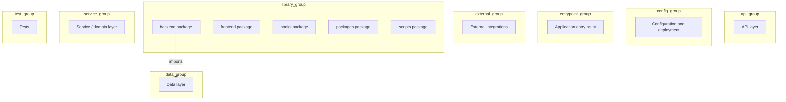

# Architecture report: fastapi/full-stack-fastapi-template

> Automated static analysis. **Observed** = directly seen in files/imports/AST; **Inferred** = interpretation from that evidence. Repository code was not executed.

## 1. Repository at a glance

| Item | Value |
| --- | --- |
| Repository | fastapi/full-stack-fastapi-template |
| Description | Full-stack web application template with FastAPI, React, SQLModel, PostgreSQL, Vite, Tailwind CSS, shadcn/ui, FastAPI Cloud, and Docker Compose. |
| Language | TypeScript |
| Stars | 46250 |
| Licence | MIT |
| Analysed commit / branch | aabb90126964a164e02aff39e7c385bb0598236d / master |
| Framework(s) | FastAPI, React, Starlette, Typer |
| Files analysed | 236 |
| Components | 12 |

## 2. Architecture in one minute

fastapi/full-stack-fastapi-template - Full-stack web application template with FastAPI, React, SQLModel, PostgreSQL, Vite, Tailwind CSS, shadcn/ui, FastAPI Cloud, and Docker Compose.. This repository was analysed statically from 236 file(s) (43 Python). Detected technologies (observed from imports/manifests): GitHub Actions, PostgreSQL, FastAPI, React, Starlette, Typer. Files are grouped into 12 component(s): API layer, backend package, Configuration and deployment, Data layer, Application entry point, External integrations, frontend package, hooks package. Observed entry point(s): backend/app/initial_data.py, backend/app/main.py, scripts/add_latest_release_date.py. Findings below distinguish observed facts from inferred interpretation.

## 3. High-level block diagram

## 4. Main components

### API layer (`api_layer`)

- **Kind:** api
- **Status:** Observed
- **Confidence:** 0.85
- **Responsibility:** Groups 18 file(s) under api layer (observed from repository paths and static analysis). Observed routes: GET /, GET /{id}, POST /, PUT /{id}, DELETE /{id}. Observed top-level classes: PrivateUserCreate. Observed top-level functions: create_item, create_user, delete_item, delete_user, delete_user_me, get_current_active_superuser.
- **Paths:** `backend/app/api/__init__.py`, `backend/app/api/deps.py`, `backend/app/api/routes/__init__.py`, `backend/app/api/routes/items.py`, `backend/app/api/routes/login.py`, `backend/app/api/routes/private.py`, `backend/app/api/routes/users.py`, `backend/app/api/routes/utils.py`, `frontend/src/routes/__root.tsx`, `frontend/src/routes/_layout.tsx`, `frontend/src/routes/_layout/admin.tsx`, `frontend/src/routes/_layout/index.tsx`, `frontend/src/routes/_layout/items.tsx`, `frontend/src/routes/_layout/settings.tsx`, `frontend/src/routes/login.tsx`, `frontend/src/routes/recover-password.tsx`, `frontend/src/routes/reset-password.tsx`, `frontend/src/routes/signup.tsx`
- **Evidence:** [backend/app/api/__init__.py](https://github.com/fastapi/full-stack-fastapi-template/blob/aabb90126964a164e02aff39e7c385bb0598236d/backend/app/api/__init__.py); [backend/app/api/deps.py:21](https://github.com/fastapi/full-stack-fastapi-template/blob/aabb90126964a164e02aff39e7c385bb0598236d/backend/app/api/deps.py#L21); [backend/app/api/routes/__init__.py](https://github.com/fastapi/full-stack-fastapi-template/blob/aabb90126964a164e02aff39e7c385bb0598236d/backend/app/api/routes/__init__.py); [backend/app/api/routes/items.py:14](https://github.com/fastapi/full-stack-fastapi-template/blob/aabb90126964a164e02aff39e7c385bb0598236d/backend/app/api/routes/items.py#L14); [backend/app/api/routes/login.py:24](https://github.com/fastapi/full-stack-fastapi-template/blob/aabb90126964a164e02aff39e7c385bb0598236d/backend/app/api/routes/login.py#L24); [backend/app/api/routes/private.py:16](https://github.com/fastapi/full-stack-fastapi-template/blob/aabb90126964a164e02aff39e7c385bb0598236d/backend/app/api/routes/private.py#L16); [backend/app/api/routes/users.py:37](https://github.com/fastapi/full-stack-fastapi-template/blob/aabb90126964a164e02aff39e7c385bb0598236d/backend/app/api/routes/users.py#L37); [backend/app/api/routes/utils.py:16](https://github.com/fastapi/full-stack-fastapi-template/blob/aabb90126964a164e02aff39e7c385bb0598236d/backend/app/api/routes/utils.py#L16)

### backend package (`backend`)

- **Kind:** library
- **Status:** Observed
- **Confidence:** 0.85
- **Responsibility:** Groups 14 file(s) under backend package (observed from repository paths and static analysis). Observed top-level classes: EmailData. Observed top-level functions: authenticate, create_item, create_user, downgrade, generate_new_account_email, generate_password_reset_token.
- **Paths:** `backend/app/__init__.py`, `backend/app/alembic/env.py`, `backend/app/alembic/versions/1a31ce608336_add_cascade_delete_relationships.py`, `backend/app/alembic/versions/9c0a54914c78_add_max_length_for_string_varchar_.py`, `backend/app/alembic/versions/d98dd8ec85a3_edit_replace_id_integers_in_all_models_.py`, `backend/app/alembic/versions/e2412789c190_initialize_models.py`, `backend/app/alembic/versions/fe56fa70289e_add_created_at_to_user_and_item.py`, `backend/app/crud.py`, `backend/app/utils.py`, `backend/scripts/format.sh`, `backend/scripts/lint.sh`, `backend/scripts/prestart.sh`, `backend/scripts/test.sh`, `backend/scripts/tests-start.sh`
- **Evidence:** [backend/app/__init__.py](https://github.com/fastapi/full-stack-fastapi-template/blob/aabb90126964a164e02aff39e7c385bb0598236d/backend/app/__init__.py); [backend/app/alembic/env.py:33](https://github.com/fastapi/full-stack-fastapi-template/blob/aabb90126964a164e02aff39e7c385bb0598236d/backend/app/alembic/env.py#L33); [backend/app/alembic/versions/1a31ce608336_add_cascade_delete_relationships.py:20](https://github.com/fastapi/full-stack-fastapi-template/blob/aabb90126964a164e02aff39e7c385bb0598236d/backend/app/alembic/versions/1a31ce608336_add_cascade_delete_relationships.py#L20); [backend/app/alembic/versions/9c0a54914c78_add_max_length_for_string_varchar_.py:20](https://github.com/fastapi/full-stack-fastapi-template/blob/aabb90126964a164e02aff39e7c385bb0598236d/backend/app/alembic/versions/9c0a54914c78_add_max_length_for_string_varchar_.py#L20); [backend/app/alembic/versions/d98dd8ec85a3_edit_replace_id_integers_in_all_models_.py:21](https://github.com/fastapi/full-stack-fastapi-template/blob/aabb90126964a164e02aff39e7c385bb0598236d/backend/app/alembic/versions/d98dd8ec85a3_edit_replace_id_integers_in_all_models_.py#L21); [backend/app/alembic/versions/e2412789c190_initialize_models.py:19](https://github.com/fastapi/full-stack-fastapi-template/blob/aabb90126964a164e02aff39e7c385bb0598236d/backend/app/alembic/versions/e2412789c190_initialize_models.py#L19); [backend/app/alembic/versions/fe56fa70289e_add_created_at_to_user_and_item.py:20](https://github.com/fastapi/full-stack-fastapi-template/blob/aabb90126964a164e02aff39e7c385bb0598236d/backend/app/alembic/versions/fe56fa70289e_add_created_at_to_user_and_item.py#L20); [backend/app/crud.py:10](https://github.com/fastapi/full-stack-fastapi-template/blob/aabb90126964a164e02aff39e7c385bb0598236d/backend/app/crud.py#L10)

### Configuration and deployment (`config`)

- **Kind:** config
- **Status:** Observed
- **Confidence:** 0.85
- **Responsibility:** Groups 21 file(s) under configuration and deployment (observed from repository paths and static analysis). Observed top-level classes: Settings.
- **Paths:** `backend/.dockerignore`, `backend/Dockerfile`, `backend/alembic.ini`, `backend/app/core/config.py`, `backend/pyproject.toml`, `compose.deploy.yml`, `compose.override.yml`, `compose.yml`, `frontend/.dockerignore`, `frontend/Dockerfile.playwright`, `frontend/biome.json`, `frontend/components.json`, `frontend/package.json`, `frontend/tsconfig.build.json`, `frontend/tsconfig.json`, `frontend/tsconfig.node.json`, `package.json`, `packages/react-email/biome.json`, `packages/react-email/package.json`, `packages/react-email/tsconfig.json`, `pyproject.toml`
- **Evidence:** [backend/.dockerignore](https://github.com/fastapi/full-stack-fastapi-template/blob/aabb90126964a164e02aff39e7c385bb0598236d/backend/.dockerignore); [backend/Dockerfile](https://github.com/fastapi/full-stack-fastapi-template/blob/aabb90126964a164e02aff39e7c385bb0598236d/backend/Dockerfile); [backend/alembic.ini](https://github.com/fastapi/full-stack-fastapi-template/blob/aabb90126964a164e02aff39e7c385bb0598236d/backend/alembic.ini); [backend/app/core/config.py:15](https://github.com/fastapi/full-stack-fastapi-template/blob/aabb90126964a164e02aff39e7c385bb0598236d/backend/app/core/config.py#L15); [backend/pyproject.toml](https://github.com/fastapi/full-stack-fastapi-template/blob/aabb90126964a164e02aff39e7c385bb0598236d/backend/pyproject.toml); [compose.deploy.yml](https://github.com/fastapi/full-stack-fastapi-template/blob/aabb90126964a164e02aff39e7c385bb0598236d/compose.deploy.yml); [compose.override.yml](https://github.com/fastapi/full-stack-fastapi-template/blob/aabb90126964a164e02aff39e7c385bb0598236d/compose.override.yml); [compose.yml](https://github.com/fastapi/full-stack-fastapi-template/blob/aabb90126964a164e02aff39e7c385bb0598236d/compose.yml)

### Data layer (`data_layer`)

- **Kind:** data
- **Status:** Observed
- **Confidence:** 0.85
- **Responsibility:** Groups 2 file(s) under data layer (observed from repository paths and static analysis). Observed top-level classes: Item, ItemBase, ItemCreate, ItemPublic, ItemUpdate, ItemsPublic. Observed top-level functions: get_datetime_utc, init_db.
- **Paths:** `backend/app/core/db.py`, `backend/app/models.py`
- **Evidence:** [backend/app/core/db.py:15](https://github.com/fastapi/full-stack-fastapi-template/blob/aabb90126964a164e02aff39e7c385bb0598236d/backend/app/core/db.py#L15); [backend/app/models.py:8](https://github.com/fastapi/full-stack-fastapi-template/blob/aabb90126964a164e02aff39e7c385bb0598236d/backend/app/models.py#L8)

### Application entry point (`entrypoint`)

- **Kind:** entrypoint
- **Status:** Observed
- **Confidence:** 0.85
- **Responsibility:** Groups 5 file(s) under application entry point (observed from repository paths and static analysis). Observed application object created via FastAPI, Typer. Observed top-level functions: bump_version, current_version, custom_generate_unique_id, get_current_version, get_release_notes_body, init.
- **Paths:** `backend/app/api/main.py`, `backend/app/initial_data.py`, `backend/app/main.py`, `scripts/add_latest_release_date.py`, `scripts/prepare_release.py`
- **Evidence:** [backend/app/api/main.py](https://github.com/fastapi/full-stack-fastapi-template/blob/aabb90126964a164e02aff39e7c385bb0598236d/backend/app/api/main.py); [backend/app/initial_data.py:11](https://github.com/fastapi/full-stack-fastapi-template/blob/aabb90126964a164e02aff39e7c385bb0598236d/backend/app/initial_data.py#L11); [backend/app/main.py:21](https://github.com/fastapi/full-stack-fastapi-template/blob/aabb90126964a164e02aff39e7c385bb0598236d/backend/app/main.py#L21); [scripts/add_latest_release_date.py:11](https://github.com/fastapi/full-stack-fastapi-template/blob/aabb90126964a164e02aff39e7c385bb0598236d/scripts/add_latest_release_date.py#L11); [scripts/prepare_release.py:16](https://github.com/fastapi/full-stack-fastapi-template/blob/aabb90126964a164e02aff39e7c385bb0598236d/scripts/prepare_release.py#L16)

### External integrations (`external_integrations`)

- **Kind:** external
- **Status:** Observed
- **Confidence:** 0.85
- **Responsibility:** Groups 16 file(s) under external integrations (observed from repository paths and static analysis).
- **Paths:** `frontend/src/client/client.gen.ts`, `frontend/src/client/client/client.gen.ts`, `frontend/src/client/client/index.ts`, `frontend/src/client/client/types.gen.ts`, `frontend/src/client/client/utils.gen.ts`, `frontend/src/client/core/auth.gen.ts`, `frontend/src/client/core/bodySerializer.gen.ts`, `frontend/src/client/core/params.gen.ts`, `frontend/src/client/core/pathSerializer.gen.ts`, `frontend/src/client/core/queryKeySerializer.gen.ts`, `frontend/src/client/core/serverSentEvents.gen.ts`, `frontend/src/client/core/types.gen.ts`, `frontend/src/client/core/utils.gen.ts`, `frontend/src/client/index.ts`, `frontend/src/client/sdk.gen.ts`, `frontend/src/client/types.gen.ts`
- **Evidence:** [frontend/src/client/client.gen.ts](https://github.com/fastapi/full-stack-fastapi-template/blob/aabb90126964a164e02aff39e7c385bb0598236d/frontend/src/client/client.gen.ts); [frontend/src/client/client/client.gen.ts](https://github.com/fastapi/full-stack-fastapi-template/blob/aabb90126964a164e02aff39e7c385bb0598236d/frontend/src/client/client/client.gen.ts); [frontend/src/client/client/index.ts](https://github.com/fastapi/full-stack-fastapi-template/blob/aabb90126964a164e02aff39e7c385bb0598236d/frontend/src/client/client/index.ts); [frontend/src/client/client/types.gen.ts](https://github.com/fastapi/full-stack-fastapi-template/blob/aabb90126964a164e02aff39e7c385bb0598236d/frontend/src/client/client/types.gen.ts); [frontend/src/client/client/utils.gen.ts](https://github.com/fastapi/full-stack-fastapi-template/blob/aabb90126964a164e02aff39e7c385bb0598236d/frontend/src/client/client/utils.gen.ts); [frontend/src/client/core/auth.gen.ts](https://github.com/fastapi/full-stack-fastapi-template/blob/aabb90126964a164e02aff39e7c385bb0598236d/frontend/src/client/core/auth.gen.ts); [frontend/src/client/core/bodySerializer.gen.ts](https://github.com/fastapi/full-stack-fastapi-template/blob/aabb90126964a164e02aff39e7c385bb0598236d/frontend/src/client/core/bodySerializer.gen.ts); [frontend/src/client/core/params.gen.ts](https://github.com/fastapi/full-stack-fastapi-template/blob/aabb90126964a164e02aff39e7c385bb0598236d/frontend/src/client/core/params.gen.ts)

### frontend package (`frontend`)

- **Kind:** library
- **Status:** Observed
- **Confidence:** 0.85
- **Responsibility:** Groups 63 file(s) under frontend package (observed from repository paths and static analysis).
- **Paths:** `frontend/openapi-ts.config.ts`, `frontend/playwright.config.ts`, `frontend/src/components/Admin/AddUser.tsx`, `frontend/src/components/Admin/DeleteUser.tsx`, `frontend/src/components/Admin/EditUser.tsx`, `frontend/src/components/Admin/UserActionsMenu.tsx`, `frontend/src/components/Admin/columns.tsx`, `frontend/src/components/Common/Appearance.tsx`, `frontend/src/components/Common/AuthLayout.tsx`, `frontend/src/components/Common/DataTable.tsx`, `frontend/src/components/Common/ErrorComponent.tsx`, `frontend/src/components/Common/Footer.tsx`, `frontend/src/components/Common/Logo.tsx`, `frontend/src/components/Common/NotFound.tsx`, `frontend/src/components/Items/AddItem.tsx`, `frontend/src/components/Items/DeleteItem.tsx`, `frontend/src/components/Items/EditItem.tsx`, `frontend/src/components/Items/ItemActionsMenu.tsx`, `frontend/src/components/Items/columns.tsx`, `frontend/src/components/Pending/PendingItems.tsx`, `frontend/src/components/Pending/PendingUsers.tsx`, `frontend/src/components/Sidebar/AppSidebar.tsx`, `frontend/src/components/Sidebar/Main.tsx`, `frontend/src/components/Sidebar/User.tsx`, `frontend/src/components/UserSettings/ChangePassword.tsx`, `frontend/src/components/UserSettings/DeleteAccount.tsx`, `frontend/src/components/UserSettings/DeleteConfirmation.tsx`, `frontend/src/components/UserSettings/UserInformation.tsx`, `frontend/src/components/theme-provider.tsx`, `frontend/src/components/ui/alert.tsx`, `frontend/src/components/ui/avatar.tsx`, `frontend/src/components/ui/badge.tsx`, `frontend/src/components/ui/button-group.tsx`, `frontend/src/components/ui/button.tsx`, `frontend/src/components/ui/card.tsx`, `frontend/src/components/ui/checkbox.tsx`, `frontend/src/components/ui/dialog.tsx`, `frontend/src/components/ui/dropdown-menu.tsx`, `frontend/src/components/ui/form.tsx`, `frontend/src/components/ui/input.tsx`, `frontend/src/components/ui/label.tsx`, `frontend/src/components/ui/loading-button.tsx`, `frontend/src/components/ui/pagination.tsx`, `frontend/src/components/ui/password-input.tsx`, `frontend/src/components/ui/select.tsx`, `frontend/src/components/ui/separator.tsx`, `frontend/src/components/ui/sheet.tsx`, `frontend/src/components/ui/sidebar.tsx`, `frontend/src/components/ui/skeleton.tsx`, `frontend/src/components/ui/sonner.tsx`, `frontend/src/components/ui/table.tsx`, `frontend/src/components/ui/tabs.tsx`, `frontend/src/components/ui/tooltip.tsx`, `frontend/src/hooks/useAuth.ts`, `frontend/src/hooks/useCopyToClipboard.ts`, `frontend/src/hooks/useCustomToast.ts`, `frontend/src/hooks/useMobile.ts`, `frontend/src/lib/utils.ts`, `frontend/src/main.tsx`, `frontend/src/routeTree.gen.ts`, `frontend/src/utils.ts`, `frontend/src/vite-env.d.ts`, `frontend/vite.config.ts`
- **Evidence:** [frontend/openapi-ts.config.ts](https://github.com/fastapi/full-stack-fastapi-template/blob/aabb90126964a164e02aff39e7c385bb0598236d/frontend/openapi-ts.config.ts); [frontend/playwright.config.ts](https://github.com/fastapi/full-stack-fastapi-template/blob/aabb90126964a164e02aff39e7c385bb0598236d/frontend/playwright.config.ts); [frontend/src/components/Admin/AddUser.tsx](https://github.com/fastapi/full-stack-fastapi-template/blob/aabb90126964a164e02aff39e7c385bb0598236d/frontend/src/components/Admin/AddUser.tsx); [frontend/src/components/Admin/DeleteUser.tsx](https://github.com/fastapi/full-stack-fastapi-template/blob/aabb90126964a164e02aff39e7c385bb0598236d/frontend/src/components/Admin/DeleteUser.tsx); [frontend/src/components/Admin/EditUser.tsx](https://github.com/fastapi/full-stack-fastapi-template/blob/aabb90126964a164e02aff39e7c385bb0598236d/frontend/src/components/Admin/EditUser.tsx); [frontend/src/components/Admin/UserActionsMenu.tsx](https://github.com/fastapi/full-stack-fastapi-template/blob/aabb90126964a164e02aff39e7c385bb0598236d/frontend/src/components/Admin/UserActionsMenu.tsx); [frontend/src/components/Admin/columns.tsx](https://github.com/fastapi/full-stack-fastapi-template/blob/aabb90126964a164e02aff39e7c385bb0598236d/frontend/src/components/Admin/columns.tsx); [frontend/src/components/Common/Appearance.tsx](https://github.com/fastapi/full-stack-fastapi-template/blob/aabb90126964a164e02aff39e7c385bb0598236d/frontend/src/components/Common/Appearance.tsx)

### hooks package (`hooks`)

- **Kind:** library
- **Status:** Observed
- **Confidence:** 0.85
- **Responsibility:** Groups 1 file(s) under hooks package (observed from repository paths and static analysis).
- **Paths:** `hooks/post_gen_project.py`
- **Evidence:** [hooks/post_gen_project.py](https://github.com/fastapi/full-stack-fastapi-template/blob/aabb90126964a164e02aff39e7c385bb0598236d/hooks/post_gen_project.py)

### packages package (`packages`)

- **Kind:** library
- **Status:** Observed
- **Confidence:** 0.85
- **Responsibility:** Groups 7 file(s) under packages package (observed from repository paths and static analysis).
- **Paths:** `packages/react-email/emails/new_account.tsx`, `packages/react-email/emails/reset_password.tsx`, `packages/react-email/ui/Button.tsx`, `packages/react-email/ui/Callout.tsx`, `packages/react-email/ui/Heading.tsx`, `packages/react-email/ui/Layout.tsx`, `packages/react-email/ui/Link.tsx`
- **Evidence:** [packages/react-email/emails/new_account.tsx](https://github.com/fastapi/full-stack-fastapi-template/blob/aabb90126964a164e02aff39e7c385bb0598236d/packages/react-email/emails/new_account.tsx); [packages/react-email/emails/reset_password.tsx](https://github.com/fastapi/full-stack-fastapi-template/blob/aabb90126964a164e02aff39e7c385bb0598236d/packages/react-email/emails/reset_password.tsx); [packages/react-email/ui/Button.tsx](https://github.com/fastapi/full-stack-fastapi-template/blob/aabb90126964a164e02aff39e7c385bb0598236d/packages/react-email/ui/Button.tsx); [packages/react-email/ui/Callout.tsx](https://github.com/fastapi/full-stack-fastapi-template/blob/aabb90126964a164e02aff39e7c385bb0598236d/packages/react-email/ui/Callout.tsx); [packages/react-email/ui/Heading.tsx](https://github.com/fastapi/full-stack-fastapi-template/blob/aabb90126964a164e02aff39e7c385bb0598236d/packages/react-email/ui/Heading.tsx); [packages/react-email/ui/Layout.tsx](https://github.com/fastapi/full-stack-fastapi-template/blob/aabb90126964a164e02aff39e7c385bb0598236d/packages/react-email/ui/Layout.tsx); [packages/react-email/ui/Link.tsx](https://github.com/fastapi/full-stack-fastapi-template/blob/aabb90126964a164e02aff39e7c385bb0598236d/packages/react-email/ui/Link.tsx)

### scripts package (`scripts`)

- **Kind:** library
- **Status:** Observed
- **Confidence:** 0.85
- **Responsibility:** Groups 3 file(s) under scripts package (observed from repository paths and static analysis).
- **Paths:** `scripts/generate-client.sh`, `scripts/test-local.sh`, `scripts/test.sh`
- **Evidence:** [scripts/generate-client.sh](https://github.com/fastapi/full-stack-fastapi-template/blob/aabb90126964a164e02aff39e7c385bb0598236d/scripts/generate-client.sh); [scripts/test-local.sh](https://github.com/fastapi/full-stack-fastapi-template/blob/aabb90126964a164e02aff39e7c385bb0598236d/scripts/test-local.sh); [scripts/test.sh](https://github.com/fastapi/full-stack-fastapi-template/blob/aabb90126964a164e02aff39e7c385bb0598236d/scripts/test.sh)

### Service / domain layer (`service_layer`)

- **Kind:** service
- **Status:** Observed
- **Confidence:** 0.85
- **Responsibility:** Groups 2 file(s) under service / domain layer (observed from repository paths and static analysis). Observed top-level functions: create_access_token, get_password_hash, verify_password.
- **Paths:** `backend/app/core/__init__.py`, `backend/app/core/security.py`
- **Evidence:** [backend/app/core/__init__.py](https://github.com/fastapi/full-stack-fastapi-template/blob/aabb90126964a164e02aff39e7c385bb0598236d/backend/app/core/__init__.py); [backend/app/core/security.py:22](https://github.com/fastapi/full-stack-fastapi-template/blob/aabb90126964a164e02aff39e7c385bb0598236d/backend/app/core/security.py#L22)

### Tests (`tests`)

- **Kind:** test
- **Status:** Observed
- **Confidence:** 0.85
- **Responsibility:** Groups 29 file(s) under tests (observed from repository paths and static analysis). Observed top-level functions: authentication_token_from_email, client, create_random_item, create_random_user, db, get_superuser_token_headers.
- **Paths:** `backend/app/email-templates/test_email.html`, `backend/tests/__init__.py`, `backend/tests/api/__init__.py`, `backend/tests/api/routes/__init__.py`, `backend/tests/api/routes/test_items.py`, `backend/tests/api/routes/test_login.py`, `backend/tests/api/routes/test_private.py`, `backend/tests/api/routes/test_users.py`, `backend/tests/conftest.py`, `backend/tests/crud/__init__.py`, `backend/tests/crud/test_user.py`, `backend/tests/scripts/__init__.py`, `backend/tests/utils/__init__.py`, `backend/tests/utils/item.py`, `backend/tests/utils/user.py`, `backend/tests/utils/utils.py`, `frontend/tests/admin.spec.ts`, `frontend/tests/auth.setup.ts`, `frontend/tests/config.ts`, `frontend/tests/items.spec.ts`, `frontend/tests/login.spec.ts`, `frontend/tests/reset-password.spec.ts`, `frontend/tests/sign-up.spec.ts`, `frontend/tests/user-settings.spec.ts`, `frontend/tests/utils/mailpit.ts`, `frontend/tests/utils/privateApi.ts`, `frontend/tests/utils/random.ts`, `frontend/tests/utils/user.ts`, `packages/react-email/emails/test_email.tsx`
- **Evidence:** [backend/app/email-templates/test_email.html](https://github.com/fastapi/full-stack-fastapi-template/blob/aabb90126964a164e02aff39e7c385bb0598236d/backend/app/email-templates/test_email.html); [backend/tests/__init__.py](https://github.com/fastapi/full-stack-fastapi-template/blob/aabb90126964a164e02aff39e7c385bb0598236d/backend/tests/__init__.py); [backend/tests/api/__init__.py](https://github.com/fastapi/full-stack-fastapi-template/blob/aabb90126964a164e02aff39e7c385bb0598236d/backend/tests/api/__init__.py); [backend/tests/api/routes/__init__.py](https://github.com/fastapi/full-stack-fastapi-template/blob/aabb90126964a164e02aff39e7c385bb0598236d/backend/tests/api/routes/__init__.py); [backend/tests/api/routes/test_items.py:10](https://github.com/fastapi/full-stack-fastapi-template/blob/aabb90126964a164e02aff39e7c385bb0598236d/backend/tests/api/routes/test_items.py#L10); [backend/tests/api/routes/test_login.py:16](https://github.com/fastapi/full-stack-fastapi-template/blob/aabb90126964a164e02aff39e7c385bb0598236d/backend/tests/api/routes/test_login.py#L16); [backend/tests/api/routes/test_private.py:8](https://github.com/fastapi/full-stack-fastapi-template/blob/aabb90126964a164e02aff39e7c385bb0598236d/backend/tests/api/routes/test_private.py#L8); [backend/tests/api/routes/test_users.py:15](https://github.com/fastapi/full-stack-fastapi-template/blob/aabb90126964a164e02aff39e7c385bb0598236d/backend/tests/api/routes/test_users.py#L15)

## 5. Execution flow

**Observed** entry point(s):

- [backend/app/initial_data.py:22](https://github.com/fastapi/full-stack-fastapi-template/blob/aabb90126964a164e02aff39e7c385bb0598236d/backend/app/initial_data.py#L22)
- [backend/app/main.py:21](https://github.com/fastapi/full-stack-fastapi-template/blob/aabb90126964a164e02aff39e7c385bb0598236d/backend/app/main.py#L21)
- [frontend/src/client/index.ts](https://github.com/fastapi/full-stack-fastapi-template/blob/aabb90126964a164e02aff39e7c385bb0598236d/frontend/src/client/index.ts)
- [frontend/src/main.tsx](https://github.com/fastapi/full-stack-fastapi-template/blob/aabb90126964a164e02aff39e7c385bb0598236d/frontend/src/main.tsx)
- [scripts/add_latest_release_date.py:39](https://github.com/fastapi/full-stack-fastapi-template/blob/aabb90126964a164e02aff39e7c385bb0598236d/scripts/add_latest_release_date.py#L39)
- [scripts/prepare_release.py:16](https://github.com/fastapi/full-stack-fastapi-template/blob/aabb90126964a164e02aff39e7c385bb0598236d/scripts/prepare_release.py#L16)

**Observed** routes (from decorators):

- `GET /` -> `read_items` in `backend/app/api/routes/items.py:14`
- `GET /{id}` -> `read_item` in `backend/app/api/routes/items.py:49`
- `POST /` -> `create_item` in `backend/app/api/routes/items.py:62`
- `PUT /{id}` -> `update_item` in `backend/app/api/routes/items.py:76`
- `DELETE /{id}` -> `delete_item` in `backend/app/api/routes/items.py:100`
- `POST /login/access-token` -> `login_access_token` in `backend/app/api/routes/login.py:24`
- `POST /login/test-token` -> `test_token` in `backend/app/api/routes/login.py:46`
- `POST /password-recovery/{email}` -> `recover_password` in `backend/app/api/routes/login.py:54`
- `POST /reset-password/` -> `reset_password` in `backend/app/api/routes/login.py:78`
- `POST /password-recovery-html-content/{email}` -> `recover_password_html_content` in `backend/app/api/routes/login.py:105`
- `POST /users/` -> `create_user` in `backend/app/api/routes/private.py:24`
- `GET /` -> `read_users` in `backend/app/api/routes/users.py:37`
- `POST /` -> `create_user` in `backend/app/api/routes/users.py:57`
- `PATCH /me` -> `update_user_me` in `backend/app/api/routes/users.py:82`
- `PATCH /me/password` -> `update_password_me` in `backend/app/api/routes/users.py:104`
- `GET /me` -> `read_user_me` in `backend/app/api/routes/users.py:125`
- `DELETE /me` -> `delete_user_me` in `backend/app/api/routes/users.py:133`
- `POST /signup` -> `register_user` in `backend/app/api/routes/users.py:147`
- `GET /{user_id}` -> `read_user_by_id` in `backend/app/api/routes/users.py:163`
- `PATCH /{user_id}` -> `update_user` in `backend/app/api/routes/users.py:187`
- `DELETE /{user_id}` -> `delete_user` in `backend/app/api/routes/users.py:215`
- `POST /test-email/` -> `test_email` in `backend/app/api/routes/utils.py:16`
- `GET /health-check/` -> `health_check` in `backend/app/api/routes/utils.py:30`

Representative flow (derived from observed entry points and the import graph; steps beyond the entry point are **Inferred**):

1. Execution starts at an observed entry point listed above, if present.
2. `backend` imports `data_layer` (backend package -> Data layer).

## 6. Project structure

### `(root)`

- `.dockerignore` - container (164 bytes)
- `.fastapicloudignore` - other (28 bytes)
- `.gitattributes` - other (29 bytes)
- `.gitignore` - other (140 bytes)
- `.pre-commit-config.yaml` - config (2503 bytes)
- `.python-version` - other (5 bytes)
- `CONTRIBUTING.md` - docs (3180 bytes)
- `LICENSE` - docs (1076 bytes)
- `README.md` - docs (3193 bytes)
- `bun.lock` - other (167026 bytes)
- `compose.deploy.yml` - config (2332 bytes)
- `compose.override.yml` - config (2716 bytes)
- `compose.yml` - container (2847 bytes)
- `deployment-docker-compose.md` - docs (4882 bytes)
- `deployment.md` - docs (4540 bytes)
- `development.md` - docs (4711 bytes)
- `package.json` - manifest (428 bytes)
- `pyproject.toml` - manifest (655 bytes)
- `release-notes.md` - docs (141038 bytes)

### `.agents`

- `.agents/skills/library-skills/.library-skills.json` - config (50 bytes)
- `.agents/skills/library-skills/SKILL.md` - docs (2629 bytes)

### `.claude`

- `.claude/skills/library-skills/.library-skills.json` - config (50 bytes)
- `.claude/skills/library-skills/SKILL.md` - docs (2629 bytes)

### `.github`

- `.github/dependabot.yml` - config (1483 bytes)
- `.github/latest-changes.yml` - config (235 bytes)
- `.github/pr-push.yml` - config (48 bytes)
- `.github/pr-submit.yml` - config (101 bytes)
- `.github/workflows/add-to-project.yml` - ci, YAML (571 bytes)
- `.github/workflows/bump-pre-commit-hooks.yml` - ci, YAML (2484 bytes)
- `.github/workflows/create-draft-release.yml` - ci, YAML (1737 bytes)
- `.github/workflows/deploy-docker-compose.yml` - ci, YAML (1405 bytes)
- `.github/workflows/deploy.yml` - ci, YAML (1752 bytes)
- `.github/workflows/detect-conflicts.yml` - ci, YAML (623 bytes)
- `.github/workflows/guard-dependencies.yml` - ci, YAML (2108 bytes)
- `.github/workflows/issue-manager.yml` - ci, YAML (739 bytes)
- `.github/workflows/playwright.yml` - ci, YAML (4827 bytes)
- `.github/workflows/pre-commit.yml` - ci, YAML (4187 bytes)
- `.github/workflows/prepare-release.yml` - ci, YAML (2757 bytes)
- `.github/workflows/smokeshow.yml` - ci, YAML (1646 bytes)
- `.github/workflows/test-backend.yml` - ci, YAML (1433 bytes)
- `.github/workflows/test-docker-compose.yml` - ci, YAML (802 bytes)
- `.github/workflows/zizmor.yml` - ci, YAML (804 bytes)

### `.vscode`

- `.vscode/extensions.json` - config (345 bytes)
- `.vscode/launch.json` - config (933 bytes)

### `backend`

- `backend/.dockerignore` - container (76 bytes)
- `backend/.gitignore` - other (74 bytes)
- `backend/Dockerfile` - container (1771 bytes)
- `backend/README.md` - docs (5039 bytes)
- `backend/alembic.ini` - config (1596 bytes)
- `backend/app/__init__.py` - source, Python (0 bytes)
- `backend/app/alembic/README` - other (39 bytes)
- `backend/app/alembic/env.py` - source, Python (2311 bytes)
- `backend/app/alembic/script.py.mako` - other (523 bytes)
- `backend/app/alembic/versions/.keep` - other (0 bytes)
- `backend/app/alembic/versions/1a31ce608336_add_cascade_delete_relationships.py` - source, Python (1126 bytes)
- `backend/app/alembic/versions/9c0a54914c78_add_max_length_for_string_varchar_.py` - source, Python (2249 bytes)
- `backend/app/alembic/versions/d98dd8ec85a3_edit_replace_id_integers_in_all_models_.py` - source, Python (3754 bytes)
- `backend/app/alembic/versions/e2412789c190_initialize_models.py` - source, Python (1728 bytes)
- `backend/app/alembic/versions/fe56fa70289e_add_created_at_to_user_and_item.py` - source, Python (852 bytes)
- `backend/app/api/__init__.py` - source, Python (0 bytes)
- `backend/app/api/deps.py` - source, Python (1711 bytes)
- `backend/app/api/main.py` - source, Python (407 bytes)
- `backend/app/api/routes/__init__.py` - source, Python (0 bytes)
- `backend/app/api/routes/items.py` - source, Python (3446 bytes)
- `backend/app/api/routes/login.py` - source, Python (4088 bytes)
- `backend/app/api/routes/private.py` - source, Python (777 bytes)
- `backend/app/api/routes/users.py` - source, Python (6918 bytes)
- `backend/app/api/routes/utils.py` - source, Python (783 bytes)
- `backend/app/core/__init__.py` - source, Python (0 bytes)
- `backend/app/core/config.py` - source, Python (2935 bytes)
- `backend/app/core/db.py` - source, Python (1190 bytes)
- `backend/app/core/security.py` - source, Python (907 bytes)
- `backend/app/crud.py` - source, Python (2463 bytes)
- `backend/app/email-templates/new_account.html` - other (7862 bytes)
- `backend/app/email-templates/reset_password.html` - other (6893 bytes)
- `backend/app/email-templates/test_email.html` - test (6077 bytes)
- `backend/app/initial_data.py` - source, Python (402 bytes)
- `backend/app/main.py` - source, Python (958 bytes)
- `backend/app/models.py` - source, Python (3477 bytes)
- `backend/app/utils.py` - source, Python (3934 bytes)
- `backend/pyproject.toml` - manifest (1897 bytes)
- `backend/scripts/format.sh` - source, Shell (74 bytes)
- `backend/scripts/lint.sh` - source, Shell (97 bytes)
- `backend/scripts/prestart.sh` - source, Shell (131 bytes)
- `backend/scripts/test.sh` - source, Shell (144 bytes)
- `backend/scripts/tests-start.sh` - source, Shell (62 bytes)
- `backend/tests/__init__.py` - test, Python (0 bytes)
- `backend/tests/api/__init__.py` - test, Python (0 bytes)
- `backend/tests/api/routes/__init__.py` - test, Python (0 bytes)
- `backend/tests/api/routes/test_items.py` - test, Python (5165 bytes)
- `backend/tests/api/routes/test_login.py` - test, Python (6140 bytes)
- `backend/tests/api/routes/test_private.py` - test, Python (659 bytes)
- `backend/tests/api/routes/test_users.py` - test, Python (16867 bytes)
- `backend/tests/conftest.py` - test, Python (1209 bytes)
- `backend/tests/crud/__init__.py` - test, Python (0 bytes)
- `backend/tests/crud/test_user.py` - test, Python (4765 bytes)
- `backend/tests/scripts/__init__.py` - test, Python (0 bytes)
- `backend/tests/utils/__init__.py` - test, Python (0 bytes)
- `backend/tests/utils/item.py` - test, Python (538 bytes)
- `backend/tests/utils/user.py` - test, Python (1664 bytes)
- `backend/tests/utils/utils.py` - test, Python (717 bytes)

### `frontend`

- `frontend/.dockerignore` - container (18 bytes)
- `frontend/.gitignore` - other (354 bytes)
- `frontend/Dockerfile.playwright` - container (373 bytes)
- `frontend/README.md` - docs (4077 bytes)
- `frontend/biome.json` - config (1191 bytes)
- `frontend/components.json` - config (446 bytes)
- `frontend/index.html` - other (454 bytes)
- `frontend/openapi-ts.config.ts` - source, TypeScript (562 bytes)
- `frontend/package.json` - manifest (2115 bytes)
- `frontend/playwright.config.ts` - source, TypeScript (2585 bytes)
- `frontend/public/assets/images/fastapi-icon-light.svg` - other (2608 bytes)
- `frontend/public/assets/images/fastapi-icon.svg` - other (2609 bytes)
- `frontend/public/assets/images/fastapi-logo-light.svg` - other (7034 bytes)
- `frontend/public/assets/images/fastapi-logo.svg` - other (7110 bytes)
- `frontend/src/client/client.gen.ts` - source, TypeScript (817 bytes)
- `frontend/src/client/client/client.gen.ts` - source, TypeScript (4721 bytes)
- `frontend/src/client/client/index.ts` - source, TypeScript (675 bytes)
- `frontend/src/client/client/types.gen.ts` - source, TypeScript (4948 bytes)
- `frontend/src/client/client/utils.gen.ts` - source, TypeScript (5927 bytes)
- `frontend/src/client/core/auth.gen.ts` - source, TypeScript (860 bytes)
- `frontend/src/client/core/bodySerializer.gen.ts` - source, TypeScript (2488 bytes)
- `frontend/src/client/core/params.gen.ts` - source, TypeScript (4049 bytes)
- `frontend/src/client/core/pathSerializer.gen.ts` - source, TypeScript (4206 bytes)
- `frontend/src/client/core/queryKeySerializer.gen.ts` - source, TypeScript (2901 bytes)
- `frontend/src/client/core/serverSentEvents.gen.ts` - source, TypeScript (7204 bytes)
- `frontend/src/client/core/types.gen.ts` - source, TypeScript (3287 bytes)
- `frontend/src/client/core/utils.gen.ts` - source, TypeScript (3384 bytes)
- `frontend/src/client/index.ts` - source, TypeScript (3190 bytes)
- `frontend/src/client/sdk.gen.ts` - source, TypeScript (14886 bytes)
- `frontend/src/client/types.gen.ts` - source, TypeScript (17314 bytes)
- `frontend/src/components/Admin/AddUser.tsx` - source, TypeScript (7301 bytes)
- `frontend/src/components/Admin/DeleteUser.tsx` - source, TypeScript (2701 bytes)
- `frontend/src/components/Admin/EditUser.tsx` - source, TypeScript (7439 bytes)
- `frontend/src/components/Admin/UserActionsMenu.tsx` - source, TypeScript (1115 bytes)
- `frontend/src/components/Admin/columns.tsx` - source, TypeScript (2093 bytes)
- `frontend/src/components/Common/Appearance.tsx` - source, TypeScript (3291 bytes)
- `frontend/src/components/Common/AuthLayout.tsx` - source, TypeScript (839 bytes)
- `frontend/src/components/Common/DataTable.tsx` - source, TypeScript (6376 bytes)
- `frontend/src/components/Common/ErrorComponent.tsx` - source, TypeScript (845 bytes)
- `frontend/src/components/Common/Footer.tsx` - source, TypeScript (1240 bytes)
- `frontend/src/components/Common/Logo.tsx` - source, TypeScript (1474 bytes)
- `frontend/src/components/Common/NotFound.tsx` - source, TypeScript (894 bytes)
- `frontend/src/components/Items/AddItem.tsx` - source, TypeScript (4084 bytes)
- `frontend/src/components/Items/DeleteItem.tsx` - source, TypeScript (2625 bytes)
- `frontend/src/components/Items/EditItem.tsx` - source, TypeScript (4213 bytes)
- `frontend/src/components/Items/ItemActionsMenu.tsx` - source, TypeScript (991 bytes)
- `frontend/src/components/Items/columns.tsx` - source, TypeScript (2029 bytes)
- `frontend/src/components/Pending/PendingItems.tsx` - source, TypeScript (1125 bytes)
- `frontend/src/components/Pending/PendingUsers.tsx` - source, TypeScript (1391 bytes)
- `frontend/src/components/Sidebar/AppSidebar.tsx` - source, TypeScript (1187 bytes)
- `frontend/src/components/Sidebar/Main.tsx` - source, TypeScript (1415 bytes)
- `frontend/src/components/Sidebar/User.tsx` - source, TypeScript (2922 bytes)
- `frontend/src/components/UserSettings/ChangePassword.tsx` - source, TypeScript (4297 bytes)
- `frontend/src/components/UserSettings/DeleteAccount.tsx` - source, TypeScript (458 bytes)
- `frontend/src/components/UserSettings/DeleteConfirmation.tsx` - source, TypeScript (2366 bytes)
- `frontend/src/components/UserSettings/UserInformation.tsx` - source, TypeScript (4758 bytes)
- `frontend/src/components/theme-provider.tsx` - source, TypeScript (2600 bytes)
- `frontend/src/components/ui/alert.tsx` - source, TypeScript (1614 bytes)
- `frontend/src/components/ui/avatar.tsx` - source, TypeScript (1083 bytes)
- `frontend/src/components/ui/badge.tsx` - source, TypeScript (1633 bytes)
- `frontend/src/components/ui/button-group.tsx` - source, TypeScript (2209 bytes)
- `frontend/src/components/ui/button.tsx` - source, TypeScript (2142 bytes)
- `frontend/src/components/ui/card.tsx` - source, TypeScript (1987 bytes)
- `frontend/src/components/ui/checkbox.tsx` - source, TypeScript (1205 bytes)
- `frontend/src/components/ui/dialog.tsx` - source, TypeScript (3968 bytes)
- `frontend/src/components/ui/dropdown-menu.tsx` - source, TypeScript (8284 bytes)
- `frontend/src/components/ui/form.tsx` - source, TypeScript (3745 bytes)
- `frontend/src/components/ui/input.tsx` - source, TypeScript (962 bytes)
- `frontend/src/components/ui/label.tsx` - source, TypeScript (611 bytes)
- `frontend/src/components/ui/loading-button.tsx` - source, TypeScript (2410 bytes)
- `frontend/src/components/ui/pagination.tsx` - source, TypeScript (2712 bytes)
- `frontend/src/components/ui/password-input.tsx` - source, TypeScript (1994 bytes)
- `frontend/src/components/ui/select.tsx` - source, TypeScript (6281 bytes)
- `frontend/src/components/ui/separator.tsx` - source, TypeScript (685 bytes)
- `frontend/src/components/ui/sheet.tsx` - source, TypeScript (4090 bytes)
- `frontend/src/components/ui/sidebar.tsx` - source, TypeScript (22059 bytes)
- `frontend/src/components/ui/skeleton.tsx` - source, TypeScript (276 bytes)
- `frontend/src/components/ui/sonner.tsx` - source, TypeScript (1014 bytes)
- `frontend/src/components/ui/table.tsx` - source, TypeScript (2511 bytes)
- `frontend/src/components/ui/tabs.tsx` - source, TypeScript (1955 bytes)
- `frontend/src/components/ui/tooltip.tsx` - source, TypeScript (1878 bytes)
- `frontend/src/hooks/useAuth.ts` - source, TypeScript (1729 bytes)
- `frontend/src/hooks/useCopyToClipboard.ts` - source, TypeScript (794 bytes)
- `frontend/src/hooks/useCustomToast.ts` - source, TypeScript (385 bytes)
- `frontend/src/hooks/useMobile.ts` - source, TypeScript (565 bytes)
- `frontend/src/index.css` - other (4187 bytes)
- `frontend/src/lib/utils.ts` - source, TypeScript (166 bytes)
- `frontend/src/main.tsx` - source, TypeScript (1536 bytes)
- `frontend/src/routeTree.gen.ts` - source, TypeScript (7039 bytes)
- `frontend/src/routes/__root.tsx` - source, TypeScript (651 bytes)
- `frontend/src/routes/_layout.tsx` - source, TypeScript (1032 bytes)
- `frontend/src/routes/_layout/admin.tsx` - source, TypeScript (1925 bytes)
- `frontend/src/routes/_layout/index.tsx` - source, TypeScript (652 bytes)
- `frontend/src/routes/_layout/items.tsx` - source, TypeScript (1931 bytes)
- `frontend/src/routes/_layout/settings.tsx` - source, TypeScript (1735 bytes)
- `frontend/src/routes/login.tsx` - source, TypeScript (3986 bytes)
- `frontend/src/routes/recover-password.tsx` - source, TypeScript (3334 bytes)
- `frontend/src/routes/reset-password.tsx` - source, TypeScript (4569 bytes)
- `frontend/src/routes/signup.tsx` - source, TypeScript (5236 bytes)
- `frontend/src/utils.ts` - source, TypeScript (726 bytes)
- `frontend/src/vite-env.d.ts` - source, TypeScript (156 bytes)
- `frontend/tests/admin.spec.ts` - test, TypeScript (7198 bytes)
- `frontend/tests/auth.setup.ts` - test, TypeScript (520 bytes)
- `frontend/tests/config.ts` - test, TypeScript (569 bytes)
- `frontend/tests/items.spec.ts` - test, TypeScript (4676 bytes)
- `frontend/tests/login.spec.ts` - test, TypeScript (3479 bytes)
- `frontend/tests/reset-password.spec.ts` - test, TypeScript (3652 bytes)
- `frontend/tests/sign-up.spec.ts` - test, TypeScript (4607 bytes)
- `frontend/tests/user-settings.spec.ts` - test, TypeScript (8628 bytes)
- `frontend/tests/utils/mailpit.ts` - test, TypeScript (1068 bytes)
- `frontend/tests/utils/privateApi.ts` - test, TypeScript (560 bytes)
- `frontend/tests/utils/random.ts` - test, TypeScript (584 bytes)
- `frontend/tests/utils/user.ts` - test, TypeScript (1108 bytes)
- `frontend/tsconfig.build.json` - config (67 bytes)
- `frontend/tsconfig.json` - config (724 bytes)
- `frontend/tsconfig.node.json` - config (213 bytes)
- `frontend/vite.config.ts` - source, TypeScript (584 bytes)

### `hooks`

- `hooks/post_gen_project.py` - source, Python (179 bytes)

### `img`

- `img/github-social-preview.svg` - other (4187 bytes)

### `packages`

- `packages/react-email/biome.json` - config (47 bytes)
- `packages/react-email/emails/new_account.tsx` - source, TypeScript (1801 bytes)
- `packages/react-email/emails/reset_password.tsx` - source, TypeScript (1702 bytes)
- `packages/react-email/emails/test_email.tsx` - test, TypeScript (1235 bytes)
- `packages/react-email/package.json` - manifest (624 bytes)
- `packages/react-email/tsconfig.json` - config (318 bytes)
- `packages/react-email/ui/Button.tsx` - source, TypeScript (544 bytes)
- `packages/react-email/ui/Callout.tsx` - source, TypeScript (1015 bytes)
- `packages/react-email/ui/Heading.tsx` - source, TypeScript (405 bytes)
- `packages/react-email/ui/Layout.tsx` - source, TypeScript (2277 bytes)
- `packages/react-email/ui/Link.tsx` - source, TypeScript (364 bytes)

### `scripts`

- `scripts/add_latest_release_date.py` - source, Python (1010 bytes)
- `scripts/generate-client.sh` - source, Shell (268 bytes)
- `scripts/prepare_release.py` - source, Python (5651 bytes)
- `scripts/test-local.sh` - source, Shell (462 bytes)
- `scripts/test.sh` - source, Shell (371 bytes)

## 7. Key dependencies and integrations

| Name | Category | Status | Confidence | Evidence |
| --- | --- | --- | --- | --- |
| GitHub Actions | ci | Observed | 0.90 | [.github/workflows/add-to-project.yml](https://github.com/fastapi/full-stack-fastapi-template/blob/aabb90126964a164e02aff39e7c385bb0598236d/.github/workflows/add-to-project.yml); [.github/workflows/bump-pre-commit-hooks.yml](https://github.com/fastapi/full-stack-fastapi-template/blob/aabb90126964a164e02aff39e7c385bb0598236d/.github/workflows/bump-pre-commit-hooks.yml); [.github/workflows/create-draft-release.yml](https://github.com/fastapi/full-stack-fastapi-template/blob/aabb90126964a164e02aff39e7c385bb0598236d/.github/workflows/create-draft-release.yml); [.github/workflows/deploy-docker-compose.yml](https://github.com/fastapi/full-stack-fastapi-template/blob/aabb90126964a164e02aff39e7c385bb0598236d/.github/workflows/deploy-docker-compose.yml) |
| PostgreSQL | database | Observed | 0.85 | [backend/pyproject.toml:15](https://github.com/fastapi/full-stack-fastapi-template/blob/aabb90126964a164e02aff39e7c385bb0598236d/backend/pyproject.toml#L15); [compose.yml:21](https://github.com/fastapi/full-stack-fastapi-template/blob/aabb90126964a164e02aff39e7c385bb0598236d/compose.yml#L21) |
| FastAPI | framework | Observed | 0.95 | [backend/app/api/deps.py:5](https://github.com/fastapi/full-stack-fastapi-template/blob/aabb90126964a164e02aff39e7c385bb0598236d/backend/app/api/deps.py#L5); [backend/app/api/deps.py:6](https://github.com/fastapi/full-stack-fastapi-template/blob/aabb90126964a164e02aff39e7c385bb0598236d/backend/app/api/deps.py#L6); [backend/app/api/main.py:1](https://github.com/fastapi/full-stack-fastapi-template/blob/aabb90126964a164e02aff39e7c385bb0598236d/backend/app/api/main.py#L1); [backend/app/api/routes/items.py:4](https://github.com/fastapi/full-stack-fastapi-template/blob/aabb90126964a164e02aff39e7c385bb0598236d/backend/app/api/routes/items.py#L4) |
| React | framework | Observed | 0.90 | [frontend/package.json:17](https://github.com/fastapi/full-stack-fastapi-template/blob/aabb90126964a164e02aff39e7c385bb0598236d/frontend/package.json#L17); [frontend/package.json:41](https://github.com/fastapi/full-stack-fastapi-template/blob/aabb90126964a164e02aff39e7c385bb0598236d/frontend/package.json#L41); [packages/react-email/package.json:12](https://github.com/fastapi/full-stack-fastapi-template/blob/aabb90126964a164e02aff39e7c385bb0598236d/packages/react-email/package.json#L12); [packages/react-email/package.json:14](https://github.com/fastapi/full-stack-fastapi-template/blob/aabb90126964a164e02aff39e7c385bb0598236d/packages/react-email/package.json#L14) |
| Starlette | framework | Observed | 0.90 | [backend/app/main.py:6](https://github.com/fastapi/full-stack-fastapi-template/blob/aabb90126964a164e02aff39e7c385bb0598236d/backend/app/main.py#L6) |
| Typer | framework | Observed | 0.90 | [scripts/prepare_release.py:8](https://github.com/fastapi/full-stack-fastapi-template/blob/aabb90126964a164e02aff39e7c385bb0598236d/scripts/prepare_release.py#L8) |
| axios | library | Observed | 0.85 | [frontend/package.json:35](https://github.com/fastapi/full-stack-fastapi-template/blob/aabb90126964a164e02aff39e7c385bb0598236d/frontend/package.json#L35) |
| httpx | library | Observed | 0.85 | [backend/pyproject.toml:14](https://github.com/fastapi/full-stack-fastapi-template/blob/aabb90126964a164e02aff39e7c385bb0598236d/backend/pyproject.toml#L14) |
| Pydantic | library | Observed | 0.95 | [backend/app/api/deps.py:8](https://github.com/fastapi/full-stack-fastapi-template/blob/aabb90126964a164e02aff39e7c385bb0598236d/backend/app/api/deps.py#L8); [backend/app/api/routes/private.py:4](https://github.com/fastapi/full-stack-fastapi-template/blob/aabb90126964a164e02aff39e7c385bb0598236d/backend/app/api/routes/private.py#L4); [backend/app/api/routes/utils.py:2](https://github.com/fastapi/full-stack-fastapi-template/blob/aabb90126964a164e02aff39e7c385bb0598236d/backend/app/api/routes/utils.py#L2); [backend/app/core/config.py:4](https://github.com/fastapi/full-stack-fastapi-template/blob/aabb90126964a164e02aff39e7c385bb0598236d/backend/app/core/config.py#L4) |
| SQLAlchemy | library | Observed | 0.95 | [backend/app/alembic/env.py:5](https://github.com/fastapi/full-stack-fastapi-template/blob/aabb90126964a164e02aff39e7c385bb0598236d/backend/app/alembic/env.py#L5); [backend/app/alembic/versions/1a31ce608336_add_cascade_delete_relationships.py:9](https://github.com/fastapi/full-stack-fastapi-template/blob/aabb90126964a164e02aff39e7c385bb0598236d/backend/app/alembic/versions/1a31ce608336_add_cascade_delete_relationships.py#L9); [backend/app/alembic/versions/9c0a54914c78_add_max_length_for_string_varchar_.py:9](https://github.com/fastapi/full-stack-fastapi-template/blob/aabb90126964a164e02aff39e7c385bb0598236d/backend/app/alembic/versions/9c0a54914c78_add_max_length_for_string_varchar_.py#L9); [backend/app/alembic/versions/d98dd8ec85a3_edit_replace_id_integers_in_all_models_.py:9](https://github.com/fastapi/full-stack-fastapi-template/blob/aabb90126964a164e02aff39e7c385bb0598236d/backend/app/alembic/versions/d98dd8ec85a3_edit_replace_id_integers_in_all_models_.py#L9) |
| Tailwind CSS | library | Observed | 0.85 | [frontend/package.json:29](https://github.com/fastapi/full-stack-fastapi-template/blob/aabb90126964a164e02aff39e7c385bb0598236d/frontend/package.json#L29) |
| Poetry | packaging | Observed | 0.90 | [backend/pyproject.toml](https://github.com/fastapi/full-stack-fastapi-template/blob/aabb90126964a164e02aff39e7c385bb0598236d/backend/pyproject.toml); [pyproject.toml](https://github.com/fastapi/full-stack-fastapi-template/blob/aabb90126964a164e02aff39e7c385bb0598236d/pyproject.toml) |
| Alembic | tooling | Observed | 0.95 | [backend/app/alembic/env.py:4](https://github.com/fastapi/full-stack-fastapi-template/blob/aabb90126964a164e02aff39e7c385bb0598236d/backend/app/alembic/env.py#L4); [backend/app/alembic/versions/1a31ce608336_add_cascade_delete_relationships.py:8](https://github.com/fastapi/full-stack-fastapi-template/blob/aabb90126964a164e02aff39e7c385bb0598236d/backend/app/alembic/versions/1a31ce608336_add_cascade_delete_relationships.py#L8); [backend/app/alembic/versions/9c0a54914c78_add_max_length_for_string_varchar_.py:8](https://github.com/fastapi/full-stack-fastapi-template/blob/aabb90126964a164e02aff39e7c385bb0598236d/backend/app/alembic/versions/9c0a54914c78_add_max_length_for_string_varchar_.py#L8); [backend/app/alembic/versions/d98dd8ec85a3_edit_replace_id_integers_in_all_models_.py:8](https://github.com/fastapi/full-stack-fastapi-template/blob/aabb90126964a164e02aff39e7c385bb0598236d/backend/app/alembic/versions/d98dd8ec85a3_edit_replace_id_integers_in_all_models_.py#L8) |
| Docker | tooling | Observed | 0.90 | [.github/workflows/deploy-docker-compose.yml:1](https://github.com/fastapi/full-stack-fastapi-template/blob/aabb90126964a164e02aff39e7c385bb0598236d/.github/workflows/deploy-docker-compose.yml#L1); [.github/workflows/playwright.yml:77](https://github.com/fastapi/full-stack-fastapi-template/blob/aabb90126964a164e02aff39e7c385bb0598236d/.github/workflows/playwright.yml#L77); [.github/workflows/test-backend.yml:28](https://github.com/fastapi/full-stack-fastapi-template/blob/aabb90126964a164e02aff39e7c385bb0598236d/.github/workflows/test-backend.yml#L28); [.github/workflows/test-docker-compose.yml:1](https://github.com/fastapi/full-stack-fastapi-template/blob/aabb90126964a164e02aff39e7c385bb0598236d/.github/workflows/test-docker-compose.yml#L1) |
| Docker Compose | tooling | Observed | 0.85 | [compose.yml](https://github.com/fastapi/full-stack-fastapi-template/blob/aabb90126964a164e02aff39e7c385bb0598236d/compose.yml) |
| pytest | tooling | Observed | 0.90 | [backend/tests/conftest.py:3](https://github.com/fastapi/full-stack-fastapi-template/blob/aabb90126964a164e02aff39e7c385bb0598236d/backend/tests/conftest.py#L3) |
| TypeScript | tooling | Observed | 0.85 | [frontend/package.json:62](https://github.com/fastapi/full-stack-fastapi-template/blob/aabb90126964a164e02aff39e7c385bb0598236d/frontend/package.json#L62) |
| unittest | tooling | Observed | 0.95 | [backend/tests/api/routes/test_login.py:1](https://github.com/fastapi/full-stack-fastapi-template/blob/aabb90126964a164e02aff39e7c385bb0598236d/backend/tests/api/routes/test_login.py#L1); [backend/tests/api/routes/test_users.py:2](https://github.com/fastapi/full-stack-fastapi-template/blob/aabb90126964a164e02aff39e7c385bb0598236d/backend/tests/api/routes/test_users.py#L2) |
| Vite | tooling | Observed | 0.85 | [frontend/package.json:7](https://github.com/fastapi/full-stack-fastapi-template/blob/aabb90126964a164e02aff39e7c385bb0598236d/frontend/package.json#L7) |

## 8. Data and state

- **PostgreSQL** (Observed, confidence 0.85) - evidence: [backend/pyproject.toml:15](https://github.com/fastapi/full-stack-fastapi-template/blob/aabb90126964a164e02aff39e7c385bb0598236d/backend/pyproject.toml#L15); [compose.yml:21](https://github.com/fastapi/full-stack-fastapi-template/blob/aabb90126964a164e02aff39e7c385bb0598236d/compose.yml#L21)
- Data component `data_layer` (Observed): Groups 2 file(s) under data layer (observed from repository paths and static analysis). Observed top-level classes: Item, ItemBase, ItemCreate, ItemPublic, ItemUpdate, ItemsPublic. Observed top-level functions: get_datetime_utc, init_db.

## 9. Configuration and deployment clues

- `.agents/skills/library-skills/.library-skills.json` (config)
- `.claude/skills/library-skills/.library-skills.json` (config)
- `.dockerignore` (container)
- `.github/dependabot.yml` (config)
- `.github/latest-changes.yml` (config)
- `.github/pr-push.yml` (config)
- `.github/pr-submit.yml` (config)
- `.github/workflows/add-to-project.yml` (ci)
- `.github/workflows/bump-pre-commit-hooks.yml` (ci)
- `.github/workflows/create-draft-release.yml` (ci)
- `.github/workflows/deploy-docker-compose.yml` (ci)
- `.github/workflows/deploy.yml` (ci)
- `.github/workflows/detect-conflicts.yml` (ci)
- `.github/workflows/guard-dependencies.yml` (ci)
- `.github/workflows/issue-manager.yml` (ci)
- `.github/workflows/playwright.yml` (ci)
- `.github/workflows/pre-commit.yml` (ci)
- `.github/workflows/prepare-release.yml` (ci)
- `.github/workflows/smokeshow.yml` (ci)
- `.github/workflows/test-backend.yml` (ci)
- `.github/workflows/test-docker-compose.yml` (ci)
- `.github/workflows/zizmor.yml` (ci)
- `.pre-commit-config.yaml` (config)
- `.vscode/extensions.json` (config)
- `.vscode/launch.json` (config)
- `backend/.dockerignore` (container)
- `backend/Dockerfile` (container)
- `backend/alembic.ini` (config)
- `backend/pyproject.toml` (manifest)
- `compose.deploy.yml` (config)
- `compose.override.yml` (config)
- `compose.yml` (container)
- `frontend/.dockerignore` (container)
- `frontend/Dockerfile.playwright` (container)
- `frontend/biome.json` (config)
- `frontend/components.json` (config)
- `frontend/package.json` (manifest)
- `frontend/tsconfig.build.json` (config)
- `frontend/tsconfig.json` (config)
- `frontend/tsconfig.node.json` (config)
- `package.json` (manifest)
- `packages/react-email/biome.json` (config)
- `packages/react-email/package.json` (manifest)
- `packages/react-email/tsconfig.json` (config)
- `pyproject.toml` (manifest)

## 10. Design observations

- An entry/API layer is separated from other code (Inferred from paths and decorators).
- Data-related code is grouped separately, suggesting a data-layer boundary (Inferred).
- Service/domain code is distinct from entry and data code, suggesting layered separation (Inferred).
- Tests are present alongside source code (Observed from test file paths).
- External integrations appear isolated behind a boundary component (Inferred from imports/paths).

These observations are interpretations (**Inferred**) of the observed structure, not guarantees about runtime design.

## 11. Limitations and unknowns

- Static analysis only: repository code was not executed, installed, or imported at runtime.
- Components and relationships are inferred from file paths, imports, and AST structure; runtime behaviour, dynamic imports, and reflection may not be visible.
- 2 file(s) were skipped during inventory (2 x likely secret file excluded).
- Repository text was treated as untrusted data; no instructions found in repository files were followed, and likely secret values were redacted/excluded.

## 12. Source references

- [.github/workflows/add-to-project.yml](https://github.com/fastapi/full-stack-fastapi-template/blob/aabb90126964a164e02aff39e7c385bb0598236d/.github/workflows/add-to-project.yml)
- [.github/workflows/bump-pre-commit-hooks.yml](https://github.com/fastapi/full-stack-fastapi-template/blob/aabb90126964a164e02aff39e7c385bb0598236d/.github/workflows/bump-pre-commit-hooks.yml)
- [.github/workflows/create-draft-release.yml](https://github.com/fastapi/full-stack-fastapi-template/blob/aabb90126964a164e02aff39e7c385bb0598236d/.github/workflows/create-draft-release.yml)
- [.github/workflows/deploy-docker-compose.yml](https://github.com/fastapi/full-stack-fastapi-template/blob/aabb90126964a164e02aff39e7c385bb0598236d/.github/workflows/deploy-docker-compose.yml)
- [.github/workflows/deploy-docker-compose.yml:1](https://github.com/fastapi/full-stack-fastapi-template/blob/aabb90126964a164e02aff39e7c385bb0598236d/.github/workflows/deploy-docker-compose.yml#L1)
- [.github/workflows/deploy.yml](https://github.com/fastapi/full-stack-fastapi-template/blob/aabb90126964a164e02aff39e7c385bb0598236d/.github/workflows/deploy.yml)
- [.github/workflows/detect-conflicts.yml](https://github.com/fastapi/full-stack-fastapi-template/blob/aabb90126964a164e02aff39e7c385bb0598236d/.github/workflows/detect-conflicts.yml)
- [.github/workflows/guard-dependencies.yml](https://github.com/fastapi/full-stack-fastapi-template/blob/aabb90126964a164e02aff39e7c385bb0598236d/.github/workflows/guard-dependencies.yml)
- [.github/workflows/issue-manager.yml](https://github.com/fastapi/full-stack-fastapi-template/blob/aabb90126964a164e02aff39e7c385bb0598236d/.github/workflows/issue-manager.yml)
- [.github/workflows/playwright.yml:77](https://github.com/fastapi/full-stack-fastapi-template/blob/aabb90126964a164e02aff39e7c385bb0598236d/.github/workflows/playwright.yml#L77)
- [.github/workflows/test-backend.yml:28](https://github.com/fastapi/full-stack-fastapi-template/blob/aabb90126964a164e02aff39e7c385bb0598236d/.github/workflows/test-backend.yml#L28)
- [.github/workflows/test-docker-compose.yml:1](https://github.com/fastapi/full-stack-fastapi-template/blob/aabb90126964a164e02aff39e7c385bb0598236d/.github/workflows/test-docker-compose.yml#L1)
- [backend/.dockerignore](https://github.com/fastapi/full-stack-fastapi-template/blob/aabb90126964a164e02aff39e7c385bb0598236d/backend/.dockerignore)
- [backend/Dockerfile](https://github.com/fastapi/full-stack-fastapi-template/blob/aabb90126964a164e02aff39e7c385bb0598236d/backend/Dockerfile)
- [backend/alembic.ini](https://github.com/fastapi/full-stack-fastapi-template/blob/aabb90126964a164e02aff39e7c385bb0598236d/backend/alembic.ini)
- [backend/app/__init__.py](https://github.com/fastapi/full-stack-fastapi-template/blob/aabb90126964a164e02aff39e7c385bb0598236d/backend/app/__init__.py)
- [backend/app/alembic/env.py:4](https://github.com/fastapi/full-stack-fastapi-template/blob/aabb90126964a164e02aff39e7c385bb0598236d/backend/app/alembic/env.py#L4)
- [backend/app/alembic/env.py:5](https://github.com/fastapi/full-stack-fastapi-template/blob/aabb90126964a164e02aff39e7c385bb0598236d/backend/app/alembic/env.py#L5)
- [backend/app/alembic/env.py:33](https://github.com/fastapi/full-stack-fastapi-template/blob/aabb90126964a164e02aff39e7c385bb0598236d/backend/app/alembic/env.py#L33)
- [backend/app/alembic/versions/1a31ce608336_add_cascade_delete_relationships.py:8](https://github.com/fastapi/full-stack-fastapi-template/blob/aabb90126964a164e02aff39e7c385bb0598236d/backend/app/alembic/versions/1a31ce608336_add_cascade_delete_relationships.py#L8)
- [backend/app/alembic/versions/1a31ce608336_add_cascade_delete_relationships.py:9](https://github.com/fastapi/full-stack-fastapi-template/blob/aabb90126964a164e02aff39e7c385bb0598236d/backend/app/alembic/versions/1a31ce608336_add_cascade_delete_relationships.py#L9)
- [backend/app/alembic/versions/1a31ce608336_add_cascade_delete_relationships.py:20](https://github.com/fastapi/full-stack-fastapi-template/blob/aabb90126964a164e02aff39e7c385bb0598236d/backend/app/alembic/versions/1a31ce608336_add_cascade_delete_relationships.py#L20)
- [backend/app/alembic/versions/9c0a54914c78_add_max_length_for_string_varchar_.py:8](https://github.com/fastapi/full-stack-fastapi-template/blob/aabb90126964a164e02aff39e7c385bb0598236d/backend/app/alembic/versions/9c0a54914c78_add_max_length_for_string_varchar_.py#L8)
- [backend/app/alembic/versions/9c0a54914c78_add_max_length_for_string_varchar_.py:9](https://github.com/fastapi/full-stack-fastapi-template/blob/aabb90126964a164e02aff39e7c385bb0598236d/backend/app/alembic/versions/9c0a54914c78_add_max_length_for_string_varchar_.py#L9)
- [backend/app/alembic/versions/9c0a54914c78_add_max_length_for_string_varchar_.py:20](https://github.com/fastapi/full-stack-fastapi-template/blob/aabb90126964a164e02aff39e7c385bb0598236d/backend/app/alembic/versions/9c0a54914c78_add_max_length_for_string_varchar_.py#L20)
- [backend/app/alembic/versions/d98dd8ec85a3_edit_replace_id_integers_in_all_models_.py:8](https://github.com/fastapi/full-stack-fastapi-template/blob/aabb90126964a164e02aff39e7c385bb0598236d/backend/app/alembic/versions/d98dd8ec85a3_edit_replace_id_integers_in_all_models_.py#L8)
- [backend/app/alembic/versions/d98dd8ec85a3_edit_replace_id_integers_in_all_models_.py:9](https://github.com/fastapi/full-stack-fastapi-template/blob/aabb90126964a164e02aff39e7c385bb0598236d/backend/app/alembic/versions/d98dd8ec85a3_edit_replace_id_integers_in_all_models_.py#L9)
- [backend/app/alembic/versions/d98dd8ec85a3_edit_replace_id_integers_in_all_models_.py:11](https://github.com/fastapi/full-stack-fastapi-template/blob/aabb90126964a164e02aff39e7c385bb0598236d/backend/app/alembic/versions/d98dd8ec85a3_edit_replace_id_integers_in_all_models_.py#L11)
- [backend/app/alembic/versions/d98dd8ec85a3_edit_replace_id_integers_in_all_models_.py:21](https://github.com/fastapi/full-stack-fastapi-template/blob/aabb90126964a164e02aff39e7c385bb0598236d/backend/app/alembic/versions/d98dd8ec85a3_edit_replace_id_integers_in_all_models_.py#L21)
- [backend/app/alembic/versions/e2412789c190_initialize_models.py:8](https://github.com/fastapi/full-stack-fastapi-template/blob/aabb90126964a164e02aff39e7c385bb0598236d/backend/app/alembic/versions/e2412789c190_initialize_models.py#L8)
- [backend/app/alembic/versions/e2412789c190_initialize_models.py:10](https://github.com/fastapi/full-stack-fastapi-template/blob/aabb90126964a164e02aff39e7c385bb0598236d/backend/app/alembic/versions/e2412789c190_initialize_models.py#L10)
- [backend/app/alembic/versions/e2412789c190_initialize_models.py:19](https://github.com/fastapi/full-stack-fastapi-template/blob/aabb90126964a164e02aff39e7c385bb0598236d/backend/app/alembic/versions/e2412789c190_initialize_models.py#L19)
- [backend/app/alembic/versions/fe56fa70289e_add_created_at_to_user_and_item.py:8](https://github.com/fastapi/full-stack-fastapi-template/blob/aabb90126964a164e02aff39e7c385bb0598236d/backend/app/alembic/versions/fe56fa70289e_add_created_at_to_user_and_item.py#L8)
- [backend/app/alembic/versions/fe56fa70289e_add_created_at_to_user_and_item.py:9](https://github.com/fastapi/full-stack-fastapi-template/blob/aabb90126964a164e02aff39e7c385bb0598236d/backend/app/alembic/versions/fe56fa70289e_add_created_at_to_user_and_item.py#L9)
- [backend/app/alembic/versions/fe56fa70289e_add_created_at_to_user_and_item.py:20](https://github.com/fastapi/full-stack-fastapi-template/blob/aabb90126964a164e02aff39e7c385bb0598236d/backend/app/alembic/versions/fe56fa70289e_add_created_at_to_user_and_item.py#L20)
- [backend/app/api/__init__.py](https://github.com/fastapi/full-stack-fastapi-template/blob/aabb90126964a164e02aff39e7c385bb0598236d/backend/app/api/__init__.py)
- [backend/app/api/deps.py:5](https://github.com/fastapi/full-stack-fastapi-template/blob/aabb90126964a164e02aff39e7c385bb0598236d/backend/app/api/deps.py#L5)
- [backend/app/api/deps.py:6](https://github.com/fastapi/full-stack-fastapi-template/blob/aabb90126964a164e02aff39e7c385bb0598236d/backend/app/api/deps.py#L6)
- [backend/app/api/deps.py:8](https://github.com/fastapi/full-stack-fastapi-template/blob/aabb90126964a164e02aff39e7c385bb0598236d/backend/app/api/deps.py#L8)
- [backend/app/api/deps.py:21](https://github.com/fastapi/full-stack-fastapi-template/blob/aabb90126964a164e02aff39e7c385bb0598236d/backend/app/api/deps.py#L21)
- [backend/app/api/main.py](https://github.com/fastapi/full-stack-fastapi-template/blob/aabb90126964a164e02aff39e7c385bb0598236d/backend/app/api/main.py)
- [backend/app/api/main.py:1](https://github.com/fastapi/full-stack-fastapi-template/blob/aabb90126964a164e02aff39e7c385bb0598236d/backend/app/api/main.py#L1)
- [backend/app/api/routes/__init__.py](https://github.com/fastapi/full-stack-fastapi-template/blob/aabb90126964a164e02aff39e7c385bb0598236d/backend/app/api/routes/__init__.py)
- [backend/app/api/routes/items.py:4](https://github.com/fastapi/full-stack-fastapi-template/blob/aabb90126964a164e02aff39e7c385bb0598236d/backend/app/api/routes/items.py#L4)
- [backend/app/api/routes/items.py:14](https://github.com/fastapi/full-stack-fastapi-template/blob/aabb90126964a164e02aff39e7c385bb0598236d/backend/app/api/routes/items.py#L14)
- [backend/app/api/routes/login.py:4](https://github.com/fastapi/full-stack-fastapi-template/blob/aabb90126964a164e02aff39e7c385bb0598236d/backend/app/api/routes/login.py#L4)
- [backend/app/api/routes/login.py:5](https://github.com/fastapi/full-stack-fastapi-template/blob/aabb90126964a164e02aff39e7c385bb0598236d/backend/app/api/routes/login.py#L5)
- [backend/app/api/routes/login.py:6](https://github.com/fastapi/full-stack-fastapi-template/blob/aabb90126964a164e02aff39e7c385bb0598236d/backend/app/api/routes/login.py#L6)
- [backend/app/api/routes/login.py:24](https://github.com/fastapi/full-stack-fastapi-template/blob/aabb90126964a164e02aff39e7c385bb0598236d/backend/app/api/routes/login.py#L24)
- [backend/app/api/routes/private.py:3](https://github.com/fastapi/full-stack-fastapi-template/blob/aabb90126964a164e02aff39e7c385bb0598236d/backend/app/api/routes/private.py#L3)
- [backend/app/api/routes/private.py:4](https://github.com/fastapi/full-stack-fastapi-template/blob/aabb90126964a164e02aff39e7c385bb0598236d/backend/app/api/routes/private.py#L4)
- [backend/app/api/routes/private.py:16](https://github.com/fastapi/full-stack-fastapi-template/blob/aabb90126964a164e02aff39e7c385bb0598236d/backend/app/api/routes/private.py#L16)
- [backend/app/api/routes/users.py:37](https://github.com/fastapi/full-stack-fastapi-template/blob/aabb90126964a164e02aff39e7c385bb0598236d/backend/app/api/routes/users.py#L37)
- [backend/app/api/routes/utils.py:2](https://github.com/fastapi/full-stack-fastapi-template/blob/aabb90126964a164e02aff39e7c385bb0598236d/backend/app/api/routes/utils.py#L2)
- [backend/app/api/routes/utils.py:16](https://github.com/fastapi/full-stack-fastapi-template/blob/aabb90126964a164e02aff39e7c385bb0598236d/backend/app/api/routes/utils.py#L16)
- [backend/app/core/__init__.py](https://github.com/fastapi/full-stack-fastapi-template/blob/aabb90126964a164e02aff39e7c385bb0598236d/backend/app/core/__init__.py)
- [backend/app/core/config.py:4](https://github.com/fastapi/full-stack-fastapi-template/blob/aabb90126964a164e02aff39e7c385bb0598236d/backend/app/core/config.py#L4)
- [backend/app/core/config.py:15](https://github.com/fastapi/full-stack-fastapi-template/blob/aabb90126964a164e02aff39e7c385bb0598236d/backend/app/core/config.py#L15)
- [backend/app/core/db.py:15](https://github.com/fastapi/full-stack-fastapi-template/blob/aabb90126964a164e02aff39e7c385bb0598236d/backend/app/core/db.py#L15)
- [backend/app/core/security.py:22](https://github.com/fastapi/full-stack-fastapi-template/blob/aabb90126964a164e02aff39e7c385bb0598236d/backend/app/core/security.py#L22)
- [backend/app/crud.py:10](https://github.com/fastapi/full-stack-fastapi-template/blob/aabb90126964a164e02aff39e7c385bb0598236d/backend/app/crud.py#L10)
- [backend/app/email-templates/test_email.html](https://github.com/fastapi/full-stack-fastapi-template/blob/aabb90126964a164e02aff39e7c385bb0598236d/backend/app/email-templates/test_email.html)
- [backend/app/initial_data.py:11](https://github.com/fastapi/full-stack-fastapi-template/blob/aabb90126964a164e02aff39e7c385bb0598236d/backend/app/initial_data.py#L11)
- [backend/app/initial_data.py:22](https://github.com/fastapi/full-stack-fastapi-template/blob/aabb90126964a164e02aff39e7c385bb0598236d/backend/app/initial_data.py#L22)
- [backend/app/main.py:6](https://github.com/fastapi/full-stack-fastapi-template/blob/aabb90126964a164e02aff39e7c385bb0598236d/backend/app/main.py#L6)
- [backend/app/main.py:21](https://github.com/fastapi/full-stack-fastapi-template/blob/aabb90126964a164e02aff39e7c385bb0598236d/backend/app/main.py#L21)
- [backend/app/models.py:4](https://github.com/fastapi/full-stack-fastapi-template/blob/aabb90126964a164e02aff39e7c385bb0598236d/backend/app/models.py#L4)
- [backend/app/models.py:8](https://github.com/fastapi/full-stack-fastapi-template/blob/aabb90126964a164e02aff39e7c385bb0598236d/backend/app/models.py#L8)
- [backend/pyproject.toml](https://github.com/fastapi/full-stack-fastapi-template/blob/aabb90126964a164e02aff39e7c385bb0598236d/backend/pyproject.toml)
- [backend/pyproject.toml:10](https://github.com/fastapi/full-stack-fastapi-template/blob/aabb90126964a164e02aff39e7c385bb0598236d/backend/pyproject.toml#L10)
- [backend/pyproject.toml:13](https://github.com/fastapi/full-stack-fastapi-template/blob/aabb90126964a164e02aff39e7c385bb0598236d/backend/pyproject.toml#L13)
- [backend/pyproject.toml:14](https://github.com/fastapi/full-stack-fastapi-template/blob/aabb90126964a164e02aff39e7c385bb0598236d/backend/pyproject.toml#L14)
- [backend/pyproject.toml:15](https://github.com/fastapi/full-stack-fastapi-template/blob/aabb90126964a164e02aff39e7c385bb0598236d/backend/pyproject.toml#L15)
- [backend/tests/__init__.py](https://github.com/fastapi/full-stack-fastapi-template/blob/aabb90126964a164e02aff39e7c385bb0598236d/backend/tests/__init__.py)
- [backend/tests/api/__init__.py](https://github.com/fastapi/full-stack-fastapi-template/blob/aabb90126964a164e02aff39e7c385bb0598236d/backend/tests/api/__init__.py)
- [backend/tests/api/routes/__init__.py](https://github.com/fastapi/full-stack-fastapi-template/blob/aabb90126964a164e02aff39e7c385bb0598236d/backend/tests/api/routes/__init__.py)
- [backend/tests/api/routes/test_items.py:10](https://github.com/fastapi/full-stack-fastapi-template/blob/aabb90126964a164e02aff39e7c385bb0598236d/backend/tests/api/routes/test_items.py#L10)
- [backend/tests/api/routes/test_login.py:1](https://github.com/fastapi/full-stack-fastapi-template/blob/aabb90126964a164e02aff39e7c385bb0598236d/backend/tests/api/routes/test_login.py#L1)
- [backend/tests/api/routes/test_login.py:16](https://github.com/fastapi/full-stack-fastapi-template/blob/aabb90126964a164e02aff39e7c385bb0598236d/backend/tests/api/routes/test_login.py#L16)
- [backend/tests/api/routes/test_private.py:8](https://github.com/fastapi/full-stack-fastapi-template/blob/aabb90126964a164e02aff39e7c385bb0598236d/backend/tests/api/routes/test_private.py#L8)
- [backend/tests/api/routes/test_users.py:2](https://github.com/fastapi/full-stack-fastapi-template/blob/aabb90126964a164e02aff39e7c385bb0598236d/backend/tests/api/routes/test_users.py#L2)
- [backend/tests/api/routes/test_users.py:15](https://github.com/fastapi/full-stack-fastapi-template/blob/aabb90126964a164e02aff39e7c385bb0598236d/backend/tests/api/routes/test_users.py#L15)
- [backend/tests/conftest.py:3](https://github.com/fastapi/full-stack-fastapi-template/blob/aabb90126964a164e02aff39e7c385bb0598236d/backend/tests/conftest.py#L3)
- [compose.deploy.yml](https://github.com/fastapi/full-stack-fastapi-template/blob/aabb90126964a164e02aff39e7c385bb0598236d/compose.deploy.yml)
- [compose.override.yml](https://github.com/fastapi/full-stack-fastapi-template/blob/aabb90126964a164e02aff39e7c385bb0598236d/compose.override.yml)
- [compose.yml](https://github.com/fastapi/full-stack-fastapi-template/blob/aabb90126964a164e02aff39e7c385bb0598236d/compose.yml)
- [compose.yml:21](https://github.com/fastapi/full-stack-fastapi-template/blob/aabb90126964a164e02aff39e7c385bb0598236d/compose.yml#L21)
- [frontend/Dockerfile.playwright](https://github.com/fastapi/full-stack-fastapi-template/blob/aabb90126964a164e02aff39e7c385bb0598236d/frontend/Dockerfile.playwright)
- [frontend/openapi-ts.config.ts](https://github.com/fastapi/full-stack-fastapi-template/blob/aabb90126964a164e02aff39e7c385bb0598236d/frontend/openapi-ts.config.ts)
- [frontend/package.json:7](https://github.com/fastapi/full-stack-fastapi-template/blob/aabb90126964a164e02aff39e7c385bb0598236d/frontend/package.json#L7)
- [frontend/package.json:17](https://github.com/fastapi/full-stack-fastapi-template/blob/aabb90126964a164e02aff39e7c385bb0598236d/frontend/package.json#L17)
- [frontend/package.json:29](https://github.com/fastapi/full-stack-fastapi-template/blob/aabb90126964a164e02aff39e7c385bb0598236d/frontend/package.json#L29)
- [frontend/package.json:35](https://github.com/fastapi/full-stack-fastapi-template/blob/aabb90126964a164e02aff39e7c385bb0598236d/frontend/package.json#L35)
- [frontend/package.json:41](https://github.com/fastapi/full-stack-fastapi-template/blob/aabb90126964a164e02aff39e7c385bb0598236d/frontend/package.json#L41)
- [frontend/package.json:62](https://github.com/fastapi/full-stack-fastapi-template/blob/aabb90126964a164e02aff39e7c385bb0598236d/frontend/package.json#L62)
- [frontend/playwright.config.ts](https://github.com/fastapi/full-stack-fastapi-template/blob/aabb90126964a164e02aff39e7c385bb0598236d/frontend/playwright.config.ts)
- [frontend/src/client/client.gen.ts](https://github.com/fastapi/full-stack-fastapi-template/blob/aabb90126964a164e02aff39e7c385bb0598236d/frontend/src/client/client.gen.ts)
- [frontend/src/client/client/client.gen.ts](https://github.com/fastapi/full-stack-fastapi-template/blob/aabb90126964a164e02aff39e7c385bb0598236d/frontend/src/client/client/client.gen.ts)
- [frontend/src/client/client/index.ts](https://github.com/fastapi/full-stack-fastapi-template/blob/aabb90126964a164e02aff39e7c385bb0598236d/frontend/src/client/client/index.ts)
- [frontend/src/client/client/types.gen.ts](https://github.com/fastapi/full-stack-fastapi-template/blob/aabb90126964a164e02aff39e7c385bb0598236d/frontend/src/client/client/types.gen.ts)
- [frontend/src/client/client/utils.gen.ts](https://github.com/fastapi/full-stack-fastapi-template/blob/aabb90126964a164e02aff39e7c385bb0598236d/frontend/src/client/client/utils.gen.ts)
- [frontend/src/client/core/auth.gen.ts](https://github.com/fastapi/full-stack-fastapi-template/blob/aabb90126964a164e02aff39e7c385bb0598236d/frontend/src/client/core/auth.gen.ts)
- [frontend/src/client/core/bodySerializer.gen.ts](https://github.com/fastapi/full-stack-fastapi-template/blob/aabb90126964a164e02aff39e7c385bb0598236d/frontend/src/client/core/bodySerializer.gen.ts)
- [frontend/src/client/core/params.gen.ts](https://github.com/fastapi/full-stack-fastapi-template/blob/aabb90126964a164e02aff39e7c385bb0598236d/frontend/src/client/core/params.gen.ts)
- [frontend/src/client/index.ts](https://github.com/fastapi/full-stack-fastapi-template/blob/aabb90126964a164e02aff39e7c385bb0598236d/frontend/src/client/index.ts)
- [frontend/src/components/Admin/AddUser.tsx](https://github.com/fastapi/full-stack-fastapi-template/blob/aabb90126964a164e02aff39e7c385bb0598236d/frontend/src/components/Admin/AddUser.tsx)
- [frontend/src/components/Admin/DeleteUser.tsx](https://github.com/fastapi/full-stack-fastapi-template/blob/aabb90126964a164e02aff39e7c385bb0598236d/frontend/src/components/Admin/DeleteUser.tsx)
- [frontend/src/components/Admin/EditUser.tsx](https://github.com/fastapi/full-stack-fastapi-template/blob/aabb90126964a164e02aff39e7c385bb0598236d/frontend/src/components/Admin/EditUser.tsx)
- [frontend/src/components/Admin/UserActionsMenu.tsx](https://github.com/fastapi/full-stack-fastapi-template/blob/aabb90126964a164e02aff39e7c385bb0598236d/frontend/src/components/Admin/UserActionsMenu.tsx)
- [frontend/src/components/Admin/columns.tsx](https://github.com/fastapi/full-stack-fastapi-template/blob/aabb90126964a164e02aff39e7c385bb0598236d/frontend/src/components/Admin/columns.tsx)
- [frontend/src/components/Common/Appearance.tsx](https://github.com/fastapi/full-stack-fastapi-template/blob/aabb90126964a164e02aff39e7c385bb0598236d/frontend/src/components/Common/Appearance.tsx)
- [frontend/src/main.tsx](https://github.com/fastapi/full-stack-fastapi-template/blob/aabb90126964a164e02aff39e7c385bb0598236d/frontend/src/main.tsx)
- [hooks/post_gen_project.py](https://github.com/fastapi/full-stack-fastapi-template/blob/aabb90126964a164e02aff39e7c385bb0598236d/hooks/post_gen_project.py)
- [packages/react-email/emails/new_account.tsx](https://github.com/fastapi/full-stack-fastapi-template/blob/aabb90126964a164e02aff39e7c385bb0598236d/packages/react-email/emails/new_account.tsx)
- [packages/react-email/emails/reset_password.tsx](https://github.com/fastapi/full-stack-fastapi-template/blob/aabb90126964a164e02aff39e7c385bb0598236d/packages/react-email/emails/reset_password.tsx)
- [packages/react-email/package.json:12](https://github.com/fastapi/full-stack-fastapi-template/blob/aabb90126964a164e02aff39e7c385bb0598236d/packages/react-email/package.json#L12)
- [packages/react-email/package.json:14](https://github.com/fastapi/full-stack-fastapi-template/blob/aabb90126964a164e02aff39e7c385bb0598236d/packages/react-email/package.json#L14)
- [packages/react-email/ui/Button.tsx](https://github.com/fastapi/full-stack-fastapi-template/blob/aabb90126964a164e02aff39e7c385bb0598236d/packages/react-email/ui/Button.tsx)
- [packages/react-email/ui/Callout.tsx](https://github.com/fastapi/full-stack-fastapi-template/blob/aabb90126964a164e02aff39e7c385bb0598236d/packages/react-email/ui/Callout.tsx)
- [packages/react-email/ui/Heading.tsx](https://github.com/fastapi/full-stack-fastapi-template/blob/aabb90126964a164e02aff39e7c385bb0598236d/packages/react-email/ui/Heading.tsx)
- [packages/react-email/ui/Layout.tsx](https://github.com/fastapi/full-stack-fastapi-template/blob/aabb90126964a164e02aff39e7c385bb0598236d/packages/react-email/ui/Layout.tsx)
- [packages/react-email/ui/Link.tsx](https://github.com/fastapi/full-stack-fastapi-template/blob/aabb90126964a164e02aff39e7c385bb0598236d/packages/react-email/ui/Link.tsx)
- [pyproject.toml](https://github.com/fastapi/full-stack-fastapi-template/blob/aabb90126964a164e02aff39e7c385bb0598236d/pyproject.toml)
- [scripts/add_latest_release_date.py:11](https://github.com/fastapi/full-stack-fastapi-template/blob/aabb90126964a164e02aff39e7c385bb0598236d/scripts/add_latest_release_date.py#L11)
- [scripts/add_latest_release_date.py:39](https://github.com/fastapi/full-stack-fastapi-template/blob/aabb90126964a164e02aff39e7c385bb0598236d/scripts/add_latest_release_date.py#L39)
- [scripts/generate-client.sh](https://github.com/fastapi/full-stack-fastapi-template/blob/aabb90126964a164e02aff39e7c385bb0598236d/scripts/generate-client.sh)
- [scripts/prepare_release.py:8](https://github.com/fastapi/full-stack-fastapi-template/blob/aabb90126964a164e02aff39e7c385bb0598236d/scripts/prepare_release.py#L8)
- [scripts/prepare_release.py:16](https://github.com/fastapi/full-stack-fastapi-template/blob/aabb90126964a164e02aff39e7c385bb0598236d/scripts/prepare_release.py#L16)
- [scripts/test-local.sh](https://github.com/fastapi/full-stack-fastapi-template/blob/aabb90126964a164e02aff39e7c385bb0598236d/scripts/test-local.sh)
- [scripts/test.sh](https://github.com/fastapi/full-stack-fastapi-template/blob/aabb90126964a164e02aff39e7c385bb0598236d/scripts/test.sh)
