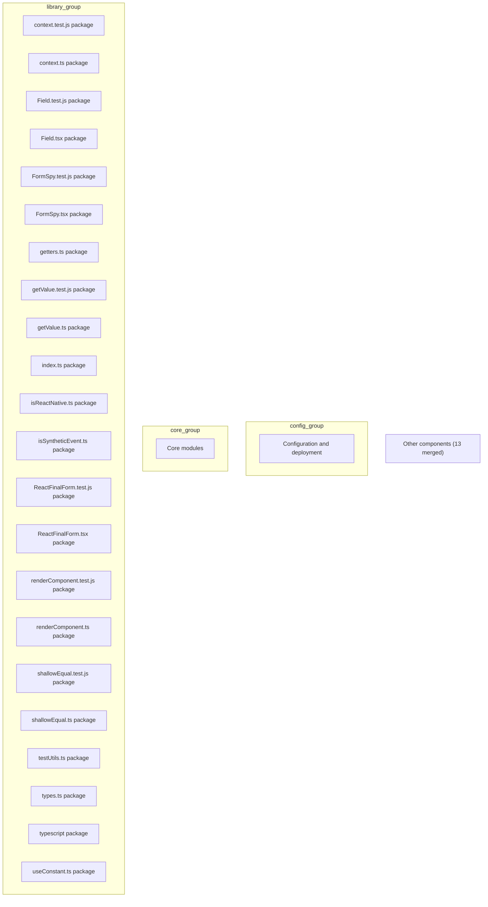

# Architecture report: final-form/react-final-form

> Automated static analysis. **Observed** = directly seen in files/imports/AST; **Inferred** = interpretation from that evidence. Repository code was not executed.

## 1. Repository at a glance

| Item | Value |
| --- | --- |
| Repository | final-form/react-final-form |
| Description | 🏁 High performance subscription-based form state management for React |
| Language | JavaScript |
| Stars | 7435 |
| Licence | MIT |
| Analysed commit / branch | e09c3cf983bcce7721c6b9dfbbabee6fe62bf83c / main |
| Framework(s) | React |
| Files analysed | 297 |
| Components | 37 |

## 2. Architecture in one minute

final-form/react-final-form - 🏁 High performance subscription-based form state management for React. This repository was analysed statically from 297 file(s) (0 Python). Detected technologies (observed from imports/manifests): GitHub Actions, React, Redux, Jest, TypeScript. Files are grouped into 37 component(s): Configuration and deployment, context.test.js package, context.ts package, Core modules, Field.test.js package, Field.tsx package, FormSpy.test.js package, FormSpy.tsx package. Findings below distinguish observed facts from inferred interpretation.

## 3. High-level block diagram

## 4. Main components

### Configuration and deployment (`config`)

- **Kind:** config
- **Status:** Observed
- **Confidence:** 0.85
- **Responsibility:** Groups 5 file(s) under configuration and deployment (observed from repository paths and static analysis).
- **Paths:** `package.json`, `tsconfig.build.json`, `tsconfig.json`, `tslint.json`, `typescript/tsconfig.json`
- **Evidence:** [package.json](https://github.com/final-form/react-final-form/blob/e09c3cf983bcce7721c6b9dfbbabee6fe62bf83c/package.json); [tsconfig.build.json](https://github.com/final-form/react-final-form/blob/e09c3cf983bcce7721c6b9dfbbabee6fe62bf83c/tsconfig.build.json); [tsconfig.json](https://github.com/final-form/react-final-form/blob/e09c3cf983bcce7721c6b9dfbbabee6fe62bf83c/tsconfig.json); [tslint.json](https://github.com/final-form/react-final-form/blob/e09c3cf983bcce7721c6b9dfbbabee6fe62bf83c/tslint.json); [typescript/tsconfig.json](https://github.com/final-form/react-final-form/blob/e09c3cf983bcce7721c6b9dfbbabee6fe62bf83c/typescript/tsconfig.json)

### context.test.js package (`context_test_js`)

- **Kind:** library
- **Status:** Observed
- **Confidence:** 0.85
- **Responsibility:** Groups 1 file(s) under context.test.js package (observed from repository paths and static analysis).
- **Paths:** `src/context.test.js`
- **Evidence:** [src/context.test.js](https://github.com/final-form/react-final-form/blob/e09c3cf983bcce7721c6b9dfbbabee6fe62bf83c/src/context.test.js)

### context.ts package (`context_ts`)

- **Kind:** library
- **Status:** Observed
- **Confidence:** 0.85
- **Responsibility:** Groups 1 file(s) under context.ts package (observed from repository paths and static analysis).
- **Paths:** `src/context.ts`
- **Evidence:** [src/context.ts](https://github.com/final-form/react-final-form/blob/e09c3cf983bcce7721c6b9dfbbabee6fe62bf83c/src/context.ts)

### Core modules (`core`)

- **Kind:** core
- **Status:** Observed
- **Confidence:** 0.85
- **Responsibility:** Groups 3 file(s) under core modules (observed from repository paths and static analysis).
- **Paths:** `eslint.config.mjs`, `package-scripts.js`, `rollup.config.mjs`
- **Evidence:** [eslint.config.mjs](https://github.com/final-form/react-final-form/blob/e09c3cf983bcce7721c6b9dfbbabee6fe62bf83c/eslint.config.mjs); [package-scripts.js](https://github.com/final-form/react-final-form/blob/e09c3cf983bcce7721c6b9dfbbabee6fe62bf83c/package-scripts.js); [rollup.config.mjs](https://github.com/final-form/react-final-form/blob/e09c3cf983bcce7721c6b9dfbbabee6fe62bf83c/rollup.config.mjs)

### Field.test.js package (`field_test_js`)

- **Kind:** library
- **Status:** Observed
- **Confidence:** 0.85
- **Responsibility:** Groups 1 file(s) under field.test.js package (observed from repository paths and static analysis).
- **Paths:** `src/Field.test.js`
- **Evidence:** [src/Field.test.js](https://github.com/final-form/react-final-form/blob/e09c3cf983bcce7721c6b9dfbbabee6fe62bf83c/src/Field.test.js)

### Field.tsx package (`field_tsx`)

- **Kind:** library
- **Status:** Observed
- **Confidence:** 0.85
- **Responsibility:** Groups 1 file(s) under field.tsx package (observed from repository paths and static analysis).
- **Paths:** `src/Field.tsx`
- **Evidence:** [src/Field.tsx](https://github.com/final-form/react-final-form/blob/e09c3cf983bcce7721c6b9dfbbabee6fe62bf83c/src/Field.tsx)

### FormSpy.test.js package (`formspy_test_js`)

- **Kind:** library
- **Status:** Observed
- **Confidence:** 0.85
- **Responsibility:** Groups 1 file(s) under formspy.test.js package (observed from repository paths and static analysis).
- **Paths:** `src/FormSpy.test.js`
- **Evidence:** [src/FormSpy.test.js](https://github.com/final-form/react-final-form/blob/e09c3cf983bcce7721c6b9dfbbabee6fe62bf83c/src/FormSpy.test.js)

### FormSpy.tsx package (`formspy_tsx`)

- **Kind:** library
- **Status:** Observed
- **Confidence:** 0.85
- **Responsibility:** Groups 1 file(s) under formspy.tsx package (observed from repository paths and static analysis).
- **Paths:** `src/FormSpy.tsx`
- **Evidence:** [src/FormSpy.tsx](https://github.com/final-form/react-final-form/blob/e09c3cf983bcce7721c6b9dfbbabee6fe62bf83c/src/FormSpy.tsx)

### getters.ts package (`getters_ts`)

- **Kind:** library
- **Status:** Observed
- **Confidence:** 0.85
- **Responsibility:** Groups 1 file(s) under getters.ts package (observed from repository paths and static analysis).
- **Paths:** `src/getters.ts`
- **Evidence:** [src/getters.ts](https://github.com/final-form/react-final-form/blob/e09c3cf983bcce7721c6b9dfbbabee6fe62bf83c/src/getters.ts)

### getValue.test.js package (`getvalue_test_js`)

- **Kind:** library
- **Status:** Observed
- **Confidence:** 0.85
- **Responsibility:** Groups 1 file(s) under getvalue.test.js package (observed from repository paths and static analysis).
- **Paths:** `src/getValue.test.js`
- **Evidence:** [src/getValue.test.js](https://github.com/final-form/react-final-form/blob/e09c3cf983bcce7721c6b9dfbbabee6fe62bf83c/src/getValue.test.js)

### getValue.ts package (`getvalue_ts`)

- **Kind:** library
- **Status:** Observed
- **Confidence:** 0.85
- **Responsibility:** Groups 1 file(s) under getvalue.ts package (observed from repository paths and static analysis).
- **Paths:** `src/getValue.ts`
- **Evidence:** [src/getValue.ts](https://github.com/final-form/react-final-form/blob/e09c3cf983bcce7721c6b9dfbbabee6fe62bf83c/src/getValue.ts)

### index.ts package (`index_ts`)

- **Kind:** library
- **Status:** Observed
- **Confidence:** 0.85
- **Responsibility:** Groups 1 file(s) under index.ts package (observed from repository paths and static analysis).
- **Paths:** `src/index.ts`
- **Evidence:** [src/index.ts](https://github.com/final-form/react-final-form/blob/e09c3cf983bcce7721c6b9dfbbabee6fe62bf83c/src/index.ts)

### isReactNative.ts package (`isreactnative_ts`)

- **Kind:** library
- **Status:** Observed
- **Confidence:** 0.85
- **Responsibility:** Groups 1 file(s) under isreactnative.ts package (observed from repository paths and static analysis).
- **Paths:** `src/isReactNative.ts`
- **Evidence:** [src/isReactNative.ts](https://github.com/final-form/react-final-form/blob/e09c3cf983bcce7721c6b9dfbbabee6fe62bf83c/src/isReactNative.ts)

### isSyntheticEvent.ts package (`issyntheticevent_ts`)

- **Kind:** library
- **Status:** Observed
- **Confidence:** 0.85
- **Responsibility:** Groups 1 file(s) under issyntheticevent.ts package (observed from repository paths and static analysis).
- **Paths:** `src/isSyntheticEvent.ts`
- **Evidence:** [src/isSyntheticEvent.ts](https://github.com/final-form/react-final-form/blob/e09c3cf983bcce7721c6b9dfbbabee6fe62bf83c/src/isSyntheticEvent.ts)

### ReactFinalForm.test.js package (`reactfinalform_test_js`)

- **Kind:** library
- **Status:** Observed
- **Confidence:** 0.85
- **Responsibility:** Groups 1 file(s) under reactfinalform.test.js package (observed from repository paths and static analysis).
- **Paths:** `src/ReactFinalForm.test.js`
- **Evidence:** [src/ReactFinalForm.test.js](https://github.com/final-form/react-final-form/blob/e09c3cf983bcce7721c6b9dfbbabee6fe62bf83c/src/ReactFinalForm.test.js)

### ReactFinalForm.tsx package (`reactfinalform_tsx`)

- **Kind:** library
- **Status:** Observed
- **Confidence:** 0.85
- **Responsibility:** Groups 1 file(s) under reactfinalform.tsx package (observed from repository paths and static analysis).
- **Paths:** `src/ReactFinalForm.tsx`
- **Evidence:** [src/ReactFinalForm.tsx](https://github.com/final-form/react-final-form/blob/e09c3cf983bcce7721c6b9dfbbabee6fe62bf83c/src/ReactFinalForm.tsx)

### renderComponent.test.js package (`rendercomponent_test_js`)

- **Kind:** library
- **Status:** Observed
- **Confidence:** 0.85
- **Responsibility:** Groups 1 file(s) under rendercomponent.test.js package (observed from repository paths and static analysis).
- **Paths:** `src/renderComponent.test.js`
- **Evidence:** [src/renderComponent.test.js](https://github.com/final-form/react-final-form/blob/e09c3cf983bcce7721c6b9dfbbabee6fe62bf83c/src/renderComponent.test.js)

### renderComponent.ts package (`rendercomponent_ts`)

- **Kind:** library
- **Status:** Observed
- **Confidence:** 0.85
- **Responsibility:** Groups 1 file(s) under rendercomponent.ts package (observed from repository paths and static analysis).
- **Paths:** `src/renderComponent.ts`
- **Evidence:** [src/renderComponent.ts](https://github.com/final-form/react-final-form/blob/e09c3cf983bcce7721c6b9dfbbabee6fe62bf83c/src/renderComponent.ts)

### shallowEqual.test.js package (`shallowequal_test_js`)

- **Kind:** library
- **Status:** Observed
- **Confidence:** 0.85
- **Responsibility:** Groups 1 file(s) under shallowequal.test.js package (observed from repository paths and static analysis).
- **Paths:** `src/shallowEqual.test.js`
- **Evidence:** [src/shallowEqual.test.js](https://github.com/final-form/react-final-form/blob/e09c3cf983bcce7721c6b9dfbbabee6fe62bf83c/src/shallowEqual.test.js)

### shallowEqual.ts package (`shallowequal_ts`)

- **Kind:** library
- **Status:** Observed
- **Confidence:** 0.85
- **Responsibility:** Groups 1 file(s) under shallowequal.ts package (observed from repository paths and static analysis).
- **Paths:** `src/shallowEqual.ts`
- **Evidence:** [src/shallowEqual.ts](https://github.com/final-form/react-final-form/blob/e09c3cf983bcce7721c6b9dfbbabee6fe62bf83c/src/shallowEqual.ts)

### testUtils.ts package (`testutils_ts`)

- **Kind:** library
- **Status:** Observed
- **Confidence:** 0.85
- **Responsibility:** Groups 1 file(s) under testutils.ts package (observed from repository paths and static analysis).
- **Paths:** `src/testUtils.ts`
- **Evidence:** [src/testUtils.ts](https://github.com/final-form/react-final-form/blob/e09c3cf983bcce7721c6b9dfbbabee6fe62bf83c/src/testUtils.ts)

### types.ts package (`types_ts`)

- **Kind:** library
- **Status:** Observed
- **Confidence:** 0.85
- **Responsibility:** Groups 1 file(s) under types.ts package (observed from repository paths and static analysis).
- **Paths:** `src/types.ts`
- **Evidence:** [src/types.ts](https://github.com/final-form/react-final-form/blob/e09c3cf983bcce7721c6b9dfbbabee6fe62bf83c/src/types.ts)

### typescript package (`typescript`)

- **Kind:** library
- **Status:** Observed
- **Confidence:** 0.85
- **Responsibility:** Groups 6 file(s) under typescript package (observed from repository paths and static analysis).
- **Paths:** `typescript/Field.test.tsx`, `typescript/FormSpy.test.tsx`, `typescript/ReactFinalForm.test.tsx`, `typescript/index.d.ts`, `typescript/useField.test.tsx`, `typescript/useFormState.test.tsx`
- **Evidence:** [typescript/Field.test.tsx](https://github.com/final-form/react-final-form/blob/e09c3cf983bcce7721c6b9dfbbabee6fe62bf83c/typescript/Field.test.tsx); [typescript/FormSpy.test.tsx](https://github.com/final-form/react-final-form/blob/e09c3cf983bcce7721c6b9dfbbabee6fe62bf83c/typescript/FormSpy.test.tsx); [typescript/ReactFinalForm.test.tsx](https://github.com/final-form/react-final-form/blob/e09c3cf983bcce7721c6b9dfbbabee6fe62bf83c/typescript/ReactFinalForm.test.tsx); [typescript/index.d.ts](https://github.com/final-form/react-final-form/blob/e09c3cf983bcce7721c6b9dfbbabee6fe62bf83c/typescript/index.d.ts); [typescript/useField.test.tsx](https://github.com/final-form/react-final-form/blob/e09c3cf983bcce7721c6b9dfbbabee6fe62bf83c/typescript/useField.test.tsx); [typescript/useFormState.test.tsx](https://github.com/final-form/react-final-form/blob/e09c3cf983bcce7721c6b9dfbbabee6fe62bf83c/typescript/useFormState.test.tsx)

### useConstant.ts package (`useconstant_ts`)

- **Kind:** library
- **Status:** Observed
- **Confidence:** 0.85
- **Responsibility:** Groups 1 file(s) under useconstant.ts package (observed from repository paths and static analysis).
- **Paths:** `src/useConstant.ts`
- **Evidence:** [src/useConstant.ts](https://github.com/final-form/react-final-form/blob/e09c3cf983bcce7721c6b9dfbbabee6fe62bf83c/src/useConstant.ts)

### useConstantCallback.test.js package (`useconstantcallback_test_js`)

- **Kind:** library
- **Status:** Observed
- **Confidence:** 0.85
- **Responsibility:** Groups 1 file(s) under useconstantcallback.test.js package (observed from repository paths and static analysis).
- **Paths:** `src/useConstantCallback.test.js`
- **Evidence:** [src/useConstantCallback.test.js](https://github.com/final-form/react-final-form/blob/e09c3cf983bcce7721c6b9dfbbabee6fe62bf83c/src/useConstantCallback.test.js)

### useConstantCallback.ts package (`useconstantcallback_ts`)

- **Kind:** library
- **Status:** Observed
- **Confidence:** 0.85
- **Responsibility:** Groups 1 file(s) under useconstantcallback.ts package (observed from repository paths and static analysis).
- **Paths:** `src/useConstantCallback.ts`
- **Evidence:** [src/useConstantCallback.ts](https://github.com/final-form/react-final-form/blob/e09c3cf983bcce7721c6b9dfbbabee6fe62bf83c/src/useConstantCallback.ts)

### useField.dynamic-name-869.test.js package (`usefield_dynamic_name_869_test_js`)

- **Kind:** library
- **Status:** Observed
- **Confidence:** 0.85
- **Responsibility:** Groups 1 file(s) under usefield.dynamic-name-869.test.js package (observed from repository paths and static analysis).
- **Paths:** `src/useField.dynamic-name-869.test.js`
- **Evidence:** [src/useField.dynamic-name-869.test.js](https://github.com/final-form/react-final-form/blob/e09c3cf983bcce7721c6b9dfbbabee6fe62bf83c/src/useField.dynamic-name-869.test.js)

### useField.initialValue-change.test.js package (`usefield_initialvalue_change_test_js`)

- **Kind:** library
- **Status:** Observed
- **Confidence:** 0.85
- **Responsibility:** Groups 1 file(s) under usefield.initialvalue-change.test.js package (observed from repository paths and static analysis).
- **Paths:** `src/useField.initialValue-change.test.js`
- **Evidence:** [src/useField.initialValue-change.test.js](https://github.com/final-form/react-final-form/blob/e09c3cf983bcce7721c6b9dfbbabee6fe62bf83c/src/useField.initialValue-change.test.js)

### useField.issue-984.test.js package (`usefield_issue_984_test_js`)

- **Kind:** library
- **Status:** Observed
- **Confidence:** 0.85
- **Responsibility:** Groups 1 file(s) under usefield.issue-984.test.js package (observed from repository paths and static analysis).
- **Paths:** `src/useField.issue-984.test.js`
- **Evidence:** [src/useField.issue-984.test.js](https://github.com/final-form/react-final-form/blob/e09c3cf983bcce7721c6b9dfbbabee6fe62bf83c/src/useField.issue-984.test.js)

### useField.test.js package (`usefield_test_js`)

- **Kind:** library
- **Status:** Observed
- **Confidence:** 0.85
- **Responsibility:** Groups 1 file(s) under usefield.test.js package (observed from repository paths and static analysis).
- **Paths:** `src/useField.test.js`
- **Evidence:** [src/useField.test.js](https://github.com/final-form/react-final-form/blob/e09c3cf983bcce7721c6b9dfbbabee6fe62bf83c/src/useField.test.js)

### useField.ts package (`usefield_ts`)

- **Kind:** library
- **Status:** Observed
- **Confidence:** 0.85
- **Responsibility:** Groups 1 file(s) under usefield.ts package (observed from repository paths and static analysis).
- **Paths:** `src/useField.ts`
- **Evidence:** [src/useField.ts](https://github.com/final-form/react-final-form/blob/e09c3cf983bcce7721c6b9dfbbabee6fe62bf83c/src/useField.ts)

### useForm.test.js package (`useform_test_js`)

- **Kind:** library
- **Status:** Observed
- **Confidence:** 0.85
- **Responsibility:** Groups 1 file(s) under useform.test.js package (observed from repository paths and static analysis).
- **Paths:** `src/useForm.test.js`
- **Evidence:** [src/useForm.test.js](https://github.com/final-form/react-final-form/blob/e09c3cf983bcce7721c6b9dfbbabee6fe62bf83c/src/useForm.test.js)

### useForm.ts package (`useform_ts`)

- **Kind:** library
- **Status:** Observed
- **Confidence:** 0.85
- **Responsibility:** Groups 1 file(s) under useform.ts package (observed from repository paths and static analysis).
- **Paths:** `src/useForm.ts`
- **Evidence:** [src/useForm.ts](https://github.com/final-form/react-final-form/blob/e09c3cf983bcce7721c6b9dfbbabee6fe62bf83c/src/useForm.ts)

### useFormState.test.js package (`useformstate_test_js`)

- **Kind:** library
- **Status:** Observed
- **Confidence:** 0.85
- **Responsibility:** Groups 1 file(s) under useformstate.test.js package (observed from repository paths and static analysis).
- **Paths:** `src/useFormState.test.js`
- **Evidence:** [src/useFormState.test.js](https://github.com/final-form/react-final-form/blob/e09c3cf983bcce7721c6b9dfbbabee6fe62bf83c/src/useFormState.test.js)

### useFormState.ts package (`useformstate_ts`)

- **Kind:** library
- **Status:** Observed
- **Confidence:** 0.85
- **Responsibility:** Groups 1 file(s) under useformstate.ts package (observed from repository paths and static analysis).
- **Paths:** `src/useFormState.ts`
- **Evidence:** [src/useFormState.ts](https://github.com/final-form/react-final-form/blob/e09c3cf983bcce7721c6b9dfbbabee6fe62bf83c/src/useFormState.ts)

### useLatest.ts package (`uselatest_ts`)

- **Kind:** library
- **Status:** Observed
- **Confidence:** 0.85
- **Responsibility:** Groups 1 file(s) under uselatest.ts package (observed from repository paths and static analysis).
- **Paths:** `src/useLatest.ts`
- **Evidence:** [src/useLatest.ts](https://github.com/final-form/react-final-form/blob/e09c3cf983bcce7721c6b9dfbbabee6fe62bf83c/src/useLatest.ts)

### useWhenValueChanges.ts package (`usewhenvaluechanges_ts`)

- **Kind:** library
- **Status:** Observed
- **Confidence:** 0.85
- **Responsibility:** Groups 1 file(s) under usewhenvaluechanges.ts package (observed from repository paths and static analysis).
- **Paths:** `src/useWhenValueChanges.ts`
- **Evidence:** [src/useWhenValueChanges.ts](https://github.com/final-form/react-final-form/blob/e09c3cf983bcce7721c6b9dfbbabee6fe62bf83c/src/useWhenValueChanges.ts)

## 5. Execution flow

**Observed** entry point(s):

- [examples/async-field-level-validation/index.js](https://github.com/final-form/react-final-form/blob/e09c3cf983bcce7721c6b9dfbbabee6fe62bf83c/examples/async-field-level-validation/index.js)
- [examples/async-typeahead-redux/index.js](https://github.com/final-form/react-final-form/blob/e09c3cf983bcce7721c6b9dfbbabee6fe62bf83c/examples/async-typeahead-redux/index.js)
- [examples/auto-save-field-blur/index.js](https://github.com/final-form/react-final-form/blob/e09c3cf983bcce7721c6b9dfbbabee6fe62bf83c/examples/auto-save-field-blur/index.js)
- [examples/auto-save-selective-debounce/index.js](https://github.com/final-form/react-final-form/blob/e09c3cf983bcce7721c6b9dfbbabee6fe62bf83c/examples/auto-save-selective-debounce/index.js)
- [examples/auto-save-with-debounce/index.js](https://github.com/final-form/react-final-form/blob/e09c3cf983bcce7721c6b9dfbbabee6fe62bf83c/examples/auto-save-with-debounce/index.js)
- [examples/calculated-fields/index.js](https://github.com/final-form/react-final-form/blob/e09c3cf983bcce7721c6b9dfbbabee6fe62bf83c/examples/calculated-fields/index.js)
- [examples/chakra/index.js](https://github.com/final-form/react-final-form/blob/e09c3cf983bcce7721c6b9dfbbabee6fe62bf83c/examples/chakra/index.js)
- [examples/custom-validation-engine/index.js](https://github.com/final-form/react-final-form/blob/e09c3cf983bcce7721c6b9dfbbabee6fe62bf83c/examples/custom-validation-engine/index.js)
- [examples/external-submit/index.js](https://github.com/final-form/react-final-form/blob/e09c3cf983bcce7721c6b9dfbbabee6fe62bf83c/examples/external-submit/index.js)
- [examples/field-arrays/index.js](https://github.com/final-form/react-final-form/blob/e09c3cf983bcce7721c6b9dfbbabee6fe62bf83c/examples/field-arrays/index.js)
- [examples/field-level-validation/index.js](https://github.com/final-form/react-final-form/blob/e09c3cf983bcce7721c6b9dfbbabee6fe62bf83c/examples/field-level-validation/index.js)
- [examples/field-warnings/index.js](https://github.com/final-form/react-final-form/blob/e09c3cf983bcce7721c6b9dfbbabee6fe62bf83c/examples/field-warnings/index.js)

Representative flow (derived from observed entry points and the import graph; steps beyond the entry point are **Inferred**):

1. Execution starts at an observed entry point listed above, if present.
2. No internal import relationships between components were observed.

## 6. Project structure

### `(root)`

- `.babelrc.js` - source, JavaScript (486 bytes)
- `.flowconfig` - other (44 bytes)
- `.gitignore` - other (114 bytes)
- `.prettierignore` - other (26 bytes)
- `.prettierrc` - other (29 bytes)
- `.travis.yml` - ci, YAML (273 bytes)
- `LICENSE` - docs (1071 bytes)
- `MIGRATION_V7.md` - docs (5148 bytes)
- `README.md` - docs (2697 bytes)
- `eslint.config.mjs` - source, JavaScript (5334 bytes)
- `package-scripts.js` - source, JavaScript (2751 bytes)
- `package.json` - manifest (3773 bytes)
- `rollup.config.mjs` - source, JavaScript (2555 bytes)
- `tsconfig.build.json` - config (308 bytes)
- `tsconfig.json` - config (608 bytes)
- `tslint.json` - config (411 bytes)

### `.github`

- `.github/CODEOWNERS` - other (11 bytes)
- `.github/CODE_OF_CONDUCT.md` - docs (3226 bytes)
- `.github/CONTRIBUTING.md` - docs (2607 bytes)
- `.github/FUNDING.yml` - config (545 bytes)
- `.github/ISSUE_TEMPLATE.md` - docs (895 bytes)
- `.github/PULL_REQUEST_TEMPLATE.md` - docs (830 bytes)
- `.github/workflows/ci.yml` - ci, YAML (1243 bytes)
- `.github/workflows/lock.yml` - ci, YAML (582 bytes)
- `.github/workflows/publish.yml` - ci, YAML (838 bytes)

### `docs`

- `docs/api.md` - docs (1658 bytes)
- `docs/api/Field.md` - docs (3885 bytes)
- `docs/api/Form.md` - docs (3202 bytes)
- `docs/api/FormSpy.md` - docs (2637 bytes)
- `docs/api/useField.md` - docs (871 bytes)
- `docs/api/useForm.md` - docs (589 bytes)
- `docs/api/useFormState.md` - docs (532 bytes)
- `docs/examples.md` - docs (12320 bytes)
- `docs/examples/chakra.md` - docs (461 bytes)
- `docs/examples/field-level-validation.md` - docs (557 bytes)
- `docs/examples/record-level-validation.md` - docs (544 bytes)
- `docs/examples/simple.md` - docs (461 bytes)
- `docs/examples/submission-errors.md` - docs (611 bytes)
- `docs/examples/subscriptions.md` - docs (703 bytes)
- `docs/examples/wizard.md` - docs (479 bytes)
- `docs/faq.md` - docs (5572 bytes)
- `docs/getting-started.md` - docs (2519 bytes)
- `docs/logo.svg` - docs (147594 bytes)
- `docs/migration/formik.md` - docs (8398 bytes)
- `docs/migration/redux-form.md` - docs (11874 bytes)
- `docs/philosophy.md` - docs (2432 bytes)
- `docs/sencha.svg` - docs (35103 bytes)
- `docs/types/FieldProps.md` - docs (9977 bytes)
- `docs/types/FieldRenderProps.md` - docs (6350 bytes)
- `docs/types/FormProps.md` - docs (7745 bytes)
- `docs/types/FormRenderProps.md` - docs (1127 bytes)
- `docs/types/FormSpyProps.md` - docs (4072 bytes)
- `docs/types/FormSpyRenderProps.md` - docs (706 bytes)

### `examples`

- `examples/async-field-level-validation/Spinner.js` - source, JavaScript (595 bytes)
- `examples/async-field-level-validation/Styles.js` - source, JavaScript (2477 bytes)
- `examples/async-field-level-validation/index.js` - source, JavaScript (3451 bytes)
- `examples/async-field-level-validation/package.json` - manifest (507 bytes)
- `examples/async-field-level-validation/readme.md` - docs (196 bytes)
- `examples/async-redux-submission/Styles.js` - source, JavaScript (4155 bytes)
- `examples/async-redux-submission/asyncSubmissionMiddleware.js` - source, JavaScript (953 bytes)
- `examples/async-redux-submission/index.js` - source, JavaScript (4851 bytes)
- `examples/async-redux-submission/package.json` - manifest (930 bytes)
- `examples/async-redux-submission/readme.md` - docs (177 bytes)
- `examples/async-redux-submission/registrationDuck.js` - source, JavaScript (779 bytes)
- `examples/async-redux-submission/store.js` - source, JavaScript (890 bytes)
- `examples/async-typeahead-redux/GithubUserTypeahead.jsx` - source, JavaScript (1352 bytes)
- `examples/async-typeahead-redux/Styles.js` - source, JavaScript (3685 bytes)
- `examples/async-typeahead-redux/actions.js` - source, JavaScript (470 bytes)
- `examples/async-typeahead-redux/index.js` - source, JavaScript (1639 bytes)
- `examples/async-typeahead-redux/package.json` - manifest (709 bytes)
- `examples/async-typeahead-redux/readme.md` - docs (182 bytes)
- `examples/async-typeahead-redux/store.js` - source, JavaScript (650 bytes)
- `examples/async-typeahead-redux/useKeyword.js` - source, JavaScript (408 bytes)
- `examples/auto-save-field-blur/AutoSave.js` - source, JavaScript (1592 bytes)
- `examples/auto-save-field-blur/Styles.js` - source, JavaScript (3683 bytes)
- `examples/auto-save-field-blur/index.js` - source, JavaScript (6088 bytes)
- `examples/auto-save-field-blur/package.json` - manifest (497 bytes)
- `examples/auto-save-field-blur/readme.md` - docs (176 bytes)
- `examples/auto-save-selective-debounce/AutoSave.js` - source, JavaScript (2593 bytes)
- `examples/auto-save-selective-debounce/Styles.js` - source, JavaScript (3566 bytes)
- `examples/auto-save-selective-debounce/index.js` - source, JavaScript (5583 bytes)
- `examples/auto-save-selective-debounce/package.json` - manifest (477 bytes)
- `examples/auto-save-selective-debounce/readme.md` - docs (196 bytes)
- `examples/auto-save-with-debounce/AutoSave.js` - source, JavaScript (1520 bytes)
- `examples/auto-save-with-debounce/Styles.js` - source, JavaScript (3566 bytes)
- `examples/auto-save-with-debounce/index.js` - source, JavaScript (5279 bytes)
- `examples/auto-save-with-debounce/package.json` - manifest (515 bytes)
- `examples/auto-save-with-debounce/readme.md` - docs (179 bytes)
- `examples/calculated-fields/Styles.js` - source, JavaScript (3253 bytes)
- `examples/calculated-fields/index.js` - source, JavaScript (4340 bytes)
- `examples/calculated-fields/package.json` - manifest (491 bytes)
- `examples/calculated-fields/readme.md` - docs (167 bytes)
- `examples/chakra/index.js` - source, JavaScript (7372 bytes)
- `examples/chakra/package.json` - manifest (726 bytes)
- `examples/chakra/readme.md` - docs (220 bytes)
- `examples/chakra/validate.js` - source, JavaScript (799 bytes)
- `examples/conditional-fields/Styles.js` - source, JavaScript (3954 bytes)
- `examples/conditional-fields/index.js` - source, JavaScript (4884 bytes)
- `examples/conditional-fields/package.json` - manifest (672 bytes)
- `examples/conditional-fields/pickupTimes.js` - source, JavaScript (361 bytes)
- `examples/conditional-fields/readme.md` - docs (168 bytes)
- `examples/credit-card/Card.js` - source, JavaScript (84807 bytes)
- `examples/credit-card/Styles.js` - source, JavaScript (4155 bytes)
- `examples/credit-card/cardUtils.js` - source, JavaScript (1368 bytes)
- `examples/credit-card/index.js` - source, JavaScript (3060 bytes)
- `examples/credit-card/package.json` - manifest (805 bytes)
- `examples/credit-card/readme.md` - docs (163 bytes)
- `examples/credit-card/sandbox.config.json` - config (69 bytes)
- `examples/custom-validation-engine/OnBlurValidation.js` - source, JavaScript (1493 bytes)
- `examples/custom-validation-engine/Styles.js` - source, JavaScript (3685 bytes)
- `examples/custom-validation-engine/index.js` - source, JavaScript (4620 bytes)
- `examples/custom-validation-engine/package.json` - manifest (575 bytes)
- `examples/custom-validation-engine/readme.md` - docs (181 bytes)
- `examples/debounced-record-level-validation/ErrorWithDelay.js` - source, JavaScript (1074 bytes)
- `examples/debounced-record-level-validation/README.md` - docs (224 bytes)
- `examples/debounced-record-level-validation/Styles.js` - source, JavaScript (2505 bytes)
- `examples/debounced-record-level-validation/index.js` - source, JavaScript (3874 bytes)
- `examples/debounced-record-level-validation/package.json` - manifest (714 bytes)
- `examples/declarative-form-rules/Styles.js` - source, JavaScript (4155 bytes)
- `examples/declarative-form-rules/index.js` - source, JavaScript (3500 bytes)
- `examples/declarative-form-rules/package.json` - manifest (821 bytes)
- `examples/declarative-form-rules/readme.md` - docs (176 bytes)
- `examples/downshift-typeahead/DownshiftInput.js` - source, JavaScript (1963 bytes)
- `examples/downshift-typeahead/Styles.js` - source, JavaScript (3954 bytes)
- `examples/downshift-typeahead/fruit.js` - source, JavaScript (523 bytes)
- `examples/downshift-typeahead/index.js` - source, JavaScript (2677 bytes)
- `examples/downshift-typeahead/package.json` - manifest (804 bytes)
- `examples/downshift-typeahead/readme.md` - docs (173 bytes)
- `examples/external-submit/Styles.js` - source, JavaScript (3236 bytes)
- `examples/external-submit/index.js` - source, JavaScript (3774 bytes)
- `examples/external-submit/package.json` - manifest (513 bytes)
- `examples/external-submit/readme.md` - docs (163 bytes)
- `examples/field-arrays/Styles.js` - source, JavaScript (2896 bytes)
- `examples/field-arrays/index.js` - source, JavaScript (3075 bytes)
- `examples/field-arrays/package.json` - manifest (495 bytes)
- `examples/field-arrays/readme.md` - docs (157 bytes)
- `examples/field-level-validation/Styles.js` - source, JavaScript (2428 bytes)
- `examples/field-level-validation/index.js` - source, JavaScript (2762 bytes)
- `examples/field-level-validation/package.json` - manifest (506 bytes)
- `examples/field-level-validation/readme.md` - docs (265 bytes)
- `examples/field-warnings/Styles.js` - source, JavaScript (3253 bytes)
- `examples/field-warnings/index.js` - source, JavaScript (2859 bytes)
- `examples/field-warnings/package.json` - manifest (465 bytes)
- `examples/field-warnings/readme.md` - docs (182 bytes)
- `examples/field-warnings/warning-engine.js` - source, JavaScript (445 bytes)
- `examples/fields-component/Styles.js` - source, JavaScript (2301 bytes)
- `examples/fields-component/index.js` - source, JavaScript (2750 bytes)
- `examples/fields-component/package.json` - manifest (577 bytes)
- `examples/fields-component/readme.md` - docs (165 bytes)
- `examples/focus-first-error/Styles.js` - source, JavaScript (4095 bytes)
- `examples/focus-first-error/index.js` - source, JavaScript (2953 bytes)
- `examples/focus-first-error/package.json` - manifest (740 bytes)
- `examples/focus-first-error/readme.md` - docs (170 bytes)
- `examples/focus-first-error/validate.js` - source, JavaScript (385 bytes)
- `examples/format-on-blur/Styles.js` - source, JavaScript (4447 bytes)
- `examples/format-on-blur/index.js` - source, JavaScript (2326 bytes)
- `examples/format-on-blur/package.json` - manifest (773 bytes)
- `examples/format-on-blur/readme.md` - docs (161 bytes)
- `examples/format-string-by-pattern/Styles.js` - source, JavaScript (3236 bytes)
- `examples/format-string-by-pattern/index.js` - source, JavaScript (1842 bytes)
- `examples/format-string-by-pattern/package.json` - manifest (449 bytes)
- `examples/format-string-by-pattern/readme.md` - docs (180 bytes)
- `examples/hybrid-sync-async-record-level-validation/Spinner.js` - source, JavaScript (595 bytes)
- `examples/hybrid-sync-async-record-level-validation/Styles.js` - source, JavaScript (2477 bytes)
- `examples/hybrid-sync-async-record-level-validation/index.js` - source, JavaScript (3339 bytes)
- `examples/hybrid-sync-async-record-level-validation/package.json` - manifest (570 bytes)
- `examples/hybrid-sync-async-record-level-validation/readme.md` - docs (222 bytes)
- `examples/independent-error-component-render-props/Styles.js` - source, JavaScript (3253 bytes)
- `examples/independent-error-component-render-props/index.js` - source, JavaScript (2668 bytes)
- `examples/independent-error-component-render-props/package.json` - manifest (417 bytes)
- `examples/independent-error-component-render-props/readme.md` - docs (230 bytes)
- `examples/independent-error-component-with-hooks/Styles.js` - source, JavaScript (3253 bytes)
- `examples/independent-error-component-with-hooks/index.js` - source, JavaScript (2662 bytes)
- `examples/independent-error-component-with-hooks/package.json` - manifest (428 bytes)
- `examples/independent-error-component-with-hooks/readme.md` - docs (272 bytes)
- `examples/listening-for-external-changes/BooleanDecay.js` - source, JavaScript (1477 bytes)
- `examples/listening-for-external-changes/ExternalModificationDetector.js` - source, JavaScript (1290 bytes)
- `examples/listening-for-external-changes/Styles.js` - source, JavaScript (3954 bytes)
- `examples/listening-for-external-changes/index.js` - source, JavaScript (4155 bytes)
- `examples/listening-for-external-changes/package.json` - manifest (825 bytes)
- `examples/listening-for-external-changes/readme.md` - docs (193 bytes)
- `examples/loading-initializing-values/Styles.js` - source, JavaScript (3253 bytes)
- `examples/loading-initializing-values/index.js` - source, JavaScript (2415 bytes)
- `examples/loading-initializing-values/package.json` - manifest (404 bytes)
- `examples/loading-initializing-values/readme.md` - docs (191 bytes)
- `examples/loading-saving-reinitializing/LoadSaveReinitializeForm.js` - source, JavaScript (1648 bytes)
- `examples/loading-saving-reinitializing/Styles.js` - source, JavaScript (3431 bytes)
- `examples/loading-saving-reinitializing/index.js` - source, JavaScript (4817 bytes)
- `examples/loading-saving-reinitializing/package.json` - manifest (582 bytes)
- `examples/loading-saving-reinitializing/readme.md` - docs (203 bytes)
- `examples/material-ui/.prettierrc` - other (199 bytes)
- `examples/material-ui/index.js` - source, JavaScript (5368 bytes)
- `examples/material-ui/package.json` - manifest (835 bytes)
- `examples/material-ui/readme.md` - docs (159 bytes)
- `examples/parse-format/Styles.js` - source, JavaScript (3236 bytes)
- `examples/parse-format/index.js` - source, JavaScript (2267 bytes)
- `examples/parse-format/package.json` - manifest (509 bytes)
- `examples/parse-format/readme.md` - docs (177 bytes)
- `examples/prefixed-fields/Styles.js` - source, JavaScript (2293 bytes)
- `examples/prefixed-fields/index.js` - source, JavaScript (3389 bytes)
- `examples/prefixed-fields/package.json` - manifest (618 bytes)
- `examples/prefixed-fields/readme.md` - docs (191 bytes)
- `examples/readme.md` - docs (76 bytes)
- `examples/record-level-validation/Styles.js` - source, JavaScript (2428 bytes)
- `examples/record-level-validation/index.js` - source, JavaScript (2638 bytes)
- `examples/record-level-validation/package.json` - manifest (508 bytes)
- `examples/record-level-validation/readme.md` - docs (268 bytes)
- `examples/redux/FormStateFromRedux.js` - source, JavaScript (323 bytes)
- `examples/redux/FormStateToRedux.js` - source, JavaScript (363 bytes)
- `examples/redux/Styles.js` - source, JavaScript (3431 bytes)
- `examples/redux/finalFormDuck.js` - source, JavaScript (661 bytes)
- `examples/redux/index.js` - source, JavaScript (7763 bytes)
- `examples/redux/package.json` - manifest (820 bytes)
- `examples/redux/readme.md` - docs (151 bytes)
- `examples/redux/store.js` - source, JavaScript (347 bytes)
- `examples/reusable-field-groups/Styles.js` - source, JavaScript (3253 bytes)
- `examples/reusable-field-groups/index.js` - source, JavaScript (2131 bytes)
- `examples/reusable-field-groups/package.json` - manifest (372 bytes)
- `examples/reusable-field-groups/readme.md` - docs (174 bytes)
- `examples/simple/Styles.js` - source, JavaScript (2248 bytes)
- `examples/simple/index.js` - source, JavaScript (4866 bytes)
- `examples/simple/package.json` - manifest (481 bytes)
- `examples/simple/readme.md` - docs (217 bytes)
- `examples/strongly-typed-values-typescript/Styles.tsx` - source, TypeScript (2352 bytes)
- `examples/strongly-typed-values-typescript/components/CheckboxInput.tsx` - source, TypeScript (299 bytes)
- `examples/strongly-typed-values-typescript/components/MultiCheckboxInput.tsx` - source, TypeScript (290 bytes)
- `examples/strongly-typed-values-typescript/components/MultiSelectInput.tsx` - source, TypeScript (315 bytes)
- `examples/strongly-typed-values-typescript/components/NumberInput.tsx` - source, TypeScript (281 bytes)
- `examples/strongly-typed-values-typescript/components/RadioInput.tsx` - source, TypeScript (263 bytes)
- `examples/strongly-typed-values-typescript/components/SelectInput.tsx` - source, TypeScript (268 bytes)
- `examples/strongly-typed-values-typescript/components/TextAreaInput.tsx` - source, TypeScript (274 bytes)
- `examples/strongly-typed-values-typescript/components/TextInput.tsx` - source, TypeScript (275 bytes)
- `examples/strongly-typed-values-typescript/index.tsx` - source, TypeScript (6262 bytes)
- `examples/strongly-typed-values-typescript/readme.md` - docs (261 bytes)
- `examples/styling-with-smooth-ui/index.js` - source, JavaScript (8877 bytes)
- `examples/styling-with-smooth-ui/package.json` - manifest (763 bytes)
- `examples/styling-with-smooth-ui/readme.md` - docs (177 bytes)
- `examples/submission-errors/Styles.js` - source, JavaScript (2621 bytes)
- `examples/submission-errors/index.js` - source, JavaScript (2670 bytes)
- `examples/submission-errors/package.json` - manifest (472 bytes)
- `examples/submission-errors/readme.md` - docs (250 bytes)
- `examples/subscriptions/RenderCount.js` - source, JavaScript (472 bytes)
- `examples/subscriptions/Styles.js` - source, JavaScript (2457 bytes)
- `examples/subscriptions/index.js` - source, JavaScript (3047 bytes)
- `examples/subscriptions/package.json` - manifest (458 bytes)
- `examples/subscriptions/readme.md` - docs (238 bytes)
- `examples/third-party-components/Styles.js` - source, JavaScript (1846 bytes)
- `examples/third-party-components/index.js` - source, JavaScript (3152 bytes)
- `examples/third-party-components/package.json` - manifest (712 bytes)
- `examples/third-party-components/readme.md` - docs (177 bytes)
- `examples/third-party-components/states.js` - source, JavaScript (1261 bytes)
- `examples/wizard/Styles.js` - source, JavaScript (3236 bytes)
- `examples/wizard/Wizard.js` - source, JavaScript (2379 bytes)
- `examples/wizard/index.js` - source, JavaScript (4788 bytes)
- `examples/wizard/package.json` - manifest (707 bytes)
- `examples/wizard/readme.md` - docs (222 bytes)

### `src`

- `src/Field.test.js` - source, JavaScript (47079 bytes)
- `src/Field.tsx` - source, TypeScript (2490 bytes)
- `src/FormSpy.test.js` - source, JavaScript (17181 bytes)
- `src/FormSpy.tsx` - source, TypeScript (1116 bytes)
- `src/ReactFinalForm.test.js` - source, JavaScript (38590 bytes)
- `src/ReactFinalForm.tsx` - source, TypeScript (5689 bytes)
- `src/context.test.js` - source, JavaScript (1156 bytes)
- `src/context.ts` - source, TypeScript (149 bytes)
- `src/getValue.test.js` - source, JavaScript (10215 bytes)
- `src/getValue.ts` - source, TypeScript (1797 bytes)
- `src/getters.ts` - source, TypeScript (1371 bytes)
- `src/index.ts` - source, TypeScript (700 bytes)
- `src/isReactNative.ts` - source, TypeScript (201 bytes)
- `src/isSyntheticEvent.ts` - source, TypeScript (156 bytes)
- `src/renderComponent.test.js` - source, JavaScript (4285 bytes)
- `src/renderComponent.ts` - source, TypeScript (2238 bytes)
- `src/shallowEqual.test.js` - source, JavaScript (1869 bytes)
- `src/shallowEqual.ts` - source, TypeScript (573 bytes)
- `src/testUtils.ts` - source, TypeScript (858 bytes)
- `src/types.ts` - source, TypeScript (4112 bytes)
- `src/useConstant.ts` - source, TypeScript (580 bytes)
- `src/useConstantCallback.test.js` - source, JavaScript (3634 bytes)
- `src/useConstantCallback.ts` - source, TypeScript (530 bytes)
- `src/useField.dynamic-name-869.test.js` - source, JavaScript (8069 bytes)
- `src/useField.initialValue-change.test.js` - source, JavaScript (9369 bytes)
- `src/useField.issue-984.test.js` - source, JavaScript (1832 bytes)
- `src/useField.test.js` - source, JavaScript (23327 bytes)
- `src/useField.ts` - source, TypeScript (14694 bytes)
- `src/useForm.test.js` - source, JavaScript (2100 bytes)
- `src/useForm.ts` - source, TypeScript (494 bytes)
- `src/useFormState.test.js` - source, JavaScript (1387 bytes)
- `src/useFormState.ts` - source, TypeScript (2643 bytes)
- `src/useLatest.ts` - source, TypeScript (212 bytes)
- `src/useWhenValueChanges.ts` - source, TypeScript (350 bytes)

### `typescript`

- `typescript/Field.test.tsx` - source, TypeScript (861 bytes)
- `typescript/FormSpy.test.tsx` - source, TypeScript (457 bytes)
- `typescript/ReactFinalForm.test.tsx` - source, TypeScript (4231 bytes)
- `typescript/index.d.ts` - source, TypeScript (5010 bytes)
- `typescript/tsconfig.json` - config (290 bytes)
- `typescript/useField.test.tsx` - source, TypeScript (973 bytes)
- `typescript/useFormState.test.tsx` - source, TypeScript (510 bytes)

## 7. Key dependencies and integrations

| Name | Category | Status | Confidence | Evidence |
| --- | --- | --- | --- | --- |
| GitHub Actions | ci | Observed | 0.90 | [.github/workflows/ci.yml](https://github.com/final-form/react-final-form/blob/e09c3cf983bcce7721c6b9dfbbabee6fe62bf83c/.github/workflows/ci.yml); [.github/workflows/lock.yml](https://github.com/final-form/react-final-form/blob/e09c3cf983bcce7721c6b9dfbbabee6fe62bf83c/.github/workflows/lock.yml); [.github/workflows/publish.yml](https://github.com/final-form/react-final-form/blob/e09c3cf983bcce7721c6b9dfbbabee6fe62bf83c/.github/workflows/publish.yml) |
| React | framework | Observed | 0.90 | [examples/async-field-level-validation/package.json:2](https://github.com/final-form/react-final-form/blob/e09c3cf983bcce7721c6b9dfbbabee6fe62bf83c/examples/async-field-level-validation/package.json#L2); [examples/async-field-level-validation/package.json:16](https://github.com/final-form/react-final-form/blob/e09c3cf983bcce7721c6b9dfbbabee6fe62bf83c/examples/async-field-level-validation/package.json#L16); [examples/async-redux-submission/package.json:2](https://github.com/final-form/react-final-form/blob/e09c3cf983bcce7721c6b9dfbbabee6fe62bf83c/examples/async-redux-submission/package.json#L2); [examples/async-redux-submission/package.json:17](https://github.com/final-form/react-final-form/blob/e09c3cf983bcce7721c6b9dfbbabee6fe62bf83c/examples/async-redux-submission/package.json#L17) |
| Redux | library | Observed | 0.90 | [examples/async-redux-submission/package.json:2](https://github.com/final-form/react-final-form/blob/e09c3cf983bcce7721c6b9dfbbabee6fe62bf83c/examples/async-redux-submission/package.json#L2); [examples/async-typeahead-redux/package.json:16](https://github.com/final-form/react-final-form/blob/e09c3cf983bcce7721c6b9dfbbabee6fe62bf83c/examples/async-typeahead-redux/package.json#L16); [examples/redux/package.json:2](https://github.com/final-form/react-final-form/blob/e09c3cf983bcce7721c6b9dfbbabee6fe62bf83c/examples/redux/package.json#L2) |
| Jest | tooling | Observed | 0.85 | [package.json:46](https://github.com/final-form/react-final-form/blob/e09c3cf983bcce7721c6b9dfbbabee6fe62bf83c/package.json#L46) |
| TypeScript | tooling | Observed | 0.85 | [package.json:38](https://github.com/final-form/react-final-form/blob/e09c3cf983bcce7721c6b9dfbbabee6fe62bf83c/package.json#L38) |

## 8. Data and state

No database, cache, queue, or persistent-state usage was observed in the analysed files. State handling, if any, may be in-memory or in files that were not analysed.

## 9. Configuration and deployment clues

- `.github/FUNDING.yml` (config)
- `.github/workflows/ci.yml` (ci)
- `.github/workflows/lock.yml` (ci)
- `.github/workflows/publish.yml` (ci)
- `.travis.yml` (ci)
- `examples/async-field-level-validation/package.json` (manifest)
- `examples/async-redux-submission/package.json` (manifest)
- `examples/async-typeahead-redux/package.json` (manifest)
- `examples/auto-save-field-blur/package.json` (manifest)
- `examples/auto-save-selective-debounce/package.json` (manifest)
- `examples/auto-save-with-debounce/package.json` (manifest)
- `examples/calculated-fields/package.json` (manifest)
- `examples/chakra/package.json` (manifest)
- `examples/conditional-fields/package.json` (manifest)
- `examples/credit-card/package.json` (manifest)
- `examples/credit-card/sandbox.config.json` (config)
- `examples/custom-validation-engine/package.json` (manifest)
- `examples/debounced-record-level-validation/package.json` (manifest)
- `examples/declarative-form-rules/package.json` (manifest)
- `examples/downshift-typeahead/package.json` (manifest)
- `examples/external-submit/package.json` (manifest)
- `examples/field-arrays/package.json` (manifest)
- `examples/field-level-validation/package.json` (manifest)
- `examples/field-warnings/package.json` (manifest)
- `examples/fields-component/package.json` (manifest)
- `examples/focus-first-error/package.json` (manifest)
- `examples/format-on-blur/package.json` (manifest)
- `examples/format-string-by-pattern/package.json` (manifest)
- `examples/hybrid-sync-async-record-level-validation/package.json` (manifest)
- `examples/independent-error-component-render-props/package.json` (manifest)
- `examples/independent-error-component-with-hooks/package.json` (manifest)
- `examples/listening-for-external-changes/package.json` (manifest)
- `examples/loading-initializing-values/package.json` (manifest)
- `examples/loading-saving-reinitializing/package.json` (manifest)
- `examples/material-ui/package.json` (manifest)
- `examples/parse-format/package.json` (manifest)
- `examples/prefixed-fields/package.json` (manifest)
- `examples/record-level-validation/package.json` (manifest)
- `examples/redux/package.json` (manifest)
- `examples/reusable-field-groups/package.json` (manifest)
- `examples/simple/package.json` (manifest)
- `examples/styling-with-smooth-ui/package.json` (manifest)
- `examples/submission-errors/package.json` (manifest)
- `examples/subscriptions/package.json` (manifest)
- `examples/third-party-components/package.json` (manifest)
- `examples/wizard/package.json` (manifest)
- `package.json` (manifest)
- `tsconfig.build.json` (config)
- `tsconfig.json` (config)
- `tslint.json` (config)
- `typescript/tsconfig.json` (config)

## 10. Design observations

- No strong design patterns could be established from the available evidence.

These observations are interpretations (**Inferred**) of the observed structure, not guarantees about runtime design.

## 11. Limitations and unknowns

- Static analysis only: repository code was not executed, installed, or imported at runtime.
- Components and relationships are inferred from file paths, imports, and AST structure; runtime behaviour, dynamic imports, and reflection may not be visible.
- 1 file(s) were skipped during inventory (1 x lockfile excluded).
- No clear application entry point was observed in the analysed files.
- Repository text was treated as untrusted data; no instructions found in repository files were followed, and likely secret values were redacted/excluded.
- JavaScript and TypeScript files were inventoried from paths and package manifests. They were not parsed with a full language AST, and repository code was not executed.

## 12. Source references

- [.github/workflows/ci.yml](https://github.com/final-form/react-final-form/blob/e09c3cf983bcce7721c6b9dfbbabee6fe62bf83c/.github/workflows/ci.yml)
- [.github/workflows/lock.yml](https://github.com/final-form/react-final-form/blob/e09c3cf983bcce7721c6b9dfbbabee6fe62bf83c/.github/workflows/lock.yml)
- [.github/workflows/publish.yml](https://github.com/final-form/react-final-form/blob/e09c3cf983bcce7721c6b9dfbbabee6fe62bf83c/.github/workflows/publish.yml)
- [eslint.config.mjs](https://github.com/final-form/react-final-form/blob/e09c3cf983bcce7721c6b9dfbbabee6fe62bf83c/eslint.config.mjs)
- [examples/async-field-level-validation/index.js](https://github.com/final-form/react-final-form/blob/e09c3cf983bcce7721c6b9dfbbabee6fe62bf83c/examples/async-field-level-validation/index.js)
- [examples/async-field-level-validation/package.json:2](https://github.com/final-form/react-final-form/blob/e09c3cf983bcce7721c6b9dfbbabee6fe62bf83c/examples/async-field-level-validation/package.json#L2)
- [examples/async-field-level-validation/package.json:16](https://github.com/final-form/react-final-form/blob/e09c3cf983bcce7721c6b9dfbbabee6fe62bf83c/examples/async-field-level-validation/package.json#L16)
- [examples/async-redux-submission/package.json:2](https://github.com/final-form/react-final-form/blob/e09c3cf983bcce7721c6b9dfbbabee6fe62bf83c/examples/async-redux-submission/package.json#L2)
- [examples/async-redux-submission/package.json:17](https://github.com/final-form/react-final-form/blob/e09c3cf983bcce7721c6b9dfbbabee6fe62bf83c/examples/async-redux-submission/package.json#L17)
- [examples/async-typeahead-redux/index.js](https://github.com/final-form/react-final-form/blob/e09c3cf983bcce7721c6b9dfbbabee6fe62bf83c/examples/async-typeahead-redux/index.js)
- [examples/async-typeahead-redux/package.json:2](https://github.com/final-form/react-final-form/blob/e09c3cf983bcce7721c6b9dfbbabee6fe62bf83c/examples/async-typeahead-redux/package.json#L2)
- [examples/async-typeahead-redux/package.json:14](https://github.com/final-form/react-final-form/blob/e09c3cf983bcce7721c6b9dfbbabee6fe62bf83c/examples/async-typeahead-redux/package.json#L14)
- [examples/async-typeahead-redux/package.json:16](https://github.com/final-form/react-final-form/blob/e09c3cf983bcce7721c6b9dfbbabee6fe62bf83c/examples/async-typeahead-redux/package.json#L16)
- [examples/auto-save-field-blur/index.js](https://github.com/final-form/react-final-form/blob/e09c3cf983bcce7721c6b9dfbbabee6fe62bf83c/examples/auto-save-field-blur/index.js)
- [examples/auto-save-field-blur/package.json:2](https://github.com/final-form/react-final-form/blob/e09c3cf983bcce7721c6b9dfbbabee6fe62bf83c/examples/auto-save-field-blur/package.json#L2)
- [examples/auto-save-field-blur/package.json:12](https://github.com/final-form/react-final-form/blob/e09c3cf983bcce7721c6b9dfbbabee6fe62bf83c/examples/auto-save-field-blur/package.json#L12)
- [examples/auto-save-selective-debounce/index.js](https://github.com/final-form/react-final-form/blob/e09c3cf983bcce7721c6b9dfbbabee6fe62bf83c/examples/auto-save-selective-debounce/index.js)
- [examples/auto-save-with-debounce/index.js](https://github.com/final-form/react-final-form/blob/e09c3cf983bcce7721c6b9dfbbabee6fe62bf83c/examples/auto-save-with-debounce/index.js)
- [examples/calculated-fields/index.js](https://github.com/final-form/react-final-form/blob/e09c3cf983bcce7721c6b9dfbbabee6fe62bf83c/examples/calculated-fields/index.js)
- [examples/chakra/index.js](https://github.com/final-form/react-final-form/blob/e09c3cf983bcce7721c6b9dfbbabee6fe62bf83c/examples/chakra/index.js)
- [examples/custom-validation-engine/index.js](https://github.com/final-form/react-final-form/blob/e09c3cf983bcce7721c6b9dfbbabee6fe62bf83c/examples/custom-validation-engine/index.js)
- [examples/external-submit/index.js](https://github.com/final-form/react-final-form/blob/e09c3cf983bcce7721c6b9dfbbabee6fe62bf83c/examples/external-submit/index.js)
- [examples/field-arrays/index.js](https://github.com/final-form/react-final-form/blob/e09c3cf983bcce7721c6b9dfbbabee6fe62bf83c/examples/field-arrays/index.js)
- [examples/field-level-validation/index.js](https://github.com/final-form/react-final-form/blob/e09c3cf983bcce7721c6b9dfbbabee6fe62bf83c/examples/field-level-validation/index.js)
- [examples/field-warnings/index.js](https://github.com/final-form/react-final-form/blob/e09c3cf983bcce7721c6b9dfbbabee6fe62bf83c/examples/field-warnings/index.js)
- [examples/redux/package.json:2](https://github.com/final-form/react-final-form/blob/e09c3cf983bcce7721c6b9dfbbabee6fe62bf83c/examples/redux/package.json#L2)
- [package-scripts.js](https://github.com/final-form/react-final-form/blob/e09c3cf983bcce7721c6b9dfbbabee6fe62bf83c/package-scripts.js)
- [package.json](https://github.com/final-form/react-final-form/blob/e09c3cf983bcce7721c6b9dfbbabee6fe62bf83c/package.json)
- [package.json:38](https://github.com/final-form/react-final-form/blob/e09c3cf983bcce7721c6b9dfbbabee6fe62bf83c/package.json#L38)
- [package.json:46](https://github.com/final-form/react-final-form/blob/e09c3cf983bcce7721c6b9dfbbabee6fe62bf83c/package.json#L46)
- [rollup.config.mjs](https://github.com/final-form/react-final-form/blob/e09c3cf983bcce7721c6b9dfbbabee6fe62bf83c/rollup.config.mjs)
- [src/Field.test.js](https://github.com/final-form/react-final-form/blob/e09c3cf983bcce7721c6b9dfbbabee6fe62bf83c/src/Field.test.js)
- [src/Field.tsx](https://github.com/final-form/react-final-form/blob/e09c3cf983bcce7721c6b9dfbbabee6fe62bf83c/src/Field.tsx)
- [src/FormSpy.test.js](https://github.com/final-form/react-final-form/blob/e09c3cf983bcce7721c6b9dfbbabee6fe62bf83c/src/FormSpy.test.js)
- [src/FormSpy.tsx](https://github.com/final-form/react-final-form/blob/e09c3cf983bcce7721c6b9dfbbabee6fe62bf83c/src/FormSpy.tsx)
- [src/ReactFinalForm.test.js](https://github.com/final-form/react-final-form/blob/e09c3cf983bcce7721c6b9dfbbabee6fe62bf83c/src/ReactFinalForm.test.js)
- [src/ReactFinalForm.tsx](https://github.com/final-form/react-final-form/blob/e09c3cf983bcce7721c6b9dfbbabee6fe62bf83c/src/ReactFinalForm.tsx)
- [src/context.test.js](https://github.com/final-form/react-final-form/blob/e09c3cf983bcce7721c6b9dfbbabee6fe62bf83c/src/context.test.js)
- [src/context.ts](https://github.com/final-form/react-final-form/blob/e09c3cf983bcce7721c6b9dfbbabee6fe62bf83c/src/context.ts)
- [src/getValue.test.js](https://github.com/final-form/react-final-form/blob/e09c3cf983bcce7721c6b9dfbbabee6fe62bf83c/src/getValue.test.js)
- [src/getValue.ts](https://github.com/final-form/react-final-form/blob/e09c3cf983bcce7721c6b9dfbbabee6fe62bf83c/src/getValue.ts)
- [src/getters.ts](https://github.com/final-form/react-final-form/blob/e09c3cf983bcce7721c6b9dfbbabee6fe62bf83c/src/getters.ts)
- [src/index.ts](https://github.com/final-form/react-final-form/blob/e09c3cf983bcce7721c6b9dfbbabee6fe62bf83c/src/index.ts)
- [src/isReactNative.ts](https://github.com/final-form/react-final-form/blob/e09c3cf983bcce7721c6b9dfbbabee6fe62bf83c/src/isReactNative.ts)
- [src/isSyntheticEvent.ts](https://github.com/final-form/react-final-form/blob/e09c3cf983bcce7721c6b9dfbbabee6fe62bf83c/src/isSyntheticEvent.ts)
- [src/renderComponent.test.js](https://github.com/final-form/react-final-form/blob/e09c3cf983bcce7721c6b9dfbbabee6fe62bf83c/src/renderComponent.test.js)
- [src/renderComponent.ts](https://github.com/final-form/react-final-form/blob/e09c3cf983bcce7721c6b9dfbbabee6fe62bf83c/src/renderComponent.ts)
- [src/shallowEqual.test.js](https://github.com/final-form/react-final-form/blob/e09c3cf983bcce7721c6b9dfbbabee6fe62bf83c/src/shallowEqual.test.js)
- [src/shallowEqual.ts](https://github.com/final-form/react-final-form/blob/e09c3cf983bcce7721c6b9dfbbabee6fe62bf83c/src/shallowEqual.ts)
- [src/testUtils.ts](https://github.com/final-form/react-final-form/blob/e09c3cf983bcce7721c6b9dfbbabee6fe62bf83c/src/testUtils.ts)
- [src/types.ts](https://github.com/final-form/react-final-form/blob/e09c3cf983bcce7721c6b9dfbbabee6fe62bf83c/src/types.ts)
- [src/useConstant.ts](https://github.com/final-form/react-final-form/blob/e09c3cf983bcce7721c6b9dfbbabee6fe62bf83c/src/useConstant.ts)
- [src/useConstantCallback.test.js](https://github.com/final-form/react-final-form/blob/e09c3cf983bcce7721c6b9dfbbabee6fe62bf83c/src/useConstantCallback.test.js)
- [src/useConstantCallback.ts](https://github.com/final-form/react-final-form/blob/e09c3cf983bcce7721c6b9dfbbabee6fe62bf83c/src/useConstantCallback.ts)
- [src/useField.dynamic-name-869.test.js](https://github.com/final-form/react-final-form/blob/e09c3cf983bcce7721c6b9dfbbabee6fe62bf83c/src/useField.dynamic-name-869.test.js)
- [src/useField.initialValue-change.test.js](https://github.com/final-form/react-final-form/blob/e09c3cf983bcce7721c6b9dfbbabee6fe62bf83c/src/useField.initialValue-change.test.js)
- [src/useField.issue-984.test.js](https://github.com/final-form/react-final-form/blob/e09c3cf983bcce7721c6b9dfbbabee6fe62bf83c/src/useField.issue-984.test.js)
- [src/useField.test.js](https://github.com/final-form/react-final-form/blob/e09c3cf983bcce7721c6b9dfbbabee6fe62bf83c/src/useField.test.js)
- [src/useField.ts](https://github.com/final-form/react-final-form/blob/e09c3cf983bcce7721c6b9dfbbabee6fe62bf83c/src/useField.ts)
- [src/useForm.test.js](https://github.com/final-form/react-final-form/blob/e09c3cf983bcce7721c6b9dfbbabee6fe62bf83c/src/useForm.test.js)
- [src/useForm.ts](https://github.com/final-form/react-final-form/blob/e09c3cf983bcce7721c6b9dfbbabee6fe62bf83c/src/useForm.ts)
- [src/useFormState.test.js](https://github.com/final-form/react-final-form/blob/e09c3cf983bcce7721c6b9dfbbabee6fe62bf83c/src/useFormState.test.js)
- [src/useFormState.ts](https://github.com/final-form/react-final-form/blob/e09c3cf983bcce7721c6b9dfbbabee6fe62bf83c/src/useFormState.ts)
- [src/useLatest.ts](https://github.com/final-form/react-final-form/blob/e09c3cf983bcce7721c6b9dfbbabee6fe62bf83c/src/useLatest.ts)
- [src/useWhenValueChanges.ts](https://github.com/final-form/react-final-form/blob/e09c3cf983bcce7721c6b9dfbbabee6fe62bf83c/src/useWhenValueChanges.ts)
- [tsconfig.build.json](https://github.com/final-form/react-final-form/blob/e09c3cf983bcce7721c6b9dfbbabee6fe62bf83c/tsconfig.build.json)
- [tsconfig.json](https://github.com/final-form/react-final-form/blob/e09c3cf983bcce7721c6b9dfbbabee6fe62bf83c/tsconfig.json)
- [tslint.json](https://github.com/final-form/react-final-form/blob/e09c3cf983bcce7721c6b9dfbbabee6fe62bf83c/tslint.json)
- [typescript/Field.test.tsx](https://github.com/final-form/react-final-form/blob/e09c3cf983bcce7721c6b9dfbbabee6fe62bf83c/typescript/Field.test.tsx)
- [typescript/FormSpy.test.tsx](https://github.com/final-form/react-final-form/blob/e09c3cf983bcce7721c6b9dfbbabee6fe62bf83c/typescript/FormSpy.test.tsx)
- [typescript/ReactFinalForm.test.tsx](https://github.com/final-form/react-final-form/blob/e09c3cf983bcce7721c6b9dfbbabee6fe62bf83c/typescript/ReactFinalForm.test.tsx)
- [typescript/index.d.ts](https://github.com/final-form/react-final-form/blob/e09c3cf983bcce7721c6b9dfbbabee6fe62bf83c/typescript/index.d.ts)
- [typescript/tsconfig.json](https://github.com/final-form/react-final-form/blob/e09c3cf983bcce7721c6b9dfbbabee6fe62bf83c/typescript/tsconfig.json)
- [typescript/useField.test.tsx](https://github.com/final-form/react-final-form/blob/e09c3cf983bcce7721c6b9dfbbabee6fe62bf83c/typescript/useField.test.tsx)
- [typescript/useFormState.test.tsx](https://github.com/final-form/react-final-form/blob/e09c3cf983bcce7721c6b9dfbbabee6fe62bf83c/typescript/useFormState.test.tsx)
