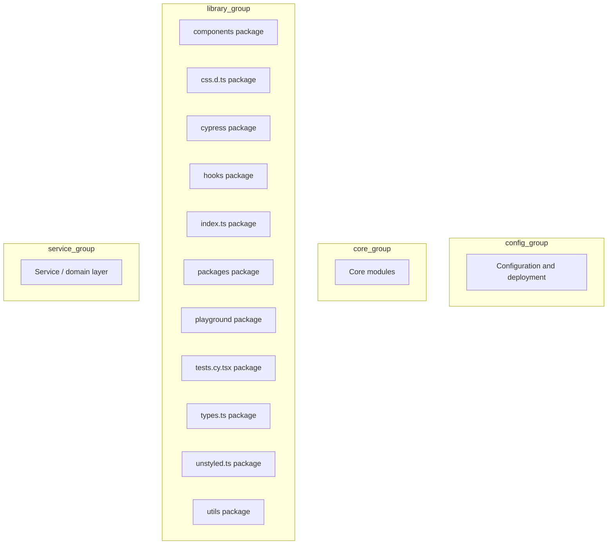

# Architecture report: fkhadra/react-toastify

> Automated static analysis. **Observed** = directly seen in files/imports/AST; **Inferred** = interpretation from that evidence. Repository code was not executed.

## 1. Repository at a glance

| Item | Value |
| --- | --- |
| Repository | fkhadra/react-toastify |
| Description | React notification made easy 🚀 ! |
| Language | TypeScript |
| Stars | 13439 |
| Licence | MIT |
| Analysed commit / branch | f3069891e0f2309cd53a691f38012b8960afc98b / main |
| Framework(s) | React |
| Files analysed | 83 |
| Components | 14 |

## 2. Architecture in one minute

fkhadra/react-toastify - React notification made easy 🚀 !. This repository was analysed statically from 83 file(s) (0 Python). Detected technologies (observed from imports/manifests): GitHub Actions, React, TypeScript, Vite. Files are grouped into 14 component(s): components package, Configuration and deployment, Core modules, css.d.ts package, cypress package, hooks package, index.ts package, packages package. Findings below distinguish observed facts from inferred interpretation.

## 3. High-level block diagram

## 4. Main components

### components package (`components`)

- **Kind:** library
- **Status:** Observed
- **Confidence:** 0.85
- **Responsibility:** Groups 13 file(s) under components package (observed from repository paths and static analysis).
- **Paths:** `src/components/CloseButton.cy.tsx`, `src/components/CloseButton.tsx`, `src/components/Icons.cy.tsx`, `src/components/Icons.tsx`, `src/components/ProgressBar.cy.tsx`, `src/components/ProgressBar.tsx`, `src/components/StyledToastContainer.cy.tsx`, `src/components/StyledToastContainer.tsx`, `src/components/Toast.cy.tsx`, `src/components/Toast.tsx`, `src/components/ToastContainer.tsx`, `src/components/Transitions.tsx`, `src/components/index.tsx`
- **Evidence:** [src/components/CloseButton.cy.tsx](https://github.com/fkhadra/react-toastify/blob/f3069891e0f2309cd53a691f38012b8960afc98b/src/components/CloseButton.cy.tsx); [src/components/CloseButton.tsx](https://github.com/fkhadra/react-toastify/blob/f3069891e0f2309cd53a691f38012b8960afc98b/src/components/CloseButton.tsx); [src/components/Icons.cy.tsx](https://github.com/fkhadra/react-toastify/blob/f3069891e0f2309cd53a691f38012b8960afc98b/src/components/Icons.cy.tsx); [src/components/Icons.tsx](https://github.com/fkhadra/react-toastify/blob/f3069891e0f2309cd53a691f38012b8960afc98b/src/components/Icons.tsx); [src/components/ProgressBar.cy.tsx](https://github.com/fkhadra/react-toastify/blob/f3069891e0f2309cd53a691f38012b8960afc98b/src/components/ProgressBar.cy.tsx); [src/components/ProgressBar.tsx](https://github.com/fkhadra/react-toastify/blob/f3069891e0f2309cd53a691f38012b8960afc98b/src/components/ProgressBar.tsx); [src/components/StyledToastContainer.cy.tsx](https://github.com/fkhadra/react-toastify/blob/f3069891e0f2309cd53a691f38012b8960afc98b/src/components/StyledToastContainer.cy.tsx); [src/components/StyledToastContainer.tsx](https://github.com/fkhadra/react-toastify/blob/f3069891e0f2309cd53a691f38012b8960afc98b/src/components/StyledToastContainer.tsx)

### Configuration and deployment (`config`)

- **Kind:** config
- **Status:** Observed
- **Confidence:** 0.85
- **Responsibility:** Groups 8 file(s) under configuration and deployment (observed from repository paths and static analysis).
- **Paths:** `lefthook.yml`, `package.json`, `packages/use-notification-center/package.json`, `playground/package.json`, `playground/tsconfig.json`, `playground/tsconfig.node.json`, `pnpm-workspace.yaml`, `tsconfig.json`
- **Evidence:** [lefthook.yml](https://github.com/fkhadra/react-toastify/blob/f3069891e0f2309cd53a691f38012b8960afc98b/lefthook.yml); [package.json](https://github.com/fkhadra/react-toastify/blob/f3069891e0f2309cd53a691f38012b8960afc98b/package.json); [packages/use-notification-center/package.json](https://github.com/fkhadra/react-toastify/blob/f3069891e0f2309cd53a691f38012b8960afc98b/packages/use-notification-center/package.json); [playground/package.json](https://github.com/fkhadra/react-toastify/blob/f3069891e0f2309cd53a691f38012b8960afc98b/playground/package.json); [playground/tsconfig.json](https://github.com/fkhadra/react-toastify/blob/f3069891e0f2309cd53a691f38012b8960afc98b/playground/tsconfig.json); [playground/tsconfig.node.json](https://github.com/fkhadra/react-toastify/blob/f3069891e0f2309cd53a691f38012b8960afc98b/playground/tsconfig.node.json); [pnpm-workspace.yaml](https://github.com/fkhadra/react-toastify/blob/f3069891e0f2309cd53a691f38012b8960afc98b/pnpm-workspace.yaml); [tsconfig.json](https://github.com/fkhadra/react-toastify/blob/f3069891e0f2309cd53a691f38012b8960afc98b/tsconfig.json)

### Core modules (`core`)

- **Kind:** core
- **Status:** Observed
- **Confidence:** 0.85
- **Responsibility:** Groups 1 file(s) under core modules (observed from repository paths and static analysis).
- **Paths:** `cypress.config.ts`
- **Evidence:** [cypress.config.ts](https://github.com/fkhadra/react-toastify/blob/f3069891e0f2309cd53a691f38012b8960afc98b/cypress.config.ts)

### css.d.ts package (`css_d_ts`)

- **Kind:** library
- **Status:** Observed
- **Confidence:** 0.85
- **Responsibility:** Groups 1 file(s) under css.d.ts package (observed from repository paths and static analysis).
- **Paths:** `src/css.d.ts`
- **Evidence:** [src/css.d.ts](https://github.com/fkhadra/react-toastify/blob/f3069891e0f2309cd53a691f38012b8960afc98b/src/css.d.ts)

### cypress package (`cypress`)

- **Kind:** library
- **Status:** Observed
- **Confidence:** 0.85
- **Responsibility:** Groups 2 file(s) under cypress package (observed from repository paths and static analysis).
- **Paths:** `cypress/support/commands.ts`, `cypress/support/component.ts`
- **Evidence:** [cypress/support/commands.ts](https://github.com/fkhadra/react-toastify/blob/f3069891e0f2309cd53a691f38012b8960afc98b/cypress/support/commands.ts); [cypress/support/component.ts](https://github.com/fkhadra/react-toastify/blob/f3069891e0f2309cd53a691f38012b8960afc98b/cypress/support/component.ts)

### hooks package (`hooks`)

- **Kind:** library
- **Status:** Observed
- **Confidence:** 0.85
- **Responsibility:** Groups 7 file(s) under hooks package (observed from repository paths and static analysis).
- **Paths:** `src/hooks/index.ts`, `src/hooks/useIsomorphicLayoutEffect.ts`, `src/hooks/useStyleSheet.cy.tsx`, `src/hooks/useStyleSheet.ts`, `src/hooks/useStyleSheetAppend.cy.tsx`, `src/hooks/useToast.ts`, `src/hooks/useToastContainer.ts`
- **Evidence:** [src/hooks/index.ts](https://github.com/fkhadra/react-toastify/blob/f3069891e0f2309cd53a691f38012b8960afc98b/src/hooks/index.ts); [src/hooks/useIsomorphicLayoutEffect.ts](https://github.com/fkhadra/react-toastify/blob/f3069891e0f2309cd53a691f38012b8960afc98b/src/hooks/useIsomorphicLayoutEffect.ts); [src/hooks/useStyleSheet.cy.tsx](https://github.com/fkhadra/react-toastify/blob/f3069891e0f2309cd53a691f38012b8960afc98b/src/hooks/useStyleSheet.cy.tsx); [src/hooks/useStyleSheet.ts](https://github.com/fkhadra/react-toastify/blob/f3069891e0f2309cd53a691f38012b8960afc98b/src/hooks/useStyleSheet.ts); [src/hooks/useStyleSheetAppend.cy.tsx](https://github.com/fkhadra/react-toastify/blob/f3069891e0f2309cd53a691f38012b8960afc98b/src/hooks/useStyleSheetAppend.cy.tsx); [src/hooks/useToast.ts](https://github.com/fkhadra/react-toastify/blob/f3069891e0f2309cd53a691f38012b8960afc98b/src/hooks/useToast.ts); [src/hooks/useToastContainer.ts](https://github.com/fkhadra/react-toastify/blob/f3069891e0f2309cd53a691f38012b8960afc98b/src/hooks/useToastContainer.ts)

### index.ts package (`index_ts`)

- **Kind:** library
- **Status:** Observed
- **Confidence:** 0.85
- **Responsibility:** Groups 1 file(s) under index.ts package (observed from repository paths and static analysis).
- **Paths:** `src/index.ts`
- **Evidence:** [src/index.ts](https://github.com/fkhadra/react-toastify/blob/f3069891e0f2309cd53a691f38012b8960afc98b/src/index.ts)

### packages package (`packages`)

- **Kind:** library
- **Status:** Observed
- **Confidence:** 0.85
- **Responsibility:** Groups 3 file(s) under packages package (observed from repository paths and static analysis).
- **Paths:** `packages/use-notification-center/src/NotificationCenter.cy.tsx`, `packages/use-notification-center/src/index.ts`, `packages/use-notification-center/src/useNotificationCenter.ts`
- **Evidence:** [packages/use-notification-center/src/NotificationCenter.cy.tsx](https://github.com/fkhadra/react-toastify/blob/f3069891e0f2309cd53a691f38012b8960afc98b/packages/use-notification-center/src/NotificationCenter.cy.tsx); [packages/use-notification-center/src/index.ts](https://github.com/fkhadra/react-toastify/blob/f3069891e0f2309cd53a691f38012b8960afc98b/packages/use-notification-center/src/index.ts); [packages/use-notification-center/src/useNotificationCenter.ts](https://github.com/fkhadra/react-toastify/blob/f3069891e0f2309cd53a691f38012b8960afc98b/packages/use-notification-center/src/useNotificationCenter.ts)

### playground package (`playground`)

- **Kind:** library
- **Status:** Observed
- **Confidence:** 0.85
- **Responsibility:** Groups 11 file(s) under playground package (observed from repository paths and static analysis).
- **Paths:** `playground/.eslintrc.cjs`, `playground/src/components/App.tsx`, `playground/src/components/Checkbox.tsx`, `playground/src/components/ContainerCode.tsx`, `playground/src/components/Header.tsx`, `playground/src/components/Radio.tsx`, `playground/src/components/ToastCode.tsx`, `playground/src/components/constants.ts`, `playground/src/main.tsx`, `playground/src/vite-env.d.ts`, `playground/vite.config.ts`
- **Evidence:** [playground/.eslintrc.cjs](https://github.com/fkhadra/react-toastify/blob/f3069891e0f2309cd53a691f38012b8960afc98b/playground/.eslintrc.cjs); [playground/src/components/App.tsx](https://github.com/fkhadra/react-toastify/blob/f3069891e0f2309cd53a691f38012b8960afc98b/playground/src/components/App.tsx); [playground/src/components/Checkbox.tsx](https://github.com/fkhadra/react-toastify/blob/f3069891e0f2309cd53a691f38012b8960afc98b/playground/src/components/Checkbox.tsx); [playground/src/components/ContainerCode.tsx](https://github.com/fkhadra/react-toastify/blob/f3069891e0f2309cd53a691f38012b8960afc98b/playground/src/components/ContainerCode.tsx); [playground/src/components/Header.tsx](https://github.com/fkhadra/react-toastify/blob/f3069891e0f2309cd53a691f38012b8960afc98b/playground/src/components/Header.tsx); [playground/src/components/Radio.tsx](https://github.com/fkhadra/react-toastify/blob/f3069891e0f2309cd53a691f38012b8960afc98b/playground/src/components/Radio.tsx); [playground/src/components/ToastCode.tsx](https://github.com/fkhadra/react-toastify/blob/f3069891e0f2309cd53a691f38012b8960afc98b/playground/src/components/ToastCode.tsx); [playground/src/components/constants.ts](https://github.com/fkhadra/react-toastify/blob/f3069891e0f2309cd53a691f38012b8960afc98b/playground/src/components/constants.ts)

### Service / domain layer (`service_layer`)

- **Kind:** service
- **Status:** Observed
- **Confidence:** 0.85
- **Responsibility:** Groups 6 file(s) under service / domain layer (observed from repository paths and static analysis).
- **Paths:** `src/core/containerObserver.ts`, `src/core/genToastId.ts`, `src/core/index.ts`, `src/core/store.ts`, `src/core/toast.cy.tsx`, `src/core/toast.ts`
- **Evidence:** [src/core/containerObserver.ts](https://github.com/fkhadra/react-toastify/blob/f3069891e0f2309cd53a691f38012b8960afc98b/src/core/containerObserver.ts); [src/core/genToastId.ts](https://github.com/fkhadra/react-toastify/blob/f3069891e0f2309cd53a691f38012b8960afc98b/src/core/genToastId.ts); [src/core/index.ts](https://github.com/fkhadra/react-toastify/blob/f3069891e0f2309cd53a691f38012b8960afc98b/src/core/index.ts); [src/core/store.ts](https://github.com/fkhadra/react-toastify/blob/f3069891e0f2309cd53a691f38012b8960afc98b/src/core/store.ts); [src/core/toast.cy.tsx](https://github.com/fkhadra/react-toastify/blob/f3069891e0f2309cd53a691f38012b8960afc98b/src/core/toast.cy.tsx); [src/core/toast.ts](https://github.com/fkhadra/react-toastify/blob/f3069891e0f2309cd53a691f38012b8960afc98b/src/core/toast.ts)

### tests.cy.tsx package (`tests_cy_tsx`)

- **Kind:** library
- **Status:** Observed
- **Confidence:** 0.85
- **Responsibility:** Groups 1 file(s) under tests.cy.tsx package (observed from repository paths and static analysis).
- **Paths:** `src/tests.cy.tsx`
- **Evidence:** [src/tests.cy.tsx](https://github.com/fkhadra/react-toastify/blob/f3069891e0f2309cd53a691f38012b8960afc98b/src/tests.cy.tsx)

### types.ts package (`types_ts`)

- **Kind:** library
- **Status:** Observed
- **Confidence:** 0.85
- **Responsibility:** Groups 1 file(s) under types.ts package (observed from repository paths and static analysis).
- **Paths:** `src/types.ts`
- **Evidence:** [src/types.ts](https://github.com/fkhadra/react-toastify/blob/f3069891e0f2309cd53a691f38012b8960afc98b/src/types.ts)

### unstyled.ts package (`unstyled_ts`)

- **Kind:** library
- **Status:** Observed
- **Confidence:** 0.85
- **Responsibility:** Groups 1 file(s) under unstyled.ts package (observed from repository paths and static analysis).
- **Paths:** `src/unstyled.ts`
- **Evidence:** [src/unstyled.ts](https://github.com/fkhadra/react-toastify/blob/f3069891e0f2309cd53a691f38012b8960afc98b/src/unstyled.ts)

### utils package (`utils`)

- **Kind:** library
- **Status:** Observed
- **Confidence:** 0.85
- **Responsibility:** Groups 6 file(s) under utils package (observed from repository paths and static analysis).
- **Paths:** `src/utils/collapseToast.ts`, `src/utils/constant.ts`, `src/utils/cssTransition.tsx`, `src/utils/index.ts`, `src/utils/mapper.ts`, `src/utils/propValidator.ts`
- **Evidence:** [src/utils/collapseToast.ts](https://github.com/fkhadra/react-toastify/blob/f3069891e0f2309cd53a691f38012b8960afc98b/src/utils/collapseToast.ts); [src/utils/constant.ts](https://github.com/fkhadra/react-toastify/blob/f3069891e0f2309cd53a691f38012b8960afc98b/src/utils/constant.ts); [src/utils/cssTransition.tsx](https://github.com/fkhadra/react-toastify/blob/f3069891e0f2309cd53a691f38012b8960afc98b/src/utils/cssTransition.tsx); [src/utils/index.ts](https://github.com/fkhadra/react-toastify/blob/f3069891e0f2309cd53a691f38012b8960afc98b/src/utils/index.ts); [src/utils/mapper.ts](https://github.com/fkhadra/react-toastify/blob/f3069891e0f2309cd53a691f38012b8960afc98b/src/utils/mapper.ts); [src/utils/propValidator.ts](https://github.com/fkhadra/react-toastify/blob/f3069891e0f2309cd53a691f38012b8960afc98b/src/utils/propValidator.ts)

## 5. Execution flow

**Observed** entry point(s):

- [packages/use-notification-center/src/index.ts](https://github.com/fkhadra/react-toastify/blob/f3069891e0f2309cd53a691f38012b8960afc98b/packages/use-notification-center/src/index.ts)
- [playground/src/components/App.tsx](https://github.com/fkhadra/react-toastify/blob/f3069891e0f2309cd53a691f38012b8960afc98b/playground/src/components/App.tsx)
- [playground/src/main.tsx](https://github.com/fkhadra/react-toastify/blob/f3069891e0f2309cd53a691f38012b8960afc98b/playground/src/main.tsx)
- [src/components/index.tsx](https://github.com/fkhadra/react-toastify/blob/f3069891e0f2309cd53a691f38012b8960afc98b/src/components/index.tsx)
- [src/core/index.ts](https://github.com/fkhadra/react-toastify/blob/f3069891e0f2309cd53a691f38012b8960afc98b/src/core/index.ts)
- [src/hooks/index.ts](https://github.com/fkhadra/react-toastify/blob/f3069891e0f2309cd53a691f38012b8960afc98b/src/hooks/index.ts)
- [src/index.ts](https://github.com/fkhadra/react-toastify/blob/f3069891e0f2309cd53a691f38012b8960afc98b/src/index.ts)
- [src/utils/index.ts](https://github.com/fkhadra/react-toastify/blob/f3069891e0f2309cd53a691f38012b8960afc98b/src/utils/index.ts)

Representative flow (derived from observed entry points and the import graph; steps beyond the entry point are **Inferred**):

1. Execution starts at an observed entry point listed above, if present.
2. No internal import relationships between components were observed.

## 6. Project structure

### `(root)`

- `.gitignore` - other (176 bytes)
- `.nycrc.json` - config (266 bytes)
- `CLAUDE.md` - docs (8256 bytes)
- `CODE_OF_CONDUCT.md` - docs (3349 bytes)
- `CONTRIBUTING.md` - docs (1864 bytes)
- `LICENSE` - docs (1063 bytes)
- `README.md` - docs (5460 bytes)
- `cypress.config.ts` - source, TypeScript (285 bytes)
- `lefthook.yml` - config (127 bytes)
- `package.json` - manifest (2990 bytes)
- `pnpm-workspace.yaml` - config (103 bytes)
- `tsconfig.json` - config (278 bytes)
- `tsdown.config.mts` - other (1083 bytes)
- `vite.config.mts` - other (256 bytes)

### `.github`

- `.github/FUNDING.yml` - config (63 bytes)
- `.github/ISSUE_TEMPLATE.md` - docs (601 bytes)
- `.github/PULL_REQUEST_TEMPLATE.md` - docs (808 bytes)
- `.github/workflows/build.yaml` - ci, YAML (999 bytes)

### `cypress`

- `cypress/support/commands.ts` - source, TypeScript (1203 bytes)
- `cypress/support/component-index.html` - other (290 bytes)
- `cypress/support/component.ts` - source, TypeScript (1424 bytes)
- `cypress/support/style.css` - other (34 bytes)

### `packages`

- `packages/use-notification-center/package.json` - manifest (437 bytes)
- `packages/use-notification-center/src/NotificationCenter.cy.tsx` - source, TypeScript (4715 bytes)
- `packages/use-notification-center/src/index.ts` - source, TypeScript (41 bytes)
- `packages/use-notification-center/src/useNotificationCenter.ts` - source, TypeScript (8105 bytes)

### `playground`

- `playground/.eslintrc.cjs` - source, JavaScript (391 bytes)
- `playground/.gitignore` - other (253 bytes)
- `playground/index.html` - other (366 bytes)
- `playground/package.json` - manifest (577 bytes)
- `playground/public/vite.svg` - other (1497 bytes)
- `playground/src/assets/react.svg` - other (4126 bytes)
- `playground/src/components/App.tsx` - source, TypeScript (8400 bytes)
- `playground/src/components/Checkbox.tsx` - source, TypeScript (405 bytes)
- `playground/src/components/ContainerCode.tsx` - source, TypeScript (1896 bytes)
- `playground/src/components/Header.tsx` - source, TypeScript (2155 bytes)
- `playground/src/components/Radio.tsx` - source, TypeScript (740 bytes)
- `playground/src/components/ToastCode.tsx` - source, TypeScript (2129 bytes)
- `playground/src/components/constants.ts` - source, TypeScript (1172 bytes)
- `playground/src/index.css` - other (3323 bytes)
- `playground/src/main.tsx` - source, TypeScript (265 bytes)
- `playground/src/vite-env.d.ts` - source, TypeScript (38 bytes)
- `playground/tsconfig.json` - config (570 bytes)
- `playground/tsconfig.node.json` - config (213 bytes)
- `playground/vite.config.ts` - source, TypeScript (163 bytes)

### `src`

- `src/components/CloseButton.cy.tsx` - source, TypeScript (816 bytes)
- `src/components/CloseButton.tsx` - source, TypeScript (893 bytes)
- `src/components/Icons.cy.tsx` - source, TypeScript (1062 bytes)
- `src/components/Icons.tsx` - source, TypeScript (3155 bytes)
- `src/components/ProgressBar.cy.tsx` - source, TypeScript (2149 bytes)
- `src/components/ProgressBar.tsx` - source, TypeScript (3147 bytes)
- `src/components/StyledToastContainer.cy.tsx` - source, TypeScript (1271 bytes)
- `src/components/StyledToastContainer.tsx` - source, TypeScript (424 bytes)
- `src/components/Toast.cy.tsx` - source, TypeScript (10649 bytes)
- `src/components/Toast.tsx` - source, TypeScript (3355 bytes)
- `src/components/ToastContainer.tsx` - source, TypeScript (4902 bytes)
- `src/components/Transitions.tsx` - source, TypeScript (1026 bytes)
- `src/components/index.tsx` - source, TypeScript (194 bytes)
- `src/core/containerObserver.ts` - source, TypeScript (5050 bytes)
- `src/core/genToastId.ts` - source, TypeScript (68 bytes)
- `src/core/index.ts` - source, TypeScript (25 bytes)
- `src/core/store.ts` - source, TypeScript (3609 bytes)
- `src/core/toast.cy.tsx` - source, TypeScript (19862 bytes)
- `src/core/toast.ts` - source, TypeScript (9419 bytes)
- `src/css.d.ts` - source, TypeScript (160 bytes)
- `src/hooks/index.ts` - source, TypeScript (65 bytes)
- `src/hooks/useIsomorphicLayoutEffect.ts` - source, TypeScript (155 bytes)
- `src/hooks/useStyleSheet.cy.tsx` - source, TypeScript (1069 bytes)
- `src/hooks/useStyleSheet.ts` - source, TypeScript (947 bytes)
- `src/hooks/useStyleSheetAppend.cy.tsx` - source, TypeScript (927 bytes)
- `src/hooks/useToast.ts` - source, TypeScript (5081 bytes)
- `src/hooks/useToastContainer.ts` - source, TypeScript (1006 bytes)
- `src/index.ts` - source, TypeScript (773 bytes)
- `src/style.css` - other (18017 bytes)
- `src/tests.cy.tsx` - source, TypeScript (2505 bytes)
- `src/types.ts` - source, TypeScript (8777 bytes)
- `src/unstyled.ts` - source, TypeScript (697 bytes)
- `src/utils/collapseToast.ts` - source, TypeScript (565 bytes)
- `src/utils/constant.ts` - source, TypeScript (344 bytes)
- `src/utils/cssTransition.tsx` - source, TypeScript (2955 bytes)
- `src/utils/index.ts` - source, TypeScript (153 bytes)
- `src/utils/mapper.ts` - source, TypeScript (1157 bytes)
- `src/utils/propValidator.ts` - source, TypeScript (803 bytes)

## 7. Key dependencies and integrations

| Name | Category | Status | Confidence | Evidence |
| --- | --- | --- | --- | --- |
| GitHub Actions | ci | Observed | 0.85 | [.github/workflows/build.yaml](https://github.com/fkhadra/react-toastify/blob/f3069891e0f2309cd53a691f38012b8960afc98b/.github/workflows/build.yaml) |
| React | framework | Observed | 0.90 | [package.json:4](https://github.com/fkhadra/react-toastify/blob/f3069891e0f2309cd53a691f38012b8960afc98b/package.json#L4); [package.json:30](https://github.com/fkhadra/react-toastify/blob/f3069891e0f2309cd53a691f38012b8960afc98b/package.json#L30); [packages/use-notification-center/package.json:5](https://github.com/fkhadra/react-toastify/blob/f3069891e0f2309cd53a691f38012b8960afc98b/packages/use-notification-center/package.json#L5); [playground/package.json:13](https://github.com/fkhadra/react-toastify/blob/f3069891e0f2309cd53a691f38012b8960afc98b/playground/package.json#L13) |
| TypeScript | tooling | Observed | 0.90 | [package.json:52](https://github.com/fkhadra/react-toastify/blob/f3069891e0f2309cd53a691f38012b8960afc98b/package.json#L52); [playground/package.json:21](https://github.com/fkhadra/react-toastify/blob/f3069891e0f2309cd53a691f38012b8960afc98b/playground/package.json#L21) |
| Vite | tooling | Observed | 0.90 | [package.json:57](https://github.com/fkhadra/react-toastify/blob/f3069891e0f2309cd53a691f38012b8960afc98b/package.json#L57); [playground/package.json:7](https://github.com/fkhadra/react-toastify/blob/f3069891e0f2309cd53a691f38012b8960afc98b/playground/package.json#L7) |

## 8. Data and state

No database, cache, queue, or persistent-state usage was observed in the analysed files. State handling, if any, may be in-memory or in files that were not analysed.

## 9. Configuration and deployment clues

- `.github/FUNDING.yml` (config)
- `.github/workflows/build.yaml` (ci)
- `.nycrc.json` (config)
- `lefthook.yml` (config)
- `package.json` (manifest)
- `packages/use-notification-center/package.json` (manifest)
- `playground/package.json` (manifest)
- `playground/tsconfig.json` (config)
- `playground/tsconfig.node.json` (config)
- `pnpm-workspace.yaml` (config)
- `tsconfig.json` (config)

## 10. Design observations

- Service/domain code is distinct from entry and data code, suggesting layered separation (Inferred).

These observations are interpretations (**Inferred**) of the observed structure, not guarantees about runtime design.

## 11. Limitations and unknowns

- Static analysis only: repository code was not executed, installed, or imported at runtime.
- Components and relationships are inferred from file paths, imports, and AST structure; runtime behaviour, dynamic imports, and reflection may not be visible.
- 1 file(s) were skipped during inventory (1 x lockfile excluded).
- No clear application entry point was observed in the analysed files.
- Repository text was treated as untrusted data; no instructions found in repository files were followed, and likely secret values were redacted/excluded.
- JavaScript and TypeScript files were inventoried from paths and package manifests. They were not parsed with a full language AST, and repository code was not executed.

## 12. Source references

- [.github/workflows/build.yaml](https://github.com/fkhadra/react-toastify/blob/f3069891e0f2309cd53a691f38012b8960afc98b/.github/workflows/build.yaml)
- [cypress.config.ts](https://github.com/fkhadra/react-toastify/blob/f3069891e0f2309cd53a691f38012b8960afc98b/cypress.config.ts)
- [cypress/support/commands.ts](https://github.com/fkhadra/react-toastify/blob/f3069891e0f2309cd53a691f38012b8960afc98b/cypress/support/commands.ts)
- [cypress/support/component.ts](https://github.com/fkhadra/react-toastify/blob/f3069891e0f2309cd53a691f38012b8960afc98b/cypress/support/component.ts)
- [lefthook.yml](https://github.com/fkhadra/react-toastify/blob/f3069891e0f2309cd53a691f38012b8960afc98b/lefthook.yml)
- [package.json](https://github.com/fkhadra/react-toastify/blob/f3069891e0f2309cd53a691f38012b8960afc98b/package.json)
- [package.json:4](https://github.com/fkhadra/react-toastify/blob/f3069891e0f2309cd53a691f38012b8960afc98b/package.json#L4)
- [package.json:30](https://github.com/fkhadra/react-toastify/blob/f3069891e0f2309cd53a691f38012b8960afc98b/package.json#L30)
- [package.json:52](https://github.com/fkhadra/react-toastify/blob/f3069891e0f2309cd53a691f38012b8960afc98b/package.json#L52)
- [package.json:57](https://github.com/fkhadra/react-toastify/blob/f3069891e0f2309cd53a691f38012b8960afc98b/package.json#L57)
- [packages/use-notification-center/package.json](https://github.com/fkhadra/react-toastify/blob/f3069891e0f2309cd53a691f38012b8960afc98b/packages/use-notification-center/package.json)
- [packages/use-notification-center/package.json:5](https://github.com/fkhadra/react-toastify/blob/f3069891e0f2309cd53a691f38012b8960afc98b/packages/use-notification-center/package.json#L5)
- [packages/use-notification-center/src/NotificationCenter.cy.tsx](https://github.com/fkhadra/react-toastify/blob/f3069891e0f2309cd53a691f38012b8960afc98b/packages/use-notification-center/src/NotificationCenter.cy.tsx)
- [packages/use-notification-center/src/index.ts](https://github.com/fkhadra/react-toastify/blob/f3069891e0f2309cd53a691f38012b8960afc98b/packages/use-notification-center/src/index.ts)
- [packages/use-notification-center/src/useNotificationCenter.ts](https://github.com/fkhadra/react-toastify/blob/f3069891e0f2309cd53a691f38012b8960afc98b/packages/use-notification-center/src/useNotificationCenter.ts)
- [playground/.eslintrc.cjs](https://github.com/fkhadra/react-toastify/blob/f3069891e0f2309cd53a691f38012b8960afc98b/playground/.eslintrc.cjs)
- [playground/package.json](https://github.com/fkhadra/react-toastify/blob/f3069891e0f2309cd53a691f38012b8960afc98b/playground/package.json)
- [playground/package.json:7](https://github.com/fkhadra/react-toastify/blob/f3069891e0f2309cd53a691f38012b8960afc98b/playground/package.json#L7)
- [playground/package.json:13](https://github.com/fkhadra/react-toastify/blob/f3069891e0f2309cd53a691f38012b8960afc98b/playground/package.json#L13)
- [playground/package.json:14](https://github.com/fkhadra/react-toastify/blob/f3069891e0f2309cd53a691f38012b8960afc98b/playground/package.json#L14)
- [playground/package.json:21](https://github.com/fkhadra/react-toastify/blob/f3069891e0f2309cd53a691f38012b8960afc98b/playground/package.json#L21)
- [playground/src/components/App.tsx](https://github.com/fkhadra/react-toastify/blob/f3069891e0f2309cd53a691f38012b8960afc98b/playground/src/components/App.tsx)
- [playground/src/components/Checkbox.tsx](https://github.com/fkhadra/react-toastify/blob/f3069891e0f2309cd53a691f38012b8960afc98b/playground/src/components/Checkbox.tsx)
- [playground/src/components/ContainerCode.tsx](https://github.com/fkhadra/react-toastify/blob/f3069891e0f2309cd53a691f38012b8960afc98b/playground/src/components/ContainerCode.tsx)
- [playground/src/components/Header.tsx](https://github.com/fkhadra/react-toastify/blob/f3069891e0f2309cd53a691f38012b8960afc98b/playground/src/components/Header.tsx)
- [playground/src/components/Radio.tsx](https://github.com/fkhadra/react-toastify/blob/f3069891e0f2309cd53a691f38012b8960afc98b/playground/src/components/Radio.tsx)
- [playground/src/components/ToastCode.tsx](https://github.com/fkhadra/react-toastify/blob/f3069891e0f2309cd53a691f38012b8960afc98b/playground/src/components/ToastCode.tsx)
- [playground/src/components/constants.ts](https://github.com/fkhadra/react-toastify/blob/f3069891e0f2309cd53a691f38012b8960afc98b/playground/src/components/constants.ts)
- [playground/src/main.tsx](https://github.com/fkhadra/react-toastify/blob/f3069891e0f2309cd53a691f38012b8960afc98b/playground/src/main.tsx)
- [playground/tsconfig.json](https://github.com/fkhadra/react-toastify/blob/f3069891e0f2309cd53a691f38012b8960afc98b/playground/tsconfig.json)
- [playground/tsconfig.node.json](https://github.com/fkhadra/react-toastify/blob/f3069891e0f2309cd53a691f38012b8960afc98b/playground/tsconfig.node.json)
- [pnpm-workspace.yaml](https://github.com/fkhadra/react-toastify/blob/f3069891e0f2309cd53a691f38012b8960afc98b/pnpm-workspace.yaml)
- [src/components/CloseButton.cy.tsx](https://github.com/fkhadra/react-toastify/blob/f3069891e0f2309cd53a691f38012b8960afc98b/src/components/CloseButton.cy.tsx)
- [src/components/CloseButton.tsx](https://github.com/fkhadra/react-toastify/blob/f3069891e0f2309cd53a691f38012b8960afc98b/src/components/CloseButton.tsx)
- [src/components/Icons.cy.tsx](https://github.com/fkhadra/react-toastify/blob/f3069891e0f2309cd53a691f38012b8960afc98b/src/components/Icons.cy.tsx)
- [src/components/Icons.tsx](https://github.com/fkhadra/react-toastify/blob/f3069891e0f2309cd53a691f38012b8960afc98b/src/components/Icons.tsx)
- [src/components/ProgressBar.cy.tsx](https://github.com/fkhadra/react-toastify/blob/f3069891e0f2309cd53a691f38012b8960afc98b/src/components/ProgressBar.cy.tsx)
- [src/components/ProgressBar.tsx](https://github.com/fkhadra/react-toastify/blob/f3069891e0f2309cd53a691f38012b8960afc98b/src/components/ProgressBar.tsx)
- [src/components/StyledToastContainer.cy.tsx](https://github.com/fkhadra/react-toastify/blob/f3069891e0f2309cd53a691f38012b8960afc98b/src/components/StyledToastContainer.cy.tsx)
- [src/components/StyledToastContainer.tsx](https://github.com/fkhadra/react-toastify/blob/f3069891e0f2309cd53a691f38012b8960afc98b/src/components/StyledToastContainer.tsx)
- [src/components/index.tsx](https://github.com/fkhadra/react-toastify/blob/f3069891e0f2309cd53a691f38012b8960afc98b/src/components/index.tsx)
- [src/core/containerObserver.ts](https://github.com/fkhadra/react-toastify/blob/f3069891e0f2309cd53a691f38012b8960afc98b/src/core/containerObserver.ts)
- [src/core/genToastId.ts](https://github.com/fkhadra/react-toastify/blob/f3069891e0f2309cd53a691f38012b8960afc98b/src/core/genToastId.ts)
- [src/core/index.ts](https://github.com/fkhadra/react-toastify/blob/f3069891e0f2309cd53a691f38012b8960afc98b/src/core/index.ts)
- [src/core/store.ts](https://github.com/fkhadra/react-toastify/blob/f3069891e0f2309cd53a691f38012b8960afc98b/src/core/store.ts)
- [src/core/toast.cy.tsx](https://github.com/fkhadra/react-toastify/blob/f3069891e0f2309cd53a691f38012b8960afc98b/src/core/toast.cy.tsx)
- [src/core/toast.ts](https://github.com/fkhadra/react-toastify/blob/f3069891e0f2309cd53a691f38012b8960afc98b/src/core/toast.ts)
- [src/css.d.ts](https://github.com/fkhadra/react-toastify/blob/f3069891e0f2309cd53a691f38012b8960afc98b/src/css.d.ts)
- [src/hooks/index.ts](https://github.com/fkhadra/react-toastify/blob/f3069891e0f2309cd53a691f38012b8960afc98b/src/hooks/index.ts)
- [src/hooks/useIsomorphicLayoutEffect.ts](https://github.com/fkhadra/react-toastify/blob/f3069891e0f2309cd53a691f38012b8960afc98b/src/hooks/useIsomorphicLayoutEffect.ts)
- [src/hooks/useStyleSheet.cy.tsx](https://github.com/fkhadra/react-toastify/blob/f3069891e0f2309cd53a691f38012b8960afc98b/src/hooks/useStyleSheet.cy.tsx)
- [src/hooks/useStyleSheet.ts](https://github.com/fkhadra/react-toastify/blob/f3069891e0f2309cd53a691f38012b8960afc98b/src/hooks/useStyleSheet.ts)
- [src/hooks/useStyleSheetAppend.cy.tsx](https://github.com/fkhadra/react-toastify/blob/f3069891e0f2309cd53a691f38012b8960afc98b/src/hooks/useStyleSheetAppend.cy.tsx)
- [src/hooks/useToast.ts](https://github.com/fkhadra/react-toastify/blob/f3069891e0f2309cd53a691f38012b8960afc98b/src/hooks/useToast.ts)
- [src/hooks/useToastContainer.ts](https://github.com/fkhadra/react-toastify/blob/f3069891e0f2309cd53a691f38012b8960afc98b/src/hooks/useToastContainer.ts)
- [src/index.ts](https://github.com/fkhadra/react-toastify/blob/f3069891e0f2309cd53a691f38012b8960afc98b/src/index.ts)
- [src/tests.cy.tsx](https://github.com/fkhadra/react-toastify/blob/f3069891e0f2309cd53a691f38012b8960afc98b/src/tests.cy.tsx)
- [src/types.ts](https://github.com/fkhadra/react-toastify/blob/f3069891e0f2309cd53a691f38012b8960afc98b/src/types.ts)
- [src/unstyled.ts](https://github.com/fkhadra/react-toastify/blob/f3069891e0f2309cd53a691f38012b8960afc98b/src/unstyled.ts)
- [src/utils/collapseToast.ts](https://github.com/fkhadra/react-toastify/blob/f3069891e0f2309cd53a691f38012b8960afc98b/src/utils/collapseToast.ts)
- [src/utils/constant.ts](https://github.com/fkhadra/react-toastify/blob/f3069891e0f2309cd53a691f38012b8960afc98b/src/utils/constant.ts)
- [src/utils/cssTransition.tsx](https://github.com/fkhadra/react-toastify/blob/f3069891e0f2309cd53a691f38012b8960afc98b/src/utils/cssTransition.tsx)
- [src/utils/index.ts](https://github.com/fkhadra/react-toastify/blob/f3069891e0f2309cd53a691f38012b8960afc98b/src/utils/index.ts)
- [src/utils/mapper.ts](https://github.com/fkhadra/react-toastify/blob/f3069891e0f2309cd53a691f38012b8960afc98b/src/utils/mapper.ts)
- [src/utils/propValidator.ts](https://github.com/fkhadra/react-toastify/blob/f3069891e0f2309cd53a691f38012b8960afc98b/src/utils/propValidator.ts)
- [tsconfig.json](https://github.com/fkhadra/react-toastify/blob/f3069891e0f2309cd53a691f38012b8960afc98b/tsconfig.json)
