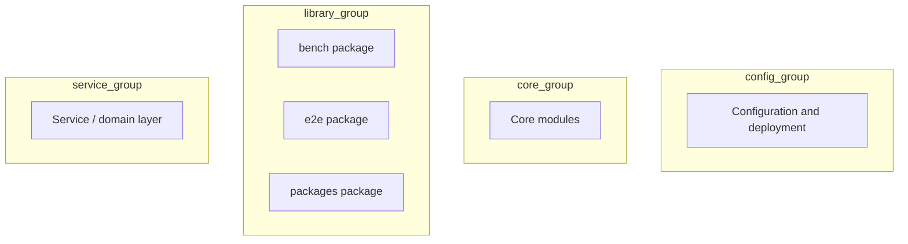

# Architecture report: formkit/formkit

> Automated static analysis. **Observed** = directly seen in files/imports/AST; **Inferred** = interpretation from that evidence. Repository code was not executed.

## 1. Repository at a glance

| Item | Value |
| --- | --- |
| Repository | formkit/formkit |
| Description | The form framework for coding agents |
| Language | TypeScript |
| Stars | 4787 |
| Licence | MIT |
| Analysed commit / branch | 990590a376c965e7a8fbd6f7061bc5b7528528f0 / master |
| Framework(s) | React, Vue |
| Files analysed | 799 |
| Components | 6 |

## 2. Architecture in one minute

formkit/formkit - The form framework for coding agents. This repository was analysed statically from 799 file(s) (0 Python). Detected technologies (observed from imports/manifests): GitHub Actions, React, Vue, axios, Tailwind CSS, TypeScript. Files are grouped into 6 component(s): bench package, Configuration and deployment, Core modules, e2e package, packages package, Service / domain layer. Findings below distinguish observed facts from inferred interpretation.

## 3. High-level block diagram

## 4. Main components

### bench package (`bench`)

- **Kind:** library
- **Status:** Observed
- **Confidence:** 0.85
- **Responsibility:** Groups 3 file(s) under bench package (observed from repository paths and static analysis).
- **Paths:** `bench/run.mjs`, `bench/src/main.js`, `bench/vite.config.mjs`
- **Evidence:** [bench/run.mjs](https://github.com/formkit/formkit/blob/990590a376c965e7a8fbd6f7061bc5b7528528f0/bench/run.mjs); [bench/src/main.js](https://github.com/formkit/formkit/blob/990590a376c965e7a8fbd6f7061bc5b7528528f0/bench/src/main.js); [bench/vite.config.mjs](https://github.com/formkit/formkit/blob/990590a376c965e7a8fbd6f7061bc5b7528528f0/bench/vite.config.mjs)

### Configuration and deployment (`config`)

- **Kind:** config
- **Status:** Observed
- **Confidence:** 0.85
- **Responsibility:** Groups 23 file(s) under configuration and deployment (observed from repository paths and static analysis).
- **Paths:** `e2e/package.json`, `package.json`, `packages/addons/package.json`, `packages/cli/assets/skills/formkit/agents/openai.yaml`, `packages/cli/package.json`, `packages/core/package.json`, `packages/dev/package.json`, `packages/formkit/package.json`, `packages/i18n/package.json`, `packages/icons/package.json`, `packages/inputs/package.json`, `packages/nuxt/package.json`, `packages/nuxt/playground/package.json`, `packages/nuxt/tsconfig.json`, `packages/observer/package.json`, `packages/react/package.json`, `packages/rules/package.json`, `packages/tailwindcss/package.json`, `packages/themes/package.json`, `packages/themes/tsconfig.json`, `packages/utils/package.json`, `packages/validation/package.json`, `packages/vue/package.json`
- **Evidence:** [e2e/package.json](https://github.com/formkit/formkit/blob/990590a376c965e7a8fbd6f7061bc5b7528528f0/e2e/package.json); [package.json](https://github.com/formkit/formkit/blob/990590a376c965e7a8fbd6f7061bc5b7528528f0/package.json); [packages/addons/package.json](https://github.com/formkit/formkit/blob/990590a376c965e7a8fbd6f7061bc5b7528528f0/packages/addons/package.json); [packages/cli/assets/skills/formkit/agents/openai.yaml](https://github.com/formkit/formkit/blob/990590a376c965e7a8fbd6f7061bc5b7528528f0/packages/cli/assets/skills/formkit/agents/openai.yaml); [packages/cli/package.json](https://github.com/formkit/formkit/blob/990590a376c965e7a8fbd6f7061bc5b7528528f0/packages/cli/package.json); [packages/core/package.json](https://github.com/formkit/formkit/blob/990590a376c965e7a8fbd6f7061bc5b7528528f0/packages/core/package.json); [packages/dev/package.json](https://github.com/formkit/formkit/blob/990590a376c965e7a8fbd6f7061bc5b7528528f0/packages/dev/package.json); [packages/formkit/package.json](https://github.com/formkit/formkit/blob/990590a376c965e7a8fbd6f7061bc5b7528528f0/packages/formkit/package.json)

### Core modules (`core`)

- **Kind:** core
- **Status:** Observed
- **Confidence:** 0.85
- **Responsibility:** Groups 2 file(s) under core modules (observed from repository paths and static analysis).
- **Paths:** `commitlint.config.js`, `eslint.config.js`
- **Evidence:** [commitlint.config.js](https://github.com/formkit/formkit/blob/990590a376c965e7a8fbd6f7061bc5b7528528f0/commitlint.config.js); [eslint.config.js](https://github.com/formkit/formkit/blob/990590a376c965e7a8fbd6f7061bc5b7528528f0/eslint.config.js)

### e2e package (`e2e`)

- **Kind:** library
- **Status:** Observed
- **Confidence:** 0.85
- **Responsibility:** Groups 7 file(s) under e2e package (observed from repository paths and static analysis).
- **Paths:** `e2e/memoryDOM.spec.ts`, `e2e/memoryNuxt.spec.ts`, `e2e/memoryReactSSR.spec.ts`, `e2e/memorySSR.spec.ts`, `e2e/servers/formKitMemoryServer.mjs`, `e2e/servers/formKitReactMemoryServer.mjs`, `e2e/servers/vueMemoryServer.mjs`
- **Evidence:** [e2e/memoryDOM.spec.ts](https://github.com/formkit/formkit/blob/990590a376c965e7a8fbd6f7061bc5b7528528f0/e2e/memoryDOM.spec.ts); [e2e/memoryNuxt.spec.ts](https://github.com/formkit/formkit/blob/990590a376c965e7a8fbd6f7061bc5b7528528f0/e2e/memoryNuxt.spec.ts); [e2e/memoryReactSSR.spec.ts](https://github.com/formkit/formkit/blob/990590a376c965e7a8fbd6f7061bc5b7528528f0/e2e/memoryReactSSR.spec.ts); [e2e/memorySSR.spec.ts](https://github.com/formkit/formkit/blob/990590a376c965e7a8fbd6f7061bc5b7528528f0/e2e/memorySSR.spec.ts); [e2e/servers/formKitMemoryServer.mjs](https://github.com/formkit/formkit/blob/990590a376c965e7a8fbd6f7061bc5b7528528f0/e2e/servers/formKitMemoryServer.mjs); [e2e/servers/formKitReactMemoryServer.mjs](https://github.com/formkit/formkit/blob/990590a376c965e7a8fbd6f7061bc5b7528528f0/e2e/servers/formKitReactMemoryServer.mjs); [e2e/servers/vueMemoryServer.mjs](https://github.com/formkit/formkit/blob/990590a376c965e7a8fbd6f7061bc5b7528528f0/e2e/servers/vueMemoryServer.mjs)

### packages package (`packages`)

- **Kind:** library
- **Status:** Observed
- **Confidence:** 0.85
- **Responsibility:** Groups 546 file(s) under packages package (observed from repository paths and static analysis).
- **Paths:** `packages/addons/__tests__/autoHeightTextarea.spec.ts`, `packages/addons/__tests__/describeForm.spec.ts`, `packages/addons/__tests__/fillForm.spec.ts`, `packages/addons/__tests__/floatingLabels.spec.ts`, `packages/addons/__tests__/localStorage.spec.ts`, `packages/addons/__tests__/multistep.spec.ts`, `packages/addons/src/index.ts`, `packages/addons/src/plugins/autoAnimatePlugin.ts`, `packages/addons/src/plugins/autoHeightTextarea.ts`, `packages/addons/src/plugins/describeForm.ts`, `packages/addons/src/plugins/fillForm.ts`, `packages/addons/src/plugins/floatingLabels/floatingLabelsPlugin.ts`, `packages/addons/src/plugins/inputCount.ts`, `packages/addons/src/plugins/localStoragePlugin.ts`, `packages/addons/src/plugins/maxlengthCountdown.ts`, `packages/addons/src/plugins/multiStep/multiStepPlugin.ts`, `packages/addons/src/plugins/multiStep/schema.ts`, `packages/addons/src/plugins/multiStep/sections/badge.ts`, `packages/addons/src/plugins/multiStep/sections/index.ts`, `packages/addons/src/plugins/multiStep/sections/multiStepOuter.ts`, `packages/addons/src/plugins/multiStep/sections/stepActions.ts`, `packages/addons/src/plugins/multiStep/sections/stepIcon.ts`, `packages/addons/src/plugins/multiStep/sections/stepInner.ts`, `packages/addons/src/plugins/multiStep/sections/stepNext.ts`, `packages/addons/src/plugins/multiStep/sections/stepOuter.ts`, `packages/addons/src/plugins/multiStep/sections/stepPrevious.ts`, `packages/addons/src/plugins/multiStep/sections/steps.ts`, `packages/addons/src/plugins/multiStep/sections/tab.ts`, `packages/addons/src/plugins/multiStep/sections/tabLabel.ts`, `packages/addons/src/plugins/multiStep/sections/tabs.ts`, `packages/addons/src/plugins/multiStep/sections/wrapper.ts`, `packages/cli/__tests__/cli.spec.ts`, `packages/cli/__tests__/mocks/localTheme.ts`, `packages/cli/__tests__/skill.spec.ts`, `packages/cli/__tests__/themeNormalize.spec.ts`, `packages/cli/bin/formkit.mjs`, `packages/cli/scripts/generate-skill-docs-index.mjs`, `packages/cli/src/createApp.ts`, `packages/cli/src/createTheme.ts`, `packages/cli/src/exportInput.ts`, `packages/cli/src/index.ts`, `packages/cli/src/skill.ts`, `packages/cli/src/skillDocs.ts`, `packages/cli/src/theme.ts`, `packages/cli/src/themeNormalize.ts`, `packages/cli/src/utils.ts`, `packages/dev/__tests__/handlers.spec.ts`, `packages/dev/src/index.ts`, `packages/formkit/bin/formkit.mjs`, `packages/formkit/src/index.ts`, `packages/i18n/__tests__/formatters.spec.ts`, `packages/i18n/__tests__/i18n.spec.ts`, `packages/i18n/src/formatters.ts`, `packages/i18n/src/i18n.ts`, `packages/i18n/src/index.ts`, `packages/i18n/src/locales/ar.ts`, `packages/i18n/src/locales/az.ts`, `packages/i18n/src/locales/bg.ts`, `packages/i18n/src/locales/bn.ts`, `packages/i18n/src/locales/bs.ts`, `packages/i18n/src/locales/ca.ts`, `packages/i18n/src/locales/cs.ts`, `packages/i18n/src/locales/da.ts`, `packages/i18n/src/locales/de.ts`, `packages/i18n/src/locales/el.ts`, `packages/i18n/src/locales/en.ts`, `packages/i18n/src/locales/es.ts`, `packages/i18n/src/locales/fa.ts`, `packages/i18n/src/locales/fi.ts`, `packages/i18n/src/locales/fr.ts`, `packages/i18n/src/locales/fy.ts`, `packages/i18n/src/locales/he.ts`, `packages/i18n/src/locales/hr.ts`, `packages/i18n/src/locales/hu.ts`, `packages/i18n/src/locales/id.ts`, `packages/i18n/src/locales/is.ts`, `packages/i18n/src/locales/it.ts`, `packages/i18n/src/locales/ja.ts`, `packages/i18n/src/locales/kk.ts`, `packages/i18n/src/locales/ko.ts`, `packages/i18n/src/locales/lt.ts`, `packages/i18n/src/locales/lv.ts`, `packages/i18n/src/locales/mn.ts`, `packages/i18n/src/locales/nb.ts`, `packages/i18n/src/locales/nl.ts`, `packages/i18n/src/locales/nn.ts`, `packages/i18n/src/locales/pl.ts`, `packages/i18n/src/locales/pt.ts`, `packages/i18n/src/locales/ro.ts`, `packages/i18n/src/locales/ru.ts`, `packages/i18n/src/locales/sk.ts`, `packages/i18n/src/locales/sl.ts`, `packages/i18n/src/locales/sr.ts`, `packages/i18n/src/locales/sv.ts`, `packages/i18n/src/locales/tet.ts`, `packages/i18n/src/locales/tg.ts`, `packages/i18n/src/locales/th.ts`, `packages/i18n/src/locales/tr.ts`, `packages/i18n/src/locales/uk.ts`, `packages/i18n/src/locales/uz.ts`, `packages/i18n/src/locales/vi.ts`, `packages/i18n/src/locales/zh-TW.ts`, `packages/i18n/src/locales/zh.ts`, `packages/icons/src/icons/application/Add.ts`, `packages/icons/src/icons/application/AvatarMan.ts`, `packages/icons/src/icons/application/AvatarWoman.ts`, `packages/icons/src/icons/application/Bookmark.ts`, `packages/icons/src/icons/application/Check.ts`, `packages/icons/src/icons/application/Circle.ts`, `packages/icons/src/icons/application/Close.ts`, `packages/icons/src/icons/application/Compress.ts`, `packages/icons/src/icons/application/DragHandle.ts`, `packages/icons/src/icons/application/Expand.ts`, `packages/icons/src/icons/application/Export.ts`, `packages/icons/src/icons/application/Eye.ts`, `packages/icons/src/icons/application/EyeClosed.ts`, `packages/icons/src/icons/application/FastForward.ts`, `packages/icons/src/icons/application/Flag.ts`, `packages/icons/src/icons/application/Happy.ts`, `packages/icons/src/icons/application/Heart.ts`, `packages/icons/src/icons/application/Help.ts`, `packages/icons/src/icons/application/Info.ts`, `packages/icons/src/icons/application/Link.ts`, `packages/icons/src/icons/application/LinkExternal.ts`, `packages/icons/src/icons/application/Megaphone.ts`, `packages/icons/src/icons/application/Minimize.ts`, `packages/icons/src/icons/application/Open.ts`, `packages/icons/src/icons/application/Pause.ts`, `packages/icons/src/icons/application/People.ts`, `packages/icons/src/icons/application/Play.ts`, `packages/icons/src/icons/application/PlayCircle.ts`, `packages/icons/src/icons/application/Refresh.ts`, `packages/icons/src/icons/application/Reorder.ts`, `packages/icons/src/icons/application/Reply.ts`, `packages/icons/src/icons/application/Rewind.ts`, `packages/icons/src/icons/application/Sad.ts`, `packages/icons/src/icons/application/Search.ts`, `packages/icons/src/icons/application/Settings.ts`, `packages/icons/src/icons/application/Share.ts`, `packages/icons/src/icons/application/Spinner.ts`, `packages/icons/src/icons/application/Star.ts`, `packages/icons/src/icons/application/Start.ts`, `packages/icons/src/icons/application/StepBack.ts`, `packages/icons/src/icons/application/StepForward.ts`, `packages/icons/src/icons/application/Stop.ts`, `packages/icons/src/icons/application/Table.ts`, `packages/icons/src/icons/application/Tag.ts`, `packages/icons/src/icons/application/Tools.ts`, `packages/icons/src/icons/application/Trash.ts`, `packages/icons/src/icons/application/VolumeDown.ts`, `packages/icons/src/icons/application/VolumeUp.ts`, `packages/icons/src/icons/application/Warning.ts`, `packages/icons/src/icons/application/index.ts`, `packages/icons/src/icons/brand/Android.ts`, `packages/icons/src/icons/brand/Apple.ts`, `packages/icons/src/icons/brand/Facebook.ts`, `packages/icons/src/icons/brand/Github.ts`, `packages/icons/src/icons/brand/Google.ts`, `packages/icons/src/icons/brand/Instagram.ts`, `packages/icons/src/icons/brand/Linkedin.ts`, `packages/icons/src/icons/brand/Medium.ts`, `packages/icons/src/icons/brand/Pinterest.ts`, `packages/icons/src/icons/brand/Reddit.ts`, `packages/icons/src/icons/brand/Skype.ts`, `packages/icons/src/icons/brand/Snapchat.ts`, `packages/icons/src/icons/brand/Tiktok.ts`, `packages/icons/src/icons/brand/Twitter.ts`, `packages/icons/src/icons/brand/Vimeo.ts`, `packages/icons/src/icons/brand/Whatsapp.ts`, `packages/icons/src/icons/brand/Wordpress.ts`, `packages/icons/src/icons/brand/Youtube.ts`, `packages/icons/src/icons/brand/index.ts`, `packages/icons/src/icons/crypto/Bitcoin.ts`, `packages/icons/src/icons/crypto/Bnb.ts`, `packages/icons/src/icons/crypto/Cardano.ts`, `packages/icons/src/icons/crypto/Dogecoin.ts`, `packages/icons/src/icons/crypto/Ethereum.ts`, `packages/icons/src/icons/crypto/Solana.ts`, `packages/icons/src/icons/crypto/Tether.ts`, `packages/icons/src/icons/crypto/Usdc.ts`, `packages/icons/src/icons/crypto/index.ts`, `packages/icons/src/icons/currency/Dollar.ts`, `packages/icons/src/icons/currency/Euro.ts`, `packages/icons/src/icons/currency/Franc.ts`, `packages/icons/src/icons/currency/Krona.ts`, `packages/icons/src/icons/currency/Lira.ts`, `packages/icons/src/icons/currency/MultiCurrency.ts`, `packages/icons/src/icons/currency/Peso.ts`, `packages/icons/src/icons/currency/Pound.ts`, `packages/icons/src/icons/currency/Ruble.ts`, `packages/icons/src/icons/currency/Rupee.ts`, `packages/icons/src/icons/currency/Shekel.ts`, `packages/icons/src/icons/currency/Won.ts`, `packages/icons/src/icons/currency/Yen.ts`, `packages/icons/src/icons/currency/Yuan.ts`, `packages/icons/src/icons/currency/index.ts`, `packages/icons/src/icons/directional/ArrowDown.ts`, `packages/icons/src/icons/directional/ArrowLeft.ts`, `packages/icons/src/icons/directional/ArrowRight.ts`, `packages/icons/src/icons/directional/ArrowUp.ts`, `packages/icons/src/icons/directional/CaretDown.ts`, `packages/icons/src/icons/directional/CaretLeft.ts`, `packages/icons/src/icons/directional/CaretRight.ts`, `packages/icons/src/icons/directional/CaretUp.ts`, `packages/icons/src/icons/directional/Down.ts`, `packages/icons/src/icons/directional/Left.ts`, `packages/icons/src/icons/directional/Right.ts`, `packages/icons/src/icons/directional/Up.ts`, `packages/icons/src/icons/directional/index.ts`, `packages/icons/src/icons/file/Download.ts`, `packages/icons/src/icons/file/DownloadCloud.ts`, `packages/icons/src/icons/file/FileAudio.ts`, `packages/icons/src/icons/file/FileDoc.ts`, `packages/icons/src/icons/file/FileImage.ts`, `packages/icons/src/icons/file/FilePdf.ts`, `packages/icons/src/icons/file/FileVideo.ts`, `packages/icons/src/icons/file/Folder.ts`, `packages/icons/src/icons/file/Upload.ts`, `packages/icons/src/icons/file/UploadCloud.ts`, `packages/icons/src/icons/file/Zip.ts`, `packages/icons/src/icons/file/index.ts`, `packages/icons/src/icons/input/Button.ts`, `packages/icons/src/icons/input/Checkbox.ts`, `packages/icons/src/icons/input/Color.ts`, `packages/icons/src/icons/input/Currency.ts`, `packages/icons/src/icons/input/Date.ts`, `packages/icons/src/icons/input/Datetime.ts`, `packages/icons/src/icons/input/Email.ts`, `packages/icons/src/icons/input/File.ts`, `packages/icons/src/icons/input/Group.ts`, `packages/icons/src/icons/input/Hidden.ts`, `packages/icons/src/icons/input/List.ts`, `packages/icons/src/icons/input/Month.ts`, `packages/icons/src/icons/input/Number.ts`, `packages/icons/src/icons/input/Password.ts`, `packages/icons/src/icons/input/Radio.ts`, `packages/icons/src/icons/input/Range.ts`, `packages/icons/src/icons/input/Repeater.ts`, `packages/icons/src/icons/input/Select.ts`, `packages/icons/src/icons/input/Submit.ts`, `packages/icons/src/icons/input/Telephone.ts`, `packages/icons/src/icons/input/Text.ts`, `packages/icons/src/icons/input/Textarea.ts`, `packages/icons/src/icons/input/Time.ts`, `packages/icons/src/icons/input/URL.ts`, `packages/icons/src/icons/input/Unit.ts`, `packages/icons/src/icons/input/Week.ts`, `packages/icons/src/icons/input/index.ts`, `packages/icons/src/icons/payment/Amex.ts`, `packages/icons/src/icons/payment/Discover.ts`, `packages/icons/src/icons/payment/Mastercard.ts`, `packages/icons/src/icons/payment/Paypal.ts`, `packages/icons/src/icons/payment/Stripe.ts`, `packages/icons/src/icons/payment/Visa.ts`, `packages/icons/src/icons/payment/index.ts`, `packages/icons/src/index.ts`, `packages/icons/src/plugin.ts`, `packages/inputs/__tests__/compose.spec.ts`, `packages/inputs/__tests__/features.spec.ts`, `packages/inputs/__tests__/types.test-d.ts`, `packages/inputs/src/compose.ts`, `packages/inputs/src/createSection.ts`, `packages/inputs/src/features/casts.ts`, `packages/inputs/src/features/checkboxes.ts`, `packages/inputs/src/features/disables.ts`, `packages/inputs/src/features/files.ts`, `packages/inputs/src/features/forms.ts`, `packages/inputs/src/features/icon.ts`, `packages/inputs/src/features/ignores.ts`, `packages/inputs/src/features/index.ts`, `packages/inputs/src/features/initialValue.ts`, `packages/inputs/src/features/localize.ts`, `packages/inputs/src/features/normalizeBoxes.ts`, `packages/inputs/src/features/options.ts`, `packages/inputs/src/features/radios.ts`, `packages/inputs/src/features/renamesRadios.ts`, `packages/inputs/src/features/selects.ts`, `packages/inputs/src/index.ts`, `packages/inputs/src/inputs/button.ts`, `packages/inputs/src/inputs/checkbox.ts`, `packages/inputs/src/inputs/file.ts`, `packages/inputs/src/inputs/form.ts`, `packages/inputs/src/inputs/group.ts`, `packages/inputs/src/inputs/hidden.ts`, `packages/inputs/src/inputs/list.ts`, `packages/inputs/src/inputs/meta.ts`, `packages/inputs/src/inputs/radio.ts`, `packages/inputs/src/inputs/select.ts`, `packages/inputs/src/inputs/text.ts`, `packages/inputs/src/inputs/textarea.ts`, `packages/inputs/src/plugin.ts`, `packages/inputs/src/props.ts`, `packages/inputs/src/sections/actions.ts`, `packages/inputs/src/sections/box.ts`, `packages/inputs/src/sections/boxHelp.ts`, `packages/inputs/src/sections/boxInner.ts`, `packages/inputs/src/sections/boxLabel.ts`, `packages/inputs/src/sections/boxOption.ts`, `packages/inputs/src/sections/boxOptions.ts`, `packages/inputs/src/sections/boxWrapper.ts`, `packages/inputs/src/sections/buttonInput.ts`, `packages/inputs/src/sections/buttonLabel.ts`, `packages/inputs/src/sections/decorator.ts`, `packages/inputs/src/sections/fieldset.ts`, `packages/inputs/src/sections/fileInput.ts`, `packages/inputs/src/sections/fileItem.ts`, `packages/inputs/src/sections/fileList.ts`, `packages/inputs/src/sections/fileName.ts`, `packages/inputs/src/sections/fileRemove.ts`, `packages/inputs/src/sections/formInput.ts`, `packages/inputs/src/sections/fragment.ts`, `packages/inputs/src/sections/help.ts`, `packages/inputs/src/sections/icon.ts`, `packages/inputs/src/sections/index.ts`, `packages/inputs/src/sections/inner.ts`, `packages/inputs/src/sections/label.ts`, `packages/inputs/src/sections/legend.ts`, `packages/inputs/src/sections/message.ts`, `packages/inputs/src/sections/messages.ts`, `packages/inputs/src/sections/noFiles.ts`, `packages/inputs/src/sections/optGroup.ts`, `packages/inputs/src/sections/option.ts`, `packages/inputs/src/sections/optionSlot.ts`, `packages/inputs/src/sections/outer.ts`, `packages/inputs/src/sections/prefix.ts`, `packages/inputs/src/sections/selectInput.ts`, `packages/inputs/src/sections/submitInput.ts`, `packages/inputs/src/sections/suffix.ts`, `packages/inputs/src/sections/textInput.ts`, `packages/inputs/src/sections/textareaInput.ts`, `packages/inputs/src/sections/wrapper.ts`, `packages/nuxt/__tests__/autoImport.spec.ts`, `packages/nuxt/__tests__/ssr.spec.ts`, `packages/nuxt/build.config.ts`, `packages/nuxt/playground/app.vue`, `packages/nuxt/playground/formkit.config.ts`, `packages/nuxt/playground/formkit.theme.ts`, `packages/nuxt/playground/nuxt.config.ts`, `packages/nuxt/playground/pages/floating-labels.vue`, `packages/nuxt/playground/pages/index.vue`, `packages/nuxt/playground/pages/merge-sync.vue`, `packages/nuxt/playground/pages/multi-step.vue`, `packages/nuxt/playground/tailwind.config.js`, `packages/nuxt/src/autoImport.ts`, `packages/nuxt/src/module.ts`, `packages/nuxt/src/runtime/formkitSSRPlugin.mjs`, `packages/observer/__tests__/observer.spec.ts`, `packages/observer/src/index.ts`, `packages/react/__tests__/FormKit.spec.ts`, `packages/react/__tests__/FormKitIcon.spec.ts`, `packages/react/__tests__/FormKitProvider.spec.ts`, `packages/react/__tests__/FormKitSchema.spec.ts`, `packages/react/__tests__/aggregateValue.spec.ts`, `packages/react/__tests__/classes.spec.ts`, `packages/react/__tests__/createInput.spec.ts`, `packages/react/__tests__/defaultConfig.spec.ts`, `packages/react/__tests__/helpers.ts`, `packages/react/__tests__/inputs/checkbox.spec.ts`, `packages/react/__tests__/inputs/file.spec.ts`, `packages/react/__tests__/inputs/form.spec.ts`, `packages/react/__tests__/inputs/group.spec.ts`, `packages/react/__tests__/inputs/hidden.spec.ts`, `packages/react/__tests__/inputs/list.spec.ts`, `packages/react/__tests__/inputs/memory.spec.ts`, `packages/react/__tests__/inputs/meta.spec.ts`, `packages/react/__tests__/inputs/radio.spec.ts`, `packages/react/__tests__/inputs/select.spec.ts`, `packages/react/__tests__/inputs/strictMode.spec.ts`, `packages/react/__tests__/inputs/text.spec.ts`, `packages/react/__tests__/inputs/textarea.spec.ts`, `packages/react/__tests__/plugin.spec.ts`, `packages/react/__tests__/sectionRefs.spec.ts`, `packages/react/__tests__/ssr.spec.ts`, `packages/react/__tests__/stateEmpty.spec.ts`, `packages/react/__tests__/useFormKitContext.spec.ts`, `packages/react/__tests__/useFormKitContextById.spec.ts`, `packages/react/__tests__/useFormKitNodeById.spec.ts`, `packages/react/__tests__/vModel.spec.ts`, `packages/react/playground/formkit.config.ts`, `packages/react/playground/formkit.theme.ts`, `packages/react/playground/src/App.tsx`, `packages/react/playground/src/main.tsx`, `packages/react/src/FormKit.ts`, `packages/react/src/FormKitIcon.ts`, `packages/react/src/FormKitKitchenSink.ts`, `packages/react/src/FormKitMessages.ts`, `packages/react/src/FormKitProvider.ts`, `packages/react/src/FormKitRoot.ts`, `packages/react/src/FormKitSchema.ts`, `packages/react/src/FormKitSummary.ts`, `packages/react/src/bindings.ts`, `packages/react/src/composables/createInput.ts`, `packages/react/src/composables/defineFormKitConfig.ts`, `packages/react/src/composables/onSSRComplete.ts`, `packages/react/src/composables/useContext.ts`, `packages/react/src/composables/useInput.ts`, `packages/react/src/context.ts`, `packages/react/src/defaultConfig.ts`, `packages/react/src/index.ts`, `packages/react/src/plugin.ts`, `packages/react/src/reactiveStore.ts`, `packages/react/src/utilities/resetCount.ts`, `packages/rules/__tests__/accepted.spec.ts`, `packages/rules/__tests__/alpha.spec.ts`, `packages/rules/__tests__/alpha_spaces.spec.ts`, `packages/rules/__tests__/alphanumeric.spec.ts`, `packages/rules/__tests__/between.spec.ts`, `packages/rules/__tests__/confirm.spec.ts`, `packages/rules/__tests__/contains_alpha.spec.ts`, `packages/rules/__tests__/contains_alpha_spaces.spec.ts`, `packages/rules/__tests__/contains_alphanumeric.spec.ts`, `packages/rules/__tests__/contains_lowercase.spec.ts`, `packages/rules/__tests__/contains_numeric.spec.ts`, `packages/rules/__tests__/contains_symbol.spec.ts`, `packages/rules/__tests__/contains_uppercase.spec.ts`, `packages/rules/__tests__/date_after.spec.ts`, `packages/rules/__tests__/date_after_node.spec.ts`, `packages/rules/__tests__/date_after_or_equal.spec.ts`, `packages/rules/__tests__/date_before.spec.ts`, `packages/rules/__tests__/date_before_or_equal.spec.ts`, `packages/rules/__tests__/date_between.spec.ts`, `packages/rules/__tests__/date_format.spec.ts`, `packages/rules/__tests__/email.spec.ts`, `packages/rules/__tests__/ends_with.spec.ts`, `packages/rules/__tests__/is.spec.ts`, `packages/rules/__tests__/length.spec.ts`, `packages/rules/__tests__/lowercase.spec.ts`, `packages/rules/__tests__/matches.spec.ts`, `packages/rules/__tests__/max.spec.ts`, `packages/rules/__tests__/min.spec.js`, `packages/rules/__tests__/not.spec.ts`, `packages/rules/__tests__/number.spec.ts`, `packages/rules/__tests__/require_one.spec.ts`, `packages/rules/__tests__/required.spec.ts`, `packages/rules/__tests__/starts_with.spec.ts`, `packages/rules/__tests__/symbol.spec.ts`, `packages/rules/__tests__/uppercase.spec.ts`, `packages/rules/__tests__/url.spec.ts`, `packages/rules/src/accepted.ts`, `packages/rules/src/alpha.ts`, `packages/rules/src/alpha_spaces.ts`, `packages/rules/src/alphanumeric.ts`, `packages/rules/src/between.ts`, `packages/rules/src/confirm.ts`, `packages/rules/src/contains_alpha.ts`, `packages/rules/src/contains_alpha_spaces.ts`, `packages/rules/src/contains_alphanumeric.ts`, `packages/rules/src/contains_lowercase.ts`, `packages/rules/src/contains_numeric.ts`, `packages/rules/src/contains_symbol.ts`, `packages/rules/src/contains_uppercase.ts`, `packages/rules/src/date_after.ts`, `packages/rules/src/date_after_node.ts`, `packages/rules/src/date_after_or_equal.ts`, `packages/rules/src/date_before.ts`, `packages/rules/src/date_before_node.ts`, `packages/rules/src/date_before_or_equal.ts`, `packages/rules/src/date_between.ts`, `packages/rules/src/date_format.ts`, `packages/rules/src/email.ts`, `packages/rules/src/ends_with.ts`, `packages/rules/src/index.ts`, `packages/rules/src/is.ts`, `packages/rules/src/length.ts`, `packages/rules/src/lowercase.ts`, `packages/rules/src/matches.ts`, `packages/rules/src/max.ts`, `packages/rules/src/min.ts`, `packages/rules/src/not.ts`, `packages/rules/src/number.ts`, `packages/rules/src/require_one.ts`, `packages/rules/src/required.ts`, `packages/rules/src/starts_with.ts`, `packages/rules/src/symbol.ts`, `packages/rules/src/uppercase.ts`, `packages/rules/src/url.ts`, `packages/tailwindcss/playground/src/App.vue`, `packages/tailwindcss/playground/src/main.js`, `packages/tailwindcss/playground/src/theme.js`, `packages/tailwindcss/playground/tailwind.config.cjs`, `packages/tailwindcss/playground/vite.config.mjs`, `packages/tailwindcss/src/index.ts`, `packages/themes/src/css/genesis/index.ts`, `packages/themes/src/index.ts`, `packages/themes/src/tailwindcss/genesis/index.ts`, `packages/themes/src/tailwindcss/index.ts`, `packages/themes/src/unocss/index.ts`, `packages/themes/src/windicss/index.ts`, `packages/utils/__tests__/utils.spec.ts`, `packages/utils/src/index.ts`, `packages/validation/__tests__/validation.spec.ts`, `packages/validation/src/index.ts`, `packages/validation/src/validation.ts`, `packages/vue/__tests__/FormKit.spec.ts`, `packages/vue/__tests__/FormKitComponent.test-d.tsx`, `packages/vue/__tests__/FormKitIcon.spec.ts`, `packages/vue/__tests__/FormKitMessages.test-d.tsx`, `packages/vue/__tests__/FormKitProvider.spec.ts`, `packages/vue/__tests__/FormKitSchema.spec.ts`, `packages/vue/__tests__/classes.spec.ts`, `packages/vue/__tests__/createInput.spec.ts`, `packages/vue/__tests__/customInputSlots.test-d.tsx`, `packages/vue/__tests__/defaultConfig.spec.ts`, `packages/vue/__tests__/inputs/checkbox-icons.spec.ts`, `packages/vue/__tests__/inputs/checkbox.spec.ts`, `packages/vue/__tests__/inputs/checkbox.test-d.tsx`, `packages/vue/__tests__/inputs/file.spec.ts`, `packages/vue/__tests__/inputs/file.test-d.tsx`, `packages/vue/__tests__/inputs/form.spec.ts`, `packages/vue/__tests__/inputs/form.test-d.tsx`, `packages/vue/__tests__/inputs/group.spec.ts`, `packages/vue/__tests__/inputs/hidden.spec.ts`, `packages/vue/__tests__/inputs/list.spec.ts`, `packages/vue/__tests__/inputs/memory.spec.ts`, `packages/vue/__tests__/inputs/meta.spec.ts`, `packages/vue/__tests__/inputs/number.test-d.tsx`, `packages/vue/__tests__/inputs/radio.spec.ts`, `packages/vue/__tests__/inputs/select.spec.ts`, `packages/vue/__tests__/inputs/select.test-d.tsx`, `packages/vue/__tests__/inputs/text.spec.ts`, `packages/vue/__tests__/inputs/text.test-d.tsx`, `packages/vue/__tests__/inputs/textarea.spec.ts`, `packages/vue/__tests__/mocks/CustomCompositionInput.ts`, `packages/vue/__tests__/mocks/CustomOptionsInput.ts`, `packages/vue/__tests__/plugin.spec.ts`, `packages/vue/__tests__/sectionRefs.spec.ts`, `packages/vue/__tests__/ssr.spec.ts`, `packages/vue/__tests__/stateEmpty.spec.ts`, `packages/vue/__tests__/useFormKitContext.spec.ts`, `packages/vue/__tests__/useFormKitContextById.spec.ts`, `packages/vue/__tests__/useFormKitNodeById.spec.ts`, `packages/vue/__tests__/vModel.spec.ts`, `packages/vue/__tests__/validationVisibility.spec.ts`, `packages/vue/src/FormKit.ts`, `packages/vue/src/FormKitIcon.ts`, `packages/vue/src/FormKitKitchenSink.ts`, `packages/vue/src/FormKitMessages.ts`, `packages/vue/src/FormKitProvider.ts`, `packages/vue/src/FormKitRoot.ts`, `packages/vue/src/FormKitSchema.ts`, `packages/vue/src/FormKitSummary.ts`, `packages/vue/src/bindings.ts`, `packages/vue/src/composables/createInput.ts`, `packages/vue/src/composables/defineFormKitConfig.ts`, `packages/vue/src/composables/onSSRComplete.ts`, `packages/vue/src/composables/useContext.ts`
- **Evidence:** [packages/addons/__tests__/autoHeightTextarea.spec.ts](https://github.com/formkit/formkit/blob/990590a376c965e7a8fbd6f7061bc5b7528528f0/packages/addons/__tests__/autoHeightTextarea.spec.ts); [packages/addons/__tests__/describeForm.spec.ts](https://github.com/formkit/formkit/blob/990590a376c965e7a8fbd6f7061bc5b7528528f0/packages/addons/__tests__/describeForm.spec.ts); [packages/addons/__tests__/fillForm.spec.ts](https://github.com/formkit/formkit/blob/990590a376c965e7a8fbd6f7061bc5b7528528f0/packages/addons/__tests__/fillForm.spec.ts); [packages/addons/__tests__/floatingLabels.spec.ts](https://github.com/formkit/formkit/blob/990590a376c965e7a8fbd6f7061bc5b7528528f0/packages/addons/__tests__/floatingLabels.spec.ts); [packages/addons/__tests__/localStorage.spec.ts](https://github.com/formkit/formkit/blob/990590a376c965e7a8fbd6f7061bc5b7528528f0/packages/addons/__tests__/localStorage.spec.ts); [packages/addons/__tests__/multistep.spec.ts](https://github.com/formkit/formkit/blob/990590a376c965e7a8fbd6f7061bc5b7528528f0/packages/addons/__tests__/multistep.spec.ts); [packages/addons/src/index.ts](https://github.com/formkit/formkit/blob/990590a376c965e7a8fbd6f7061bc5b7528528f0/packages/addons/src/index.ts); [packages/addons/src/plugins/autoAnimatePlugin.ts](https://github.com/formkit/formkit/blob/990590a376c965e7a8fbd6f7061bc5b7528528f0/packages/addons/src/plugins/autoAnimatePlugin.ts)

### Service / domain layer (`service_layer`)

- **Kind:** service
- **Status:** Observed
- **Confidence:** 0.85
- **Responsibility:** Groups 25 file(s) under service / domain layer (observed from repository paths and static analysis).
- **Paths:** `packages/core/__tests__/classes.spec.ts`, `packages/core/__tests__/compiler.spec.ts`, `packages/core/__tests__/dispatcher.spec.ts`, `packages/core/__tests__/events.spec.ts`, `packages/core/__tests__/ledger.spec.ts`, `packages/core/__tests__/lists.spec.ts`, `packages/core/__tests__/node.spec.ts`, `packages/core/__tests__/registry.spec.ts`, `packages/core/__tests__/store.spec.ts`, `packages/core/src/classes.ts`, `packages/core/src/compiler.ts`, `packages/core/src/config.ts`, `packages/core/src/dispatcher.ts`, `packages/core/src/duplicateIds.ts`, `packages/core/src/errors.ts`, `packages/core/src/events.ts`, `packages/core/src/index.ts`, `packages/core/src/ledger.ts`, `packages/core/src/node.ts`, `packages/core/src/registry.ts`, `packages/core/src/reset.ts`, `packages/core/src/schema.ts`, `packages/core/src/setErrors.ts`, `packages/core/src/store.ts`, `packages/core/src/submitForm.ts`
- **Evidence:** [packages/core/__tests__/classes.spec.ts](https://github.com/formkit/formkit/blob/990590a376c965e7a8fbd6f7061bc5b7528528f0/packages/core/__tests__/classes.spec.ts); [packages/core/__tests__/compiler.spec.ts](https://github.com/formkit/formkit/blob/990590a376c965e7a8fbd6f7061bc5b7528528f0/packages/core/__tests__/compiler.spec.ts); [packages/core/__tests__/dispatcher.spec.ts](https://github.com/formkit/formkit/blob/990590a376c965e7a8fbd6f7061bc5b7528528f0/packages/core/__tests__/dispatcher.spec.ts); [packages/core/__tests__/events.spec.ts](https://github.com/formkit/formkit/blob/990590a376c965e7a8fbd6f7061bc5b7528528f0/packages/core/__tests__/events.spec.ts); [packages/core/__tests__/ledger.spec.ts](https://github.com/formkit/formkit/blob/990590a376c965e7a8fbd6f7061bc5b7528528f0/packages/core/__tests__/ledger.spec.ts); [packages/core/__tests__/lists.spec.ts](https://github.com/formkit/formkit/blob/990590a376c965e7a8fbd6f7061bc5b7528528f0/packages/core/__tests__/lists.spec.ts); [packages/core/__tests__/node.spec.ts](https://github.com/formkit/formkit/blob/990590a376c965e7a8fbd6f7061bc5b7528528f0/packages/core/__tests__/node.spec.ts); [packages/core/__tests__/registry.spec.ts](https://github.com/formkit/formkit/blob/990590a376c965e7a8fbd6f7061bc5b7528528f0/packages/core/__tests__/registry.spec.ts)

## 5. Execution flow

**Observed** entry point(s):

- [bench/src/main.js](https://github.com/formkit/formkit/blob/990590a376c965e7a8fbd6f7061bc5b7528528f0/bench/src/main.js)
- [e2e/memoryDOM.spec.ts](https://github.com/formkit/formkit/blob/990590a376c965e7a8fbd6f7061bc5b7528528f0/e2e/memoryDOM.spec.ts)
- [packages/addons/src/index.ts](https://github.com/formkit/formkit/blob/990590a376c965e7a8fbd6f7061bc5b7528528f0/packages/addons/src/index.ts)
- [packages/cli/bin/formkit.mjs](https://github.com/formkit/formkit/blob/990590a376c965e7a8fbd6f7061bc5b7528528f0/packages/cli/bin/formkit.mjs)
- [packages/cli/src/index.ts](https://github.com/formkit/formkit/blob/990590a376c965e7a8fbd6f7061bc5b7528528f0/packages/cli/src/index.ts)
- [packages/core/src/index.ts](https://github.com/formkit/formkit/blob/990590a376c965e7a8fbd6f7061bc5b7528528f0/packages/core/src/index.ts)
- [packages/dev/src/index.ts](https://github.com/formkit/formkit/blob/990590a376c965e7a8fbd6f7061bc5b7528528f0/packages/dev/src/index.ts)
- [packages/formkit/bin/formkit.mjs](https://github.com/formkit/formkit/blob/990590a376c965e7a8fbd6f7061bc5b7528528f0/packages/formkit/bin/formkit.mjs)
- [packages/formkit/src/index.ts](https://github.com/formkit/formkit/blob/990590a376c965e7a8fbd6f7061bc5b7528528f0/packages/formkit/src/index.ts)
- [packages/i18n/src/index.ts](https://github.com/formkit/formkit/blob/990590a376c965e7a8fbd6f7061bc5b7528528f0/packages/i18n/src/index.ts)
- [packages/icons/src/index.ts](https://github.com/formkit/formkit/blob/990590a376c965e7a8fbd6f7061bc5b7528528f0/packages/icons/src/index.ts)
- [packages/inputs/src/index.ts](https://github.com/formkit/formkit/blob/990590a376c965e7a8fbd6f7061bc5b7528528f0/packages/inputs/src/index.ts)

Representative flow (derived from observed entry points and the import graph; steps beyond the entry point are **Inferred**):

1. Execution starts at an observed entry point listed above, if present.
2. No internal import relationships between components were observed.

## 6. Project structure

### `(root)`

- `.editorconfig` - config (207 bytes)
- `.gitignore` - other (716 bytes)
- `.prettierrc` - other (30 bytes)
- `CLAUDE.md` - docs (3543 bytes)
- `LICENSE` - docs (1075 bytes)
- `README.md` - docs (6942 bytes)
- `commitlint.config.js` - source, JavaScript (67 bytes)
- `eslint.config.js` - source, JavaScript (1999 bytes)
- `package.json` - manifest (5662 bytes)

### `.claude`

- `.claude/agents/package-docs-generator.md` - docs (4952 bytes)

### `.dmux-hooks`

- `.dmux-hooks/AGENTS.md` - docs (11853 bytes)
- `.dmux-hooks/CLAUDE.md` - docs (11853 bytes)
- `.dmux-hooks/README.md` - docs (1340 bytes)
- `.dmux-hooks/examples/post_merge.example` - other (2097 bytes)
- `.dmux-hooks/examples/run_dev.example` - other (1888 bytes)
- `.dmux-hooks/examples/run_test.example` - other (1327 bytes)
- `.dmux-hooks/examples/worktree_created.example` - other (1222 bytes)

### `.github`

- `.github/FUNDING.yml` - config (63 bytes)
- `.github/ISSUE_TEMPLATE/bug-report.yml` - config (1531 bytes)
- `.github/ISSUE_TEMPLATE/config.yml` - config (331 bytes)
- `.github/workflows/publish-package.yml` - ci, YAML (1664 bytes)
- `.github/workflows/publish.yml` - ci, YAML (11177 bytes)
- `.github/workflows/tests.yml` - ci, YAML (1385 bytes)
- `.github/your-logo-here.svg` - other (1926 bytes)

### `.husky`

- `.husky/commit-msg` - other (88 bytes)

### `.tests`

- `.tests/helpers.ts` - source, TypeScript (3835 bytes)
- `.tests/react18/package.json` - manifest (340 bytes)

### `.vscode`

- `.vscode/settings.json` - config (304 bytes)

### `bench`

- `bench/README.md` - docs (1521 bytes)
- `bench/index.html` - other (175 bytes)
- `bench/run.mjs` - source, JavaScript (2995 bytes)
- `bench/src/main.js` - source, JavaScript (3797 bytes)
- `bench/vite.config.mjs` - source, JavaScript (914 bytes)

### `e2e`

- `e2e/memoryDOM.spec.ts` - source, TypeScript (6173 bytes)
- `e2e/memoryNuxt.spec.ts` - source, TypeScript (1089 bytes)
- `e2e/memoryReactSSR.spec.ts` - source, TypeScript (899 bytes)
- `e2e/memorySSR.spec.ts` - source, TypeScript (1343 bytes)
- `e2e/package.json` - manifest (200 bytes)
- `e2e/servers/formKitMemoryServer.mjs` - source, JavaScript (2080 bytes)
- `e2e/servers/formKitReactMemoryServer.mjs` - source, JavaScript (2637 bytes)
- `e2e/servers/vueMemoryServer.mjs` - source, JavaScript (1263 bytes)

### `examples`

- `examples/index.html` - other (500 bytes)
- `examples/package.json` - manifest (753 bytes)
- `examples/react/index.html` - other (316 bytes)
- `examples/react/src/App.tsx` - source, TypeScript (1857 bytes)
- `examples/react/src/main.tsx` - source, TypeScript (355 bytes)
- `examples/react/src/styles.css` - other (579 bytes)
- `examples/src/assets/logo.svg` - other (2056 bytes)
- `examples/src/assets/styles/_structure.scss` - other (42 bytes)
- `examples/src/assets/styles/griddle-overrides.scss` - other (0 bytes)
- `examples/src/assets/styles/main.scss` - other (75 bytes)
- `examples/src/main.ts` - source, TypeScript (5596 bytes)
- `examples/src/types/vue-shim.d.ts` - source, TypeScript (181 bytes)
- `examples/src/vue/App.vue` - source, Vue (745 bytes)
- `examples/src/vue/Navigation.vue` - source, Vue (2331 bytes)
- `examples/src/vue/TextClassifications.vue` - source, Vue (1996 bytes)
- `examples/src/vue/e2e/MemoryTest.vue` - source, Vue (1890 bytes)
- `examples/src/vue/e2e/MemoryTestControl.vue` - source, Vue (1366 bytes)
- `examples/src/vue/e2e/MemoryTestUnmount.vue` - source, Vue (479 bytes)
- `examples/src/vue/e2e/MemoryTestUnmountBlank.vue` - source, Vue (232 bytes)
- `examples/src/vue/e2e/MemoryTestUnmountControl.vue` - source, Vue (605 bytes)
- `examples/src/vue/e2e/MemoryTestUnmountSchema.vue` - source, Vue (545 bytes)
- `examples/src/vue/e2e/components/TestGroup.ts` - source, TypeScript (374 bytes)
- `examples/src/vue/e2e/components/TestInput.vue` - source, Vue (192 bytes)
- `examples/src/vue/examples/3rdPartyIcons.vue` - source, Vue (1354 bytes)
- `examples/src/vue/examples/AccessibilityTest.vue` - source, Vue (13606 bytes)
- `examples/src/vue/examples/AutoAnimate.vue` - source, Vue (4110 bytes)
- `examples/src/vue/examples/AutoHeightTextarea.vue` - source, Vue (1621 bytes)
- `examples/src/vue/examples/BasicForm.vue` - source, Vue (3930 bytes)
- `examples/src/vue/examples/CustomElements.vue` - source, Vue (53 bytes)
- `examples/src/vue/examples/FileUpload.vue` - source, Vue (804 bytes)
- `examples/src/vue/examples/FloatingLabels.vue` - source, Vue (12294 bytes)
- `examples/src/vue/examples/FormKitIcon.vue` - source, Vue (1707 bytes)
- `examples/src/vue/examples/Group.vue` - source, Vue (854 bytes)
- `examples/src/vue/examples/IconPlugin.vue` - source, Vue (2516 bytes)
- `examples/src/vue/examples/KitchenSink.vue` - source, Vue (318 bytes)
- `examples/src/vue/examples/LocalStoragePlugin.vue` - source, Vue (2607 bytes)
- `examples/src/vue/examples/ModifySchema.vue` - source, Vue (1947 bytes)
- `examples/src/vue/examples/MultiStep.vue` - source, Vue (6623 bytes)
- `examples/src/vue/examples/PerformanceTest.vue` - source, Vue (8978 bytes)
- `examples/src/vue/examples/PlaygroundWorld.vue` - source, Vue (999 bytes)
- `examples/src/vue/examples/Repeater.vue` - source, Vue (1536 bytes)
- `examples/src/vue/examples/RequireOne.vue` - source, Vue (602 bytes)
- `examples/src/vue/examples/SyncedLists.vue` - source, Vue (584 bytes)
- `examples/src/vue/examples/TSXExample.tsx` - source, TypeScript (533 bytes)
- `examples/src/vue/examples/TestAsyncFormSubmit.vue` - source, Vue (975 bytes)
- `examples/src/vue/examples/ThemePlugin.vue` - source, Vue (7817 bytes)
- `examples/src/vue/examples/Zod.vue` - source, Vue (3685 bytes)
- `examples/src/vue/examples/custom-elements/CustomElementApp.vue` - source, Vue (1190 bytes)
- `examples/src/vue/examples/custom-elements/CustomRoot.ts` - source, TypeScript (862 bytes)
- `examples/src/vue/examples/custom-input/CurrencyInput.vue` - source, Vue (1402 bytes)
- `examples/src/vue/examples/custom-input/CustomInput.vue` - source, Vue (577 bytes)
- `examples/vite.config.mts` - other (644 bytes)
- `examples/vite.react.config.mts` - other (196 bytes)

### `packages`

- `packages/addons/.npmignore` - other (53 bytes)
- `packages/addons/CLAUDE.md` - docs (6084 bytes)
- `packages/addons/LICENSE` - docs (1075 bytes)
- `packages/addons/README.md` - docs (346 bytes)
- `packages/addons/__tests__/__snapshots__/multistep.spec.ts.snap` - other (9567 bytes)
- `packages/addons/__tests__/autoHeightTextarea.spec.ts` - source, TypeScript (3736 bytes)
- `packages/addons/__tests__/describeForm.spec.ts` - source, TypeScript (6813 bytes)
- `packages/addons/__tests__/fillForm.spec.ts` - source, TypeScript (11160 bytes)
- `packages/addons/__tests__/floatingLabels.spec.ts` - source, TypeScript (6760 bytes)
- `packages/addons/__tests__/localStorage.spec.ts` - source, TypeScript (3443 bytes)
- `packages/addons/__tests__/multistep.spec.ts` - source, TypeScript (17546 bytes)
- `packages/addons/package.json` - manifest (1287 bytes)
- `packages/addons/src/css/floatingLabels.css` - other (2765 bytes)
- `packages/addons/src/css/inputCount.css` - other (84 bytes)
- `packages/addons/src/css/maxlengthCountdown.css` - other (648 bytes)
- `packages/addons/src/css/multistep.css` - other (6272 bytes)
- `packages/addons/src/index.ts` - source, TypeScript (567 bytes)
- `packages/addons/src/plugins/autoAnimatePlugin.ts` - source, TypeScript (5757 bytes)
- `packages/addons/src/plugins/autoHeightTextarea.ts` - source, TypeScript (6574 bytes)
- `packages/addons/src/plugins/describeForm.ts` - source, TypeScript (10283 bytes)
- `packages/addons/src/plugins/fillForm.ts` - source, TypeScript (16009 bytes)
- `packages/addons/src/plugins/floatingLabels/floatingLabelsPlugin.ts` - source, TypeScript (8824 bytes)
- `packages/addons/src/plugins/inputCount.ts` - source, TypeScript (3249 bytes)
- `packages/addons/src/plugins/localStoragePlugin.ts` - source, TypeScript (7313 bytes)
- `packages/addons/src/plugins/maxlengthCountdown.ts` - source, TypeScript (4169 bytes)
- `packages/addons/src/plugins/multiStep/multiStepPlugin.ts` - source, TypeScript (23233 bytes)
- `packages/addons/src/plugins/multiStep/schema.ts` - source, TypeScript (2459 bytes)
- `packages/addons/src/plugins/multiStep/sections/badge.ts` - source, TypeScript (246 bytes)
- `packages/addons/src/plugins/multiStep/sections/index.ts` - source, TypeScript (492 bytes)
- `packages/addons/src/plugins/multiStep/sections/multiStepOuter.ts` - source, TypeScript (637 bytes)
- `packages/addons/src/plugins/multiStep/sections/stepActions.ts` - source, TypeScript (208 bytes)
- `packages/addons/src/plugins/multiStep/sections/stepIcon.ts` - source, TypeScript (1155 bytes)
- `packages/addons/src/plugins/multiStep/sections/stepInner.ts` - source, TypeScript (169 bytes)
- `packages/addons/src/plugins/multiStep/sections/stepNext.ts` - source, TypeScript (590 bytes)
- `packages/addons/src/plugins/multiStep/sections/stepOuter.ts` - source, TypeScript (600 bytes)
- `packages/addons/src/plugins/multiStep/sections/stepPrevious.ts` - source, TypeScript (600 bytes)
- `packages/addons/src/plugins/multiStep/sections/steps.ts` - source, TypeScript (201 bytes)
- `packages/addons/src/plugins/multiStep/sections/tab.ts` - source, TypeScript (660 bytes)
- `packages/addons/src/plugins/multiStep/sections/tabLabel.ts` - source, TypeScript (194 bytes)
- `packages/addons/src/plugins/multiStep/sections/tabs.ts` - source, TypeScript (215 bytes)
- `packages/addons/src/plugins/multiStep/sections/wrapper.ts` - source, TypeScript (297 bytes)
- `packages/cli/.npmignore` - other (53 bytes)
- `packages/cli/CLAUDE.md` - docs (5298 bytes)
- `packages/cli/LICENSE` - docs (1075 bytes)
- `packages/cli/README.md` - docs (332 bytes)
- `packages/cli/__tests__/__snapshots__/cli.spec.ts.snap` - other (7311 bytes)
- `packages/cli/__tests__/cli.spec.ts` - source, TypeScript (4339 bytes)
- `packages/cli/__tests__/mocks/docs-content/1.getting-started/2.installation.md` - docs (44 bytes)
- `packages/cli/__tests__/mocks/docs-content/2.essentials/10.architecture.md` - docs (44 bytes)
- `packages/cli/__tests__/mocks/docs-content/3.inputs/text.md` - docs (40 bytes)
- `packages/cli/__tests__/mocks/docs-content/4.plugins/.hidden.md` - docs (32 bytes)
- `packages/cli/__tests__/mocks/docs-content/4.plugins/zod.md` - docs (40 bytes)
- `packages/cli/__tests__/mocks/docs-content/6.api-reference/1.context.md` - docs (56 bytes)
- `packages/cli/__tests__/mocks/localTheme.ts` - source, TypeScript (1060 bytes)
- `packages/cli/__tests__/skill.spec.ts` - source, TypeScript (6317 bytes)
- `packages/cli/__tests__/themeNormalize.spec.ts` - source, TypeScript (1397 bytes)
- `packages/cli/assets/skills/formkit/SKILL.md` - docs (6931 bytes)
- `packages/cli/assets/skills/formkit/agents/openai.yaml` - config (252 bytes)
- `packages/cli/assets/skills/formkit/references/docs-index.md` - docs (11215 bytes)
- `packages/cli/bin/formkit.mjs` - source, JavaScript (180 bytes)
- `packages/cli/package.json` - manifest (1618 bytes)
- `packages/cli/scripts/generate-skill-docs-index.mjs` - source, JavaScript (746 bytes)
- `packages/cli/src/createApp.ts` - source, TypeScript (22574 bytes)
- `packages/cli/src/createTheme.ts` - source, TypeScript (4676 bytes)
- `packages/cli/src/exportInput.ts` - source, TypeScript (6963 bytes)
- `packages/cli/src/index.ts` - source, TypeScript (4030 bytes)
- `packages/cli/src/skill.ts` - source, TypeScript (11718 bytes)
- `packages/cli/src/skillDocs.ts` - source, TypeScript (3940 bytes)
- `packages/cli/src/theme.ts` - source, TypeScript (21408 bytes)
- `packages/cli/src/themeNormalize.ts` - source, TypeScript (1114 bytes)
- `packages/cli/src/utils.ts` - source, TypeScript (1045 bytes)
- `packages/core/.npmignore` - other (53 bytes)
- `packages/core/CLAUDE.md` - docs (7048 bytes)
- `packages/core/LICENSE` - docs (1075 bytes)
- `packages/core/README.md` - docs (438 bytes)
- `packages/core/__tests__/classes.spec.ts` - source, TypeScript (497 bytes)
- `packages/core/__tests__/compiler.spec.ts` - source, TypeScript (14000 bytes)
- `packages/core/__tests__/dispatcher.spec.ts` - source, TypeScript (3237 bytes)
- `packages/core/__tests__/events.spec.ts` - source, TypeScript (5896 bytes)
- `packages/core/__tests__/ledger.spec.ts` - source, TypeScript (11690 bytes)
- `packages/core/__tests__/lists.spec.ts` - source, TypeScript (19583 bytes)
- `packages/core/__tests__/node.spec.ts` - source, TypeScript (52835 bytes)
- `packages/core/__tests__/registry.spec.ts` - source, TypeScript (2902 bytes)
- `packages/core/__tests__/store.spec.ts` - source, TypeScript (10855 bytes)
- `packages/core/package.json` - manifest (943 bytes)
- `packages/core/src/classes.ts` - source, TypeScript (2955 bytes)
- `packages/core/src/compiler.ts` - source, TypeScript (18605 bytes)
- `packages/core/src/config.ts` - source, TypeScript (1862 bytes)
- `packages/core/src/dispatcher.ts` - source, TypeScript (1711 bytes)
- `packages/core/src/duplicateIds.ts` - source, TypeScript (956 bytes)
- `packages/core/src/errors.ts` - source, TypeScript (1422 bytes)
- `packages/core/src/events.ts` - source, TypeScript (7866 bytes)
- `packages/core/src/index.ts` - source, TypeScript (2804 bytes)
- `packages/core/src/ledger.ts` - source, TypeScript (5901 bytes)
- `packages/core/src/node.ts` - source, TypeScript (100201 bytes)
- `packages/core/src/registry.ts` - source, TypeScript (3111 bytes)
- `packages/core/src/reset.ts` - source, TypeScript (4328 bytes)
- `packages/core/src/schema.ts` - source, TypeScript (7388 bytes)
- `packages/core/src/setErrors.ts` - source, TypeScript (1159 bytes)
- `packages/core/src/store.ts` - source, TypeScript (13861 bytes)
- `packages/core/src/submitForm.ts` - source, TypeScript (467 bytes)
- `packages/dev/.npmignore` - other (53 bytes)
- `packages/dev/CLAUDE.md` - docs (3117 bytes)
- `packages/dev/LICENSE` - docs (1075 bytes)
- `packages/dev/README.md` - docs (432 bytes)
- `packages/dev/__tests__/handlers.spec.ts` - source, TypeScript (4767 bytes)
- `packages/dev/package.json` - manifest (1029 bytes)
- `packages/dev/src/index.ts` - source, TypeScript (4733 bytes)
- `packages/formkit/.npmignore` - other (53 bytes)
- `packages/formkit/CLAUDE.md` - docs (1840 bytes)
- `packages/formkit/LICENSE` - docs (1075 bytes)
- `packages/formkit/README.md` - docs (6573 bytes)
- `packages/formkit/bin/formkit.mjs` - source, JavaScript (68 bytes)
- `packages/formkit/package.json` - manifest (987 bytes)
- `packages/formkit/src/index.ts` - source, TypeScript (116 bytes)
- `packages/i18n/.npmignore` - other (53 bytes)
- `packages/i18n/CLAUDE.md` - docs (4261 bytes)
- `packages/i18n/LICENSE` - docs (1075 bytes)
- `packages/i18n/README.md` - docs (619 bytes)
- `packages/i18n/__tests__/formatters.spec.ts` - source, TypeScript (813 bytes)
- `packages/i18n/__tests__/i18n.spec.ts` - source, TypeScript (1093 bytes)
- `packages/i18n/package.json` - manifest (1060 bytes)
- `packages/i18n/src/formatters.ts` - source, TypeScript (1760 bytes)
- `packages/i18n/src/i18n.ts` - source, TypeScript (4509 bytes)
- `packages/i18n/src/index.ts` - source, TypeScript (2884 bytes)
- `packages/i18n/src/locales/ar.ts` - source, TypeScript (18133 bytes)
- `packages/i18n/src/locales/az.ts` - source, TypeScript (17533 bytes)
- `packages/i18n/src/locales/bg.ts` - source, TypeScript (18668 bytes)
- `packages/i18n/src/locales/bn.ts` - source, TypeScript (20548 bytes)
- `packages/i18n/src/locales/bs.ts` - source, TypeScript (17201 bytes)
- `packages/i18n/src/locales/ca.ts` - source, TypeScript (17410 bytes)
- `packages/i18n/src/locales/cs.ts` - source, TypeScript (16919 bytes)
- `packages/i18n/src/locales/da.ts` - source, TypeScript (17095 bytes)
- `packages/i18n/src/locales/de.ts` - source, TypeScript (17301 bytes)
- `packages/i18n/src/locales/el.ts` - source, TypeScript (19278 bytes)
- `packages/i18n/src/locales/en.ts` - source, TypeScript (17388 bytes)
- `packages/i18n/src/locales/es.ts` - source, TypeScript (17309 bytes)
- `packages/i18n/src/locales/fa.ts` - source, TypeScript (18203 bytes)
- `packages/i18n/src/locales/fi.ts` - source, TypeScript (17335 bytes)
- `packages/i18n/src/locales/fr.ts` - source, TypeScript (17562 bytes)
- `packages/i18n/src/locales/fy.ts` - source, TypeScript (17027 bytes)
- `packages/i18n/src/locales/he.ts` - source, TypeScript (17726 bytes)
- `packages/i18n/src/locales/hr.ts` - source, TypeScript (17107 bytes)
- `packages/i18n/src/locales/hu.ts` - source, TypeScript (17619 bytes)
- `packages/i18n/src/locales/id.ts` - source, TypeScript (17425 bytes)
- `packages/i18n/src/locales/is.ts` - source, TypeScript (17380 bytes)
- `packages/i18n/src/locales/it.ts` - source, TypeScript (17297 bytes)
- `packages/i18n/src/locales/ja.ts` - source, TypeScript (18220 bytes)
- `packages/i18n/src/locales/kk.ts` - source, TypeScript (18654 bytes)
- `packages/i18n/src/locales/ko.ts` - source, TypeScript (17530 bytes)
- `packages/i18n/src/locales/lt.ts` - source, TypeScript (17996 bytes)
- `packages/i18n/src/locales/lv.ts` - source, TypeScript (13132 bytes)
- `packages/i18n/src/locales/mn.ts` - source, TypeScript (14332 bytes)
- `packages/i18n/src/locales/nb.ts` - source, TypeScript (16945 bytes)
- `packages/i18n/src/locales/nl.ts` - source, TypeScript (17221 bytes)
- `packages/i18n/src/locales/nn.ts` - source, TypeScript (17012 bytes)
- `packages/i18n/src/locales/pl.ts` - source, TypeScript (17378 bytes)
- `packages/i18n/src/locales/pt.ts` - source, TypeScript (17329 bytes)
- `packages/i18n/src/locales/ro.ts` - source, TypeScript (17415 bytes)
- `packages/i18n/src/locales/ru.ts` - source, TypeScript (19115 bytes)
- `packages/i18n/src/locales/sk.ts` - source, TypeScript (17348 bytes)
- `packages/i18n/src/locales/sl.ts` - source, TypeScript (17061 bytes)
- `packages/i18n/src/locales/sr.ts` - source, TypeScript (17201 bytes)
- `packages/i18n/src/locales/sv.ts` - source, TypeScript (17184 bytes)
- `packages/i18n/src/locales/tet.ts` - source, TypeScript (12763 bytes)
- `packages/i18n/src/locales/tg.ts` - source, TypeScript (18522 bytes)
- `packages/i18n/src/locales/th.ts` - source, TypeScript (20001 bytes)
- `packages/i18n/src/locales/tr.ts` - source, TypeScript (17286 bytes)
- `packages/i18n/src/locales/uk.ts` - source, TypeScript (18972 bytes)
- `packages/i18n/src/locales/uz.ts` - source, TypeScript (17542 bytes)
- `packages/i18n/src/locales/vi.ts` - source, TypeScript (17653 bytes)
- `packages/i18n/src/locales/zh-TW.ts` - source, TypeScript (13598 bytes)
- `packages/i18n/src/locales/zh.ts` - source, TypeScript (16888 bytes)
- `packages/icons/.npmignore` - other (53 bytes)
- `packages/icons/CLAUDE.md` - docs (3843 bytes)
- `packages/icons/LICENSE` - docs (1075 bytes)
- `packages/icons/README.md` - docs (297 bytes)
- `packages/icons/package.json` - manifest (919 bytes)
- `packages/icons/src/icons/application/Add.ts` - source, TypeScript (457 bytes)
- `packages/icons/src/icons/application/AvatarMan.ts` - source, TypeScript (629 bytes)
- `packages/icons/src/icons/application/AvatarWoman.ts` - source, TypeScript (556 bytes)
- `packages/icons/src/icons/application/Bookmark.ts` - source, TypeScript (567 bytes)
- `packages/icons/src/icons/application/Check.ts` - source, TypeScript (209 bytes)
- `packages/icons/src/icons/application/Circle.ts` - source, TypeScript (136 bytes)
- `packages/icons/src/icons/application/Close.ts` - source, TypeScript (414 bytes)
- `packages/icons/src/icons/application/Compress.ts` - source, TypeScript (651 bytes)
- `packages/icons/src/icons/application/DragHandle.ts` - source, TypeScript (432 bytes)
- `packages/icons/src/icons/application/Expand.ts` - source, TypeScript (1395 bytes)
- `packages/icons/src/icons/application/Export.ts` - source, TypeScript (746 bytes)
- `packages/icons/src/icons/application/Eye.ts` - source, TypeScript (719 bytes)
- `packages/icons/src/icons/application/EyeClosed.ts` - source, TypeScript (660 bytes)
- `packages/icons/src/icons/application/FastForward.ts` - source, TypeScript (836 bytes)
- `packages/icons/src/icons/application/Flag.ts` - source, TypeScript (474 bytes)
- `packages/icons/src/icons/application/Happy.ts` - source, TypeScript (558 bytes)
- `packages/icons/src/icons/application/Heart.ts` - source, TypeScript (616 bytes)
- `packages/icons/src/icons/application/Help.ts` - source, TypeScript (536 bytes)
- `packages/icons/src/icons/application/Info.ts` - source, TypeScript (397 bytes)
- `packages/icons/src/icons/application/Link.ts` - source, TypeScript (893 bytes)
- `packages/icons/src/icons/application/LinkExternal.ts` - source, TypeScript (687 bytes)
- `packages/icons/src/icons/application/Megaphone.ts` - source, TypeScript (1062 bytes)
- `packages/icons/src/icons/application/Minimize.ts` - source, TypeScript (650 bytes)
- `packages/icons/src/icons/application/Open.ts` - source, TypeScript (429 bytes)
- `packages/icons/src/icons/application/Pause.ts` - source, TypeScript (328 bytes)
- `packages/icons/src/icons/application/People.ts` - source, TypeScript (1148 bytes)
- `packages/icons/src/icons/application/Play.ts` - source, TypeScript (508 bytes)
- `packages/icons/src/icons/application/PlayCircle.ts` - source, TypeScript (351 bytes)
- `packages/icons/src/icons/application/Refresh.ts` - source, TypeScript (497 bytes)
- `packages/icons/src/icons/application/Reorder.ts` - source, TypeScript (249 bytes)
- `packages/icons/src/icons/application/Reply.ts` - source, TypeScript (480 bytes)
- `packages/icons/src/icons/application/Rewind.ts` - source, TypeScript (838 bytes)
- `packages/icons/src/icons/application/Sad.ts` - source, TypeScript (579 bytes)
- `packages/icons/src/icons/application/Search.ts` - source, TypeScript (659 bytes)
- `packages/icons/src/icons/application/Settings.ts` - source, TypeScript (1114 bytes)
- `packages/icons/src/icons/application/Share.ts` - source, TypeScript (704 bytes)
- `packages/icons/src/icons/application/Spinner.ts` - source, TypeScript (290 bytes)
- `packages/icons/src/icons/application/Star.ts` - source, TypeScript (502 bytes)
- `packages/icons/src/icons/application/Start.ts` - source, TypeScript (541 bytes)
- `packages/icons/src/icons/application/StepBack.ts` - source, TypeScript (636 bytes)
- `packages/icons/src/icons/application/StepForward.ts` - source, TypeScript (620 bytes)
- `packages/icons/src/icons/application/Stop.ts` - source, TypeScript (334 bytes)
- `packages/icons/src/icons/application/Table.ts` - source, TypeScript (527 bytes)
- `packages/icons/src/icons/application/Tag.ts` - source, TypeScript (611 bytes)
- `packages/icons/src/icons/application/Tools.ts` - source, TypeScript (1803 bytes)
- `packages/icons/src/icons/application/Trash.ts` - source, TypeScript (842 bytes)
- `packages/icons/src/icons/application/VolumeDown.ts` - source, TypeScript (665 bytes)
- `packages/icons/src/icons/application/VolumeUp.ts` - source, TypeScript (790 bytes)
- `packages/icons/src/icons/application/Warning.ts` - source, TypeScript (640 bytes)
- `packages/icons/src/icons/application/index.ts` - source, TypeScript (2037 bytes)
- `packages/icons/src/icons/brand/Android.ts` - source, TypeScript (1323 bytes)
- `packages/icons/src/icons/brand/Apple.ts` - source, TypeScript (699 bytes)
- `packages/icons/src/icons/brand/Facebook.ts` - source, TypeScript (368 bytes)
- `packages/icons/src/icons/brand/Github.ts` - source, TypeScript (701 bytes)
- `packages/icons/src/icons/brand/Google.ts` - source, TypeScript (351 bytes)
- `packages/icons/src/icons/brand/Instagram.ts` - source, TypeScript (865 bytes)
- `packages/icons/src/icons/brand/Linkedin.ts` - source, TypeScript (418 bytes)
- `packages/icons/src/icons/brand/Medium.ts` - source, TypeScript (513 bytes)
- `packages/icons/src/icons/brand/Pinterest.ts` - source, TypeScript (578 bytes)
- `packages/icons/src/icons/brand/Reddit.ts` - source, TypeScript (1829 bytes)
- `packages/icons/src/icons/brand/Skype.ts` - source, TypeScript (1741 bytes)
- `packages/icons/src/icons/brand/Snapchat.ts` - source, TypeScript (788 bytes)
- `packages/icons/src/icons/brand/Tiktok.ts` - source, TypeScript (684 bytes)
- `packages/icons/src/icons/brand/Twitter.ts` - source, TypeScript (638 bytes)
- `packages/icons/src/icons/brand/Vimeo.ts` - source, TypeScript (577 bytes)
- `packages/icons/src/icons/brand/Whatsapp.ts` - source, TypeScript (735 bytes)
- `packages/icons/src/icons/brand/Wordpress.ts` - source, TypeScript (599 bytes)
- `packages/icons/src/icons/brand/Youtube.ts` - source, TypeScript (285 bytes)
- `packages/icons/src/icons/brand/index.ts` - source, TypeScript (782 bytes)
- `packages/icons/src/icons/crypto/Bitcoin.ts` - source, TypeScript (723 bytes)
- `packages/icons/src/icons/crypto/Bnb.ts` - source, TypeScript (456 bytes)
- `packages/icons/src/icons/crypto/Cardano.ts` - source, TypeScript (2931 bytes)
- `packages/icons/src/icons/crypto/Dogecoin.ts` - source, TypeScript (492 bytes)
- `packages/icons/src/icons/crypto/Ethereum.ts` - source, TypeScript (464 bytes)
- `packages/icons/src/icons/crypto/Solana.ts` - source, TypeScript (536 bytes)
- `packages/icons/src/icons/crypto/Tether.ts` - source, TypeScript (579 bytes)
- `packages/icons/src/icons/crypto/Usdc.ts` - source, TypeScript (1182 bytes)
- `packages/icons/src/icons/crypto/index.ts` - source, TypeScript (334 bytes)
- `packages/icons/src/icons/currency/Dollar.ts` - source, TypeScript (939 bytes)
- `packages/icons/src/icons/currency/Euro.ts` - source, TypeScript (770 bytes)
- `packages/icons/src/icons/currency/Franc.ts` - source, TypeScript (616 bytes)
- `packages/icons/src/icons/currency/Krona.ts` - source, TypeScript (556 bytes)
- `packages/icons/src/icons/currency/Lira.ts` - source, TypeScript (810 bytes)
- `packages/icons/src/icons/currency/MultiCurrency.ts` - source, TypeScript (2413 bytes)
- `packages/icons/src/icons/currency/Peso.ts` - source, TypeScript (706 bytes)
- `packages/icons/src/icons/currency/Pound.ts` - source, TypeScript (700 bytes)
- `packages/icons/src/icons/currency/Ruble.ts` - source, TypeScript (603 bytes)
- `packages/icons/src/icons/currency/Rupee.ts` - source, TypeScript (821 bytes)
- `packages/icons/src/icons/currency/Shekel.ts` - source, TypeScript (657 bytes)
- `packages/icons/src/icons/currency/Won.ts` - source, TypeScript (706 bytes)
- `packages/icons/src/icons/currency/Yen.ts` - source, TypeScript (927 bytes)
- `packages/icons/src/icons/currency/Yuan.ts` - source, TypeScript (927 bytes)
- `packages/icons/src/icons/currency/index.ts` - source, TypeScript (535 bytes)
- `packages/icons/src/icons/directional/ArrowDown.ts` - source, TypeScript (405 bytes)
- `packages/icons/src/icons/directional/ArrowLeft.ts` - source, TypeScript (398 bytes)
- `packages/icons/src/icons/directional/ArrowRight.ts` - source, TypeScript (398 bytes)
- `packages/icons/src/icons/directional/ArrowUp.ts` - source, TypeScript (401 bytes)
- `packages/icons/src/icons/directional/CaretDown.ts` - source, TypeScript (225 bytes)
- `packages/icons/src/icons/directional/CaretLeft.ts` - source, TypeScript (223 bytes)
- `packages/icons/src/icons/directional/CaretRight.ts` - source, TypeScript (223 bytes)
- `packages/icons/src/icons/directional/CaretUp.ts` - source, TypeScript (224 bytes)
- `packages/icons/src/icons/directional/Down.ts` - source, TypeScript (285 bytes)
- `packages/icons/src/icons/directional/Left.ts` - source, TypeScript (281 bytes)
- `packages/icons/src/icons/directional/Right.ts` - source, TypeScript (287 bytes)
- `packages/icons/src/icons/directional/Up.ts` - source, TypeScript (279 bytes)
- `packages/icons/src/icons/directional/index.ts` - source, TypeScript (530 bytes)
- `packages/icons/src/icons/file/Download.ts` - source, TypeScript (558 bytes)
- `packages/icons/src/icons/file/DownloadCloud.ts` - source, TypeScript (778 bytes)
- `packages/icons/src/icons/file/FileAudio.ts` - source, TypeScript (1068 bytes)
- `packages/icons/src/icons/file/FileDoc.ts` - source, TypeScript (909 bytes)
- `packages/icons/src/icons/file/FileImage.ts` - source, TypeScript (905 bytes)
- `packages/icons/src/icons/file/FilePdf.ts` - source, TypeScript (1003 bytes)
- `packages/icons/src/icons/file/FileVideo.ts` - source, TypeScript (722 bytes)
- `packages/icons/src/icons/file/Folder.ts` - source, TypeScript (739 bytes)
- `packages/icons/src/icons/file/Upload.ts` - source, TypeScript (565 bytes)
- `packages/icons/src/icons/file/UploadCloud.ts` - source, TypeScript (774 bytes)
- `packages/icons/src/icons/file/Zip.ts` - source, TypeScript (1243 bytes)
- `packages/icons/src/icons/file/index.ts` - source, TypeScript (517 bytes)
- `packages/icons/src/icons/input/Button.ts` - source, TypeScript (546 bytes)
- `packages/icons/src/icons/input/Checkbox.ts` - source, TypeScript (334 bytes)
- `packages/icons/src/icons/input/Color.ts` - source, TypeScript (586 bytes)
- `packages/icons/src/icons/input/Currency.ts` - source, TypeScript (879 bytes)
- `packages/icons/src/icons/input/Date.ts` - source, TypeScript (683 bytes)
- `packages/icons/src/icons/input/Datetime.ts` - source, TypeScript (1092 bytes)
- `packages/icons/src/icons/input/Email.ts` - source, TypeScript (583 bytes)
- `packages/icons/src/icons/input/File.ts` - source, TypeScript (739 bytes)
- `packages/icons/src/icons/input/Group.ts` - source, TypeScript (1059 bytes)
- `packages/icons/src/icons/input/Hidden.ts` - source, TypeScript (660 bytes)
- `packages/icons/src/icons/input/List.ts` - source, TypeScript (573 bytes)
- `packages/icons/src/icons/input/Month.ts` - source, TypeScript (1299 bytes)
- `packages/icons/src/icons/input/Number.ts` - source, TypeScript (571 bytes)
- `packages/icons/src/icons/input/Password.ts` - source, TypeScript (691 bytes)
- `packages/icons/src/icons/input/Radio.ts` - source, TypeScript (281 bytes)
- `packages/icons/src/icons/input/Range.ts` - source, TypeScript (502 bytes)
- `packages/icons/src/icons/input/Repeater.ts` - source, TypeScript (810 bytes)
- `packages/icons/src/icons/input/Select.ts` - source, TypeScript (734 bytes)
- `packages/icons/src/icons/input/Submit.ts` - source, TypeScript (268 bytes)
- `packages/icons/src/icons/input/Telephone.ts` - source, TypeScript (420 bytes)
- `packages/icons/src/icons/input/Text.ts` - source, TypeScript (552 bytes)
- `packages/icons/src/icons/input/Textarea.ts` - source, TypeScript (784 bytes)
- `packages/icons/src/icons/input/Time.ts` - source, TypeScript (429 bytes)
- `packages/icons/src/icons/input/URL.ts` - source, TypeScript (534 bytes)
- `packages/icons/src/icons/input/Unit.ts` - source, TypeScript (1018 bytes)
- `packages/icons/src/icons/input/Week.ts` - source, TypeScript (982 bytes)
- `packages/icons/src/icons/input/index.ts` - source, TypeScript (948 bytes)
- `packages/icons/src/icons/payment/Amex.ts` - source, TypeScript (911 bytes)
- `packages/icons/src/icons/payment/Discover.ts` - source, TypeScript (1869 bytes)
- `packages/icons/src/icons/payment/Mastercard.ts` - source, TypeScript (1044 bytes)
- `packages/icons/src/icons/payment/Paypal.ts` - source, TypeScript (1184 bytes)
- `packages/icons/src/icons/payment/Stripe.ts` - source, TypeScript (1418 bytes)
- `packages/icons/src/icons/payment/Visa.ts` - source, TypeScript (1228 bytes)
- `packages/icons/src/icons/payment/index.ts` - source, TypeScript (257 bytes)
- `packages/icons/src/index.ts` - source, TypeScript (11745 bytes)
- `packages/icons/src/plugin.ts` - source, TypeScript (2161 bytes)
- `packages/inputs/.npmignore` - other (53 bytes)
- `packages/inputs/CLAUDE.md` - docs (6782 bytes)
- `packages/inputs/LICENSE` - docs (1075 bytes)
- `packages/inputs/README.md` - docs (419 bytes)
- `packages/inputs/__tests__/compose.spec.ts` - source, TypeScript (6609 bytes)
- `packages/inputs/__tests__/features.spec.ts` - source, TypeScript (4685 bytes)
- `packages/inputs/__tests__/types.test-d.ts` - source, TypeScript (2402 bytes)
- `packages/inputs/package.json` - manifest (976 bytes)
- `packages/inputs/src/compose.ts` - source, TypeScript (11108 bytes)
- `packages/inputs/src/createSection.ts` - source, TypeScript (5280 bytes)
- `packages/inputs/src/features/casts.ts` - source, TypeScript (1523 bytes)
- `packages/inputs/src/features/checkboxes.ts` - source, TypeScript (2629 bytes)
- `packages/inputs/src/features/disables.ts` - source, TypeScript (897 bytes)
- `packages/inputs/src/features/files.ts` - source, TypeScript (3078 bytes)
- `packages/inputs/src/features/forms.ts` - source, TypeScript (3651 bytes)
- `packages/inputs/src/features/icon.ts` - source, TypeScript (644 bytes)
- `packages/inputs/src/features/ignores.ts` - source, TypeScript (349 bytes)
- `packages/inputs/src/features/index.ts` - source, TypeScript (711 bytes)
- `packages/inputs/src/features/initialValue.ts` - source, TypeScript (383 bytes)
- `packages/inputs/src/features/localize.ts` - source, TypeScript (691 bytes)
- `packages/inputs/src/features/normalizeBoxes.ts` - source, TypeScript (1198 bytes)
- `packages/inputs/src/features/options.ts` - source, TypeScript (5001 bytes)
- `packages/inputs/src/features/radios.ts` - source, TypeScript (1598 bytes)
- `packages/inputs/src/features/renamesRadios.ts` - source, TypeScript (661 bytes)
- `packages/inputs/src/features/selects.ts` - source, TypeScript (6145 bytes)
- `packages/inputs/src/index.ts` - source, TypeScript (2784 bytes)
- `packages/inputs/src/inputs/button.ts` - source, TypeScript (1323 bytes)
- `packages/inputs/src/inputs/checkbox.ts` - source, TypeScript (2433 bytes)
- `packages/inputs/src/inputs/file.ts` - source, TypeScript (1847 bytes)
- `packages/inputs/src/inputs/form.ts` - source, TypeScript (954 bytes)
- `packages/inputs/src/inputs/group.ts` - source, TypeScript (635 bytes)
- `packages/inputs/src/inputs/hidden.ts` - source, TypeScript (577 bytes)
- `packages/inputs/src/inputs/list.ts` - source, TypeScript (649 bytes)
- `packages/inputs/src/inputs/meta.ts` - source, TypeScript (559 bytes)
- `packages/inputs/src/inputs/radio.ts` - source, TypeScript (2472 bytes)
- `packages/inputs/src/inputs/select.ts` - source, TypeScript (1527 bytes)
- `packages/inputs/src/inputs/text.ts` - source, TypeScript (1172 bytes)
- `packages/inputs/src/inputs/textarea.ts` - source, TypeScript (1019 bytes)
- `packages/inputs/src/plugin.ts` - source, TypeScript (1050 bytes)
- `packages/inputs/src/props.ts` - source, TypeScript (22772 bytes)
- `packages/inputs/src/sections/actions.ts` - source, TypeScript (214 bytes)
- `packages/inputs/src/sections/box.ts` - source, TypeScript (775 bytes)
- `packages/inputs/src/sections/boxHelp.ts` - source, TypeScript (252 bytes)
- `packages/inputs/src/sections/boxInner.ts` - source, TypeScript (148 bytes)
- `packages/inputs/src/sections/boxLabel.ts` - source, TypeScript (156 bytes)
- `packages/inputs/src/sections/boxOption.ts` - source, TypeScript (308 bytes)
- `packages/inputs/src/sections/boxOptions.ts` - source, TypeScript (191 bytes)
- `packages/inputs/src/sections/boxWrapper.ts` - source, TypeScript (496 bytes)
- `packages/inputs/src/sections/buttonInput.ts` - source, TypeScript (301 bytes)
- `packages/inputs/src/sections/buttonLabel.ts` - source, TypeScript (162 bytes)
- `packages/inputs/src/sections/decorator.ts` - source, TypeScript (216 bytes)
- `packages/inputs/src/sections/fieldset.ts` - source, TypeScript (335 bytes)
- `packages/inputs/src/sections/fileInput.ts` - source, TypeScript (457 bytes)
- `packages/inputs/src/sections/fileItem.ts` - source, TypeScript (220 bytes)
- `packages/inputs/src/sections/fileList.ts` - source, TypeScript (278 bytes)
- `packages/inputs/src/sections/fileName.ts` - source, TypeScript (241 bytes)
- `packages/inputs/src/sections/fileRemove.ts` - source, TypeScript (286 bytes)
- `packages/inputs/src/sections/formInput.ts` - source, TypeScript (359 bytes)
- `packages/inputs/src/sections/fragment.ts` - source, TypeScript (162 bytes)
- `packages/inputs/src/sections/help.ts` - source, TypeScript (237 bytes)
- `packages/inputs/src/sections/icon.ts` - source, TypeScript (990 bytes)
- `packages/inputs/src/sections/index.ts` - source, TypeScript (1434 bytes)
- `packages/inputs/src/sections/inner.ts` - source, TypeScript (140 bytes)
- `packages/inputs/src/sections/label.ts` - source, TypeScript (229 bytes)
- `packages/inputs/src/sections/legend.ts` - source, TypeScript (231 bytes)
- `packages/inputs/src/sections/message.ts` - source, TypeScript (345 bytes)
- `packages/inputs/src/sections/messages.ts` - source, TypeScript (266 bytes)
- `packages/inputs/src/sections/noFiles.ts` - source, TypeScript (247 bytes)
- `packages/inputs/src/sections/optGroup.ts` - source, TypeScript (262 bytes)
- `packages/inputs/src/sections/option.ts` - source, TypeScript (328 bytes)
- `packages/inputs/src/sections/optionSlot.ts` - source, TypeScript (291 bytes)
- `packages/inputs/src/sections/outer.ts` - source, TypeScript (1124 bytes)
- `packages/inputs/src/sections/prefix.ts` - source, TypeScript (142 bytes)
- `packages/inputs/src/sections/selectInput.ts` - source, TypeScript (582 bytes)
- `packages/inputs/src/sections/submitInput.ts` - source, TypeScript (302 bytes)
- `packages/inputs/src/sections/suffix.ts` - source, TypeScript (142 bytes)
- `packages/inputs/src/sections/textInput.ts` - source, TypeScript (465 bytes)
- `packages/inputs/src/sections/textareaInput.ts` - source, TypeScript (506 bytes)
- `packages/inputs/src/sections/wrapper.ts` - source, TypeScript (152 bytes)
- `packages/nuxt/.npmignore` - other (92 bytes)
- `packages/nuxt/CLAUDE.md` - docs (4385 bytes)
- `packages/nuxt/LICENSE` - docs (1075 bytes)
- `packages/nuxt/README.md` - docs (373 bytes)
- `packages/nuxt/__tests__/autoImport.spec.ts` - source, TypeScript (1026 bytes)
- `packages/nuxt/__tests__/snapshots/index.html` - other (4118 bytes)
- `packages/nuxt/__tests__/ssr.spec.ts` - source, TypeScript (1540 bytes)
- `packages/nuxt/build.config.ts` - source, TypeScript (271 bytes)
- `packages/nuxt/package.json` - manifest (1085 bytes)
- `packages/nuxt/playground/app.vue` - source, Vue (38 bytes)
- `packages/nuxt/playground/formkit.config.ts` - source, TypeScript (510 bytes)
- `packages/nuxt/playground/formkit.theme.ts` - source, TypeScript (100467 bytes)
- `packages/nuxt/playground/nuxt.config.ts` - source, TypeScript (214 bytes)
- `packages/nuxt/playground/package.json` - manifest (689 bytes)
- `packages/nuxt/playground/pages/floating-labels.vue` - source, Vue (1159 bytes)
- `packages/nuxt/playground/pages/index.vue` - source, Vue (1619 bytes)
- `packages/nuxt/playground/pages/merge-sync.vue` - source, Vue (351 bytes)
- `packages/nuxt/playground/pages/multi-step.vue` - source, Vue (6492 bytes)
- `packages/nuxt/playground/tailwind.config.js` - source, JavaScript (66 bytes)
- `packages/nuxt/src/autoImport.ts` - source, TypeScript (3302 bytes)
- `packages/nuxt/src/module.ts` - source, TypeScript (9432 bytes)
- `packages/nuxt/src/runtime/formkitSSRPlugin.mjs` - source, JavaScript (243 bytes)
- `packages/nuxt/tsconfig.json` - config (283 bytes)
- `packages/nuxt/vitest.config.mts` - other (78 bytes)
- `packages/observer/.npmignore` - other (53 bytes)
- `packages/observer/CLAUDE.md` - docs (5475 bytes)
- `packages/observer/LICENSE` - docs (1075 bytes)
- `packages/observer/__tests__/observer.spec.ts` - source, TypeScript (9633 bytes)
- `packages/observer/package.json` - manifest (1016 bytes)
- `packages/observer/src/index.ts` - source, TypeScript (9634 bytes)
- `packages/react/.npmignore` - other (53 bytes)
- `packages/react/CLAUDE.md` - docs (1807 bytes)
- `packages/react/LICENSE` - docs (1075 bytes)
- `packages/react/README.md` - docs (536 bytes)
- `packages/react/__tests__/FormKit.spec.ts` - source, TypeScript (3304 bytes)
- `packages/react/__tests__/FormKitIcon.spec.ts` - source, TypeScript (3692 bytes)
- `packages/react/__tests__/FormKitProvider.spec.ts` - source, TypeScript (4890 bytes)
- `packages/react/__tests__/FormKitSchema.spec.ts` - source, TypeScript (878 bytes)
- `packages/react/__tests__/aggregateValue.spec.ts` - source, TypeScript (2721 bytes)
- `packages/react/__tests__/classes.spec.ts` - source, TypeScript (1407 bytes)
- `packages/react/__tests__/createInput.spec.ts` - source, TypeScript (7068 bytes)
- `packages/react/__tests__/defaultConfig.spec.ts` - source, TypeScript (3384 bytes)
- `packages/react/__tests__/helpers.ts` - source, TypeScript (893 bytes)
- `packages/react/__tests__/inputs/checkbox.spec.ts` - source, TypeScript (13958 bytes)
- `packages/react/__tests__/inputs/file.spec.ts` - source, TypeScript (3227 bytes)
- `packages/react/__tests__/inputs/form.spec.ts` - source, TypeScript (9131 bytes)
- `packages/react/__tests__/inputs/group.spec.ts` - source, TypeScript (7140 bytes)
- `packages/react/__tests__/inputs/hidden.spec.ts` - source, TypeScript (806 bytes)
- `packages/react/__tests__/inputs/list.spec.ts` - source, TypeScript (8227 bytes)
- `packages/react/__tests__/inputs/memory.spec.ts` - source, TypeScript (1516 bytes)
- `packages/react/__tests__/inputs/meta.spec.ts` - source, TypeScript (1294 bytes)
- `packages/react/__tests__/inputs/radio.spec.ts` - source, TypeScript (7177 bytes)
- `packages/react/__tests__/inputs/select.spec.ts` - source, TypeScript (11116 bytes)
- `packages/react/__tests__/inputs/strictMode.spec.ts` - source, TypeScript (3165 bytes)
- `packages/react/__tests__/inputs/text.spec.ts` - source, TypeScript (6517 bytes)
- `packages/react/__tests__/inputs/textarea.spec.ts` - source, TypeScript (2035 bytes)
- `packages/react/__tests__/plugin.spec.ts` - source, TypeScript (3950 bytes)
- `packages/react/__tests__/sectionRefs.spec.ts` - source, TypeScript (2119 bytes)
- `packages/react/__tests__/ssr.spec.ts` - source, TypeScript (852 bytes)
- `packages/react/__tests__/stateEmpty.spec.ts` - source, TypeScript (1035 bytes)
- `packages/react/__tests__/useFormKitContext.spec.ts` - source, TypeScript (3090 bytes)
- `packages/react/__tests__/useFormKitContextById.spec.ts` - source, TypeScript (2471 bytes)
- `packages/react/__tests__/useFormKitNodeById.spec.ts` - source, TypeScript (1546 bytes)
- `packages/react/__tests__/vModel.spec.ts` - source, TypeScript (4573 bytes)
- `packages/react/package.json` - manifest (1608 bytes)
- `packages/react/playground/formkit.config.ts` - source, TypeScript (280 bytes)
- `packages/react/playground/formkit.theme.ts` - source, TypeScript (100467 bytes)
- `packages/react/playground/index.html` - other (323 bytes)
- `packages/react/playground/src/App.tsx` - source, TypeScript (11740 bytes)
- `packages/react/playground/src/main.tsx` - source, TypeScript (250 bytes)
- `packages/react/playground/src/styles.css` - other (759 bytes)
- `packages/react/playground/vite.config.mts` - other (649 bytes)
- `packages/react/src/FormKit.ts` - source, TypeScript (7907 bytes)
- `packages/react/src/FormKitIcon.ts` - source, TypeScript (3546 bytes)
- `packages/react/src/FormKitKitchenSink.ts` - source, TypeScript (248 bytes)
- `packages/react/src/FormKitMessages.ts` - source, TypeScript (1751 bytes)
- `packages/react/src/FormKitProvider.ts` - source, TypeScript (5006 bytes)
- `packages/react/src/FormKitRoot.ts` - source, TypeScript (1049 bytes)
- `packages/react/src/FormKitSchema.ts` - source, TypeScript (39497 bytes)
- `packages/react/src/FormKitSummary.ts` - source, TypeScript (4663 bytes)
- `packages/react/src/bindings.ts` - source, TypeScript (19083 bytes)
- `packages/react/src/composables/createInput.ts` - source, TypeScript (2150 bytes)
- `packages/react/src/composables/defineFormKitConfig.ts` - source, TypeScript (248 bytes)
- `packages/react/src/composables/onSSRComplete.ts` - source, TypeScript (896 bytes)
- `packages/react/src/composables/useContext.ts` - source, TypeScript (5585 bytes)
- `packages/react/src/composables/useInput.ts` - source, TypeScript (15640 bytes)
- `packages/react/src/context.ts` - source, TypeScript (599 bytes)
- `packages/react/src/defaultConfig.ts` - source, TypeScript (2598 bytes)
- `packages/react/src/index.ts` - source, TypeScript (1802 bytes)
- `packages/react/src/plugin.ts` - source, TypeScript (1845 bytes)
- `packages/react/src/reactiveStore.ts` - source, TypeScript (2416 bytes)
- `packages/react/src/utilities/resetCount.ts` - source, TypeScript (229 bytes)
- `packages/rules/.npmignore` - other (53 bytes)
- `packages/rules/CLAUDE.md` - docs (6396 bytes)
- `packages/rules/LICENSE` - docs (1075 bytes)
- `packages/rules/__tests__/accepted.spec.ts` - source, TypeScript (933 bytes)
- `packages/rules/__tests__/alpha.spec.ts` - source, TypeScript (1361 bytes)
- `packages/rules/__tests__/alpha_spaces.spec.ts` - source, TypeScript (1879 bytes)
- `packages/rules/__tests__/alphanumeric.spec.ts` - source, TypeScript (1576 bytes)
- `packages/rules/__tests__/between.spec.ts` - source, TypeScript (1379 bytes)
- `packages/rules/__tests__/confirm.spec.ts` - source, TypeScript (3536 bytes)
- `packages/rules/__tests__/contains_alpha.spec.ts` - source, TypeScript (1742 bytes)
- `packages/rules/__tests__/contains_alpha_spaces.spec.ts` - source, TypeScript (2296 bytes)
- `packages/rules/__tests__/contains_alphanumeric.spec.ts` - source, TypeScript (2030 bytes)
- `packages/rules/__tests__/contains_lowercase.spec.ts` - source, TypeScript (1695 bytes)
- `packages/rules/__tests__/contains_numeric.spec.ts` - source, TypeScript (1284 bytes)
- `packages/rules/__tests__/contains_symbol.spec.ts` - source, TypeScript (1293 bytes)
- `packages/rules/__tests__/contains_uppercase.spec.ts` - source, TypeScript (1704 bytes)
- `packages/rules/__tests__/date_after.spec.ts` - source, TypeScript (1006 bytes)
- `packages/rules/__tests__/date_after_node.spec.ts` - source, TypeScript (1740 bytes)
- `packages/rules/__tests__/date_after_or_equal.spec.ts` - source, TypeScript (1181 bytes)
- `packages/rules/__tests__/date_before.spec.ts` - source, TypeScript (1022 bytes)
- `packages/rules/__tests__/date_before_or_equal.spec.ts` - source, TypeScript (1206 bytes)
- `packages/rules/__tests__/date_between.spec.ts` - source, TypeScript (1747 bytes)
- `packages/rules/__tests__/date_format.spec.ts` - source, TypeScript (1638 bytes)
- `packages/rules/__tests__/email.spec.ts` - source, TypeScript (849 bytes)
- `packages/rules/__tests__/ends_with.spec.ts` - source, TypeScript (1925 bytes)
- `packages/rules/__tests__/is.spec.ts` - source, TypeScript (1082 bytes)
- `packages/rules/__tests__/length.spec.ts` - source, TypeScript (1722 bytes)
- `packages/rules/__tests__/lowercase.spec.ts` - source, TypeScript (2955 bytes)
- `packages/rules/__tests__/matches.spec.ts` - source, TypeScript (1362 bytes)
- `packages/rules/__tests__/max.spec.ts` - source, TypeScript (960 bytes)
- `packages/rules/__tests__/min.spec.js` - source, JavaScript (1203 bytes)
- `packages/rules/__tests__/not.spec.ts` - source, TypeScript (856 bytes)
- `packages/rules/__tests__/number.spec.ts` - source, TypeScript (790 bytes)
- `packages/rules/__tests__/require_one.spec.ts` - source, TypeScript (1590 bytes)
- `packages/rules/__tests__/required.spec.ts` - source, TypeScript (1796 bytes)
- `packages/rules/__tests__/starts_with.spec.ts` - source, TypeScript (1697 bytes)
- `packages/rules/__tests__/symbol.spec.ts` - source, TypeScript (1009 bytes)
- `packages/rules/__tests__/uppercase.spec.ts` - source, TypeScript (1557 bytes)
- `packages/rules/__tests__/url.spec.ts` - source, TypeScript (937 bytes)
- `packages/rules/package.json` - manifest (1011 bytes)
- `packages/rules/src/accepted.ts` - source, TypeScript (403 bytes)
- `packages/rules/src/alpha.ts` - source, TypeScript (533 bytes)
- `packages/rules/src/alpha_spaces.ts` - source, TypeScript (566 bytes)
- `packages/rules/src/alphanumeric.ts` - source, TypeScript (572 bytes)
- `packages/rules/src/between.ts` - source, TypeScript (581 bytes)
- `packages/rules/src/confirm.ts` - source, TypeScript (654 bytes)
- `packages/rules/src/contains_alpha.ts` - source, TypeScript (546 bytes)
- `packages/rules/src/contains_alpha_spaces.ts` - source, TypeScript (573 bytes)
- `packages/rules/src/contains_alphanumeric.ts` - source, TypeScript (579 bytes)
- `packages/rules/src/contains_lowercase.ts` - source, TypeScript (558 bytes)
- `packages/rules/src/contains_numeric.ts` - source, TypeScript (347 bytes)
- `packages/rules/src/contains_symbol.ts` - source, TypeScript (347 bytes)
- `packages/rules/src/contains_uppercase.ts` - source, TypeScript (558 bytes)
- `packages/rules/src/date_after.ts` - source, TypeScript (499 bytes)
- `packages/rules/src/date_after_node.ts` - source, TypeScript (596 bytes)
- `packages/rules/src/date_after_or_equal.ts` - source, TypeScript (557 bytes)
- `packages/rules/src/date_before.ts` - source, TypeScript (473 bytes)
- `packages/rules/src/date_before_node.ts` - source, TypeScript (599 bytes)
- `packages/rules/src/date_before_or_equal.ts` - source, TypeScript (531 bytes)
- `packages/rules/src/date_between.ts` - source, TypeScript (767 bytes)
- `packages/rules/src/date_format.ts` - source, TypeScript (520 bytes)
- `packages/rules/src/email.ts` - source, TypeScript (464 bytes)
- `packages/rules/src/ends_with.ts` - source, TypeScript (547 bytes)
- `packages/rules/src/index.ts` - source, TypeScript (1999 bytes)
- `packages/rules/src/is.ts` - source, TypeScript (467 bytes)
- `packages/rules/src/length.ts` - source, TypeScript (776 bytes)
- `packages/rules/src/lowercase.ts` - source, TypeScript (744 bytes)
- `packages/rules/src/matches.ts` - source, TypeScript (675 bytes)
- `packages/rules/src/max.ts` - source, TypeScript (415 bytes)
- `packages/rules/src/min.ts` - source, TypeScript (417 bytes)
- `packages/rules/src/not.ts` - source, TypeScript (458 bytes)
- `packages/rules/src/number.ts` - source, TypeScript (306 bytes)
- `packages/rules/src/require_one.ts` - source, TypeScript (521 bytes)
- `packages/rules/src/required.ts` - source, TypeScript (543 bytes)
- `packages/rules/src/starts_with.ts` - source, TypeScript (544 bytes)
- `packages/rules/src/symbol.ts` - source, TypeScript (337 bytes)
- `packages/rules/src/uppercase.ts` - source, TypeScript (545 bytes)
- `packages/rules/src/url.ts` - source, TypeScript (461 bytes)
- `packages/tailwindcss/.npmignore` - other (92 bytes)
- `packages/tailwindcss/CLAUDE.md` - docs (3050 bytes)
- `packages/tailwindcss/LICENSE` - docs (1075 bytes)
- `packages/tailwindcss/README.md` - docs (1953 bytes)
- `packages/tailwindcss/package.json` - manifest (1093 bytes)
- `packages/tailwindcss/playground/README.md` - docs (669 bytes)
- `packages/tailwindcss/playground/index.html` - other (337 bytes)
- `packages/tailwindcss/playground/src/App.vue` - source, Vue (1075 bytes)
- `packages/tailwindcss/playground/src/index.css` - other (59 bytes)
- `packages/tailwindcss/playground/src/main.js` - source, JavaScript (371 bytes)
- `packages/tailwindcss/playground/src/theme.js` - source, JavaScript (2316 bytes)
- `packages/tailwindcss/playground/tailwind.config.cjs` - source, JavaScript (284 bytes)
- `packages/tailwindcss/playground/vite.config.mjs` - source, JavaScript (156 bytes)
- `packages/tailwindcss/src/index.ts` - source, TypeScript (1424 bytes)
- `packages/themes/.npmignore` - other (53 bytes)
- `packages/themes/CLAUDE.md` - docs (6118 bytes)
- `packages/themes/LICENSE` - docs (1075 bytes)
- `packages/themes/README.md` - docs (443 bytes)
- `packages/themes/package.json` - manifest (2837 bytes)
- `packages/themes/src/css/genesis/addons/icons.css` - other (2777 bytes)
- `packages/themes/src/css/genesis/animations.css` - other (224 bytes)
- `packages/themes/src/css/genesis/colors.css` - other (838 bytes)
- `packages/themes/src/css/genesis/extras/summary.css` - other (514 bytes)
- `packages/themes/src/css/genesis/formkit-reset.css` - other (404 bytes)
- `packages/themes/src/css/genesis/genesis.css` - other (540 bytes)
- `packages/themes/src/css/genesis/index.ts` - source, TypeScript (80 bytes)
- `packages/themes/src/css/genesis/inputs/button-and-submit.css` - other (1812 bytes)
- `packages/themes/src/css/genesis/inputs/checkbox-and-radio.css` - other (2235 bytes)
- `packages/themes/src/css/genesis/inputs/color.css` - other (562 bytes)
- `packages/themes/src/css/genesis/inputs/file.css` - other (2286 bytes)
- `packages/themes/src/css/genesis/inputs/range.css` - other (1508 bytes)
- `packages/themes/src/css/genesis/inputs/select.css` - other (248 bytes)
- `packages/themes/src/css/genesis/inputs/textarea.css` - other (102 bytes)
- `packages/themes/src/css/genesis/old.css` - other (2001 bytes)
- `packages/themes/src/css/genesis/structure.css` - other (3350 bytes)
- `packages/themes/src/css/genesis/typography.css` - other (1462 bytes)
- `packages/themes/src/css/genesis/variables.css` - other (17253 bytes)
- `packages/themes/src/index.ts` - source, TypeScript (16518 bytes)
- `packages/themes/src/tailwindcss/genesis/index.ts` - source, TypeScript (27912 bytes)
- `packages/themes/src/tailwindcss/index.ts` - source, TypeScript (889 bytes)
- `packages/themes/src/unocss/index.ts` - source, TypeScript (1352 bytes)
- `packages/themes/src/windicss/index.ts` - source, TypeScript (807 bytes)
- `packages/themes/tsconfig.json` - config (98 bytes)
- `packages/utils/CLAUDE.md` - docs (4291 bytes)
- `packages/utils/LICENSE` - docs (1075 bytes)
- `packages/utils/README.md` - docs (382 bytes)
- `packages/utils/__tests__/utils.spec.ts` - source, TypeScript (18713 bytes)
- `packages/utils/package.json` - manifest (935 bytes)
- `packages/utils/src/index.ts` - source, TypeScript (22171 bytes)
- `packages/validation/.npmignore` - other (53 bytes)
- `packages/validation/CLAUDE.md` - docs (5456 bytes)
- `packages/validation/LICENSE` - docs (1075 bytes)
- `packages/validation/README.md` - docs (367 bytes)
- `packages/validation/__tests__/validation.spec.ts` - source, TypeScript (28386 bytes)
- `packages/validation/package.json` - manifest (1020 bytes)
- `packages/validation/src/index.ts` - source, TypeScript (618 bytes)
- `packages/validation/src/validation.ts` - source, TypeScript (22483 bytes)
- `packages/vue/.npmignore` - other (53 bytes)
- `packages/vue/CLAUDE.md` - docs (6568 bytes)
- `packages/vue/LICENSE` - docs (1075 bytes)
- `packages/vue/README.md` - docs (6485 bytes)
- `packages/vue/__tests__/FormKit.spec.ts` - source, TypeScript (85176 bytes)
- `packages/vue/__tests__/FormKitComponent.test-d.tsx` - source, TypeScript (1442 bytes)
- `packages/vue/__tests__/FormKitIcon.spec.ts` - source, TypeScript (4863 bytes)
- `packages/vue/__tests__/FormKitMessages.test-d.tsx` - source, TypeScript (657 bytes)
- `packages/vue/__tests__/FormKitProvider.spec.ts` - source, TypeScript (5011 bytes)
- `packages/vue/__tests__/FormKitSchema.spec.ts` - source, TypeScript (45182 bytes)
- `packages/vue/__tests__/__snapshots__/FormKit.spec.ts.snap` - other (1123 bytes)
- `packages/vue/__tests__/__snapshots__/checkbox.spec.ts.snap` - other (2493 bytes)
- `packages/vue/__tests__/__snapshots__/createInput.spec.ts.snap` - other (1975 bytes)
- `packages/vue/__tests__/__snapshots__/vModel.spec.ts.snap` - other (320 bytes)
- `packages/vue/__tests__/classes.spec.ts` - source, TypeScript (1030 bytes)
- `packages/vue/__tests__/createInput.spec.ts` - source, TypeScript (6572 bytes)
- `packages/vue/__tests__/customInputSlots.test-d.tsx` - source, TypeScript (975 bytes)
- `packages/vue/__tests__/defaultConfig.spec.ts` - source, TypeScript (3982 bytes)
- `packages/vue/__tests__/inputs/__snapshots__/checkbox.spec.ts.snap` - other (2249 bytes)
- `packages/vue/__tests__/inputs/__snapshots__/file.spec.ts.snap` - other (2610 bytes)
- `packages/vue/__tests__/inputs/__snapshots__/group.spec.ts.snap` - other (2286 bytes)
- `packages/vue/__tests__/inputs/__snapshots__/radio.spec.ts.snap` - other (1112 bytes)
- `packages/vue/__tests__/inputs/__snapshots__/select.spec.ts.snap` - other (1585 bytes)
- `packages/vue/__tests__/inputs/checkbox-icons.spec.ts` - source, TypeScript (1831 bytes)
- `packages/vue/__tests__/inputs/checkbox.spec.ts` - source, TypeScript (13144 bytes)
- `packages/vue/__tests__/inputs/checkbox.test-d.tsx` - source, TypeScript (0 bytes)
- `packages/vue/__tests__/inputs/file.spec.ts` - source, TypeScript (4732 bytes)
- `packages/vue/__tests__/inputs/file.test-d.tsx` - source, TypeScript (1386 bytes)
- `packages/vue/__tests__/inputs/form.spec.ts` - source, TypeScript (51808 bytes)
- `packages/vue/__tests__/inputs/form.test-d.tsx` - source, TypeScript (1889 bytes)
- `packages/vue/__tests__/inputs/group.spec.ts` - source, TypeScript (14636 bytes)
- `packages/vue/__tests__/inputs/hidden.spec.ts` - source, TypeScript (642 bytes)
- `packages/vue/__tests__/inputs/list.spec.ts` - source, TypeScript (11347 bytes)
- `packages/vue/__tests__/inputs/memory.spec.ts` - source, TypeScript (4294 bytes)
- `packages/vue/__tests__/inputs/meta.spec.ts` - source, TypeScript (1299 bytes)
- `packages/vue/__tests__/inputs/number.test-d.tsx` - source, TypeScript (687 bytes)
- `packages/vue/__tests__/inputs/radio.spec.ts` - source, TypeScript (9372 bytes)
- `packages/vue/__tests__/inputs/select.spec.ts` - source, TypeScript (29334 bytes)
- `packages/vue/__tests__/inputs/select.test-d.tsx` - source, TypeScript (1627 bytes)
- `packages/vue/__tests__/inputs/text.spec.ts` - source, TypeScript (13722 bytes)
- `packages/vue/__tests__/inputs/text.test-d.tsx` - source, TypeScript (1903 bytes)
- `packages/vue/__tests__/inputs/textarea.spec.ts` - source, TypeScript (1561 bytes)
- `packages/vue/__tests__/mocks/CustomCompositionInput.ts` - source, TypeScript (530 bytes)
- `packages/vue/__tests__/mocks/CustomOptionsInput.ts` - source, TypeScript (516 bytes)
- `packages/vue/__tests__/plugin.spec.ts` - source, TypeScript (3331 bytes)
- `packages/vue/__tests__/sectionRefs.spec.ts` - source, TypeScript (3852 bytes)
- `packages/vue/__tests__/ssr.spec.ts` - source, TypeScript (1172 bytes)
- `packages/vue/__tests__/stateEmpty.spec.ts` - source, TypeScript (1676 bytes)
- `packages/vue/__tests__/useFormKitContext.spec.ts` - source, TypeScript (4600 bytes)
- `packages/vue/__tests__/useFormKitContextById.spec.ts` - source, TypeScript (2432 bytes)
- `packages/vue/__tests__/useFormKitNodeById.spec.ts` - source, TypeScript (1537 bytes)
- `packages/vue/__tests__/vModel.spec.ts` - source, TypeScript (4912 bytes)
- `packages/vue/__tests__/validationVisibility.spec.ts` - source, TypeScript (1880 bytes)
- `packages/vue/package.json` - manifest (1445 bytes)
- `packages/vue/src/FormKit.ts` - source, TypeScript (8238 bytes)
- `packages/vue/src/FormKitIcon.ts` - source, TypeScript (4173 bytes)
- `packages/vue/src/FormKitKitchenSink.ts` - source, TypeScript (17282 bytes)
- `packages/vue/src/FormKitMessages.ts` - source, TypeScript (2332 bytes)
- `packages/vue/src/FormKitProvider.ts` - source, TypeScript (6025 bytes)
- `packages/vue/src/FormKitRoot.ts` - source, TypeScript (1895 bytes)
- `packages/vue/src/FormKitSchema.ts` - source, TypeScript (32195 bytes)
- `packages/vue/src/FormKitSummary.ts` - source, TypeScript (4890 bytes)
- `packages/vue/src/bindings.ts` - source, TypeScript (22294 bytes)
- `packages/vue/src/composables/createInput.ts` - source, TypeScript (2316 bytes)
- `packages/vue/src/composables/defineFormKitConfig.ts` - source, TypeScript (248 bytes)
- `packages/vue/src/composables/onSSRComplete.ts` - source, TypeScript (1158 bytes)
- `packages/vue/src/composables/useContext.ts` - source, TypeScript (4284 bytes)

## 7. Key dependencies and integrations

| Name | Category | Status | Confidence | Evidence |
| --- | --- | --- | --- | --- |
| GitHub Actions | ci | Observed | 0.90 | [.github/workflows/publish-package.yml](https://github.com/formkit/formkit/blob/990590a376c965e7a8fbd6f7061bc5b7528528f0/.github/workflows/publish-package.yml); [.github/workflows/publish.yml](https://github.com/formkit/formkit/blob/990590a376c965e7a8fbd6f7061bc5b7528528f0/.github/workflows/publish.yml); [.github/workflows/tests.yml](https://github.com/formkit/formkit/blob/990590a376c965e7a8fbd6f7061bc5b7528528f0/.github/workflows/tests.yml) |
| React | framework | Observed | 0.90 | [.tests/react18/package.json:2](https://github.com/formkit/formkit/blob/990590a376c965e7a8fbd6f7061bc5b7528528f0/.tests/react18/package.json#L2); [.tests/react18/package.json:9](https://github.com/formkit/formkit/blob/990590a376c965e7a8fbd6f7061bc5b7528528f0/.tests/react18/package.json#L9); [examples/package.json:15](https://github.com/formkit/formkit/blob/990590a376c965e7a8fbd6f7061bc5b7528528f0/examples/package.json#L15); [examples/package.json:21](https://github.com/formkit/formkit/blob/990590a376c965e7a8fbd6f7061bc5b7528528f0/examples/package.json#L21) |
| Vue | framework | Observed | 0.90 | [package.json:22](https://github.com/formkit/formkit/blob/990590a376c965e7a8fbd6f7061bc5b7528528f0/package.json#L22); [packages/nuxt/playground/package.json:17](https://github.com/formkit/formkit/blob/990590a376c965e7a8fbd6f7061bc5b7528528f0/packages/nuxt/playground/package.json#L17); [packages/vue/package.json:2](https://github.com/formkit/formkit/blob/990590a376c965e7a8fbd6f7061bc5b7528528f0/packages/vue/package.json#L2) |
| axios | library | Observed | 0.90 | [package.json:28](https://github.com/formkit/formkit/blob/990590a376c965e7a8fbd6f7061bc5b7528528f0/package.json#L28); [packages/cli/package.json:51](https://github.com/formkit/formkit/blob/990590a376c965e7a8fbd6f7061bc5b7528528f0/packages/cli/package.json#L51) |
| Tailwind CSS | library | Observed | 0.90 | [package.json:15](https://github.com/formkit/formkit/blob/990590a376c965e7a8fbd6f7061bc5b7528528f0/package.json#L15); [packages/nuxt/playground/package.json:18](https://github.com/formkit/formkit/blob/990590a376c965e7a8fbd6f7061bc5b7528528f0/packages/nuxt/playground/package.json#L18); [packages/tailwindcss/package.json:2](https://github.com/formkit/formkit/blob/990590a376c965e7a8fbd6f7061bc5b7528528f0/packages/tailwindcss/package.json#L2) |
| TypeScript | tooling | Observed | 0.85 | [package.json:14](https://github.com/formkit/formkit/blob/990590a376c965e7a8fbd6f7061bc5b7528528f0/package.json#L14) |
| Vite | tooling | Observed | 0.90 | [examples/package.json:19](https://github.com/formkit/formkit/blob/990590a376c965e7a8fbd6f7061bc5b7528528f0/examples/package.json#L19); [package.json:15](https://github.com/formkit/formkit/blob/990590a376c965e7a8fbd6f7061bc5b7528528f0/package.json#L15) |
| Vitest | tooling | Observed | 0.85 | [package.json:69](https://github.com/formkit/formkit/blob/990590a376c965e7a8fbd6f7061bc5b7528528f0/package.json#L69) |

## 8. Data and state

No database, cache, queue, or persistent-state usage was observed in the analysed files. State handling, if any, may be in-memory or in files that were not analysed.

## 9. Configuration and deployment clues

- `.editorconfig` (config)
- `.github/FUNDING.yml` (config)
- `.github/ISSUE_TEMPLATE/bug-report.yml` (config)
- `.github/ISSUE_TEMPLATE/config.yml` (config)
- `.github/workflows/publish-package.yml` (ci)
- `.github/workflows/publish.yml` (ci)
- `.github/workflows/tests.yml` (ci)
- `.tests/react18/package.json` (manifest)
- `.vscode/settings.json` (config)
- `e2e/package.json` (manifest)
- `examples/package.json` (manifest)
- `package.json` (manifest)
- `packages/addons/package.json` (manifest)
- `packages/cli/assets/skills/formkit/agents/openai.yaml` (config)
- `packages/cli/package.json` (manifest)
- `packages/core/package.json` (manifest)
- `packages/dev/package.json` (manifest)
- `packages/formkit/package.json` (manifest)
- `packages/i18n/package.json` (manifest)
- `packages/icons/package.json` (manifest)
- `packages/inputs/package.json` (manifest)
- `packages/nuxt/package.json` (manifest)
- `packages/nuxt/playground/package.json` (manifest)
- `packages/nuxt/tsconfig.json` (config)
- `packages/observer/package.json` (manifest)
- `packages/react/package.json` (manifest)
- `packages/rules/package.json` (manifest)
- `packages/tailwindcss/package.json` (manifest)
- `packages/themes/package.json` (manifest)
- `packages/themes/tsconfig.json` (config)
- `packages/utils/package.json` (manifest)
- `packages/validation/package.json` (manifest)
- `packages/vue/package.json` (manifest)

## 10. Design observations

- Service/domain code is distinct from entry and data code, suggesting layered separation (Inferred).

These observations are interpretations (**Inferred**) of the observed structure, not guarantees about runtime design.

## 11. Limitations and unknowns

- Static analysis only: repository code was not executed, installed, or imported at runtime.
- Components and relationships are inferred from file paths, imports, and AST structure; runtime behaviour, dynamic imports, and reflection may not be visible.
- 1 file(s) were skipped during inventory (1 x lockfile excluded).
- No clear application entry point was observed in the analysed files.
- Repository text was treated as untrusted data; no instructions found in repository files were followed, and likely secret values were redacted/excluded.
- JavaScript and TypeScript files were inventoried from paths and package manifests. They were not parsed with a full language AST, and repository code was not executed.

## 12. Source references

- [.github/workflows/publish-package.yml](https://github.com/formkit/formkit/blob/990590a376c965e7a8fbd6f7061bc5b7528528f0/.github/workflows/publish-package.yml)
- [.github/workflows/publish.yml](https://github.com/formkit/formkit/blob/990590a376c965e7a8fbd6f7061bc5b7528528f0/.github/workflows/publish.yml)
- [.github/workflows/tests.yml](https://github.com/formkit/formkit/blob/990590a376c965e7a8fbd6f7061bc5b7528528f0/.github/workflows/tests.yml)
- [.tests/react18/package.json:2](https://github.com/formkit/formkit/blob/990590a376c965e7a8fbd6f7061bc5b7528528f0/.tests/react18/package.json#L2)
- [.tests/react18/package.json:9](https://github.com/formkit/formkit/blob/990590a376c965e7a8fbd6f7061bc5b7528528f0/.tests/react18/package.json#L9)
- [bench/run.mjs](https://github.com/formkit/formkit/blob/990590a376c965e7a8fbd6f7061bc5b7528528f0/bench/run.mjs)
- [bench/src/main.js](https://github.com/formkit/formkit/blob/990590a376c965e7a8fbd6f7061bc5b7528528f0/bench/src/main.js)
- [bench/vite.config.mjs](https://github.com/formkit/formkit/blob/990590a376c965e7a8fbd6f7061bc5b7528528f0/bench/vite.config.mjs)
- [commitlint.config.js](https://github.com/formkit/formkit/blob/990590a376c965e7a8fbd6f7061bc5b7528528f0/commitlint.config.js)
- [e2e/memoryDOM.spec.ts](https://github.com/formkit/formkit/blob/990590a376c965e7a8fbd6f7061bc5b7528528f0/e2e/memoryDOM.spec.ts)
- [e2e/memoryNuxt.spec.ts](https://github.com/formkit/formkit/blob/990590a376c965e7a8fbd6f7061bc5b7528528f0/e2e/memoryNuxt.spec.ts)
- [e2e/memoryReactSSR.spec.ts](https://github.com/formkit/formkit/blob/990590a376c965e7a8fbd6f7061bc5b7528528f0/e2e/memoryReactSSR.spec.ts)
- [e2e/memorySSR.spec.ts](https://github.com/formkit/formkit/blob/990590a376c965e7a8fbd6f7061bc5b7528528f0/e2e/memorySSR.spec.ts)
- [e2e/package.json](https://github.com/formkit/formkit/blob/990590a376c965e7a8fbd6f7061bc5b7528528f0/e2e/package.json)
- [e2e/servers/formKitMemoryServer.mjs](https://github.com/formkit/formkit/blob/990590a376c965e7a8fbd6f7061bc5b7528528f0/e2e/servers/formKitMemoryServer.mjs)
- [e2e/servers/formKitReactMemoryServer.mjs](https://github.com/formkit/formkit/blob/990590a376c965e7a8fbd6f7061bc5b7528528f0/e2e/servers/formKitReactMemoryServer.mjs)
- [e2e/servers/vueMemoryServer.mjs](https://github.com/formkit/formkit/blob/990590a376c965e7a8fbd6f7061bc5b7528528f0/e2e/servers/vueMemoryServer.mjs)
- [eslint.config.js](https://github.com/formkit/formkit/blob/990590a376c965e7a8fbd6f7061bc5b7528528f0/eslint.config.js)
- [examples/package.json:15](https://github.com/formkit/formkit/blob/990590a376c965e7a8fbd6f7061bc5b7528528f0/examples/package.json#L15)
- [examples/package.json:19](https://github.com/formkit/formkit/blob/990590a376c965e7a8fbd6f7061bc5b7528528f0/examples/package.json#L19)
- [examples/package.json:21](https://github.com/formkit/formkit/blob/990590a376c965e7a8fbd6f7061bc5b7528528f0/examples/package.json#L21)
- [package.json](https://github.com/formkit/formkit/blob/990590a376c965e7a8fbd6f7061bc5b7528528f0/package.json)
- [package.json:14](https://github.com/formkit/formkit/blob/990590a376c965e7a8fbd6f7061bc5b7528528f0/package.json#L14)
- [package.json:15](https://github.com/formkit/formkit/blob/990590a376c965e7a8fbd6f7061bc5b7528528f0/package.json#L15)
- [package.json:16](https://github.com/formkit/formkit/blob/990590a376c965e7a8fbd6f7061bc5b7528528f0/package.json#L16)
- [package.json:20](https://github.com/formkit/formkit/blob/990590a376c965e7a8fbd6f7061bc5b7528528f0/package.json#L20)
- [package.json:22](https://github.com/formkit/formkit/blob/990590a376c965e7a8fbd6f7061bc5b7528528f0/package.json#L22)
- [package.json:28](https://github.com/formkit/formkit/blob/990590a376c965e7a8fbd6f7061bc5b7528528f0/package.json#L28)
- [package.json:69](https://github.com/formkit/formkit/blob/990590a376c965e7a8fbd6f7061bc5b7528528f0/package.json#L69)
- [packages/addons/__tests__/autoHeightTextarea.spec.ts](https://github.com/formkit/formkit/blob/990590a376c965e7a8fbd6f7061bc5b7528528f0/packages/addons/__tests__/autoHeightTextarea.spec.ts)
- [packages/addons/__tests__/describeForm.spec.ts](https://github.com/formkit/formkit/blob/990590a376c965e7a8fbd6f7061bc5b7528528f0/packages/addons/__tests__/describeForm.spec.ts)
- [packages/addons/__tests__/fillForm.spec.ts](https://github.com/formkit/formkit/blob/990590a376c965e7a8fbd6f7061bc5b7528528f0/packages/addons/__tests__/fillForm.spec.ts)
- [packages/addons/__tests__/floatingLabels.spec.ts](https://github.com/formkit/formkit/blob/990590a376c965e7a8fbd6f7061bc5b7528528f0/packages/addons/__tests__/floatingLabels.spec.ts)
- [packages/addons/__tests__/localStorage.spec.ts](https://github.com/formkit/formkit/blob/990590a376c965e7a8fbd6f7061bc5b7528528f0/packages/addons/__tests__/localStorage.spec.ts)
- [packages/addons/__tests__/multistep.spec.ts](https://github.com/formkit/formkit/blob/990590a376c965e7a8fbd6f7061bc5b7528528f0/packages/addons/__tests__/multistep.spec.ts)
- [packages/addons/package.json](https://github.com/formkit/formkit/blob/990590a376c965e7a8fbd6f7061bc5b7528528f0/packages/addons/package.json)
- [packages/addons/src/index.ts](https://github.com/formkit/formkit/blob/990590a376c965e7a8fbd6f7061bc5b7528528f0/packages/addons/src/index.ts)
- [packages/addons/src/plugins/autoAnimatePlugin.ts](https://github.com/formkit/formkit/blob/990590a376c965e7a8fbd6f7061bc5b7528528f0/packages/addons/src/plugins/autoAnimatePlugin.ts)
- [packages/cli/assets/skills/formkit/agents/openai.yaml](https://github.com/formkit/formkit/blob/990590a376c965e7a8fbd6f7061bc5b7528528f0/packages/cli/assets/skills/formkit/agents/openai.yaml)
- [packages/cli/bin/formkit.mjs](https://github.com/formkit/formkit/blob/990590a376c965e7a8fbd6f7061bc5b7528528f0/packages/cli/bin/formkit.mjs)
- [packages/cli/package.json](https://github.com/formkit/formkit/blob/990590a376c965e7a8fbd6f7061bc5b7528528f0/packages/cli/package.json)
- [packages/cli/package.json:51](https://github.com/formkit/formkit/blob/990590a376c965e7a8fbd6f7061bc5b7528528f0/packages/cli/package.json#L51)
- [packages/cli/src/index.ts](https://github.com/formkit/formkit/blob/990590a376c965e7a8fbd6f7061bc5b7528528f0/packages/cli/src/index.ts)
- [packages/core/__tests__/classes.spec.ts](https://github.com/formkit/formkit/blob/990590a376c965e7a8fbd6f7061bc5b7528528f0/packages/core/__tests__/classes.spec.ts)
- [packages/core/__tests__/compiler.spec.ts](https://github.com/formkit/formkit/blob/990590a376c965e7a8fbd6f7061bc5b7528528f0/packages/core/__tests__/compiler.spec.ts)
- [packages/core/__tests__/dispatcher.spec.ts](https://github.com/formkit/formkit/blob/990590a376c965e7a8fbd6f7061bc5b7528528f0/packages/core/__tests__/dispatcher.spec.ts)
- [packages/core/__tests__/events.spec.ts](https://github.com/formkit/formkit/blob/990590a376c965e7a8fbd6f7061bc5b7528528f0/packages/core/__tests__/events.spec.ts)
- [packages/core/__tests__/ledger.spec.ts](https://github.com/formkit/formkit/blob/990590a376c965e7a8fbd6f7061bc5b7528528f0/packages/core/__tests__/ledger.spec.ts)
- [packages/core/__tests__/lists.spec.ts](https://github.com/formkit/formkit/blob/990590a376c965e7a8fbd6f7061bc5b7528528f0/packages/core/__tests__/lists.spec.ts)
- [packages/core/__tests__/node.spec.ts](https://github.com/formkit/formkit/blob/990590a376c965e7a8fbd6f7061bc5b7528528f0/packages/core/__tests__/node.spec.ts)
- [packages/core/__tests__/registry.spec.ts](https://github.com/formkit/formkit/blob/990590a376c965e7a8fbd6f7061bc5b7528528f0/packages/core/__tests__/registry.spec.ts)
- [packages/core/package.json](https://github.com/formkit/formkit/blob/990590a376c965e7a8fbd6f7061bc5b7528528f0/packages/core/package.json)
- [packages/core/src/index.ts](https://github.com/formkit/formkit/blob/990590a376c965e7a8fbd6f7061bc5b7528528f0/packages/core/src/index.ts)
- [packages/dev/package.json](https://github.com/formkit/formkit/blob/990590a376c965e7a8fbd6f7061bc5b7528528f0/packages/dev/package.json)
- [packages/dev/src/index.ts](https://github.com/formkit/formkit/blob/990590a376c965e7a8fbd6f7061bc5b7528528f0/packages/dev/src/index.ts)
- [packages/formkit/bin/formkit.mjs](https://github.com/formkit/formkit/blob/990590a376c965e7a8fbd6f7061bc5b7528528f0/packages/formkit/bin/formkit.mjs)
- [packages/formkit/package.json](https://github.com/formkit/formkit/blob/990590a376c965e7a8fbd6f7061bc5b7528528f0/packages/formkit/package.json)
- [packages/formkit/src/index.ts](https://github.com/formkit/formkit/blob/990590a376c965e7a8fbd6f7061bc5b7528528f0/packages/formkit/src/index.ts)
- [packages/i18n/src/index.ts](https://github.com/formkit/formkit/blob/990590a376c965e7a8fbd6f7061bc5b7528528f0/packages/i18n/src/index.ts)
- [packages/icons/src/index.ts](https://github.com/formkit/formkit/blob/990590a376c965e7a8fbd6f7061bc5b7528528f0/packages/icons/src/index.ts)
- [packages/inputs/src/index.ts](https://github.com/formkit/formkit/blob/990590a376c965e7a8fbd6f7061bc5b7528528f0/packages/inputs/src/index.ts)
- [packages/nuxt/playground/package.json:17](https://github.com/formkit/formkit/blob/990590a376c965e7a8fbd6f7061bc5b7528528f0/packages/nuxt/playground/package.json#L17)
- [packages/nuxt/playground/package.json:18](https://github.com/formkit/formkit/blob/990590a376c965e7a8fbd6f7061bc5b7528528f0/packages/nuxt/playground/package.json#L18)
- [packages/react/package.json:2](https://github.com/formkit/formkit/blob/990590a376c965e7a8fbd6f7061bc5b7528528f0/packages/react/package.json#L2)
- [packages/react/package.json:59](https://github.com/formkit/formkit/blob/990590a376c965e7a8fbd6f7061bc5b7528528f0/packages/react/package.json#L59)
- [packages/tailwindcss/package.json:2](https://github.com/formkit/formkit/blob/990590a376c965e7a8fbd6f7061bc5b7528528f0/packages/tailwindcss/package.json#L2)
- [packages/vue/package.json:2](https://github.com/formkit/formkit/blob/990590a376c965e7a8fbd6f7061bc5b7528528f0/packages/vue/package.json#L2)
