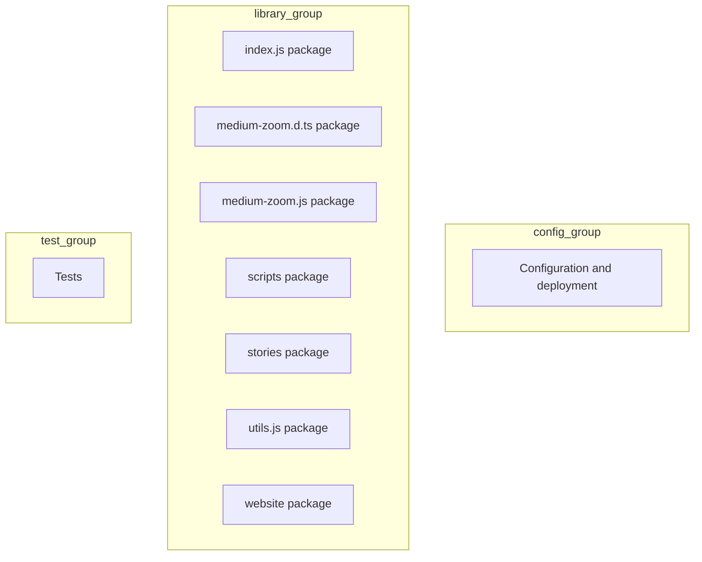

# Architecture report: francoischalifour/medium-zoom

> Automated static analysis. **Observed** = directly seen in files/imports/AST; **Inferred** = interpretation from that evidence. Repository code was not executed.

## 1. Repository at a glance

| Item | Value |
| --- | --- |
| Repository | francoischalifour/medium-zoom |
| Description | 🔎🖼️ Lightweight image zoom for the web. Zero dependencies, any framework, React via shadcn. |
| Language | TypeScript |
| Stars | 3944 |
| Licence | MIT |
| Analysed commit / branch | 6ed91069df0236c4bf971e9213bc31b39059bf00 / main |
| Framework(s) | Next.js, React, Svelte, Vue |
| Files analysed | 408 |
| Components | 9 |

## 2. Architecture in one minute

francoischalifour/medium-zoom - 🔎🖼️ Lightweight image zoom for the web. Zero dependencies, any framework, React via shadcn.. This repository was analysed statically from 408 file(s) (0 Python). Detected technologies (observed from imports/manifests): GitHub Actions, Next.js, React, Svelte, Vue, TypeScript. Files are grouped into 9 component(s): Configuration and deployment, index.js package, medium-zoom.d.ts package, medium-zoom.js package, scripts package, stories package, Tests, utils.js package. Findings below distinguish observed facts from inferred interpretation.

## 3. High-level block diagram

## 4. Main components

### Configuration and deployment (`config`)

- **Kind:** config
- **Status:** Observed
- **Confidence:** 0.85
- **Responsibility:** Groups 8 file(s) under configuration and deployment (observed from repository paths and static analysis).
- **Paths:** `bunfig.toml`, `config/tsconfig.worker.json`, `package.json`, `registry.json`, `tsconfig.json`, `website/package.json`, `website/src/npm-downloads.json`, `website/tsconfig.json`
- **Evidence:** [bunfig.toml](https://github.com/francoischalifour/medium-zoom/blob/6ed91069df0236c4bf971e9213bc31b39059bf00/bunfig.toml); [config/tsconfig.worker.json](https://github.com/francoischalifour/medium-zoom/blob/6ed91069df0236c4bf971e9213bc31b39059bf00/config/tsconfig.worker.json); [package.json](https://github.com/francoischalifour/medium-zoom/blob/6ed91069df0236c4bf971e9213bc31b39059bf00/package.json); [registry.json](https://github.com/francoischalifour/medium-zoom/blob/6ed91069df0236c4bf971e9213bc31b39059bf00/registry.json); [tsconfig.json](https://github.com/francoischalifour/medium-zoom/blob/6ed91069df0236c4bf971e9213bc31b39059bf00/tsconfig.json); [website/package.json](https://github.com/francoischalifour/medium-zoom/blob/6ed91069df0236c4bf971e9213bc31b39059bf00/website/package.json); [website/src/npm-downloads.json](https://github.com/francoischalifour/medium-zoom/blob/6ed91069df0236c4bf971e9213bc31b39059bf00/website/src/npm-downloads.json); [website/tsconfig.json](https://github.com/francoischalifour/medium-zoom/blob/6ed91069df0236c4bf971e9213bc31b39059bf00/website/tsconfig.json)

### index.js package (`index_js`)

- **Kind:** library
- **Status:** Observed
- **Confidence:** 0.85
- **Responsibility:** Groups 1 file(s) under index.js package (observed from repository paths and static analysis).
- **Paths:** `src/index.js`
- **Evidence:** [src/index.js](https://github.com/francoischalifour/medium-zoom/blob/6ed91069df0236c4bf971e9213bc31b39059bf00/src/index.js)

### medium-zoom.d.ts package (`medium_zoom_d_ts`)

- **Kind:** library
- **Status:** Observed
- **Confidence:** 0.85
- **Responsibility:** Groups 1 file(s) under medium-zoom.d.ts package (observed from repository paths and static analysis).
- **Paths:** `src/medium-zoom.d.ts`
- **Evidence:** [src/medium-zoom.d.ts](https://github.com/francoischalifour/medium-zoom/blob/6ed91069df0236c4bf971e9213bc31b39059bf00/src/medium-zoom.d.ts)

### medium-zoom.js package (`medium_zoom_js`)

- **Kind:** library
- **Status:** Observed
- **Confidence:** 0.85
- **Responsibility:** Groups 1 file(s) under medium-zoom.js package (observed from repository paths and static analysis).
- **Paths:** `src/medium-zoom.js`
- **Evidence:** [src/medium-zoom.js](https://github.com/francoischalifour/medium-zoom/blob/6ed91069df0236c4bf971e9213bc31b39059bf00/src/medium-zoom.js)

### scripts package (`scripts`)

- **Kind:** library
- **Status:** Observed
- **Confidence:** 0.85
- **Responsibility:** Groups 20 file(s) under scripts package (observed from repository paths and static analysis).
- **Paths:** `scripts/build-analytics-fixture.ts`, `scripts/build-examples.ts`, `scripts/build-registry.ts`, `scripts/check-docs.ts`, `scripts/check-examples.ts`, `scripts/check-package-analyzers.ts`, `scripts/check-package-consumers.ts`, `scripts/check-package.ts`, `scripts/check-preview.sh`, `scripts/check-size.ts`, `scripts/ci-scope.sh`, `scripts/clean.ts`, `scripts/deploy-preview.sh`, `scripts/dev-example.ts`, `scripts/example-names.ts`, `scripts/generate-og.ts`, `scripts/pack.ts`, `scripts/playwright-image.ts`, `scripts/prerender-website.ts`, `scripts/update-npm-downloads.ts`
- **Evidence:** [scripts/build-analytics-fixture.ts](https://github.com/francoischalifour/medium-zoom/blob/6ed91069df0236c4bf971e9213bc31b39059bf00/scripts/build-analytics-fixture.ts); [scripts/build-examples.ts](https://github.com/francoischalifour/medium-zoom/blob/6ed91069df0236c4bf971e9213bc31b39059bf00/scripts/build-examples.ts); [scripts/build-registry.ts](https://github.com/francoischalifour/medium-zoom/blob/6ed91069df0236c4bf971e9213bc31b39059bf00/scripts/build-registry.ts); [scripts/check-docs.ts](https://github.com/francoischalifour/medium-zoom/blob/6ed91069df0236c4bf971e9213bc31b39059bf00/scripts/check-docs.ts); [scripts/check-examples.ts](https://github.com/francoischalifour/medium-zoom/blob/6ed91069df0236c4bf971e9213bc31b39059bf00/scripts/check-examples.ts); [scripts/check-package-analyzers.ts](https://github.com/francoischalifour/medium-zoom/blob/6ed91069df0236c4bf971e9213bc31b39059bf00/scripts/check-package-analyzers.ts); [scripts/check-package-consumers.ts](https://github.com/francoischalifour/medium-zoom/blob/6ed91069df0236c4bf971e9213bc31b39059bf00/scripts/check-package-consumers.ts); [scripts/check-package.ts](https://github.com/francoischalifour/medium-zoom/blob/6ed91069df0236c4bf971e9213bc31b39059bf00/scripts/check-package.ts)

### stories package (`stories`)

- **Kind:** library
- **Status:** Observed
- **Confidence:** 0.85
- **Responsibility:** Groups 18 file(s) under stories package (observed from repository paths and static analysis).
- **Paths:** `stories/attach.stories.js`, `stories/attributes.stories.js`, `stories/catalogue/frame.ts`, `stories/catalogue/index.ts`, `stories/catalogue/registry.ts`, `stories/catalogue/stories.ts`, `stories/clone.stories.js`, `stories/close.stories.js`, `stories/detach.stories.js`, `stories/getImages.stories.js`, `stories/getOptions.stories.js`, `stories/getZoomedImage.stories.js`, `stories/off.stories.js`, `stories/on.stories.js`, `stories/open.stories.js`, `stories/options.stories.js`, `stories/toggle.stories.js`, `stories/update.stories.js`
- **Evidence:** [stories/attach.stories.js](https://github.com/francoischalifour/medium-zoom/blob/6ed91069df0236c4bf971e9213bc31b39059bf00/stories/attach.stories.js); [stories/attributes.stories.js](https://github.com/francoischalifour/medium-zoom/blob/6ed91069df0236c4bf971e9213bc31b39059bf00/stories/attributes.stories.js); [stories/catalogue/frame.ts](https://github.com/francoischalifour/medium-zoom/blob/6ed91069df0236c4bf971e9213bc31b39059bf00/stories/catalogue/frame.ts); [stories/catalogue/index.ts](https://github.com/francoischalifour/medium-zoom/blob/6ed91069df0236c4bf971e9213bc31b39059bf00/stories/catalogue/index.ts); [stories/catalogue/registry.ts](https://github.com/francoischalifour/medium-zoom/blob/6ed91069df0236c4bf971e9213bc31b39059bf00/stories/catalogue/registry.ts); [stories/catalogue/stories.ts](https://github.com/francoischalifour/medium-zoom/blob/6ed91069df0236c4bf971e9213bc31b39059bf00/stories/catalogue/stories.ts); [stories/clone.stories.js](https://github.com/francoischalifour/medium-zoom/blob/6ed91069df0236c4bf971e9213bc31b39059bf00/stories/clone.stories.js); [stories/close.stories.js](https://github.com/francoischalifour/medium-zoom/blob/6ed91069df0236c4bf971e9213bc31b39059bf00/stories/close.stories.js)

### Tests (`tests`)

- **Kind:** test
- **Status:** Observed
- **Confidence:** 0.85
- **Responsibility:** Groups 53 file(s) under tests (observed from repository paths and static analysis).
- **Paths:** `examples/shadcn/tests/CompoundFixture.tsx`, `examples/shadcn/tests/Fixture.tsx`, `examples/shadcn/tests/main.tsx`, `examples/shadcn/tests/ssr.tsx`, `examples/shadcn/tests/style.css`, `tests/analytics/website.spec.ts`, `tests/browser/api.spec.ts`, `tests/browser/dev.spec.ts`, `tests/browser/helpers.ts`, `tests/browser/loading.spec.ts`, `tests/browser/mobile.spec.ts`, `tests/browser/motion.spec.ts`, `tests/browser/package.spec.ts`, `tests/browser/shadcn-composition.spec.ts`, `tests/browser/shadcn.spec.ts`, `tests/browser/stories.helpers.ts`, `tests/browser/stories.spec.ts`, `tests/browser/video.spec.ts`, `tests/browser/website-accessibility.spec.ts`, `tests/browser/website-command-palette.spec.ts`, `tests/browser/website-delivery.spec.ts`, `tests/browser/website-dev.spec.ts`, `tests/browser/website-docs.spec.ts`, `tests/browser/website-downloads.spec.ts`, `tests/browser/website-examples.spec.ts`, `tests/browser/website-fixture.ts`, `tests/browser/website-footer.spec.ts`, `tests/browser/website-hero.spec.ts`, `tests/browser/website-hierarchy.spec.ts`, `tests/browser/website-markdown.spec.ts`, `tests/browser/website-metadata.spec.ts`, `tests/browser/website-product-features.spec.ts`, `tests/browser/website-react-page.spec.ts`, `tests/browser/website-react-usage.spec.ts`, `tests/browser/website-react.spec.ts`, `tests/browser/website.spec.ts`, `tests/fixtures/next/.gitignore`, `tests/fixtures/next/app/composed/page.jsx`, `tests/fixtures/next/app/layout.jsx`, `tests/fixtures/next/app/page.jsx`, `tests/fixtures/next/app/zoom/page.jsx`, `tests/fixtures/next/next.config.mjs`, `tests/fixtures/next/package.json`, `tests/globals.d.ts`, `tests/registry-downloads.test.mts`, `tests/rsc/image-zoom.spec.ts`, `tests/server-urls.ts`, `tests/server.ts`, `tests/types/bundler.mjs`, `tests/types/commonjs.cts`, `tests/types/consumer.ts`, `tests/types/node-esm.mts`, `tests/types/runtime.mjs`
- **Evidence:** [examples/shadcn/tests/CompoundFixture.tsx](https://github.com/francoischalifour/medium-zoom/blob/6ed91069df0236c4bf971e9213bc31b39059bf00/examples/shadcn/tests/CompoundFixture.tsx); [examples/shadcn/tests/Fixture.tsx](https://github.com/francoischalifour/medium-zoom/blob/6ed91069df0236c4bf971e9213bc31b39059bf00/examples/shadcn/tests/Fixture.tsx); [examples/shadcn/tests/main.tsx](https://github.com/francoischalifour/medium-zoom/blob/6ed91069df0236c4bf971e9213bc31b39059bf00/examples/shadcn/tests/main.tsx); [examples/shadcn/tests/ssr.tsx](https://github.com/francoischalifour/medium-zoom/blob/6ed91069df0236c4bf971e9213bc31b39059bf00/examples/shadcn/tests/ssr.tsx); [examples/shadcn/tests/style.css](https://github.com/francoischalifour/medium-zoom/blob/6ed91069df0236c4bf971e9213bc31b39059bf00/examples/shadcn/tests/style.css); [tests/analytics/website.spec.ts](https://github.com/francoischalifour/medium-zoom/blob/6ed91069df0236c4bf971e9213bc31b39059bf00/tests/analytics/website.spec.ts); [tests/browser/api.spec.ts](https://github.com/francoischalifour/medium-zoom/blob/6ed91069df0236c4bf971e9213bc31b39059bf00/tests/browser/api.spec.ts); [tests/browser/dev.spec.ts](https://github.com/francoischalifour/medium-zoom/blob/6ed91069df0236c4bf971e9213bc31b39059bf00/tests/browser/dev.spec.ts)

### utils.js package (`utils_js`)

- **Kind:** library
- **Status:** Observed
- **Confidence:** 0.85
- **Responsibility:** Groups 1 file(s) under utils.js package (observed from repository paths and static analysis).
- **Paths:** `src/utils.js`
- **Evidence:** [src/utils.js](https://github.com/francoischalifour/medium-zoom/blob/6ed91069df0236c4bf971e9213bc31b39059bf00/src/utils.js)

### website package (`website`)

- **Kind:** library
- **Status:** Observed
- **Confidence:** 0.85
- **Responsibility:** Groups 38 file(s) under website package (observed from repository paths and static analysis).
- **Paths:** `website/src/App.tsx`, `website/src/JavaScriptPage.tsx`, `website/src/NotFoundPage.tsx`, `website/src/ReactPage.tsx`, `website/src/chat-links.ts`, `website/src/closing-install.tsx`, `website/src/code-font.ts`, `website/src/command-items.ts`, `website/src/command-palette.tsx`, `website/src/docs-search-index.ts`, `website/src/docs-search.ts`, `website/src/example-rail.tsx`, `website/src/gallery.ts`, `website/src/hero.tsx`, `website/src/hydrate.tsx`, `website/src/install-command.tsx`, `website/src/install-commands.ts`, `website/src/main.tsx`, `website/src/monthly-downloads.tsx`, `website/src/npm-downloads.ts`, `website/src/package-manager-preference.ts`, `website/src/package-manager.ts`, `website/src/product-features.tsx`, `website/src/product-pages.ts`, `website/src/scroll-area.tsx`, `website/src/shortcut-platform.ts`, `website/src/site-analytics.ts`, `website/src/site-components.tsx`, `website/src/site-data.ts`, `website/src/site-shell.tsx`, `website/src/site-tabs.tsx`, `website/src/site-theme.ts`, `website/src/site-url.ts`, `website/src/technology-icons.tsx`, `website/src/usage-examples.tsx`, `website/src/usage-snippets.ts`, `website/src/vite-env.d.ts`, `website/worker.ts`
- **Evidence:** [website/src/App.tsx](https://github.com/francoischalifour/medium-zoom/blob/6ed91069df0236c4bf971e9213bc31b39059bf00/website/src/App.tsx); [website/src/JavaScriptPage.tsx](https://github.com/francoischalifour/medium-zoom/blob/6ed91069df0236c4bf971e9213bc31b39059bf00/website/src/JavaScriptPage.tsx); [website/src/NotFoundPage.tsx](https://github.com/francoischalifour/medium-zoom/blob/6ed91069df0236c4bf971e9213bc31b39059bf00/website/src/NotFoundPage.tsx); [website/src/ReactPage.tsx](https://github.com/francoischalifour/medium-zoom/blob/6ed91069df0236c4bf971e9213bc31b39059bf00/website/src/ReactPage.tsx); [website/src/chat-links.ts](https://github.com/francoischalifour/medium-zoom/blob/6ed91069df0236c4bf971e9213bc31b39059bf00/website/src/chat-links.ts); [website/src/closing-install.tsx](https://github.com/francoischalifour/medium-zoom/blob/6ed91069df0236c4bf971e9213bc31b39059bf00/website/src/closing-install.tsx); [website/src/code-font.ts](https://github.com/francoischalifour/medium-zoom/blob/6ed91069df0236c4bf971e9213bc31b39059bf00/website/src/code-font.ts); [website/src/command-items.ts](https://github.com/francoischalifour/medium-zoom/blob/6ed91069df0236c4bf971e9213bc31b39059bf00/website/src/command-items.ts)

## 5. Execution flow

**Observed** entry point(s):

- [examples/dropbox-paper-template/index.html](https://github.com/francoischalifour/medium-zoom/blob/6ed91069df0236c4bf971e9213bc31b39059bf00/examples/dropbox-paper-template/index.html)
- [examples/facebook-template/index.html](https://github.com/francoischalifour/medium-zoom/blob/6ed91069df0236c4bf971e9213bc31b39059bf00/examples/facebook-template/index.html)
- [examples/react-markdown/src/main.tsx](https://github.com/francoischalifour/medium-zoom/blob/6ed91069df0236c4bf971e9213bc31b39059bf00/examples/react-markdown/src/main.tsx)
- [examples/react/src/main.tsx](https://github.com/francoischalifour/medium-zoom/blob/6ed91069df0236c4bf971e9213bc31b39059bf00/examples/react/src/main.tsx)
- [examples/svelte/src/main.js](https://github.com/francoischalifour/medium-zoom/blob/6ed91069df0236c4bf971e9213bc31b39059bf00/examples/svelte/src/main.js)
- [examples/svg-data-url/index.html](https://github.com/francoischalifour/medium-zoom/blob/6ed91069df0236c4bf971e9213bc31b39059bf00/examples/svg-data-url/index.html)
- [examples/vanilla/index.html](https://github.com/francoischalifour/medium-zoom/blob/6ed91069df0236c4bf971e9213bc31b39059bf00/examples/vanilla/index.html)
- [examples/video/index.html](https://github.com/francoischalifour/medium-zoom/blob/6ed91069df0236c4bf971e9213bc31b39059bf00/examples/video/index.html)
- [examples/vue/src/main.ts](https://github.com/francoischalifour/medium-zoom/blob/6ed91069df0236c4bf971e9213bc31b39059bf00/examples/vue/src/main.ts)
- [src/index.js](https://github.com/francoischalifour/medium-zoom/blob/6ed91069df0236c4bf971e9213bc31b39059bf00/src/index.js)
- [stories/catalogue/index.ts](https://github.com/francoischalifour/medium-zoom/blob/6ed91069df0236c4bf971e9213bc31b39059bf00/stories/catalogue/index.ts)
- [website/index.html](https://github.com/francoischalifour/medium-zoom/blob/6ed91069df0236c4bf971e9213bc31b39059bf00/website/index.html)

Representative flow (derived from observed entry points and the import graph; steps beyond the entry point are **Inferred**):

1. Execution starts at an observed entry point listed above, if present.
2. No internal import relationships between components were observed.

## 6. Project structure

### `(root)`

- `.bun-version` - other (6 bytes)
- `.editorconfig` - config (173 bytes)
- `.env.example` - config (184 bytes)
- `.gitignore` - other (252 bytes)
- `.node-version` - other (8 bytes)
- `CHANGELOG.md` - docs (11807 bytes)
- `CODE_OF_CONDUCT.md` - docs (5522 bytes)
- `CONTRIBUTING.md` - docs (4497 bytes)
- `LICENSE` - docs (1094 bytes)
- `README.md` - docs (3374 bytes)
- `SECURITY.md` - docs (787 bytes)
- `bunfig.toml` - config (23 bytes)
- `oxfmt.config.mts` - other (496 bytes)
- `oxlint.config.mts` - other (839 bytes)
- `package.json` - manifest (5728 bytes)
- `registry.json` - config (698 bytes)
- `tsconfig.json` - config (783 bytes)

### `.codex`

- `.codex/environments/environment.toml` - config (643 bytes)

### `.github`

- `.github/.release-please-manifest.json` - config (19 bytes)
- `.github/ISSUE_TEMPLATE/bug_report.yml` - config (1739 bytes)
- `.github/ISSUE_TEMPLATE/feature_request.yml` - config (639 bytes)
- `.github/dependabot.yml` - config (354 bytes)
- `.github/pull_request_template.md` - docs (291 bytes)
- `.github/release-please-config.json` - config (324 bytes)
- `.github/release-please/.gitignore` - other (33 bytes)
- `.github/release-please/manifest.mjs` - source, JavaScript (788 bytes)
- `.github/release-please/manifest.test.mjs` - source, JavaScript (3998 bytes)
- `.github/release-please/package.json` - manifest (219 bytes)
- `.github/release-please/run.mjs` - source, JavaScript (1331 bytes)
- `.github/workflows/checks.yml` - ci, YAML (5847 bytes)
- `.github/workflows/ci.yml` - ci, YAML (485 bytes)
- `.github/workflows/deploy-preview.yml` - ci, YAML (2521 bytes)
- `.github/workflows/preview.yml` - ci, YAML (1329 bytes)
- `.github/workflows/release.yml` - ci, YAML (1971 bytes)

### `assets`

- `assets/images/CREDITS.md` - docs (3556 bytes)

### `config`

- `config/playwright.analytics.config.mts` - other (849 bytes)
- `config/playwright.config.mts` - other (1774 bytes)
- `config/playwright.rsc.config.mts` - other (810 bytes)
- `config/size.config.mts` - other (379 bytes)
- `config/test-ports.mts` - other (1332 bytes)
- `config/tsconfig.worker.json` - config (422 bytes)
- `config/tsdown.config.mts` - other (5184 bytes)
- `config/vite.examples.config.mts` - other (1836 bytes)
- `config/vite.shared.config.mts` - other (245 bytes)
- `config/vite.stories.config.mts` - other (774 bytes)
- `config/vite.website.config.mts` - other (2926 bytes)
- `config/wrangler.jsonc` - other (587 bytes)

### `docs`

- `docs/assets/logo.svg` - docs (256 bytes)
- `docs/container.md` - docs (169 bytes)
- `docs/inline-svg.md` - docs (152 bytes)
- `docs/template.md` - docs (167 bytes)
- `docs/video.md` - docs (145 bytes)

### `examples`

- `examples/angular/.codesandbox/tasks.json` - config (275 bytes)
- `examples/angular/.devcontainer/devcontainer.json` - config (130 bytes)
- `examples/angular/.gitignore` - other (622 bytes)
- `examples/angular/README.md` - docs (675 bytes)
- `examples/angular/angular.json` - config (1323 bytes)
- `examples/angular/package.json` - manifest (715 bytes)
- `examples/angular/src/app/app.config.ts` - source, TypeScript (193 bytes)
- `examples/angular/src/app/app.ts` - source, TypeScript (1076 bytes)
- `examples/angular/src/app/zoomable-image.ts` - source, TypeScript (755 bytes)
- `examples/angular/src/index.html` - other (387 bytes)
- `examples/angular/src/main.ts` - source, TypeScript (218 bytes)
- `examples/angular/src/reset.css` - other (1103 bytes)
- `examples/angular/src/styles.css` - other (613 bytes)
- `examples/angular/tsconfig.app.json` - config (109 bytes)
- `examples/angular/tsconfig.json` - config (602 bytes)
- `examples/astro/.codesandbox/tasks.json` - config (275 bytes)
- `examples/astro/.devcontainer/devcontainer.json` - config (128 bytes)
- `examples/astro/.gitignore` - other (264 bytes)
- `examples/astro/README.md` - docs (717 bytes)
- `examples/astro/astro.config.mjs` - source, JavaScript (120 bytes)
- `examples/astro/package.json` - manifest (533 bytes)
- `examples/astro/src/components/ZoomableImage.astro` - other (835 bytes)
- `examples/astro/src/pages/index.astro` - other (1347 bytes)
- `examples/astro/src/styles/reset.css` - other (1103 bytes)
- `examples/astro/src/styles/style.css` - other (613 bytes)
- `examples/astro/tsconfig.json` - config (109 bytes)
- `examples/dropbox-paper-template/.gitignore` - other (28 bytes)
- `examples/dropbox-paper-template/README.md` - docs (917 bytes)
- `examples/dropbox-paper-template/index.html` - other (2213 bytes)
- `examples/dropbox-paper-template/package.json` - manifest (488 bytes)
- `examples/dropbox-paper-template/sandbox.config.json` - config (27 bytes)
- `examples/dropbox-paper-template/src/index.js` - source, JavaScript (640 bytes)
- `examples/dropbox-paper-template/src/reset.css` - other (1103 bytes)
- `examples/dropbox-paper-template/src/style.css` - other (1692 bytes)
- `examples/dropbox-paper-template/tsconfig.json` - config (401 bytes)
- `examples/dropbox-paper-template/vite.config.ts` - source, TypeScript (81 bytes)
- `examples/facebook-template/.gitignore` - other (25 bytes)
- `examples/facebook-template/README.md` - docs (887 bytes)
- `examples/facebook-template/index.html` - other (1547 bytes)
- `examples/facebook-template/package.json` - manifest (483 bytes)
- `examples/facebook-template/sandbox.config.json` - config (27 bytes)
- `examples/facebook-template/src/index.js` - source, JavaScript (630 bytes)
- `examples/facebook-template/src/reset.css` - other (1103 bytes)
- `examples/facebook-template/src/style.css` - other (1167 bytes)
- `examples/facebook-template/tsconfig.json` - config (401 bytes)
- `examples/facebook-template/vite.config.ts` - source, TypeScript (81 bytes)
- `examples/react-markdown/.codesandbox/tasks.json` - config (275 bytes)
- `examples/react-markdown/.devcontainer/devcontainer.json` - config (137 bytes)
- `examples/react-markdown/.gitignore` - other (253 bytes)
- `examples/react-markdown/README.md` - docs (674 bytes)
- `examples/react-markdown/index.html` - other (447 bytes)
- `examples/react-markdown/package.json` - manifest (663 bytes)
- `examples/react-markdown/src/App.tsx` - source, TypeScript (968 bytes)
- `examples/react-markdown/src/main.tsx` - source, TypeScript (258 bytes)
- `examples/react-markdown/src/reset.css` - other (1103 bytes)
- `examples/react-markdown/src/style.css` - other (613 bytes)
- `examples/react-markdown/src/vite-env.d.ts` - source, TypeScript (38 bytes)
- `examples/react-markdown/tsconfig.json` - config (425 bytes)
- `examples/react-markdown/vite.config.ts` - source, TypeScript (142 bytes)
- `examples/react/.gitignore` - other (253 bytes)
- `examples/react/README.md` - docs (783 bytes)
- `examples/react/index.html` - other (438 bytes)
- `examples/react/package.json` - manifest (624 bytes)
- `examples/react/sandbox.config.json` - config (37 bytes)
- `examples/react/src/App.tsx` - source, TypeScript (887 bytes)
- `examples/react/src/ImageZoom.tsx` - source, TypeScript (671 bytes)
- `examples/react/src/main.tsx` - source, TypeScript (258 bytes)
- `examples/react/src/reset.css` - other (1103 bytes)
- `examples/react/src/style.css` - other (613 bytes)
- `examples/react/src/vite-env.d.ts` - source, TypeScript (38 bytes)
- `examples/react/tsconfig.json` - config (426 bytes)
- `examples/react/vite.config.ts` - source, TypeScript (142 bytes)
- `examples/shadcn/.gitignore` - other (253 bytes)
- `examples/shadcn/README.md` - docs (1333 bytes)
- `examples/shadcn/gallery-assets.ts` - source, TypeScript (2440 bytes)
- `examples/shadcn/index.html` - other (366 bytes)
- `examples/shadcn/package.json` - manifest (628 bytes)
- `examples/shadcn/playground.html` - other (366 bytes)
- `examples/shadcn/src/components/ui/image-zoom.css` - other (602 bytes)
- `examples/shadcn/src/components/ui/image-zoom.tsx` - source, TypeScript (10125 bytes)
- `examples/shadcn/src/gallery-paths.ts` - source, TypeScript (267 bytes)
- `examples/shadcn/tests/CompoundFixture.tsx` - test, TypeScript (3517 bytes)
- `examples/shadcn/tests/Fixture.tsx` - test, TypeScript (4180 bytes)
- `examples/shadcn/tests/main.tsx` - test, TypeScript (569 bytes)
- `examples/shadcn/tests/ssr.tsx` - test, TypeScript (444 bytes)
- `examples/shadcn/tests/style.css` - test (1772 bytes)
- `examples/shadcn/tsconfig.json` - config (488 bytes)
- `examples/shadcn/vite.config.ts` - source, TypeScript (483 bytes)
- `examples/svelte/.codesandbox/tasks.json` - config (275 bytes)
- `examples/svelte/.devcontainer/devcontainer.json` - config (129 bytes)
- `examples/svelte/.gitignore` - other (253 bytes)
- `examples/svelte/README.md` - docs (635 bytes)
- `examples/svelte/index.html` - other (438 bytes)
- `examples/svelte/package.json` - manifest (640 bytes)
- `examples/svelte/src/App.svelte` - source, Svelte (836 bytes)
- `examples/svelte/src/app.css` - other (1310 bytes)
- `examples/svelte/src/lib/ImageZoom.svelte` - source, Svelte (564 bytes)
- `examples/svelte/src/main.js` - source, JavaScript (197 bytes)
- `examples/svelte/src/reset.css` - other (1103 bytes)
- `examples/svelte/src/style.css` - other (613 bytes)
- `examples/svelte/src/vite-env.d.ts` - source, TypeScript (71 bytes)
- `examples/svelte/svelte.config.js` - source, JavaScript (111 bytes)
- `examples/svelte/tsconfig.json` - config (430 bytes)
- `examples/svelte/vite.config.ts` - source, TypeScript (156 bytes)
- `examples/svg-data-url/.gitignore` - other (25 bytes)
- `examples/svg-data-url/README.md` - docs (833 bytes)
- `examples/svg-data-url/index.html` - other (864 bytes)
- `examples/svg-data-url/package.json` - manifest (478 bytes)
- `examples/svg-data-url/src/index.js` - source, JavaScript (1420 bytes)
- `examples/svg-data-url/src/reset.css` - other (1103 bytes)
- `examples/svg-data-url/src/style.css` - other (613 bytes)
- `examples/svg-data-url/tsconfig.json` - config (401 bytes)
- `examples/svg-data-url/vite.config.ts` - source, TypeScript (81 bytes)
- `examples/vanilla/.gitignore` - other (25 bytes)
- `examples/vanilla/README.md` - docs (565 bytes)
- `examples/vanilla/index.html` - other (935 bytes)
- `examples/vanilla/package.json` - manifest (473 bytes)
- `examples/vanilla/sandbox.config.json` - config (27 bytes)
- `examples/vanilla/src/index.js` - source, JavaScript (67 bytes)
- `examples/vanilla/src/reset.css` - other (1103 bytes)
- `examples/vanilla/src/style.css` - other (613 bytes)
- `examples/vanilla/tsconfig.json` - config (401 bytes)
- `examples/vanilla/vite.config.ts` - source, TypeScript (81 bytes)
- `examples/video/.gitignore` - other (25 bytes)
- `examples/video/README.md` - docs (814 bytes)
- `examples/video/index.html` - other (787 bytes)
- `examples/video/package.json` - manifest (471 bytes)
- `examples/video/src/index.js` - source, JavaScript (1677 bytes)
- `examples/video/src/reset.css` - other (1103 bytes)
- `examples/video/src/style.css` - other (775 bytes)
- `examples/video/tsconfig.json` - config (401 bytes)
- `examples/video/vite.config.ts` - source, TypeScript (81 bytes)
- `examples/vitepress/.codesandbox/tasks.json` - config (275 bytes)
- `examples/vitepress/.devcontainer/devcontainer.json` - config (132 bytes)
- `examples/vitepress/.gitignore` - other (197 bytes)
- `examples/vitepress/README.md` - docs (734 bytes)
- `examples/vitepress/docs/.vitepress/config.mts` - docs (375 bytes)
- `examples/vitepress/docs/.vitepress/theme/index.ts` - docs (520 bytes)
- `examples/vitepress/docs/.vitepress/theme/style.css` - docs (133 bytes)
- `examples/vitepress/docs/gallery.md` - docs (123 bytes)
- `examples/vitepress/docs/index.md` - docs (711 bytes)
- `examples/vitepress/package.json` - manifest (584 bytes)
- `examples/vitepress/tsconfig.json` - config (328 bytes)
- `examples/vue/.codesandbox/tasks.json` - config (275 bytes)
- `examples/vue/.devcontainer/devcontainer.json` - config (126 bytes)
- `examples/vue/.gitignore` - other (253 bytes)
- `examples/vue/README.md` - docs (620 bytes)
- `examples/vue/index.html` - other (434 bytes)
- `examples/vue/package.json` - manifest (615 bytes)
- `examples/vue/src/App.vue` - source, Vue (889 bytes)
- `examples/vue/src/components/ImageZoom.vue` - source, Vue (823 bytes)
- `examples/vue/src/main.ts` - source, TypeScript (134 bytes)
- `examples/vue/src/reset.css` - other (1103 bytes)
- `examples/vue/src/style.css` - other (613 bytes)
- `examples/vue/src/vite-env.d.ts` - source, TypeScript (38 bytes)
- `examples/vue/tsconfig.json` - config (401 bytes)
- `examples/vue/vite.config.ts` - source, TypeScript (136 bytes)

### `scripts`

- `scripts/build-analytics-fixture.ts` - source, TypeScript (491 bytes)
- `scripts/build-examples.ts` - source, TypeScript (4012 bytes)
- `scripts/build-registry.ts` - source, TypeScript (1017 bytes)
- `scripts/check-docs.ts` - source, TypeScript (2027 bytes)
- `scripts/check-examples.ts` - source, TypeScript (2467 bytes)
- `scripts/check-package-analyzers.ts` - source, TypeScript (3650 bytes)
- `scripts/check-package-consumers.ts` - source, TypeScript (3095 bytes)
- `scripts/check-package.ts` - source, TypeScript (3985 bytes)
- `scripts/check-preview.sh` - source, Shell (562 bytes)
- `scripts/check-size.ts` - source, TypeScript (1605 bytes)
- `scripts/ci-scope.sh` - source, Shell (791 bytes)
- `scripts/clean.ts` - source, TypeScript (83 bytes)
- `scripts/deploy-preview.sh` - source, Shell (1311 bytes)
- `scripts/dev-example.ts` - source, TypeScript (725 bytes)
- `scripts/example-names.ts` - source, TypeScript (299 bytes)
- `scripts/generate-og.ts` - source, TypeScript (9435 bytes)
- `scripts/pack.ts` - source, TypeScript (1037 bytes)
- `scripts/playwright-image.ts` - source, TypeScript (157 bytes)
- `scripts/prerender-website.ts` - source, TypeScript (945 bytes)
- `scripts/update-npm-downloads.ts` - source, TypeScript (471 bytes)

### `src`

- `src/index.js` - source, JavaScript (94 bytes)
- `src/medium-zoom.css` - other (1030 bytes)
- `src/medium-zoom.d.ts` - source, TypeScript (3998 bytes)
- `src/medium-zoom.js` - source, JavaScript (16988 bytes)
- `src/utils.js` - source, JavaScript (2389 bytes)

### `stories`

- `stories/attach.stories.js` - source, JavaScript (1232 bytes)
- `stories/attributes.stories.js` - source, JavaScript (2791 bytes)
- `stories/catalogue/frame.css` - other (475 bytes)
- `stories/catalogue/frame.ts` - source, TypeScript (852 bytes)
- `stories/catalogue/index.ts` - source, TypeScript (643 bytes)
- `stories/catalogue/registry.ts` - source, TypeScript (637 bytes)
- `stories/catalogue/stories.ts` - source, TypeScript (114 bytes)
- `stories/clone.stories.js` - source, JavaScript (406 bytes)
- `stories/close.stories.js` - source, JavaScript (472 bytes)
- `stories/detach.stories.js` - source, JavaScript (1795 bytes)
- `stories/frame.html` - other (235 bytes)
- `stories/getImages.stories.js` - source, JavaScript (477 bytes)
- `stories/getOptions.stories.js` - source, JavaScript (435 bytes)
- `stories/getZoomedImage.stories.js` - source, JavaScript (488 bytes)
- `stories/images/crab.svg` - other (2443 bytes)
- `stories/index.html` - other (836 bytes)
- `stories/off.stories.js` - source, JavaScript (1937 bytes)
- `stories/on.stories.js` - source, JavaScript (2339 bytes)
- `stories/open.stories.js` - source, JavaScript (891 bytes)
- `stories/options.stories.js` - source, JavaScript (10303 bytes)
- `stories/toggle.stories.js` - source, JavaScript (990 bytes)
- `stories/update.stories.js` - source, JavaScript (594 bytes)

### `tests`

- `tests/analytics/website.spec.ts` - test, TypeScript (13621 bytes)
- `tests/browser/api.spec.ts` - test, TypeScript (17830 bytes)
- `tests/browser/dev.spec.ts` - test, TypeScript (445 bytes)
- `tests/browser/helpers.ts` - test, TypeScript (4548 bytes)
- `tests/browser/loading.spec.ts` - test, TypeScript (12513 bytes)
- `tests/browser/mobile.spec.ts` - test, TypeScript (8700 bytes)
- `tests/browser/motion.spec.ts` - test, TypeScript (9441 bytes)
- `tests/browser/package.spec.ts` - test, TypeScript (2740 bytes)
- `tests/browser/shadcn-composition.spec.ts` - test, TypeScript (8604 bytes)
- `tests/browser/shadcn.spec.ts` - test, TypeScript (13789 bytes)
- `tests/browser/stories.helpers.ts` - test, TypeScript (1390 bytes)
- `tests/browser/stories.spec.ts` - test, TypeScript (5448 bytes)
- `tests/browser/video.spec.ts` - test, TypeScript (5180 bytes)
- `tests/browser/website-accessibility.spec.ts` - test, TypeScript (3146 bytes)
- `tests/browser/website-command-palette.spec.ts` - test, TypeScript (22802 bytes)
- `tests/browser/website-delivery.spec.ts` - test, TypeScript (6441 bytes)
- `tests/browser/website-dev.spec.ts` - test, TypeScript (3375 bytes)
- `tests/browser/website-docs.spec.ts` - test, TypeScript (51529 bytes)
- `tests/browser/website-downloads.spec.ts` - test, TypeScript (5503 bytes)
- `tests/browser/website-examples.spec.ts` - test, TypeScript (3615 bytes)
- `tests/browser/website-fixture.ts` - test, TypeScript (649 bytes)
- `tests/browser/website-footer.spec.ts` - test, TypeScript (2597 bytes)
- `tests/browser/website-hero.spec.ts` - test, TypeScript (5196 bytes)
- `tests/browser/website-hierarchy.spec.ts` - test, TypeScript (6306 bytes)
- `tests/browser/website-markdown.spec.ts` - test, TypeScript (5674 bytes)
- `tests/browser/website-metadata.spec.ts` - test, TypeScript (8021 bytes)
- `tests/browser/website-product-features.spec.ts` - test, TypeScript (3161 bytes)
- `tests/browser/website-react-page.spec.ts` - test, TypeScript (9459 bytes)
- `tests/browser/website-react-usage.spec.ts` - test, TypeScript (8600 bytes)
- `tests/browser/website-react.spec.ts` - test, TypeScript (6263 bytes)
- `tests/browser/website.spec.ts` - test, TypeScript (21309 bytes)
- `tests/fixtures/next/.gitignore` - test (21 bytes)
- `tests/fixtures/next/app/composed/page.jsx` - test, JavaScript (998 bytes)
- `tests/fixtures/next/app/layout.jsx` - test, JavaScript (176 bytes)
- `tests/fixtures/next/app/page.jsx` - test, JavaScript (260 bytes)
- `tests/fixtures/next/app/zoom/page.jsx` - test, JavaScript (948 bytes)
- `tests/fixtures/next/next.config.mjs` - test, JavaScript (295 bytes)
- `tests/fixtures/next/package.json` - test (268 bytes)
- `tests/globals.d.ts` - test, TypeScript (213 bytes)
- `tests/registry-downloads.test.mts` - test (5541 bytes)
- `tests/rsc/image-zoom.spec.ts` - test, TypeScript (2780 bytes)
- `tests/server-urls.ts` - test, TypeScript (853 bytes)
- `tests/server.ts` - test, TypeScript (3522 bytes)
- `tests/types/bundler.mjs` - test, JavaScript (306 bytes)
- `tests/types/commonjs.cts` - test (512 bytes)
- `tests/types/consumer.ts` - test, TypeScript (936 bytes)
- `tests/types/node-esm.mts` - test (582 bytes)
- `tests/types/runtime.mjs` - test, JavaScript (1094 bytes)

### `website`

- `website/.gitignore` - other (28 bytes)
- `website/404.html` - other (525 bytes)
- `website/LICENSE` - docs (1094 bytes)
- `website/README.md` - docs (4338 bytes)
- `website/index.html` - other (3669 bytes)
- `website/package.json` - manifest (782 bytes)
- `website/public/_redirects` - other (4970 bytes)
- `website/public/brand/favicon.svg` - other (256 bytes)
- `website/public/brand/mark-monochrome.svg` - other (128 bytes)
- `website/public/brand/mark.svg` - other (256 bytes)
- `website/public/brand/shadcn.svg` - other (208 bytes)
- `website/public/favicon.svg` - other (256 bytes)
- `website/react.html` - other (3268 bytes)
- `website/src/App.tsx` - source, TypeScript (648 bytes)
- `website/src/JavaScriptPage.tsx` - source, TypeScript (3041 bytes)
- `website/src/NotFoundPage.tsx` - source, TypeScript (2084 bytes)
- `website/src/ReactPage.tsx` - source, TypeScript (2083 bytes)
- `website/src/chat-links.ts` - source, TypeScript (584 bytes)
- `website/src/closing-install.tsx` - source, TypeScript (554 bytes)
- `website/src/code-font.ts` - source, TypeScript (622 bytes)
- `website/src/command-items.ts` - source, TypeScript (3535 bytes)
- `website/src/command-palette.css` - other (9030 bytes)
- `website/src/command-palette.tsx` - source, TypeScript (13951 bytes)
- `website/src/docs-search-index.ts` - source, TypeScript (5487 bytes)
- `website/src/docs-search.ts` - source, TypeScript (547 bytes)
- `website/src/docs/DocsPage.tsx` - docs (6845 bytes)
- `website/src/docs/angular-integration.mdx` - docs (3038 bytes)
- `website/src/docs/astro-integration.mdx` - docs (3459 bytes)
- `website/src/docs/composition-api.mdx` - docs (3335 bytes)
- `website/src/docs/controlled-state.mdx` - docs (1459 bytes)
- `website/src/docs/custom-react-triggers.mdx` - docs (1567 bytes)
- `website/src/docs/doc-components.tsx` - docs (6402 bytes)
- `website/src/docs/docs-outline.tsx` - docs (2926 bytes)
- `website/src/docs/docs.css` - docs (17811 bytes)
- `website/src/docs/events.mdx` - docs (2272 bytes)
- `website/src/docs/examples/captioned-photo.css` - docs (460 bytes)
- `website/src/docs/examples/captioned-photo.tsx` - docs (503 bytes)
- `website/src/docs/examples/custom-trigger-photo.css` - docs (688 bytes)
- `website/src/docs/examples/custom-trigger-photo.tsx` - docs (707 bytes)
- `website/src/docs/examples/generated-diagram.css` - docs (173 bytes)
- `website/src/docs/examples/generated-diagram.tsx` - docs (1849 bytes)
- `website/src/docs/examples/hd-photo.tsx` - docs (296 bytes)
- `website/src/docs/examples/multiple-images.css` - docs (178 bytes)
- `website/src/docs/examples/multiple-images.tsx` - docs (768 bytes)
- `website/src/docs/examples/photo-inspector.css` - docs (1752 bytes)
- `website/src/docs/examples/photo-inspector.tsx` - docs (1985 bytes)
- `website/src/docs/examples/photo.tsx` - docs (231 bytes)
- `website/src/docs/examples/video.css` - docs (240 bytes)
- `website/src/docs/examples/video.tsx` - docs (3233 bytes)
- `website/src/docs/examples/zoomable-diagram.tsx` - docs (450 bytes)
- `website/src/docs/generated-svg.mdx` - docs (3543 bytes)
- `website/src/docs/hd-images.mdx` - docs (1337 bytes)
- `website/src/docs/image-zoom.mdx` - docs (3166 bytes)
- `website/src/docs/javascript-api.mdx` - docs (1823 bytes)
- `website/src/docs/javascript-quickstart.mdx` - docs (3738 bytes)
- `website/src/docs/mdx.d.ts` - docs (462 bytes)
- `website/src/docs/methods.mdx` - docs (3861 bytes)
- `website/src/docs/multiple-images.mdx` - docs (2111 bytes)
- `website/src/docs/options.mdx` - docs (2440 bytes)
- `website/src/docs/overview.mdx` - docs (2326 bytes)
- `website/src/docs/pages.ts` - docs (10017 bytes)
- `website/src/docs/react-quickstart.mdx` - docs (1467 bytes)
- `website/src/docs/server-rendering.mdx` - docs (2366 bytes)
- `website/src/docs/solid-integration.mdx` - docs (2663 bytes)
- `website/src/docs/styling.mdx` - docs (2856 bytes)
- `website/src/docs/supported-browsers.ts` - docs (312 bytes)
- `website/src/docs/svelte-integration.mdx` - docs (2646 bytes)
- `website/src/docs/use-docs-navigation.ts` - docs (6115 bytes)
- `website/src/docs/video.mdx` - docs (3740 bytes)
- `website/src/docs/vitepress-integration.mdx` - docs (2711 bytes)
- `website/src/docs/vue-integration.mdx` - docs (2628 bytes)
- `website/src/example-rail.tsx` - source, TypeScript (7414 bytes)
- `website/src/gallery.ts` - source, TypeScript (4826 bytes)
- `website/src/hero.tsx` - source, TypeScript (2250 bytes)
- `website/src/hydrate.tsx` - source, TypeScript (1165 bytes)
- `website/src/install-command.tsx` - source, TypeScript (2209 bytes)
- `website/src/install-commands.ts` - source, TypeScript (907 bytes)
- `website/src/javascript.css` - other (2154 bytes)
- `website/src/main.tsx` - source, TypeScript (3989 bytes)
- `website/src/monthly-downloads.tsx` - source, TypeScript (1921 bytes)
- `website/src/not-found.css` - other (827 bytes)
- `website/src/npm-downloads.json` - config (73 bytes)
- `website/src/npm-downloads.ts` - source, TypeScript (1209 bytes)
- `website/src/package-manager-preference.ts` - source, TypeScript (840 bytes)
- `website/src/package-manager.ts` - source, TypeScript (1765 bytes)
- `website/src/product-features.tsx` - source, TypeScript (916 bytes)
- `website/src/product-pages.ts` - source, TypeScript (5180 bytes)
- `website/src/scroll-area.css` - other (1556 bytes)
- `website/src/scroll-area.tsx` - source, TypeScript (2616 bytes)
- `website/src/shortcut-platform.ts` - source, TypeScript (356 bytes)
- `website/src/site-analytics.ts` - source, TypeScript (3609 bytes)
- `website/src/site-components.tsx` - source, TypeScript (7325 bytes)
- `website/src/site-data.ts` - source, TypeScript (678 bytes)
- `website/src/site-shell.tsx` - source, TypeScript (5650 bytes)
- `website/src/site-tabs.tsx` - source, TypeScript (1528 bytes)
- `website/src/site-theme.ts` - source, TypeScript (1707 bytes)
- `website/src/site-url.ts` - source, TypeScript (256 bytes)
- `website/src/site.css` - other (34615 bytes)
- `website/src/technology-icons.tsx` - source, TypeScript (1759 bytes)
- `website/src/usage-examples.tsx` - source, TypeScript (3950 bytes)
- `website/src/usage-snippets.ts` - source, TypeScript (4079 bytes)
- `website/src/vite-env.d.ts` - source, TypeScript (134 bytes)
- `website/tsconfig.json` - config (812 bytes)
- `website/worker.ts` - source, TypeScript (1824 bytes)

## 7. Key dependencies and integrations

| Name | Category | Status | Confidence | Evidence |
| --- | --- | --- | --- | --- |
| GitHub Actions | ci | Observed | 0.90 | [.github/workflows/checks.yml](https://github.com/francoischalifour/medium-zoom/blob/6ed91069df0236c4bf971e9213bc31b39059bf00/.github/workflows/checks.yml); [.github/workflows/ci.yml](https://github.com/francoischalifour/medium-zoom/blob/6ed91069df0236c4bf971e9213bc31b39059bf00/.github/workflows/ci.yml); [.github/workflows/deploy-preview.yml](https://github.com/francoischalifour/medium-zoom/blob/6ed91069df0236c4bf971e9213bc31b39059bf00/.github/workflows/deploy-preview.yml); [.github/workflows/preview.yml](https://github.com/francoischalifour/medium-zoom/blob/6ed91069df0236c4bf971e9213bc31b39059bf00/.github/workflows/preview.yml) |
| Next.js | framework | Observed | 0.85 | [tests/fixtures/next/package.json:2](https://github.com/francoischalifour/medium-zoom/blob/6ed91069df0236c4bf971e9213bc31b39059bf00/tests/fixtures/next/package.json#L2) |
| React | framework | Observed | 0.90 | [examples/react-markdown/package.json:2](https://github.com/francoischalifour/medium-zoom/blob/6ed91069df0236c4bf971e9213bc31b39059bf00/examples/react-markdown/package.json#L2); [examples/react-markdown/package.json:17](https://github.com/francoischalifour/medium-zoom/blob/6ed91069df0236c4bf971e9213bc31b39059bf00/examples/react-markdown/package.json#L17); [examples/react/package.json:2](https://github.com/francoischalifour/medium-zoom/blob/6ed91069df0236c4bf971e9213bc31b39059bf00/examples/react/package.json#L2); [examples/react/package.json:17](https://github.com/francoischalifour/medium-zoom/blob/6ed91069df0236c4bf971e9213bc31b39059bf00/examples/react/package.json#L17) |
| Svelte | framework | Observed | 0.85 | [examples/svelte/package.json:2](https://github.com/francoischalifour/medium-zoom/blob/6ed91069df0236c4bf971e9213bc31b39059bf00/examples/svelte/package.json#L2) |
| Vue | framework | Observed | 0.90 | [examples/vitepress/package.json:16](https://github.com/francoischalifour/medium-zoom/blob/6ed91069df0236c4bf971e9213bc31b39059bf00/examples/vitepress/package.json#L16); [examples/vue/package.json:2](https://github.com/francoischalifour/medium-zoom/blob/6ed91069df0236c4bf971e9213bc31b39059bf00/examples/vue/package.json#L2) |
| TypeScript | tooling | Observed | 0.90 | [examples/angular/package.json:24](https://github.com/francoischalifour/medium-zoom/blob/6ed91069df0236c4bf971e9213bc31b39059bf00/examples/angular/package.json#L24); [examples/astro/package.json:19](https://github.com/francoischalifour/medium-zoom/blob/6ed91069df0236c4bf971e9213bc31b39059bf00/examples/astro/package.json#L19); [examples/dropbox-paper-template/package.json:18](https://github.com/francoischalifour/medium-zoom/blob/6ed91069df0236c4bf971e9213bc31b39059bf00/examples/dropbox-paper-template/package.json#L18); [examples/facebook-template/package.json:18](https://github.com/francoischalifour/medium-zoom/blob/6ed91069df0236c4bf971e9213bc31b39059bf00/examples/facebook-template/package.json#L18) |
| Vite | tooling | Observed | 0.90 | [examples/dropbox-paper-template/package.json:8](https://github.com/francoischalifour/medium-zoom/blob/6ed91069df0236c4bf971e9213bc31b39059bf00/examples/dropbox-paper-template/package.json#L8); [examples/facebook-template/package.json:8](https://github.com/francoischalifour/medium-zoom/blob/6ed91069df0236c4bf971e9213bc31b39059bf00/examples/facebook-template/package.json#L8); [examples/react-markdown/package.json:8](https://github.com/francoischalifour/medium-zoom/blob/6ed91069df0236c4bf971e9213bc31b39059bf00/examples/react-markdown/package.json#L8); [examples/react/package.json:8](https://github.com/francoischalifour/medium-zoom/blob/6ed91069df0236c4bf971e9213bc31b39059bf00/examples/react/package.json#L8) |

## 8. Data and state

No database, cache, queue, or persistent-state usage was observed in the analysed files. State handling, if any, may be in-memory or in files that were not analysed.

## 9. Configuration and deployment clues

- `.codex/environments/environment.toml` (config)
- `.editorconfig` (config)
- `.env.example` (config)
- `.github/.release-please-manifest.json` (config)
- `.github/ISSUE_TEMPLATE/bug_report.yml` (config)
- `.github/ISSUE_TEMPLATE/feature_request.yml` (config)
- `.github/dependabot.yml` (config)
- `.github/release-please-config.json` (config)
- `.github/release-please/package.json` (manifest)
- `.github/workflows/checks.yml` (ci)
- `.github/workflows/ci.yml` (ci)
- `.github/workflows/deploy-preview.yml` (ci)
- `.github/workflows/preview.yml` (ci)
- `.github/workflows/release.yml` (ci)
- `bunfig.toml` (config)
- `config/tsconfig.worker.json` (config)
- `examples/angular/.codesandbox/tasks.json` (config)
- `examples/angular/.devcontainer/devcontainer.json` (config)
- `examples/angular/angular.json` (config)
- `examples/angular/package.json` (manifest)
- `examples/angular/tsconfig.app.json` (config)
- `examples/angular/tsconfig.json` (config)
- `examples/astro/.codesandbox/tasks.json` (config)
- `examples/astro/.devcontainer/devcontainer.json` (config)
- `examples/astro/package.json` (manifest)
- `examples/astro/tsconfig.json` (config)
- `examples/dropbox-paper-template/package.json` (manifest)
- `examples/dropbox-paper-template/sandbox.config.json` (config)
- `examples/dropbox-paper-template/tsconfig.json` (config)
- `examples/facebook-template/package.json` (manifest)
- `examples/facebook-template/sandbox.config.json` (config)
- `examples/facebook-template/tsconfig.json` (config)
- `examples/react-markdown/.codesandbox/tasks.json` (config)
- `examples/react-markdown/.devcontainer/devcontainer.json` (config)
- `examples/react-markdown/package.json` (manifest)
- `examples/react-markdown/tsconfig.json` (config)
- `examples/react/package.json` (manifest)
- `examples/react/sandbox.config.json` (config)
- `examples/react/tsconfig.json` (config)
- `examples/shadcn/package.json` (manifest)
- `examples/shadcn/tsconfig.json` (config)
- `examples/svelte/.codesandbox/tasks.json` (config)
- `examples/svelte/.devcontainer/devcontainer.json` (config)
- `examples/svelte/package.json` (manifest)
- `examples/svelte/tsconfig.json` (config)
- `examples/svg-data-url/package.json` (manifest)
- `examples/svg-data-url/tsconfig.json` (config)
- `examples/vanilla/package.json` (manifest)
- `examples/vanilla/sandbox.config.json` (config)
- `examples/vanilla/tsconfig.json` (config)
- `examples/video/package.json` (manifest)
- `examples/video/tsconfig.json` (config)
- `examples/vitepress/.codesandbox/tasks.json` (config)
- `examples/vitepress/.devcontainer/devcontainer.json` (config)
- `examples/vitepress/package.json` (manifest)
- `examples/vitepress/tsconfig.json` (config)
- `examples/vue/.codesandbox/tasks.json` (config)
- `examples/vue/.devcontainer/devcontainer.json` (config)
- `examples/vue/package.json` (manifest)
- `examples/vue/tsconfig.json` (config)
- `package.json` (manifest)
- `registry.json` (config)
- `tsconfig.json` (config)
- `website/package.json` (manifest)
- `website/src/npm-downloads.json` (config)
- `website/tsconfig.json` (config)

Environment variable *names* seen in example env files (values never recorded):

- `.env.example`: `VITE_ALTERTABLE_API_KEY`

## 10. Design observations

- Tests are present alongside source code (Observed from test file paths).

These observations are interpretations (**Inferred**) of the observed structure, not guarantees about runtime design.

## 11. Limitations and unknowns

- Static analysis only: repository code was not executed, installed, or imported at runtime.
- Components and relationships are inferred from file paths, imports, and AST structure; runtime behaviour, dynamic imports, and reflection may not be visible.
- 17 file(s) were skipped during inventory (1 x lockfile excluded; 16 x vendored/generated directory excluded).
- No clear application entry point was observed in the analysed files.
- Repository text was treated as untrusted data; no instructions found in repository files were followed, and likely secret values were redacted/excluded.
- JavaScript and TypeScript files were inventoried from paths and package manifests. They were not parsed with a full language AST, and repository code was not executed.

## 12. Source references

- [.github/workflows/checks.yml](https://github.com/francoischalifour/medium-zoom/blob/6ed91069df0236c4bf971e9213bc31b39059bf00/.github/workflows/checks.yml)
- [.github/workflows/ci.yml](https://github.com/francoischalifour/medium-zoom/blob/6ed91069df0236c4bf971e9213bc31b39059bf00/.github/workflows/ci.yml)
- [.github/workflows/deploy-preview.yml](https://github.com/francoischalifour/medium-zoom/blob/6ed91069df0236c4bf971e9213bc31b39059bf00/.github/workflows/deploy-preview.yml)
- [.github/workflows/preview.yml](https://github.com/francoischalifour/medium-zoom/blob/6ed91069df0236c4bf971e9213bc31b39059bf00/.github/workflows/preview.yml)
- [.github/workflows/release.yml](https://github.com/francoischalifour/medium-zoom/blob/6ed91069df0236c4bf971e9213bc31b39059bf00/.github/workflows/release.yml)
- [bunfig.toml](https://github.com/francoischalifour/medium-zoom/blob/6ed91069df0236c4bf971e9213bc31b39059bf00/bunfig.toml)
- [config/tsconfig.worker.json](https://github.com/francoischalifour/medium-zoom/blob/6ed91069df0236c4bf971e9213bc31b39059bf00/config/tsconfig.worker.json)
- [examples/angular/package.json:24](https://github.com/francoischalifour/medium-zoom/blob/6ed91069df0236c4bf971e9213bc31b39059bf00/examples/angular/package.json#L24)
- [examples/astro/package.json:19](https://github.com/francoischalifour/medium-zoom/blob/6ed91069df0236c4bf971e9213bc31b39059bf00/examples/astro/package.json#L19)
- [examples/dropbox-paper-template/index.html](https://github.com/francoischalifour/medium-zoom/blob/6ed91069df0236c4bf971e9213bc31b39059bf00/examples/dropbox-paper-template/index.html)
- [examples/dropbox-paper-template/package.json:8](https://github.com/francoischalifour/medium-zoom/blob/6ed91069df0236c4bf971e9213bc31b39059bf00/examples/dropbox-paper-template/package.json#L8)
- [examples/dropbox-paper-template/package.json:18](https://github.com/francoischalifour/medium-zoom/blob/6ed91069df0236c4bf971e9213bc31b39059bf00/examples/dropbox-paper-template/package.json#L18)
- [examples/facebook-template/index.html](https://github.com/francoischalifour/medium-zoom/blob/6ed91069df0236c4bf971e9213bc31b39059bf00/examples/facebook-template/index.html)
- [examples/facebook-template/package.json:8](https://github.com/francoischalifour/medium-zoom/blob/6ed91069df0236c4bf971e9213bc31b39059bf00/examples/facebook-template/package.json#L8)
- [examples/facebook-template/package.json:18](https://github.com/francoischalifour/medium-zoom/blob/6ed91069df0236c4bf971e9213bc31b39059bf00/examples/facebook-template/package.json#L18)
- [examples/react-markdown/package.json:2](https://github.com/francoischalifour/medium-zoom/blob/6ed91069df0236c4bf971e9213bc31b39059bf00/examples/react-markdown/package.json#L2)
- [examples/react-markdown/package.json:8](https://github.com/francoischalifour/medium-zoom/blob/6ed91069df0236c4bf971e9213bc31b39059bf00/examples/react-markdown/package.json#L8)
- [examples/react-markdown/package.json:17](https://github.com/francoischalifour/medium-zoom/blob/6ed91069df0236c4bf971e9213bc31b39059bf00/examples/react-markdown/package.json#L17)
- [examples/react-markdown/package.json:24](https://github.com/francoischalifour/medium-zoom/blob/6ed91069df0236c4bf971e9213bc31b39059bf00/examples/react-markdown/package.json#L24)
- [examples/react-markdown/src/main.tsx](https://github.com/francoischalifour/medium-zoom/blob/6ed91069df0236c4bf971e9213bc31b39059bf00/examples/react-markdown/src/main.tsx)
- [examples/react/package.json:2](https://github.com/francoischalifour/medium-zoom/blob/6ed91069df0236c4bf971e9213bc31b39059bf00/examples/react/package.json#L2)
- [examples/react/package.json:8](https://github.com/francoischalifour/medium-zoom/blob/6ed91069df0236c4bf971e9213bc31b39059bf00/examples/react/package.json#L8)
- [examples/react/package.json:17](https://github.com/francoischalifour/medium-zoom/blob/6ed91069df0236c4bf971e9213bc31b39059bf00/examples/react/package.json#L17)
- [examples/react/package.json:23](https://github.com/francoischalifour/medium-zoom/blob/6ed91069df0236c4bf971e9213bc31b39059bf00/examples/react/package.json#L23)
- [examples/react/src/main.tsx](https://github.com/francoischalifour/medium-zoom/blob/6ed91069df0236c4bf971e9213bc31b39059bf00/examples/react/src/main.tsx)
- [examples/shadcn/package.json:7](https://github.com/francoischalifour/medium-zoom/blob/6ed91069df0236c4bf971e9213bc31b39059bf00/examples/shadcn/package.json#L7)
- [examples/shadcn/package.json:15](https://github.com/francoischalifour/medium-zoom/blob/6ed91069df0236c4bf971e9213bc31b39059bf00/examples/shadcn/package.json#L15)
- [examples/shadcn/package.json:16](https://github.com/francoischalifour/medium-zoom/blob/6ed91069df0236c4bf971e9213bc31b39059bf00/examples/shadcn/package.json#L16)
- [examples/shadcn/package.json:23](https://github.com/francoischalifour/medium-zoom/blob/6ed91069df0236c4bf971e9213bc31b39059bf00/examples/shadcn/package.json#L23)
- [examples/shadcn/tests/CompoundFixture.tsx](https://github.com/francoischalifour/medium-zoom/blob/6ed91069df0236c4bf971e9213bc31b39059bf00/examples/shadcn/tests/CompoundFixture.tsx)
- [examples/shadcn/tests/Fixture.tsx](https://github.com/francoischalifour/medium-zoom/blob/6ed91069df0236c4bf971e9213bc31b39059bf00/examples/shadcn/tests/Fixture.tsx)
- [examples/shadcn/tests/main.tsx](https://github.com/francoischalifour/medium-zoom/blob/6ed91069df0236c4bf971e9213bc31b39059bf00/examples/shadcn/tests/main.tsx)
- [examples/shadcn/tests/ssr.tsx](https://github.com/francoischalifour/medium-zoom/blob/6ed91069df0236c4bf971e9213bc31b39059bf00/examples/shadcn/tests/ssr.tsx)
- [examples/shadcn/tests/style.css](https://github.com/francoischalifour/medium-zoom/blob/6ed91069df0236c4bf971e9213bc31b39059bf00/examples/shadcn/tests/style.css)
- [examples/svelte/package.json:2](https://github.com/francoischalifour/medium-zoom/blob/6ed91069df0236c4bf971e9213bc31b39059bf00/examples/svelte/package.json#L2)
- [examples/svelte/package.json:8](https://github.com/francoischalifour/medium-zoom/blob/6ed91069df0236c4bf971e9213bc31b39059bf00/examples/svelte/package.json#L8)
- [examples/svelte/package.json:21](https://github.com/francoischalifour/medium-zoom/blob/6ed91069df0236c4bf971e9213bc31b39059bf00/examples/svelte/package.json#L21)
- [examples/svelte/src/main.js](https://github.com/francoischalifour/medium-zoom/blob/6ed91069df0236c4bf971e9213bc31b39059bf00/examples/svelte/src/main.js)
- [examples/svg-data-url/index.html](https://github.com/francoischalifour/medium-zoom/blob/6ed91069df0236c4bf971e9213bc31b39059bf00/examples/svg-data-url/index.html)
- [examples/svg-data-url/package.json:8](https://github.com/francoischalifour/medium-zoom/blob/6ed91069df0236c4bf971e9213bc31b39059bf00/examples/svg-data-url/package.json#L8)
- [examples/vanilla/index.html](https://github.com/francoischalifour/medium-zoom/blob/6ed91069df0236c4bf971e9213bc31b39059bf00/examples/vanilla/index.html)
- [examples/vanilla/package.json:8](https://github.com/francoischalifour/medium-zoom/blob/6ed91069df0236c4bf971e9213bc31b39059bf00/examples/vanilla/package.json#L8)
- [examples/video/index.html](https://github.com/francoischalifour/medium-zoom/blob/6ed91069df0236c4bf971e9213bc31b39059bf00/examples/video/index.html)
- [examples/vitepress/package.json:16](https://github.com/francoischalifour/medium-zoom/blob/6ed91069df0236c4bf971e9213bc31b39059bf00/examples/vitepress/package.json#L16)
- [examples/vue/package.json:2](https://github.com/francoischalifour/medium-zoom/blob/6ed91069df0236c4bf971e9213bc31b39059bf00/examples/vue/package.json#L2)
- [examples/vue/src/main.ts](https://github.com/francoischalifour/medium-zoom/blob/6ed91069df0236c4bf971e9213bc31b39059bf00/examples/vue/src/main.ts)
- [package.json](https://github.com/francoischalifour/medium-zoom/blob/6ed91069df0236c4bf971e9213bc31b39059bf00/package.json)
- [registry.json](https://github.com/francoischalifour/medium-zoom/blob/6ed91069df0236c4bf971e9213bc31b39059bf00/registry.json)
- [scripts/build-analytics-fixture.ts](https://github.com/francoischalifour/medium-zoom/blob/6ed91069df0236c4bf971e9213bc31b39059bf00/scripts/build-analytics-fixture.ts)
- [scripts/build-examples.ts](https://github.com/francoischalifour/medium-zoom/blob/6ed91069df0236c4bf971e9213bc31b39059bf00/scripts/build-examples.ts)
- [scripts/build-registry.ts](https://github.com/francoischalifour/medium-zoom/blob/6ed91069df0236c4bf971e9213bc31b39059bf00/scripts/build-registry.ts)
- [scripts/check-docs.ts](https://github.com/francoischalifour/medium-zoom/blob/6ed91069df0236c4bf971e9213bc31b39059bf00/scripts/check-docs.ts)
- [scripts/check-examples.ts](https://github.com/francoischalifour/medium-zoom/blob/6ed91069df0236c4bf971e9213bc31b39059bf00/scripts/check-examples.ts)
- [scripts/check-package-analyzers.ts](https://github.com/francoischalifour/medium-zoom/blob/6ed91069df0236c4bf971e9213bc31b39059bf00/scripts/check-package-analyzers.ts)
- [scripts/check-package-consumers.ts](https://github.com/francoischalifour/medium-zoom/blob/6ed91069df0236c4bf971e9213bc31b39059bf00/scripts/check-package-consumers.ts)
- [scripts/check-package.ts](https://github.com/francoischalifour/medium-zoom/blob/6ed91069df0236c4bf971e9213bc31b39059bf00/scripts/check-package.ts)
- [src/index.js](https://github.com/francoischalifour/medium-zoom/blob/6ed91069df0236c4bf971e9213bc31b39059bf00/src/index.js)
- [src/medium-zoom.d.ts](https://github.com/francoischalifour/medium-zoom/blob/6ed91069df0236c4bf971e9213bc31b39059bf00/src/medium-zoom.d.ts)
- [src/medium-zoom.js](https://github.com/francoischalifour/medium-zoom/blob/6ed91069df0236c4bf971e9213bc31b39059bf00/src/medium-zoom.js)
- [src/utils.js](https://github.com/francoischalifour/medium-zoom/blob/6ed91069df0236c4bf971e9213bc31b39059bf00/src/utils.js)
- [stories/attach.stories.js](https://github.com/francoischalifour/medium-zoom/blob/6ed91069df0236c4bf971e9213bc31b39059bf00/stories/attach.stories.js)
- [stories/attributes.stories.js](https://github.com/francoischalifour/medium-zoom/blob/6ed91069df0236c4bf971e9213bc31b39059bf00/stories/attributes.stories.js)
- [stories/catalogue/frame.ts](https://github.com/francoischalifour/medium-zoom/blob/6ed91069df0236c4bf971e9213bc31b39059bf00/stories/catalogue/frame.ts)
- [stories/catalogue/index.ts](https://github.com/francoischalifour/medium-zoom/blob/6ed91069df0236c4bf971e9213bc31b39059bf00/stories/catalogue/index.ts)
- [stories/catalogue/registry.ts](https://github.com/francoischalifour/medium-zoom/blob/6ed91069df0236c4bf971e9213bc31b39059bf00/stories/catalogue/registry.ts)
- [stories/catalogue/stories.ts](https://github.com/francoischalifour/medium-zoom/blob/6ed91069df0236c4bf971e9213bc31b39059bf00/stories/catalogue/stories.ts)
- [stories/clone.stories.js](https://github.com/francoischalifour/medium-zoom/blob/6ed91069df0236c4bf971e9213bc31b39059bf00/stories/clone.stories.js)
- [stories/close.stories.js](https://github.com/francoischalifour/medium-zoom/blob/6ed91069df0236c4bf971e9213bc31b39059bf00/stories/close.stories.js)
- [tests/analytics/website.spec.ts](https://github.com/francoischalifour/medium-zoom/blob/6ed91069df0236c4bf971e9213bc31b39059bf00/tests/analytics/website.spec.ts)
- [tests/browser/api.spec.ts](https://github.com/francoischalifour/medium-zoom/blob/6ed91069df0236c4bf971e9213bc31b39059bf00/tests/browser/api.spec.ts)
- [tests/browser/dev.spec.ts](https://github.com/francoischalifour/medium-zoom/blob/6ed91069df0236c4bf971e9213bc31b39059bf00/tests/browser/dev.spec.ts)
- [tests/fixtures/next/package.json:2](https://github.com/francoischalifour/medium-zoom/blob/6ed91069df0236c4bf971e9213bc31b39059bf00/tests/fixtures/next/package.json#L2)
- [tests/fixtures/next/package.json:11](https://github.com/francoischalifour/medium-zoom/blob/6ed91069df0236c4bf971e9213bc31b39059bf00/tests/fixtures/next/package.json#L11)
- [tests/fixtures/next/package.json:12](https://github.com/francoischalifour/medium-zoom/blob/6ed91069df0236c4bf971e9213bc31b39059bf00/tests/fixtures/next/package.json#L12)
- [tsconfig.json](https://github.com/francoischalifour/medium-zoom/blob/6ed91069df0236c4bf971e9213bc31b39059bf00/tsconfig.json)
- [website/index.html](https://github.com/francoischalifour/medium-zoom/blob/6ed91069df0236c4bf971e9213bc31b39059bf00/website/index.html)
- [website/package.json](https://github.com/francoischalifour/medium-zoom/blob/6ed91069df0236c4bf971e9213bc31b39059bf00/website/package.json)
- [website/src/App.tsx](https://github.com/francoischalifour/medium-zoom/blob/6ed91069df0236c4bf971e9213bc31b39059bf00/website/src/App.tsx)
- [website/src/JavaScriptPage.tsx](https://github.com/francoischalifour/medium-zoom/blob/6ed91069df0236c4bf971e9213bc31b39059bf00/website/src/JavaScriptPage.tsx)
- [website/src/NotFoundPage.tsx](https://github.com/francoischalifour/medium-zoom/blob/6ed91069df0236c4bf971e9213bc31b39059bf00/website/src/NotFoundPage.tsx)
- [website/src/ReactPage.tsx](https://github.com/francoischalifour/medium-zoom/blob/6ed91069df0236c4bf971e9213bc31b39059bf00/website/src/ReactPage.tsx)
- [website/src/chat-links.ts](https://github.com/francoischalifour/medium-zoom/blob/6ed91069df0236c4bf971e9213bc31b39059bf00/website/src/chat-links.ts)
- [website/src/closing-install.tsx](https://github.com/francoischalifour/medium-zoom/blob/6ed91069df0236c4bf971e9213bc31b39059bf00/website/src/closing-install.tsx)
- [website/src/code-font.ts](https://github.com/francoischalifour/medium-zoom/blob/6ed91069df0236c4bf971e9213bc31b39059bf00/website/src/code-font.ts)
- [website/src/command-items.ts](https://github.com/francoischalifour/medium-zoom/blob/6ed91069df0236c4bf971e9213bc31b39059bf00/website/src/command-items.ts)
- [website/src/npm-downloads.json](https://github.com/francoischalifour/medium-zoom/blob/6ed91069df0236c4bf971e9213bc31b39059bf00/website/src/npm-downloads.json)
- [website/tsconfig.json](https://github.com/francoischalifour/medium-zoom/blob/6ed91069df0236c4bf971e9213bc31b39059bf00/website/tsconfig.json)
