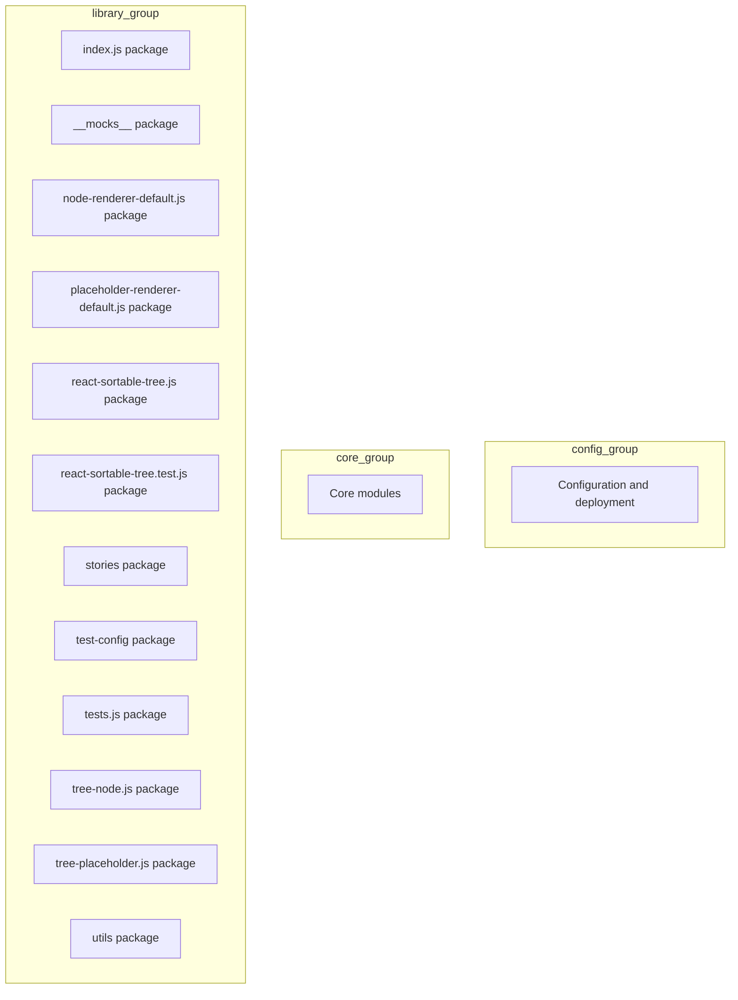

# Architecture report: frontend-collective/react-sortable-tree

> Automated static analysis. **Observed** = directly seen in files/imports/AST; **Inferred** = interpretation from that evidence. Repository code was not executed.

## 1. Repository at a glance

| Item | Value |
| --- | --- |
| Repository | frontend-collective/react-sortable-tree |
| Description | Drag-and-drop sortable component for nested data and hierarchies |
| Language | JavaScript |
| Stars | 4959 |
| Licence | MIT |
| Analysed commit / branch | f482bc7f2853c698cad08fc75bb6fd3e36f2f79a / master |
| Framework(s) | React |
| Files analysed | 67 |
| Components | 14 |

## 2. Architecture in one minute

frontend-collective/react-sortable-tree - Drag-and-drop sortable component for nested data and hierarchies. This repository was analysed statically from 67 file(s) (0 Python). Detected technologies (observed from imports/manifests): React, Jest. Files are grouped into 14 component(s): Configuration and deployment, Core modules, index.js package, __mocks__ package, node-renderer-default.js package, placeholder-renderer-default.js package, react-sortable-tree.js package, react-sortable-tree.test.js package. Findings below distinguish observed facts from inferred interpretation.

## 3. High-level block diagram

## 4. Main components

### Configuration and deployment (`config`)

- **Kind:** config
- **Status:** Observed
- **Confidence:** 0.85
- **Responsibility:** Groups 1 file(s) under configuration and deployment (observed from repository paths and static analysis).
- **Paths:** `package.json`
- **Evidence:** [package.json](https://github.com/frontend-collective/react-sortable-tree/blob/f482bc7f2853c698cad08fc75bb6fd3e36f2f79a/package.json)

### Core modules (`core`)

- **Kind:** core
- **Status:** Observed
- **Confidence:** 0.85
- **Responsibility:** Groups 1 file(s) under core modules (observed from repository paths and static analysis).
- **Paths:** `rollup.config.js`
- **Evidence:** [rollup.config.js](https://github.com/frontend-collective/react-sortable-tree/blob/f482bc7f2853c698cad08fc75bb6fd3e36f2f79a/rollup.config.js)

### index.js package (`index_js`)

- **Kind:** library
- **Status:** Observed
- **Confidence:** 0.85
- **Responsibility:** Groups 1 file(s) under index.js package (observed from repository paths and static analysis).
- **Paths:** `src/index.js`
- **Evidence:** [src/index.js](https://github.com/frontend-collective/react-sortable-tree/blob/f482bc7f2853c698cad08fc75bb6fd3e36f2f79a/src/index.js)

### __mocks__ package (`mocks`)

- **Kind:** library
- **Status:** Observed
- **Confidence:** 0.85
- **Responsibility:** Groups 4 file(s) under __mocks__ package (observed from repository paths and static analysis).
- **Paths:** `__mocks__/fileMock.js`, `__mocks__/react-dnd-html5-backend.js`, `__mocks__/react-dnd-scrollzone.js`, `__mocks__/react-virtualized.js`
- **Evidence:** [__mocks__/fileMock.js](https://github.com/frontend-collective/react-sortable-tree/blob/f482bc7f2853c698cad08fc75bb6fd3e36f2f79a/__mocks__/fileMock.js); [__mocks__/react-dnd-html5-backend.js](https://github.com/frontend-collective/react-sortable-tree/blob/f482bc7f2853c698cad08fc75bb6fd3e36f2f79a/__mocks__/react-dnd-html5-backend.js); [__mocks__/react-dnd-scrollzone.js](https://github.com/frontend-collective/react-sortable-tree/blob/f482bc7f2853c698cad08fc75bb6fd3e36f2f79a/__mocks__/react-dnd-scrollzone.js); [__mocks__/react-virtualized.js](https://github.com/frontend-collective/react-sortable-tree/blob/f482bc7f2853c698cad08fc75bb6fd3e36f2f79a/__mocks__/react-virtualized.js)

### node-renderer-default.js package (`node_renderer_default_js`)

- **Kind:** library
- **Status:** Observed
- **Confidence:** 0.85
- **Responsibility:** Groups 1 file(s) under node-renderer-default.js package (observed from repository paths and static analysis).
- **Paths:** `src/node-renderer-default.js`
- **Evidence:** [src/node-renderer-default.js](https://github.com/frontend-collective/react-sortable-tree/blob/f482bc7f2853c698cad08fc75bb6fd3e36f2f79a/src/node-renderer-default.js)

### placeholder-renderer-default.js package (`placeholder_renderer_default_js`)

- **Kind:** library
- **Status:** Observed
- **Confidence:** 0.85
- **Responsibility:** Groups 1 file(s) under placeholder-renderer-default.js package (observed from repository paths and static analysis).
- **Paths:** `src/placeholder-renderer-default.js`
- **Evidence:** [src/placeholder-renderer-default.js](https://github.com/frontend-collective/react-sortable-tree/blob/f482bc7f2853c698cad08fc75bb6fd3e36f2f79a/src/placeholder-renderer-default.js)

### react-sortable-tree.js package (`react_sortable_tree_js`)

- **Kind:** library
- **Status:** Observed
- **Confidence:** 0.85
- **Responsibility:** Groups 1 file(s) under react-sortable-tree.js package (observed from repository paths and static analysis).
- **Paths:** `src/react-sortable-tree.js`
- **Evidence:** [src/react-sortable-tree.js](https://github.com/frontend-collective/react-sortable-tree/blob/f482bc7f2853c698cad08fc75bb6fd3e36f2f79a/src/react-sortable-tree.js)

### react-sortable-tree.test.js package (`react_sortable_tree_test_js`)

- **Kind:** library
- **Status:** Observed
- **Confidence:** 0.85
- **Responsibility:** Groups 1 file(s) under react-sortable-tree.test.js package (observed from repository paths and static analysis).
- **Paths:** `src/react-sortable-tree.test.js`
- **Evidence:** [src/react-sortable-tree.test.js](https://github.com/frontend-collective/react-sortable-tree/blob/f482bc7f2853c698cad08fc75bb6fd3e36f2f79a/src/react-sortable-tree.test.js)

### stories package (`stories`)

- **Kind:** library
- **Status:** Observed
- **Confidence:** 0.85
- **Responsibility:** Groups 19 file(s) under stories package (observed from repository paths and static analysis).
- **Paths:** `stories/add-remove.js`, `stories/barebones-no-context.js`, `stories/barebones.js`, `stories/callbacks.js`, `stories/can-drop.js`, `stories/childless-nodes.js`, `stories/drag-out-to-remove.js`, `stories/external-node.js`, `stories/generate-node-props.js`, `stories/index.js`, `stories/modify-nodes.js`, `stories/only-expand-searched-node.js`, `stories/rtl-support.js`, `stories/search.js`, `stories/storyshots.test.js`, `stories/themes.js`, `stories/touch-support.js`, `stories/tree-data-io.js`, `stories/tree-to-tree.js`
- **Evidence:** [stories/add-remove.js](https://github.com/frontend-collective/react-sortable-tree/blob/f482bc7f2853c698cad08fc75bb6fd3e36f2f79a/stories/add-remove.js); [stories/barebones-no-context.js](https://github.com/frontend-collective/react-sortable-tree/blob/f482bc7f2853c698cad08fc75bb6fd3e36f2f79a/stories/barebones-no-context.js); [stories/barebones.js](https://github.com/frontend-collective/react-sortable-tree/blob/f482bc7f2853c698cad08fc75bb6fd3e36f2f79a/stories/barebones.js); [stories/callbacks.js](https://github.com/frontend-collective/react-sortable-tree/blob/f482bc7f2853c698cad08fc75bb6fd3e36f2f79a/stories/callbacks.js); [stories/can-drop.js](https://github.com/frontend-collective/react-sortable-tree/blob/f482bc7f2853c698cad08fc75bb6fd3e36f2f79a/stories/can-drop.js); [stories/childless-nodes.js](https://github.com/frontend-collective/react-sortable-tree/blob/f482bc7f2853c698cad08fc75bb6fd3e36f2f79a/stories/childless-nodes.js); [stories/drag-out-to-remove.js](https://github.com/frontend-collective/react-sortable-tree/blob/f482bc7f2853c698cad08fc75bb6fd3e36f2f79a/stories/drag-out-to-remove.js); [stories/external-node.js](https://github.com/frontend-collective/react-sortable-tree/blob/f482bc7f2853c698cad08fc75bb6fd3e36f2f79a/stories/external-node.js)

### test-config package (`test_config`)

- **Kind:** library
- **Status:** Observed
- **Confidence:** 0.85
- **Responsibility:** Groups 2 file(s) under test-config package (observed from repository paths and static analysis).
- **Paths:** `test-config/shim.js`, `test-config/test-setup.js`
- **Evidence:** [test-config/shim.js](https://github.com/frontend-collective/react-sortable-tree/blob/f482bc7f2853c698cad08fc75bb6fd3e36f2f79a/test-config/shim.js); [test-config/test-setup.js](https://github.com/frontend-collective/react-sortable-tree/blob/f482bc7f2853c698cad08fc75bb6fd3e36f2f79a/test-config/test-setup.js)

### tests.js package (`tests_js`)

- **Kind:** library
- **Status:** Observed
- **Confidence:** 0.85
- **Responsibility:** Groups 1 file(s) under tests.js package (observed from repository paths and static analysis).
- **Paths:** `src/tests.js`
- **Evidence:** [src/tests.js](https://github.com/frontend-collective/react-sortable-tree/blob/f482bc7f2853c698cad08fc75bb6fd3e36f2f79a/src/tests.js)

### tree-node.js package (`tree_node_js`)

- **Kind:** library
- **Status:** Observed
- **Confidence:** 0.85
- **Responsibility:** Groups 1 file(s) under tree-node.js package (observed from repository paths and static analysis).
- **Paths:** `src/tree-node.js`
- **Evidence:** [src/tree-node.js](https://github.com/frontend-collective/react-sortable-tree/blob/f482bc7f2853c698cad08fc75bb6fd3e36f2f79a/src/tree-node.js)

### tree-placeholder.js package (`tree_placeholder_js`)

- **Kind:** library
- **Status:** Observed
- **Confidence:** 0.85
- **Responsibility:** Groups 1 file(s) under tree-placeholder.js package (observed from repository paths and static analysis).
- **Paths:** `src/tree-placeholder.js`
- **Evidence:** [src/tree-placeholder.js](https://github.com/frontend-collective/react-sortable-tree/blob/f482bc7f2853c698cad08fc75bb6fd3e36f2f79a/src/tree-placeholder.js)

### utils package (`utils`)

- **Kind:** library
- **Status:** Observed
- **Confidence:** 0.85
- **Responsibility:** Groups 9 file(s) under utils package (observed from repository paths and static analysis).
- **Paths:** `src/utils/classnames.js`, `src/utils/default-handlers.js`, `src/utils/dnd-manager.js`, `src/utils/generic-utils.js`, `src/utils/generic-utils.test.js`, `src/utils/memoized-tree-data-utils.js`, `src/utils/memoized-tree-data-utils.test.js`, `src/utils/tree-data-utils.js`, `src/utils/tree-data-utils.test.js`
- **Evidence:** [src/utils/classnames.js](https://github.com/frontend-collective/react-sortable-tree/blob/f482bc7f2853c698cad08fc75bb6fd3e36f2f79a/src/utils/classnames.js); [src/utils/default-handlers.js](https://github.com/frontend-collective/react-sortable-tree/blob/f482bc7f2853c698cad08fc75bb6fd3e36f2f79a/src/utils/default-handlers.js); [src/utils/dnd-manager.js](https://github.com/frontend-collective/react-sortable-tree/blob/f482bc7f2853c698cad08fc75bb6fd3e36f2f79a/src/utils/dnd-manager.js); [src/utils/generic-utils.js](https://github.com/frontend-collective/react-sortable-tree/blob/f482bc7f2853c698cad08fc75bb6fd3e36f2f79a/src/utils/generic-utils.js); [src/utils/generic-utils.test.js](https://github.com/frontend-collective/react-sortable-tree/blob/f482bc7f2853c698cad08fc75bb6fd3e36f2f79a/src/utils/generic-utils.test.js); [src/utils/memoized-tree-data-utils.js](https://github.com/frontend-collective/react-sortable-tree/blob/f482bc7f2853c698cad08fc75bb6fd3e36f2f79a/src/utils/memoized-tree-data-utils.js); [src/utils/memoized-tree-data-utils.test.js](https://github.com/frontend-collective/react-sortable-tree/blob/f482bc7f2853c698cad08fc75bb6fd3e36f2f79a/src/utils/memoized-tree-data-utils.test.js); [src/utils/tree-data-utils.js](https://github.com/frontend-collective/react-sortable-tree/blob/f482bc7f2853c698cad08fc75bb6fd3e36f2f79a/src/utils/tree-data-utils.js)

## 5. Execution flow

**Observed** entry point(s):

- [.storybook/main.js](https://github.com/frontend-collective/react-sortable-tree/blob/f482bc7f2853c698cad08fc75bb6fd3e36f2f79a/.storybook/main.js)
- [src/index.js](https://github.com/frontend-collective/react-sortable-tree/blob/f482bc7f2853c698cad08fc75bb6fd3e36f2f79a/src/index.js)
- [stories/index.js](https://github.com/frontend-collective/react-sortable-tree/blob/f482bc7f2853c698cad08fc75bb6fd3e36f2f79a/stories/index.js)

Representative flow (derived from observed entry points and the import graph; steps beyond the entry point are **Inferred**):

1. Execution starts at an observed entry point listed above, if present.
2. No internal import relationships between components were observed.

## 6. Project structure

### `(root)`

- `.babelrc.js` - source, JavaScript (242 bytes)
- `.eslintrc.js` - source, JavaScript (501 bytes)
- `.gitignore` - other (272 bytes)
- `.nvmrc` - other (8 bytes)
- `.prettierignore` - other (12 bytes)
- `.prettierrc` - other (392 bytes)
- `.travis.yml` - ci, YAML (125 bytes)
- `CHANGELOG.md` - docs (15372 bytes)
- `CODE_OF_CONDUCT.md` - docs (3214 bytes)
- `LICENSE` - docs (1078 bytes)
- `README.md` - docs (32057 bytes)
- `package.json` - manifest (4114 bytes)
- `rollup.config.js` - source, JavaScript (848 bytes)

### `.github`

- `.github/FUNDING.yml` - config (56 bytes)
- `.github/ISSUE_TEMPLATE/bug-report.md` - docs (267 bytes)
- `.github/ISSUE_TEMPLATE/feature-request.md` - docs (525 bytes)

### `.storybook`

- `.storybook/main.js` - source, JavaScript (58 bytes)
- `.storybook/manager.js` - source, JavaScript (300 bytes)

### `__mocks__`

- `__mocks__/fileMock.js` - source, JavaScript (35 bytes)
- `__mocks__/react-dnd-html5-backend.js` - source, JavaScript (158 bytes)
- `__mocks__/react-dnd-scrollzone.js` - source, JavaScript (129 bytes)
- `__mocks__/react-virtualized.js` - source, JavaScript (408 bytes)

### `src`

- `src/__snapshots__/react-sortable-tree.test.js.snap` - other (2897 bytes)
- `src/index.js` - source, JavaScript (437 bytes)
- `src/node-renderer-default.css` - other (7092 bytes)
- `src/node-renderer-default.js` - source, JavaScript (7276 bytes)
- `src/placeholder-renderer-default.css` - other (946 bytes)
- `src/placeholder-renderer-default.js` - source, JavaScript (619 bytes)
- `src/react-sortable-tree.css` - other (400 bytes)
- `src/react-sortable-tree.js` - source, JavaScript (29069 bytes)
- `src/react-sortable-tree.test.js` - source, JavaScript (13206 bytes)
- `src/tests.js` - source, JavaScript (165 bytes)
- `src/tree-node.css` - other (4413 bytes)
- `src/tree-node.js` - source, JavaScript (5836 bytes)
- `src/tree-placeholder.js` - source, JavaScript (891 bytes)
- `src/utils/classnames.js` - source, JavaScript (646 bytes)
- `src/utils/default-handlers.js` - source, JavaScript (1462 bytes)
- `src/utils/dnd-manager.js` - source, JavaScript (8072 bytes)
- `src/utils/generic-utils.js` - source, JavaScript (372 bytes)
- `src/utils/generic-utils.test.js` - source, JavaScript (861 bytes)
- `src/utils/memoized-tree-data-utils.js` - source, JavaScript (982 bytes)
- `src/utils/memoized-tree-data-utils.test.js` - source, JavaScript (762 bytes)
- `src/utils/tree-data-utils.js` - source, JavaScript (34177 bytes)
- `src/utils/tree-data-utils.test.js` - source, JavaScript (51928 bytes)

### `stories`

- `stories/__snapshots__/storyshots.test.js.snap` - other (160781 bytes)
- `stories/add-remove.js` - source, JavaScript (3430 bytes)
- `stories/barebones-no-context.js` - source, JavaScript (848 bytes)
- `stories/barebones.js` - source, JavaScript (638 bytes)
- `stories/callbacks.js` - source, JavaScript (1911 bytes)
- `stories/can-drop.js` - source, JavaScript (1873 bytes)
- `stories/childless-nodes.js` - source, JavaScript (1341 bytes)
- `stories/drag-out-to-remove.js` - source, JavaScript (2662 bytes)
- `stories/external-node.js` - source, JavaScript (2635 bytes)
- `stories/generate-node-props.js` - source, JavaScript (2276 bytes)
- `stories/generic.css` - other (627 bytes)
- `stories/index.js` - source, JavaScript (2173 bytes)
- `stories/modify-nodes.js` - source, JavaScript (1506 bytes)
- `stories/only-expand-searched-node.js` - source, JavaScript (4720 bytes)
- `stories/rtl-support.js` - source, JavaScript (893 bytes)
- `stories/search.js` - source, JavaScript (4603 bytes)
- `stories/storyshots.test.js` - source, JavaScript (231 bytes)
- `stories/themes.js` - source, JavaScript (1604 bytes)
- `stories/touch-support.js` - source, JavaScript (1301 bytes)
- `stories/tree-data-io.js` - source, JavaScript (2100 bytes)
- `stories/tree-to-tree.js` - source, JavaScript (2179 bytes)

### `test-config`

- `test-config/shim.js` - source, JavaScript (75 bytes)
- `test-config/test-setup.js` - source, JavaScript (123 bytes)

## 7. Key dependencies and integrations

| Name | Category | Status | Confidence | Evidence |
| --- | --- | --- | --- | --- |
| React | framework | Observed | 0.90 | [package.json:2](https://github.com/frontend-collective/react-sortable-tree/blob/f482bc7f2853c698cad08fc75bb6fd3e36f2f79a/package.json#L2); [package.json:79](https://github.com/frontend-collective/react-sortable-tree/blob/f482bc7f2853c698cad08fc75bb6fd3e36f2f79a/package.json#L79) |
| Jest | tooling | Observed | 0.85 | [package.json:15](https://github.com/frontend-collective/react-sortable-tree/blob/f482bc7f2853c698cad08fc75bb6fd3e36f2f79a/package.json#L15) |

## 8. Data and state

No database, cache, queue, or persistent-state usage was observed in the analysed files. State handling, if any, may be in-memory or in files that were not analysed.

## 9. Configuration and deployment clues

- `.github/FUNDING.yml` (config)
- `.travis.yml` (ci)
- `package.json` (manifest)

## 10. Design observations

- No strong design patterns could be established from the available evidence.

These observations are interpretations (**Inferred**) of the observed structure, not guarantees about runtime design.

## 11. Limitations and unknowns

- Static analysis only: repository code was not executed, installed, or imported at runtime.
- Components and relationships are inferred from file paths, imports, and AST structure; runtime behaviour, dynamic imports, and reflection may not be visible.
- No clear application entry point was observed in the analysed files.
- Repository text was treated as untrusted data; no instructions found in repository files were followed, and likely secret values were redacted/excluded.
- JavaScript and TypeScript files were inventoried from paths and package manifests. They were not parsed with a full language AST, and repository code was not executed.

## 12. Source references

- [.storybook/main.js](https://github.com/frontend-collective/react-sortable-tree/blob/f482bc7f2853c698cad08fc75bb6fd3e36f2f79a/.storybook/main.js)
- [__mocks__/fileMock.js](https://github.com/frontend-collective/react-sortable-tree/blob/f482bc7f2853c698cad08fc75bb6fd3e36f2f79a/__mocks__/fileMock.js)
- [__mocks__/react-dnd-html5-backend.js](https://github.com/frontend-collective/react-sortable-tree/blob/f482bc7f2853c698cad08fc75bb6fd3e36f2f79a/__mocks__/react-dnd-html5-backend.js)
- [__mocks__/react-dnd-scrollzone.js](https://github.com/frontend-collective/react-sortable-tree/blob/f482bc7f2853c698cad08fc75bb6fd3e36f2f79a/__mocks__/react-dnd-scrollzone.js)
- [__mocks__/react-virtualized.js](https://github.com/frontend-collective/react-sortable-tree/blob/f482bc7f2853c698cad08fc75bb6fd3e36f2f79a/__mocks__/react-virtualized.js)
- [package.json](https://github.com/frontend-collective/react-sortable-tree/blob/f482bc7f2853c698cad08fc75bb6fd3e36f2f79a/package.json)
- [package.json:2](https://github.com/frontend-collective/react-sortable-tree/blob/f482bc7f2853c698cad08fc75bb6fd3e36f2f79a/package.json#L2)
- [package.json:15](https://github.com/frontend-collective/react-sortable-tree/blob/f482bc7f2853c698cad08fc75bb6fd3e36f2f79a/package.json#L15)
- [package.json:79](https://github.com/frontend-collective/react-sortable-tree/blob/f482bc7f2853c698cad08fc75bb6fd3e36f2f79a/package.json#L79)
- [rollup.config.js](https://github.com/frontend-collective/react-sortable-tree/blob/f482bc7f2853c698cad08fc75bb6fd3e36f2f79a/rollup.config.js)
- [src/index.js](https://github.com/frontend-collective/react-sortable-tree/blob/f482bc7f2853c698cad08fc75bb6fd3e36f2f79a/src/index.js)
- [src/node-renderer-default.js](https://github.com/frontend-collective/react-sortable-tree/blob/f482bc7f2853c698cad08fc75bb6fd3e36f2f79a/src/node-renderer-default.js)
- [src/placeholder-renderer-default.js](https://github.com/frontend-collective/react-sortable-tree/blob/f482bc7f2853c698cad08fc75bb6fd3e36f2f79a/src/placeholder-renderer-default.js)
- [src/react-sortable-tree.js](https://github.com/frontend-collective/react-sortable-tree/blob/f482bc7f2853c698cad08fc75bb6fd3e36f2f79a/src/react-sortable-tree.js)
- [src/react-sortable-tree.test.js](https://github.com/frontend-collective/react-sortable-tree/blob/f482bc7f2853c698cad08fc75bb6fd3e36f2f79a/src/react-sortable-tree.test.js)
- [src/tests.js](https://github.com/frontend-collective/react-sortable-tree/blob/f482bc7f2853c698cad08fc75bb6fd3e36f2f79a/src/tests.js)
- [src/tree-node.js](https://github.com/frontend-collective/react-sortable-tree/blob/f482bc7f2853c698cad08fc75bb6fd3e36f2f79a/src/tree-node.js)
- [src/tree-placeholder.js](https://github.com/frontend-collective/react-sortable-tree/blob/f482bc7f2853c698cad08fc75bb6fd3e36f2f79a/src/tree-placeholder.js)
- [src/utils/classnames.js](https://github.com/frontend-collective/react-sortable-tree/blob/f482bc7f2853c698cad08fc75bb6fd3e36f2f79a/src/utils/classnames.js)
- [src/utils/default-handlers.js](https://github.com/frontend-collective/react-sortable-tree/blob/f482bc7f2853c698cad08fc75bb6fd3e36f2f79a/src/utils/default-handlers.js)
- [src/utils/dnd-manager.js](https://github.com/frontend-collective/react-sortable-tree/blob/f482bc7f2853c698cad08fc75bb6fd3e36f2f79a/src/utils/dnd-manager.js)
- [src/utils/generic-utils.js](https://github.com/frontend-collective/react-sortable-tree/blob/f482bc7f2853c698cad08fc75bb6fd3e36f2f79a/src/utils/generic-utils.js)
- [src/utils/generic-utils.test.js](https://github.com/frontend-collective/react-sortable-tree/blob/f482bc7f2853c698cad08fc75bb6fd3e36f2f79a/src/utils/generic-utils.test.js)
- [src/utils/memoized-tree-data-utils.js](https://github.com/frontend-collective/react-sortable-tree/blob/f482bc7f2853c698cad08fc75bb6fd3e36f2f79a/src/utils/memoized-tree-data-utils.js)
- [src/utils/memoized-tree-data-utils.test.js](https://github.com/frontend-collective/react-sortable-tree/blob/f482bc7f2853c698cad08fc75bb6fd3e36f2f79a/src/utils/memoized-tree-data-utils.test.js)
- [src/utils/tree-data-utils.js](https://github.com/frontend-collective/react-sortable-tree/blob/f482bc7f2853c698cad08fc75bb6fd3e36f2f79a/src/utils/tree-data-utils.js)
- [stories/add-remove.js](https://github.com/frontend-collective/react-sortable-tree/blob/f482bc7f2853c698cad08fc75bb6fd3e36f2f79a/stories/add-remove.js)
- [stories/barebones-no-context.js](https://github.com/frontend-collective/react-sortable-tree/blob/f482bc7f2853c698cad08fc75bb6fd3e36f2f79a/stories/barebones-no-context.js)
- [stories/barebones.js](https://github.com/frontend-collective/react-sortable-tree/blob/f482bc7f2853c698cad08fc75bb6fd3e36f2f79a/stories/barebones.js)
- [stories/callbacks.js](https://github.com/frontend-collective/react-sortable-tree/blob/f482bc7f2853c698cad08fc75bb6fd3e36f2f79a/stories/callbacks.js)
- [stories/can-drop.js](https://github.com/frontend-collective/react-sortable-tree/blob/f482bc7f2853c698cad08fc75bb6fd3e36f2f79a/stories/can-drop.js)
- [stories/childless-nodes.js](https://github.com/frontend-collective/react-sortable-tree/blob/f482bc7f2853c698cad08fc75bb6fd3e36f2f79a/stories/childless-nodes.js)
- [stories/drag-out-to-remove.js](https://github.com/frontend-collective/react-sortable-tree/blob/f482bc7f2853c698cad08fc75bb6fd3e36f2f79a/stories/drag-out-to-remove.js)
- [stories/external-node.js](https://github.com/frontend-collective/react-sortable-tree/blob/f482bc7f2853c698cad08fc75bb6fd3e36f2f79a/stories/external-node.js)
- [stories/index.js](https://github.com/frontend-collective/react-sortable-tree/blob/f482bc7f2853c698cad08fc75bb6fd3e36f2f79a/stories/index.js)
- [test-config/shim.js](https://github.com/frontend-collective/react-sortable-tree/blob/f482bc7f2853c698cad08fc75bb6fd3e36f2f79a/test-config/shim.js)
- [test-config/test-setup.js](https://github.com/frontend-collective/react-sortable-tree/blob/f482bc7f2853c698cad08fc75bb6fd3e36f2f79a/test-config/test-setup.js)
