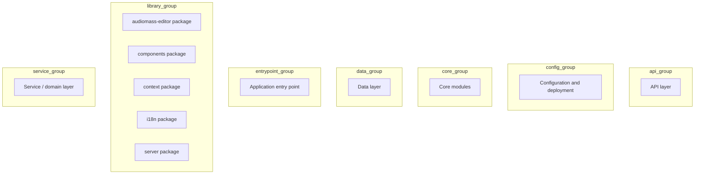

# Architecture report: fspecii/ace-step-ui

> Automated static analysis. **Observed** = directly seen in files/imports/AST; **Inferred** = interpretation from that evidence. Repository code was not executed.

## 1. Repository at a glance

| Item | Value |
| --- | --- |
| Repository | fspecii/ace-step-ui |
| Description | 🎵 The Ultimate Open Source Suno Alternative - Professional UI for ACE-Step 1.5 AI Music Generation. Free, local, unlimited. Stop paying for Suno! |
| Language | JavaScript |
| Stars | 5218 |
| Licence | Not detected |
| Analysed commit / branch | a1fdf91829ec6f7b98844f80e323529cd155dbf2 / main |
| Framework(s) | Express, React |
| Files analysed | 166 |
| Components | 11 |

## 2. Architecture in one minute

fspecii/ace-step-ui - 🎵 The Ultimate Open Source Suno Alternative - Professional UI for ACE-Step 1.5 AI Music Generation. Free, local, unlimited. Stop paying for Suno!. This repository was analysed statically from 166 file(s) (6 Python). Detected technologies (observed from imports/manifests): Express, React, TypeScript, Vite. Files are grouped into 11 component(s): API layer, audiomass-editor package, components package, Configuration and deployment, context package, Core modules, Data layer, Application entry point. Observed entry point(s): server/scripts/format_sample.py, server/scripts/get_limits.py, server/scripts/preprocess_dataset.py. Findings below distinguish observed facts from inferred interpretation.

## 3. High-level block diagram

## 4. Main components

### API layer (`api_layer`)

- **Kind:** api
- **Status:** Observed
- **Confidence:** 0.85
- **Responsibility:** Groups 9 file(s) under api layer (observed from repository paths and static analysis).
- **Paths:** `server/src/routes/auth.ts`, `server/src/routes/contact.ts`, `server/src/routes/generate.ts`, `server/src/routes/lora.ts`, `server/src/routes/playlists.ts`, `server/src/routes/referenceTrack.ts`, `server/src/routes/songs.ts`, `server/src/routes/training.ts`, `server/src/routes/users.ts`
- **Evidence:** [server/src/routes/auth.ts](https://github.com/fspecii/ace-step-ui/blob/a1fdf91829ec6f7b98844f80e323529cd155dbf2/server/src/routes/auth.ts); [server/src/routes/contact.ts](https://github.com/fspecii/ace-step-ui/blob/a1fdf91829ec6f7b98844f80e323529cd155dbf2/server/src/routes/contact.ts); [server/src/routes/generate.ts](https://github.com/fspecii/ace-step-ui/blob/a1fdf91829ec6f7b98844f80e323529cd155dbf2/server/src/routes/generate.ts); [server/src/routes/lora.ts](https://github.com/fspecii/ace-step-ui/blob/a1fdf91829ec6f7b98844f80e323529cd155dbf2/server/src/routes/lora.ts); [server/src/routes/playlists.ts](https://github.com/fspecii/ace-step-ui/blob/a1fdf91829ec6f7b98844f80e323529cd155dbf2/server/src/routes/playlists.ts); [server/src/routes/referenceTrack.ts](https://github.com/fspecii/ace-step-ui/blob/a1fdf91829ec6f7b98844f80e323529cd155dbf2/server/src/routes/referenceTrack.ts); [server/src/routes/songs.ts](https://github.com/fspecii/ace-step-ui/blob/a1fdf91829ec6f7b98844f80e323529cd155dbf2/server/src/routes/songs.ts); [server/src/routes/training.ts](https://github.com/fspecii/ace-step-ui/blob/a1fdf91829ec6f7b98844f80e323529cd155dbf2/server/src/routes/training.ts)

### audiomass-editor package (`audiomass_editor`)

- **Kind:** library
- **Status:** Observed
- **Confidence:** 0.85
- **Responsibility:** Groups 26 file(s) under audiomass-editor package (observed from repository paths and static analysis).
- **Paths:** `audiomass-editor/src/actions.js`, `audiomass-editor/src/app.js`, `audiomass-editor/src/audiomass-server.go`, `audiomass-editor/src/audiomass-server.py`, `audiomass-editor/src/audiomass-url-patch.js`, `audiomass-editor/src/contextmenu.js`, `audiomass-editor/src/drag.js`, `audiomass-editor/src/engine.js`, `audiomass-editor/src/flac.js`, `audiomass-editor/src/fx-auto.js`, `audiomass-editor/src/fx-pg-eq.js`, `audiomass-editor/src/id3.js`, `audiomass-editor/src/keys.js`, `audiomass-editor/src/local.js`, `audiomass-editor/src/lz4-block-codec-wasm.js`, `audiomass-editor/src/lzma.js`, `audiomass-editor/src/modal.js`, `audiomass-editor/src/oneup.js`, `audiomass-editor/src/recorder.js`, `audiomass-editor/src/rnn_denoise.js`, `audiomass-editor/src/state.js`, `audiomass-editor/src/sw.js`, `audiomass-editor/src/ui-fx.js`, `audiomass-editor/src/ui.js`, `audiomass-editor/src/wav.js`, `audiomass-editor/src/welcome.js`
- **Evidence:** [audiomass-editor/src/actions.js](https://github.com/fspecii/ace-step-ui/blob/a1fdf91829ec6f7b98844f80e323529cd155dbf2/audiomass-editor/src/actions.js); [audiomass-editor/src/app.js](https://github.com/fspecii/ace-step-ui/blob/a1fdf91829ec6f7b98844f80e323529cd155dbf2/audiomass-editor/src/app.js); [audiomass-editor/src/audiomass-server.go](https://github.com/fspecii/ace-step-ui/blob/a1fdf91829ec6f7b98844f80e323529cd155dbf2/audiomass-editor/src/audiomass-server.go); [audiomass-editor/src/audiomass-server.py](https://github.com/fspecii/ace-step-ui/blob/a1fdf91829ec6f7b98844f80e323529cd155dbf2/audiomass-editor/src/audiomass-server.py); [audiomass-editor/src/audiomass-url-patch.js](https://github.com/fspecii/ace-step-ui/blob/a1fdf91829ec6f7b98844f80e323529cd155dbf2/audiomass-editor/src/audiomass-url-patch.js); [audiomass-editor/src/contextmenu.js](https://github.com/fspecii/ace-step-ui/blob/a1fdf91829ec6f7b98844f80e323529cd155dbf2/audiomass-editor/src/contextmenu.js); [audiomass-editor/src/drag.js](https://github.com/fspecii/ace-step-ui/blob/a1fdf91829ec6f7b98844f80e323529cd155dbf2/audiomass-editor/src/drag.js); [audiomass-editor/src/engine.js](https://github.com/fspecii/ace-step-ui/blob/a1fdf91829ec6f7b98844f80e323529cd155dbf2/audiomass-editor/src/engine.js)

### components package (`components`)

- **Kind:** library
- **Status:** Observed
- **Confidence:** 0.85
- **Responsibility:** Groups 24 file(s) under components package (observed from repository paths and static analysis).
- **Paths:** `components/AlbumCover.tsx`, `components/ConfirmDialog.tsx`, `components/CreatePanel.tsx`, `components/EditProfileModal.tsx`, `components/EditableSlider.tsx`, `components/LibraryView.tsx`, `components/MobileDrawer.tsx`, `components/NewsPage.tsx`, `components/Player.tsx`, `components/PlaylistDetail.tsx`, `components/PlaylistModals.tsx`, `components/RightSidebar.tsx`, `components/SearchPage.tsx`, `components/SettingsModal.tsx`, `components/ShareModal.tsx`, `components/Sidebar.tsx`, `components/SongDropdownMenu.tsx`, `components/SongList.tsx`, `components/SongProfile.tsx`, `components/Toast.tsx`, `components/TrainingPanel.tsx`, `components/UserProfile.tsx`, `components/UsernameModal.tsx`, `components/VideoGeneratorModal.tsx`
- **Evidence:** [components/AlbumCover.tsx](https://github.com/fspecii/ace-step-ui/blob/a1fdf91829ec6f7b98844f80e323529cd155dbf2/components/AlbumCover.tsx); [components/ConfirmDialog.tsx](https://github.com/fspecii/ace-step-ui/blob/a1fdf91829ec6f7b98844f80e323529cd155dbf2/components/ConfirmDialog.tsx); [components/CreatePanel.tsx](https://github.com/fspecii/ace-step-ui/blob/a1fdf91829ec6f7b98844f80e323529cd155dbf2/components/CreatePanel.tsx); [components/EditProfileModal.tsx](https://github.com/fspecii/ace-step-ui/blob/a1fdf91829ec6f7b98844f80e323529cd155dbf2/components/EditProfileModal.tsx); [components/EditableSlider.tsx](https://github.com/fspecii/ace-step-ui/blob/a1fdf91829ec6f7b98844f80e323529cd155dbf2/components/EditableSlider.tsx); [components/LibraryView.tsx](https://github.com/fspecii/ace-step-ui/blob/a1fdf91829ec6f7b98844f80e323529cd155dbf2/components/LibraryView.tsx); [components/MobileDrawer.tsx](https://github.com/fspecii/ace-step-ui/blob/a1fdf91829ec6f7b98844f80e323529cd155dbf2/components/MobileDrawer.tsx); [components/NewsPage.tsx](https://github.com/fspecii/ace-step-ui/blob/a1fdf91829ec6f7b98844f80e323529cd155dbf2/components/NewsPage.tsx)

### Configuration and deployment (`config`)

- **Kind:** config
- **Status:** Observed
- **Confidence:** 0.85
- **Responsibility:** Groups 10 file(s) under configuration and deployment (observed from repository paths and static analysis).
- **Paths:** `audiomass-editor/src/manifest.json`, `data/news.json`, `metadata.json`, `package.json`, `server/.env.example`, `server/audio-editor/manifest.json`, `server/package.json`, `server/src/config/index.ts`, `server/tsconfig.json`, `tsconfig.json`
- **Evidence:** [audiomass-editor/src/manifest.json](https://github.com/fspecii/ace-step-ui/blob/a1fdf91829ec6f7b98844f80e323529cd155dbf2/audiomass-editor/src/manifest.json); [data/news.json](https://github.com/fspecii/ace-step-ui/blob/a1fdf91829ec6f7b98844f80e323529cd155dbf2/data/news.json); [metadata.json](https://github.com/fspecii/ace-step-ui/blob/a1fdf91829ec6f7b98844f80e323529cd155dbf2/metadata.json); [package.json](https://github.com/fspecii/ace-step-ui/blob/a1fdf91829ec6f7b98844f80e323529cd155dbf2/package.json); [server/.env.example](https://github.com/fspecii/ace-step-ui/blob/a1fdf91829ec6f7b98844f80e323529cd155dbf2/server/.env.example); [server/audio-editor/manifest.json](https://github.com/fspecii/ace-step-ui/blob/a1fdf91829ec6f7b98844f80e323529cd155dbf2/server/audio-editor/manifest.json); [server/package.json](https://github.com/fspecii/ace-step-ui/blob/a1fdf91829ec6f7b98844f80e323529cd155dbf2/server/package.json); [server/src/config/index.ts](https://github.com/fspecii/ace-step-ui/blob/a1fdf91829ec6f7b98844f80e323529cd155dbf2/server/src/config/index.ts)

### context package (`context`)

- **Kind:** library
- **Status:** Observed
- **Confidence:** 0.85
- **Responsibility:** Groups 3 file(s) under context package (observed from repository paths and static analysis).
- **Paths:** `context/AuthContext.tsx`, `context/I18nContext.tsx`, `context/ResponsiveContext.tsx`
- **Evidence:** [context/AuthContext.tsx](https://github.com/fspecii/ace-step-ui/blob/a1fdf91829ec6f7b98844f80e323529cd155dbf2/context/AuthContext.tsx); [context/I18nContext.tsx](https://github.com/fspecii/ace-step-ui/blob/a1fdf91829ec6f7b98844f80e323529cd155dbf2/context/I18nContext.tsx); [context/ResponsiveContext.tsx](https://github.com/fspecii/ace-step-ui/blob/a1fdf91829ec6f7b98844f80e323529cd155dbf2/context/ResponsiveContext.tsx)

### Core modules (`core`)

- **Kind:** core
- **Status:** Observed
- **Confidence:** 0.85
- **Responsibility:** Groups 10 file(s) under core modules (observed from repository paths and static analysis).
- **Paths:** `App.tsx`, `global.d.ts`, `index.tsx`, `setup.sh`, `start-all.sh`, `start.sh`, `stop-all.sh`, `types.ts`, `vite-env.d.ts`, `vite.config.ts`
- **Evidence:** [App.tsx](https://github.com/fspecii/ace-step-ui/blob/a1fdf91829ec6f7b98844f80e323529cd155dbf2/App.tsx); [global.d.ts](https://github.com/fspecii/ace-step-ui/blob/a1fdf91829ec6f7b98844f80e323529cd155dbf2/global.d.ts); [index.tsx](https://github.com/fspecii/ace-step-ui/blob/a1fdf91829ec6f7b98844f80e323529cd155dbf2/index.tsx); [setup.sh](https://github.com/fspecii/ace-step-ui/blob/a1fdf91829ec6f7b98844f80e323529cd155dbf2/setup.sh); [start-all.sh](https://github.com/fspecii/ace-step-ui/blob/a1fdf91829ec6f7b98844f80e323529cd155dbf2/start-all.sh); [start.sh](https://github.com/fspecii/ace-step-ui/blob/a1fdf91829ec6f7b98844f80e323529cd155dbf2/start.sh); [stop-all.sh](https://github.com/fspecii/ace-step-ui/blob/a1fdf91829ec6f7b98844f80e323529cd155dbf2/stop-all.sh); [types.ts](https://github.com/fspecii/ace-step-ui/blob/a1fdf91829ec6f7b98844f80e323529cd155dbf2/types.ts)

### Data layer (`data_layer`)

- **Kind:** data
- **Status:** Observed
- **Confidence:** 0.85
- **Responsibility:** Groups 7 file(s) under data layer (observed from repository paths and static analysis).
- **Paths:** `data/genres.ts`, `server/src/db/migrate.ts`, `server/src/db/pool.ts`, `server/src/db/sqlite.ts`, `server/src/services/storage/factory.ts`, `server/src/services/storage/index.ts`, `server/src/services/storage/local.ts`
- **Evidence:** [data/genres.ts](https://github.com/fspecii/ace-step-ui/blob/a1fdf91829ec6f7b98844f80e323529cd155dbf2/data/genres.ts); [server/src/db/migrate.ts](https://github.com/fspecii/ace-step-ui/blob/a1fdf91829ec6f7b98844f80e323529cd155dbf2/server/src/db/migrate.ts); [server/src/db/pool.ts](https://github.com/fspecii/ace-step-ui/blob/a1fdf91829ec6f7b98844f80e323529cd155dbf2/server/src/db/pool.ts); [server/src/db/sqlite.ts](https://github.com/fspecii/ace-step-ui/blob/a1fdf91829ec6f7b98844f80e323529cd155dbf2/server/src/db/sqlite.ts); [server/src/services/storage/factory.ts](https://github.com/fspecii/ace-step-ui/blob/a1fdf91829ec6f7b98844f80e323529cd155dbf2/server/src/services/storage/factory.ts); [server/src/services/storage/index.ts](https://github.com/fspecii/ace-step-ui/blob/a1fdf91829ec6f7b98844f80e323529cd155dbf2/server/src/services/storage/index.ts); [server/src/services/storage/local.ts](https://github.com/fspecii/ace-step-ui/blob/a1fdf91829ec6f7b98844f80e323529cd155dbf2/server/src/services/storage/local.ts)

### Application entry point (`entrypoint`)

- **Kind:** entrypoint
- **Status:** Observed
- **Confidence:** 0.85
- **Responsibility:** Groups 4 file(s) under application entry point (observed from repository paths and static analysis). Observed top-level functions: format_input, generate, get_handlers, get_llm_handler, main.
- **Paths:** `server/scripts/format_sample.py`, `server/scripts/get_limits.py`, `server/scripts/preprocess_dataset.py`, `server/scripts/simple_generate.py`
- **Evidence:** [server/scripts/format_sample.py:26](https://github.com/fspecii/ace-step-ui/blob/a1fdf91829ec6f7b98844f80e323529cd155dbf2/server/scripts/format_sample.py#L26); [server/scripts/get_limits.py:12](https://github.com/fspecii/ace-step-ui/blob/a1fdf91829ec6f7b98844f80e323529cd155dbf2/server/scripts/get_limits.py#L12); [server/scripts/preprocess_dataset.py:20](https://github.com/fspecii/ace-step-ui/blob/a1fdf91829ec6f7b98844f80e323529cd155dbf2/server/scripts/preprocess_dataset.py#L20); [server/scripts/simple_generate.py:28](https://github.com/fspecii/ace-step-ui/blob/a1fdf91829ec6f7b98844f80e323529cd155dbf2/server/scripts/simple_generate.py#L28)

### i18n package (`i18n`)

- **Kind:** library
- **Status:** Observed
- **Confidence:** 0.85
- **Responsibility:** Groups 1 file(s) under i18n package (observed from repository paths and static analysis).
- **Paths:** `i18n/translations.ts`
- **Evidence:** [i18n/translations.ts](https://github.com/fspecii/ace-step-ui/blob/a1fdf91829ec6f7b98844f80e323529cd155dbf2/i18n/translations.ts)

### server package (`server`)

- **Kind:** library
- **Status:** Observed
- **Confidence:** 0.85
- **Responsibility:** Groups 35 file(s) under server package (observed from repository paths and static analysis).
- **Paths:** `server/audio-editor/actions.js`, `server/audio-editor/app.js`, `server/audio-editor/audiomass-server.go`, `server/audio-editor/audiomass-server.py`, `server/audio-editor/audiomass-url-patch.js`, `server/audio-editor/contextmenu.js`, `server/audio-editor/drag.js`, `server/audio-editor/engine.js`, `server/audio-editor/flac.js`, `server/audio-editor/fx-auto.js`, `server/audio-editor/fx-pg-eq.js`, `server/audio-editor/id3.js`, `server/audio-editor/keys.js`, `server/audio-editor/local.js`, `server/audio-editor/lz4-block-codec-wasm.js`, `server/audio-editor/lzma.js`, `server/audio-editor/modal.js`, `server/audio-editor/oneup.js`, `server/audio-editor/recorder.js`, `server/audio-editor/rnn_denoise.js`, `server/audio-editor/state.js`, `server/audio-editor/sw.js`, `server/audio-editor/ui-fx.js`, `server/audio-editor/ui.js`, `server/audio-editor/wav.js`, `server/audio-editor/welcome.js`, `server/public/demucs-web/app.js`, `server/public/demucs-web/src/constants.js`, `server/public/demucs-web/src/fft.js`, `server/public/demucs-web/src/index.js`, `server/public/demucs-web/src/processor.js`, `server/src/index.ts`, `server/src/middleware/auth.ts`, `server/src/scripts/backfill-avatars.ts`, `server/src/scripts/test-queue.ts`
- **Evidence:** [server/audio-editor/actions.js](https://github.com/fspecii/ace-step-ui/blob/a1fdf91829ec6f7b98844f80e323529cd155dbf2/server/audio-editor/actions.js); [server/audio-editor/app.js](https://github.com/fspecii/ace-step-ui/blob/a1fdf91829ec6f7b98844f80e323529cd155dbf2/server/audio-editor/app.js); [server/audio-editor/audiomass-server.go](https://github.com/fspecii/ace-step-ui/blob/a1fdf91829ec6f7b98844f80e323529cd155dbf2/server/audio-editor/audiomass-server.go); [server/audio-editor/audiomass-server.py](https://github.com/fspecii/ace-step-ui/blob/a1fdf91829ec6f7b98844f80e323529cd155dbf2/server/audio-editor/audiomass-server.py); [server/audio-editor/audiomass-url-patch.js](https://github.com/fspecii/ace-step-ui/blob/a1fdf91829ec6f7b98844f80e323529cd155dbf2/server/audio-editor/audiomass-url-patch.js); [server/audio-editor/contextmenu.js](https://github.com/fspecii/ace-step-ui/blob/a1fdf91829ec6f7b98844f80e323529cd155dbf2/server/audio-editor/contextmenu.js); [server/audio-editor/drag.js](https://github.com/fspecii/ace-step-ui/blob/a1fdf91829ec6f7b98844f80e323529cd155dbf2/server/audio-editor/drag.js); [server/audio-editor/engine.js](https://github.com/fspecii/ace-step-ui/blob/a1fdf91829ec6f7b98844f80e323529cd155dbf2/server/audio-editor/engine.js)

### Service / domain layer (`service_layer`)

- **Kind:** service
- **Status:** Observed
- **Confidence:** 0.85
- **Responsibility:** Groups 6 file(s) under service / domain layer (observed from repository paths and static analysis).
- **Paths:** `server/src/services/acestep.ts`, `server/src/services/cleanup.ts`, `server/src/services/generationQueue.ts`, `server/src/services/gradio-client.ts`, `services/api.ts`, `services/geminiService.ts`
- **Evidence:** [server/src/services/acestep.ts](https://github.com/fspecii/ace-step-ui/blob/a1fdf91829ec6f7b98844f80e323529cd155dbf2/server/src/services/acestep.ts); [server/src/services/cleanup.ts](https://github.com/fspecii/ace-step-ui/blob/a1fdf91829ec6f7b98844f80e323529cd155dbf2/server/src/services/cleanup.ts); [server/src/services/generationQueue.ts](https://github.com/fspecii/ace-step-ui/blob/a1fdf91829ec6f7b98844f80e323529cd155dbf2/server/src/services/generationQueue.ts); [server/src/services/gradio-client.ts](https://github.com/fspecii/ace-step-ui/blob/a1fdf91829ec6f7b98844f80e323529cd155dbf2/server/src/services/gradio-client.ts); [services/api.ts](https://github.com/fspecii/ace-step-ui/blob/a1fdf91829ec6f7b98844f80e323529cd155dbf2/services/api.ts); [services/geminiService.ts](https://github.com/fspecii/ace-step-ui/blob/a1fdf91829ec6f7b98844f80e323529cd155dbf2/services/geminiService.ts)

## 5. Execution flow

**Observed** entry point(s):

- [App.tsx](https://github.com/fspecii/ace-step-ui/blob/a1fdf91829ec6f7b98844f80e323529cd155dbf2/App.tsx)
- [audiomass-editor/src/app.js](https://github.com/fspecii/ace-step-ui/blob/a1fdf91829ec6f7b98844f80e323529cd155dbf2/audiomass-editor/src/app.js)
- [index.tsx](https://github.com/fspecii/ace-step-ui/blob/a1fdf91829ec6f7b98844f80e323529cd155dbf2/index.tsx)
- [server/audio-editor/app.js](https://github.com/fspecii/ace-step-ui/blob/a1fdf91829ec6f7b98844f80e323529cd155dbf2/server/audio-editor/app.js)
- [server/public/demucs-web/app.js](https://github.com/fspecii/ace-step-ui/blob/a1fdf91829ec6f7b98844f80e323529cd155dbf2/server/public/demucs-web/app.js)
- [server/scripts/format_sample.py:172](https://github.com/fspecii/ace-step-ui/blob/a1fdf91829ec6f7b98844f80e323529cd155dbf2/server/scripts/format_sample.py#L172)
- [server/scripts/get_limits.py:24](https://github.com/fspecii/ace-step-ui/blob/a1fdf91829ec6f7b98844f80e323529cd155dbf2/server/scripts/get_limits.py#L24)
- [server/scripts/preprocess_dataset.py:139](https://github.com/fspecii/ace-step-ui/blob/a1fdf91829ec6f7b98844f80e323529cd155dbf2/server/scripts/preprocess_dataset.py#L139)
- [server/scripts/simple_generate.py:290](https://github.com/fspecii/ace-step-ui/blob/a1fdf91829ec6f7b98844f80e323529cd155dbf2/server/scripts/simple_generate.py#L290)
- [server/src/config/index.ts](https://github.com/fspecii/ace-step-ui/blob/a1fdf91829ec6f7b98844f80e323529cd155dbf2/server/src/config/index.ts)
- [server/src/index.ts](https://github.com/fspecii/ace-step-ui/blob/a1fdf91829ec6f7b98844f80e323529cd155dbf2/server/src/index.ts)

Representative flow (derived from observed entry points and the import graph; steps beyond the entry point are **Inferred**):

1. Execution starts at an observed entry point listed above, if present.
2. No internal import relationships between components were observed.

## 6. Project structure

### `(root)`

- `.env.example` - config (503 bytes)
- `.gitignore` - other (1185 bytes)
- `App.tsx` - source, TypeScript (52036 bytes)
- `I18N_USAGE.md` - docs (1441 bytes)
- `README.md` - docs (18414 bytes)
- `global.d.ts` - source, TypeScript (822 bytes)
- `index.html` - other (7556 bytes)
- `index.tsx` - source, TypeScript (567 bytes)
- `metadata.json` - config (211 bytes)
- `package.json` - manifest (600 bytes)
- `setup.bat` - other (1540 bytes)
- `setup.sh` - source, Shell (1885 bytes)
- `start-all.bat` - other (2894 bytes)
- `start-all.sh` - source, Shell (3795 bytes)
- `start.bat` - other (1719 bytes)
- `start.sh` - source, Shell (1023 bytes)
- `stop-all.sh` - source, Shell (811 bytes)
- `tsconfig.json` - config (542 bytes)
- `types.ts` - source, TypeScript (3211 bytes)
- `vite-env.d.ts` - source, TypeScript (241 bytes)
- `vite.config.ts` - source, TypeScript (1171 bytes)

### `audiomass-editor`

- `audiomass-editor/README.md` - docs (934 bytes)
- `audiomass-editor/src/about.html` - other (11553 bytes)
- `audiomass-editor/src/actions.js` - source, JavaScript (50227 bytes)
- `audiomass-editor/src/app.js` - source, JavaScript (2617 bytes)
- `audiomass-editor/src/audiomass-server.go` - source, Go (1242 bytes)
- `audiomass-editor/src/audiomass-server.py` - source, Python (212 bytes)
- `audiomass-editor/src/audiomass-url-patch.js` - source, JavaScript (383 bytes)
- `audiomass-editor/src/audiomass.appcache` - other (466 bytes)
- `audiomass-editor/src/contextmenu.js` - source, JavaScript (5576 bytes)
- `audiomass-editor/src/drag.js` - source, JavaScript (5516 bytes)
- `audiomass-editor/src/engine.js` - source, JavaScript (80124 bytes)
- `audiomass-editor/src/eq.html` - other (4789 bytes)
- `audiomass-editor/src/flac.js` - source, JavaScript (3614 bytes)
- `audiomass-editor/src/fonts/icomoon.svg` - other (6236 bytes)
- `audiomass-editor/src/fx-auto.js` - source, JavaScript (10150 bytes)
- `audiomass-editor/src/fx-pg-eq.js` - source, JavaScript (77833 bytes)
- `audiomass-editor/src/id3.js` - source, JavaScript (30492 bytes)
- `audiomass-editor/src/index-cache.html` - other (2706 bytes)
- `audiomass-editor/src/index.html` - other (2863 bytes)
- `audiomass-editor/src/keys.js` - source, JavaScript (2150 bytes)
- `audiomass-editor/src/local.js` - source, JavaScript (5764 bytes)
- `audiomass-editor/src/lz4-block-codec-wasm.js` - source, JavaScript (7229 bytes)
- `audiomass-editor/src/lzma.js` - source, JavaScript (6038 bytes)
- `audiomass-editor/src/main.css` - other (36138 bytes)
- `audiomass-editor/src/manifest.json` - config (254 bytes)
- `audiomass-editor/src/modal.js` - source, JavaScript (11322 bytes)
- `audiomass-editor/src/oneup.js` - source, JavaScript (673 bytes)
- `audiomass-editor/src/recorder.js` - source, JavaScript (6343 bytes)
- `audiomass-editor/src/rnn_denoise.js` - source, JavaScript (84178 bytes)
- `audiomass-editor/src/sp.html` - other (6886 bytes)
- `audiomass-editor/src/state.js` - source, JavaScript (2851 bytes)
- `audiomass-editor/src/sw.js` - source, JavaScript (1202 bytes)
- `audiomass-editor/src/ui-fx.js` - source, JavaScript (57477 bytes)
- `audiomass-editor/src/ui.js` - source, JavaScript (88699 bytes)
- `audiomass-editor/src/wav.js` - source, JavaScript (2891 bytes)
- `audiomass-editor/src/welcome.js` - source, JavaScript (2659 bytes)

### `components`

- `components/AlbumCover.tsx` - source, TypeScript (10719 bytes)
- `components/ConfirmDialog.tsx` - source, TypeScript (3406 bytes)
- `components/CreatePanel.tsx` - source, TypeScript (136965 bytes)
- `components/EditProfileModal.tsx` - source, TypeScript (16594 bytes)
- `components/EditableSlider.tsx` - source, TypeScript (3197 bytes)
- `components/LibraryView.tsx` - source, TypeScript (17500 bytes)
- `components/MobileDrawer.tsx` - source, TypeScript (4497 bytes)
- `components/NewsPage.tsx` - source, TypeScript (6698 bytes)
- `components/Player.tsx` - source, TypeScript (47751 bytes)
- `components/PlaylistDetail.tsx` - source, TypeScript (15290 bytes)
- `components/PlaylistModals.tsx` - source, TypeScript (7082 bytes)
- `components/RightSidebar.tsx` - source, TypeScript (33794 bytes)
- `components/SearchPage.tsx` - source, TypeScript (25150 bytes)
- `components/SettingsModal.tsx` - source, TypeScript (18099 bytes)
- `components/ShareModal.tsx` - source, TypeScript (13043 bytes)
- `components/Sidebar.tsx` - source, TypeScript (9035 bytes)
- `components/SongDropdownMenu.tsx` - source, TypeScript (7821 bytes)
- `components/SongList.tsx` - source, TypeScript (41635 bytes)
- `components/SongProfile.tsx` - source, TypeScript (18766 bytes)
- `components/Toast.tsx` - source, TypeScript (1640 bytes)
- `components/TrainingPanel.tsx` - source, TypeScript (63245 bytes)
- `components/UserProfile.tsx` - source, TypeScript (48550 bytes)
- `components/UsernameModal.tsx` - source, TypeScript (4587 bytes)
- `components/VideoGeneratorModal.tsx` - source, TypeScript (104394 bytes)

### `context`

- `context/AuthContext.tsx` - source, TypeScript (3866 bytes)
- `context/I18nContext.tsx` - source, TypeScript (1237 bytes)
- `context/ResponsiveContext.tsx` - source, TypeScript (1531 bytes)

### `data`

- `data/all_style.txt` - docs (16077 bytes)
- `data/genres.ts` - source, TypeScript (974 bytes)
- `data/main_style.txt` - docs (1004 bytes)
- `data/news.json` - config (722 bytes)

### `i18n`

- `i18n/translations.ts` - source, TypeScript (90541 bytes)

### `server`

- `server/.env.example` - config (503 bytes)
- `server/.gitignore` - other (51 bytes)
- `server/audio-editor/about.html` - other (11553 bytes)
- `server/audio-editor/actions.js` - source, JavaScript (50227 bytes)
- `server/audio-editor/app.js` - source, JavaScript (2617 bytes)
- `server/audio-editor/audiomass-server.go` - source, Go (1242 bytes)
- `server/audio-editor/audiomass-server.py` - source, Python (212 bytes)
- `server/audio-editor/audiomass-url-patch.js` - source, JavaScript (383 bytes)
- `server/audio-editor/audiomass.appcache` - other (466 bytes)
- `server/audio-editor/contextmenu.js` - source, JavaScript (5576 bytes)
- `server/audio-editor/drag.js` - source, JavaScript (5516 bytes)
- `server/audio-editor/engine.js` - source, JavaScript (76559 bytes)
- `server/audio-editor/eq.html` - other (4789 bytes)
- `server/audio-editor/flac.js` - source, JavaScript (3614 bytes)
- `server/audio-editor/fonts/icomoon.svg` - other (6236 bytes)
- `server/audio-editor/fx-auto.js` - source, JavaScript (10150 bytes)
- `server/audio-editor/fx-pg-eq.js` - source, JavaScript (77833 bytes)
- `server/audio-editor/id3.js` - source, JavaScript (30492 bytes)
- `server/audio-editor/index-cache.html` - other (2706 bytes)
- `server/audio-editor/index.html` - other (2863 bytes)
- `server/audio-editor/keys.js` - source, JavaScript (2150 bytes)
- `server/audio-editor/local.js` - source, JavaScript (5764 bytes)
- `server/audio-editor/lz4-block-codec-wasm.js` - source, JavaScript (7229 bytes)
- `server/audio-editor/lzma.js` - source, JavaScript (6038 bytes)
- `server/audio-editor/main.css` - other (38232 bytes)
- `server/audio-editor/manifest.json` - config (254 bytes)
- `server/audio-editor/modal.js` - source, JavaScript (11322 bytes)
- `server/audio-editor/oneup.js` - source, JavaScript (673 bytes)
- `server/audio-editor/recorder.js` - source, JavaScript (6343 bytes)
- `server/audio-editor/rnn_denoise.js` - source, JavaScript (84178 bytes)
- `server/audio-editor/sp.html` - other (6886 bytes)
- `server/audio-editor/state.js` - source, JavaScript (2851 bytes)
- `server/audio-editor/sw.js` - source, JavaScript (1202 bytes)
- `server/audio-editor/ui-fx.js` - source, JavaScript (57477 bytes)
- `server/audio-editor/ui.js` - source, JavaScript (88699 bytes)
- `server/audio-editor/wav.js` - source, JavaScript (2891 bytes)
- `server/audio-editor/welcome.js` - source, JavaScript (2659 bytes)
- `server/data/.gitkeep` - other (0 bytes)
- `server/package.json` - manifest (886 bytes)
- `server/public/audio/.gitkeep` - other (0 bytes)
- `server/public/demucs-web/app.js` - source, JavaScript (17253 bytes)
- `server/public/demucs-web/index.html` - other (13693 bytes)
- `server/public/demucs-web/src/constants.js` - source, JavaScript (426 bytes)
- `server/public/demucs-web/src/fft.js` - source, JavaScript (6313 bytes)
- `server/public/demucs-web/src/index.js` - source, JavaScript (318 bytes)
- `server/public/demucs-web/src/processor.js` - source, JavaScript (12222 bytes)
- `server/scripts/format_sample.py` - source, Python (6430 bytes)
- `server/scripts/get_limits.py` - source, Python (659 bytes)
- `server/scripts/preprocess_dataset.py` - source, Python (5264 bytes)
- `server/scripts/simple_generate.py` - source, Python (11157 bytes)
- `server/src/config/index.ts` - source, TypeScript (1426 bytes)
- `server/src/db/migrate.ts` - source, TypeScript (5343 bytes)
- `server/src/db/pool.ts` - source, TypeScript (5753 bytes)
- `server/src/db/sqlite.ts` - source, TypeScript (1793 bytes)
- `server/src/index.ts` - source, TypeScript (15356 bytes)
- `server/src/middleware/auth.ts` - source, TypeScript (2207 bytes)
- `server/src/routes/auth.ts` - source, TypeScript (7694 bytes)
- `server/src/routes/contact.ts` - source, TypeScript (4068 bytes)
- `server/src/routes/generate.ts` - source, TypeScript (30453 bytes)
- `server/src/routes/lora.ts` - source, TypeScript (3498 bytes)
- `server/src/routes/playlists.ts` - source, TypeScript (10207 bytes)
- `server/src/routes/referenceTrack.ts` - source, TypeScript (9912 bytes)
- `server/src/routes/songs.ts` - source, TypeScript (20692 bytes)
- `server/src/routes/training.ts` - source, TypeScript (30233 bytes)
- `server/src/routes/users.ts` - source, TypeScript (15201 bytes)
- `server/src/scripts/backfill-avatars.ts` - source, TypeScript (938 bytes)
- `server/src/scripts/test-queue.ts` - source, TypeScript (1666 bytes)
- `server/src/services/acestep.ts` - source, TypeScript (36054 bytes)
- `server/src/services/cleanup.ts` - source, TypeScript (785 bytes)
- `server/src/services/generationQueue.ts` - source, TypeScript (4177 bytes)
- `server/src/services/gradio-client.ts` - source, TypeScript (1977 bytes)
- `server/src/services/storage/factory.ts` - source, TypeScript (523 bytes)
- `server/src/services/storage/index.ts` - source, TypeScript (392 bytes)
- `server/src/services/storage/local.ts` - source, TypeScript (1916 bytes)
- `server/tsconfig.json` - config (385 bytes)

### `services`

- `services/api.ts` - source, TypeScript (25356 bytes)
- `services/geminiService.ts` - source, TypeScript (1857 bytes)

## 7. Key dependencies and integrations

| Name | Category | Status | Confidence | Evidence |
| --- | --- | --- | --- | --- |
| Express | framework | Observed | 0.85 | [server/package.json:18](https://github.com/fspecii/ace-step-ui/blob/a1fdf91829ec6f7b98844f80e323529cd155dbf2/server/package.json#L18) |
| React | framework | Observed | 0.90 | [package.json:16](https://github.com/fspecii/ace-step-ui/blob/a1fdf91829ec6f7b98844f80e323529cd155dbf2/package.json#L16); [package.json:18](https://github.com/fspecii/ace-step-ui/blob/a1fdf91829ec6f7b98844f80e323529cd155dbf2/package.json#L18) |
| TypeScript | tooling | Observed | 0.90 | [package.json:23](https://github.com/fspecii/ace-step-ui/blob/a1fdf91829ec6f7b98844f80e323529cd155dbf2/package.json#L23); [server/package.json:33](https://github.com/fspecii/ace-step-ui/blob/a1fdf91829ec6f7b98844f80e323529cd155dbf2/server/package.json#L33) |
| Vite | tooling | Observed | 0.85 | [package.json:7](https://github.com/fspecii/ace-step-ui/blob/a1fdf91829ec6f7b98844f80e323529cd155dbf2/package.json#L7) |

## 8. Data and state

- Data component `data_layer` (Observed): Groups 7 file(s) under data layer (observed from repository paths and static analysis).

## 9. Configuration and deployment clues

- `.env.example` (config)
- `audiomass-editor/src/manifest.json` (config)
- `data/news.json` (config)
- `metadata.json` (config)
- `package.json` (manifest)
- `server/.env.example` (config)
- `server/audio-editor/manifest.json` (config)
- `server/package.json` (manifest)
- `server/tsconfig.json` (config)
- `tsconfig.json` (config)

Environment variable *names* seen in example env files (values never recorded):

- `.env.example`: `ACESTEP_API_URL`, `AUDIO_DIR`, `DATABASE_PATH`, `FRONTEND_URL`, `JWT_SECRET`, `NODE_ENV`, `PEXELS_API_KEY`, `PORT`, `VITE_API_URL`
- `server/.env.example`: `ACESTEP_API_URL`, `AUDIO_DIR`, `DATABASE_PATH`, `FRONTEND_URL`, `JWT_SECRET`, `NODE_ENV`, `PEXELS_API_KEY`, `PORT`, `VITE_API_URL`

## 10. Design observations

- An entry/API layer is separated from other code (Inferred from paths and decorators).
- Data-related code is grouped separately, suggesting a data-layer boundary (Inferred).
- Service/domain code is distinct from entry and data code, suggesting layered separation (Inferred).

These observations are interpretations (**Inferred**) of the observed structure, not guarantees about runtime design.

## 11. Limitations and unknowns

- Static analysis only: repository code was not executed, installed, or imported at runtime.
- Components and relationships are inferred from file paths, imports, and AST structure; runtime behaviour, dynamic imports, and reflection may not be visible.
- 3 file(s) were skipped during inventory (2 x lockfile excluded; 1 x vendored/generated directory excluded).
- File audiomass-editor/src/audiomass-server.py could not be parsed as Python (possible SyntaxError) and was skipped for AST analysis.
- File server/audio-editor/audiomass-server.py could not be parsed as Python (possible SyntaxError) and was skipped for AST analysis.
- Repository text was treated as untrusted data; no instructions found in repository files were followed, and likely secret values were redacted/excluded.

## 12. Source references

- [App.tsx](https://github.com/fspecii/ace-step-ui/blob/a1fdf91829ec6f7b98844f80e323529cd155dbf2/App.tsx)
- [audiomass-editor/src/actions.js](https://github.com/fspecii/ace-step-ui/blob/a1fdf91829ec6f7b98844f80e323529cd155dbf2/audiomass-editor/src/actions.js)
- [audiomass-editor/src/app.js](https://github.com/fspecii/ace-step-ui/blob/a1fdf91829ec6f7b98844f80e323529cd155dbf2/audiomass-editor/src/app.js)
- [audiomass-editor/src/audiomass-server.go](https://github.com/fspecii/ace-step-ui/blob/a1fdf91829ec6f7b98844f80e323529cd155dbf2/audiomass-editor/src/audiomass-server.go)
- [audiomass-editor/src/audiomass-server.py](https://github.com/fspecii/ace-step-ui/blob/a1fdf91829ec6f7b98844f80e323529cd155dbf2/audiomass-editor/src/audiomass-server.py)
- [audiomass-editor/src/audiomass-url-patch.js](https://github.com/fspecii/ace-step-ui/blob/a1fdf91829ec6f7b98844f80e323529cd155dbf2/audiomass-editor/src/audiomass-url-patch.js)
- [audiomass-editor/src/contextmenu.js](https://github.com/fspecii/ace-step-ui/blob/a1fdf91829ec6f7b98844f80e323529cd155dbf2/audiomass-editor/src/contextmenu.js)
- [audiomass-editor/src/drag.js](https://github.com/fspecii/ace-step-ui/blob/a1fdf91829ec6f7b98844f80e323529cd155dbf2/audiomass-editor/src/drag.js)
- [audiomass-editor/src/engine.js](https://github.com/fspecii/ace-step-ui/blob/a1fdf91829ec6f7b98844f80e323529cd155dbf2/audiomass-editor/src/engine.js)
- [audiomass-editor/src/manifest.json](https://github.com/fspecii/ace-step-ui/blob/a1fdf91829ec6f7b98844f80e323529cd155dbf2/audiomass-editor/src/manifest.json)
- [components/AlbumCover.tsx](https://github.com/fspecii/ace-step-ui/blob/a1fdf91829ec6f7b98844f80e323529cd155dbf2/components/AlbumCover.tsx)
- [components/ConfirmDialog.tsx](https://github.com/fspecii/ace-step-ui/blob/a1fdf91829ec6f7b98844f80e323529cd155dbf2/components/ConfirmDialog.tsx)
- [components/CreatePanel.tsx](https://github.com/fspecii/ace-step-ui/blob/a1fdf91829ec6f7b98844f80e323529cd155dbf2/components/CreatePanel.tsx)
- [components/EditProfileModal.tsx](https://github.com/fspecii/ace-step-ui/blob/a1fdf91829ec6f7b98844f80e323529cd155dbf2/components/EditProfileModal.tsx)
- [components/EditableSlider.tsx](https://github.com/fspecii/ace-step-ui/blob/a1fdf91829ec6f7b98844f80e323529cd155dbf2/components/EditableSlider.tsx)
- [components/LibraryView.tsx](https://github.com/fspecii/ace-step-ui/blob/a1fdf91829ec6f7b98844f80e323529cd155dbf2/components/LibraryView.tsx)
- [components/MobileDrawer.tsx](https://github.com/fspecii/ace-step-ui/blob/a1fdf91829ec6f7b98844f80e323529cd155dbf2/components/MobileDrawer.tsx)
- [components/NewsPage.tsx](https://github.com/fspecii/ace-step-ui/blob/a1fdf91829ec6f7b98844f80e323529cd155dbf2/components/NewsPage.tsx)
- [context/AuthContext.tsx](https://github.com/fspecii/ace-step-ui/blob/a1fdf91829ec6f7b98844f80e323529cd155dbf2/context/AuthContext.tsx)
- [context/I18nContext.tsx](https://github.com/fspecii/ace-step-ui/blob/a1fdf91829ec6f7b98844f80e323529cd155dbf2/context/I18nContext.tsx)
- [context/ResponsiveContext.tsx](https://github.com/fspecii/ace-step-ui/blob/a1fdf91829ec6f7b98844f80e323529cd155dbf2/context/ResponsiveContext.tsx)
- [data/genres.ts](https://github.com/fspecii/ace-step-ui/blob/a1fdf91829ec6f7b98844f80e323529cd155dbf2/data/genres.ts)
- [data/news.json](https://github.com/fspecii/ace-step-ui/blob/a1fdf91829ec6f7b98844f80e323529cd155dbf2/data/news.json)
- [global.d.ts](https://github.com/fspecii/ace-step-ui/blob/a1fdf91829ec6f7b98844f80e323529cd155dbf2/global.d.ts)
- [i18n/translations.ts](https://github.com/fspecii/ace-step-ui/blob/a1fdf91829ec6f7b98844f80e323529cd155dbf2/i18n/translations.ts)
- [index.tsx](https://github.com/fspecii/ace-step-ui/blob/a1fdf91829ec6f7b98844f80e323529cd155dbf2/index.tsx)
- [metadata.json](https://github.com/fspecii/ace-step-ui/blob/a1fdf91829ec6f7b98844f80e323529cd155dbf2/metadata.json)
- [package.json](https://github.com/fspecii/ace-step-ui/blob/a1fdf91829ec6f7b98844f80e323529cd155dbf2/package.json)
- [package.json:7](https://github.com/fspecii/ace-step-ui/blob/a1fdf91829ec6f7b98844f80e323529cd155dbf2/package.json#L7)
- [package.json:16](https://github.com/fspecii/ace-step-ui/blob/a1fdf91829ec6f7b98844f80e323529cd155dbf2/package.json#L16)
- [package.json:18](https://github.com/fspecii/ace-step-ui/blob/a1fdf91829ec6f7b98844f80e323529cd155dbf2/package.json#L18)
- [package.json:23](https://github.com/fspecii/ace-step-ui/blob/a1fdf91829ec6f7b98844f80e323529cd155dbf2/package.json#L23)
- [server/.env.example](https://github.com/fspecii/ace-step-ui/blob/a1fdf91829ec6f7b98844f80e323529cd155dbf2/server/.env.example)
- [server/audio-editor/actions.js](https://github.com/fspecii/ace-step-ui/blob/a1fdf91829ec6f7b98844f80e323529cd155dbf2/server/audio-editor/actions.js)
- [server/audio-editor/app.js](https://github.com/fspecii/ace-step-ui/blob/a1fdf91829ec6f7b98844f80e323529cd155dbf2/server/audio-editor/app.js)
- [server/audio-editor/audiomass-server.go](https://github.com/fspecii/ace-step-ui/blob/a1fdf91829ec6f7b98844f80e323529cd155dbf2/server/audio-editor/audiomass-server.go)
- [server/audio-editor/audiomass-server.py](https://github.com/fspecii/ace-step-ui/blob/a1fdf91829ec6f7b98844f80e323529cd155dbf2/server/audio-editor/audiomass-server.py)
- [server/audio-editor/audiomass-url-patch.js](https://github.com/fspecii/ace-step-ui/blob/a1fdf91829ec6f7b98844f80e323529cd155dbf2/server/audio-editor/audiomass-url-patch.js)
- [server/audio-editor/contextmenu.js](https://github.com/fspecii/ace-step-ui/blob/a1fdf91829ec6f7b98844f80e323529cd155dbf2/server/audio-editor/contextmenu.js)
- [server/audio-editor/drag.js](https://github.com/fspecii/ace-step-ui/blob/a1fdf91829ec6f7b98844f80e323529cd155dbf2/server/audio-editor/drag.js)
- [server/audio-editor/engine.js](https://github.com/fspecii/ace-step-ui/blob/a1fdf91829ec6f7b98844f80e323529cd155dbf2/server/audio-editor/engine.js)
- [server/audio-editor/manifest.json](https://github.com/fspecii/ace-step-ui/blob/a1fdf91829ec6f7b98844f80e323529cd155dbf2/server/audio-editor/manifest.json)
- [server/package.json](https://github.com/fspecii/ace-step-ui/blob/a1fdf91829ec6f7b98844f80e323529cd155dbf2/server/package.json)
- [server/package.json:18](https://github.com/fspecii/ace-step-ui/blob/a1fdf91829ec6f7b98844f80e323529cd155dbf2/server/package.json#L18)
- [server/package.json:33](https://github.com/fspecii/ace-step-ui/blob/a1fdf91829ec6f7b98844f80e323529cd155dbf2/server/package.json#L33)
- [server/public/demucs-web/app.js](https://github.com/fspecii/ace-step-ui/blob/a1fdf91829ec6f7b98844f80e323529cd155dbf2/server/public/demucs-web/app.js)
- [server/scripts/format_sample.py:26](https://github.com/fspecii/ace-step-ui/blob/a1fdf91829ec6f7b98844f80e323529cd155dbf2/server/scripts/format_sample.py#L26)
- [server/scripts/format_sample.py:172](https://github.com/fspecii/ace-step-ui/blob/a1fdf91829ec6f7b98844f80e323529cd155dbf2/server/scripts/format_sample.py#L172)
- [server/scripts/get_limits.py:12](https://github.com/fspecii/ace-step-ui/blob/a1fdf91829ec6f7b98844f80e323529cd155dbf2/server/scripts/get_limits.py#L12)
- [server/scripts/get_limits.py:24](https://github.com/fspecii/ace-step-ui/blob/a1fdf91829ec6f7b98844f80e323529cd155dbf2/server/scripts/get_limits.py#L24)
- [server/scripts/preprocess_dataset.py:20](https://github.com/fspecii/ace-step-ui/blob/a1fdf91829ec6f7b98844f80e323529cd155dbf2/server/scripts/preprocess_dataset.py#L20)
- [server/scripts/preprocess_dataset.py:139](https://github.com/fspecii/ace-step-ui/blob/a1fdf91829ec6f7b98844f80e323529cd155dbf2/server/scripts/preprocess_dataset.py#L139)
- [server/scripts/simple_generate.py:28](https://github.com/fspecii/ace-step-ui/blob/a1fdf91829ec6f7b98844f80e323529cd155dbf2/server/scripts/simple_generate.py#L28)
- [server/scripts/simple_generate.py:290](https://github.com/fspecii/ace-step-ui/blob/a1fdf91829ec6f7b98844f80e323529cd155dbf2/server/scripts/simple_generate.py#L290)
- [server/src/config/index.ts](https://github.com/fspecii/ace-step-ui/blob/a1fdf91829ec6f7b98844f80e323529cd155dbf2/server/src/config/index.ts)
- [server/src/db/migrate.ts](https://github.com/fspecii/ace-step-ui/blob/a1fdf91829ec6f7b98844f80e323529cd155dbf2/server/src/db/migrate.ts)
- [server/src/db/pool.ts](https://github.com/fspecii/ace-step-ui/blob/a1fdf91829ec6f7b98844f80e323529cd155dbf2/server/src/db/pool.ts)
- [server/src/db/sqlite.ts](https://github.com/fspecii/ace-step-ui/blob/a1fdf91829ec6f7b98844f80e323529cd155dbf2/server/src/db/sqlite.ts)
- [server/src/index.ts](https://github.com/fspecii/ace-step-ui/blob/a1fdf91829ec6f7b98844f80e323529cd155dbf2/server/src/index.ts)
- [server/src/routes/auth.ts](https://github.com/fspecii/ace-step-ui/blob/a1fdf91829ec6f7b98844f80e323529cd155dbf2/server/src/routes/auth.ts)
- [server/src/routes/contact.ts](https://github.com/fspecii/ace-step-ui/blob/a1fdf91829ec6f7b98844f80e323529cd155dbf2/server/src/routes/contact.ts)
- [server/src/routes/generate.ts](https://github.com/fspecii/ace-step-ui/blob/a1fdf91829ec6f7b98844f80e323529cd155dbf2/server/src/routes/generate.ts)
- [server/src/routes/lora.ts](https://github.com/fspecii/ace-step-ui/blob/a1fdf91829ec6f7b98844f80e323529cd155dbf2/server/src/routes/lora.ts)
- [server/src/routes/playlists.ts](https://github.com/fspecii/ace-step-ui/blob/a1fdf91829ec6f7b98844f80e323529cd155dbf2/server/src/routes/playlists.ts)
- [server/src/routes/referenceTrack.ts](https://github.com/fspecii/ace-step-ui/blob/a1fdf91829ec6f7b98844f80e323529cd155dbf2/server/src/routes/referenceTrack.ts)
- [server/src/routes/songs.ts](https://github.com/fspecii/ace-step-ui/blob/a1fdf91829ec6f7b98844f80e323529cd155dbf2/server/src/routes/songs.ts)
- [server/src/routes/training.ts](https://github.com/fspecii/ace-step-ui/blob/a1fdf91829ec6f7b98844f80e323529cd155dbf2/server/src/routes/training.ts)
- [server/src/services/acestep.ts](https://github.com/fspecii/ace-step-ui/blob/a1fdf91829ec6f7b98844f80e323529cd155dbf2/server/src/services/acestep.ts)
- [server/src/services/cleanup.ts](https://github.com/fspecii/ace-step-ui/blob/a1fdf91829ec6f7b98844f80e323529cd155dbf2/server/src/services/cleanup.ts)
- [server/src/services/generationQueue.ts](https://github.com/fspecii/ace-step-ui/blob/a1fdf91829ec6f7b98844f80e323529cd155dbf2/server/src/services/generationQueue.ts)
- [server/src/services/gradio-client.ts](https://github.com/fspecii/ace-step-ui/blob/a1fdf91829ec6f7b98844f80e323529cd155dbf2/server/src/services/gradio-client.ts)
- [server/src/services/storage/factory.ts](https://github.com/fspecii/ace-step-ui/blob/a1fdf91829ec6f7b98844f80e323529cd155dbf2/server/src/services/storage/factory.ts)
- [server/src/services/storage/index.ts](https://github.com/fspecii/ace-step-ui/blob/a1fdf91829ec6f7b98844f80e323529cd155dbf2/server/src/services/storage/index.ts)
- [server/src/services/storage/local.ts](https://github.com/fspecii/ace-step-ui/blob/a1fdf91829ec6f7b98844f80e323529cd155dbf2/server/src/services/storage/local.ts)
- [services/api.ts](https://github.com/fspecii/ace-step-ui/blob/a1fdf91829ec6f7b98844f80e323529cd155dbf2/services/api.ts)
- [services/geminiService.ts](https://github.com/fspecii/ace-step-ui/blob/a1fdf91829ec6f7b98844f80e323529cd155dbf2/services/geminiService.ts)
- [setup.sh](https://github.com/fspecii/ace-step-ui/blob/a1fdf91829ec6f7b98844f80e323529cd155dbf2/setup.sh)
- [start-all.sh](https://github.com/fspecii/ace-step-ui/blob/a1fdf91829ec6f7b98844f80e323529cd155dbf2/start-all.sh)
- [start.sh](https://github.com/fspecii/ace-step-ui/blob/a1fdf91829ec6f7b98844f80e323529cd155dbf2/start.sh)
- [stop-all.sh](https://github.com/fspecii/ace-step-ui/blob/a1fdf91829ec6f7b98844f80e323529cd155dbf2/stop-all.sh)
- [types.ts](https://github.com/fspecii/ace-step-ui/blob/a1fdf91829ec6f7b98844f80e323529cd155dbf2/types.ts)
