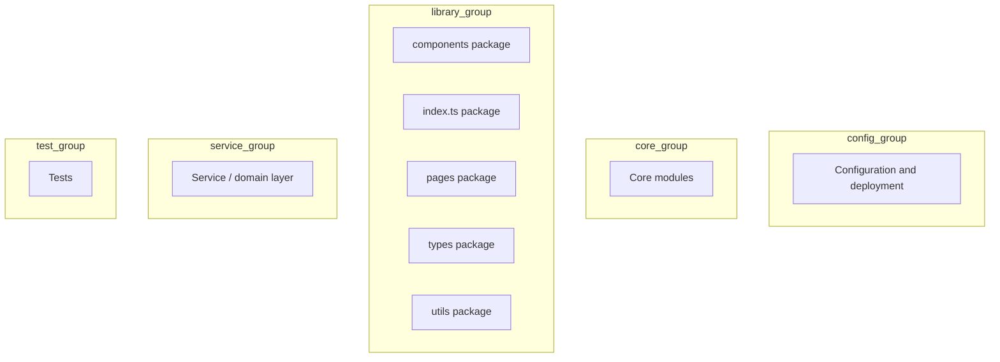

# Architecture report: garmeeh/next-seo

> Automated static analysis. **Observed** = directly seen in files/imports/AST; **Inferred** = interpretation from that evidence. Repository code was not executed.

## 1. Repository at a glance

| Item | Value |
| --- | --- |
| Repository | garmeeh/next-seo |
| Description | Next SEO is a plug in that makes managing your SEO easier in Next.js projects. |
| Language | TypeScript |
| Stars | 8545 |
| Licence | MIT |
| Analysed commit / branch | 738ef7e774ee6216f6e90c26a3b5b99dd5d166b4 / main |
| Framework(s) | Next.js, React |
| Files analysed | 290 |
| Components | 9 |

## 2. Architecture in one minute

garmeeh/next-seo - Next SEO is a plug in that makes managing your SEO easier in Next.js projects.. This repository was analysed statically from 290 file(s) (0 Python). Detected technologies (observed from imports/manifests): GitHub Actions, Next.js, React, TypeScript, Vitest. Files are grouped into 9 component(s): components package, Configuration and deployment, Core modules, index.ts package, pages package, Service / domain layer, Tests, types package. Findings below distinguish observed facts from inferred interpretation.

## 3. High-level block diagram

## 4. Main components

### components package (`components`)

- **Kind:** library
- **Status:** Observed
- **Confidence:** 0.85
- **Responsibility:** Groups 54 file(s) under components package (observed from repository paths and static analysis).
- **Paths:** `src/components/AggregateRatingJsonLd.test.tsx`, `src/components/AggregateRatingJsonLd.tsx`, `src/components/ArticleJsonLd.test.tsx`, `src/components/ArticleJsonLd.tsx`, `src/components/BreadcrumbJsonLd.test.tsx`, `src/components/BreadcrumbJsonLd.tsx`, `src/components/CarouselJsonLd.test.tsx`, `src/components/CarouselJsonLd.tsx`, `src/components/ClaimReviewJsonLd.test.tsx`, `src/components/ClaimReviewJsonLd.tsx`, `src/components/CourseJsonLd.test.tsx`, `src/components/CourseJsonLd.tsx`, `src/components/CreativeWorkJsonLd.test.tsx`, `src/components/CreativeWorkJsonLd.tsx`, `src/components/DatasetJsonLd.test.tsx`, `src/components/DatasetJsonLd.tsx`, `src/components/DiscussionForumPostingJsonLd.test.tsx`, `src/components/DiscussionForumPostingJsonLd.tsx`, `src/components/EmployerAggregateRatingJsonLd.test.tsx`, `src/components/EmployerAggregateRatingJsonLd.tsx`, `src/components/EventJsonLd.test.tsx`, `src/components/EventJsonLd.tsx`, `src/components/FAQJsonLd.test.tsx`, `src/components/FAQJsonLd.tsx`, `src/components/HowToJsonLd.test.tsx`, `src/components/HowToJsonLd.tsx`, `src/components/ImageJsonLd.test.tsx`, `src/components/ImageJsonLd.tsx`, `src/components/JobPostingJsonLd.test.tsx`, `src/components/JobPostingJsonLd.tsx`, `src/components/LocalBusinessJsonLd.test.tsx`, `src/components/LocalBusinessJsonLd.tsx`, `src/components/MerchantReturnPolicyJsonLd.test.tsx`, `src/components/MerchantReturnPolicyJsonLd.tsx`, `src/components/MovieCarouselJsonLd.test.tsx`, `src/components/MovieCarouselJsonLd.tsx`, `src/components/OrganizationJsonLd.test.tsx`, `src/components/OrganizationJsonLd.tsx`, `src/components/ProductJsonLd.test.tsx`, `src/components/ProductJsonLd.tsx`, `src/components/ProfilePageJsonLd.test.tsx`, `src/components/ProfilePageJsonLd.tsx`, `src/components/QuizJsonLd.test.tsx`, `src/components/QuizJsonLd.tsx`, `src/components/RecipeJsonLd.test.tsx`, `src/components/RecipeJsonLd.tsx`, `src/components/ReviewJsonLd.test.tsx`, `src/components/ReviewJsonLd.tsx`, `src/components/SoftwareApplicationJsonLd.test.tsx`, `src/components/SoftwareApplicationJsonLd.tsx`, `src/components/VacationRentalJsonLd.test.tsx`, `src/components/VacationRentalJsonLd.tsx`, `src/components/VideoJsonLd.test.tsx`, `src/components/VideoJsonLd.tsx`
- **Evidence:** [src/components/AggregateRatingJsonLd.test.tsx](https://github.com/garmeeh/next-seo/blob/738ef7e774ee6216f6e90c26a3b5b99dd5d166b4/src/components/AggregateRatingJsonLd.test.tsx); [src/components/AggregateRatingJsonLd.tsx](https://github.com/garmeeh/next-seo/blob/738ef7e774ee6216f6e90c26a3b5b99dd5d166b4/src/components/AggregateRatingJsonLd.tsx); [src/components/ArticleJsonLd.test.tsx](https://github.com/garmeeh/next-seo/blob/738ef7e774ee6216f6e90c26a3b5b99dd5d166b4/src/components/ArticleJsonLd.test.tsx); [src/components/ArticleJsonLd.tsx](https://github.com/garmeeh/next-seo/blob/738ef7e774ee6216f6e90c26a3b5b99dd5d166b4/src/components/ArticleJsonLd.tsx); [src/components/BreadcrumbJsonLd.test.tsx](https://github.com/garmeeh/next-seo/blob/738ef7e774ee6216f6e90c26a3b5b99dd5d166b4/src/components/BreadcrumbJsonLd.test.tsx); [src/components/BreadcrumbJsonLd.tsx](https://github.com/garmeeh/next-seo/blob/738ef7e774ee6216f6e90c26a3b5b99dd5d166b4/src/components/BreadcrumbJsonLd.tsx); [src/components/CarouselJsonLd.test.tsx](https://github.com/garmeeh/next-seo/blob/738ef7e774ee6216f6e90c26a3b5b99dd5d166b4/src/components/CarouselJsonLd.test.tsx); [src/components/CarouselJsonLd.tsx](https://github.com/garmeeh/next-seo/blob/738ef7e774ee6216f6e90c26a3b5b99dd5d166b4/src/components/CarouselJsonLd.tsx)

### Configuration and deployment (`config`)

- **Kind:** config
- **Status:** Observed
- **Confidence:** 0.85
- **Responsibility:** Groups 4 file(s) under configuration and deployment (observed from repository paths and static analysis).
- **Paths:** `package.json`, `pnpm-workspace.yaml`, `repomix.config.json`, `tsconfig.json`
- **Evidence:** [package.json](https://github.com/garmeeh/next-seo/blob/738ef7e774ee6216f6e90c26a3b5b99dd5d166b4/package.json); [pnpm-workspace.yaml](https://github.com/garmeeh/next-seo/blob/738ef7e774ee6216f6e90c26a3b5b99dd5d166b4/pnpm-workspace.yaml); [repomix.config.json](https://github.com/garmeeh/next-seo/blob/738ef7e774ee6216f6e90c26a3b5b99dd5d166b4/repomix.config.json); [tsconfig.json](https://github.com/garmeeh/next-seo/blob/738ef7e774ee6216f6e90c26a3b5b99dd5d166b4/tsconfig.json)

### Core modules (`core`)

- **Kind:** core
- **Status:** Observed
- **Confidence:** 0.85
- **Responsibility:** Groups 4 file(s) under core modules (observed from repository paths and static analysis).
- **Paths:** `eslint.config.mjs`, `playwright.config.ts`, `tsup.config.ts`, `vitest.config.ts`
- **Evidence:** [eslint.config.mjs](https://github.com/garmeeh/next-seo/blob/738ef7e774ee6216f6e90c26a3b5b99dd5d166b4/eslint.config.mjs); [playwright.config.ts](https://github.com/garmeeh/next-seo/blob/738ef7e774ee6216f6e90c26a3b5b99dd5d166b4/playwright.config.ts); [tsup.config.ts](https://github.com/garmeeh/next-seo/blob/738ef7e774ee6216f6e90c26a3b5b99dd5d166b4/tsup.config.ts); [vitest.config.ts](https://github.com/garmeeh/next-seo/blob/738ef7e774ee6216f6e90c26a3b5b99dd5d166b4/vitest.config.ts)

### index.ts package (`index_ts`)

- **Kind:** library
- **Status:** Observed
- **Confidence:** 0.85
- **Responsibility:** Groups 1 file(s) under index.ts package (observed from repository paths and static analysis).
- **Paths:** `src/index.ts`
- **Evidence:** [src/index.ts](https://github.com/garmeeh/next-seo/blob/738ef7e774ee6216f6e90c26a3b5b99dd5d166b4/src/index.ts)

### pages package (`pages`)

- **Kind:** library
- **Status:** Observed
- **Confidence:** 0.85
- **Responsibility:** Groups 3 file(s) under pages package (observed from repository paths and static analysis).
- **Paths:** `src/pages/index.ts`, `src/pages/types/index.ts`, `src/pages/utils/processors.ts`
- **Evidence:** [src/pages/index.ts](https://github.com/garmeeh/next-seo/blob/738ef7e774ee6216f6e90c26a3b5b99dd5d166b4/src/pages/index.ts); [src/pages/types/index.ts](https://github.com/garmeeh/next-seo/blob/738ef7e774ee6216f6e90c26a3b5b99dd5d166b4/src/pages/types/index.ts); [src/pages/utils/processors.ts](https://github.com/garmeeh/next-seo/blob/738ef7e774ee6216f6e90c26a3b5b99dd5d166b4/src/pages/utils/processors.ts)

### Service / domain layer (`service_layer`)

- **Kind:** service
- **Status:** Observed
- **Confidence:** 0.85
- **Responsibility:** Groups 4 file(s) under service / domain layer (observed from repository paths and static analysis).
- **Paths:** `src/core/JsonLdScript.test.tsx`, `src/core/JsonLdScript.tsx`, `src/pages/core/buildTags.test.tsx`, `src/pages/core/buildTags.tsx`
- **Evidence:** [src/core/JsonLdScript.test.tsx](https://github.com/garmeeh/next-seo/blob/738ef7e774ee6216f6e90c26a3b5b99dd5d166b4/src/core/JsonLdScript.test.tsx); [src/core/JsonLdScript.tsx](https://github.com/garmeeh/next-seo/blob/738ef7e774ee6216f6e90c26a3b5b99dd5d166b4/src/core/JsonLdScript.tsx); [src/pages/core/buildTags.test.tsx](https://github.com/garmeeh/next-seo/blob/738ef7e774ee6216f6e90c26a3b5b99dd5d166b4/src/pages/core/buildTags.test.tsx); [src/pages/core/buildTags.tsx](https://github.com/garmeeh/next-seo/blob/738ef7e774ee6216f6e90c26a3b5b99dd5d166b4/src/pages/core/buildTags.tsx)

### Tests (`tests`)

- **Kind:** test
- **Status:** Observed
- **Confidence:** 0.85
- **Responsibility:** Groups 34 file(s) under tests (observed from repository paths and static analysis).
- **Paths:** `tests/e2e/.gitkeep`, `tests/e2e/CLAUDE.md`, `tests/e2e/aggregateRatingJsonLd.e2e.spec.ts`, `tests/e2e/articleJsonLd.e2e.spec.ts`, `tests/e2e/breadcrumbJsonLd.e2e.spec.ts`, `tests/e2e/carouselJsonLd.e2e.spec.ts`, `tests/e2e/claimReviewJsonLd.e2e.spec.ts`, `tests/e2e/courseJsonLd.e2e.spec.ts`, `tests/e2e/creativeWorkJsonLd.e2e.spec.ts`, `tests/e2e/customComponents.e2e.spec.ts`, `tests/e2e/datasetJsonLd.e2e.spec.ts`, `tests/e2e/discussionForumPostingJsonLd.e2e.spec.ts`, `tests/e2e/employerAggregateRatingJsonLd.e2e.spec.ts`, `tests/e2e/eventJsonLd.e2e.spec.ts`, `tests/e2e/faqJsonLd.e2e.spec.ts`, `tests/e2e/howtoJsonLd.e2e.spec.ts`, `tests/e2e/imageJsonLd.e2e.spec.ts`, `tests/e2e/jobPostingJsonLd.e2e.spec.ts`, `tests/e2e/jsonLdScript.e2e.spec.ts`, `tests/e2e/jsonValidation.e2e.spec.ts`, `tests/e2e/localBusinessJsonLd.e2e.spec.ts`, `tests/e2e/merchantReturnPolicyJsonLd.e2e.spec.ts`, `tests/e2e/movieCarouselJsonLd.e2e.spec.ts`, `tests/e2e/organizationJsonLd.e2e.spec.ts`, `tests/e2e/productJsonLd.e2e.spec.ts`, `tests/e2e/profilePageJsonLd.e2e.spec.ts`, `tests/e2e/quizJsonLd.e2e.spec.ts`, `tests/e2e/recipeJsonLd.e2e.spec.ts`, `tests/e2e/reviewJsonLd.e2e.spec.ts`, `tests/e2e/security.e2e.spec.ts`, `tests/e2e/softwareApplicationJsonLd.e2e.spec.ts`, `tests/e2e/vacationRentalJsonLd.e2e.spec.ts`, `tests/e2e/videoJsonLd.e2e.spec.ts`, `tests/unit/setup.ts`
- **Evidence:** [tests/e2e/.gitkeep](https://github.com/garmeeh/next-seo/blob/738ef7e774ee6216f6e90c26a3b5b99dd5d166b4/tests/e2e/.gitkeep); [tests/e2e/CLAUDE.md](https://github.com/garmeeh/next-seo/blob/738ef7e774ee6216f6e90c26a3b5b99dd5d166b4/tests/e2e/CLAUDE.md); [tests/e2e/aggregateRatingJsonLd.e2e.spec.ts](https://github.com/garmeeh/next-seo/blob/738ef7e774ee6216f6e90c26a3b5b99dd5d166b4/tests/e2e/aggregateRatingJsonLd.e2e.spec.ts); [tests/e2e/articleJsonLd.e2e.spec.ts](https://github.com/garmeeh/next-seo/blob/738ef7e774ee6216f6e90c26a3b5b99dd5d166b4/tests/e2e/articleJsonLd.e2e.spec.ts); [tests/e2e/breadcrumbJsonLd.e2e.spec.ts](https://github.com/garmeeh/next-seo/blob/738ef7e774ee6216f6e90c26a3b5b99dd5d166b4/tests/e2e/breadcrumbJsonLd.e2e.spec.ts); [tests/e2e/carouselJsonLd.e2e.spec.ts](https://github.com/garmeeh/next-seo/blob/738ef7e774ee6216f6e90c26a3b5b99dd5d166b4/tests/e2e/carouselJsonLd.e2e.spec.ts); [tests/e2e/claimReviewJsonLd.e2e.spec.ts](https://github.com/garmeeh/next-seo/blob/738ef7e774ee6216f6e90c26a3b5b99dd5d166b4/tests/e2e/claimReviewJsonLd.e2e.spec.ts); [tests/e2e/courseJsonLd.e2e.spec.ts](https://github.com/garmeeh/next-seo/blob/738ef7e774ee6216f6e90c26a3b5b99dd5d166b4/tests/e2e/courseJsonLd.e2e.spec.ts)

### types package (`types`)

- **Kind:** library
- **Status:** Observed
- **Confidence:** 0.85
- **Responsibility:** Groups 28 file(s) under types package (observed from repository paths and static analysis).
- **Paths:** `src/types/article.types.ts`, `src/types/breadcrumb.types.ts`, `src/types/carousel.types.ts`, `src/types/claimreview.types.ts`, `src/types/common.types.ts`, `src/types/course.types.ts`, `src/types/creativework.types.ts`, `src/types/dataset.types.ts`, `src/types/discussionforum.types.ts`, `src/types/employer-aggregate-rating.types.ts`, `src/types/event.types.ts`, `src/types/faq.types.ts`, `src/types/howto.types.ts`, `src/types/image.types.ts`, `src/types/index.ts`, `src/types/jobposting.types.ts`, `src/types/localbusiness.types.ts`, `src/types/merchantreturnpolicy.types.ts`, `src/types/movie-carousel.types.ts`, `src/types/organization.types.ts`, `src/types/product.types.ts`, `src/types/profile.types.ts`, `src/types/quiz.types.ts`, `src/types/recipe.types.ts`, `src/types/review.types.ts`, `src/types/softwareApplication.types.ts`, `src/types/vacationrental.types.ts`, `src/types/video.types.ts`
- **Evidence:** [src/types/article.types.ts](https://github.com/garmeeh/next-seo/blob/738ef7e774ee6216f6e90c26a3b5b99dd5d166b4/src/types/article.types.ts); [src/types/breadcrumb.types.ts](https://github.com/garmeeh/next-seo/blob/738ef7e774ee6216f6e90c26a3b5b99dd5d166b4/src/types/breadcrumb.types.ts); [src/types/carousel.types.ts](https://github.com/garmeeh/next-seo/blob/738ef7e774ee6216f6e90c26a3b5b99dd5d166b4/src/types/carousel.types.ts); [src/types/claimreview.types.ts](https://github.com/garmeeh/next-seo/blob/738ef7e774ee6216f6e90c26a3b5b99dd5d166b4/src/types/claimreview.types.ts); [src/types/common.types.ts](https://github.com/garmeeh/next-seo/blob/738ef7e774ee6216f6e90c26a3b5b99dd5d166b4/src/types/common.types.ts); [src/types/course.types.ts](https://github.com/garmeeh/next-seo/blob/738ef7e774ee6216f6e90c26a3b5b99dd5d166b4/src/types/course.types.ts); [src/types/creativework.types.ts](https://github.com/garmeeh/next-seo/blob/738ef7e774ee6216f6e90c26a3b5b99dd5d166b4/src/types/creativework.types.ts); [src/types/dataset.types.ts](https://github.com/garmeeh/next-seo/blob/738ef7e774ee6216f6e90c26a3b5b99dd5d166b4/src/types/dataset.types.ts)

### utils package (`utils`)

- **Kind:** library
- **Status:** Observed
- **Confidence:** 0.85
- **Responsibility:** Groups 5 file(s) under utils package (observed from repository paths and static analysis).
- **Paths:** `src/utils/processors.export.ts`, `src/utils/processors.test.ts`, `src/utils/processors.ts`, `src/utils/stringify.test.ts`, `src/utils/stringify.ts`
- **Evidence:** [src/utils/processors.export.ts](https://github.com/garmeeh/next-seo/blob/738ef7e774ee6216f6e90c26a3b5b99dd5d166b4/src/utils/processors.export.ts); [src/utils/processors.test.ts](https://github.com/garmeeh/next-seo/blob/738ef7e774ee6216f6e90c26a3b5b99dd5d166b4/src/utils/processors.test.ts); [src/utils/processors.ts](https://github.com/garmeeh/next-seo/blob/738ef7e774ee6216f6e90c26a3b5b99dd5d166b4/src/utils/processors.ts); [src/utils/stringify.test.ts](https://github.com/garmeeh/next-seo/blob/738ef7e774ee6216f6e90c26a3b5b99dd5d166b4/src/utils/stringify.test.ts); [src/utils/stringify.ts](https://github.com/garmeeh/next-seo/blob/738ef7e774ee6216f6e90c26a3b5b99dd5d166b4/src/utils/stringify.ts)

## 5. Execution flow

**Observed** entry point(s):

- [src/index.ts](https://github.com/garmeeh/next-seo/blob/738ef7e774ee6216f6e90c26a3b5b99dd5d166b4/src/index.ts)
- [src/pages/index.ts](https://github.com/garmeeh/next-seo/blob/738ef7e774ee6216f6e90c26a3b5b99dd5d166b4/src/pages/index.ts)
- [src/pages/types/index.ts](https://github.com/garmeeh/next-seo/blob/738ef7e774ee6216f6e90c26a3b5b99dd5d166b4/src/pages/types/index.ts)
- [src/types/index.ts](https://github.com/garmeeh/next-seo/blob/738ef7e774ee6216f6e90c26a3b5b99dd5d166b4/src/types/index.ts)

Representative flow (derived from observed entry points and the import graph; steps beyond the entry point are **Inferred**):

1. Execution starts at an observed entry point listed above, if present.
2. No internal import relationships between components were observed.

## 6. Project structure

### `(root)`

- `.editorconfig` - config (188 bytes)
- `.gitignore` - other (668 bytes)
- `.npmignore` - other (448 bytes)
- `.prettierignore` - other (185 bytes)
- `ADDING_NEW_COMPONENTS.md` - docs (19025 bytes)
- `AGENTS.md` - docs (4160 bytes)
- `CHANGELOG.md` - docs (1574 bytes)
- `CLAUDE.md` - docs (4160 bytes)
- `CONTRIBUTING.md` - docs (4891 bytes)
- `CUSTOM_COMPONENTS.md` - docs (18988 bytes)
- `LICENSE` - docs (1068 bytes)
- `LICENSE.md` - docs (1068 bytes)
- `LIST.md` - docs (1262 bytes)
- `eslint.config.mjs` - source, JavaScript (722 bytes)
- `package.json` - manifest (3356 bytes)
- `playwright.config.ts` - source, TypeScript (976 bytes)
- `pnpm-workspace.yaml` - config (34 bytes)
- `repomix.config.json` - config (278 bytes)
- `tsconfig.json` - config (780 bytes)
- `tsup.config.ts` - source, TypeScript (396 bytes)
- `vitest.config.ts` - source, TypeScript (988 bytes)

### `.changeset`

- `.changeset/README.md` - docs (510 bytes)
- `.changeset/config.json` - config (292 bytes)

### `.github`

- `.github/ISSUE_TEMPLATE/bug_report.md` - docs (475 bytes)
- `.github/ISSUE_TEMPLATE/feature_request.md` - docs (698 bytes)
- `.github/dependabot.yml` - config (187 bytes)
- `.github/pull_request_template.md` - docs (0 bytes)
- `.github/workflows/changeset-check.yml` - ci, YAML (4006 bytes)
- `.github/workflows/changesets.yml` - ci, YAML (6146 bytes)
- `.github/workflows/ci.yml` - ci, YAML (5516 bytes)
- `.github/workflows/release.yml` - ci, YAML (3270 bytes)

### `.husky`

- `.husky/pre-commit` - other (16 bytes)

### `.vscode`

- `.vscode/settings.json` - config (98 bytes)

### `examples`

- `examples/app-router-showcase/.gitignore` - other (480 bytes)
- `examples/app-router-showcase/CLAUDE.md` - docs (2194 bytes)
- `examples/app-router-showcase/README.md` - docs (1450 bytes)
- `examples/app-router-showcase/app/aggregate-rating-restaurant/page.tsx` - source, TypeScript (1348 bytes)
- `examples/app-router-showcase/app/aggregate-rating/page.tsx` - source, TypeScript (519 bytes)
- `examples/app-router-showcase/app/article/page.tsx` - source, TypeScript (1311 bytes)
- `examples/app-router-showcase/app/blog-posting/page.tsx` - source, TypeScript (3154 bytes)
- `examples/app-router-showcase/app/breadcrumb/advanced/page.tsx` - source, TypeScript (3430 bytes)
- `examples/app-router-showcase/app/breadcrumb/multiple/page.tsx` - source, TypeScript (2955 bytes)
- `examples/app-router-showcase/app/breadcrumb/page.tsx` - source, TypeScript (2468 bytes)
- `examples/app-router-showcase/app/carousel-course/page.tsx` - source, TypeScript (4569 bytes)
- `examples/app-router-showcase/app/carousel-movie/page.tsx` - source, TypeScript (7267 bytes)
- `examples/app-router-showcase/app/carousel-recipe/page.tsx` - source, TypeScript (9849 bytes)
- `examples/app-router-showcase/app/carousel-restaurant/page.tsx` - source, TypeScript (12352 bytes)
- `examples/app-router-showcase/app/carousel-summary/page.tsx` - source, TypeScript (2635 bytes)
- `examples/app-router-showcase/app/claim-review-advanced/page.tsx` - source, TypeScript (3305 bytes)
- `examples/app-router-showcase/app/claim-review-organization/page.tsx` - source, TypeScript (3462 bytes)
- `examples/app-router-showcase/app/claim-review/page.tsx` - source, TypeScript (1871 bytes)
- `examples/app-router-showcase/app/course-list-summary/page.tsx` - source, TypeScript (3955 bytes)
- `examples/app-router-showcase/app/course-list/page.tsx` - source, TypeScript (3616 bytes)
- `examples/app-router-showcase/app/course/page.tsx` - source, TypeScript (2356 bytes)
- `examples/app-router-showcase/app/creative-work-blog/page.tsx` - source, TypeScript (5453 bytes)
- `examples/app-router-showcase/app/creative-work-multiple/page.tsx` - source, TypeScript (4056 bytes)
- `examples/app-router-showcase/app/creative-work-news/page.tsx` - source, TypeScript (4565 bytes)
- `examples/app-router-showcase/app/creative-work/page.tsx` - source, TypeScript (2481 bytes)
- `examples/app-router-showcase/app/custom-podcast/page.tsx` - source, TypeScript (3207 bytes)
- `examples/app-router-showcase/app/custom-service/page.tsx` - source, TypeScript (3851 bytes)
- `examples/app-router-showcase/app/dataset-advanced/page.tsx` - source, TypeScript (8265 bytes)
- `examples/app-router-showcase/app/dataset-catalog/page.tsx` - source, TypeScript (5912 bytes)
- `examples/app-router-showcase/app/dataset-nested/page.tsx` - source, TypeScript (9954 bytes)
- `examples/app-router-showcase/app/dataset/page.tsx` - source, TypeScript (2121 bytes)
- `examples/app-router-showcase/app/discussion-forum-advanced/page.tsx` - source, TypeScript (5574 bytes)
- `examples/app-router-showcase/app/discussion-forum-deleted/page.tsx` - source, TypeScript (3541 bytes)
- `examples/app-router-showcase/app/discussion-forum/page.tsx` - source, TypeScript (1543 bytes)
- `examples/app-router-showcase/app/employer-aggregate-rating-advanced/page.tsx` - source, TypeScript (8660 bytes)
- `examples/app-router-showcase/app/employer-aggregate-rating-custom-scale/page.tsx` - source, TypeScript (6700 bytes)
- `examples/app-router-showcase/app/employer-aggregate-rating/page.tsx` - source, TypeScript (2879 bytes)
- `examples/app-router-showcase/app/event-cancelled/page.tsx` - source, TypeScript (3769 bytes)
- `examples/app-router-showcase/app/event-free/page.tsx` - source, TypeScript (5837 bytes)
- `examples/app-router-showcase/app/event-rescheduled/page.tsx` - source, TypeScript (6570 bytes)
- `examples/app-router-showcase/app/event/page.tsx` - source, TypeScript (4164 bytes)
- `examples/app-router-showcase/app/faq-advanced/page.tsx` - source, TypeScript (7583 bytes)
- `examples/app-router-showcase/app/faq-health/page.tsx` - source, TypeScript (9490 bytes)
- `examples/app-router-showcase/app/faq/page.tsx` - source, TypeScript (3404 bytes)
- `examples/app-router-showcase/app/globals.css` - other (608 bytes)
- `examples/app-router-showcase/app/howto-advanced/page.tsx` - source, TypeScript (8684 bytes)
- `examples/app-router-showcase/app/howto/page.tsx` - source, TypeScript (4476 bytes)
- `examples/app-router-showcase/app/image-advanced/page.tsx` - source, TypeScript (4294 bytes)
- `examples/app-router-showcase/app/image-multiple/page.tsx` - source, TypeScript (7510 bytes)
- `examples/app-router-showcase/app/image/page.tsx` - source, TypeScript (1999 bytes)
- `examples/app-router-showcase/app/job-posting-advanced/page.tsx` - source, TypeScript (6034 bytes)
- `examples/app-router-showcase/app/job-posting-remote/page.tsx` - source, TypeScript (3699 bytes)
- `examples/app-router-showcase/app/job-posting/page.tsx` - source, TypeScript (2862 bytes)
- `examples/app-router-showcase/app/jsonld-test-page/page.tsx` - source, TypeScript (862 bytes)
- `examples/app-router-showcase/app/layout.tsx` - source, TypeScript (662 bytes)
- `examples/app-router-showcase/app/local-business/page.tsx` - source, TypeScript (2012 bytes)
- `examples/app-router-showcase/app/merchant-return-policy-advanced/page.tsx` - source, TypeScript (4906 bytes)
- `examples/app-router-showcase/app/merchant-return-policy-link/page.tsx` - source, TypeScript (2422 bytes)
- `examples/app-router-showcase/app/merchant-return-policy/page.tsx` - source, TypeScript (2420 bytes)
- `examples/app-router-showcase/app/mobile-app/page.tsx` - source, TypeScript (14711 bytes)
- `examples/app-router-showcase/app/movie-carousel-advanced/page.tsx` - source, TypeScript (6582 bytes)
- `examples/app-router-showcase/app/movie-carousel-summary/page.tsx` - source, TypeScript (1609 bytes)
- `examples/app-router-showcase/app/movie-carousel/page.tsx` - source, TypeScript (3482 bytes)
- `examples/app-router-showcase/app/news-article/page.tsx` - source, TypeScript (2511 bytes)
- `examples/app-router-showcase/app/online-store-loyalty/page.tsx` - source, TypeScript (9659 bytes)
- `examples/app-router-showcase/app/online-store/page.tsx` - source, TypeScript (6883 bytes)
- `examples/app-router-showcase/app/organization-advanced/page.tsx` - source, TypeScript (6542 bytes)
- `examples/app-router-showcase/app/organization-reviews/page.tsx` - source, TypeScript (3383 bytes)
- `examples/app-router-showcase/app/organization/page.tsx` - source, TypeScript (2345 bytes)
- `examples/app-router-showcase/app/page.module.css` - other (2747 bytes)
- `examples/app-router-showcase/app/page.tsx` - source, TypeScript (2694 bytes)
- `examples/app-router-showcase/app/product-3d-model/page.tsx` - source, TypeScript (11130 bytes)
- `examples/app-router-showcase/app/product-aggregate/page.tsx` - source, TypeScript (13021 bytes)
- `examples/app-router-showcase/app/product-certification/page.tsx` - source, TypeScript (10232 bytes)
- `examples/app-router-showcase/app/product-member-pricing/page.tsx` - source, TypeScript (9205 bytes)
- `examples/app-router-showcase/app/product-review/page.tsx` - source, TypeScript (11690 bytes)
- `examples/app-router-showcase/app/product-sale-pricing/page.tsx` - source, TypeScript (5964 bytes)
- `examples/app-router-showcase/app/product-shipping-options/page.tsx` - source, TypeScript (12726 bytes)
- `examples/app-router-showcase/app/product-unit-pricing/page.tsx` - source, TypeScript (8180 bytes)
- `examples/app-router-showcase/app/product-variants-advanced/page.tsx` - source, TypeScript (17066 bytes)
- `examples/app-router-showcase/app/product-variants-multipage/page.tsx` - source, TypeScript (12928 bytes)
- `examples/app-router-showcase/app/product-variants/page.tsx` - source, TypeScript (10261 bytes)
- `examples/app-router-showcase/app/product-with-return-policy/page.tsx` - source, TypeScript (5524 bytes)
- `examples/app-router-showcase/app/product/page.tsx` - source, TypeScript (5699 bytes)
- `examples/app-router-showcase/app/profile-advanced/page.tsx` - source, TypeScript (4833 bytes)
- `examples/app-router-showcase/app/profile-organization/page.tsx` - source, TypeScript (6267 bytes)
- `examples/app-router-showcase/app/profile/page.tsx` - source, TypeScript (1649 bytes)
- `examples/app-router-showcase/app/quiz-advanced/page.tsx` - source, TypeScript (4498 bytes)
- `examples/app-router-showcase/app/quiz-biology/page.tsx` - source, TypeScript (2400 bytes)
- `examples/app-router-showcase/app/quiz/page.tsx` - source, TypeScript (1235 bytes)
- `examples/app-router-showcase/app/recipe-advanced/page.tsx` - source, TypeScript (9129 bytes)
- `examples/app-router-showcase/app/recipe/page.tsx` - source, TypeScript (3624 bytes)
- `examples/app-router-showcase/app/restaurant/page.tsx` - source, TypeScript (5080 bytes)
- `examples/app-router-showcase/app/review-advanced/page.tsx` - source, TypeScript (2751 bytes)
- `examples/app-router-showcase/app/review-movie/page.tsx` - source, TypeScript (1916 bytes)
- `examples/app-router-showcase/app/review/page.tsx` - source, TypeScript (615 bytes)
- `examples/app-router-showcase/app/social-media-posting/page.tsx` - source, TypeScript (4554 bytes)
- `examples/app-router-showcase/app/software-app-paid/page.tsx` - source, TypeScript (10095 bytes)
- `examples/app-router-showcase/app/software-app/page.tsx` - source, TypeScript (5240 bytes)
- `examples/app-router-showcase/app/store-with-departments/page.tsx` - source, TypeScript (6237 bytes)
- `examples/app-router-showcase/app/test-arrays/page.tsx` - source, TypeScript (1565 bytes)
- `examples/app-router-showcase/app/test-nested/page.tsx` - source, TypeScript (1417 bytes)
- `examples/app-router-showcase/app/test-url-params/page.tsx` - source, TypeScript (1753 bytes)
- `examples/app-router-showcase/app/vacation-rental-advanced/page.tsx` - source, TypeScript (8808 bytes)
- `examples/app-router-showcase/app/vacation-rental-apartment/page.tsx` - source, TypeScript (4807 bytes)
- `examples/app-router-showcase/app/vacation-rental/page.tsx` - source, TypeScript (1326 bytes)
- `examples/app-router-showcase/app/video-advanced/page.tsx` - source, TypeScript (3364 bytes)
- `examples/app-router-showcase/app/video-clips/page.tsx` - source, TypeScript (6135 bytes)
- `examples/app-router-showcase/app/video-game/page.tsx` - source, TypeScript (16746 bytes)
- `examples/app-router-showcase/app/video-live/page.tsx` - source, TypeScript (3719 bytes)
- `examples/app-router-showcase/app/video-seekto/page.tsx` - source, TypeScript (4637 bytes)
- `examples/app-router-showcase/app/video/page.tsx` - source, TypeScript (1905 bytes)
- `examples/app-router-showcase/app/web-app/page.tsx` - source, TypeScript (13563 bytes)
- `examples/app-router-showcase/components/custom/PodcastSeriesJsonLd.tsx` - source, TypeScript (1664 bytes)
- `examples/app-router-showcase/components/custom/ServiceJsonLd.tsx` - source, TypeScript (1769 bytes)
- `examples/app-router-showcase/eslint.config.mjs` - source, JavaScript (466 bytes)
- `examples/app-router-showcase/next.config.ts` - source, TypeScript (133 bytes)
- `examples/app-router-showcase/package.json` - manifest (560 bytes)
- `examples/app-router-showcase/public/file.svg` - other (391 bytes)
- `examples/app-router-showcase/public/globe.svg` - other (1035 bytes)
- `examples/app-router-showcase/public/next.svg` - other (1375 bytes)
- `examples/app-router-showcase/public/vercel.svg` - other (128 bytes)
- `examples/app-router-showcase/public/window.svg` - other (385 bytes)
- `examples/app-router-showcase/tsconfig.json` - config (632 bytes)

### `src`

- `src/components/.gitkeep` - other (1 bytes)
- `src/components/AggregateRatingJsonLd.test.tsx` - source, TypeScript (2143 bytes)
- `src/components/AggregateRatingJsonLd.tsx` - source, TypeScript (1251 bytes)
- `src/components/ArticleJsonLd.test.tsx` - source, TypeScript (13133 bytes)
- `src/components/ArticleJsonLd.tsx` - source, TypeScript (1595 bytes)
- `src/components/BreadcrumbJsonLd.test.tsx` - source, TypeScript (6291 bytes)
- `src/components/BreadcrumbJsonLd.tsx` - source, TypeScript (1355 bytes)
- `src/components/CLAUDE.md` - docs (4268 bytes)
- `src/components/CarouselJsonLd.test.tsx` - source, TypeScript (16578 bytes)
- `src/components/CarouselJsonLd.tsx` - source, TypeScript (7278 bytes)
- `src/components/ClaimReviewJsonLd.test.tsx` - source, TypeScript (9432 bytes)
- `src/components/ClaimReviewJsonLd.tsx` - source, TypeScript (892 bytes)
- `src/components/CourseJsonLd.test.tsx` - source, TypeScript (10576 bytes)
- `src/components/CourseJsonLd.tsx` - source, TypeScript (2514 bytes)
- `src/components/CreativeWorkJsonLd.test.tsx` - source, TypeScript (15841 bytes)
- `src/components/CreativeWorkJsonLd.tsx` - source, TypeScript (2514 bytes)
- `src/components/DatasetJsonLd.test.tsx` - source, TypeScript (15064 bytes)
- `src/components/DatasetJsonLd.tsx` - source, TypeScript (2512 bytes)
- `src/components/DiscussionForumPostingJsonLd.test.tsx` - source, TypeScript (15488 bytes)
- `src/components/DiscussionForumPostingJsonLd.tsx` - source, TypeScript (1891 bytes)
- `src/components/EmployerAggregateRatingJsonLd.test.tsx` - source, TypeScript (10568 bytes)
- `src/components/EmployerAggregateRatingJsonLd.tsx` - source, TypeScript (2802 bytes)
- `src/components/EventJsonLd.test.tsx` - source, TypeScript (12647 bytes)
- `src/components/EventJsonLd.tsx` - source, TypeScript (1491 bytes)
- `src/components/FAQJsonLd.test.tsx` - source, TypeScript (7340 bytes)
- `src/components/FAQJsonLd.tsx` - source, TypeScript (1782 bytes)
- `src/components/HowToJsonLd.test.tsx` - source, TypeScript (20454 bytes)
- `src/components/HowToJsonLd.tsx` - source, TypeScript (1664 bytes)
- `src/components/ImageJsonLd.test.tsx` - source, TypeScript (7521 bytes)
- `src/components/ImageJsonLd.tsx` - source, TypeScript (1922 bytes)
- `src/components/JobPostingJsonLd.test.tsx` - source, TypeScript (17627 bytes)
- `src/components/JobPostingJsonLd.tsx` - source, TypeScript (2635 bytes)
- `src/components/LocalBusinessJsonLd.test.tsx` - source, TypeScript (19291 bytes)
- `src/components/LocalBusinessJsonLd.tsx` - source, TypeScript (5810 bytes)
- `src/components/MerchantReturnPolicyJsonLd.test.tsx` - source, TypeScript (12121 bytes)
- `src/components/MerchantReturnPolicyJsonLd.tsx` - source, TypeScript (3870 bytes)
- `src/components/MovieCarouselJsonLd.test.tsx` - source, TypeScript (10533 bytes)
- `src/components/MovieCarouselJsonLd.tsx` - source, TypeScript (2317 bytes)
- `src/components/OrganizationJsonLd.test.tsx` - source, TypeScript (30646 bytes)
- `src/components/OrganizationJsonLd.tsx` - source, TypeScript (3093 bytes)
- `src/components/ProductJsonLd.test.tsx` - source, TypeScript (24976 bytes)
- `src/components/ProductJsonLd.tsx` - source, TypeScript (9202 bytes)
- `src/components/ProfilePageJsonLd.test.tsx` - source, TypeScript (9890 bytes)
- `src/components/ProfilePageJsonLd.tsx` - source, TypeScript (1667 bytes)
- `src/components/QuizJsonLd.test.tsx` - source, TypeScript (7928 bytes)
- `src/components/QuizJsonLd.tsx` - source, TypeScript (2792 bytes)
- `src/components/RecipeJsonLd.test.tsx` - source, TypeScript (19319 bytes)
- `src/components/RecipeJsonLd.tsx` - source, TypeScript (1900 bytes)
- `src/components/ReviewJsonLd.test.tsx` - source, TypeScript (3749 bytes)
- `src/components/ReviewJsonLd.tsx` - source, TypeScript (1606 bytes)
- `src/components/SoftwareApplicationJsonLd.test.tsx` - source, TypeScript (17266 bytes)
- `src/components/SoftwareApplicationJsonLd.tsx` - source, TypeScript (4052 bytes)
- `src/components/VacationRentalJsonLd.test.tsx` - source, TypeScript (13662 bytes)
- `src/components/VacationRentalJsonLd.tsx` - source, TypeScript (2047 bytes)
- `src/components/VideoJsonLd.test.tsx` - source, TypeScript (16670 bytes)
- `src/components/VideoJsonLd.tsx` - source, TypeScript (2354 bytes)
- `src/core/JsonLdScript.test.tsx` - source, TypeScript (3848 bytes)
- `src/core/JsonLdScript.tsx` - source, TypeScript (707 bytes)
- `src/index.ts` - source, TypeScript (3277 bytes)
- `src/pages/README.md` - docs (4358 bytes)
- `src/pages/core/__snapshots__/buildTags.test.tsx.snap` - other (12127 bytes)
- `src/pages/core/buildTags.test.tsx` - source, TypeScript (37137 bytes)
- `src/pages/core/buildTags.tsx` - source, TypeScript (20497 bytes)
- `src/pages/index.ts` - source, TypeScript (685 bytes)
- `src/pages/types/index.ts` - source, TypeScript (3925 bytes)
- `src/pages/utils/processors.ts` - source, TypeScript (3393 bytes)
- `src/types/article.types.ts` - source, TypeScript (1291 bytes)
- `src/types/breadcrumb.types.ts` - source, TypeScript (867 bytes)
- `src/types/carousel.types.ts` - source, TypeScript (3617 bytes)
- `src/types/claimreview.types.ts` - source, TypeScript (1301 bytes)
- `src/types/common.types.ts` - source, TypeScript (11734 bytes)
- `src/types/course.types.ts` - source, TypeScript (1750 bytes)
- `src/types/creativework.types.ts` - source, TypeScript (3968 bytes)
- `src/types/dataset.types.ts` - source, TypeScript (2536 bytes)
- `src/types/discussionforum.types.ts` - source, TypeScript (2488 bytes)
- `src/types/employer-aggregate-rating.types.ts` - source, TypeScript (626 bytes)
- `src/types/event.types.ts` - source, TypeScript (1913 bytes)
- `src/types/faq.types.ts` - source, TypeScript (940 bytes)
- `src/types/howto.types.ts` - source, TypeScript (3662 bytes)
- `src/types/image.types.ts` - source, TypeScript (661 bytes)
- `src/types/index.ts` - source, TypeScript (86 bytes)
- `src/types/jobposting.types.ts` - source, TypeScript (2910 bytes)
- `src/types/localbusiness.types.ts` - source, TypeScript (2648 bytes)
- `src/types/merchantreturnpolicy.types.ts` - source, TypeScript (293 bytes)
- `src/types/movie-carousel.types.ts` - source, TypeScript (1660 bytes)
- `src/types/organization.types.ts` - source, TypeScript (877 bytes)
- `src/types/product.types.ts` - source, TypeScript (7663 bytes)
- `src/types/profile.types.ts` - source, TypeScript (702 bytes)
- `src/types/quiz.types.ts` - source, TypeScript (1471 bytes)
- `src/types/recipe.types.ts` - source, TypeScript (1852 bytes)
- `src/types/review.types.ts` - source, TypeScript (1502 bytes)
- `src/types/softwareApplication.types.ts` - source, TypeScript (6480 bytes)
- `src/types/vacationrental.types.ts` - source, TypeScript (1270 bytes)
- `src/types/video.types.ts` - source, TypeScript (2269 bytes)
- `src/utils/processors.export.ts` - source, TypeScript (3226 bytes)
- `src/utils/processors.test.ts` - source, TypeScript (23283 bytes)
- `src/utils/processors.ts` - source, TypeScript (73868 bytes)
- `src/utils/stringify.test.ts` - source, TypeScript (7767 bytes)
- `src/utils/stringify.ts` - source, TypeScript (2774 bytes)

### `tests`

- `tests/e2e/.gitkeep` - test (1 bytes)
- `tests/e2e/CLAUDE.md` - test (2003 bytes)
- `tests/e2e/aggregateRatingJsonLd.e2e.spec.ts` - test, TypeScript (3914 bytes)
- `tests/e2e/articleJsonLd.e2e.spec.ts` - test, TypeScript (4792 bytes)
- `tests/e2e/breadcrumbJsonLd.e2e.spec.ts` - test, TypeScript (3229 bytes)
- `tests/e2e/carouselJsonLd.e2e.spec.ts` - test, TypeScript (9546 bytes)
- `tests/e2e/claimReviewJsonLd.e2e.spec.ts` - test, TypeScript (4413 bytes)
- `tests/e2e/courseJsonLd.e2e.spec.ts` - test, TypeScript (5077 bytes)
- `tests/e2e/creativeWorkJsonLd.e2e.spec.ts` - test, TypeScript (7017 bytes)
- `tests/e2e/customComponents.e2e.spec.ts` - test, TypeScript (7586 bytes)
- `tests/e2e/datasetJsonLd.e2e.spec.ts` - test, TypeScript (8442 bytes)
- `tests/e2e/discussionForumPostingJsonLd.e2e.spec.ts` - test, TypeScript (6798 bytes)
- `tests/e2e/employerAggregateRatingJsonLd.e2e.spec.ts` - test, TypeScript (5839 bytes)
- `tests/e2e/eventJsonLd.e2e.spec.ts` - test, TypeScript (6331 bytes)
- `tests/e2e/faqJsonLd.e2e.spec.ts` - test, TypeScript (6307 bytes)
- `tests/e2e/howtoJsonLd.e2e.spec.ts` - test, TypeScript (8296 bytes)
- `tests/e2e/imageJsonLd.e2e.spec.ts` - test, TypeScript (5204 bytes)
- `tests/e2e/jobPostingJsonLd.e2e.spec.ts` - test, TypeScript (8508 bytes)
- `tests/e2e/jsonLdScript.e2e.spec.ts` - test, TypeScript (2923 bytes)
- `tests/e2e/jsonValidation.e2e.spec.ts` - test, TypeScript (63650 bytes)
- `tests/e2e/localBusinessJsonLd.e2e.spec.ts` - test, TypeScript (4301 bytes)
- `tests/e2e/merchantReturnPolicyJsonLd.e2e.spec.ts` - test, TypeScript (7897 bytes)
- `tests/e2e/movieCarouselJsonLd.e2e.spec.ts` - test, TypeScript (5957 bytes)
- `tests/e2e/organizationJsonLd.e2e.spec.ts` - test, TypeScript (11015 bytes)
- `tests/e2e/productJsonLd.e2e.spec.ts` - test, TypeScript (12594 bytes)
- `tests/e2e/profilePageJsonLd.e2e.spec.ts` - test, TypeScript (4483 bytes)
- `tests/e2e/quizJsonLd.e2e.spec.ts` - test, TypeScript (4512 bytes)
- `tests/e2e/recipeJsonLd.e2e.spec.ts` - test, TypeScript (7915 bytes)
- `tests/e2e/reviewJsonLd.e2e.spec.ts` - test, TypeScript (4219 bytes)
- `tests/e2e/security.e2e.spec.ts` - test, TypeScript (7944 bytes)
- `tests/e2e/softwareApplicationJsonLd.e2e.spec.ts` - test, TypeScript (10257 bytes)
- `tests/e2e/vacationRentalJsonLd.e2e.spec.ts` - test, TypeScript (6809 bytes)
- `tests/e2e/videoJsonLd.e2e.spec.ts` - test, TypeScript (5721 bytes)
- `tests/unit/setup.ts` - test, TypeScript (68 bytes)

## 7. Key dependencies and integrations

| Name | Category | Status | Confidence | Evidence |
| --- | --- | --- | --- | --- |
| GitHub Actions | ci | Observed | 0.90 | [.github/workflows/changeset-check.yml](https://github.com/garmeeh/next-seo/blob/738ef7e774ee6216f6e90c26a3b5b99dd5d166b4/.github/workflows/changeset-check.yml); [.github/workflows/changesets.yml](https://github.com/garmeeh/next-seo/blob/738ef7e774ee6216f6e90c26a3b5b99dd5d166b4/.github/workflows/changesets.yml); [.github/workflows/ci.yml](https://github.com/garmeeh/next-seo/blob/738ef7e774ee6216f6e90c26a3b5b99dd5d166b4/.github/workflows/ci.yml); [.github/workflows/release.yml](https://github.com/garmeeh/next-seo/blob/738ef7e774ee6216f6e90c26a3b5b99dd5d166b4/.github/workflows/release.yml) |
| Next.js | framework | Observed | 0.90 | [examples/app-router-showcase/package.json:6](https://github.com/garmeeh/next-seo/blob/738ef7e774ee6216f6e90c26a3b5b99dd5d166b4/examples/app-router-showcase/package.json#L6); [package.json:2](https://github.com/garmeeh/next-seo/blob/738ef7e774ee6216f6e90c26a3b5b99dd5d166b4/package.json#L2) |
| React | framework | Observed | 0.90 | [examples/app-router-showcase/package.json:14](https://github.com/garmeeh/next-seo/blob/738ef7e774ee6216f6e90c26a3b5b99dd5d166b4/examples/app-router-showcase/package.json#L14); [examples/app-router-showcase/package.json:15](https://github.com/garmeeh/next-seo/blob/738ef7e774ee6216f6e90c26a3b5b99dd5d166b4/examples/app-router-showcase/package.json#L15); [package.json:71](https://github.com/garmeeh/next-seo/blob/738ef7e774ee6216f6e90c26a3b5b99dd5d166b4/package.json#L71) |
| TypeScript | tooling | Observed | 0.90 | [examples/app-router-showcase/package.json:24](https://github.com/garmeeh/next-seo/blob/738ef7e774ee6216f6e90c26a3b5b99dd5d166b4/examples/app-router-showcase/package.json#L24); [package.json:86](https://github.com/garmeeh/next-seo/blob/738ef7e774ee6216f6e90c26a3b5b99dd5d166b4/package.json#L86) |
| Vitest | tooling | Observed | 0.85 | [package.json:41](https://github.com/garmeeh/next-seo/blob/738ef7e774ee6216f6e90c26a3b5b99dd5d166b4/package.json#L41) |

## 8. Data and state

No database, cache, queue, or persistent-state usage was observed in the analysed files. State handling, if any, may be in-memory or in files that were not analysed.

## 9. Configuration and deployment clues

- `.changeset/config.json` (config)
- `.editorconfig` (config)
- `.github/dependabot.yml` (config)
- `.github/workflows/changeset-check.yml` (ci)
- `.github/workflows/changesets.yml` (ci)
- `.github/workflows/ci.yml` (ci)
- `.github/workflows/release.yml` (ci)
- `.vscode/settings.json` (config)
- `examples/app-router-showcase/package.json` (manifest)
- `examples/app-router-showcase/tsconfig.json` (config)
- `package.json` (manifest)
- `pnpm-workspace.yaml` (config)
- `repomix.config.json` (config)
- `tsconfig.json` (config)

## 10. Design observations

- Service/domain code is distinct from entry and data code, suggesting layered separation (Inferred).
- Tests are present alongside source code (Observed from test file paths).

These observations are interpretations (**Inferred**) of the observed structure, not guarantees about runtime design.

## 11. Limitations and unknowns

- Static analysis only: repository code was not executed, installed, or imported at runtime.
- Components and relationships are inferred from file paths, imports, and AST structure; runtime behaviour, dynamic imports, and reflection may not be visible.
- No clear application entry point was observed in the analysed files.
- Repository text was treated as untrusted data; no instructions found in repository files were followed, and likely secret values were redacted/excluded.
- JavaScript and TypeScript files were inventoried from paths and package manifests. They were not parsed with a full language AST, and repository code was not executed.

## 12. Source references

- [.github/workflows/changeset-check.yml](https://github.com/garmeeh/next-seo/blob/738ef7e774ee6216f6e90c26a3b5b99dd5d166b4/.github/workflows/changeset-check.yml)
- [.github/workflows/changesets.yml](https://github.com/garmeeh/next-seo/blob/738ef7e774ee6216f6e90c26a3b5b99dd5d166b4/.github/workflows/changesets.yml)
- [.github/workflows/ci.yml](https://github.com/garmeeh/next-seo/blob/738ef7e774ee6216f6e90c26a3b5b99dd5d166b4/.github/workflows/ci.yml)
- [.github/workflows/release.yml](https://github.com/garmeeh/next-seo/blob/738ef7e774ee6216f6e90c26a3b5b99dd5d166b4/.github/workflows/release.yml)
- [eslint.config.mjs](https://github.com/garmeeh/next-seo/blob/738ef7e774ee6216f6e90c26a3b5b99dd5d166b4/eslint.config.mjs)
- [examples/app-router-showcase/package.json:6](https://github.com/garmeeh/next-seo/blob/738ef7e774ee6216f6e90c26a3b5b99dd5d166b4/examples/app-router-showcase/package.json#L6)
- [examples/app-router-showcase/package.json:14](https://github.com/garmeeh/next-seo/blob/738ef7e774ee6216f6e90c26a3b5b99dd5d166b4/examples/app-router-showcase/package.json#L14)
- [examples/app-router-showcase/package.json:15](https://github.com/garmeeh/next-seo/blob/738ef7e774ee6216f6e90c26a3b5b99dd5d166b4/examples/app-router-showcase/package.json#L15)
- [examples/app-router-showcase/package.json:24](https://github.com/garmeeh/next-seo/blob/738ef7e774ee6216f6e90c26a3b5b99dd5d166b4/examples/app-router-showcase/package.json#L24)
- [package.json](https://github.com/garmeeh/next-seo/blob/738ef7e774ee6216f6e90c26a3b5b99dd5d166b4/package.json)
- [package.json:2](https://github.com/garmeeh/next-seo/blob/738ef7e774ee6216f6e90c26a3b5b99dd5d166b4/package.json#L2)
- [package.json:41](https://github.com/garmeeh/next-seo/blob/738ef7e774ee6216f6e90c26a3b5b99dd5d166b4/package.json#L41)
- [package.json:71](https://github.com/garmeeh/next-seo/blob/738ef7e774ee6216f6e90c26a3b5b99dd5d166b4/package.json#L71)
- [package.json:86](https://github.com/garmeeh/next-seo/blob/738ef7e774ee6216f6e90c26a3b5b99dd5d166b4/package.json#L86)
- [playwright.config.ts](https://github.com/garmeeh/next-seo/blob/738ef7e774ee6216f6e90c26a3b5b99dd5d166b4/playwright.config.ts)
- [pnpm-workspace.yaml](https://github.com/garmeeh/next-seo/blob/738ef7e774ee6216f6e90c26a3b5b99dd5d166b4/pnpm-workspace.yaml)
- [repomix.config.json](https://github.com/garmeeh/next-seo/blob/738ef7e774ee6216f6e90c26a3b5b99dd5d166b4/repomix.config.json)
- [src/components/AggregateRatingJsonLd.test.tsx](https://github.com/garmeeh/next-seo/blob/738ef7e774ee6216f6e90c26a3b5b99dd5d166b4/src/components/AggregateRatingJsonLd.test.tsx)
- [src/components/AggregateRatingJsonLd.tsx](https://github.com/garmeeh/next-seo/blob/738ef7e774ee6216f6e90c26a3b5b99dd5d166b4/src/components/AggregateRatingJsonLd.tsx)
- [src/components/ArticleJsonLd.test.tsx](https://github.com/garmeeh/next-seo/blob/738ef7e774ee6216f6e90c26a3b5b99dd5d166b4/src/components/ArticleJsonLd.test.tsx)
- [src/components/ArticleJsonLd.tsx](https://github.com/garmeeh/next-seo/blob/738ef7e774ee6216f6e90c26a3b5b99dd5d166b4/src/components/ArticleJsonLd.tsx)
- [src/components/BreadcrumbJsonLd.test.tsx](https://github.com/garmeeh/next-seo/blob/738ef7e774ee6216f6e90c26a3b5b99dd5d166b4/src/components/BreadcrumbJsonLd.test.tsx)
- [src/components/BreadcrumbJsonLd.tsx](https://github.com/garmeeh/next-seo/blob/738ef7e774ee6216f6e90c26a3b5b99dd5d166b4/src/components/BreadcrumbJsonLd.tsx)
- [src/components/CarouselJsonLd.test.tsx](https://github.com/garmeeh/next-seo/blob/738ef7e774ee6216f6e90c26a3b5b99dd5d166b4/src/components/CarouselJsonLd.test.tsx)
- [src/components/CarouselJsonLd.tsx](https://github.com/garmeeh/next-seo/blob/738ef7e774ee6216f6e90c26a3b5b99dd5d166b4/src/components/CarouselJsonLd.tsx)
- [src/core/JsonLdScript.test.tsx](https://github.com/garmeeh/next-seo/blob/738ef7e774ee6216f6e90c26a3b5b99dd5d166b4/src/core/JsonLdScript.test.tsx)
- [src/core/JsonLdScript.tsx](https://github.com/garmeeh/next-seo/blob/738ef7e774ee6216f6e90c26a3b5b99dd5d166b4/src/core/JsonLdScript.tsx)
- [src/index.ts](https://github.com/garmeeh/next-seo/blob/738ef7e774ee6216f6e90c26a3b5b99dd5d166b4/src/index.ts)
- [src/pages/core/buildTags.test.tsx](https://github.com/garmeeh/next-seo/blob/738ef7e774ee6216f6e90c26a3b5b99dd5d166b4/src/pages/core/buildTags.test.tsx)
- [src/pages/core/buildTags.tsx](https://github.com/garmeeh/next-seo/blob/738ef7e774ee6216f6e90c26a3b5b99dd5d166b4/src/pages/core/buildTags.tsx)
- [src/pages/index.ts](https://github.com/garmeeh/next-seo/blob/738ef7e774ee6216f6e90c26a3b5b99dd5d166b4/src/pages/index.ts)
- [src/pages/types/index.ts](https://github.com/garmeeh/next-seo/blob/738ef7e774ee6216f6e90c26a3b5b99dd5d166b4/src/pages/types/index.ts)
- [src/pages/utils/processors.ts](https://github.com/garmeeh/next-seo/blob/738ef7e774ee6216f6e90c26a3b5b99dd5d166b4/src/pages/utils/processors.ts)
- [src/types/article.types.ts](https://github.com/garmeeh/next-seo/blob/738ef7e774ee6216f6e90c26a3b5b99dd5d166b4/src/types/article.types.ts)
- [src/types/breadcrumb.types.ts](https://github.com/garmeeh/next-seo/blob/738ef7e774ee6216f6e90c26a3b5b99dd5d166b4/src/types/breadcrumb.types.ts)
- [src/types/carousel.types.ts](https://github.com/garmeeh/next-seo/blob/738ef7e774ee6216f6e90c26a3b5b99dd5d166b4/src/types/carousel.types.ts)
- [src/types/claimreview.types.ts](https://github.com/garmeeh/next-seo/blob/738ef7e774ee6216f6e90c26a3b5b99dd5d166b4/src/types/claimreview.types.ts)
- [src/types/common.types.ts](https://github.com/garmeeh/next-seo/blob/738ef7e774ee6216f6e90c26a3b5b99dd5d166b4/src/types/common.types.ts)
- [src/types/course.types.ts](https://github.com/garmeeh/next-seo/blob/738ef7e774ee6216f6e90c26a3b5b99dd5d166b4/src/types/course.types.ts)
- [src/types/creativework.types.ts](https://github.com/garmeeh/next-seo/blob/738ef7e774ee6216f6e90c26a3b5b99dd5d166b4/src/types/creativework.types.ts)
- [src/types/dataset.types.ts](https://github.com/garmeeh/next-seo/blob/738ef7e774ee6216f6e90c26a3b5b99dd5d166b4/src/types/dataset.types.ts)
- [src/types/index.ts](https://github.com/garmeeh/next-seo/blob/738ef7e774ee6216f6e90c26a3b5b99dd5d166b4/src/types/index.ts)
- [src/utils/processors.export.ts](https://github.com/garmeeh/next-seo/blob/738ef7e774ee6216f6e90c26a3b5b99dd5d166b4/src/utils/processors.export.ts)
- [src/utils/processors.test.ts](https://github.com/garmeeh/next-seo/blob/738ef7e774ee6216f6e90c26a3b5b99dd5d166b4/src/utils/processors.test.ts)
- [src/utils/processors.ts](https://github.com/garmeeh/next-seo/blob/738ef7e774ee6216f6e90c26a3b5b99dd5d166b4/src/utils/processors.ts)
- [src/utils/stringify.test.ts](https://github.com/garmeeh/next-seo/blob/738ef7e774ee6216f6e90c26a3b5b99dd5d166b4/src/utils/stringify.test.ts)
- [src/utils/stringify.ts](https://github.com/garmeeh/next-seo/blob/738ef7e774ee6216f6e90c26a3b5b99dd5d166b4/src/utils/stringify.ts)
- [tests/e2e/.gitkeep](https://github.com/garmeeh/next-seo/blob/738ef7e774ee6216f6e90c26a3b5b99dd5d166b4/tests/e2e/.gitkeep)
- [tests/e2e/CLAUDE.md](https://github.com/garmeeh/next-seo/blob/738ef7e774ee6216f6e90c26a3b5b99dd5d166b4/tests/e2e/CLAUDE.md)
- [tests/e2e/aggregateRatingJsonLd.e2e.spec.ts](https://github.com/garmeeh/next-seo/blob/738ef7e774ee6216f6e90c26a3b5b99dd5d166b4/tests/e2e/aggregateRatingJsonLd.e2e.spec.ts)
- [tests/e2e/articleJsonLd.e2e.spec.ts](https://github.com/garmeeh/next-seo/blob/738ef7e774ee6216f6e90c26a3b5b99dd5d166b4/tests/e2e/articleJsonLd.e2e.spec.ts)
- [tests/e2e/breadcrumbJsonLd.e2e.spec.ts](https://github.com/garmeeh/next-seo/blob/738ef7e774ee6216f6e90c26a3b5b99dd5d166b4/tests/e2e/breadcrumbJsonLd.e2e.spec.ts)
- [tests/e2e/carouselJsonLd.e2e.spec.ts](https://github.com/garmeeh/next-seo/blob/738ef7e774ee6216f6e90c26a3b5b99dd5d166b4/tests/e2e/carouselJsonLd.e2e.spec.ts)
- [tests/e2e/claimReviewJsonLd.e2e.spec.ts](https://github.com/garmeeh/next-seo/blob/738ef7e774ee6216f6e90c26a3b5b99dd5d166b4/tests/e2e/claimReviewJsonLd.e2e.spec.ts)
- [tests/e2e/courseJsonLd.e2e.spec.ts](https://github.com/garmeeh/next-seo/blob/738ef7e774ee6216f6e90c26a3b5b99dd5d166b4/tests/e2e/courseJsonLd.e2e.spec.ts)
- [tsconfig.json](https://github.com/garmeeh/next-seo/blob/738ef7e774ee6216f6e90c26a3b5b99dd5d166b4/tsconfig.json)
- [tsup.config.ts](https://github.com/garmeeh/next-seo/blob/738ef7e774ee6216f6e90c26a3b5b99dd5d166b4/tsup.config.ts)
- [vitest.config.ts](https://github.com/garmeeh/next-seo/blob/738ef7e774ee6216f6e90c26a3b5b99dd5d166b4/vitest.config.ts)
