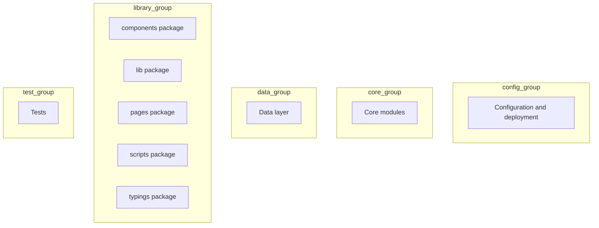

# Architecture report: geist-org/geist-ui

> Automated static analysis. **Observed** = directly seen in files/imports/AST; **Inferred** = interpretation from that evidence. Repository code was not executed.

## 1. Repository at a glance

| Item | Value |
| --- | --- |
| Repository | geist-org/geist-ui |
| Description | A design system for building modern websites and applications. |
| Language | TypeScript |
| Stars | 4543 |
| Licence | MIT |
| Analysed commit / branch | 6894bfdf12bca17ae292617cf2b69c63731fd5d4 / master |
| Framework(s) | Next.js, React |
| Files analysed | 752 |
| Components | 9 |

## 2. Architecture in one minute

geist-org/geist-ui - A design system for building modern websites and applications.. This repository was analysed statically from 752 file(s) (0 Python). Detected technologies (observed from imports/manifests): GitHub Actions, Next.js, React, Jest, TypeScript, webpack. Files are grouped into 9 component(s): components package, Configuration and deployment, Core modules, Data layer, lib package, pages package, scripts package, Tests. Findings below distinguish observed facts from inferred interpretation.

## 3. High-level block diagram

## 4. Main components

### components package (`components`)

- **Kind:** library
- **Status:** Observed
- **Confidence:** 0.85
- **Responsibility:** Groups 367 file(s) under components package (observed from repository paths and static analysis).
- **Paths:** `components/auto-complete/__tests__/index.test.tsx`, `components/auto-complete/__tests__/search.test.tsx`, `components/auto-complete/__tests__/use-input.test.tsx`, `components/auto-complete/auto-complete-context.ts`, `components/auto-complete/auto-complete-dropdown.tsx`, `components/auto-complete/auto-complete-empty.tsx`, `components/auto-complete/auto-complete-item.tsx`, `components/auto-complete/auto-complete-searching.tsx`, `components/auto-complete/auto-complete.tsx`, `components/auto-complete/index.ts`, `components/avatar/__tests__/index.test.tsx`, `components/avatar/avatar-group.tsx`, `components/avatar/avatar.tsx`, `components/avatar/index.ts`, `components/badge/__tests__/anchor.test.tsx`, `components/badge/__tests__/index.test.tsx`, `components/badge/badge-anchor.tsx`, `components/badge/badge.tsx`, `components/badge/index.ts`, `components/breadcrumbs/__tests__/breadcrumbs.test.tsx`, `components/breadcrumbs/breadcrumbs-item.tsx`, `components/breadcrumbs/breadcrumbs-separator.tsx`, `components/breadcrumbs/breadcrumbs.tsx`, `components/breadcrumbs/index.ts`, `components/button-dropdown/__tests__/index.test.tsx`, `components/button-dropdown/button-dropdown-context.ts`, `components/button-dropdown/button-dropdown-item.tsx`, `components/button-dropdown/button-dropdown.tsx`, `components/button-dropdown/icon.tsx`, `components/button-dropdown/index.ts`, `components/button-dropdown/styles.ts`, `components/button-group/__tests__/index.test.tsx`, `components/button-group/button-group-context.ts`, `components/button-group/button-group.tsx`, `components/button-group/index.ts`, `components/button/__tests__/icon.test.tsx`, `components/button/__tests__/index.test.tsx`, `components/button/button-icon.tsx`, `components/button/button-loading.tsx`, `components/button/button.drip.tsx`, `components/button/button.tsx`, `components/button/index.ts`, `components/button/styles.ts`, `components/button/utils.tsx`, `components/capacity/__tests__/index.test.tsx`, `components/capacity/capacity.tsx`, `components/capacity/index.ts`, `components/card/__tests__/footer.test.tsx`, `components/card/__tests__/index.test.tsx`, `components/card/card-content.tsx`, `components/card/card-footer.tsx`, `components/card/card.tsx`, `components/card/index.ts`, `components/card/styles.ts`, `components/checkbox/__tests__/group.test.tsx`, `components/checkbox/__tests__/index.test.tsx`, `components/checkbox/checkbox-context.ts`, `components/checkbox/checkbox-group.tsx`, `components/checkbox/checkbox.icon.tsx`, `components/checkbox/checkbox.tsx`, `components/checkbox/index.ts`, `components/checkbox/styles.ts`, `components/code/__tests__/index.test.tsx`, `components/code/code.tsx`, `components/code/index.ts`, `components/col/__tests__/index.test.tsx`, `components/col/col.tsx`, `components/col/index.ts`, `components/collapse/__tests__/group.test.tsx`, `components/collapse/__tests__/index.test.tsx`, `components/collapse/collapse-context.ts`, `components/collapse/collapse-group.tsx`, `components/collapse/collapse-icon.tsx`, `components/collapse/collapse.tsx`, `components/collapse/index.ts`, `components/css-baseline/__tests__/baseline.test.tsx`, `components/css-baseline/css-baseline.tsx`, `components/css-baseline/index.ts`, `components/description/__tests__/index.test.tsx`, `components/description/description.tsx`, `components/description/index.ts`, `components/display/__tests__/index.test.tsx`, `components/display/display.tsx`, `components/display/index.ts`, `components/divider/__tests__/index.test.tsx`, `components/divider/divider.tsx`, `components/divider/index.ts`, `components/dot/__tests__/index.test.tsx`, `components/dot/dot.tsx`, `components/dot/index.ts`, `components/drawer/__tests__/index.test.tsx`, `components/drawer/__tests__/use-modal.test.tsx`, `components/drawer/drawer-wrapper.tsx`, `components/drawer/drawer.tsx`, `components/drawer/helper.ts`, `components/drawer/index.ts`, `components/fieldset/__tests__/group.test.tsx`, `components/fieldset/__tests__/index.test.tsx`, `components/fieldset/fieldset-content.tsx`, `components/fieldset/fieldset-context.ts`, `components/fieldset/fieldset-footer.tsx`, `components/fieldset/fieldset-group.tsx`, `components/fieldset/fieldset-subtitle.tsx`, `components/fieldset/fieldset-title.tsx`, `components/fieldset/fieldset.tsx`, `components/fieldset/index.ts`, `components/geist-provider/geist-provider.tsx`, `components/geist-provider/index.ts`, `components/geist-provider/theme-provider.tsx`, `components/grid/__tests__/index.test.tsx`, `components/grid/basic-item.tsx`, `components/grid/grid-container.tsx`, `components/grid/grid-types.ts`, `components/grid/grid.tsx`, `components/grid/index.ts`, `components/image/__tests__/browser.test.tsx`, `components/image/__tests__/index.test.tsx`, `components/image/helpers.ts`, `components/image/image-browser-https-icon.tsx`, `components/image/image-browser.tsx`, `components/image/image.skeleton.tsx`, `components/image/image.tsx`, `components/image/index.ts`, `components/image/styles.ts`, `components/index.ts`, `components/input/__tests__/index.test.tsx`, `components/input/__tests__/password.test.tsx`, `components/input/index.ts`, `components/input/input-block-label.tsx`, `components/input/input-icon-clear.tsx`, `components/input/input-icon.tsx`, `components/input/input-label.tsx`, `components/input/input-props.ts`, `components/input/input.tsx`, `components/input/password-icon.tsx`, `components/input/password.tsx`, `components/input/styles.ts`, `components/keyboard/__tests__/index.test.tsx`, `components/keyboard/index.ts`, `components/keyboard/keyboard.tsx`, `components/link/__tests__/index.test.tsx`, `components/link/icon.tsx`, `components/link/index.ts`, `components/link/link.tsx`, `components/loading/__tests__/index.test.tsx`, `components/loading/index.ts`, `components/loading/loading.tsx`, `components/modal/__tests__/index.test.tsx`, `components/modal/index.ts`, `components/modal/modal-action.tsx`, `components/modal/modal-actions.tsx`, `components/modal/modal-content.tsx`, `components/modal/modal-context.ts`, `components/modal/modal-subtitle.tsx`, `components/modal/modal-title.tsx`, `components/modal/modal-wrapper.tsx`, `components/modal/modal.tsx`, `components/note/__tests__/index.test.tsx`, `components/note/index.ts`, `components/note/note.tsx`, `components/page/__tests__/child.test.tsx`, `components/page/__tests__/index.test.tsx`, `components/page/index.ts`, `components/page/page-content.tsx`, `components/page/page-footer.tsx`, `components/page/page-header.tsx`, `components/page/page.tsx`, `components/pagination/__tests__/pagination.test.tsx`, `components/pagination/index.ts`, `components/pagination/pagination-context.ts`, `components/pagination/pagination-ellipsis.tsx`, `components/pagination/pagination-item.tsx`, `components/pagination/pagination-next.tsx`, `components/pagination/pagination-pages.tsx`, `components/pagination/pagination-previous.tsx`, `components/pagination/pagination.tsx`, `components/popover/__tests__/index.test.tsx`, `components/popover/index.ts`, `components/popover/popover-context.ts`, `components/popover/popover-item.tsx`, `components/popover/popover.tsx`, `components/progress/__tests__/index.test.tsx`, `components/progress/index.ts`, `components/progress/progress.tsx`, `components/radio/__tests__/group.test.tsx`, `components/radio/__tests__/index.test.tsx`, `components/radio/index.ts`, `components/radio/radio-context.ts`, `components/radio/radio-description.tsx`, `components/radio/radio-group.tsx`, `components/radio/radio.tsx`, `components/radio/styles.ts`, `components/rating/__tests__/index.test.tsx`, `components/rating/index.ts`, `components/rating/rating-icon.tsx`, `components/rating/rating.tsx`, `components/row/__tests__/index.test.tsx`, `components/row/index.ts`, `components/row/row.tsx`, `components/select/__tests__/events.test.tsx`, `components/select/__tests__/index.test.tsx`, `components/select/__tests__/multiple.test.tsx`, `components/select/index.ts`, `components/select/select-context.ts`, `components/select/select-dropdown.tsx`, `components/select/select-icon-clear.tsx`, `components/select/select-icon.tsx`, `components/select/select-input.tsx`, `components/select/select-multiple-value.tsx`, `components/select/select-option.tsx`, `components/select/select.tsx`, `components/select/styles.ts`, `components/shared/__tests__/backdrop.test.tsx`, `components/shared/__tests__/dropdown.test.tsx`, `components/shared/__tests__/ellipsis.test.tsx`, `components/shared/__tests__/transition.test.tsx`, `components/shared/backdrop.tsx`, `components/shared/css-transition.tsx`, `components/shared/dropdown.tsx`, `components/shared/ellipsis.tsx`, `components/shared/expand.tsx`, `components/shared/highlight.tsx`, `components/slider/__tests__/index.test.tsx`, `components/slider/index.ts`, `components/slider/slider-dot.tsx`, `components/slider/slider-mark.tsx`, `components/slider/slider.tsx`, `components/slider/styles.ts`, `components/snippet/__tests__/index.test.tsx`, `components/snippet/index.ts`, `components/snippet/snippet-icon.tsx`, `components/snippet/snippet.tsx`, `components/snippet/styles.ts`, `components/spacer/__tests__/index.test.tsx`, `components/spacer/index.ts`, `components/spacer/spacer.tsx`, `components/spinner/__tests__/index.test.tsx`, `components/spinner/index.ts`, `components/spinner/spinner.tsx`, `components/table/__tests__/index.test.tsx`, `components/table/index.ts`, `components/table/table-body.tsx`, `components/table/table-cell.tsx`, `components/table/table-column.tsx`, `components/table/table-context.ts`, `components/table/table-head.tsx`, `components/table/table-types.ts`, `components/table/table.tsx`, `components/tabs/__tests__/index.test.tsx`, `components/tabs/index.ts`, `components/tabs/tabs-context.ts`, `components/tabs/tabs-item.tsx`, `components/tabs/tabs.tsx`, `components/tag/__tests__/index.test.tsx`, `components/tag/index.ts`, `components/tag/tag.tsx`, `components/text/__tests__/index.test.tsx`, `components/text/child.tsx`, `components/text/index.ts`, `components/text/text.tsx`, `components/textarea/__tests__/index.test.tsx`, `components/textarea/index.ts`, `components/textarea/textarea.tsx`, `components/themes/index.ts`, `components/themes/presets/dark.ts`, `components/themes/presets/default.ts`, `components/themes/presets/index.ts`, `components/themes/presets/shared.ts`, `components/themes/themes.ts`, `components/toggle/__tests__/index.test.tsx`, `components/toggle/index.ts`, `components/toggle/styles.ts`, `components/toggle/toggle.tsx`, `components/tooltip/__test__/index.test.tsx`, `components/tooltip/helper.ts`, `components/tooltip/index.ts`, `components/tooltip/placement.ts`, `components/tooltip/styles.ts`, `components/tooltip/tooltip-content.tsx`, `components/tooltip/tooltip-icon.tsx`, `components/tooltip/tooltip.tsx`, `components/tree/__tests__/index.test.tsx`, `components/tree/index.ts`, `components/tree/tree-context.ts`, `components/tree/tree-file-icon.tsx`, `components/tree/tree-file.tsx`, `components/tree/tree-folder-icon.tsx`, `components/tree/tree-folder.tsx`, `components/tree/tree-help.ts`, `components/tree/tree-indents.tsx`, `components/tree/tree-status-icon.tsx`, `components/tree/tree.tsx`, `components/use-all-themes/all-themes-context.ts`, `components/use-all-themes/index.ts`, `components/use-body-scroll/__tests__/body-scroll.test.tsx`, `components/use-body-scroll/index.ts`, `components/use-body-scroll/use-body-scroll.ts`, `components/use-classes/__tests__/index.test.tsx`, `components/use-classes/index.ts`, `components/use-classes/use-classes.ts`, `components/use-click-away/__tests__/click-away.test.tsx`, `components/use-click-away/index.ts`, `components/use-click-away/use-click-away.ts`, `components/use-clipboard/__tests__/clipboard.test.tsx`, `components/use-clipboard/index.ts`, `components/use-clipboard/use-clipboard.ts`, `components/use-current-state/__tests__/current-state.test.tsx`, `components/use-current-state/index.ts`, `components/use-current-state/use-current-state.ts`, `components/use-input/__tests__/use-input.test.tsx`, `components/use-input/index.ts`, `components/use-input/use-input.tsx`, `components/use-keyboard/__tests__/keyboard.test.tsx`, `components/use-keyboard/codes.ts`, `components/use-keyboard/helper.ts`, `components/use-keyboard/index.ts`, `components/use-keyboard/use-keyboard.ts`, `components/use-media-query/__tests__/media-query.test.tsx`, `components/use-media-query/index.ts`, `components/use-media-query/use-media-query.ts`, `components/use-modal/__tests__/use-modal.test.tsx`, `components/use-modal/index.ts`, `components/use-modal/use-modal.ts`, `components/use-scale/__tests__/scale.test.tsx`, `components/use-scale/index.ts`, `components/use-scale/scale-context.ts`, `components/use-scale/utils.ts`, `components/use-scale/with-scale.tsx`, `components/use-tabs/__tests__/use-tabs.test.tsx`, `components/use-tabs/index.ts`, `components/use-tabs/use-tabs.ts`, `components/use-theme/index.ts`, `components/use-theme/theme-context.ts`, `components/use-toasts/__tests__/index.test.tsx`, `components/use-toasts/helpers.tsx`, `components/use-toasts/index.ts`, `components/use-toasts/toast-container.tsx`, `components/use-toasts/toast-item.tsx`, `components/use-toasts/use-toast.tsx`, `components/user/__tests__/index.test.tsx`, `components/user/index.ts`, `components/user/user-link.tsx`, `components/user/user.tsx`, `components/utils/__tests__/calculations.test.tsx`, `components/utils/calculations.ts`, `components/utils/collections.ts`, `components/utils/color.ts`, `components/utils/layouts.ts`, `components/utils/prop-types.ts`, `components/utils/types.ts`, `components/utils/use-body-scroll.ts`, `components/utils/use-click-anywhere.ts`, `components/utils/use-click-away.ts`, `components/utils/use-clipboard.ts`, `components/utils/use-context-state/create-geist-context.tsx`, `components/utils/use-context-state/use-context-state.ts`, `components/utils/use-current-state.ts`, `components/utils/use-default-props.ts`, `components/utils/use-dom-observer.ts`, `components/utils/use-drag.ts`, `components/utils/use-geist-ui-context.ts`, `components/utils/use-portal.ts`, `components/utils/use-previous.ts`, `components/utils/use-real-shape.ts`, `components/utils/use-resize.ts`, `components/utils/use-ssr.ts`, `components/utils/use-warning.ts`
- **Evidence:** [components/auto-complete/__tests__/index.test.tsx](https://github.com/geist-org/geist-ui/blob/6894bfdf12bca17ae292617cf2b69c63731fd5d4/components/auto-complete/__tests__/index.test.tsx); [components/auto-complete/__tests__/search.test.tsx](https://github.com/geist-org/geist-ui/blob/6894bfdf12bca17ae292617cf2b69c63731fd5d4/components/auto-complete/__tests__/search.test.tsx); [components/auto-complete/__tests__/use-input.test.tsx](https://github.com/geist-org/geist-ui/blob/6894bfdf12bca17ae292617cf2b69c63731fd5d4/components/auto-complete/__tests__/use-input.test.tsx); [components/auto-complete/auto-complete-context.ts](https://github.com/geist-org/geist-ui/blob/6894bfdf12bca17ae292617cf2b69c63731fd5d4/components/auto-complete/auto-complete-context.ts); [components/auto-complete/auto-complete-dropdown.tsx](https://github.com/geist-org/geist-ui/blob/6894bfdf12bca17ae292617cf2b69c63731fd5d4/components/auto-complete/auto-complete-dropdown.tsx); [components/auto-complete/auto-complete-empty.tsx](https://github.com/geist-org/geist-ui/blob/6894bfdf12bca17ae292617cf2b69c63731fd5d4/components/auto-complete/auto-complete-empty.tsx); [components/auto-complete/auto-complete-item.tsx](https://github.com/geist-org/geist-ui/blob/6894bfdf12bca17ae292617cf2b69c63731fd5d4/components/auto-complete/auto-complete-item.tsx); [components/auto-complete/auto-complete-searching.tsx](https://github.com/geist-org/geist-ui/blob/6894bfdf12bca17ae292617cf2b69c63731fd5d4/components/auto-complete/auto-complete-searching.tsx)

### Configuration and deployment (`config`)

- **Kind:** config
- **Status:** Observed
- **Confidence:** 0.85
- **Responsibility:** Groups 11 file(s) under configuration and deployment (observed from repository paths and static analysis).
- **Paths:** `lib/data/metadata-en-us.json`, `lib/data/metadata-zh-cn.json`, `lib/data/seeds-en-us.json`, `lib/data/seeds-zh-cn.json`, `now.json`, `package.json`, `scripts/seeds/codesandbox.json`, `scripts/seeds/links.json`, `scripts/tsconfig.json`, `scripts/tsconfig.test.json`, `tsconfig.json`
- **Evidence:** [lib/data/metadata-en-us.json](https://github.com/geist-org/geist-ui/blob/6894bfdf12bca17ae292617cf2b69c63731fd5d4/lib/data/metadata-en-us.json); [lib/data/metadata-zh-cn.json](https://github.com/geist-org/geist-ui/blob/6894bfdf12bca17ae292617cf2b69c63731fd5d4/lib/data/metadata-zh-cn.json); [lib/data/seeds-en-us.json](https://github.com/geist-org/geist-ui/blob/6894bfdf12bca17ae292617cf2b69c63731fd5d4/lib/data/seeds-en-us.json); [lib/data/seeds-zh-cn.json](https://github.com/geist-org/geist-ui/blob/6894bfdf12bca17ae292617cf2b69c63731fd5d4/lib/data/seeds-zh-cn.json); [now.json](https://github.com/geist-org/geist-ui/blob/6894bfdf12bca17ae292617cf2b69c63731fd5d4/now.json); [package.json](https://github.com/geist-org/geist-ui/blob/6894bfdf12bca17ae292617cf2b69c63731fd5d4/package.json); [scripts/seeds/codesandbox.json](https://github.com/geist-org/geist-ui/blob/6894bfdf12bca17ae292617cf2b69c63731fd5d4/scripts/seeds/codesandbox.json); [scripts/seeds/links.json](https://github.com/geist-org/geist-ui/blob/6894bfdf12bca17ae292617cf2b69c63731fd5d4/scripts/seeds/links.json)

### Core modules (`core`)

- **Kind:** core
- **Status:** Observed
- **Confidence:** 0.85
- **Responsibility:** Groups 2 file(s) under core modules (observed from repository paths and static analysis).
- **Paths:** `next-env.d.ts`, `next.config.js`
- **Evidence:** [next-env.d.ts](https://github.com/geist-org/geist-ui/blob/6894bfdf12bca17ae292617cf2b69c63731fd5d4/next-env.d.ts); [next.config.js](https://github.com/geist-org/geist-ui/blob/6894bfdf12bca17ae292617cf2b69c63731fd5d4/next.config.js)

### Data layer (`data_layer`)

- **Kind:** data
- **Status:** Observed
- **Confidence:** 0.85
- **Responsibility:** Groups 2 file(s) under data layer (observed from repository paths and static analysis).
- **Paths:** `lib/data/index.ts`, `lib/data/seeds.ts`
- **Evidence:** [lib/data/index.ts](https://github.com/geist-org/geist-ui/blob/6894bfdf12bca17ae292617cf2b69c63731fd5d4/lib/data/index.ts); [lib/data/seeds.ts](https://github.com/geist-org/geist-ui/blob/6894bfdf12bca17ae292617cf2b69c63731fd5d4/lib/data/seeds.ts)

### lib package (`lib`)

- **Kind:** library
- **Status:** Observed
- **Confidence:** 0.85
- **Responsibility:** Groups 66 file(s) under lib package (observed from repository paths and static analysis).
- **Paths:** `lib/components/attributes/attributes-table.tsx`, `lib/components/attributes/attributes-title.tsx`, `lib/components/attributes/attributes.tsx`, `lib/components/attributes/contributors.tsx`, `lib/components/attributes/index.ts`, `lib/components/customization/codes.tsx`, `lib/components/customization/colors.tsx`, `lib/components/customization/demo.tsx`, `lib/components/customization/editor-color-item.tsx`, `lib/components/customization/editor-input-item.tsx`, `lib/components/customization/editor.tsx`, `lib/components/customization/layout.tsx`, `lib/components/index.ts`, `lib/components/layout/header.tsx`, `lib/components/layout/index.tsx`, `lib/components/layout/layout.tsx`, `lib/components/layout/menu/index.tsx`, `lib/components/layout/menu/menu-mobile.tsx`, `lib/components/layout/menu/menu-skeleton.tsx`, `lib/components/layout/menu/menu.tsx`, `lib/components/layout/powered-by/index.ts`, `lib/components/layout/powered-by/powered-by.tsx`, `lib/components/layout/sidebar/active-catalog.tsx`, `lib/components/layout/sidebar/active-link.tsx`, `lib/components/layout/sidebar/index.tsx`, `lib/components/layout/sidebar/side-item.tsx`, `lib/components/layout/sidebar/sidebar-skeleton.tsx`, `lib/components/layout/sidebar/sidebar.tsx`, `lib/components/mdx-widgets/colors/colors-data.ts`, `lib/components/mdx-widgets/colors/index.tsx`, `lib/components/mdx-widgets/example-block.tsx`, `lib/components/mdx-widgets/grid-demo.tsx`, `lib/components/mdx-widgets/home-cell.tsx`, `lib/components/mdx-widgets/hybrid-code.tsx`, `lib/components/mdx-widgets/hybrid-link.tsx`, `lib/components/mdx-widgets/icons-gallery/icons-cell.tsx`, `lib/components/mdx-widgets/icons-gallery/icons-gallery.tsx`, `lib/components/mdx-widgets/icons-gallery/index.tsx`, `lib/components/mdx-widgets/index.ts`, `lib/components/mdx-widgets/mock-page.tsx`, `lib/components/mdx-widgets/parsed-codes/clock.tsx`, `lib/components/mdx-widgets/parsed-codes/greeting.tsx`, `lib/components/mdx-widgets/parsed-codes/index.ts`, `lib/components/mdx-widgets/parsed-codes/types.tsx`, `lib/components/playground/code-theme.ts`, `lib/components/playground/dynamic-live.tsx`, `lib/components/playground/editor.tsx`, `lib/components/playground/index.ts`, `lib/components/playground/playground.tsx`, `lib/components/playground/title.tsx`, `lib/components/pures/anchor/anchor-icon.tsx`, `lib/components/pures/anchor/index.tsx`, `lib/components/pures/controls.tsx`, `lib/components/pures/index.ts`, `lib/components/search/helper.ts`, `lib/components/search/index.tsx`, `lib/components/search/search-icon.tsx`, `lib/components/search/search-item.tsx`, `lib/components/search/search-items.tsx`, `lib/components/search/search.tsx`, `lib/config-context.ts`, `lib/config-provider.tsx`, `lib/constants.ts`, `lib/redirect.tsx`, `lib/use-dom-clean.ts`, `lib/use-locale.ts`
- **Evidence:** [lib/components/attributes/attributes-table.tsx](https://github.com/geist-org/geist-ui/blob/6894bfdf12bca17ae292617cf2b69c63731fd5d4/lib/components/attributes/attributes-table.tsx); [lib/components/attributes/attributes-title.tsx](https://github.com/geist-org/geist-ui/blob/6894bfdf12bca17ae292617cf2b69c63731fd5d4/lib/components/attributes/attributes-title.tsx); [lib/components/attributes/attributes.tsx](https://github.com/geist-org/geist-ui/blob/6894bfdf12bca17ae292617cf2b69c63731fd5d4/lib/components/attributes/attributes.tsx); [lib/components/attributes/contributors.tsx](https://github.com/geist-org/geist-ui/blob/6894bfdf12bca17ae292617cf2b69c63731fd5d4/lib/components/attributes/contributors.tsx); [lib/components/attributes/index.ts](https://github.com/geist-org/geist-ui/blob/6894bfdf12bca17ae292617cf2b69c63731fd5d4/lib/components/attributes/index.ts); [lib/components/customization/codes.tsx](https://github.com/geist-org/geist-ui/blob/6894bfdf12bca17ae292617cf2b69c63731fd5d4/lib/components/customization/codes.tsx); [lib/components/customization/colors.tsx](https://github.com/geist-org/geist-ui/blob/6894bfdf12bca17ae292617cf2b69c63731fd5d4/lib/components/customization/colors.tsx); [lib/components/customization/demo.tsx](https://github.com/geist-org/geist-ui/blob/6894bfdf12bca17ae292617cf2b69c63731fd5d4/lib/components/customization/demo.tsx)

### pages package (`pages`)

- **Kind:** library
- **Status:** Observed
- **Confidence:** 0.85
- **Responsibility:** Groups 10 file(s) under pages package (observed from repository paths and static analysis).
- **Paths:** `pages/_app.tsx`, `pages/_document.tsx`, `pages/en-us/components/index.js`, `pages/en-us/guide/index.js`, `pages/en-us/hooks/index.js`, `pages/en-us/index.tsx`, `pages/zh-cn/components/index.js`, `pages/zh-cn/guide/index.js`, `pages/zh-cn/hooks/index.js`, `pages/zh-cn/index.tsx`
- **Evidence:** [pages/_app.tsx](https://github.com/geist-org/geist-ui/blob/6894bfdf12bca17ae292617cf2b69c63731fd5d4/pages/_app.tsx); [pages/_document.tsx](https://github.com/geist-org/geist-ui/blob/6894bfdf12bca17ae292617cf2b69c63731fd5d4/pages/_document.tsx); [pages/en-us/components/index.js](https://github.com/geist-org/geist-ui/blob/6894bfdf12bca17ae292617cf2b69c63731fd5d4/pages/en-us/components/index.js); [pages/en-us/guide/index.js](https://github.com/geist-org/geist-ui/blob/6894bfdf12bca17ae292617cf2b69c63731fd5d4/pages/en-us/guide/index.js); [pages/en-us/hooks/index.js](https://github.com/geist-org/geist-ui/blob/6894bfdf12bca17ae292617cf2b69c63731fd5d4/pages/en-us/hooks/index.js); [pages/en-us/index.tsx](https://github.com/geist-org/geist-ui/blob/6894bfdf12bca17ae292617cf2b69c63731fd5d4/pages/en-us/index.tsx); [pages/zh-cn/components/index.js](https://github.com/geist-org/geist-ui/blob/6894bfdf12bca17ae292617cf2b69c63731fd5d4/pages/zh-cn/components/index.js); [pages/zh-cn/guide/index.js](https://github.com/geist-org/geist-ui/blob/6894bfdf12bca17ae292617cf2b69c63731fd5d4/pages/zh-cn/guide/index.js)

### scripts package (`scripts`)

- **Kind:** library
- **Status:** Observed
- **Confidence:** 0.85
- **Responsibility:** Groups 12 file(s) under scripts package (observed from repository paths and static analysis).
- **Paths:** `scripts/babel.config.js`, `scripts/built-in/styled-jsx-server.es.js`, `scripts/built-in/styled-jsx.cjs.js`, `scripts/built-in/styled-jsx.es.js`, `scripts/collect-meta.js`, `scripts/locales.js`, `scripts/move-built-in.js`, `scripts/rollup.config.js`, `scripts/seeds/presets.js`, `scripts/seeds/update.js`, `scripts/side-effects.js`, `scripts/webpack.config.js`
- **Evidence:** [scripts/babel.config.js](https://github.com/geist-org/geist-ui/blob/6894bfdf12bca17ae292617cf2b69c63731fd5d4/scripts/babel.config.js); [scripts/built-in/styled-jsx-server.es.js](https://github.com/geist-org/geist-ui/blob/6894bfdf12bca17ae292617cf2b69c63731fd5d4/scripts/built-in/styled-jsx-server.es.js); [scripts/built-in/styled-jsx.cjs.js](https://github.com/geist-org/geist-ui/blob/6894bfdf12bca17ae292617cf2b69c63731fd5d4/scripts/built-in/styled-jsx.cjs.js); [scripts/built-in/styled-jsx.es.js](https://github.com/geist-org/geist-ui/blob/6894bfdf12bca17ae292617cf2b69c63731fd5d4/scripts/built-in/styled-jsx.es.js); [scripts/collect-meta.js](https://github.com/geist-org/geist-ui/blob/6894bfdf12bca17ae292617cf2b69c63731fd5d4/scripts/collect-meta.js); [scripts/locales.js](https://github.com/geist-org/geist-ui/blob/6894bfdf12bca17ae292617cf2b69c63731fd5d4/scripts/locales.js); [scripts/move-built-in.js](https://github.com/geist-org/geist-ui/blob/6894bfdf12bca17ae292617cf2b69c63731fd5d4/scripts/move-built-in.js); [scripts/rollup.config.js](https://github.com/geist-org/geist-ui/blob/6894bfdf12bca17ae292617cf2b69c63731fd5d4/scripts/rollup.config.js)

### Tests (`tests`)

- **Kind:** test
- **Status:** Observed
- **Confidence:** 0.85
- **Responsibility:** Groups 4 file(s) under tests (observed from repository paths and static analysis).
- **Paths:** `tests/.babelrc.js`, `tests/__mocks__/styled-jsx/css.js`, `tests/setup.ts`, `tests/utils.ts`
- **Evidence:** [tests/.babelrc.js](https://github.com/geist-org/geist-ui/blob/6894bfdf12bca17ae292617cf2b69c63731fd5d4/tests/.babelrc.js); [tests/__mocks__/styled-jsx/css.js](https://github.com/geist-org/geist-ui/blob/6894bfdf12bca17ae292617cf2b69c63731fd5d4/tests/__mocks__/styled-jsx/css.js); [tests/setup.ts](https://github.com/geist-org/geist-ui/blob/6894bfdf12bca17ae292617cf2b69c63731fd5d4/tests/setup.ts); [tests/utils.ts](https://github.com/geist-org/geist-ui/blob/6894bfdf12bca17ae292617cf2b69c63731fd5d4/tests/utils.ts)

### typings package (`typings`)

- **Kind:** library
- **Status:** Observed
- **Confidence:** 0.85
- **Responsibility:** Groups 3 file(s) under typings package (observed from repository paths and static analysis).
- **Paths:** `typings/mdx.d.ts`, `typings/meta.d.ts`, `typings/styled.d.ts`
- **Evidence:** [typings/mdx.d.ts](https://github.com/geist-org/geist-ui/blob/6894bfdf12bca17ae292617cf2b69c63731fd5d4/typings/mdx.d.ts); [typings/meta.d.ts](https://github.com/geist-org/geist-ui/blob/6894bfdf12bca17ae292617cf2b69c63731fd5d4/typings/meta.d.ts); [typings/styled.d.ts](https://github.com/geist-org/geist-ui/blob/6894bfdf12bca17ae292617cf2b69c63731fd5d4/typings/styled.d.ts)

## 5. Execution flow

**Observed** entry point(s):

- [components/auto-complete/index.ts](https://github.com/geist-org/geist-ui/blob/6894bfdf12bca17ae292617cf2b69c63731fd5d4/components/auto-complete/index.ts)
- [components/avatar/index.ts](https://github.com/geist-org/geist-ui/blob/6894bfdf12bca17ae292617cf2b69c63731fd5d4/components/avatar/index.ts)
- [components/badge/index.ts](https://github.com/geist-org/geist-ui/blob/6894bfdf12bca17ae292617cf2b69c63731fd5d4/components/badge/index.ts)
- [components/breadcrumbs/index.ts](https://github.com/geist-org/geist-ui/blob/6894bfdf12bca17ae292617cf2b69c63731fd5d4/components/breadcrumbs/index.ts)
- [components/button-dropdown/index.ts](https://github.com/geist-org/geist-ui/blob/6894bfdf12bca17ae292617cf2b69c63731fd5d4/components/button-dropdown/index.ts)
- [components/button-group/index.ts](https://github.com/geist-org/geist-ui/blob/6894bfdf12bca17ae292617cf2b69c63731fd5d4/components/button-group/index.ts)
- [components/button/index.ts](https://github.com/geist-org/geist-ui/blob/6894bfdf12bca17ae292617cf2b69c63731fd5d4/components/button/index.ts)
- [components/capacity/index.ts](https://github.com/geist-org/geist-ui/blob/6894bfdf12bca17ae292617cf2b69c63731fd5d4/components/capacity/index.ts)
- [components/card/index.ts](https://github.com/geist-org/geist-ui/blob/6894bfdf12bca17ae292617cf2b69c63731fd5d4/components/card/index.ts)
- [components/checkbox/index.ts](https://github.com/geist-org/geist-ui/blob/6894bfdf12bca17ae292617cf2b69c63731fd5d4/components/checkbox/index.ts)
- [components/code/index.ts](https://github.com/geist-org/geist-ui/blob/6894bfdf12bca17ae292617cf2b69c63731fd5d4/components/code/index.ts)
- [components/col/index.ts](https://github.com/geist-org/geist-ui/blob/6894bfdf12bca17ae292617cf2b69c63731fd5d4/components/col/index.ts)

Representative flow (derived from observed entry points and the import graph; steps beyond the entry point are **Inferred**):

1. Execution starts at an observed entry point listed above, if present.
2. No internal import relationships between components were observed.

## 6. Project structure

### `(root)`

- `.codecov.yml` - config (166 bytes)
- `.eslintignore` - other (78 bytes)
- `.eslintrc.js` - source, JavaScript (488 bytes)
- `.gitignore` - other (450 bytes)
- `.jest.config.js` - source, JavaScript (868 bytes)
- `.prettierignore` - other (81 bytes)
- `.travis.yml` - ci, YAML (207 bytes)
- `.vercelignore` - other (258 bytes)
- `LICENSE` - docs (1065 bytes)
- `README.md` - docs (756 bytes)
- `next-env.d.ts` - source, TypeScript (201 bytes)
- `next.config.js` - source, JavaScript (1467 bytes)
- `now.json` - config (41 bytes)
- `package.json` - manifest (3922 bytes)
- `tsconfig.json` - config (948 bytes)

### `.circleci`

- `.circleci/config.yml` - ci, YAML (1033 bytes)

### `.github`

- `.github/CODE_OF_CONDUCT.md` - docs (5220 bytes)
- `.github/CONTRIBUTING.md` - docs (3029 bytes)
- `.github/ISSUE_TEMPLATE/1-bug-report.md` - docs (391 bytes)
- `.github/ISSUE_TEMPLATE/2-feature-request.md` - docs (369 bytes)
- `.github/ISSUE_TEMPLATE/3-docs.md` - docs (322 bytes)
- `.github/ISSUE_TEMPLATE/config.yml` - config (209 bytes)
- `.github/PULL_REQUEST_TEMPLATE.md` - docs (116 bytes)
- `.github/workflows/publish.yml` - ci, YAML (1350 bytes)

### `components`

- `components/auto-complete/__tests__/__snapshots__/index.test.tsx.snap` - other (126 bytes)
- `components/auto-complete/__tests__/__snapshots__/search.test.tsx.snap` - other (56395 bytes)
- `components/auto-complete/__tests__/index.test.tsx` - source, TypeScript (2148 bytes)
- `components/auto-complete/__tests__/search.test.tsx` - source, TypeScript (5528 bytes)
- `components/auto-complete/__tests__/use-input.test.tsx` - source, TypeScript (1868 bytes)
- `components/auto-complete/auto-complete-context.ts` - source, TypeScript (520 bytes)
- `components/auto-complete/auto-complete-dropdown.tsx` - source, TypeScript (2120 bytes)
- `components/auto-complete/auto-complete-empty.tsx` - source, TypeScript (730 bytes)
- `components/auto-complete/auto-complete-item.tsx` - source, TypeScript (2924 bytes)
- `components/auto-complete/auto-complete-searching.tsx` - source, TypeScript (1686 bytes)
- `components/auto-complete/auto-complete.tsx` - source, TypeScript (7666 bytes)
- `components/auto-complete/index.ts` - source, TypeScript (894 bytes)
- `components/avatar/__tests__/__snapshots__/index.test.tsx.snap` - other (48773 bytes)
- `components/avatar/__tests__/index.test.tsx` - source, TypeScript (1639 bytes)
- `components/avatar/avatar-group.tsx` - source, TypeScript (1645 bytes)
- `components/avatar/avatar.tsx` - source, TypeScript (2655 bytes)
- `components/avatar/index.ts` - source, TypeScript (353 bytes)
- `components/badge/__tests__/__snapshots__/anchor.test.tsx.snap` - other (3847 bytes)
- `components/badge/__tests__/__snapshots__/index.test.tsx.snap` - other (64505 bytes)
- `components/badge/__tests__/anchor.test.tsx` - source, TypeScript (973 bytes)
- `components/badge/__tests__/index.test.tsx` - source, TypeScript (1999 bytes)
- `components/badge/badge-anchor.tsx` - source, TypeScript (2464 bytes)
- `components/badge/badge.tsx` - source, TypeScript (2452 bytes)
- `components/badge/index.ts` - source, TypeScript (378 bytes)
- `components/breadcrumbs/__tests__/__snapshots__/breadcrumbs.test.tsx.snap` - other (2308 bytes)
- `components/breadcrumbs/__tests__/breadcrumbs.test.tsx` - source, TypeScript (2222 bytes)
- `components/breadcrumbs/breadcrumbs-item.tsx` - source, TypeScript (1721 bytes)
- `components/breadcrumbs/breadcrumbs-separator.tsx` - source, TypeScript (1286 bytes)
- `components/breadcrumbs/breadcrumbs.tsx` - source, TypeScript (2769 bytes)
- `components/breadcrumbs/index.ts` - source, TypeScript (673 bytes)
- `components/button-dropdown/__tests__/index.test.tsx` - source, TypeScript (5005 bytes)
- `components/button-dropdown/button-dropdown-context.ts` - source, TypeScript (539 bytes)
- `components/button-dropdown/button-dropdown-item.tsx` - source, TypeScript (2601 bytes)
- `components/button-dropdown/button-dropdown.tsx` - source, TypeScript (6557 bytes)
- `components/button-dropdown/icon.tsx` - source, TypeScript (664 bytes)
- `components/button-dropdown/index.ts` - source, TypeScript (493 bytes)
- `components/button-dropdown/styles.ts` - source, TypeScript (1665 bytes)
- `components/button-group/__tests__/__snapshots__/index.test.tsx.snap` - other (16471 bytes)
- `components/button-group/__tests__/index.test.tsx` - source, TypeScript (1562 bytes)
- `components/button-group/button-group-context.ts` - source, TypeScript (483 bytes)
- `components/button-group/button-group.tsx` - source, TypeScript (3859 bytes)
- `components/button-group/index.ts` - source, TypeScript (179 bytes)
- `components/button/__tests__/__snapshots__/icon.test.tsx.snap` - other (9297 bytes)
- `components/button/__tests__/__snapshots__/index.test.tsx.snap` - other (321 bytes)
- `components/button/__tests__/icon.test.tsx` - source, TypeScript (1489 bytes)
- `components/button/__tests__/index.test.tsx` - source, TypeScript (3815 bytes)
- `components/button/button-icon.tsx` - source, TypeScript (1564 bytes)
- `components/button/button-loading.tsx` - source, TypeScript (606 bytes)
- `components/button/button.drip.tsx` - source, TypeScript (1972 bytes)
- `components/button/button.tsx` - source, TypeScript (6882 bytes)
- `components/button/index.ts` - source, TypeScript (152 bytes)
- `components/button/styles.ts` - source, TypeScript (5602 bytes)
- `components/button/utils.tsx` - source, TypeScript (1649 bytes)
- `components/capacity/__tests__/__snapshots__/index.test.tsx.snap` - other (40962 bytes)
- `components/capacity/__tests__/index.test.tsx` - source, TypeScript (981 bytes)
- `components/capacity/capacity.tsx` - source, TypeScript (2175 bytes)
- `components/capacity/index.ts` - source, TypeScript (107 bytes)
- `components/card/__tests__/__snapshots__/footer.test.tsx.snap` - other (2665 bytes)
- `components/card/__tests__/footer.test.tsx` - source, TypeScript (792 bytes)
- `components/card/__tests__/index.test.tsx` - source, TypeScript (1508 bytes)
- `components/card/card-content.tsx` - source, TypeScript (1302 bytes)
- `components/card/card-footer.tsx` - source, TypeScript (1870 bytes)
- `components/card/card.tsx` - source, TypeScript (2912 bytes)
- `components/card/index.ts` - source, TypeScript (712 bytes)
- `components/card/styles.ts` - source, TypeScript (1447 bytes)
- `components/checkbox/__tests__/__snapshots__/group.test.tsx.snap` - other (61612 bytes)
- `components/checkbox/__tests__/__snapshots__/index.test.tsx.snap` - other (34051 bytes)
- `components/checkbox/__tests__/group.test.tsx` - source, TypeScript (3212 bytes)
- `components/checkbox/__tests__/index.test.tsx` - source, TypeScript (2401 bytes)
- `components/checkbox/checkbox-context.ts` - source, TypeScript (450 bytes)
- `components/checkbox/checkbox-group.tsx` - source, TypeScript (2411 bytes)
- `components/checkbox/checkbox.icon.tsx` - source, TypeScript (1627 bytes)
- `components/checkbox/checkbox.tsx` - source, TypeScript (4450 bytes)
- `components/checkbox/index.ts` - source, TypeScript (444 bytes)
- `components/checkbox/styles.ts` - source, TypeScript (821 bytes)
- `components/code/__tests__/__snapshots__/index.test.tsx.snap` - other (30890 bytes)
- `components/code/__tests__/index.test.tsx` - source, TypeScript (1037 bytes)
- `components/code/code.tsx` - source, TypeScript (3164 bytes)
- `components/code/index.ts` - source, TypeScript (87 bytes)
- `components/col/__tests__/__snapshots__/index.test.tsx.snap` - other (13532 bytes)
- `components/col/__tests__/index.test.tsx` - source, TypeScript (1124 bytes)
- `components/col/col.tsx` - source, TypeScript (1093 bytes)
- `components/col/index.ts` - source, TypeScript (82 bytes)
- `components/collapse/__tests__/group.test.tsx` - source, TypeScript (2245 bytes)
- `components/collapse/__tests__/index.test.tsx` - source, TypeScript (1716 bytes)
- `components/collapse/collapse-context.ts` - source, TypeScript (405 bytes)
- `components/collapse/collapse-group.tsx` - source, TypeScript (2663 bytes)
- `components/collapse/collapse-icon.tsx` - source, TypeScript (726 bytes)
- `components/collapse/collapse.tsx` - source, TypeScript (3784 bytes)
- `components/collapse/index.ts` - source, TypeScript (384 bytes)
- `components/css-baseline/__tests__/__snapshots__/baseline.test.tsx.snap` - other (19206 bytes)
- `components/css-baseline/__tests__/baseline.test.tsx` - source, TypeScript (552 bytes)
- `components/css-baseline/css-baseline.tsx` - source, TypeScript (7191 bytes)
- `components/css-baseline/index.ts` - source, TypeScript (41 bytes)
- `components/description/__tests__/__snapshots__/index.test.tsx.snap` - other (114 bytes)
- `components/description/__tests__/index.test.tsx` - source, TypeScript (870 bytes)
- `components/description/description.tsx` - source, TypeScript (1979 bytes)
- `components/description/index.ts` - source, TypeScript (122 bytes)
- `components/display/__tests__/__snapshots__/index.test.tsx.snap` - other (48698 bytes)
- `components/display/__tests__/index.test.tsx` - source, TypeScript (879 bytes)
- `components/display/display.tsx` - source, TypeScript (2384 bytes)
- `components/display/index.ts` - source, TypeScript (102 bytes)
- `components/divider/__tests__/__snapshots__/index.test.tsx.snap` - other (126410 bytes)
- `components/divider/__tests__/index.test.tsx` - source, TypeScript (1365 bytes)
- `components/divider/divider.tsx` - source, TypeScript (3215 bytes)
- `components/divider/index.ts` - source, TypeScript (172 bytes)
- `components/dot/__tests__/__snapshots__/index.test.tsx.snap` - other (131997 bytes)
- `components/dot/__tests__/index.test.tsx` - source, TypeScript (692 bytes)
- `components/dot/dot.tsx` - source, TypeScript (2341 bytes)
- `components/dot/index.ts` - source, TypeScript (92 bytes)
- `components/drawer/__tests__/__snapshots__/index.test.tsx.snap` - other (28017 bytes)
- `components/drawer/__tests__/index.test.tsx` - source, TypeScript (4853 bytes)
- `components/drawer/__tests__/use-modal.test.tsx` - source, TypeScript (1117 bytes)
- `components/drawer/drawer-wrapper.tsx` - source, TypeScript (5121 bytes)
- `components/drawer/drawer.tsx` - source, TypeScript (2373 bytes)
- `components/drawer/helper.ts` - source, TypeScript (1028 bytes)
- `components/drawer/index.ts` - source, TypeScript (739 bytes)
- `components/fieldset/__tests__/__snapshots__/index.test.tsx.snap` - other (95903 bytes)
- `components/fieldset/__tests__/group.test.tsx` - source, TypeScript (1787 bytes)
- `components/fieldset/__tests__/index.test.tsx` - source, TypeScript (1897 bytes)
- `components/fieldset/fieldset-content.tsx` - source, TypeScript (1403 bytes)
- `components/fieldset/fieldset-context.ts` - source, TypeScript (460 bytes)
- `components/fieldset/fieldset-footer.tsx` - source, TypeScript (1770 bytes)
- `components/fieldset/fieldset-group.tsx` - source, TypeScript (4319 bytes)
- `components/fieldset/fieldset-subtitle.tsx` - source, TypeScript (872 bytes)
- `components/fieldset/fieldset-title.tsx` - source, TypeScript (1027 bytes)
- `components/fieldset/fieldset.tsx` - source, TypeScript (3581 bytes)
- `components/fieldset/index.ts` - source, TypeScript (1295 bytes)
- `components/geist-provider/geist-provider.tsx` - source, TypeScript (1933 bytes)
- `components/geist-provider/index.ts` - source, TypeScript (134 bytes)
- `components/geist-provider/theme-provider.tsx` - source, TypeScript (1363 bytes)
- `components/grid/__tests__/__snapshots__/index.test.tsx.snap` - other (27721 bytes)
- `components/grid/__tests__/index.test.tsx` - source, TypeScript (3468 bytes)
- `components/grid/basic-item.tsx` - source, TypeScript (4638 bytes)
- `components/grid/grid-container.tsx` - source, TypeScript (1814 bytes)
- `components/grid/grid-types.ts` - source, TypeScript (768 bytes)
- `components/grid/grid.tsx` - source, TypeScript (1263 bytes)
- `components/grid/index.ts` - source, TypeScript (527 bytes)
- `components/image/__tests__/__snapshots__/index.test.tsx.snap` - other (481 bytes)
- `components/image/__tests__/browser.test.tsx` - source, TypeScript (2111 bytes)
- `components/image/__tests__/index.test.tsx` - source, TypeScript (3604 bytes)
- `components/image/helpers.ts` - source, TypeScript (324 bytes)
- `components/image/image-browser-https-icon.tsx` - source, TypeScript (759 bytes)
- `components/image/image-browser.tsx` - source, TypeScript (5738 bytes)
- `components/image/image.skeleton.tsx` - source, TypeScript (1420 bytes)
- `components/image/image.tsx` - source, TypeScript (2758 bytes)
- `components/image/index.ts` - source, TypeScript (370 bytes)
- `components/image/styles.ts` - source, TypeScript (739 bytes)
- `components/index.ts` - source, TypeScript (6839 bytes)
- `components/input/__tests__/__snapshots__/index.test.tsx.snap` - other (25680 bytes)
- `components/input/__tests__/__snapshots__/password.test.tsx.snap` - other (3858 bytes)
- `components/input/__tests__/index.test.tsx` - source, TypeScript (4732 bytes)
- `components/input/__tests__/password.test.tsx` - source, TypeScript (1221 bytes)
- `components/input/index.ts` - source, TypeScript (568 bytes)
- `components/input/input-block-label.tsx` - source, TypeScript (898 bytes)
- `components/input/input-icon-clear.tsx` - source, TypeScript (2005 bytes)
- `components/input/input-icon.tsx` - source, TypeScript (1168 bytes)
- `components/input/input-label.tsx` - source, TypeScript (1454 bytes)
- `components/input/input-props.ts` - source, TypeScript (1027 bytes)
- `components/input/input.tsx` - source, TypeScript (7929 bytes)
- `components/input/password-icon.tsx` - source, TypeScript (909 bytes)
- `components/input/password.tsx` - source, TypeScript (1985 bytes)
- `components/input/styles.ts` - source, TypeScript (1071 bytes)
- `components/keyboard/__tests__/__snapshots__/index.test.tsx.snap` - other (4860 bytes)
- `components/keyboard/__tests__/index.test.tsx` - source, TypeScript (672 bytes)
- `components/keyboard/index.ts` - source, TypeScript (107 bytes)
- `components/keyboard/keyboard.tsx` - source, TypeScript (2103 bytes)
- `components/link/__tests__/__snapshots__/index.test.tsx.snap` - other (5439 bytes)
- `components/link/__tests__/index.test.tsx` - source, TypeScript (1558 bytes)
- `components/link/icon.tsx` - source, TypeScript (836 bytes)
- `components/link/index.ts` - source, TypeScript (87 bytes)
- `components/link/link.tsx` - source, TypeScript (2790 bytes)
- `components/loading/__tests__/__snapshots__/index.test.tsx.snap` - other (12840 bytes)
- `components/loading/__tests__/index.test.tsx` - source, TypeScript (1148 bytes)
- `components/loading/index.ts` - source, TypeScript (116 bytes)
- `components/loading/loading.tsx` - source, TypeScript (3466 bytes)
- `components/modal/__tests__/__snapshots__/index.test.tsx.snap` - other (12817 bytes)
- `components/modal/__tests__/index.test.tsx` - source, TypeScript (5550 bytes)
- `components/modal/index.ts` - source, TypeScript (891 bytes)
- `components/modal/modal-action.tsx` - source, TypeScript (3038 bytes)
- `components/modal/modal-actions.tsx` - source, TypeScript (1340 bytes)
- `components/modal/modal-content.tsx` - source, TypeScript (1629 bytes)
- `components/modal/modal-context.ts` - source, TypeScript (283 bytes)
- `components/modal/modal-subtitle.tsx` - source, TypeScript (1495 bytes)
- `components/modal/modal-title.tsx` - source, TypeScript (1541 bytes)
- `components/modal/modal-wrapper.tsx` - source, TypeScript (4034 bytes)
- `components/modal/modal.tsx` - source, TypeScript (3276 bytes)
- `components/note/__tests__/__snapshots__/index.test.tsx.snap` - other (5944 bytes)
- `components/note/__tests__/index.test.tsx` - source, TypeScript (1417 bytes)
- `components/note/index.ts` - source, TypeScript (98 bytes)
- `components/note/note.tsx` - source, TypeScript (2921 bytes)
- `components/page/__tests__/__snapshots__/child.test.tsx.snap` - other (1403 bytes)
- `components/page/__tests__/__snapshots__/index.test.tsx.snap` - other (1826 bytes)
- `components/page/__tests__/child.test.tsx` - source, TypeScript (978 bytes)
- `components/page/__tests__/index.test.tsx` - source, TypeScript (1727 bytes)
- `components/page/index.ts` - source, TypeScript (765 bytes)
- `components/page/page-content.tsx` - source, TypeScript (1148 bytes)
- `components/page/page-footer.tsx` - source, TypeScript (1152 bytes)
- `components/page/page-header.tsx` - source, TypeScript (1392 bytes)
- `components/page/page.tsx` - source, TypeScript (3407 bytes)
- `components/pagination/__tests__/__snapshots__/pagination.test.tsx.snap` - other (4973 bytes)
- `components/pagination/__tests__/pagination.test.tsx` - source, TypeScript (5373 bytes)
- `components/pagination/index.ts` - source, TypeScript (641 bytes)
- `components/pagination/pagination-context.ts` - source, TypeScript (562 bytes)
- `components/pagination/pagination-ellipsis.tsx` - source, TypeScript (1646 bytes)
- `components/pagination/pagination-item.tsx` - source, TypeScript (2732 bytes)
- `components/pagination/pagination-next.tsx` - source, TypeScript (595 bytes)
- `components/pagination/pagination-pages.tsx` - source, TypeScript (3041 bytes)
- `components/pagination/pagination-previous.tsx` - source, TypeScript (639 bytes)
- `components/pagination/pagination.tsx` - source, TypeScript (3316 bytes)
- `components/popover/__tests__/__snapshots__/index.test.tsx.snap` - other (783 bytes)
- `components/popover/__tests__/index.test.tsx` - source, TypeScript (5711 bytes)
- `components/popover/index.ts` - source, TypeScript (484 bytes)
- `components/popover/popover-context.ts` - source, TypeScript (418 bytes)
- `components/popover/popover-item.tsx` - source, TypeScript (3011 bytes)
- `components/popover/popover.tsx` - source, TypeScript (2927 bytes)
- `components/progress/__tests__/__snapshots__/index.test.tsx.snap` - other (10921 bytes)
- `components/progress/__tests__/index.test.tsx` - source, TypeScript (1818 bytes)
- `components/progress/index.ts` - source, TypeScript (138 bytes)
- `components/progress/progress.tsx` - source, TypeScript (3516 bytes)
- `components/radio/__tests__/__snapshots__/group.test.tsx.snap` - other (8455 bytes)
- `components/radio/__tests__/__snapshots__/index.test.tsx.snap` - other (15442 bytes)
- `components/radio/__tests__/group.test.tsx` - source, TypeScript (4032 bytes)
- `components/radio/__tests__/index.test.tsx` - source, TypeScript (2392 bytes)
- `components/radio/index.ts` - source, TypeScript (682 bytes)
- `components/radio/radio-context.ts` - source, TypeScript (420 bytes)
- `components/radio/radio-description.tsx` - source, TypeScript (1406 bytes)
- `components/radio/radio-group.tsx` - source, TypeScript (2481 bytes)
- `components/radio/radio.tsx` - source, TypeScript (5345 bytes)
- `components/radio/styles.ts` - source, TypeScript (966 bytes)
- `components/rating/__tests__/__snapshots__/index.test.tsx.snap` - other (33421 bytes)
- `components/rating/__tests__/index.test.tsx` - source, TypeScript (3567 bytes)
- `components/rating/index.ts` - source, TypeScript (136 bytes)
- `components/rating/rating-icon.tsx` - source, TypeScript (523 bytes)
- `components/rating/rating.tsx` - source, TypeScript (4464 bytes)
- `components/row/__tests__/__snapshots__/index.test.tsx.snap` - other (8760 bytes)
- `components/row/__tests__/index.test.tsx` - source, TypeScript (2095 bytes)
- `components/row/index.ts` - source, TypeScript (82 bytes)
- `components/row/row.tsx` - source, TypeScript (2080 bytes)
- `components/select/__tests__/__snapshots__/index.test.tsx.snap` - other (98497 bytes)
- `components/select/__tests__/__snapshots__/multiple.test.tsx.snap` - other (5069 bytes)
- `components/select/__tests__/events.test.tsx` - source, TypeScript (2232 bytes)
- `components/select/__tests__/index.test.tsx` - source, TypeScript (5336 bytes)
- `components/select/__tests__/multiple.test.tsx` - source, TypeScript (3384 bytes)
- `components/select/index.ts` - source, TypeScript (384 bytes)
- `components/select/select-context.ts` - source, TypeScript (546 bytes)
- `components/select/select-dropdown.tsx` - source, TypeScript (2163 bytes)
- `components/select/select-icon-clear.tsx` - source, TypeScript (1514 bytes)
- `components/select/select-icon.tsx` - source, TypeScript (657 bytes)
- `components/select/select-input.tsx` - source, TypeScript (1282 bytes)
- `components/select/select-multiple-value.tsx` - source, TypeScript (1364 bytes)
- `components/select/select-option.tsx` - source, TypeScript (4579 bytes)
- `components/select/select.tsx` - source, TypeScript (10009 bytes)
- `components/select/styles.ts` - source, TypeScript (1322 bytes)
- `components/shared/__tests__/__snapshots__/backdrop.test.tsx.snap` - other (1886 bytes)
- `components/shared/__tests__/__snapshots__/dropdown.test.tsx.snap` - other (109 bytes)
- `components/shared/__tests__/__snapshots__/ellipsis.test.tsx.snap` - other (346 bytes)
- `components/shared/__tests__/__snapshots__/transition.test.tsx.snap` - other (160 bytes)
- `components/shared/__tests__/backdrop.test.tsx` - source, TypeScript (2633 bytes)
- `components/shared/__tests__/dropdown.test.tsx` - source, TypeScript (5033 bytes)
- `components/shared/__tests__/ellipsis.test.tsx` - source, TypeScript (397 bytes)
- `components/shared/__tests__/transition.test.tsx` - source, TypeScript (2423 bytes)
- `components/shared/backdrop.tsx` - source, TypeScript (3991 bytes)
- `components/shared/css-transition.tsx` - source, TypeScript (1832 bytes)
- `components/shared/dropdown.tsx` - source, TypeScript (3552 bytes)
- `components/shared/ellipsis.tsx` - source, TypeScript (485 bytes)
- `components/shared/expand.tsx` - source, TypeScript (2616 bytes)
- `components/shared/highlight.tsx` - source, TypeScript (1985 bytes)
- `components/slider/__tests__/__snapshots__/index.test.tsx.snap` - other (13022 bytes)
- `components/slider/__tests__/index.test.tsx` - source, TypeScript (4723 bytes)
- `components/slider/index.ts` - source, TypeScript (110 bytes)
- `components/slider/slider-dot.tsx` - source, TypeScript (2138 bytes)
- `components/slider/slider-mark.tsx` - source, TypeScript (1158 bytes)
- `components/slider/slider.tsx` - source, TypeScript (5554 bytes)
- `components/slider/styles.ts` - source, TypeScript (629 bytes)
- `components/snippet/__tests__/__snapshots__/index.test.tsx.snap` - other (18773 bytes)
- `components/snippet/__tests__/index.test.tsx` - source, TypeScript (3438 bytes)
- `components/snippet/index.ts` - source, TypeScript (181 bytes)
- `components/snippet/snippet-icon.tsx` - source, TypeScript (899 bytes)
- `components/snippet/snippet.tsx` - source, TypeScript (4864 bytes)
- `components/snippet/styles.ts` - source, TypeScript (1489 bytes)
- `components/spacer/__tests__/__snapshots__/index.test.tsx.snap` - other (2515 bytes)
- `components/spacer/__tests__/index.test.tsx` - source, TypeScript (1101 bytes)
- `components/spacer/index.ts` - source, TypeScript (97 bytes)
- `components/spacer/spacer.tsx` - source, TypeScript (1058 bytes)
- `components/spinner/__tests__/__snapshots__/index.test.tsx.snap` - other (96571 bytes)
- `components/spinner/__tests__/index.test.tsx` - source, TypeScript (603 bytes)
- `components/spinner/index.ts` - source, TypeScript (102 bytes)
- `components/spinner/spinner.tsx` - source, TypeScript (3607 bytes)
- `components/table/__tests__/__snapshots__/index.test.tsx.snap` - other (22131 bytes)
- `components/table/__tests__/index.test.tsx` - source, TypeScript (8458 bytes)
- `components/table/index.ts` - source, TypeScript (333 bytes)
- `components/table/table-body.tsx` - source, TypeScript (2536 bytes)
- `components/table/table-cell.tsx` - source, TypeScript (1526 bytes)
- `components/table/table-column.tsx` - source, TypeScript (1321 bytes)
- `components/table/table-context.ts` - source, TypeScript (471 bytes)
- `components/table/table-head.tsx` - source, TypeScript (3557 bytes)
- `components/table/table-types.ts` - source, TypeScript (885 bytes)
- `components/table/table.tsx` - source, TypeScript (3890 bytes)
- `components/tabs/__tests__/__snapshots__/index.test.tsx.snap` - other (13440 bytes)
- `components/tabs/__tests__/index.test.tsx` - source, TypeScript (3517 bytes)
- `components/tabs/index.ts` - source, TypeScript (330 bytes)
- `components/tabs/tabs-context.ts` - source, TypeScript (785 bytes)
- `components/tabs/tabs-item.tsx` - source, TypeScript (4487 bytes)
- `components/tabs/tabs.tsx` - source, TypeScript (5241 bytes)
- `components/tag/__tests__/__snapshots__/index.test.tsx.snap` - other (59601 bytes)
- `components/tag/__tests__/index.test.tsx` - source, TypeScript (888 bytes)
- `components/tag/index.ts` - source, TypeScript (103 bytes)
- `components/tag/tag.tsx` - source, TypeScript (2876 bytes)
- `components/text/__tests__/__snapshots__/index.test.tsx.snap` - other (13914 bytes)
- `components/text/__tests__/index.test.tsx` - source, TypeScript (2211 bytes)
- `components/text/child.tsx` - source, TypeScript (3102 bytes)
- `components/text/index.ts` - source, TypeScript (98 bytes)
- `components/text/text.tsx` - source, TypeScript (2989 bytes)
- `components/textarea/__tests__/__snapshots__/index.test.tsx.snap` - other (7486 bytes)
- `components/textarea/__tests__/index.test.tsx` - source, TypeScript (2428 bytes)
- `components/textarea/index.ts` - source, TypeScript (139 bytes)
- `components/textarea/textarea.tsx` - source, TypeScript (5315 bytes)
- `components/themes/index.ts` - source, TypeScript (296 bytes)
- `components/themes/presets/dark.ts` - source, TypeScript (1707 bytes)
- `components/themes/presets/default.ts` - source, TypeScript (1777 bytes)
- `components/themes/presets/index.ts` - source, TypeScript (1921 bytes)
- `components/themes/presets/shared.ts` - source, TypeScript (1253 bytes)
- `components/themes/themes.ts` - source, TypeScript (2601 bytes)
- `components/toggle/__tests__/__snapshots__/index.test.tsx.snap` - other (20959 bytes)
- `components/toggle/__tests__/index.test.tsx` - source, TypeScript (2523 bytes)
- `components/toggle/index.ts` - source, TypeScript (165 bytes)
- `components/toggle/styles.ts` - source, TypeScript (627 bytes)
- `components/toggle/toggle.tsx` - source, TypeScript (4940 bytes)
- `components/tooltip/__test__/index.test.tsx` - source, TypeScript (3351 bytes)
- `components/tooltip/helper.ts` - source, TypeScript (862 bytes)
- `components/tooltip/index.ts` - source, TypeScript (186 bytes)
- `components/tooltip/placement.ts` - source, TypeScript (4756 bytes)
- `components/tooltip/styles.ts` - source, TypeScript (707 bytes)
- `components/tooltip/tooltip-content.tsx` - source, TypeScript (3451 bytes)
- `components/tooltip/tooltip-icon.tsx` - source, TypeScript (1218 bytes)
- `components/tooltip/tooltip.tsx` - source, TypeScript (3867 bytes)
- `components/tree/__tests__/__snapshots__/index.test.tsx.snap` - other (370 bytes)
- `components/tree/__tests__/index.test.tsx` - source, TypeScript (2089 bytes)
- `components/tree/index.ts` - source, TypeScript (389 bytes)
- `components/tree/tree-context.ts` - source, TypeScript (389 bytes)
- `components/tree/tree-file-icon.tsx` - source, TypeScript (972 bytes)
- `components/tree/tree-file.tsx` - source, TypeScript (2757 bytes)
- `components/tree/tree-folder-icon.tsx` - source, TypeScript (1210 bytes)
- `components/tree/tree-folder.tsx` - source, TypeScript (4090 bytes)
- `components/tree/tree-help.ts` - source, TypeScript (719 bytes)
- `components/tree/tree-indents.tsx` - source, TypeScript (568 bytes)
- `components/tree/tree-status-icon.tsx` - source, TypeScript (1066 bytes)
- `components/tree/tree.tsx` - source, TypeScript (2517 bytes)
- `components/use-all-themes/all-themes-context.ts` - source, TypeScript (484 bytes)
- `components/use-all-themes/index.ts` - source, TypeScript (141 bytes)
- `components/use-body-scroll/__tests__/body-scroll.test.tsx` - source, TypeScript (4058 bytes)
- `components/use-body-scroll/index.ts` - source, TypeScript (135 bytes)
- `components/use-body-scroll/use-body-scroll.ts` - source, TypeScript (2423 bytes)
- `components/use-classes/__tests__/index.test.tsx` - source, TypeScript (1924 bytes)
- `components/use-classes/index.ts` - source, TypeScript (81 bytes)
- `components/use-classes/use-classes.ts` - source, TypeScript (1120 bytes)
- `components/use-click-away/__tests__/click-away.test.tsx` - source, TypeScript (1671 bytes)
- `components/use-click-away/index.ts` - source, TypeScript (73 bytes)
- `components/use-click-away/use-click-away.ts` - source, TypeScript (700 bytes)
- `components/use-clipboard/__tests__/clipboard.test.tsx` - source, TypeScript (2040 bytes)
- `components/use-clipboard/index.ts` - source, TypeScript (151 bytes)
- `components/use-clipboard/use-clipboard.ts` - source, TypeScript (1219 bytes)
- `components/use-current-state/__tests__/current-state.test.tsx` - source, TypeScript (1701 bytes)
- `components/use-current-state/index.ts` - source, TypeScript (82 bytes)
- `components/use-current-state/use-current-state.ts` - source, TypeScript (796 bytes)
- `components/use-input/__tests__/use-input.test.tsx` - source, TypeScript (1847 bytes)
- `components/use-input/index.ts` - source, TypeScript (116 bytes)
- `components/use-input/use-input.tsx` - source, TypeScript (969 bytes)
- `components/use-keyboard/__tests__/keyboard.test.tsx` - source, TypeScript (5822 bytes)
- `components/use-keyboard/codes.ts` - source, TypeScript (1603 bytes)
- `components/use-keyboard/helper.ts` - source, TypeScript (761 bytes)
- `components/use-keyboard/index.ts` - source, TypeScript (250 bytes)
- `components/use-keyboard/use-keyboard.ts` - source, TypeScript (2835 bytes)
- `components/use-media-query/__tests__/media-query.test.tsx` - source, TypeScript (2001 bytes)
- `components/use-media-query/index.ts` - source, TypeScript (157 bytes)
- `components/use-media-query/use-media-query.ts` - source, TypeScript (2819 bytes)
- `components/use-modal/__tests__/use-modal.test.tsx` - source, TypeScript (1098 bytes)
- `components/use-modal/index.ts` - source, TypeScript (114 bytes)
- `components/use-modal/use-modal.ts` - source, TypeScript (692 bytes)
- `components/use-scale/__tests__/scale.test.tsx` - source, TypeScript (7224 bytes)
- `components/use-scale/index.ts` - source, TypeScript (182 bytes)
- `components/use-scale/scale-context.ts` - source, TypeScript (2762 bytes)
- `components/use-scale/utils.ts` - source, TypeScript (1054 bytes)
- `components/use-scale/with-scale.tsx` - source, TypeScript (3338 bytes)
- `components/use-tabs/__tests__/use-tabs.test.tsx` - source, TypeScript (1196 bytes)
- `components/use-tabs/index.ts` - source, TypeScript (57 bytes)
- `components/use-tabs/use-tabs.ts` - source, TypeScript (621 bytes)
- `components/use-theme/index.ts` - source, TypeScript (68 bytes)
- `components/use-theme/theme-context.ts` - source, TypeScript (360 bytes)
- `components/use-toasts/__tests__/__snapshots__/index.test.tsx.snap` - other (9238 bytes)
- `components/use-toasts/__tests__/index.test.tsx` - source, TypeScript (5322 bytes)
- `components/use-toasts/helpers.tsx` - source, TypeScript (2625 bytes)
- `components/use-toasts/index.ts` - source, TypeScript (153 bytes)
- `components/use-toasts/toast-container.tsx` - source, TypeScript (3802 bytes)
- `components/use-toasts/toast-item.tsx` - source, TypeScript (2998 bytes)
- `components/use-toasts/use-toast.tsx` - source, TypeScript (3532 bytes)
- `components/user/__tests__/__snapshots__/index.test.tsx.snap` - other (139804 bytes)
- `components/user/__tests__/index.test.tsx` - source, TypeScript (1220 bytes)
- `components/user/index.ts` - source, TypeScript (263 bytes)
- `components/user/user-link.tsx` - source, TypeScript (969 bytes)
- `components/user/user.tsx` - source, TypeScript (2607 bytes)
- `components/utils/__tests__/calculations.test.tsx` - source, TypeScript (1720 bytes)
- `components/utils/calculations.ts` - source, TypeScript (900 bytes)
- `components/utils/collections.ts` - source, TypeScript (4542 bytes)
- `components/utils/color.ts` - source, TypeScript (1206 bytes)
- `components/utils/layouts.ts` - source, TypeScript (2866 bytes)
- `components/utils/prop-types.ts` - source, TypeScript (1455 bytes)
- `components/utils/types.ts` - source, TypeScript (113 bytes)
- `components/utils/use-body-scroll.ts` - source, TypeScript (77 bytes)
- `components/utils/use-click-anywhere.ts` - source, TypeScript (339 bytes)
- `components/utils/use-click-away.ts` - source, TypeScript (89 bytes)
- `components/utils/use-clipboard.ts` - source, TypeScript (73 bytes)
- `components/utils/use-context-state/create-geist-context.tsx` - source, TypeScript (2530 bytes)
- `components/utils/use-context-state/use-context-state.ts` - source, TypeScript (1981 bytes)
- `components/utils/use-current-state.ts` - source, TypeScript (83 bytes)
- `components/utils/use-default-props.ts` - source, TypeScript (643 bytes)
- `components/utils/use-dom-observer.ts` - source, TypeScript (655 bytes)
- `components/utils/use-drag.ts` - source, TypeScript (2545 bytes)
- `components/utils/use-geist-ui-context.ts` - source, TypeScript (1282 bytes)
- `components/utils/use-portal.ts` - source, TypeScript (975 bytes)
- `components/utils/use-previous.ts` - source, TypeScript (256 bytes)
- `components/utils/use-real-shape.ts` - source, TypeScript (1281 bytes)
- `components/utils/use-resize.ts` - source, TypeScript (360 bytes)
- `components/utils/use-ssr.ts` - source, TypeScript (392 bytes)
- `components/utils/use-warning.ts` - source, TypeScript (447 bytes)

### `examples`

- `examples/create-next-app/.eslintrc.json` - config (40 bytes)
- `examples/create-next-app/README.md` - docs (577 bytes)
- `examples/create-next-app/next-env.d.ts` - source, TypeScript (201 bytes)
- `examples/create-next-app/next.config.js` - source, JavaScript (47 bytes)
- `examples/create-next-app/package.json` - manifest (446 bytes)
- `examples/create-next-app/pages/_app.tsx` - source, TypeScript (291 bytes)
- `examples/create-next-app/pages/_document.js` - source, JavaScript (622 bytes)
- `examples/create-next-app/pages/index.tsx` - source, TypeScript (1433 bytes)
- `examples/create-next-app/tsconfig.json` - config (557 bytes)
- `examples/create-react-app/README.md` - docs (149 bytes)
- `examples/custom-styles/README.md` - docs (284 bytes)
- `examples/custom-styles/package.json` - manifest (398 bytes)
- `examples/custom-styles/public/index.html` - other (241 bytes)
- `examples/custom-styles/src/home.jsx` - source, JavaScript (812 bytes)
- `examples/custom-styles/src/index.jsx` - source, JavaScript (391 bytes)
- `examples/custom-styles/src/style.css` - other (227 bytes)
- `examples/custom-themes/README.md` - docs (282 bytes)
- `examples/custom-themes/package.json` - manifest (627 bytes)
- `examples/custom-themes/public/index.html` - other (241 bytes)
- `examples/custom-themes/src/home.jsx` - source, JavaScript (1119 bytes)
- `examples/custom-themes/src/index.jsx` - source, JavaScript (750 bytes)
- `examples/custom-themes/src/theme.js` - source, JavaScript (783 bytes)
- `examples/extends-components/README.md` - docs (292 bytes)
- `examples/extends-components/package.json` - manifest (539 bytes)
- `examples/extends-components/public/index.html` - other (246 bytes)
- `examples/extends-components/src/app.tsx` - source, TypeScript (350 bytes)
- `examples/extends-components/src/index.tsx` - source, TypeScript (172 bytes)
- `examples/extends-components/src/my-input.tsx` - source, TypeScript (648 bytes)
- `examples/extends-components/src/react-app-env.d.ts` - source, TypeScript (40 bytes)
- `examples/extends-components/tsconfig.json` - config (473 bytes)
- `examples/remix/README.md` - docs (491 bytes)
- `examples/remix/api/index.js` - source, JavaScript (136 bytes)
- `examples/remix/app/entry.client.tsx` - source, TypeScript (110 bytes)
- `examples/remix/app/entry.server.tsx` - source, TypeScript (654 bytes)
- `examples/remix/app/root.tsx` - source, TypeScript (830 bytes)
- `examples/remix/app/routes/index.tsx` - source, TypeScript (197 bytes)
- `examples/remix/package.json` - manifest (721 bytes)
- `examples/remix/remix.config.js` - source, JavaScript (237 bytes)
- `examples/remix/remix.env.d.ts` - source, TypeScript (91 bytes)
- `examples/remix/tsconfig.json` - config (474 bytes)
- `examples/remix/vercel.json` - config (76 bytes)
- `examples/tree-shaking-create-react-app/README.md` - docs (171 bytes)
- `examples/tree-shaking-create-react-app/package.json` - manifest (771 bytes)
- `examples/tree-shaking-create-react-app/public/index.html` - other (240 bytes)
- `examples/tree-shaking-create-react-app/src/home.jsx` - source, JavaScript (200 bytes)
- `examples/tree-shaking-create-react-app/src/index.jsx` - source, JavaScript (391 bytes)
- `examples/tree-shaking-nextjs/README.md` - docs (237 bytes)
- `examples/tree-shaking-nextjs/next.config.js` - source, JavaScript (197 bytes)
- `examples/tree-shaking-nextjs/package.json` - manifest (393 bytes)
- `examples/tree-shaking-nextjs/pages/_app.js` - source, JavaScript (240 bytes)
- `examples/tree-shaking-nextjs/pages/_document.js` - source, JavaScript (622 bytes)
- `examples/tree-shaking-nextjs/pages/index.js` - source, JavaScript (246 bytes)
- `examples/tree-shaking-webpack/.babelrc` - other (62 bytes)
- `examples/tree-shaking-webpack/README.md` - docs (264 bytes)
- `examples/tree-shaking-webpack/package.json` - manifest (790 bytes)
- `examples/tree-shaking-webpack/src/index.html` - other (126 bytes)
- `examples/tree-shaking-webpack/src/index.js` - source, JavaScript (426 bytes)
- `examples/tree-shaking-webpack/webpack.config.js` - source, JavaScript (702 bytes)
- `examples/with-typescript/README.md` - docs (154 bytes)

### `lib`

- `lib/components/attributes/attributes-table.tsx` - source, TypeScript (2466 bytes)
- `lib/components/attributes/attributes-title.tsx` - source, TypeScript (1615 bytes)
- `lib/components/attributes/attributes.tsx` - source, TypeScript (1445 bytes)
- `lib/components/attributes/contributors.tsx` - source, TypeScript (2094 bytes)
- `lib/components/attributes/index.ts` - source, TypeScript (234 bytes)
- `lib/components/customization/codes.tsx` - source, TypeScript (4300 bytes)
- `lib/components/customization/colors.tsx` - source, TypeScript (1066 bytes)
- `lib/components/customization/demo.tsx` - source, TypeScript (3437 bytes)
- `lib/components/customization/editor-color-item.tsx` - source, TypeScript (3569 bytes)
- `lib/components/customization/editor-input-item.tsx` - source, TypeScript (1598 bytes)
- `lib/components/customization/editor.tsx` - source, TypeScript (4043 bytes)
- `lib/components/customization/layout.tsx` - source, TypeScript (988 bytes)
- `lib/components/index.ts` - source, TypeScript (290 bytes)
- `lib/components/layout/header.tsx` - source, TypeScript (627 bytes)
- `lib/components/layout/index.tsx` - source, TypeScript (172 bytes)
- `lib/components/layout/layout.tsx` - source, TypeScript (2485 bytes)
- `lib/components/layout/menu/index.tsx` - source, TypeScript (193 bytes)
- `lib/components/layout/menu/menu-mobile.tsx` - source, TypeScript (5208 bytes)
- `lib/components/layout/menu/menu-skeleton.tsx` - source, TypeScript (485 bytes)
- `lib/components/layout/menu/menu.tsx` - source, TypeScript (6643 bytes)
- `lib/components/layout/powered-by/index.ts` - source, TypeScript (149 bytes)
- `lib/components/layout/powered-by/powered-by.tsx` - source, TypeScript (762 bytes)
- `lib/components/layout/sidebar/active-catalog.tsx` - source, TypeScript (844 bytes)
- `lib/components/layout/sidebar/active-link.tsx` - source, TypeScript (1567 bytes)
- `lib/components/layout/sidebar/index.tsx` - source, TypeScript (211 bytes)
- `lib/components/layout/sidebar/side-item.tsx` - source, TypeScript (1615 bytes)
- `lib/components/layout/sidebar/sidebar-skeleton.tsx` - source, TypeScript (1491 bytes)
- `lib/components/layout/sidebar/sidebar.tsx` - source, TypeScript (2131 bytes)
- `lib/components/mdx-widgets/README.md` - docs (147 bytes)
- `lib/components/mdx-widgets/colors/colors-data.ts` - source, TypeScript (1999 bytes)
- `lib/components/mdx-widgets/colors/index.tsx` - source, TypeScript (3012 bytes)
- `lib/components/mdx-widgets/example-block.tsx` - source, TypeScript (1469 bytes)
- `lib/components/mdx-widgets/grid-demo.tsx` - source, TypeScript (1172 bytes)
- `lib/components/mdx-widgets/home-cell.tsx` - source, TypeScript (1451 bytes)
- `lib/components/mdx-widgets/hybrid-code.tsx` - source, TypeScript (1810 bytes)
- `lib/components/mdx-widgets/hybrid-link.tsx` - source, TypeScript (826 bytes)
- `lib/components/mdx-widgets/icons-gallery/icons-cell.tsx` - source, TypeScript (1845 bytes)
- `lib/components/mdx-widgets/icons-gallery/icons-gallery.tsx` - source, TypeScript (2521 bytes)
- `lib/components/mdx-widgets/icons-gallery/index.tsx` - source, TypeScript (169 bytes)
- `lib/components/mdx-widgets/index.ts` - source, TypeScript (465 bytes)
- `lib/components/mdx-widgets/mock-page.tsx` - source, TypeScript (1116 bytes)
- `lib/components/mdx-widgets/parsed-codes/clock.tsx` - source, TypeScript (2517 bytes)
- `lib/components/mdx-widgets/parsed-codes/greeting.tsx` - source, TypeScript (1765 bytes)
- `lib/components/mdx-widgets/parsed-codes/index.ts` - source, TypeScript (75 bytes)
- `lib/components/mdx-widgets/parsed-codes/types.tsx` - source, TypeScript (1477 bytes)
- `lib/components/playground/code-theme.ts` - source, TypeScript (2159 bytes)
- `lib/components/playground/dynamic-live.tsx` - source, TypeScript (1293 bytes)
- `lib/components/playground/editor.tsx` - source, TypeScript (3954 bytes)
- `lib/components/playground/index.ts` - source, TypeScript (65 bytes)
- `lib/components/playground/playground.tsx` - source, TypeScript (1458 bytes)
- `lib/components/playground/title.tsx` - source, TypeScript (1417 bytes)
- `lib/components/pures/anchor/anchor-icon.tsx` - source, TypeScript (546 bytes)
- `lib/components/pures/anchor/index.tsx` - source, TypeScript (1905 bytes)
- `lib/components/pures/controls.tsx` - source, TypeScript (3939 bytes)
- `lib/components/pures/index.ts` - source, TypeScript (101 bytes)
- `lib/components/search/helper.ts` - source, TypeScript (2444 bytes)
- `lib/components/search/index.tsx` - source, TypeScript (357 bytes)
- `lib/components/search/search-icon.tsx` - source, TypeScript (4262 bytes)
- `lib/components/search/search-item.tsx` - source, TypeScript (1763 bytes)
- `lib/components/search/search-items.tsx` - source, TypeScript (3229 bytes)
- `lib/components/search/search.tsx` - source, TypeScript (4621 bytes)
- `lib/config-context.ts` - source, TypeScript (912 bytes)
- `lib/config-provider.tsx` - source, TypeScript (2180 bytes)
- `lib/constants.ts` - source, TypeScript (282 bytes)
- `lib/data/index.ts` - source, TypeScript (340 bytes)
- `lib/data/metadata-en-us.json` - config (6381 bytes)
- `lib/data/metadata-zh-cn.json` - config (6980 bytes)
- `lib/data/seeds-en-us.json` - config (6073 bytes)
- `lib/data/seeds-zh-cn.json` - config (6629 bytes)
- `lib/data/seeds.ts` - source, TypeScript (272 bytes)
- `lib/redirect.tsx` - source, TypeScript (703 bytes)
- `lib/use-dom-clean.ts` - source, TypeScript (225 bytes)
- `lib/use-locale.ts` - source, TypeScript (915 bytes)

### `pages`

- `pages/_app.tsx` - source, TypeScript (4638 bytes)
- `pages/_document.tsx` - source, TypeScript (1548 bytes)
- `pages/en-us/components/auto-complete.mdx` - other (12777 bytes)
- `pages/en-us/components/avatar.mdx` - other (3065 bytes)
- `pages/en-us/components/badge.mdx` - other (4417 bytes)
- `pages/en-us/components/breadcrumbs.mdx` - other (3568 bytes)
- `pages/en-us/components/button-dropdown.mdx` - other (5155 bytes)
- `pages/en-us/components/button-group.mdx` - other (3188 bytes)
- `pages/en-us/components/button.mdx` - other (6613 bytes)
- `pages/en-us/components/capacity.mdx` - other (1343 bytes)
- `pages/en-us/components/card.mdx` - other (5175 bytes)
- `pages/en-us/components/checkbox.mdx` - other (4692 bytes)
- `pages/en-us/components/code.mdx` - other (2191 bytes)
- `pages/en-us/components/collapse.mdx` - other (4574 bytes)
- `pages/en-us/components/description.mdx` - other (1303 bytes)
- `pages/en-us/components/display.mdx` - other (2239 bytes)
- `pages/en-us/components/divider.mdx` - other (4391 bytes)
- `pages/en-us/components/dot.mdx` - other (1385 bytes)
- `pages/en-us/components/drawer.mdx` - other (4432 bytes)
- `pages/en-us/components/fieldset.mdx` - other (5882 bytes)
- `pages/en-us/components/file-tree.mdx` - other (4993 bytes)
- `pages/en-us/components/grid.mdx` - other (7140 bytes)
- `pages/en-us/components/icons.mdx` - other (2104 bytes)
- `pages/en-us/components/image.mdx` - other (4240 bytes)
- `pages/en-us/components/index.js` - source, JavaScript (87 bytes)
- `pages/en-us/components/input.mdx` - other (7858 bytes)
- `pages/en-us/components/keyboard.mdx` - other (1807 bytes)
- `pages/en-us/components/link.mdx` - other (3115 bytes)
- `pages/en-us/components/loading.mdx` - other (2253 bytes)
- `pages/en-us/components/modal.mdx` - other (11034 bytes)
- `pages/en-us/components/note.mdx` - other (2584 bytes)
- `pages/en-us/components/page.mdx` - other (3918 bytes)
- `pages/en-us/components/pagination.mdx` - other (3709 bytes)
- `pages/en-us/components/popover.mdx` - other (5066 bytes)
- `pages/en-us/components/progress.mdx` - other (2989 bytes)
- `pages/en-us/components/radio.mdx` - other (5211 bytes)
- `pages/en-us/components/rating.mdx` - other (3732 bytes)
- `pages/en-us/components/select.mdx` - other (11597 bytes)
- `pages/en-us/components/slider.mdx` - other (3906 bytes)
- `pages/en-us/components/snippet.mdx` - other (4391 bytes)
- `pages/en-us/components/spacer.mdx` - other (1656 bytes)
- `pages/en-us/components/spinner.mdx` - other (833 bytes)
- `pages/en-us/components/table.mdx` - other (9788 bytes)
- `pages/en-us/components/tabs.mdx` - other (7181 bytes)
- `pages/en-us/components/tag.mdx` - other (2011 bytes)
- `pages/en-us/components/text.mdx` - other (4367 bytes)
- `pages/en-us/components/textarea.mdx` - other (4996 bytes)
- `pages/en-us/components/toast.mdx` - other (396 bytes)
- `pages/en-us/components/toggle.mdx` - other (2708 bytes)
- `pages/en-us/components/tooltip.mdx` - other (7445 bytes)
- `pages/en-us/components/user.mdx` - other (2402 bytes)
- `pages/en-us/guide/bundle-size.mdx` - other (3407 bytes)
- `pages/en-us/guide/colors.mdx` - other (1076 bytes)
- `pages/en-us/guide/index.js` - source, JavaScript (90 bytes)
- `pages/en-us/guide/installation.mdx` - other (3668 bytes)
- `pages/en-us/guide/introduction.mdx` - other (1640 bytes)
- `pages/en-us/guide/scale.mdx` - other (5448 bytes)
- `pages/en-us/guide/server-render.mdx` - other (2553 bytes)
- `pages/en-us/guide/themes.mdx` - other (4356 bytes)
- `pages/en-us/hooks/index.js` - source, JavaScript (90 bytes)
- `pages/en-us/hooks/use-body-scroll.mdx` - other (1509 bytes)
- `pages/en-us/hooks/use-classes.mdx` - other (2417 bytes)
- `pages/en-us/hooks/use-click-away.mdx` - other (1164 bytes)
- `pages/en-us/hooks/use-clipboard.mdx` - other (1145 bytes)
- `pages/en-us/hooks/use-current-state.mdx` - other (1659 bytes)
- `pages/en-us/hooks/use-input.mdx` - other (2144 bytes)
- `pages/en-us/hooks/use-keyboard.mdx` - other (2503 bytes)
- `pages/en-us/hooks/use-media-query.mdx` - other (2428 bytes)
- `pages/en-us/hooks/use-modal.mdx` - other (1647 bytes)
- `pages/en-us/hooks/use-scale.mdx` - other (4608 bytes)
- `pages/en-us/hooks/use-tabs.mdx` - other (1507 bytes)
- `pages/en-us/hooks/use-theme.mdx` - other (2074 bytes)
- `pages/en-us/hooks/use-toast.mdx` - other (5866 bytes)
- `pages/en-us/index.tsx` - source, TypeScript (2547 bytes)
- `pages/zh-cn/components/auto-complete.mdx` - other (12321 bytes)
- `pages/zh-cn/components/avatar.mdx` - other (3071 bytes)
- `pages/zh-cn/components/badge.mdx` - other (4416 bytes)
- `pages/zh-cn/components/breadcrumbs.mdx` - other (3603 bytes)
- `pages/zh-cn/components/button-dropdown.mdx` - other (5121 bytes)
- `pages/zh-cn/components/button-group.mdx` - other (3380 bytes)
- `pages/zh-cn/components/button.mdx` - other (6475 bytes)
- `pages/zh-cn/components/capacity.mdx` - other (1347 bytes)
- `pages/zh-cn/components/card.mdx` - other (5069 bytes)
- `pages/zh-cn/components/checkbox.mdx` - other (3260 bytes)
- `pages/zh-cn/components/code.mdx` - other (2199 bytes)
- `pages/zh-cn/components/collapse.mdx` - other (5164 bytes)
- `pages/zh-cn/components/description.mdx` - other (1264 bytes)
- `pages/zh-cn/components/display.mdx` - other (2224 bytes)
- `pages/zh-cn/components/divider.mdx` - other (4418 bytes)
- `pages/zh-cn/components/dot.mdx` - other (1415 bytes)
- `pages/zh-cn/components/drawer.mdx` - other (4320 bytes)
- `pages/zh-cn/components/fieldset.mdx` - other (5842 bytes)
- `pages/zh-cn/components/file-tree.mdx` - other (5142 bytes)
- `pages/zh-cn/components/grid.mdx` - other (7119 bytes)
- `pages/zh-cn/components/icons.mdx` - other (2097 bytes)
- `pages/zh-cn/components/image.mdx` - other (4269 bytes)
- `pages/zh-cn/components/index.js` - source, JavaScript (87 bytes)
- `pages/zh-cn/components/input.mdx` - other (7588 bytes)
- `pages/zh-cn/components/keyboard.mdx` - other (1830 bytes)
- `pages/zh-cn/components/link.mdx` - other (3369 bytes)
- `pages/zh-cn/components/loading.mdx` - other (2201 bytes)
- `pages/zh-cn/components/modal.mdx` - other (8466 bytes)
- `pages/zh-cn/components/note.mdx` - other (3201 bytes)
- `pages/zh-cn/components/page.mdx` - other (4098 bytes)
- `pages/zh-cn/components/pagination.mdx` - other (3673 bytes)
- `pages/zh-cn/components/popover.mdx` - other (4866 bytes)
- `pages/zh-cn/components/progress.mdx` - other (3017 bytes)
- `pages/zh-cn/components/radio.mdx` - other (4815 bytes)
- `pages/zh-cn/components/rating.mdx` - other (3744 bytes)
- `pages/zh-cn/components/select.mdx` - other (11133 bytes)
- `pages/zh-cn/components/slider.mdx` - other (2994 bytes)
- `pages/zh-cn/components/snippet.mdx` - other (4111 bytes)
- `pages/zh-cn/components/spacer.mdx` - other (1773 bytes)
- `pages/zh-cn/components/spinner.mdx` - other (820 bytes)
- `pages/zh-cn/components/table.mdx` - other (9444 bytes)
- `pages/zh-cn/components/tabs.mdx` - other (5810 bytes)
- `pages/zh-cn/components/tag.mdx` - other (1977 bytes)
- `pages/zh-cn/components/text.mdx` - other (4644 bytes)
- `pages/zh-cn/components/textarea.mdx` - other (5359 bytes)
- `pages/zh-cn/components/toast.mdx` - other (396 bytes)
- `pages/zh-cn/components/toggle.mdx` - other (2000 bytes)
- `pages/zh-cn/components/tooltip.mdx` - other (7377 bytes)
- `pages/zh-cn/components/user.mdx` - other (2368 bytes)
- `pages/zh-cn/guide/bundle-size.mdx` - other (3027 bytes)
- `pages/zh-cn/guide/colors.mdx` - other (1039 bytes)
- `pages/zh-cn/guide/index.js` - source, JavaScript (90 bytes)
- `pages/zh-cn/guide/installation.mdx` - other (3551 bytes)
- `pages/zh-cn/guide/introduction.mdx` - other (1712 bytes)
- `pages/zh-cn/guide/scale.mdx` - other (4964 bytes)
- `pages/zh-cn/guide/server-render.mdx` - other (2591 bytes)
- `pages/zh-cn/guide/themes.mdx` - other (4500 bytes)
- `pages/zh-cn/hooks/index.js` - source, JavaScript (90 bytes)
- `pages/zh-cn/hooks/use-body-scroll.mdx` - other (1530 bytes)
- `pages/zh-cn/hooks/use-classes.mdx` - other (2660 bytes)
- `pages/zh-cn/hooks/use-click-away.mdx` - other (1021 bytes)
- `pages/zh-cn/hooks/use-clipboard.mdx` - other (1016 bytes)
- `pages/zh-cn/hooks/use-current-state.mdx` - other (1722 bytes)
- `pages/zh-cn/hooks/use-input.mdx` - other (1997 bytes)
- `pages/zh-cn/hooks/use-keyboard.mdx` - other (2561 bytes)
- `pages/zh-cn/hooks/use-media-query.mdx` - other (2354 bytes)
- `pages/zh-cn/hooks/use-modal.mdx` - other (1692 bytes)
- `pages/zh-cn/hooks/use-scale.mdx` - other (4640 bytes)
- `pages/zh-cn/hooks/use-tabs.mdx` - other (1541 bytes)
- `pages/zh-cn/hooks/use-theme.mdx` - other (2054 bytes)
- `pages/zh-cn/hooks/use-toast.mdx` - other (5495 bytes)
- `pages/zh-cn/index.tsx` - source, TypeScript (2493 bytes)

### `public`

- `public/_redirects` - other (151 bytes)

### `scripts`

- `scripts/babel.config.js` - source, JavaScript (659 bytes)
- `scripts/built-in/styled-jsx-server.es.js` - source, JavaScript (126 bytes)
- `scripts/built-in/styled-jsx.cjs.js` - source, JavaScript (20200 bytes)
- `scripts/built-in/styled-jsx.es.js` - source, JavaScript (19970 bytes)
- `scripts/collect-meta.js` - source, JavaScript (3929 bytes)
- `scripts/locales.js` - source, JavaScript (204 bytes)
- `scripts/move-built-in.js` - source, JavaScript (1026 bytes)
- `scripts/rollup.config.js` - source, JavaScript (2870 bytes)
- `scripts/seeds/codesandbox.json` - config (182 bytes)
- `scripts/seeds/links.json` - config (829 bytes)
- `scripts/seeds/presets.js` - source, JavaScript (270 bytes)
- `scripts/seeds/update.js` - source, JavaScript (1991 bytes)
- `scripts/side-effects.js` - source, JavaScript (260 bytes)
- `scripts/tsconfig.json` - config (1055 bytes)
- `scripts/tsconfig.test.json` - config (743 bytes)
- `scripts/webpack.config.js` - source, JavaScript (2720 bytes)

### `tests`

- `tests/.babelrc.js` - test, JavaScript (158 bytes)
- `tests/__mocks__/styled-jsx/css.js` - test, JavaScript (175 bytes)
- `tests/setup.ts` - test, TypeScript (301 bytes)
- `tests/utils.ts` - test, TypeScript (505 bytes)

### `typings`

- `typings/mdx.d.ts` - source, TypeScript (377 bytes)
- `typings/meta.d.ts` - source, TypeScript (152 bytes)
- `typings/styled.d.ts` - source, TypeScript (237 bytes)

## 7. Key dependencies and integrations

| Name | Category | Status | Confidence | Evidence |
| --- | --- | --- | --- | --- |
| GitHub Actions | ci | Observed | 0.85 | [.github/workflows/publish.yml](https://github.com/geist-org/geist-ui/blob/6894bfdf12bca17ae292617cf2b69c63731fd5d4/.github/workflows/publish.yml) |
| Next.js | framework | Observed | 0.90 | [examples/create-next-app/package.json:2](https://github.com/geist-org/geist-ui/blob/6894bfdf12bca17ae292617cf2b69c63731fd5d4/examples/create-next-app/package.json#L2); [examples/tree-shaking-nextjs/package.json:2](https://github.com/geist-org/geist-ui/blob/6894bfdf12bca17ae292617cf2b69c63731fd5d4/examples/tree-shaking-nextjs/package.json#L2); [package.json:9](https://github.com/geist-org/geist-ui/blob/6894bfdf12bca17ae292617cf2b69c63731fd5d4/package.json#L9) |
| React | framework | Observed | 0.90 | [examples/create-next-app/package.json:13](https://github.com/geist-org/geist-ui/blob/6894bfdf12bca17ae292617cf2b69c63731fd5d4/examples/create-next-app/package.json#L13); [examples/create-next-app/package.json:14](https://github.com/geist-org/geist-ui/blob/6894bfdf12bca17ae292617cf2b69c63731fd5d4/examples/create-next-app/package.json#L14); [examples/custom-styles/package.json:6](https://github.com/geist-org/geist-ui/blob/6894bfdf12bca17ae292617cf2b69c63731fd5d4/examples/custom-styles/package.json#L6); [examples/custom-styles/package.json:12](https://github.com/geist-org/geist-ui/blob/6894bfdf12bca17ae292617cf2b69c63731fd5d4/examples/custom-styles/package.json#L12) |
| Jest | tooling | Observed | 0.85 | [package.json:16](https://github.com/geist-org/geist-ui/blob/6894bfdf12bca17ae292617cf2b69c63731fd5d4/package.json#L16) |
| TypeScript | tooling | Observed | 0.90 | [examples/create-next-app/package.json:18](https://github.com/geist-org/geist-ui/blob/6894bfdf12bca17ae292617cf2b69c63731fd5d4/examples/create-next-app/package.json#L18); [examples/extends-components/package.json:14](https://github.com/geist-org/geist-ui/blob/6894bfdf12bca17ae292617cf2b69c63731fd5d4/examples/extends-components/package.json#L14); [examples/remix/package.json:25](https://github.com/geist-org/geist-ui/blob/6894bfdf12bca17ae292617cf2b69c63731fd5d4/examples/remix/package.json#L25); [package.json:56](https://github.com/geist-org/geist-ui/blob/6894bfdf12bca17ae292617cf2b69c63731fd5d4/package.json#L56) |
| webpack | tooling | Observed | 0.85 | [examples/tree-shaking-webpack/package.json:2](https://github.com/geist-org/geist-ui/blob/6894bfdf12bca17ae292617cf2b69c63731fd5d4/examples/tree-shaking-webpack/package.json#L2) |

## 8. Data and state

- Data component `data_layer` (Observed): Groups 2 file(s) under data layer (observed from repository paths and static analysis).

## 9. Configuration and deployment clues

- `.circleci/config.yml` (ci)
- `.codecov.yml` (config)
- `.github/ISSUE_TEMPLATE/config.yml` (config)
- `.github/workflows/publish.yml` (ci)
- `.travis.yml` (ci)
- `examples/create-next-app/.eslintrc.json` (config)
- `examples/create-next-app/package.json` (manifest)
- `examples/create-next-app/tsconfig.json` (config)
- `examples/custom-styles/package.json` (manifest)
- `examples/custom-themes/package.json` (manifest)
- `examples/extends-components/package.json` (manifest)
- `examples/extends-components/tsconfig.json` (config)
- `examples/remix/package.json` (manifest)
- `examples/remix/tsconfig.json` (config)
- `examples/remix/vercel.json` (config)
- `examples/tree-shaking-create-react-app/package.json` (manifest)
- `examples/tree-shaking-nextjs/package.json` (manifest)
- `examples/tree-shaking-webpack/package.json` (manifest)
- `lib/data/metadata-en-us.json` (config)
- `lib/data/metadata-zh-cn.json` (config)
- `lib/data/seeds-en-us.json` (config)
- `lib/data/seeds-zh-cn.json` (config)
- `now.json` (config)
- `package.json` (manifest)
- `scripts/seeds/codesandbox.json` (config)
- `scripts/seeds/links.json` (config)
- `scripts/tsconfig.json` (config)
- `scripts/tsconfig.test.json` (config)
- `tsconfig.json` (config)

## 10. Design observations

- Data-related code is grouped separately, suggesting a data-layer boundary (Inferred).
- Tests are present alongside source code (Observed from test file paths).

These observations are interpretations (**Inferred**) of the observed structure, not guarantees about runtime design.

## 11. Limitations and unknowns

- Static analysis only: repository code was not executed, installed, or imported at runtime.
- Components and relationships are inferred from file paths, imports, and AST structure; runtime behaviour, dynamic imports, and reflection may not be visible.
- 4 file(s) were skipped during inventory (4 x vendored/generated directory excluded).
- No clear application entry point was observed in the analysed files.
- Repository text was treated as untrusted data; no instructions found in repository files were followed, and likely secret values were redacted/excluded.
- JavaScript and TypeScript files were inventoried from paths and package manifests. They were not parsed with a full language AST, and repository code was not executed.
- The GitHub repository was marked archived at selection time.

## 12. Source references

- [.github/workflows/publish.yml](https://github.com/geist-org/geist-ui/blob/6894bfdf12bca17ae292617cf2b69c63731fd5d4/.github/workflows/publish.yml)
- [components/auto-complete/__tests__/index.test.tsx](https://github.com/geist-org/geist-ui/blob/6894bfdf12bca17ae292617cf2b69c63731fd5d4/components/auto-complete/__tests__/index.test.tsx)
- [components/auto-complete/__tests__/search.test.tsx](https://github.com/geist-org/geist-ui/blob/6894bfdf12bca17ae292617cf2b69c63731fd5d4/components/auto-complete/__tests__/search.test.tsx)
- [components/auto-complete/__tests__/use-input.test.tsx](https://github.com/geist-org/geist-ui/blob/6894bfdf12bca17ae292617cf2b69c63731fd5d4/components/auto-complete/__tests__/use-input.test.tsx)
- [components/auto-complete/auto-complete-context.ts](https://github.com/geist-org/geist-ui/blob/6894bfdf12bca17ae292617cf2b69c63731fd5d4/components/auto-complete/auto-complete-context.ts)
- [components/auto-complete/auto-complete-dropdown.tsx](https://github.com/geist-org/geist-ui/blob/6894bfdf12bca17ae292617cf2b69c63731fd5d4/components/auto-complete/auto-complete-dropdown.tsx)
- [components/auto-complete/auto-complete-empty.tsx](https://github.com/geist-org/geist-ui/blob/6894bfdf12bca17ae292617cf2b69c63731fd5d4/components/auto-complete/auto-complete-empty.tsx)
- [components/auto-complete/auto-complete-item.tsx](https://github.com/geist-org/geist-ui/blob/6894bfdf12bca17ae292617cf2b69c63731fd5d4/components/auto-complete/auto-complete-item.tsx)
- [components/auto-complete/auto-complete-searching.tsx](https://github.com/geist-org/geist-ui/blob/6894bfdf12bca17ae292617cf2b69c63731fd5d4/components/auto-complete/auto-complete-searching.tsx)
- [components/auto-complete/index.ts](https://github.com/geist-org/geist-ui/blob/6894bfdf12bca17ae292617cf2b69c63731fd5d4/components/auto-complete/index.ts)
- [components/avatar/index.ts](https://github.com/geist-org/geist-ui/blob/6894bfdf12bca17ae292617cf2b69c63731fd5d4/components/avatar/index.ts)
- [components/badge/index.ts](https://github.com/geist-org/geist-ui/blob/6894bfdf12bca17ae292617cf2b69c63731fd5d4/components/badge/index.ts)
- [components/breadcrumbs/index.ts](https://github.com/geist-org/geist-ui/blob/6894bfdf12bca17ae292617cf2b69c63731fd5d4/components/breadcrumbs/index.ts)
- [components/button-dropdown/index.ts](https://github.com/geist-org/geist-ui/blob/6894bfdf12bca17ae292617cf2b69c63731fd5d4/components/button-dropdown/index.ts)
- [components/button-group/index.ts](https://github.com/geist-org/geist-ui/blob/6894bfdf12bca17ae292617cf2b69c63731fd5d4/components/button-group/index.ts)
- [components/button/index.ts](https://github.com/geist-org/geist-ui/blob/6894bfdf12bca17ae292617cf2b69c63731fd5d4/components/button/index.ts)
- [components/capacity/index.ts](https://github.com/geist-org/geist-ui/blob/6894bfdf12bca17ae292617cf2b69c63731fd5d4/components/capacity/index.ts)
- [components/card/index.ts](https://github.com/geist-org/geist-ui/blob/6894bfdf12bca17ae292617cf2b69c63731fd5d4/components/card/index.ts)
- [components/checkbox/index.ts](https://github.com/geist-org/geist-ui/blob/6894bfdf12bca17ae292617cf2b69c63731fd5d4/components/checkbox/index.ts)
- [components/code/index.ts](https://github.com/geist-org/geist-ui/blob/6894bfdf12bca17ae292617cf2b69c63731fd5d4/components/code/index.ts)
- [components/col/index.ts](https://github.com/geist-org/geist-ui/blob/6894bfdf12bca17ae292617cf2b69c63731fd5d4/components/col/index.ts)
- [examples/create-next-app/package.json:2](https://github.com/geist-org/geist-ui/blob/6894bfdf12bca17ae292617cf2b69c63731fd5d4/examples/create-next-app/package.json#L2)
- [examples/create-next-app/package.json:13](https://github.com/geist-org/geist-ui/blob/6894bfdf12bca17ae292617cf2b69c63731fd5d4/examples/create-next-app/package.json#L13)
- [examples/create-next-app/package.json:14](https://github.com/geist-org/geist-ui/blob/6894bfdf12bca17ae292617cf2b69c63731fd5d4/examples/create-next-app/package.json#L14)
- [examples/create-next-app/package.json:18](https://github.com/geist-org/geist-ui/blob/6894bfdf12bca17ae292617cf2b69c63731fd5d4/examples/create-next-app/package.json#L18)
- [examples/custom-styles/package.json:6](https://github.com/geist-org/geist-ui/blob/6894bfdf12bca17ae292617cf2b69c63731fd5d4/examples/custom-styles/package.json#L6)
- [examples/custom-styles/package.json:12](https://github.com/geist-org/geist-ui/blob/6894bfdf12bca17ae292617cf2b69c63731fd5d4/examples/custom-styles/package.json#L12)
- [examples/custom-themes/package.json:6](https://github.com/geist-org/geist-ui/blob/6894bfdf12bca17ae292617cf2b69c63731fd5d4/examples/custom-themes/package.json#L6)
- [examples/custom-themes/package.json:12](https://github.com/geist-org/geist-ui/blob/6894bfdf12bca17ae292617cf2b69c63731fd5d4/examples/custom-themes/package.json#L12)
- [examples/extends-components/package.json:2](https://github.com/geist-org/geist-ui/blob/6894bfdf12bca17ae292617cf2b69c63731fd5d4/examples/extends-components/package.json#L2)
- [examples/extends-components/package.json:8](https://github.com/geist-org/geist-ui/blob/6894bfdf12bca17ae292617cf2b69c63731fd5d4/examples/extends-components/package.json#L8)
- [examples/extends-components/package.json:14](https://github.com/geist-org/geist-ui/blob/6894bfdf12bca17ae292617cf2b69c63731fd5d4/examples/extends-components/package.json#L14)
- [examples/remix/package.json:25](https://github.com/geist-org/geist-ui/blob/6894bfdf12bca17ae292617cf2b69c63731fd5d4/examples/remix/package.json#L25)
- [examples/tree-shaking-nextjs/package.json:2](https://github.com/geist-org/geist-ui/blob/6894bfdf12bca17ae292617cf2b69c63731fd5d4/examples/tree-shaking-nextjs/package.json#L2)
- [examples/tree-shaking-webpack/package.json:2](https://github.com/geist-org/geist-ui/blob/6894bfdf12bca17ae292617cf2b69c63731fd5d4/examples/tree-shaking-webpack/package.json#L2)
- [lib/components/attributes/attributes-table.tsx](https://github.com/geist-org/geist-ui/blob/6894bfdf12bca17ae292617cf2b69c63731fd5d4/lib/components/attributes/attributes-table.tsx)
- [lib/components/attributes/attributes-title.tsx](https://github.com/geist-org/geist-ui/blob/6894bfdf12bca17ae292617cf2b69c63731fd5d4/lib/components/attributes/attributes-title.tsx)
- [lib/components/attributes/attributes.tsx](https://github.com/geist-org/geist-ui/blob/6894bfdf12bca17ae292617cf2b69c63731fd5d4/lib/components/attributes/attributes.tsx)
- [lib/components/attributes/contributors.tsx](https://github.com/geist-org/geist-ui/blob/6894bfdf12bca17ae292617cf2b69c63731fd5d4/lib/components/attributes/contributors.tsx)
- [lib/components/attributes/index.ts](https://github.com/geist-org/geist-ui/blob/6894bfdf12bca17ae292617cf2b69c63731fd5d4/lib/components/attributes/index.ts)
- [lib/components/customization/codes.tsx](https://github.com/geist-org/geist-ui/blob/6894bfdf12bca17ae292617cf2b69c63731fd5d4/lib/components/customization/codes.tsx)
- [lib/components/customization/colors.tsx](https://github.com/geist-org/geist-ui/blob/6894bfdf12bca17ae292617cf2b69c63731fd5d4/lib/components/customization/colors.tsx)
- [lib/components/customization/demo.tsx](https://github.com/geist-org/geist-ui/blob/6894bfdf12bca17ae292617cf2b69c63731fd5d4/lib/components/customization/demo.tsx)
- [lib/data/index.ts](https://github.com/geist-org/geist-ui/blob/6894bfdf12bca17ae292617cf2b69c63731fd5d4/lib/data/index.ts)
- [lib/data/metadata-en-us.json](https://github.com/geist-org/geist-ui/blob/6894bfdf12bca17ae292617cf2b69c63731fd5d4/lib/data/metadata-en-us.json)
- [lib/data/metadata-zh-cn.json](https://github.com/geist-org/geist-ui/blob/6894bfdf12bca17ae292617cf2b69c63731fd5d4/lib/data/metadata-zh-cn.json)
- [lib/data/seeds-en-us.json](https://github.com/geist-org/geist-ui/blob/6894bfdf12bca17ae292617cf2b69c63731fd5d4/lib/data/seeds-en-us.json)
- [lib/data/seeds-zh-cn.json](https://github.com/geist-org/geist-ui/blob/6894bfdf12bca17ae292617cf2b69c63731fd5d4/lib/data/seeds-zh-cn.json)
- [lib/data/seeds.ts](https://github.com/geist-org/geist-ui/blob/6894bfdf12bca17ae292617cf2b69c63731fd5d4/lib/data/seeds.ts)
- [next-env.d.ts](https://github.com/geist-org/geist-ui/blob/6894bfdf12bca17ae292617cf2b69c63731fd5d4/next-env.d.ts)
- [next.config.js](https://github.com/geist-org/geist-ui/blob/6894bfdf12bca17ae292617cf2b69c63731fd5d4/next.config.js)
- [now.json](https://github.com/geist-org/geist-ui/blob/6894bfdf12bca17ae292617cf2b69c63731fd5d4/now.json)
- [package.json](https://github.com/geist-org/geist-ui/blob/6894bfdf12bca17ae292617cf2b69c63731fd5d4/package.json)
- [package.json:9](https://github.com/geist-org/geist-ui/blob/6894bfdf12bca17ae292617cf2b69c63731fd5d4/package.json#L9)
- [package.json:16](https://github.com/geist-org/geist-ui/blob/6894bfdf12bca17ae292617cf2b69c63731fd5d4/package.json#L16)
- [package.json:56](https://github.com/geist-org/geist-ui/blob/6894bfdf12bca17ae292617cf2b69c63731fd5d4/package.json#L56)
- [pages/_app.tsx](https://github.com/geist-org/geist-ui/blob/6894bfdf12bca17ae292617cf2b69c63731fd5d4/pages/_app.tsx)
- [pages/_document.tsx](https://github.com/geist-org/geist-ui/blob/6894bfdf12bca17ae292617cf2b69c63731fd5d4/pages/_document.tsx)
- [pages/en-us/components/index.js](https://github.com/geist-org/geist-ui/blob/6894bfdf12bca17ae292617cf2b69c63731fd5d4/pages/en-us/components/index.js)
- [pages/en-us/guide/index.js](https://github.com/geist-org/geist-ui/blob/6894bfdf12bca17ae292617cf2b69c63731fd5d4/pages/en-us/guide/index.js)
- [pages/en-us/hooks/index.js](https://github.com/geist-org/geist-ui/blob/6894bfdf12bca17ae292617cf2b69c63731fd5d4/pages/en-us/hooks/index.js)
- [pages/en-us/index.tsx](https://github.com/geist-org/geist-ui/blob/6894bfdf12bca17ae292617cf2b69c63731fd5d4/pages/en-us/index.tsx)
- [pages/zh-cn/components/index.js](https://github.com/geist-org/geist-ui/blob/6894bfdf12bca17ae292617cf2b69c63731fd5d4/pages/zh-cn/components/index.js)
- [pages/zh-cn/guide/index.js](https://github.com/geist-org/geist-ui/blob/6894bfdf12bca17ae292617cf2b69c63731fd5d4/pages/zh-cn/guide/index.js)
- [scripts/babel.config.js](https://github.com/geist-org/geist-ui/blob/6894bfdf12bca17ae292617cf2b69c63731fd5d4/scripts/babel.config.js)
- [scripts/built-in/styled-jsx-server.es.js](https://github.com/geist-org/geist-ui/blob/6894bfdf12bca17ae292617cf2b69c63731fd5d4/scripts/built-in/styled-jsx-server.es.js)
- [scripts/built-in/styled-jsx.cjs.js](https://github.com/geist-org/geist-ui/blob/6894bfdf12bca17ae292617cf2b69c63731fd5d4/scripts/built-in/styled-jsx.cjs.js)
- [scripts/built-in/styled-jsx.es.js](https://github.com/geist-org/geist-ui/blob/6894bfdf12bca17ae292617cf2b69c63731fd5d4/scripts/built-in/styled-jsx.es.js)
- [scripts/collect-meta.js](https://github.com/geist-org/geist-ui/blob/6894bfdf12bca17ae292617cf2b69c63731fd5d4/scripts/collect-meta.js)
- [scripts/locales.js](https://github.com/geist-org/geist-ui/blob/6894bfdf12bca17ae292617cf2b69c63731fd5d4/scripts/locales.js)
- [scripts/move-built-in.js](https://github.com/geist-org/geist-ui/blob/6894bfdf12bca17ae292617cf2b69c63731fd5d4/scripts/move-built-in.js)
- [scripts/rollup.config.js](https://github.com/geist-org/geist-ui/blob/6894bfdf12bca17ae292617cf2b69c63731fd5d4/scripts/rollup.config.js)
- [scripts/seeds/codesandbox.json](https://github.com/geist-org/geist-ui/blob/6894bfdf12bca17ae292617cf2b69c63731fd5d4/scripts/seeds/codesandbox.json)
- [scripts/seeds/links.json](https://github.com/geist-org/geist-ui/blob/6894bfdf12bca17ae292617cf2b69c63731fd5d4/scripts/seeds/links.json)
- [tests/.babelrc.js](https://github.com/geist-org/geist-ui/blob/6894bfdf12bca17ae292617cf2b69c63731fd5d4/tests/.babelrc.js)
- [tests/__mocks__/styled-jsx/css.js](https://github.com/geist-org/geist-ui/blob/6894bfdf12bca17ae292617cf2b69c63731fd5d4/tests/__mocks__/styled-jsx/css.js)
- [tests/setup.ts](https://github.com/geist-org/geist-ui/blob/6894bfdf12bca17ae292617cf2b69c63731fd5d4/tests/setup.ts)
- [tests/utils.ts](https://github.com/geist-org/geist-ui/blob/6894bfdf12bca17ae292617cf2b69c63731fd5d4/tests/utils.ts)
- [typings/mdx.d.ts](https://github.com/geist-org/geist-ui/blob/6894bfdf12bca17ae292617cf2b69c63731fd5d4/typings/mdx.d.ts)
- [typings/meta.d.ts](https://github.com/geist-org/geist-ui/blob/6894bfdf12bca17ae292617cf2b69c63731fd5d4/typings/meta.d.ts)
- [typings/styled.d.ts](https://github.com/geist-org/geist-ui/blob/6894bfdf12bca17ae292617cf2b69c63731fd5d4/typings/styled.d.ts)
