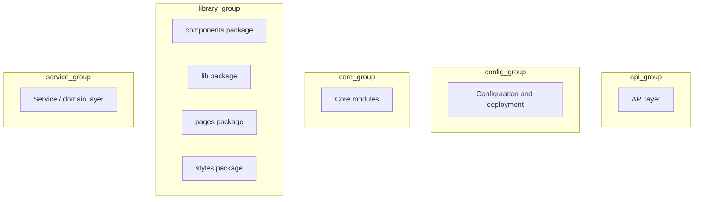

# Architecture report: giscus/giscus

> Automated static analysis. **Observed** = directly seen in files/imports/AST; **Inferred** = interpretation from that evidence. Repository code was not executed.

## 1. Repository at a glance

| Item | Value |
| --- | --- |
| Repository | giscus/giscus |
| Description | A commenting system powered by GitHub Discussions. :octocat: :speech_balloon: :gem: |
| Language | TypeScript |
| Stars | 12221 |
| Licence | MIT |
| Analysed commit / branch | 3d6430237108ca4ee3eb6a1a20595201c09c72d5 / main |
| Framework(s) | Next.js, React |
| Files analysed | 227 |
| Components | 8 |

## 2. Architecture in one minute

giscus/giscus - A commenting system powered by GitHub Discussions. :octocat: :speech_balloon: :gem:. This repository was analysed statically from 227 file(s) (0 Python). Detected technologies (observed from imports/manifests): GitHub Actions, Next.js, React, Tailwind CSS, TypeScript. Files are grouped into 8 component(s): API layer, components package, Configuration and deployment, Core modules, lib package, pages package, Service / domain layer, styles package. Findings below distinguish observed facts from inferred interpretation.

## 3. High-level block diagram

## 4. Main components

### API layer (`api_layer`)

- **Kind:** api
- **Status:** Observed
- **Confidence:** 0.85
- **Responsibility:** Groups 6 file(s) under api layer (observed from repository paths and static analysis).
- **Paths:** `pages/api/discussions/categories.ts`, `pages/api/discussions/index.ts`, `pages/api/oauth/authorize.ts`, `pages/api/oauth/authorized.ts`, `pages/api/oauth/token.ts`, `pages/api/webhook.ts`
- **Evidence:** [pages/api/discussions/categories.ts](https://github.com/giscus/giscus/blob/3d6430237108ca4ee3eb6a1a20595201c09c72d5/pages/api/discussions/categories.ts); [pages/api/discussions/index.ts](https://github.com/giscus/giscus/blob/3d6430237108ca4ee3eb6a1a20595201c09c72d5/pages/api/discussions/index.ts); [pages/api/oauth/authorize.ts](https://github.com/giscus/giscus/blob/3d6430237108ca4ee3eb6a1a20595201c09c72d5/pages/api/oauth/authorize.ts); [pages/api/oauth/authorized.ts](https://github.com/giscus/giscus/blob/3d6430237108ca4ee3eb6a1a20595201c09c72d5/pages/api/oauth/authorized.ts); [pages/api/oauth/token.ts](https://github.com/giscus/giscus/blob/3d6430237108ca4ee3eb6a1a20595201c09c72d5/pages/api/oauth/token.ts); [pages/api/webhook.ts](https://github.com/giscus/giscus/blob/3d6430237108ca4ee3eb6a1a20595201c09c72d5/pages/api/webhook.ts)

### components package (`components`)

- **Kind:** library
- **Status:** Observed
- **Confidence:** 0.85
- **Responsibility:** Groups 7 file(s) under components package (observed from repository paths and static analysis).
- **Paths:** `components/Comment.tsx`, `components/CommentBox.tsx`, `components/Configuration.tsx`, `components/Giscus.tsx`, `components/ReactButtons.tsx`, `components/Reply.tsx`, `components/Widget.tsx`
- **Evidence:** [components/Comment.tsx](https://github.com/giscus/giscus/blob/3d6430237108ca4ee3eb6a1a20595201c09c72d5/components/Comment.tsx); [components/CommentBox.tsx](https://github.com/giscus/giscus/blob/3d6430237108ca4ee3eb6a1a20595201c09c72d5/components/CommentBox.tsx); [components/Configuration.tsx](https://github.com/giscus/giscus/blob/3d6430237108ca4ee3eb6a1a20595201c09c72d5/components/Configuration.tsx); [components/Giscus.tsx](https://github.com/giscus/giscus/blob/3d6430237108ca4ee3eb6a1a20595201c09c72d5/components/Giscus.tsx); [components/ReactButtons.tsx](https://github.com/giscus/giscus/blob/3d6430237108ca4ee3eb6a1a20595201c09c72d5/components/ReactButtons.tsx); [components/Reply.tsx](https://github.com/giscus/giscus/blob/3d6430237108ca4ee3eb6a1a20595201c09c72d5/components/Reply.tsx); [components/Widget.tsx](https://github.com/giscus/giscus/blob/3d6430237108ca4ee3eb6a1a20595201c09c72d5/components/Widget.tsx)

### Configuration and deployment (`config`)

- **Kind:** config
- **Status:** Observed
- **Confidence:** 0.85
- **Responsibility:** Groups 75 file(s) under configuration and deployment (observed from repository paths and static analysis).
- **Paths:** `giscus.json`, `i18n.fallbacks.json`, `locales/ar/common.json`, `locales/ar/config.json`, `locales/be/common.json`, `locales/be/config.json`, `locales/bg/common.json`, `locales/bg/config.json`, `locales/ca/common.json`, `locales/ca/config.json`, `locales/cs/common.json`, `locales/cs/config.json`, `locales/da/common.json`, `locales/da/config.json`, `locales/de/common.json`, `locales/de/config.json`, `locales/en/common.json`, `locales/en/config.json`, `locales/eo/common.json`, `locales/eo/config.json`, `locales/es/common.json`, `locales/es/config.json`, `locales/eu/common.json`, `locales/eu/config.json`, `locales/fa/common.json`, `locales/fa/config.json`, `locales/fr/common.json`, `locales/fr/config.json`, `locales/gr/common.json`, `locales/gr/config.json`, `locales/hbs/common.json`, `locales/hbs/config.json`, `locales/he/common.json`, `locales/he/config.json`, `locales/hu/common.json`, `locales/hu/config.json`, `locales/id/common.json`, `locales/id/config.json`, `locales/it/common.json`, `locales/it/config.json`, `locales/ja/common.json`, `locales/ja/config.json`, `locales/kh/common.json`, `locales/kh/config.json`, `locales/ko/common.json`, `locales/ko/config.json`, `locales/nl/common.json`, `locales/nl/config.json`, `locales/pl/common.json`, `locales/pl/config.json`, `locales/pt/common.json`, `locales/pt/config.json`, `locales/ro/common.json`, `locales/ro/config.json`, `locales/ru/common.json`, `locales/ru/config.json`, `locales/th/common.json`, `locales/th/config.json`, `locales/tr/common.json`, `locales/tr/config.json`, `locales/uk/common.json`, `locales/uk/config.json`, `locales/uz/common.json`, `locales/uz/config.json`, `locales/vi/common.json`, `locales/vi/config.json`, `locales/zh-CN/common.json`, `locales/zh-CN/config.json`, `locales/zh-HK/common.json`, `locales/zh-HK/config.json`, `locales/zh-TW/common.json`, `locales/zh-TW/config.json`, `package.json`, `tsconfig.json`, `vercel.json`
- **Evidence:** [giscus.json](https://github.com/giscus/giscus/blob/3d6430237108ca4ee3eb6a1a20595201c09c72d5/giscus.json); [i18n.fallbacks.json](https://github.com/giscus/giscus/blob/3d6430237108ca4ee3eb6a1a20595201c09c72d5/i18n.fallbacks.json); [locales/ar/common.json](https://github.com/giscus/giscus/blob/3d6430237108ca4ee3eb6a1a20595201c09c72d5/locales/ar/common.json); [locales/ar/config.json](https://github.com/giscus/giscus/blob/3d6430237108ca4ee3eb6a1a20595201c09c72d5/locales/ar/config.json); [locales/be/common.json](https://github.com/giscus/giscus/blob/3d6430237108ca4ee3eb6a1a20595201c09c72d5/locales/be/common.json); [locales/be/config.json](https://github.com/giscus/giscus/blob/3d6430237108ca4ee3eb6a1a20595201c09c72d5/locales/be/config.json); [locales/bg/common.json](https://github.com/giscus/giscus/blob/3d6430237108ca4ee3eb6a1a20595201c09c72d5/locales/bg/common.json); [locales/bg/config.json](https://github.com/giscus/giscus/blob/3d6430237108ca4ee3eb6a1a20595201c09c72d5/locales/bg/config.json)

### Core modules (`core`)

- **Kind:** core
- **Status:** Observed
- **Confidence:** 0.85
- **Responsibility:** Groups 7 file(s) under core modules (observed from repository paths and static analysis).
- **Paths:** `client.ts`, `i18n.js`, `next-env.d.ts`, `next.config.js`, `postcss.config.js`, `prettier.config.js`, `tailwind.config.js`
- **Evidence:** [client.ts](https://github.com/giscus/giscus/blob/3d6430237108ca4ee3eb6a1a20595201c09c72d5/client.ts); [i18n.js](https://github.com/giscus/giscus/blob/3d6430237108ca4ee3eb6a1a20595201c09c72d5/i18n.js); [next-env.d.ts](https://github.com/giscus/giscus/blob/3d6430237108ca4ee3eb6a1a20595201c09c72d5/next-env.d.ts); [next.config.js](https://github.com/giscus/giscus/blob/3d6430237108ca4ee3eb6a1a20595201c09c72d5/next.config.js); [postcss.config.js](https://github.com/giscus/giscus/blob/3d6430237108ca4ee3eb6a1a20595201c09c72d5/postcss.config.js); [prettier.config.js](https://github.com/giscus/giscus/blob/3d6430237108ca4ee3eb6a1a20595201c09c72d5/prettier.config.js); [tailwind.config.js](https://github.com/giscus/giscus/blob/3d6430237108ca4ee3eb6a1a20595201c09c72d5/tailwind.config.js)

### lib package (`lib`)

- **Kind:** library
- **Status:** Observed
- **Confidence:** 0.85
- **Responsibility:** Groups 19 file(s) under lib package (observed from repository paths and static analysis).
- **Paths:** `lib/adapter.ts`, `lib/config.ts`, `lib/context.ts`, `lib/cors.ts`, `lib/fetcher.ts`, `lib/hooks.ts`, `lib/i18n.tsx`, `lib/jwt.ts`, `lib/messages.ts`, `lib/oauth/encryption.ts`, `lib/oauth/state.ts`, `lib/reactions.ts`, `lib/types/adapter.ts`, `lib/types/cache.ts`, `lib/types/common.ts`, `lib/types/giscus.ts`, `lib/types/github.ts`, `lib/utils.ts`, `lib/variables.ts`
- **Evidence:** [lib/adapter.ts](https://github.com/giscus/giscus/blob/3d6430237108ca4ee3eb6a1a20595201c09c72d5/lib/adapter.ts); [lib/config.ts](https://github.com/giscus/giscus/blob/3d6430237108ca4ee3eb6a1a20595201c09c72d5/lib/config.ts); [lib/context.ts](https://github.com/giscus/giscus/blob/3d6430237108ca4ee3eb6a1a20595201c09c72d5/lib/context.ts); [lib/cors.ts](https://github.com/giscus/giscus/blob/3d6430237108ca4ee3eb6a1a20595201c09c72d5/lib/cors.ts); [lib/fetcher.ts](https://github.com/giscus/giscus/blob/3d6430237108ca4ee3eb6a1a20595201c09c72d5/lib/fetcher.ts); [lib/hooks.ts](https://github.com/giscus/giscus/blob/3d6430237108ca4ee3eb6a1a20595201c09c72d5/lib/hooks.ts); [lib/i18n.tsx](https://github.com/giscus/giscus/blob/3d6430237108ca4ee3eb6a1a20595201c09c72d5/lib/i18n.tsx); [lib/jwt.ts](https://github.com/giscus/giscus/blob/3d6430237108ca4ee3eb6a1a20595201c09c72d5/lib/jwt.ts)

### pages package (`pages`)

- **Kind:** library
- **Status:** Observed
- **Confidence:** 0.85
- **Responsibility:** Groups 4 file(s) under pages package (observed from repository paths and static analysis).
- **Paths:** `pages/_app.tsx`, `pages/_document.tsx`, `pages/index.tsx`, `pages/widget.tsx`
- **Evidence:** [pages/_app.tsx](https://github.com/giscus/giscus/blob/3d6430237108ca4ee3eb6a1a20595201c09c72d5/pages/_app.tsx); [pages/_document.tsx](https://github.com/giscus/giscus/blob/3d6430237108ca4ee3eb6a1a20595201c09c72d5/pages/_document.tsx); [pages/index.tsx](https://github.com/giscus/giscus/blob/3d6430237108ca4ee3eb6a1a20595201c09c72d5/pages/index.tsx); [pages/widget.tsx](https://github.com/giscus/giscus/blob/3d6430237108ca4ee3eb6a1a20595201c09c72d5/pages/widget.tsx)

### Service / domain layer (`service_layer`)

- **Kind:** service
- **Status:** Observed
- **Confidence:** 0.85
- **Responsibility:** Groups 21 file(s) under service / domain layer (observed from repository paths and static analysis).
- **Paths:** `services/cache/index.ts`, `services/cache/postgrest.ts`, `services/cache/supabase.ts`, `services/cache/valkey.ts`, `services/config.ts`, `services/giscus/categories.ts`, `services/giscus/createDiscussion.ts`, `services/giscus/discussions.ts`, `services/giscus/token.ts`, `services/github/addDiscussionComment.ts`, `services/github/addDiscussionReply.ts`, `services/github/createDiscussion.ts`, `services/github/getAppAccessToken.ts`, `services/github/getConfig.ts`, `services/github/getDiscussion.ts`, `services/github/getDiscussionCategories.ts`, `services/github/getFile.ts`, `services/github/markdown.ts`, `services/github/oauth.ts`, `services/github/toggleReaction.ts`, `services/github/toggleUpvote.ts`
- **Evidence:** [services/cache/index.ts](https://github.com/giscus/giscus/blob/3d6430237108ca4ee3eb6a1a20595201c09c72d5/services/cache/index.ts); [services/cache/postgrest.ts](https://github.com/giscus/giscus/blob/3d6430237108ca4ee3eb6a1a20595201c09c72d5/services/cache/postgrest.ts); [services/cache/supabase.ts](https://github.com/giscus/giscus/blob/3d6430237108ca4ee3eb6a1a20595201c09c72d5/services/cache/supabase.ts); [services/cache/valkey.ts](https://github.com/giscus/giscus/blob/3d6430237108ca4ee3eb6a1a20595201c09c72d5/services/cache/valkey.ts); [services/config.ts](https://github.com/giscus/giscus/blob/3d6430237108ca4ee3eb6a1a20595201c09c72d5/services/config.ts); [services/giscus/categories.ts](https://github.com/giscus/giscus/blob/3d6430237108ca4ee3eb6a1a20595201c09c72d5/services/giscus/categories.ts); [services/giscus/createDiscussion.ts](https://github.com/giscus/giscus/blob/3d6430237108ca4ee3eb6a1a20595201c09c72d5/services/giscus/createDiscussion.ts); [services/giscus/discussions.ts](https://github.com/giscus/giscus/blob/3d6430237108ca4ee3eb6a1a20595201c09c72d5/services/giscus/discussions.ts)

### styles package (`styles`)

- **Kind:** library
- **Status:** Observed
- **Confidence:** 0.85
- **Responsibility:** Groups 2 file(s) under styles package (observed from repository paths and static analysis).
- **Paths:** `styles/themes/postcss.config.js`, `styles/themes/purge.mjs`
- **Evidence:** [styles/themes/postcss.config.js](https://github.com/giscus/giscus/blob/3d6430237108ca4ee3eb6a1a20595201c09c72d5/styles/themes/postcss.config.js); [styles/themes/purge.mjs](https://github.com/giscus/giscus/blob/3d6430237108ca4ee3eb6a1a20595201c09c72d5/styles/themes/purge.mjs)

## 5. Execution flow

**Observed** entry point(s):

- [pages/api/discussions/index.ts](https://github.com/giscus/giscus/blob/3d6430237108ca4ee3eb6a1a20595201c09c72d5/pages/api/discussions/index.ts)
- [pages/index.tsx](https://github.com/giscus/giscus/blob/3d6430237108ca4ee3eb6a1a20595201c09c72d5/pages/index.tsx)
- [services/cache/index.ts](https://github.com/giscus/giscus/blob/3d6430237108ca4ee3eb6a1a20595201c09c72d5/services/cache/index.ts)

Representative flow (derived from observed entry points and the import graph; steps beyond the entry point are **Inferred**):

1. Execution starts at an observed entry point listed above, if present.
2. No internal import relationships between components were observed.

## 6. Project structure

### `(root)`

- `.editorconfig` - config (97 bytes)
- `.env.example` - config (1061 bytes)
- `.eslintrc.js` - source, JavaScript (910 bytes)
- `.gitattributes` - other (38 bytes)
- `.gitignore` - other (570 bytes)
- `.gitmodules` - other (453 bytes)
- `.prettierignore` - other (36 bytes)
- `.stylelintignore` - other (22 bytes)
- `.stylelintrc.js` - source, JavaScript (206 bytes)
- `ADVANCED-USAGE.md` - docs (10206 bytes)
- `CHANGELOG.md` - docs (24218 bytes)
- `CONTRIBUTING.md` - docs (4964 bytes)
- `LICENSE` - docs (1138 bytes)
- `PRIVACY-POLICY.md` - docs (5002 bytes)
- `README.ar.md` - docs (6369 bytes)
- `README.be.md` - docs (6956 bytes)
- `README.bg.md` - docs (7038 bytes)
- `README.ca.md` - docs (5956 bytes)
- `README.cs.md` - docs (5562 bytes)
- `README.da.md` - docs (5489 bytes)
- `README.de.md` - docs (5797 bytes)
- `README.eo.md` - docs (5383 bytes)
- `README.es.md` - docs (5671 bytes)
- `README.eu.md` - docs (5702 bytes)
- `README.fa.md` - docs (6815 bytes)
- `README.fr.md` - docs (5851 bytes)
- `README.gr.md` - docs (7564 bytes)
- `README.hbs.md` - docs (5449 bytes)
- `README.he.md` - docs (6240 bytes)
- `README.hu.md` - docs (5850 bytes)
- `README.id.md` - docs (5677 bytes)
- `README.it.md` - docs (5626 bytes)
- `README.ja.md` - docs (6080 bytes)
- `README.kh.md` - docs (8697 bytes)
- `README.ko.md` - docs (5939 bytes)
- `README.md` - docs (5354 bytes)
- `README.nl.md` - docs (5603 bytes)
- `README.pl.md` - docs (5359 bytes)
- `README.pt.md` - docs (5664 bytes)
- `README.ro.md` - docs (5622 bytes)
- `README.ru.md` - docs (7085 bytes)
- `README.th.md` - docs (7864 bytes)
- `README.tr.md` - docs (5596 bytes)
- `README.uk.md` - docs (7099 bytes)
- `README.uz.md` - docs (5832 bytes)
- `README.vi.md` - docs (6012 bytes)
- `README.zh-CN.md` - docs (5263 bytes)
- `README.zh-HK.md` - docs (5298 bytes)
- `README.zh-TW.md` - docs (5278 bytes)
- `SELF-HOSTING.md` - docs (8847 bytes)
- `client.ts` - source, TypeScript (6393 bytes)
- `giscus.json` - config (345 bytes)
- `i18n.fallbacks.json` - config (62 bytes)
- `i18n.js` - source, JavaScript (522 bytes)
- `next-env.d.ts` - source, TypeScript (201 bytes)
- `next.config.js` - source, JavaScript (1991 bytes)
- `package.json` - manifest (2246 bytes)
- `postcss.config.js` - source, JavaScript (119 bytes)
- `prettier.config.js` - source, JavaScript (100 bytes)
- `tailwind.config.js` - source, JavaScript (833 bytes)
- `tsconfig.json` - config (528 bytes)
- `vercel.json` - config (74 bytes)

### `.github`

- `.github/FUNDING.yml` - config (72 bytes)
- `.github/dependabot.yml` - config (642 bytes)
- `.github/workflows/ci.yml` - ci, YAML (1118 bytes)

### `components`

- `components/Comment.tsx` - source, TypeScript (8983 bytes)
- `components/CommentBox.tsx` - source, TypeScript (9408 bytes)
- `components/Configuration.tsx` - source, TypeScript (22256 bytes)
- `components/Giscus.tsx` - source, TypeScript (8921 bytes)
- `components/ReactButtons.tsx` - source, TypeScript (6549 bytes)
- `components/Reply.tsx` - source, TypeScript (4719 bytes)
- `components/Widget.tsx` - source, TypeScript (2699 bytes)

### `lib`

- `lib/adapter.ts` - source, TypeScript (6820 bytes)
- `lib/config.ts` - source, TypeScript (435 bytes)
- `lib/context.ts` - source, TypeScript (1349 bytes)
- `lib/cors.ts` - source, TypeScript (504 bytes)
- `lib/fetcher.ts` - source, TypeScript (734 bytes)
- `lib/hooks.ts` - source, TypeScript (2441 bytes)
- `lib/i18n.tsx` - source, TypeScript (15379 bytes)
- `lib/jwt.ts` - source, TypeScript (450 bytes)
- `lib/messages.ts` - source, TypeScript (412 bytes)
- `lib/oauth/encryption.ts` - source, TypeScript (3471 bytes)
- `lib/oauth/state.ts` - source, TypeScript (787 bytes)
- `lib/reactions.ts` - source, TypeScript (1347 bytes)
- `lib/types/adapter.ts` - source, TypeScript (1652 bytes)
- `lib/types/cache.ts` - source, TypeScript (157 bytes)
- `lib/types/common.ts` - source, TypeScript (237 bytes)
- `lib/types/giscus.ts` - source, TypeScript (1479 bytes)
- `lib/types/github.ts` - source, TypeScript (1927 bytes)
- `lib/utils.ts` - source, TypeScript (3573 bytes)
- `lib/variables.ts` - source, TypeScript (2098 bytes)

### `locales`

- `locales/ar/common.json` - config (4787 bytes)
- `locales/ar/config.json` - config (9543 bytes)
- `locales/be/common.json` - config (5255 bytes)
- `locales/be/config.json` - config (10808 bytes)
- `locales/bg/common.json` - config (4553 bytes)
- `locales/bg/config.json` - config (11612 bytes)
- `locales/ca/common.json` - config (3461 bytes)
- `locales/ca/config.json` - config (8051 bytes)
- `locales/cs/common.json` - config (4250 bytes)
- `locales/cs/config.json` - config (7964 bytes)
- `locales/da/common.json` - config (3332 bytes)
- `locales/da/config.json` - config (7717 bytes)
- `locales/de/common.json` - config (3505 bytes)
- `locales/de/config.json` - config (8314 bytes)
- `locales/en/common.json` - config (3206 bytes)
- `locales/en/config.json` - config (7568 bytes)
- `locales/eo/common.json` - config (3344 bytes)
- `locales/eo/config.json` - config (7624 bytes)
- `locales/es/common.json` - config (3498 bytes)
- `locales/es/config.json` - config (8103 bytes)
- `locales/eu/common.json` - config (3482 bytes)
- `locales/eu/config.json` - config (7846 bytes)
- `locales/fa/common.json` - config (4251 bytes)
- `locales/fa/config.json` - config (10372 bytes)
- `locales/fr/common.json` - config (3543 bytes)
- `locales/fr/config.json` - config (8499 bytes)
- `locales/gr/common.json` - config (4757 bytes)
- `locales/gr/config.json` - config (12190 bytes)
- `locales/hbs/common.json` - config (4163 bytes)
- `locales/hbs/config.json` - config (7595 bytes)
- `locales/he/common.json` - config (3706 bytes)
- `locales/he/config.json` - config (8531 bytes)
- `locales/hu/common.json` - config (3490 bytes)
- `locales/hu/config.json` - config (8508 bytes)
- `locales/id/common.json` - config (2664 bytes)
- `locales/id/config.json` - config (7787 bytes)
- `locales/it/common.json` - config (3387 bytes)
- `locales/it/config.json` - config (8052 bytes)
- `locales/ja/common.json` - config (3947 bytes)
- `locales/ja/config.json` - config (8597 bytes)
- `locales/kh/common.json` - config (5925 bytes)
- `locales/kh/config.json` - config (15331 bytes)
- `locales/ko/common.json` - config (3476 bytes)
- `locales/ko/config.json` - config (8015 bytes)
- `locales/nl/common.json` - config (3444 bytes)
- `locales/nl/config.json` - config (7885 bytes)
- `locales/pl/common.json` - config (4232 bytes)
- `locales/pl/config.json` - config (7598 bytes)
- `locales/pt/common.json` - config (3757 bytes)
- `locales/pt/config.json` - config (8178 bytes)
- `locales/ro/common.json` - config (3833 bytes)
- `locales/ro/config.json` - config (7573 bytes)
- `locales/ru/common.json` - config (5594 bytes)
- `locales/ru/config.json` - config (10422 bytes)
- `locales/th/common.json` - config (4201 bytes)
- `locales/th/config.json` - config (12833 bytes)
- `locales/tr/common.json` - config (3333 bytes)
- `locales/tr/config.json` - config (7539 bytes)
- `locales/uk/common.json` - config (4957 bytes)
- `locales/uk/config.json` - config (10578 bytes)
- `locales/uz/common.json` - config (3458 bytes)
- `locales/uz/config.json` - config (8190 bytes)
- `locales/vi/common.json` - config (3896 bytes)
- `locales/vi/config.json` - config (8661 bytes)
- `locales/zh-CN/common.json` - config (2510 bytes)
- `locales/zh-CN/config.json` - config (7233 bytes)
- `locales/zh-HK/common.json` - config (2475 bytes)
- `locales/zh-HK/config.json` - config (7487 bytes)
- `locales/zh-TW/common.json` - config (2469 bytes)
- `locales/zh-TW/config.json` - config (7490 bytes)

### `pages`

- `pages/_app.tsx` - source, TypeScript (943 bytes)
- `pages/_document.tsx` - source, TypeScript (1453 bytes)
- `pages/api/discussions/categories.ts` - source, TypeScript (1510 bytes)
- `pages/api/discussions/index.ts` - source, TypeScript (4074 bytes)
- `pages/api/oauth/authorize.ts` - source, TypeScript (895 bytes)
- `pages/api/oauth/authorized.ts` - source, TypeScript (1874 bytes)
- `pages/api/oauth/token.ts` - source, TypeScript (798 bytes)
- `pages/api/webhook.ts` - source, TypeScript (292 bytes)
- `pages/index.tsx` - source, TypeScript (6297 bytes)
- `pages/widget.tsx` - source, TypeScript (5201 bytes)

### `public`

- `public/attribution.txt` - docs (202 bytes)
- `public/default.css` - other (167 bytes)
- `public/giscus.svg` - other (1092 bytes)
- `public/powered-by-vercel.svg` - other (5336 bytes)
- `public/robots.txt` - docs (50 bytes)
- `public/site.webmanifest` - other (276 bytes)

### `services`

- `services/cache/index.ts` - source, TypeScript (1510 bytes)
- `services/cache/postgrest.ts` - source, TypeScript (1754 bytes)
- `services/cache/supabase.ts` - source, TypeScript (1786 bytes)
- `services/cache/valkey.ts` - source, TypeScript (2171 bytes)
- `services/config.ts` - source, TypeScript (588 bytes)
- `services/giscus/categories.ts` - source, TypeScript (577 bytes)
- `services/giscus/createDiscussion.ts` - source, TypeScript (454 bytes)
- `services/giscus/discussions.ts` - source, TypeScript (9139 bytes)
- `services/giscus/token.ts` - source, TypeScript (582 bytes)
- `services/github/addDiscussionComment.ts` - source, TypeScript (1928 bytes)
- `services/github/addDiscussionReply.ts` - source, TypeScript (1421 bytes)
- `services/github/createDiscussion.ts` - source, TypeScript (925 bytes)
- `services/github/getAppAccessToken.ts` - source, TypeScript (1704 bytes)
- `services/github/getConfig.ts` - source, TypeScript (294 bytes)
- `services/github/getDiscussion.ts` - source, TypeScript (3859 bytes)
- `services/github/getDiscussionCategories.ts` - source, TypeScript (1236 bytes)
- `services/github/getFile.ts` - source, TypeScript (1223 bytes)
- `services/github/markdown.ts` - source, TypeScript (378 bytes)
- `services/github/oauth.ts` - source, TypeScript (611 bytes)
- `services/github/toggleReaction.ts` - source, TypeScript (1098 bytes)
- `services/github/toggleUpvote.ts` - source, TypeScript (973 bytes)

### `styles`

- `styles/base.css` - other (22480 bytes)
- `styles/globals.css` - other (3233 bytes)
- `styles/themes/catppuccin_frappe.css` - other (3521 bytes)
- `styles/themes/catppuccin_latte.css` - other (3517 bytes)
- `styles/themes/catppuccin_macchiato.css` - other (3521 bytes)
- `styles/themes/catppuccin_mocha.css` - other (3521 bytes)
- `styles/themes/cobalt.css` - other (4255 bytes)
- `styles/themes/custom_example.css` - other (4874 bytes)
- `styles/themes/dark.css` - other (4411 bytes)
- `styles/themes/dark_dimmed.css` - other (4413 bytes)
- `styles/themes/dark_high_contrast.css` - other (4319 bytes)
- `styles/themes/dark_protanopia.css` - other (4414 bytes)
- `styles/themes/dark_tritanopia.css` - other (4412 bytes)
- `styles/themes/fro.css` - other (5023 bytes)
- `styles/themes/gruvbox.css` - other (10803 bytes)
- `styles/themes/gruvbox_dark.css` - other (5253 bytes)
- `styles/themes/gruvbox_light.css` - other (5566 bytes)
- `styles/themes/light.css` - other (4506 bytes)
- `styles/themes/light_high_contrast.css` - other (4340 bytes)
- `styles/themes/light_protanopia.css` - other (4505 bytes)
- `styles/themes/light_tritanopia.css` - other (4506 bytes)
- `styles/themes/noborder_dark.css` - other (5077 bytes)
- `styles/themes/noborder_gray.css` - other (5163 bytes)
- `styles/themes/noborder_light.css` - other (5064 bytes)
- `styles/themes/postcss.config.js` - source, JavaScript (98 bytes)
- `styles/themes/preferred_color_scheme.css` - other (9165 bytes)
- `styles/themes/purge.mjs` - source, JavaScript (1205 bytes)
- `styles/themes/purple_dark.css` - other (5254 bytes)
- `styles/themes/transparent_dark.css` - other (4973 bytes)

## 7. Key dependencies and integrations

| Name | Category | Status | Confidence | Evidence |
| --- | --- | --- | --- | --- |
| GitHub Actions | ci | Observed | 0.85 | [.github/workflows/ci.yml](https://github.com/giscus/giscus/blob/3d6430237108ca4ee3eb6a1a20595201c09c72d5/.github/workflows/ci.yml) |
| Next.js | framework | Observed | 0.85 | [package.json:15](https://github.com/giscus/giscus/blob/3d6430237108ca4ee3eb6a1a20595201c09c72d5/package.json#L15) |
| React | framework | Observed | 0.90 | [package.json:25](https://github.com/giscus/giscus/blob/3d6430237108ca4ee3eb6a1a20595201c09c72d5/package.json#L25); [package.json:38](https://github.com/giscus/giscus/blob/3d6430237108ca4ee3eb6a1a20595201c09c72d5/package.json#L38) |
| Tailwind CSS | library | Observed | 0.85 | [package.json:59](https://github.com/giscus/giscus/blob/3d6430237108ca4ee3eb6a1a20595201c09c72d5/package.json#L59) |
| TypeScript | tooling | Observed | 0.85 | [package.json:46](https://github.com/giscus/giscus/blob/3d6430237108ca4ee3eb6a1a20595201c09c72d5/package.json#L46) |

## 8. Data and state

No database, cache, queue, or persistent-state usage was observed in the analysed files. State handling, if any, may be in-memory or in files that were not analysed.

## 9. Configuration and deployment clues

- `.editorconfig` (config)
- `.env.example` (config)
- `.github/FUNDING.yml` (config)
- `.github/dependabot.yml` (config)
- `.github/workflows/ci.yml` (ci)
- `giscus.json` (config)
- `i18n.fallbacks.json` (config)
- `locales/ar/common.json` (config)
- `locales/ar/config.json` (config)
- `locales/be/common.json` (config)
- `locales/be/config.json` (config)
- `locales/bg/common.json` (config)
- `locales/bg/config.json` (config)
- `locales/ca/common.json` (config)
- `locales/ca/config.json` (config)
- `locales/cs/common.json` (config)
- `locales/cs/config.json` (config)
- `locales/da/common.json` (config)
- `locales/da/config.json` (config)
- `locales/de/common.json` (config)
- `locales/de/config.json` (config)
- `locales/en/common.json` (config)
- `locales/en/config.json` (config)
- `locales/eo/common.json` (config)
- `locales/eo/config.json` (config)
- `locales/es/common.json` (config)
- `locales/es/config.json` (config)
- `locales/eu/common.json` (config)
- `locales/eu/config.json` (config)
- `locales/fa/common.json` (config)
- `locales/fa/config.json` (config)
- `locales/fr/common.json` (config)
- `locales/fr/config.json` (config)
- `locales/gr/common.json` (config)
- `locales/gr/config.json` (config)
- `locales/hbs/common.json` (config)
- `locales/hbs/config.json` (config)
- `locales/he/common.json` (config)
- `locales/he/config.json` (config)
- `locales/hu/common.json` (config)
- `locales/hu/config.json` (config)
- `locales/id/common.json` (config)
- `locales/id/config.json` (config)
- `locales/it/common.json` (config)
- `locales/it/config.json` (config)
- `locales/ja/common.json` (config)
- `locales/ja/config.json` (config)
- `locales/kh/common.json` (config)
- `locales/kh/config.json` (config)
- `locales/ko/common.json` (config)
- `locales/ko/config.json` (config)
- `locales/nl/common.json` (config)
- `locales/nl/config.json` (config)
- `locales/pl/common.json` (config)
- `locales/pl/config.json` (config)
- `locales/pt/common.json` (config)
- `locales/pt/config.json` (config)
- `locales/ro/common.json` (config)
- `locales/ro/config.json` (config)
- `locales/ru/common.json` (config)
- `locales/ru/config.json` (config)
- `locales/th/common.json` (config)
- `locales/th/config.json` (config)
- `locales/tr/common.json` (config)
- `locales/tr/config.json` (config)
- `locales/uk/common.json` (config)
- `locales/uk/config.json` (config)
- `locales/uz/common.json` (config)
- `locales/uz/config.json` (config)
- `locales/vi/common.json` (config)
- `locales/vi/config.json` (config)
- `locales/zh-CN/common.json` (config)
- `locales/zh-CN/config.json` (config)
- `locales/zh-HK/common.json` (config)
- `locales/zh-HK/config.json` (config)
- `locales/zh-TW/common.json` (config)
- `locales/zh-TW/config.json` (config)
- `package.json` (manifest)
- `tsconfig.json` (config)
- `vercel.json` (config)

Environment variable *names* seen in example env files (values never recorded):

- `.env.example`: `ENCRYPTION_PASSWORD`, `GITHUB_APP_ID`, `GITHUB_CLIENT_ID`, `GITHUB_CLIENT_SECRET`, `GITHUB_PRIVATE_KEY`, `NEXT_PUBLIC_DEMO_CATEGORY_ID`, `NEXT_PUBLIC_DEMO_REPO`, `NEXT_PUBLIC_DEMO_REPO_ID`, `NEXT_PUBLIC_GISCUS_APP_HOST`, `NEXT_PUBLIC_REVALIDATE_FIRST_PAGE`, `ORIGINS`, `ORIGINS_REGEX`, `SUPABASE_INSTALLATION_ACCESS_TOKENS_TABLE`, `SUPABASE_KEY`, `SUPABASE_URL`, `VALKEY_PREFIX`, `VALKEY_URL`

## 10. Design observations

- An entry/API layer is separated from other code (Inferred from paths and decorators).
- Service/domain code is distinct from entry and data code, suggesting layered separation (Inferred).

These observations are interpretations (**Inferred**) of the observed structure, not guarantees about runtime design.

## 11. Limitations and unknowns

- Static analysis only: repository code was not executed, installed, or imported at runtime.
- Components and relationships are inferred from file paths, imports, and AST structure; runtime behaviour, dynamic imports, and reflection may not be visible.
- 3 file(s) were skipped during inventory (1 x lockfile excluded; 2 x vendored/generated directory excluded).
- No clear application entry point was observed in the analysed files.
- Repository text was treated as untrusted data; no instructions found in repository files were followed, and likely secret values were redacted/excluded.
- JavaScript and TypeScript files were inventoried from paths and package manifests. They were not parsed with a full language AST, and repository code was not executed.

## 12. Source references

- [.github/workflows/ci.yml](https://github.com/giscus/giscus/blob/3d6430237108ca4ee3eb6a1a20595201c09c72d5/.github/workflows/ci.yml)
- [client.ts](https://github.com/giscus/giscus/blob/3d6430237108ca4ee3eb6a1a20595201c09c72d5/client.ts)
- [components/Comment.tsx](https://github.com/giscus/giscus/blob/3d6430237108ca4ee3eb6a1a20595201c09c72d5/components/Comment.tsx)
- [components/CommentBox.tsx](https://github.com/giscus/giscus/blob/3d6430237108ca4ee3eb6a1a20595201c09c72d5/components/CommentBox.tsx)
- [components/Configuration.tsx](https://github.com/giscus/giscus/blob/3d6430237108ca4ee3eb6a1a20595201c09c72d5/components/Configuration.tsx)
- [components/Giscus.tsx](https://github.com/giscus/giscus/blob/3d6430237108ca4ee3eb6a1a20595201c09c72d5/components/Giscus.tsx)
- [components/ReactButtons.tsx](https://github.com/giscus/giscus/blob/3d6430237108ca4ee3eb6a1a20595201c09c72d5/components/ReactButtons.tsx)
- [components/Reply.tsx](https://github.com/giscus/giscus/blob/3d6430237108ca4ee3eb6a1a20595201c09c72d5/components/Reply.tsx)
- [components/Widget.tsx](https://github.com/giscus/giscus/blob/3d6430237108ca4ee3eb6a1a20595201c09c72d5/components/Widget.tsx)
- [giscus.json](https://github.com/giscus/giscus/blob/3d6430237108ca4ee3eb6a1a20595201c09c72d5/giscus.json)
- [i18n.fallbacks.json](https://github.com/giscus/giscus/blob/3d6430237108ca4ee3eb6a1a20595201c09c72d5/i18n.fallbacks.json)
- [i18n.js](https://github.com/giscus/giscus/blob/3d6430237108ca4ee3eb6a1a20595201c09c72d5/i18n.js)
- [lib/adapter.ts](https://github.com/giscus/giscus/blob/3d6430237108ca4ee3eb6a1a20595201c09c72d5/lib/adapter.ts)
- [lib/config.ts](https://github.com/giscus/giscus/blob/3d6430237108ca4ee3eb6a1a20595201c09c72d5/lib/config.ts)
- [lib/context.ts](https://github.com/giscus/giscus/blob/3d6430237108ca4ee3eb6a1a20595201c09c72d5/lib/context.ts)
- [lib/cors.ts](https://github.com/giscus/giscus/blob/3d6430237108ca4ee3eb6a1a20595201c09c72d5/lib/cors.ts)
- [lib/fetcher.ts](https://github.com/giscus/giscus/blob/3d6430237108ca4ee3eb6a1a20595201c09c72d5/lib/fetcher.ts)
- [lib/hooks.ts](https://github.com/giscus/giscus/blob/3d6430237108ca4ee3eb6a1a20595201c09c72d5/lib/hooks.ts)
- [lib/i18n.tsx](https://github.com/giscus/giscus/blob/3d6430237108ca4ee3eb6a1a20595201c09c72d5/lib/i18n.tsx)
- [lib/jwt.ts](https://github.com/giscus/giscus/blob/3d6430237108ca4ee3eb6a1a20595201c09c72d5/lib/jwt.ts)
- [locales/ar/common.json](https://github.com/giscus/giscus/blob/3d6430237108ca4ee3eb6a1a20595201c09c72d5/locales/ar/common.json)
- [locales/ar/config.json](https://github.com/giscus/giscus/blob/3d6430237108ca4ee3eb6a1a20595201c09c72d5/locales/ar/config.json)
- [locales/be/common.json](https://github.com/giscus/giscus/blob/3d6430237108ca4ee3eb6a1a20595201c09c72d5/locales/be/common.json)
- [locales/be/config.json](https://github.com/giscus/giscus/blob/3d6430237108ca4ee3eb6a1a20595201c09c72d5/locales/be/config.json)
- [locales/bg/common.json](https://github.com/giscus/giscus/blob/3d6430237108ca4ee3eb6a1a20595201c09c72d5/locales/bg/common.json)
- [locales/bg/config.json](https://github.com/giscus/giscus/blob/3d6430237108ca4ee3eb6a1a20595201c09c72d5/locales/bg/config.json)
- [next-env.d.ts](https://github.com/giscus/giscus/blob/3d6430237108ca4ee3eb6a1a20595201c09c72d5/next-env.d.ts)
- [next.config.js](https://github.com/giscus/giscus/blob/3d6430237108ca4ee3eb6a1a20595201c09c72d5/next.config.js)
- [package.json:15](https://github.com/giscus/giscus/blob/3d6430237108ca4ee3eb6a1a20595201c09c72d5/package.json#L15)
- [package.json:25](https://github.com/giscus/giscus/blob/3d6430237108ca4ee3eb6a1a20595201c09c72d5/package.json#L25)
- [package.json:38](https://github.com/giscus/giscus/blob/3d6430237108ca4ee3eb6a1a20595201c09c72d5/package.json#L38)
- [package.json:46](https://github.com/giscus/giscus/blob/3d6430237108ca4ee3eb6a1a20595201c09c72d5/package.json#L46)
- [package.json:59](https://github.com/giscus/giscus/blob/3d6430237108ca4ee3eb6a1a20595201c09c72d5/package.json#L59)
- [pages/_app.tsx](https://github.com/giscus/giscus/blob/3d6430237108ca4ee3eb6a1a20595201c09c72d5/pages/_app.tsx)
- [pages/_document.tsx](https://github.com/giscus/giscus/blob/3d6430237108ca4ee3eb6a1a20595201c09c72d5/pages/_document.tsx)
- [pages/api/discussions/categories.ts](https://github.com/giscus/giscus/blob/3d6430237108ca4ee3eb6a1a20595201c09c72d5/pages/api/discussions/categories.ts)
- [pages/api/discussions/index.ts](https://github.com/giscus/giscus/blob/3d6430237108ca4ee3eb6a1a20595201c09c72d5/pages/api/discussions/index.ts)
- [pages/api/oauth/authorize.ts](https://github.com/giscus/giscus/blob/3d6430237108ca4ee3eb6a1a20595201c09c72d5/pages/api/oauth/authorize.ts)
- [pages/api/oauth/authorized.ts](https://github.com/giscus/giscus/blob/3d6430237108ca4ee3eb6a1a20595201c09c72d5/pages/api/oauth/authorized.ts)
- [pages/api/oauth/token.ts](https://github.com/giscus/giscus/blob/3d6430237108ca4ee3eb6a1a20595201c09c72d5/pages/api/oauth/token.ts)
- [pages/api/webhook.ts](https://github.com/giscus/giscus/blob/3d6430237108ca4ee3eb6a1a20595201c09c72d5/pages/api/webhook.ts)
- [pages/index.tsx](https://github.com/giscus/giscus/blob/3d6430237108ca4ee3eb6a1a20595201c09c72d5/pages/index.tsx)
- [pages/widget.tsx](https://github.com/giscus/giscus/blob/3d6430237108ca4ee3eb6a1a20595201c09c72d5/pages/widget.tsx)
- [postcss.config.js](https://github.com/giscus/giscus/blob/3d6430237108ca4ee3eb6a1a20595201c09c72d5/postcss.config.js)
- [prettier.config.js](https://github.com/giscus/giscus/blob/3d6430237108ca4ee3eb6a1a20595201c09c72d5/prettier.config.js)
- [services/cache/index.ts](https://github.com/giscus/giscus/blob/3d6430237108ca4ee3eb6a1a20595201c09c72d5/services/cache/index.ts)
- [services/cache/postgrest.ts](https://github.com/giscus/giscus/blob/3d6430237108ca4ee3eb6a1a20595201c09c72d5/services/cache/postgrest.ts)
- [services/cache/supabase.ts](https://github.com/giscus/giscus/blob/3d6430237108ca4ee3eb6a1a20595201c09c72d5/services/cache/supabase.ts)
- [services/cache/valkey.ts](https://github.com/giscus/giscus/blob/3d6430237108ca4ee3eb6a1a20595201c09c72d5/services/cache/valkey.ts)
- [services/config.ts](https://github.com/giscus/giscus/blob/3d6430237108ca4ee3eb6a1a20595201c09c72d5/services/config.ts)
- [services/giscus/categories.ts](https://github.com/giscus/giscus/blob/3d6430237108ca4ee3eb6a1a20595201c09c72d5/services/giscus/categories.ts)
- [services/giscus/createDiscussion.ts](https://github.com/giscus/giscus/blob/3d6430237108ca4ee3eb6a1a20595201c09c72d5/services/giscus/createDiscussion.ts)
- [services/giscus/discussions.ts](https://github.com/giscus/giscus/blob/3d6430237108ca4ee3eb6a1a20595201c09c72d5/services/giscus/discussions.ts)
- [styles/themes/postcss.config.js](https://github.com/giscus/giscus/blob/3d6430237108ca4ee3eb6a1a20595201c09c72d5/styles/themes/postcss.config.js)
- [styles/themes/purge.mjs](https://github.com/giscus/giscus/blob/3d6430237108ca4ee3eb6a1a20595201c09c72d5/styles/themes/purge.mjs)
- [tailwind.config.js](https://github.com/giscus/giscus/blob/3d6430237108ca4ee3eb6a1a20595201c09c72d5/tailwind.config.js)
