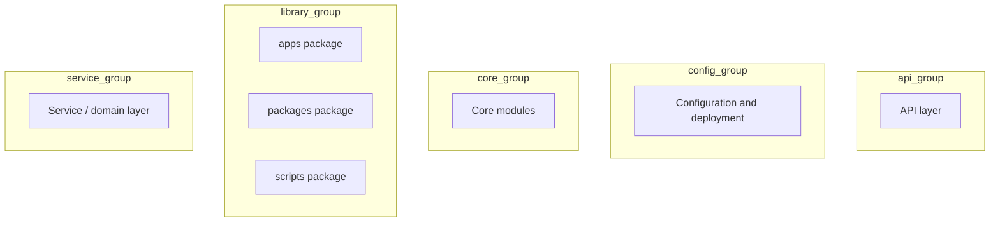

# Architecture report: gitalk/gitalk

> Automated static analysis. **Observed** = directly seen in files/imports/AST; **Inferred** = interpretation from that evidence. Repository code was not executed.

## 1. Repository at a glance

| Item | Value |
| --- | --- |
| Repository | gitalk/gitalk |
| Description | Gitalk — a comment component based on GitHub Discussions (current, 2.x). The GitHub Issues based 1.x line is end-of-life. |
| Language | TypeScript |
| Stars | 7154 |
| Licence | MIT |
| Analysed commit / branch | b1b478e877fac68d6632b843b00c33d3f32c2dad / main |
| Framework(s) | React, Vue |
| Files analysed | 189 |
| Components | 7 |

## 2. Architecture in one minute

gitalk/gitalk - Gitalk — a comment component based on GitHub Discussions (current, 2.x). The GitHub Issues based 1.x line is end-of-life.. This repository was analysed statically from 189 file(s) (0 Python). Detected technologies (observed from imports/manifests): GitHub Actions, React, Vue, Tailwind CSS, Docker, TypeScript. Files are grouped into 7 component(s): API layer, apps package, Configuration and deployment, Core modules, packages package, scripts package, Service / domain layer. Findings below distinguish observed facts from inferred interpretation.

## 3. High-level block diagram

## 4. Main components

### API layer (`api_layer`)

- **Kind:** api
- **Status:** Observed
- **Confidence:** 0.85
- **Responsibility:** Groups 7 file(s) under api layer (observed from repository paths and static analysis).
- **Paths:** `packages/core/src/api/api.test.ts`, `packages/core/src/api/backend.ts`, `packages/core/src/api/client.ts`, `packages/core/src/api/discussions.ts`, `packages/core/src/api/issues.ts`, `packages/core/src/api/proxy-read.test.ts`, `packages/core/src/api/read-queries.ts`
- **Evidence:** [packages/core/src/api/api.test.ts](https://github.com/gitalk/gitalk/blob/b1b478e877fac68d6632b843b00c33d3f32c2dad/packages/core/src/api/api.test.ts); [packages/core/src/api/backend.ts](https://github.com/gitalk/gitalk/blob/b1b478e877fac68d6632b843b00c33d3f32c2dad/packages/core/src/api/backend.ts); [packages/core/src/api/client.ts](https://github.com/gitalk/gitalk/blob/b1b478e877fac68d6632b843b00c33d3f32c2dad/packages/core/src/api/client.ts); [packages/core/src/api/discussions.ts](https://github.com/gitalk/gitalk/blob/b1b478e877fac68d6632b843b00c33d3f32c2dad/packages/core/src/api/discussions.ts); [packages/core/src/api/issues.ts](https://github.com/gitalk/gitalk/blob/b1b478e877fac68d6632b843b00c33d3f32c2dad/packages/core/src/api/issues.ts); [packages/core/src/api/proxy-read.test.ts](https://github.com/gitalk/gitalk/blob/b1b478e877fac68d6632b843b00c33d3f32c2dad/packages/core/src/api/proxy-read.test.ts); [packages/core/src/api/read-queries.ts](https://github.com/gitalk/gitalk/blob/b1b478e877fac68d6632b843b00c33d3f32c2dad/packages/core/src/api/read-queries.ts)

### apps package (`apps`)

- **Kind:** library
- **Status:** Observed
- **Confidence:** 0.85
- **Responsibility:** Groups 43 file(s) under apps package (observed from repository paths and static analysis).
- **Paths:** `apps/demo-react/src/app.tsx`, `apps/demo-react/src/config.ts`, `apps/demo-react/src/main.tsx`, `apps/demo-react/src/snippet.ts`, `apps/demo-react/src/vite-env.d.ts`, `apps/demo-react/vite.config.ts`, `apps/demo-vue/src/app.vue`, `apps/demo-vue/src/config.ts`, `apps/demo-vue/src/env.d.ts`, `apps/demo-vue/src/main.ts`, `apps/demo-vue/src/snippet.ts`, `apps/demo-vue/vite.config.ts`, `apps/landing/src/ambient.ts`, `apps/landing/src/app.tsx`, `apps/landing/src/components/ambient-toggle.tsx`, `apps/landing/src/components/aurora-shader.tsx`, `apps/landing/src/components/backend-explainer.tsx`, `apps/landing/src/components/code-tabs.tsx`, `apps/landing/src/components/faq.tsx`, `apps/landing/src/components/features.tsx`, `apps/landing/src/components/get-started.tsx`, `apps/landing/src/components/gitalk-demo.tsx`, `apps/landing/src/components/gitalk.tsx`, `apps/landing/src/components/github-icon.tsx`, `apps/landing/src/components/hero.tsx`, `apps/landing/src/components/logo.tsx`, `apps/landing/src/components/stats.tsx`, `apps/landing/src/css.d.ts`, `apps/landing/src/env.d.ts`, `apps/landing/src/i18n.tsx`, `apps/landing/src/locales/de.ts`, `apps/landing/src/locales/es-ES.ts`, `apps/landing/src/locales/fa.ts`, `apps/landing/src/locales/fr.ts`, `apps/landing/src/locales/ja.ts`, `apps/landing/src/locales/ko.ts`, `apps/landing/src/locales/pl.ts`, `apps/landing/src/locales/ru.ts`, `apps/landing/src/locales/zh-TW.ts`, `apps/landing/src/main.tsx`, `apps/landing/src/snippets.ts`, `apps/landing/src/use-fx.ts`, `apps/landing/vite.config.ts`
- **Evidence:** [apps/demo-react/src/app.tsx](https://github.com/gitalk/gitalk/blob/b1b478e877fac68d6632b843b00c33d3f32c2dad/apps/demo-react/src/app.tsx); [apps/demo-react/src/config.ts](https://github.com/gitalk/gitalk/blob/b1b478e877fac68d6632b843b00c33d3f32c2dad/apps/demo-react/src/config.ts); [apps/demo-react/src/main.tsx](https://github.com/gitalk/gitalk/blob/b1b478e877fac68d6632b843b00c33d3f32c2dad/apps/demo-react/src/main.tsx); [apps/demo-react/src/snippet.ts](https://github.com/gitalk/gitalk/blob/b1b478e877fac68d6632b843b00c33d3f32c2dad/apps/demo-react/src/snippet.ts); [apps/demo-react/src/vite-env.d.ts](https://github.com/gitalk/gitalk/blob/b1b478e877fac68d6632b843b00c33d3f32c2dad/apps/demo-react/src/vite-env.d.ts); [apps/demo-react/vite.config.ts](https://github.com/gitalk/gitalk/blob/b1b478e877fac68d6632b843b00c33d3f32c2dad/apps/demo-react/vite.config.ts); [apps/demo-vue/src/app.vue](https://github.com/gitalk/gitalk/blob/b1b478e877fac68d6632b843b00c33d3f32c2dad/apps/demo-vue/src/app.vue); [apps/demo-vue/src/config.ts](https://github.com/gitalk/gitalk/blob/b1b478e877fac68d6632b843b00c33d3f32c2dad/apps/demo-vue/src/config.ts)

### Configuration and deployment (`config`)

- **Kind:** config
- **Status:** Observed
- **Confidence:** 0.85
- **Responsibility:** Groups 26 file(s) under configuration and deployment (observed from repository paths and static analysis).
- **Paths:** `apps/demo-react/package.json`, `apps/demo-react/tsconfig.json`, `apps/demo-vue/package.json`, `apps/demo-vue/tsconfig.json`, `apps/landing/package.json`, `apps/landing/tsconfig.json`, `package.json`, `packages/core/package.json`, `packages/core/tsconfig.types.json`, `packages/gitalk-deploy/package.json`, `packages/proxy-cloudbase/cloudbaserc.json`, `packages/proxy-cloudbase/package.json`, `packages/proxy-core/package.json`, `packages/proxy-node/Dockerfile`, `packages/proxy-node/package.json`, `packages/proxy-worker/.env.example`, `packages/proxy-worker/package.json`, `packages/proxy-worker/wrangler.toml`, `packages/react/package.json`, `packages/react/tsconfig.json`, `packages/react/tsconfig.types.json`, `packages/vue/package.json`, `packages/vue/tsconfig.json`, `packages/vue/tsconfig.types.json`, `pnpm-workspace.yaml`, `tsconfig.json`
- **Evidence:** [apps/demo-react/package.json](https://github.com/gitalk/gitalk/blob/b1b478e877fac68d6632b843b00c33d3f32c2dad/apps/demo-react/package.json); [apps/demo-react/tsconfig.json](https://github.com/gitalk/gitalk/blob/b1b478e877fac68d6632b843b00c33d3f32c2dad/apps/demo-react/tsconfig.json); [apps/demo-vue/package.json](https://github.com/gitalk/gitalk/blob/b1b478e877fac68d6632b843b00c33d3f32c2dad/apps/demo-vue/package.json); [apps/demo-vue/tsconfig.json](https://github.com/gitalk/gitalk/blob/b1b478e877fac68d6632b843b00c33d3f32c2dad/apps/demo-vue/tsconfig.json); [apps/landing/package.json](https://github.com/gitalk/gitalk/blob/b1b478e877fac68d6632b843b00c33d3f32c2dad/apps/landing/package.json); [apps/landing/tsconfig.json](https://github.com/gitalk/gitalk/blob/b1b478e877fac68d6632b843b00c33d3f32c2dad/apps/landing/tsconfig.json); [package.json](https://github.com/gitalk/gitalk/blob/b1b478e877fac68d6632b843b00c33d3f32c2dad/package.json); [packages/core/package.json](https://github.com/gitalk/gitalk/blob/b1b478e877fac68d6632b843b00c33d3f32c2dad/packages/core/package.json)

### Core modules (`core`)

- **Kind:** core
- **Status:** Observed
- **Confidence:** 0.85
- **Responsibility:** Groups 1 file(s) under core modules (observed from repository paths and static analysis).
- **Paths:** `vitest.config.ts`
- **Evidence:** [vitest.config.ts](https://github.com/gitalk/gitalk/blob/b1b478e877fac68d6632b843b00c33d3f32c2dad/vitest.config.ts)

### packages package (`packages`)

- **Kind:** library
- **Status:** Observed
- **Confidence:** 0.85
- **Responsibility:** Groups 19 file(s) under packages package (observed from repository paths and static analysis).
- **Paths:** `packages/gitalk-deploy/scripts/bundle.mjs`, `packages/gitalk-deploy/src/cli.ts`, `packages/gitalk-deploy/src/deploy/cloudbase.ts`, `packages/gitalk-deploy/src/deploy/cloudflare.ts`, `packages/gitalk-deploy/src/env.ts`, `packages/proxy-cloudbase/scripts/build.mjs`, `packages/proxy-cloudbase/scripts/deploy.mjs`, `packages/proxy-core/src/anonymous-read.test.ts`, `packages/proxy-core/src/index.ts`, `packages/proxy-core/src/oauth.test.ts`, `packages/proxy-core/src/pkcs8.test.ts`, `packages/proxy-core/src/pkcs8.ts`, `packages/proxy-node/src/server.ts`, `packages/proxy-worker/scripts/deploy.mjs`, `packages/proxy-worker/src/index.ts`, `packages/react/src/index.tsx`, `packages/react/vite.config.ts`, `packages/vue/src/index.ts`, `packages/vue/vite.config.ts`
- **Evidence:** [packages/gitalk-deploy/scripts/bundle.mjs](https://github.com/gitalk/gitalk/blob/b1b478e877fac68d6632b843b00c33d3f32c2dad/packages/gitalk-deploy/scripts/bundle.mjs); [packages/gitalk-deploy/src/cli.ts](https://github.com/gitalk/gitalk/blob/b1b478e877fac68d6632b843b00c33d3f32c2dad/packages/gitalk-deploy/src/cli.ts); [packages/gitalk-deploy/src/deploy/cloudbase.ts](https://github.com/gitalk/gitalk/blob/b1b478e877fac68d6632b843b00c33d3f32c2dad/packages/gitalk-deploy/src/deploy/cloudbase.ts); [packages/gitalk-deploy/src/deploy/cloudflare.ts](https://github.com/gitalk/gitalk/blob/b1b478e877fac68d6632b843b00c33d3f32c2dad/packages/gitalk-deploy/src/deploy/cloudflare.ts); [packages/gitalk-deploy/src/env.ts](https://github.com/gitalk/gitalk/blob/b1b478e877fac68d6632b843b00c33d3f32c2dad/packages/gitalk-deploy/src/env.ts); [packages/proxy-cloudbase/scripts/build.mjs](https://github.com/gitalk/gitalk/blob/b1b478e877fac68d6632b843b00c33d3f32c2dad/packages/proxy-cloudbase/scripts/build.mjs); [packages/proxy-cloudbase/scripts/deploy.mjs](https://github.com/gitalk/gitalk/blob/b1b478e877fac68d6632b843b00c33d3f32c2dad/packages/proxy-cloudbase/scripts/deploy.mjs); [packages/proxy-core/src/anonymous-read.test.ts](https://github.com/gitalk/gitalk/blob/b1b478e877fac68d6632b843b00c33d3f32c2dad/packages/proxy-core/src/anonymous-read.test.ts)

### scripts package (`scripts`)

- **Kind:** library
- **Status:** Observed
- **Confidence:** 0.85
- **Responsibility:** Groups 3 file(s) under scripts package (observed from repository paths and static analysis).
- **Paths:** `scripts/check-docs.mjs`, `scripts/check-publishable.mjs`, `scripts/next-beta-version.mjs`
- **Evidence:** [scripts/check-docs.mjs](https://github.com/gitalk/gitalk/blob/b1b478e877fac68d6632b843b00c33d3f32c2dad/scripts/check-docs.mjs); [scripts/check-publishable.mjs](https://github.com/gitalk/gitalk/blob/b1b478e877fac68d6632b843b00c33d3f32c2dad/scripts/check-publishable.mjs); [scripts/next-beta-version.mjs](https://github.com/gitalk/gitalk/blob/b1b478e877fac68d6632b843b00c33d3f32c2dad/scripts/next-beta-version.mjs)

### Service / domain layer (`service_layer`)

- **Kind:** service
- **Status:** Observed
- **Confidence:** 0.85
- **Responsibility:** Groups 55 file(s) under service / domain layer (observed from repository paths and static analysis).
- **Paths:** `packages/core/src/auth.test.ts`, `packages/core/src/auth.ts`, `packages/core/src/avatar-menu.test.tsx`, `packages/core/src/bundle.test.ts`, `packages/core/src/components/author-name.tsx`, `packages/core/src/components/avatar-menu.tsx`, `packages/core/src/components/avatar.tsx`, `packages/core/src/components/button.tsx`, `packages/core/src/components/comment.tsx`, `packages/core/src/components/icon.tsx`, `packages/core/src/components/image-upload.tsx`, `packages/core/src/components/letter-avatar.tsx`, `packages/core/src/components/markdown-body.tsx`, `packages/core/src/components/mention-textarea.tsx`, `packages/core/src/components/pending-comment.tsx`, `packages/core/src/components/reaction-picker.tsx`, `packages/core/src/components/reply-box.tsx`, `packages/core/src/components/upvote.tsx`, `packages/core/src/create-issue-manually.test.tsx`, `packages/core/src/display-name.test.tsx`, `packages/core/src/display-name.ts`, `packages/core/src/env/css.d.ts`, `packages/core/src/env/global.d.ts`, `packages/core/src/global-entry.ts`, `packages/core/src/i18n/index.ts`, `packages/core/src/icons/index.ts`, `packages/core/src/image-upload.test.tsx`, `packages/core/src/images.test.ts`, `packages/core/src/images.ts`, `packages/core/src/index.ts`, `packages/core/src/inline-reply.test.tsx`, `packages/core/src/interactions-v3.test.tsx`, `packages/core/src/interactions.test.tsx`, `packages/core/src/mentions-ui.test.tsx`, `packages/core/src/mentions.test.ts`, `packages/core/src/mentions.ts`, `packages/core/src/mount.tsx`, `packages/core/src/optimistic.test.tsx`, `packages/core/src/proxy-read-widget.test.tsx`, `packages/core/src/reactions.ts`, `packages/core/src/redesign.test.tsx`, `packages/core/src/replies.test.tsx`, `packages/core/src/sorting.test.tsx`, `packages/core/src/standalone.test.ts`, `packages/core/src/standalone.ts`, `packages/core/src/time.ts`, `packages/core/src/types.ts`, `packages/core/src/use-gitalk.ts`, `packages/core/src/use-sticky-composer.test.tsx`, `packages/core/src/use-sticky-composer.ts`, `packages/core/src/version.ts`, `packages/core/src/widget.test.tsx`, `packages/core/src/widget.tsx`, `packages/core/vite.config.ts`, `packages/core/vite.iife.config.ts`
- **Evidence:** [packages/core/src/auth.test.ts](https://github.com/gitalk/gitalk/blob/b1b478e877fac68d6632b843b00c33d3f32c2dad/packages/core/src/auth.test.ts); [packages/core/src/auth.ts](https://github.com/gitalk/gitalk/blob/b1b478e877fac68d6632b843b00c33d3f32c2dad/packages/core/src/auth.ts); [packages/core/src/avatar-menu.test.tsx](https://github.com/gitalk/gitalk/blob/b1b478e877fac68d6632b843b00c33d3f32c2dad/packages/core/src/avatar-menu.test.tsx); [packages/core/src/bundle.test.ts](https://github.com/gitalk/gitalk/blob/b1b478e877fac68d6632b843b00c33d3f32c2dad/packages/core/src/bundle.test.ts); [packages/core/src/components/author-name.tsx](https://github.com/gitalk/gitalk/blob/b1b478e877fac68d6632b843b00c33d3f32c2dad/packages/core/src/components/author-name.tsx); [packages/core/src/components/avatar-menu.tsx](https://github.com/gitalk/gitalk/blob/b1b478e877fac68d6632b843b00c33d3f32c2dad/packages/core/src/components/avatar-menu.tsx); [packages/core/src/components/avatar.tsx](https://github.com/gitalk/gitalk/blob/b1b478e877fac68d6632b843b00c33d3f32c2dad/packages/core/src/components/avatar.tsx); [packages/core/src/components/button.tsx](https://github.com/gitalk/gitalk/blob/b1b478e877fac68d6632b843b00c33d3f32c2dad/packages/core/src/components/button.tsx)

## 5. Execution flow

**Observed** entry point(s):

- [apps/demo-react/src/app.tsx](https://github.com/gitalk/gitalk/blob/b1b478e877fac68d6632b843b00c33d3f32c2dad/apps/demo-react/src/app.tsx)
- [apps/demo-react/src/main.tsx](https://github.com/gitalk/gitalk/blob/b1b478e877fac68d6632b843b00c33d3f32c2dad/apps/demo-react/src/main.tsx)
- [apps/demo-vue/src/main.ts](https://github.com/gitalk/gitalk/blob/b1b478e877fac68d6632b843b00c33d3f32c2dad/apps/demo-vue/src/main.ts)
- [apps/landing/src/app.tsx](https://github.com/gitalk/gitalk/blob/b1b478e877fac68d6632b843b00c33d3f32c2dad/apps/landing/src/app.tsx)
- [apps/landing/src/main.tsx](https://github.com/gitalk/gitalk/blob/b1b478e877fac68d6632b843b00c33d3f32c2dad/apps/landing/src/main.tsx)
- [packages/core/src/index.ts](https://github.com/gitalk/gitalk/blob/b1b478e877fac68d6632b843b00c33d3f32c2dad/packages/core/src/index.ts)
- [packages/proxy-core/src/index.ts](https://github.com/gitalk/gitalk/blob/b1b478e877fac68d6632b843b00c33d3f32c2dad/packages/proxy-core/src/index.ts)
- [packages/proxy-node/src/server.ts](https://github.com/gitalk/gitalk/blob/b1b478e877fac68d6632b843b00c33d3f32c2dad/packages/proxy-node/src/server.ts)
- [packages/proxy-worker/src/index.ts](https://github.com/gitalk/gitalk/blob/b1b478e877fac68d6632b843b00c33d3f32c2dad/packages/proxy-worker/src/index.ts)
- [packages/react/src/index.tsx](https://github.com/gitalk/gitalk/blob/b1b478e877fac68d6632b843b00c33d3f32c2dad/packages/react/src/index.tsx)
- [packages/vue/src/index.ts](https://github.com/gitalk/gitalk/blob/b1b478e877fac68d6632b843b00c33d3f32c2dad/packages/vue/src/index.ts)

Representative flow (derived from observed entry points and the import graph; steps beyond the entry point are **Inferred**):

1. Execution starts at an observed entry point listed above, if present.
2. No internal import relationships between components were observed.

## 6. Project structure

### `(root)`

- `.editorconfig` - config (560 bytes)
- `.gitignore` - other (517 bytes)
- `LICENSE` - docs (1063 bytes)
- `package.json` - manifest (821 bytes)
- `pnpm-workspace.yaml` - config (36 bytes)
- `readme-cn.md` - docs (7020 bytes)
- `readme.md` - docs (7370 bytes)
- `scf_bootstrap` - other (64 bytes)
- `tsconfig.json` - config (1106 bytes)
- `vitest.config.ts` - source, TypeScript (215 bytes)

### `.github`

- `.github/ISSUE_TEMPLATE.md` - docs (89 bytes)
- `.github/PULL_REQUEST_TEMPLATE.md` - docs (540 bytes)
- `.github/workflows/ci.yml` - ci, YAML (1344 bytes)
- `.github/workflows/deploy-pages.yml` - ci, YAML (5182 bytes)
- `.github/workflows/publish-deploy-cli.yml` - ci, YAML (2896 bytes)
- `.github/workflows/publish.yml` - ci, YAML (13167 bytes)

### `apps`

- `apps/demo-react/index.html` - other (857 bytes)
- `apps/demo-react/package.json` - manifest (644 bytes)
- `apps/demo-react/public/favicon.svg` - other (410 bytes)
- `apps/demo-react/src/app.tsx` - source, TypeScript (1905 bytes)
- `apps/demo-react/src/config.ts` - source, TypeScript (549 bytes)
- `apps/demo-react/src/main.tsx` - source, TypeScript (420 bytes)
- `apps/demo-react/src/snippet.ts` - source, TypeScript (551 bytes)
- `apps/demo-react/src/style.css` - other (4403 bytes)
- `apps/demo-react/src/vite-env.d.ts` - source, TypeScript (38 bytes)
- `apps/demo-react/tsconfig.json` - config (458 bytes)
- `apps/demo-react/vite.config.ts` - source, TypeScript (360 bytes)
- `apps/demo-vue/index.html` - other (851 bytes)
- `apps/demo-vue/package.json` - manifest (507 bytes)
- `apps/demo-vue/public/favicon.svg` - other (410 bytes)
- `apps/demo-vue/src/app.vue` - source, Vue (1575 bytes)
- `apps/demo-vue/src/config.ts` - source, TypeScript (549 bytes)
- `apps/demo-vue/src/env.d.ts` - source, TypeScript (38 bytes)
- `apps/demo-vue/src/main.ts` - source, TypeScript (374 bytes)
- `apps/demo-vue/src/snippet.ts` - source, TypeScript (570 bytes)
- `apps/demo-vue/src/style.css` - other (4452 bytes)
- `apps/demo-vue/tsconfig.json` - config (451 bytes)
- `apps/demo-vue/vite.config.ts` - source, TypeScript (350 bytes)
- `apps/landing/.gitignore` - other (20 bytes)
- `apps/landing/index.html` - other (740 bytes)
- `apps/landing/package.json` - manifest (756 bytes)
- `apps/landing/public/favicon.svg` - other (410 bytes)
- `apps/landing/public/logo-mono.svg` - other (480 bytes)
- `apps/landing/public/logo.svg` - other (410 bytes)
- `apps/landing/src/ambient.ts` - source, TypeScript (23209 bytes)
- `apps/landing/src/app.tsx` - source, TypeScript (5549 bytes)
- `apps/landing/src/components/ambient-toggle.tsx` - source, TypeScript (7608 bytes)
- `apps/landing/src/components/aurora-shader.tsx` - source, TypeScript (12503 bytes)
- `apps/landing/src/components/backend-explainer.tsx` - source, TypeScript (1609 bytes)
- `apps/landing/src/components/code-tabs.tsx` - source, TypeScript (2313 bytes)
- `apps/landing/src/components/faq.tsx` - source, TypeScript (1469 bytes)
- `apps/landing/src/components/features.tsx` - source, TypeScript (636 bytes)
- `apps/landing/src/components/get-started.tsx` - source, TypeScript (1872 bytes)
- `apps/landing/src/components/gitalk-demo.tsx` - source, TypeScript (1965 bytes)
- `apps/landing/src/components/gitalk.tsx` - source, TypeScript (996 bytes)
- `apps/landing/src/components/github-icon.tsx` - source, TypeScript (1134 bytes)
- `apps/landing/src/components/hero.tsx` - source, TypeScript (3032 bytes)
- `apps/landing/src/components/logo.tsx` - source, TypeScript (1210 bytes)
- `apps/landing/src/components/stats.tsx` - source, TypeScript (2746 bytes)
- `apps/landing/src/css.d.ts` - source, TypeScript (140 bytes)
- `apps/landing/src/env.d.ts` - source, TypeScript (410 bytes)
- `apps/landing/src/i18n.tsx` - source, TypeScript (26861 bytes)
- `apps/landing/src/index.css` - other (36334 bytes)
- `apps/landing/src/locales/de.ts` - source, TypeScript (11066 bytes)
- `apps/landing/src/locales/es-ES.ts` - source, TypeScript (11074 bytes)
- `apps/landing/src/locales/fa.ts` - source, TypeScript (13886 bytes)
- `apps/landing/src/locales/fr.ts` - source, TypeScript (11489 bytes)
- `apps/landing/src/locales/ja.ts` - source, TypeScript (12637 bytes)
- `apps/landing/src/locales/ko.ts` - source, TypeScript (11638 bytes)
- `apps/landing/src/locales/pl.ts` - source, TypeScript (10996 bytes)
- `apps/landing/src/locales/ru.ts` - source, TypeScript (14923 bytes)
- `apps/landing/src/locales/zh-TW.ts` - source, TypeScript (10115 bytes)
- `apps/landing/src/main.tsx` - source, TypeScript (406 bytes)
- `apps/landing/src/snippets.ts` - source, TypeScript (579 bytes)
- `apps/landing/src/use-fx.ts` - source, TypeScript (1877 bytes)
- `apps/landing/tsconfig.json` - config (487 bytes)
- `apps/landing/vite.config.ts` - source, TypeScript (3100 bytes)

### `docs`

- `docs/guide.md` - docs (27525 bytes)
- `docs/handsoff.md` - docs (2173 bytes)
- `docs/tech-deploy.md` - docs (7846 bytes)
- `docs/tech.md` - docs (16732 bytes)
- `docs/upload-service.md` - docs (15898 bytes)

### `packages`

- `packages/core/package.json` - manifest (1194 bytes)
- `packages/core/src/api/api.test.ts` - source, TypeScript (34658 bytes)
- `packages/core/src/api/backend.ts` - source, TypeScript (19896 bytes)
- `packages/core/src/api/client.ts` - source, TypeScript (6689 bytes)
- `packages/core/src/api/discussions.ts` - source, TypeScript (36979 bytes)
- `packages/core/src/api/issues.ts` - source, TypeScript (15440 bytes)
- `packages/core/src/api/proxy-read.test.ts` - source, TypeScript (13326 bytes)
- `packages/core/src/api/read-queries.ts` - source, TypeScript (6494 bytes)
- `packages/core/src/auth.test.ts` - source, TypeScript (8372 bytes)
- `packages/core/src/auth.ts` - source, TypeScript (8112 bytes)
- `packages/core/src/avatar-menu.test.tsx` - source, TypeScript (10654 bytes)
- `packages/core/src/bundle.test.ts` - source, TypeScript (1280 bytes)
- `packages/core/src/components/author-name.tsx` - source, TypeScript (1900 bytes)
- `packages/core/src/components/avatar-menu.tsx` - source, TypeScript (7736 bytes)
- `packages/core/src/components/avatar.tsx` - source, TypeScript (541 bytes)
- `packages/core/src/components/button.tsx` - source, TypeScript (674 bytes)
- `packages/core/src/components/comment.tsx` - source, TypeScript (10348 bytes)
- `packages/core/src/components/icon.tsx` - source, TypeScript (478 bytes)
- `packages/core/src/components/image-upload.tsx` - source, TypeScript (4091 bytes)
- `packages/core/src/components/letter-avatar.tsx` - source, TypeScript (1955 bytes)
- `packages/core/src/components/markdown-body.tsx` - source, TypeScript (1888 bytes)
- `packages/core/src/components/mention-textarea.tsx` - source, TypeScript (12815 bytes)
- `packages/core/src/components/pending-comment.tsx` - source, TypeScript (3142 bytes)
- `packages/core/src/components/reaction-picker.tsx` - source, TypeScript (7577 bytes)
- `packages/core/src/components/reply-box.tsx` - source, TypeScript (2573 bytes)
- `packages/core/src/components/upvote.tsx` - source, TypeScript (2450 bytes)
- `packages/core/src/create-issue-manually.test.tsx` - source, TypeScript (12510 bytes)
- `packages/core/src/display-name.test.tsx` - source, TypeScript (2597 bytes)
- `packages/core/src/display-name.ts` - source, TypeScript (1553 bytes)
- `packages/core/src/env/css.d.ts` - source, TypeScript (23 bytes)
- `packages/core/src/env/global.d.ts` - source, TypeScript (80 bytes)
- `packages/core/src/global-entry.ts` - source, TypeScript (547 bytes)
- `packages/core/src/i18n/index.ts` - source, TypeScript (29724 bytes)
- `packages/core/src/icons/index.ts` - source, TypeScript (6748 bytes)
- `packages/core/src/image-upload.test.tsx` - source, TypeScript (12595 bytes)
- `packages/core/src/images.test.ts` - source, TypeScript (4434 bytes)
- `packages/core/src/images.ts` - source, TypeScript (6005 bytes)
- `packages/core/src/index.ts` - source, TypeScript (1373 bytes)
- `packages/core/src/inline-reply.test.tsx` - source, TypeScript (9601 bytes)
- `packages/core/src/interactions-v3.test.tsx` - source, TypeScript (19447 bytes)
- `packages/core/src/interactions.test.tsx` - source, TypeScript (15192 bytes)
- `packages/core/src/mentions-ui.test.tsx` - source, TypeScript (8360 bytes)
- `packages/core/src/mentions.test.ts` - source, TypeScript (5015 bytes)
- `packages/core/src/mentions.ts` - source, TypeScript (4536 bytes)
- `packages/core/src/mount.tsx` - source, TypeScript (713 bytes)
- `packages/core/src/optimistic.test.tsx` - source, TypeScript (12146 bytes)
- `packages/core/src/proxy-read-widget.test.tsx` - source, TypeScript (13473 bytes)
- `packages/core/src/reactions.ts` - source, TypeScript (1631 bytes)
- `packages/core/src/redesign.test.tsx` - source, TypeScript (9679 bytes)
- `packages/core/src/replies.test.tsx` - source, TypeScript (7009 bytes)
- `packages/core/src/sorting.test.tsx` - source, TypeScript (4813 bytes)
- `packages/core/src/standalone.test.ts` - source, TypeScript (2322 bytes)
- `packages/core/src/standalone.ts` - source, TypeScript (1283 bytes)
- `packages/core/src/styles/index.css` - other (128421 bytes)
- `packages/core/src/time.ts` - source, TypeScript (1073 bytes)
- `packages/core/src/types.ts` - source, TypeScript (17873 bytes)
- `packages/core/src/use-gitalk.ts` - source, TypeScript (51417 bytes)
- `packages/core/src/use-sticky-composer.test.tsx` - source, TypeScript (2398 bytes)
- `packages/core/src/use-sticky-composer.ts` - source, TypeScript (9828 bytes)
- `packages/core/src/version.ts` - source, TypeScript (183 bytes)
- `packages/core/src/widget.test.tsx` - source, TypeScript (14098 bytes)
- `packages/core/src/widget.tsx` - source, TypeScript (31425 bytes)
- `packages/core/tsconfig.types.json` - config (507 bytes)
- `packages/core/vite.config.ts` - source, TypeScript (1071 bytes)
- `packages/core/vite.iife.config.ts` - source, TypeScript (1197 bytes)
- `packages/gitalk-deploy/README-CN.md` - docs (16693 bytes)
- `packages/gitalk-deploy/README.md` - docs (17628 bytes)
- `packages/gitalk-deploy/package.json` - manifest (638 bytes)
- `packages/gitalk-deploy/scripts/bundle.mjs` - source, JavaScript (3314 bytes)
- `packages/gitalk-deploy/src/cli.ts` - source, TypeScript (4898 bytes)
- `packages/gitalk-deploy/src/deploy/cloudbase.ts` - source, TypeScript (3331 bytes)
- `packages/gitalk-deploy/src/deploy/cloudflare.ts` - source, TypeScript (3204 bytes)
- `packages/gitalk-deploy/src/env.ts` - source, TypeScript (1726 bytes)
- `packages/proxy-cloudbase/cloudbaserc.json` - config (974 bytes)
- `packages/proxy-cloudbase/functions/gitalk-proxy/scf_bootstrap` - other (491 bytes)
- `packages/proxy-cloudbase/package.json` - manifest (450 bytes)
- `packages/proxy-cloudbase/scripts/build.mjs` - source, JavaScript (1659 bytes)
- `packages/proxy-cloudbase/scripts/deploy.mjs` - source, JavaScript (8077 bytes)
- `packages/proxy-core/package.json` - manifest (439 bytes)
- `packages/proxy-core/src/anonymous-read.test.ts` - source, TypeScript (18121 bytes)
- `packages/proxy-core/src/index.ts` - source, TypeScript (47455 bytes)
- `packages/proxy-core/src/oauth.test.ts` - source, TypeScript (21612 bytes)
- `packages/proxy-core/src/pkcs8.test.ts` - source, TypeScript (4671 bytes)
- `packages/proxy-core/src/pkcs8.ts` - source, TypeScript (4303 bytes)
- `packages/proxy-node/Dockerfile` - container (770 bytes)
- `packages/proxy-node/package.json` - manifest (614 bytes)
- `packages/proxy-node/src/server.ts` - source, TypeScript (7184 bytes)
- `packages/proxy-worker/.env.example` - config (2566 bytes)
- `packages/proxy-worker/.gitignore` - other (31 bytes)
- `packages/proxy-worker/package.json` - manifest (606 bytes)
- `packages/proxy-worker/scripts/deploy.mjs` - source, JavaScript (13906 bytes)
- `packages/proxy-worker/src/index.ts` - source, TypeScript (497 bytes)
- `packages/proxy-worker/wrangler.toml` - config (570 bytes)
- `packages/react/package.json` - manifest (1112 bytes)
- `packages/react/src/index.tsx` - source, TypeScript (1450 bytes)
- `packages/react/tsconfig.json` - config (506 bytes)
- `packages/react/tsconfig.types.json` - config (268 bytes)
- `packages/react/vite.config.ts` - source, TypeScript (613 bytes)
- `packages/vue/package.json` - manifest (1074 bytes)
- `packages/vue/src/index.ts` - source, TypeScript (1128 bytes)
- `packages/vue/tsconfig.json` - config (361 bytes)
- `packages/vue/tsconfig.types.json` - config (268 bytes)
- `packages/vue/vite.config.ts` - source, TypeScript (313 bytes)

### `prd`

- `prd/comment-translation.md` - docs (6762 bytes)

### `scripts`

- `scripts/check-docs.mjs` - source, JavaScript (24871 bytes)
- `scripts/check-publishable.mjs` - source, JavaScript (2742 bytes)
- `scripts/next-beta-version.mjs` - source, JavaScript (15063 bytes)

## 7. Key dependencies and integrations

| Name | Category | Status | Confidence | Evidence |
| --- | --- | --- | --- | --- |
| GitHub Actions | ci | Observed | 0.90 | [.github/workflows/ci.yml](https://github.com/gitalk/gitalk/blob/b1b478e877fac68d6632b843b00c33d3f32c2dad/.github/workflows/ci.yml); [.github/workflows/deploy-pages.yml](https://github.com/gitalk/gitalk/blob/b1b478e877fac68d6632b843b00c33d3f32c2dad/.github/workflows/deploy-pages.yml); [.github/workflows/publish-deploy-cli.yml](https://github.com/gitalk/gitalk/blob/b1b478e877fac68d6632b843b00c33d3f32c2dad/.github/workflows/publish-deploy-cli.yml); [.github/workflows/publish.yml](https://github.com/gitalk/gitalk/blob/b1b478e877fac68d6632b843b00c33d3f32c2dad/.github/workflows/publish.yml) |
| React | framework | Observed | 0.90 | [apps/demo-react/package.json:2](https://github.com/gitalk/gitalk/blob/b1b478e877fac68d6632b843b00c33d3f32c2dad/apps/demo-react/package.json#L2); [apps/demo-react/package.json:17](https://github.com/gitalk/gitalk/blob/b1b478e877fac68d6632b843b00c33d3f32c2dad/apps/demo-react/package.json#L17); [apps/landing/package.json:17](https://github.com/gitalk/gitalk/blob/b1b478e877fac68d6632b843b00c33d3f32c2dad/apps/landing/package.json#L17); [apps/landing/package.json:18](https://github.com/gitalk/gitalk/blob/b1b478e877fac68d6632b843b00c33d3f32c2dad/apps/landing/package.json#L18) |
| Vue | framework | Observed | 0.90 | [apps/demo-vue/package.json:2](https://github.com/gitalk/gitalk/blob/b1b478e877fac68d6632b843b00c33d3f32c2dad/apps/demo-vue/package.json#L2); [packages/vue/package.json:2](https://github.com/gitalk/gitalk/blob/b1b478e877fac68d6632b843b00c33d3f32c2dad/packages/vue/package.json#L2) |
| Tailwind CSS | library | Observed | 0.85 | [apps/landing/package.json:22](https://github.com/gitalk/gitalk/blob/b1b478e877fac68d6632b843b00c33d3f32c2dad/apps/landing/package.json#L22) |
| Docker | tooling | Observed | 0.85 | [packages/proxy-node/Dockerfile](https://github.com/gitalk/gitalk/blob/b1b478e877fac68d6632b843b00c33d3f32c2dad/packages/proxy-node/Dockerfile) |
| TypeScript | tooling | Observed | 0.90 | [apps/demo-react/package.json:23](https://github.com/gitalk/gitalk/blob/b1b478e877fac68d6632b843b00c33d3f32c2dad/apps/demo-react/package.json#L23); [apps/demo-vue/package.json:19](https://github.com/gitalk/gitalk/blob/b1b478e877fac68d6632b843b00c33d3f32c2dad/apps/demo-vue/package.json#L19); [apps/landing/package.json:29](https://github.com/gitalk/gitalk/blob/b1b478e877fac68d6632b843b00c33d3f32c2dad/apps/landing/package.json#L29); [package.json:25](https://github.com/gitalk/gitalk/blob/b1b478e877fac68d6632b843b00c33d3f32c2dad/package.json#L25) |
| Vite | tooling | Observed | 0.90 | [apps/demo-react/package.json:8](https://github.com/gitalk/gitalk/blob/b1b478e877fac68d6632b843b00c33d3f32c2dad/apps/demo-react/package.json#L8); [apps/demo-vue/package.json:8](https://github.com/gitalk/gitalk/blob/b1b478e877fac68d6632b843b00c33d3f32c2dad/apps/demo-vue/package.json#L8); [apps/landing/package.json:9](https://github.com/gitalk/gitalk/blob/b1b478e877fac68d6632b843b00c33d3f32c2dad/apps/landing/package.json#L9); [package.json:14](https://github.com/gitalk/gitalk/blob/b1b478e877fac68d6632b843b00c33d3f32c2dad/package.json#L14) |
| Vitest | tooling | Observed | 0.85 | [package.json:14](https://github.com/gitalk/gitalk/blob/b1b478e877fac68d6632b843b00c33d3f32c2dad/package.json#L14) |

## 8. Data and state

No database, cache, queue, or persistent-state usage was observed in the analysed files. State handling, if any, may be in-memory or in files that were not analysed.

## 9. Configuration and deployment clues

- `.editorconfig` (config)
- `.github/workflows/ci.yml` (ci)
- `.github/workflows/deploy-pages.yml` (ci)
- `.github/workflows/publish-deploy-cli.yml` (ci)
- `.github/workflows/publish.yml` (ci)
- `apps/demo-react/package.json` (manifest)
- `apps/demo-react/tsconfig.json` (config)
- `apps/demo-vue/package.json` (manifest)
- `apps/demo-vue/tsconfig.json` (config)
- `apps/landing/package.json` (manifest)
- `apps/landing/tsconfig.json` (config)
- `package.json` (manifest)
- `packages/core/package.json` (manifest)
- `packages/core/tsconfig.types.json` (config)
- `packages/gitalk-deploy/package.json` (manifest)
- `packages/proxy-cloudbase/cloudbaserc.json` (config)
- `packages/proxy-cloudbase/package.json` (manifest)
- `packages/proxy-core/package.json` (manifest)
- `packages/proxy-node/Dockerfile` (container)
- `packages/proxy-node/package.json` (manifest)
- `packages/proxy-worker/.env.example` (config)
- `packages/proxy-worker/package.json` (manifest)
- `packages/proxy-worker/wrangler.toml` (config)
- `packages/react/package.json` (manifest)
- `packages/react/tsconfig.json` (config)
- `packages/react/tsconfig.types.json` (config)
- `packages/vue/package.json` (manifest)
- `packages/vue/tsconfig.json` (config)
- `packages/vue/tsconfig.types.json` (config)
- `pnpm-workspace.yaml` (config)
- `tsconfig.json` (config)

Environment variable *names* seen in example env files (values never recorded):

- `packages/proxy-worker/.env.example`: `CLOUDBASE_ENV_ID`, `CLOUDBASE_SECRET_ID`, `CLOUDBASE_SECRET_KEY`, `CLOUDFLARE_API_TOKEN`, `GITALK_ALLOWED_ORIGINS`, `GITHUB_APP_ID`, `GITHUB_APP_PRIVATE_KEY`, `GITHUB_CLIENT_ID`, `GITHUB_CLIENT_SECRET`, `PUBLIC_ORIGIN`, `SESSION_ENCRYPTION_KEY`

## 10. Design observations

- An entry/API layer is separated from other code (Inferred from paths and decorators).
- Service/domain code is distinct from entry and data code, suggesting layered separation (Inferred).

These observations are interpretations (**Inferred**) of the observed structure, not guarantees about runtime design.

## 11. Limitations and unknowns

- Static analysis only: repository code was not executed, installed, or imported at runtime.
- Components and relationships are inferred from file paths, imports, and AST structure; runtime behaviour, dynamic imports, and reflection may not be visible.
- 2 file(s) were skipped during inventory (1 x likely secret file excluded; 1 x lockfile excluded).
- No clear application entry point was observed in the analysed files.
- Repository text was treated as untrusted data; no instructions found in repository files were followed, and likely secret values were redacted/excluded.
- JavaScript and TypeScript files were inventoried from paths and package manifests. They were not parsed with a full language AST, and repository code was not executed.

## 12. Source references

- [.github/workflows/ci.yml](https://github.com/gitalk/gitalk/blob/b1b478e877fac68d6632b843b00c33d3f32c2dad/.github/workflows/ci.yml)
- [.github/workflows/deploy-pages.yml](https://github.com/gitalk/gitalk/blob/b1b478e877fac68d6632b843b00c33d3f32c2dad/.github/workflows/deploy-pages.yml)
- [.github/workflows/publish-deploy-cli.yml](https://github.com/gitalk/gitalk/blob/b1b478e877fac68d6632b843b00c33d3f32c2dad/.github/workflows/publish-deploy-cli.yml)
- [.github/workflows/publish.yml](https://github.com/gitalk/gitalk/blob/b1b478e877fac68d6632b843b00c33d3f32c2dad/.github/workflows/publish.yml)
- [apps/demo-react/package.json](https://github.com/gitalk/gitalk/blob/b1b478e877fac68d6632b843b00c33d3f32c2dad/apps/demo-react/package.json)
- [apps/demo-react/package.json:2](https://github.com/gitalk/gitalk/blob/b1b478e877fac68d6632b843b00c33d3f32c2dad/apps/demo-react/package.json#L2)
- [apps/demo-react/package.json:8](https://github.com/gitalk/gitalk/blob/b1b478e877fac68d6632b843b00c33d3f32c2dad/apps/demo-react/package.json#L8)
- [apps/demo-react/package.json:17](https://github.com/gitalk/gitalk/blob/b1b478e877fac68d6632b843b00c33d3f32c2dad/apps/demo-react/package.json#L17)
- [apps/demo-react/package.json:23](https://github.com/gitalk/gitalk/blob/b1b478e877fac68d6632b843b00c33d3f32c2dad/apps/demo-react/package.json#L23)
- [apps/demo-react/src/app.tsx](https://github.com/gitalk/gitalk/blob/b1b478e877fac68d6632b843b00c33d3f32c2dad/apps/demo-react/src/app.tsx)
- [apps/demo-react/src/config.ts](https://github.com/gitalk/gitalk/blob/b1b478e877fac68d6632b843b00c33d3f32c2dad/apps/demo-react/src/config.ts)
- [apps/demo-react/src/main.tsx](https://github.com/gitalk/gitalk/blob/b1b478e877fac68d6632b843b00c33d3f32c2dad/apps/demo-react/src/main.tsx)
- [apps/demo-react/src/snippet.ts](https://github.com/gitalk/gitalk/blob/b1b478e877fac68d6632b843b00c33d3f32c2dad/apps/demo-react/src/snippet.ts)
- [apps/demo-react/src/vite-env.d.ts](https://github.com/gitalk/gitalk/blob/b1b478e877fac68d6632b843b00c33d3f32c2dad/apps/demo-react/src/vite-env.d.ts)
- [apps/demo-react/tsconfig.json](https://github.com/gitalk/gitalk/blob/b1b478e877fac68d6632b843b00c33d3f32c2dad/apps/demo-react/tsconfig.json)
- [apps/demo-react/vite.config.ts](https://github.com/gitalk/gitalk/blob/b1b478e877fac68d6632b843b00c33d3f32c2dad/apps/demo-react/vite.config.ts)
- [apps/demo-vue/package.json](https://github.com/gitalk/gitalk/blob/b1b478e877fac68d6632b843b00c33d3f32c2dad/apps/demo-vue/package.json)
- [apps/demo-vue/package.json:2](https://github.com/gitalk/gitalk/blob/b1b478e877fac68d6632b843b00c33d3f32c2dad/apps/demo-vue/package.json#L2)
- [apps/demo-vue/package.json:8](https://github.com/gitalk/gitalk/blob/b1b478e877fac68d6632b843b00c33d3f32c2dad/apps/demo-vue/package.json#L8)
- [apps/demo-vue/package.json:19](https://github.com/gitalk/gitalk/blob/b1b478e877fac68d6632b843b00c33d3f32c2dad/apps/demo-vue/package.json#L19)
- [apps/demo-vue/src/app.vue](https://github.com/gitalk/gitalk/blob/b1b478e877fac68d6632b843b00c33d3f32c2dad/apps/demo-vue/src/app.vue)
- [apps/demo-vue/src/config.ts](https://github.com/gitalk/gitalk/blob/b1b478e877fac68d6632b843b00c33d3f32c2dad/apps/demo-vue/src/config.ts)
- [apps/demo-vue/src/main.ts](https://github.com/gitalk/gitalk/blob/b1b478e877fac68d6632b843b00c33d3f32c2dad/apps/demo-vue/src/main.ts)
- [apps/demo-vue/tsconfig.json](https://github.com/gitalk/gitalk/blob/b1b478e877fac68d6632b843b00c33d3f32c2dad/apps/demo-vue/tsconfig.json)
- [apps/landing/package.json](https://github.com/gitalk/gitalk/blob/b1b478e877fac68d6632b843b00c33d3f32c2dad/apps/landing/package.json)
- [apps/landing/package.json:9](https://github.com/gitalk/gitalk/blob/b1b478e877fac68d6632b843b00c33d3f32c2dad/apps/landing/package.json#L9)
- [apps/landing/package.json:17](https://github.com/gitalk/gitalk/blob/b1b478e877fac68d6632b843b00c33d3f32c2dad/apps/landing/package.json#L17)
- [apps/landing/package.json:18](https://github.com/gitalk/gitalk/blob/b1b478e877fac68d6632b843b00c33d3f32c2dad/apps/landing/package.json#L18)
- [apps/landing/package.json:22](https://github.com/gitalk/gitalk/blob/b1b478e877fac68d6632b843b00c33d3f32c2dad/apps/landing/package.json#L22)
- [apps/landing/package.json:29](https://github.com/gitalk/gitalk/blob/b1b478e877fac68d6632b843b00c33d3f32c2dad/apps/landing/package.json#L29)
- [apps/landing/src/app.tsx](https://github.com/gitalk/gitalk/blob/b1b478e877fac68d6632b843b00c33d3f32c2dad/apps/landing/src/app.tsx)
- [apps/landing/src/main.tsx](https://github.com/gitalk/gitalk/blob/b1b478e877fac68d6632b843b00c33d3f32c2dad/apps/landing/src/main.tsx)
- [apps/landing/tsconfig.json](https://github.com/gitalk/gitalk/blob/b1b478e877fac68d6632b843b00c33d3f32c2dad/apps/landing/tsconfig.json)
- [package.json](https://github.com/gitalk/gitalk/blob/b1b478e877fac68d6632b843b00c33d3f32c2dad/package.json)
- [package.json:14](https://github.com/gitalk/gitalk/blob/b1b478e877fac68d6632b843b00c33d3f32c2dad/package.json#L14)
- [package.json:25](https://github.com/gitalk/gitalk/blob/b1b478e877fac68d6632b843b00c33d3f32c2dad/package.json#L25)
- [packages/core/package.json](https://github.com/gitalk/gitalk/blob/b1b478e877fac68d6632b843b00c33d3f32c2dad/packages/core/package.json)
- [packages/core/package.json:31](https://github.com/gitalk/gitalk/blob/b1b478e877fac68d6632b843b00c33d3f32c2dad/packages/core/package.json#L31)
- [packages/core/package.json:41](https://github.com/gitalk/gitalk/blob/b1b478e877fac68d6632b843b00c33d3f32c2dad/packages/core/package.json#L41)
- [packages/core/src/api/api.test.ts](https://github.com/gitalk/gitalk/blob/b1b478e877fac68d6632b843b00c33d3f32c2dad/packages/core/src/api/api.test.ts)
- [packages/core/src/api/backend.ts](https://github.com/gitalk/gitalk/blob/b1b478e877fac68d6632b843b00c33d3f32c2dad/packages/core/src/api/backend.ts)
- [packages/core/src/api/client.ts](https://github.com/gitalk/gitalk/blob/b1b478e877fac68d6632b843b00c33d3f32c2dad/packages/core/src/api/client.ts)
- [packages/core/src/api/discussions.ts](https://github.com/gitalk/gitalk/blob/b1b478e877fac68d6632b843b00c33d3f32c2dad/packages/core/src/api/discussions.ts)
- [packages/core/src/api/issues.ts](https://github.com/gitalk/gitalk/blob/b1b478e877fac68d6632b843b00c33d3f32c2dad/packages/core/src/api/issues.ts)
- [packages/core/src/api/proxy-read.test.ts](https://github.com/gitalk/gitalk/blob/b1b478e877fac68d6632b843b00c33d3f32c2dad/packages/core/src/api/proxy-read.test.ts)
- [packages/core/src/api/read-queries.ts](https://github.com/gitalk/gitalk/blob/b1b478e877fac68d6632b843b00c33d3f32c2dad/packages/core/src/api/read-queries.ts)
- [packages/core/src/auth.test.ts](https://github.com/gitalk/gitalk/blob/b1b478e877fac68d6632b843b00c33d3f32c2dad/packages/core/src/auth.test.ts)
- [packages/core/src/auth.ts](https://github.com/gitalk/gitalk/blob/b1b478e877fac68d6632b843b00c33d3f32c2dad/packages/core/src/auth.ts)
- [packages/core/src/avatar-menu.test.tsx](https://github.com/gitalk/gitalk/blob/b1b478e877fac68d6632b843b00c33d3f32c2dad/packages/core/src/avatar-menu.test.tsx)
- [packages/core/src/bundle.test.ts](https://github.com/gitalk/gitalk/blob/b1b478e877fac68d6632b843b00c33d3f32c2dad/packages/core/src/bundle.test.ts)
- [packages/core/src/components/author-name.tsx](https://github.com/gitalk/gitalk/blob/b1b478e877fac68d6632b843b00c33d3f32c2dad/packages/core/src/components/author-name.tsx)
- [packages/core/src/components/avatar-menu.tsx](https://github.com/gitalk/gitalk/blob/b1b478e877fac68d6632b843b00c33d3f32c2dad/packages/core/src/components/avatar-menu.tsx)
- [packages/core/src/components/avatar.tsx](https://github.com/gitalk/gitalk/blob/b1b478e877fac68d6632b843b00c33d3f32c2dad/packages/core/src/components/avatar.tsx)
- [packages/core/src/components/button.tsx](https://github.com/gitalk/gitalk/blob/b1b478e877fac68d6632b843b00c33d3f32c2dad/packages/core/src/components/button.tsx)
- [packages/core/src/index.ts](https://github.com/gitalk/gitalk/blob/b1b478e877fac68d6632b843b00c33d3f32c2dad/packages/core/src/index.ts)
- [packages/gitalk-deploy/scripts/bundle.mjs](https://github.com/gitalk/gitalk/blob/b1b478e877fac68d6632b843b00c33d3f32c2dad/packages/gitalk-deploy/scripts/bundle.mjs)
- [packages/gitalk-deploy/src/cli.ts](https://github.com/gitalk/gitalk/blob/b1b478e877fac68d6632b843b00c33d3f32c2dad/packages/gitalk-deploy/src/cli.ts)
- [packages/gitalk-deploy/src/deploy/cloudbase.ts](https://github.com/gitalk/gitalk/blob/b1b478e877fac68d6632b843b00c33d3f32c2dad/packages/gitalk-deploy/src/deploy/cloudbase.ts)
- [packages/gitalk-deploy/src/deploy/cloudflare.ts](https://github.com/gitalk/gitalk/blob/b1b478e877fac68d6632b843b00c33d3f32c2dad/packages/gitalk-deploy/src/deploy/cloudflare.ts)
- [packages/gitalk-deploy/src/env.ts](https://github.com/gitalk/gitalk/blob/b1b478e877fac68d6632b843b00c33d3f32c2dad/packages/gitalk-deploy/src/env.ts)
- [packages/proxy-cloudbase/scripts/build.mjs](https://github.com/gitalk/gitalk/blob/b1b478e877fac68d6632b843b00c33d3f32c2dad/packages/proxy-cloudbase/scripts/build.mjs)
- [packages/proxy-cloudbase/scripts/deploy.mjs](https://github.com/gitalk/gitalk/blob/b1b478e877fac68d6632b843b00c33d3f32c2dad/packages/proxy-cloudbase/scripts/deploy.mjs)
- [packages/proxy-core/package.json:19](https://github.com/gitalk/gitalk/blob/b1b478e877fac68d6632b843b00c33d3f32c2dad/packages/proxy-core/package.json#L19)
- [packages/proxy-core/src/anonymous-read.test.ts](https://github.com/gitalk/gitalk/blob/b1b478e877fac68d6632b843b00c33d3f32c2dad/packages/proxy-core/src/anonymous-read.test.ts)
- [packages/proxy-core/src/index.ts](https://github.com/gitalk/gitalk/blob/b1b478e877fac68d6632b843b00c33d3f32c2dad/packages/proxy-core/src/index.ts)
- [packages/proxy-node/Dockerfile](https://github.com/gitalk/gitalk/blob/b1b478e877fac68d6632b843b00c33d3f32c2dad/packages/proxy-node/Dockerfile)
- [packages/proxy-node/package.json:19](https://github.com/gitalk/gitalk/blob/b1b478e877fac68d6632b843b00c33d3f32c2dad/packages/proxy-node/package.json#L19)
- [packages/proxy-node/src/server.ts](https://github.com/gitalk/gitalk/blob/b1b478e877fac68d6632b843b00c33d3f32c2dad/packages/proxy-node/src/server.ts)
- [packages/proxy-worker/package.json:19](https://github.com/gitalk/gitalk/blob/b1b478e877fac68d6632b843b00c33d3f32c2dad/packages/proxy-worker/package.json#L19)
- [packages/proxy-worker/src/index.ts](https://github.com/gitalk/gitalk/blob/b1b478e877fac68d6632b843b00c33d3f32c2dad/packages/proxy-worker/src/index.ts)
- [packages/react/package.json:2](https://github.com/gitalk/gitalk/blob/b1b478e877fac68d6632b843b00c33d3f32c2dad/packages/react/package.json#L2)
- [packages/react/package.json:21](https://github.com/gitalk/gitalk/blob/b1b478e877fac68d6632b843b00c33d3f32c2dad/packages/react/package.json#L21)
- [packages/react/src/index.tsx](https://github.com/gitalk/gitalk/blob/b1b478e877fac68d6632b843b00c33d3f32c2dad/packages/react/src/index.tsx)
- [packages/vue/package.json:2](https://github.com/gitalk/gitalk/blob/b1b478e877fac68d6632b843b00c33d3f32c2dad/packages/vue/package.json#L2)
- [packages/vue/package.json:21](https://github.com/gitalk/gitalk/blob/b1b478e877fac68d6632b843b00c33d3f32c2dad/packages/vue/package.json#L21)
- [packages/vue/src/index.ts](https://github.com/gitalk/gitalk/blob/b1b478e877fac68d6632b843b00c33d3f32c2dad/packages/vue/src/index.ts)
- [scripts/check-docs.mjs](https://github.com/gitalk/gitalk/blob/b1b478e877fac68d6632b843b00c33d3f32c2dad/scripts/check-docs.mjs)
- [scripts/check-publishable.mjs](https://github.com/gitalk/gitalk/blob/b1b478e877fac68d6632b843b00c33d3f32c2dad/scripts/check-publishable.mjs)
- [scripts/next-beta-version.mjs](https://github.com/gitalk/gitalk/blob/b1b478e877fac68d6632b843b00c33d3f32c2dad/scripts/next-beta-version.mjs)
- [vitest.config.ts](https://github.com/gitalk/gitalk/blob/b1b478e877fac68d6632b843b00c33d3f32c2dad/vitest.config.ts)
