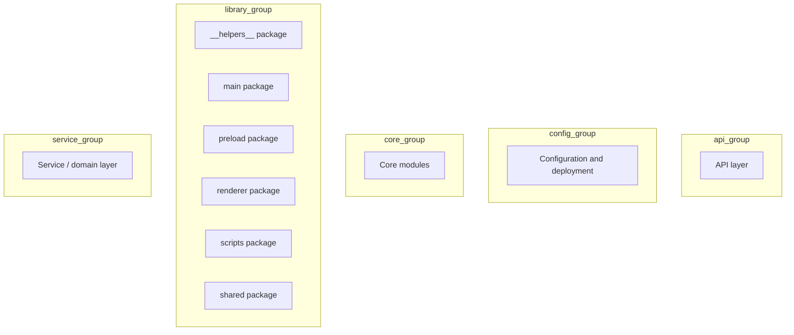

# Architecture report: gitify-app/gitify

> Automated static analysis. **Observed** = directly seen in files/imports/AST; **Inferred** = interpretation from that evidence. Repository code was not executed.

## 1. Repository at a glance

| Item | Value |
| --- | --- |
| Repository | gitify-app/gitify |
| Description | Git notifications on your menu bar. Available on macOS, Windows & Linux. |
| Language | TypeScript |
| Stars | 5398 |
| Licence | MIT |
| Analysed commit / branch | 67c00229d77d09e0c7f7044da7c24b42b484dcb0 / main |
| Framework(s) | Electron, React |
| Files analysed | 635 |
| Components | 10 |

## 2. Architecture in one minute

gitify-app/gitify - Git notifications on your menu bar. Available on macOS, Windows & Linux.. This repository was analysed statically from 635 file(s) (0 Python). Detected technologies (observed from imports/manifests): GitHub Actions, Electron, React, React Router, Tailwind CSS, Docker. Files are grouped into 10 component(s): API layer, Configuration and deployment, Core modules, __helpers__ package, main package, preload package, renderer package, scripts package. Findings below distinguish observed facts from inferred interpretation.

## 3. High-level block diagram

## 4. Main components

### API layer (`api_layer`)

- **Kind:** api
- **Status:** Observed
- **Confidence:** 0.85
- **Responsibility:** Groups 94 file(s) under api layer (observed from repository paths and static analysis).
- **Paths:** `src/main/handlers/app.test.ts`, `src/main/handlers/app.ts`, `src/main/handlers/github-cli.test.ts`, `src/main/handlers/github-cli.ts`, `src/main/handlers/index.ts`, `src/main/handlers/native-notifications.test.ts`, `src/main/handlers/native-notifications.ts`, `src/main/handlers/storage.test.ts`, `src/main/handlers/storage.ts`, `src/main/handlers/system.test.ts`, `src/main/handlers/system.ts`, `src/main/handlers/tray.test.ts`, `src/main/handlers/tray.ts`, `src/main/handlers/updater.test.ts`, `src/main/handlers/updater.ts`, `src/renderer/routes/AccountScopes.test.tsx`, `src/renderer/routes/AccountScopes.tsx`, `src/renderer/routes/Accounts.test.tsx`, `src/renderer/routes/Accounts.tsx`, `src/renderer/routes/Accounts.visual.test.tsx`, `src/renderer/routes/Filters.test.tsx`, `src/renderer/routes/Filters.tsx`, `src/renderer/routes/Filters.visual.test.tsx`, `src/renderer/routes/Loading.visual.test.tsx`, `src/renderer/routes/Login.test.tsx`, `src/renderer/routes/Login.tsx`, `src/renderer/routes/LoginComposition.visual.test.tsx`, `src/renderer/routes/LoginStates.visual.test.tsx`, `src/renderer/routes/Notifications.test.tsx`, `src/renderer/routes/Notifications.tsx`, `src/renderer/routes/NotificationsStates.visual.test.tsx`, `src/renderer/routes/ProtectedLayout.tsx`, `src/renderer/routes/RootLayout.tsx`, `src/renderer/routes/Settings.test.tsx`, `src/renderer/routes/Settings.tsx`, `src/renderer/routes/Settings.visual.test.tsx`, `src/renderer/routes/bitbucket/LoginWithPersonalAccessToken.test.tsx`, `src/renderer/routes/bitbucket/LoginWithPersonalAccessToken.tsx`, `src/renderer/routes/gitea/LoginWithPersonalAccessToken.test.tsx`, `src/renderer/routes/gitea/LoginWithPersonalAccessToken.tsx`, `src/renderer/routes/gitea/LoginWithPersonalAccessToken.visual.test.tsx`, `src/renderer/routes/github/DeviceFlowAuthorize.test.tsx`, `src/renderer/routes/github/DeviceFlowAuthorize.tsx`, `src/renderer/routes/github/LoginWithCustomOAuthApp.test.tsx`, `src/renderer/routes/github/LoginWithCustomOAuthApp.tsx`, `src/renderer/routes/github/LoginWithDeviceFlow.tsx`, `src/renderer/routes/github/LoginWithGitHubCLI.test.tsx`, `src/renderer/routes/github/LoginWithGitHubCLI.tsx`, `src/renderer/routes/github/LoginWithPersonalAccessToken.test.tsx`, `src/renderer/routes/github/LoginWithPersonalAccessToken.tsx`, `src/renderer/routes/gitlab/LoginWithPersonalAccessToken.test.tsx`, `src/renderer/routes/gitlab/LoginWithPersonalAccessToken.tsx`, `src/renderer/routes/routes.visual.test.tsx`, `src/renderer/routes/update-settings.visual.test.tsx`, `src/renderer/utils/api/errors.test.ts`, `src/renderer/utils/api/errors.ts`, `src/renderer/utils/api/features.test.ts`, `src/renderer/utils/api/features.ts`, `src/renderer/utils/api/queryClient.test.ts`, `src/renderer/utils/api/queryClient.ts`, `src/renderer/utils/api/queryKeys.ts`, `src/renderer/utils/forges/github/handlers/agentSessionThread.test.ts`, `src/renderer/utils/forges/github/handlers/agentSessionThread.ts`, `src/renderer/utils/forges/github/handlers/checkSuite.test.ts`, `src/renderer/utils/forges/github/handlers/checkSuite.ts`, `src/renderer/utils/forges/github/handlers/commit.test.ts`, `src/renderer/utils/forges/github/handlers/commit.ts`, `src/renderer/utils/forges/github/handlers/default.test.ts`, `src/renderer/utils/forges/github/handlers/default.ts`, `src/renderer/utils/forges/github/handlers/discussion.test.ts`, `src/renderer/utils/forges/github/handlers/discussion.ts`, `src/renderer/utils/forges/github/handlers/index.test.ts`, `src/renderer/utils/forges/github/handlers/index.ts`, `src/renderer/utils/forges/github/handlers/issue.test.ts`, `src/renderer/utils/forges/github/handlers/issue.ts`, `src/renderer/utils/forges/github/handlers/pullRequest.test.ts`, `src/renderer/utils/forges/github/handlers/pullRequest.ts`, `src/renderer/utils/forges/github/handlers/release.test.ts`, `src/renderer/utils/forges/github/handlers/release.ts`, `src/renderer/utils/forges/github/handlers/repositoryAdvisory.test.ts`, `src/renderer/utils/forges/github/handlers/repositoryAdvisory.ts`, `src/renderer/utils/forges/github/handlers/repositoryDependabotAlertsThread.test.ts`, `src/renderer/utils/forges/github/handlers/repositoryDependabotAlertsThread.ts`, `src/renderer/utils/forges/github/handlers/repositoryInvitation.test.ts`, `src/renderer/utils/forges/github/handlers/repositoryInvitation.ts`, `src/renderer/utils/forges/github/handlers/repositoryVulnerabilityAlert.test.ts`, `src/renderer/utils/forges/github/handlers/repositoryVulnerabilityAlert.ts`, `src/renderer/utils/forges/github/handlers/supported.test.ts`, `src/renderer/utils/forges/github/handlers/supported.ts`, `src/renderer/utils/forges/github/handlers/types.ts`, `src/renderer/utils/forges/github/handlers/utils.test.ts`, `src/renderer/utils/forges/github/handlers/utils.ts`, `src/renderer/utils/forges/github/handlers/workflowRun.test.ts`, `src/renderer/utils/forges/github/handlers/workflowRun.ts`
- **Evidence:** [src/main/handlers/app.test.ts](https://github.com/gitify-app/gitify/blob/67c00229d77d09e0c7f7044da7c24b42b484dcb0/src/main/handlers/app.test.ts); [src/main/handlers/app.ts](https://github.com/gitify-app/gitify/blob/67c00229d77d09e0c7f7044da7c24b42b484dcb0/src/main/handlers/app.ts); [src/main/handlers/github-cli.test.ts](https://github.com/gitify-app/gitify/blob/67c00229d77d09e0c7f7044da7c24b42b484dcb0/src/main/handlers/github-cli.test.ts); [src/main/handlers/github-cli.ts](https://github.com/gitify-app/gitify/blob/67c00229d77d09e0c7f7044da7c24b42b484dcb0/src/main/handlers/github-cli.ts); [src/main/handlers/index.ts](https://github.com/gitify-app/gitify/blob/67c00229d77d09e0c7f7044da7c24b42b484dcb0/src/main/handlers/index.ts); [src/main/handlers/native-notifications.test.ts](https://github.com/gitify-app/gitify/blob/67c00229d77d09e0c7f7044da7c24b42b484dcb0/src/main/handlers/native-notifications.test.ts); [src/main/handlers/native-notifications.ts](https://github.com/gitify-app/gitify/blob/67c00229d77d09e0c7f7044da7c24b42b484dcb0/src/main/handlers/native-notifications.ts); [src/main/handlers/storage.test.ts](https://github.com/gitify-app/gitify/blob/67c00229d77d09e0c7f7044da7c24b42b484dcb0/src/main/handlers/storage.test.ts)

### Configuration and deployment (`config`)

- **Kind:** config
- **Status:** Observed
- **Confidence:** 0.85
- **Responsibility:** Groups 33 file(s) under configuration and deployment (observed from repository paths and static analysis).
- **Paths:** `openspec/config.yaml`, `package.json`, `pnpm-workspace.yaml`, `release-please-config.json`, `renovate.json`, `src/renderer/components/settings/AlertSettings.test.tsx`, `src/renderer/components/settings/AlertSettings.tsx`, `src/renderer/components/settings/AppearanceSettings.test.tsx`, `src/renderer/components/settings/AppearanceSettings.tsx`, `src/renderer/components/settings/InboxSettings.test.tsx`, `src/renderer/components/settings/InboxSettings.tsx`, `src/renderer/components/settings/SettingsFooter.test.tsx`, `src/renderer/components/settings/SettingsFooter.tsx`, `src/renderer/components/settings/SettingsGroupHeading.test.tsx`, `src/renderer/components/settings/SettingsGroupHeading.tsx`, `src/renderer/components/settings/SettingsReset.test.tsx`, `src/renderer/components/settings/SettingsReset.tsx`, `src/renderer/components/settings/SystemSettings.test.tsx`, `src/renderer/components/settings/SystemSettings.tsx`, `src/renderer/components/settings/TraySettings.test.tsx`, `src/renderer/components/settings/TraySettings.tsx`, `src/renderer/components/settings/controls/SettingsChoice.test.tsx`, `src/renderer/components/settings/controls/SettingsChoice.tsx`, `src/renderer/components/settings/controls/SettingsList.test.tsx`, `src/renderer/components/settings/controls/SettingsList.tsx`, `src/renderer/components/settings/controls/SettingsReveal.test.tsx`, `src/renderer/components/settings/controls/SettingsReveal.tsx`, `src/renderer/components/settings/controls/SettingsRow.test.tsx`, `src/renderer/components/settings/controls/SettingsRow.tsx`, `src/renderer/components/settings/controls/SettingsToggle.test.tsx`, `src/renderer/components/settings/controls/SettingsToggle.tsx`, `src/renderer/i18n/locales/en.json`, `tsconfig.json`
- **Evidence:** [openspec/config.yaml](https://github.com/gitify-app/gitify/blob/67c00229d77d09e0c7f7044da7c24b42b484dcb0/openspec/config.yaml); [package.json](https://github.com/gitify-app/gitify/blob/67c00229d77d09e0c7f7044da7c24b42b484dcb0/package.json); [pnpm-workspace.yaml](https://github.com/gitify-app/gitify/blob/67c00229d77d09e0c7f7044da7c24b42b484dcb0/pnpm-workspace.yaml); [release-please-config.json](https://github.com/gitify-app/gitify/blob/67c00229d77d09e0c7f7044da7c24b42b484dcb0/release-please-config.json); [renovate.json](https://github.com/gitify-app/gitify/blob/67c00229d77d09e0c7f7044da7c24b42b484dcb0/renovate.json); [src/renderer/components/settings/AlertSettings.test.tsx](https://github.com/gitify-app/gitify/blob/67c00229d77d09e0c7f7044da7c24b42b484dcb0/src/renderer/components/settings/AlertSettings.test.tsx); [src/renderer/components/settings/AlertSettings.tsx](https://github.com/gitify-app/gitify/blob/67c00229d77d09e0c7f7044da7c24b42b484dcb0/src/renderer/components/settings/AlertSettings.tsx); [src/renderer/components/settings/AppearanceSettings.test.tsx](https://github.com/gitify-app/gitify/blob/67c00229d77d09e0c7f7044da7c24b42b484dcb0/src/renderer/components/settings/AppearanceSettings.test.tsx)

### Core modules (`core`)

- **Kind:** core
- **Status:** Observed
- **Confidence:** 0.85
- **Responsibility:** Groups 4 file(s) under core modules (observed from repository paths and static analysis).
- **Paths:** `codegen.ts`, `electron-builder.js`, `graphql.config.ts`, `i18next.config.ts`
- **Evidence:** [codegen.ts](https://github.com/gitify-app/gitify/blob/67c00229d77d09e0c7f7044da7c24b42b484dcb0/codegen.ts); [electron-builder.js](https://github.com/gitify-app/gitify/blob/67c00229d77d09e0c7f7044da7c24b42b484dcb0/electron-builder.js); [graphql.config.ts](https://github.com/gitify-app/gitify/blob/67c00229d77d09e0c7f7044da7c24b42b484dcb0/graphql.config.ts); [i18next.config.ts](https://github.com/gitify-app/gitify/blob/67c00229d77d09e0c7f7044da7c24b42b484dcb0/i18next.config.ts)

### __helpers__ package (`helpers`)

- **Kind:** library
- **Status:** Observed
- **Confidence:** 0.85
- **Responsibility:** Groups 4 file(s) under __helpers__ package (observed from repository paths and static analysis).
- **Paths:** `src/__helpers__/electron-log.setup.ts`, `src/__helpers__/fail-on-act-warnings.setup.ts`, `src/__helpers__/gitify-bridge.ts`, `src/__helpers__/restore-test-spies.setup.ts`
- **Evidence:** [src/__helpers__/electron-log.setup.ts](https://github.com/gitify-app/gitify/blob/67c00229d77d09e0c7f7044da7c24b42b484dcb0/src/__helpers__/electron-log.setup.ts); [src/__helpers__/fail-on-act-warnings.setup.ts](https://github.com/gitify-app/gitify/blob/67c00229d77d09e0c7f7044da7c24b42b484dcb0/src/__helpers__/fail-on-act-warnings.setup.ts); [src/__helpers__/gitify-bridge.ts](https://github.com/gitify-app/gitify/blob/67c00229d77d09e0c7f7044da7c24b42b484dcb0/src/__helpers__/gitify-bridge.ts); [src/__helpers__/restore-test-spies.setup.ts](https://github.com/gitify-app/gitify/blob/67c00229d77d09e0c7f7044da7c24b42b484dcb0/src/__helpers__/restore-test-spies.setup.ts)

### main package (`main`)

- **Kind:** library
- **Status:** Observed
- **Confidence:** 0.85
- **Responsibility:** Groups 36 file(s) under main package (observed from repository paths and static analysis).
- **Paths:** `src/main/badge.test.ts`, `src/main/badge.ts`, `src/main/ciDependencyCompatibility.test.ts`, `src/main/config.test.ts`, `src/main/config.ts`, `src/main/events.test.ts`, `src/main/events.ts`, `src/main/icons.test.ts`, `src/main/icons.ts`, `src/main/index.test.ts`, `src/main/index.ts`, `src/main/lifecycle/first-run.test.ts`, `src/main/lifecycle/first-run.ts`, `src/main/lifecycle/index.ts`, `src/main/lifecycle/reset.test.ts`, `src/main/lifecycle/reset.ts`, `src/main/lifecycle/startup.test.ts`, `src/main/lifecycle/startup.ts`, `src/main/lifecycle/user-data.test.ts`, `src/main/lifecycle/user-data.ts`, `src/main/lifecycle/window.test.ts`, `src/main/lifecycle/window.ts`, `src/main/menu.test.ts`, `src/main/menu.ts`, `src/main/notifications.test.ts`, `src/main/notifications.ts`, `src/main/ozone.test.ts`, `src/main/ozone.ts`, `src/main/update-manager.test.ts`, `src/main/update-manager.ts`, `src/main/updater.test.ts`, `src/main/updater.ts`, `src/main/utils.test.ts`, `src/main/utils.ts`, `src/main/zoom.test.ts`, `src/main/zoom.ts`
- **Evidence:** [src/main/badge.test.ts](https://github.com/gitify-app/gitify/blob/67c00229d77d09e0c7f7044da7c24b42b484dcb0/src/main/badge.test.ts); [src/main/badge.ts](https://github.com/gitify-app/gitify/blob/67c00229d77d09e0c7f7044da7c24b42b484dcb0/src/main/badge.ts); [src/main/ciDependencyCompatibility.test.ts](https://github.com/gitify-app/gitify/blob/67c00229d77d09e0c7f7044da7c24b42b484dcb0/src/main/ciDependencyCompatibility.test.ts); [src/main/config.test.ts](https://github.com/gitify-app/gitify/blob/67c00229d77d09e0c7f7044da7c24b42b484dcb0/src/main/config.test.ts); [src/main/config.ts](https://github.com/gitify-app/gitify/blob/67c00229d77d09e0c7f7044da7c24b42b484dcb0/src/main/config.ts); [src/main/events.test.ts](https://github.com/gitify-app/gitify/blob/67c00229d77d09e0c7f7044da7c24b42b484dcb0/src/main/events.test.ts); [src/main/events.ts](https://github.com/gitify-app/gitify/blob/67c00229d77d09e0c7f7044da7c24b42b484dcb0/src/main/events.ts); [src/main/icons.test.ts](https://github.com/gitify-app/gitify/blob/67c00229d77d09e0c7f7044da7c24b42b484dcb0/src/main/icons.test.ts)

### preload package (`preload`)

- **Kind:** library
- **Status:** Observed
- **Confidence:** 0.85
- **Responsibility:** Groups 6 file(s) under preload package (observed from repository paths and static analysis).
- **Paths:** `src/preload/index.test.ts`, `src/preload/index.ts`, `src/preload/preload.d.ts`, `src/preload/types.ts`, `src/preload/utils.test.ts`, `src/preload/utils.ts`
- **Evidence:** [src/preload/index.test.ts](https://github.com/gitify-app/gitify/blob/67c00229d77d09e0c7f7044da7c24b42b484dcb0/src/preload/index.test.ts); [src/preload/index.ts](https://github.com/gitify-app/gitify/blob/67c00229d77d09e0c7f7044da7c24b42b484dcb0/src/preload/index.ts); [src/preload/preload.d.ts](https://github.com/gitify-app/gitify/blob/67c00229d77d09e0c7f7044da7c24b42b484dcb0/src/preload/preload.d.ts); [src/preload/types.ts](https://github.com/gitify-app/gitify/blob/67c00229d77d09e0c7f7044da7c24b42b484dcb0/src/preload/types.ts); [src/preload/utils.test.ts](https://github.com/gitify-app/gitify/blob/67c00229d77d09e0c7f7044da7c24b42b484dcb0/src/preload/utils.test.ts); [src/preload/utils.ts](https://github.com/gitify-app/gitify/blob/67c00229d77d09e0c7f7044da7c24b42b484dcb0/src/preload/utils.ts)

### renderer package (`renderer`)

- **Kind:** library
- **Status:** Observed
- **Confidence:** 0.85
- **Responsibility:** Groups 333 file(s) under renderer package (observed from repository paths and static analysis).
- **Paths:** `src/renderer/App.test.tsx`, `src/renderer/App.tsx`, `src/renderer/__helpers__/hook-mocks.ts`, `src/renderer/__helpers__/test-utils.tsx`, `src/renderer/__helpers__/visual-utils.tsx`, `src/renderer/__helpers__/visual.global-setup.ts`, `src/renderer/__helpers__/visual.setup.ts`, `src/renderer/__helpers__/vitest.setup.ts`, `src/renderer/__mocks__/account-mocks.ts`, `src/renderer/__mocks__/notifications-mocks.ts`, `src/renderer/__mocks__/state-mocks.ts`, `src/renderer/__mocks__/user-mocks.ts`, `src/renderer/components/AllRead.test.tsx`, `src/renderer/components/AllRead.tsx`, `src/renderer/components/AppErrorBoundary.test.tsx`, `src/renderer/components/AppErrorBoundary.tsx`, `src/renderer/components/ErrorStates.visual.test.tsx`, `src/renderer/components/GlobalEffects.test.tsx`, `src/renderer/components/GlobalEffects.tsx`, `src/renderer/components/GlobalShortcuts.test.tsx`, `src/renderer/components/GlobalShortcuts.tsx`, `src/renderer/components/Loading.test.tsx`, `src/renderer/components/Loading.tsx`, `src/renderer/components/Oops.test.tsx`, `src/renderer/components/Oops.tsx`, `src/renderer/components/RouteError.test.tsx`, `src/renderer/components/RouteError.tsx`, `src/renderer/components/Sidebar.test.tsx`, `src/renderer/components/Sidebar.tsx`, `src/renderer/components/avatars/AvatarWithFallback.test.tsx`, `src/renderer/components/avatars/AvatarWithFallback.tsx`, `src/renderer/components/filters/AccountFilter.test.tsx`, `src/renderer/components/filters/AccountFilter.tsx`, `src/renderer/components/filters/FilterCheckbox.test.tsx`, `src/renderer/components/filters/FilterCheckbox.tsx`, `src/renderer/components/filters/FilterSection.test.tsx`, `src/renderer/components/filters/FilterSection.tsx`, `src/renderer/components/filters/ReasonFilter.test.tsx`, `src/renderer/components/filters/ReasonFilter.tsx`, `src/renderer/components/filters/RequiresDetailedNotificationsWarning.test.tsx`, `src/renderer/components/filters/RequiresDetailedNotificationsWarning.tsx`, `src/renderer/components/filters/ReviewRequestTypeFilter.test.tsx`, `src/renderer/components/filters/ReviewRequestTypeFilter.tsx`, `src/renderer/components/filters/SearchFilter.test.tsx`, `src/renderer/components/filters/SearchFilter.tsx`, `src/renderer/components/filters/SearchFilterSuggestions.test.tsx`, `src/renderer/components/filters/SearchFilterSuggestions.tsx`, `src/renderer/components/filters/StateFilter.test.tsx`, `src/renderer/components/filters/StateFilter.tsx`, `src/renderer/components/filters/SubjectTypeFilter.test.tsx`, `src/renderer/components/filters/SubjectTypeFilter.tsx`, `src/renderer/components/filters/TokenSearchInput.tsx`, `src/renderer/components/filters/UserTypeFilter.test.tsx`, `src/renderer/components/filters/UserTypeFilter.tsx`, `src/renderer/components/layout/AppLayout.test.tsx`, `src/renderer/components/layout/AppLayout.tsx`, `src/renderer/components/layout/Centered.test.tsx`, `src/renderer/components/layout/Centered.tsx`, `src/renderer/components/layout/Contents.test.tsx`, `src/renderer/components/layout/Contents.tsx`, `src/renderer/components/layout/EmojiSplash.test.tsx`, `src/renderer/components/layout/EmojiSplash.tsx`, `src/renderer/components/layout/Page.test.tsx`, `src/renderer/components/layout/Page.tsx`, `src/renderer/components/login/LoginMethods.tsx`, `src/renderer/components/login/LoginWithPersonalAccessTokenForm.tsx`, `src/renderer/components/metrics/ChecksPill.test.tsx`, `src/renderer/components/metrics/ChecksPill.tsx`, `src/renderer/components/metrics/CommentsPill.test.tsx`, `src/renderer/components/metrics/CommentsPill.tsx`, `src/renderer/components/metrics/IssueTypesPill.test.tsx`, `src/renderer/components/metrics/IssueTypesPill.tsx`, `src/renderer/components/metrics/LabelsPill.test.tsx`, `src/renderer/components/metrics/LabelsPill.tsx`, `src/renderer/components/metrics/LabelsPill.visual.test.tsx`, `src/renderer/components/metrics/LinkedIssuesPill.test.tsx`, `src/renderer/components/metrics/LinkedIssuesPill.tsx`, `src/renderer/components/metrics/MetricGroup.test.tsx`, `src/renderer/components/metrics/MetricGroup.tsx`, `src/renderer/components/metrics/MetricPill.test.tsx`, `src/renderer/components/metrics/MetricPill.tsx`, `src/renderer/components/metrics/MetricPills.test.tsx`, `src/renderer/components/metrics/MetricPills.tsx`, `src/renderer/components/metrics/MilestonePill.test.tsx`, `src/renderer/components/metrics/MilestonePill.tsx`, `src/renderer/components/metrics/ParentPill.test.tsx`, `src/renderer/components/metrics/ParentPill.tsx`, `src/renderer/components/metrics/ReactionsPill.test.tsx`, `src/renderer/components/metrics/ReactionsPill.tsx`, `src/renderer/components/metrics/ReviewsPill.test.tsx`, `src/renderer/components/metrics/ReviewsPill.tsx`, `src/renderer/components/metrics/StackedPrsPill.test.tsx`, `src/renderer/components/metrics/StackedPrsPill.tsx`, `src/renderer/components/metrics/SubIssueProgressPill.test.tsx`, `src/renderer/components/metrics/SubIssueProgressPill.tsx`, `src/renderer/components/notifications/AccountHeader.test.tsx`, `src/renderer/components/notifications/AccountHeader.tsx`, `src/renderer/components/notifications/ExitCollapse.test.tsx`, `src/renderer/components/notifications/ExitCollapse.tsx`, `src/renderer/components/notifications/NotificationFooter.test.tsx`, `src/renderer/components/notifications/NotificationFooter.tsx`, `src/renderer/components/notifications/NotificationHeader.test.tsx`, `src/renderer/components/notifications/NotificationHeader.tsx`, `src/renderer/components/notifications/NotificationList.test.tsx`, `src/renderer/components/notifications/NotificationList.tsx`, `src/renderer/components/notifications/NotificationList.visual.test.tsx`, `src/renderer/components/notifications/NotificationRow.subscription.test.tsx`, `src/renderer/components/notifications/NotificationRow.test.tsx`, `src/renderer/components/notifications/NotificationRow.tsx`, `src/renderer/components/notifications/NotificationRow.visual.test.tsx`, `src/renderer/components/notifications/NotificationTitle.test.tsx`, `src/renderer/components/notifications/NotificationTitle.tsx`, `src/renderer/components/notifications/RepositoryHeader.test.tsx`, `src/renderer/components/notifications/RepositoryHeader.tsx`, `src/renderer/components/primitives/CustomCounter.test.tsx`, `src/renderer/components/primitives/CustomCounter.tsx`, `src/renderer/components/primitives/EmojiText.test.tsx`, `src/renderer/components/primitives/EmojiText.tsx`, `src/renderer/components/primitives/Footer.test.tsx`, `src/renderer/components/primitives/Footer.tsx`, `src/renderer/components/primitives/Header.test.tsx`, `src/renderer/components/primitives/Header.tsx`, `src/renderer/components/primitives/HelpPopover.test.tsx`, `src/renderer/components/primitives/HelpPopover.tsx`, `src/renderer/components/primitives/HoverButton.test.tsx`, `src/renderer/components/primitives/HoverButton.tsx`, `src/renderer/components/primitives/HoverGroup.test.tsx`, `src/renderer/components/primitives/HoverGroup.tsx`, `src/renderer/components/primitives/ReloadButton.tsx`, `src/renderer/components/primitives/SectionHeading.test.tsx`, `src/renderer/components/primitives/SectionHeading.tsx`, `src/renderer/constants.ts`, `src/renderer/hooks/notifications/useNotificationActions.test.tsx`, `src/renderer/hooks/notifications/useNotificationActions.ts`, `src/renderer/hooks/notifications/useNotificationEffects.ts`, `src/renderer/hooks/notifications/useNotificationMutations.ts`, `src/renderer/hooks/notifications/useNotificationsHost.ts`, `src/renderer/hooks/notifications/useNotificationsQuery.ts`, `src/renderer/hooks/notifications/useNotificationsQueryKey.test.ts`, `src/renderer/hooks/notifications/useNotificationsQueryKey.ts`, `src/renderer/hooks/useAccounts.test.tsx`, `src/renderer/hooks/useAccounts.ts`, `src/renderer/hooks/useAppearance.test.ts`, `src/renderer/hooks/useAppearance.ts`, `src/renderer/hooks/useLogins.test.tsx`, `src/renderer/hooks/useLogins.ts`, `src/renderer/hooks/useNotifications.test.tsx`, `src/renderer/hooks/useNotifications.ts`, `src/renderer/hooks/useOnlineStatus.test.ts`, `src/renderer/hooks/useOnlineStatus.ts`, `src/renderer/hooks/usePowerState.test.ts`, `src/renderer/hooks/usePowerState.ts`, `src/renderer/hooks/usePrefersContrast.test.ts`, `src/renderer/hooks/usePrefersContrast.ts`, `src/renderer/hooks/usePrefersReducedTransparency.test.ts`, `src/renderer/hooks/usePrefersReducedTransparency.ts`, `src/renderer/hooks/useShortcutActions.ts`, `src/renderer/hooks/useShortcutRegistration.test.ts`, `src/renderer/hooks/useShortcutRegistration.ts`, `src/renderer/i18n/index.ts`, `src/renderer/i18n/loader.test.ts`, `src/renderer/i18n/loader.ts`, `src/renderer/i18n/types.ts`, `src/renderer/icons/BitbucketIcon.tsx`, `src/renderer/icons/GitLabIcon.tsx`, `src/renderer/icons/LogoIcon.test.tsx`, `src/renderer/icons/LogoIcon.tsx`, `src/renderer/icons/ScopeStatusIcon.test.tsx`, `src/renderer/icons/ScopeStatusIcon.tsx`, `src/renderer/icons/VolumeDownIcon.tsx`, `src/renderer/icons/VolumeUpIcon.tsx`, `src/renderer/index.tsx`, `src/renderer/nav.ts`, `src/renderer/router.test.ts`, `src/renderer/router.tsx`, `src/renderer/stores/defaults.ts`, `src/renderer/stores/index.ts`, `src/renderer/stores/subscriptions.test.ts`, `src/renderer/stores/subscriptions.ts`, `src/renderer/stores/types.ts`, `src/renderer/stores/useAccountsStore.test.ts`, `src/renderer/stores/useAccountsStore.ts`, `src/renderer/stores/useFiltersStore.test.ts`, `src/renderer/stores/useFiltersStore.ts`, `src/renderer/stores/useNotificationActionFailuresStore.ts`, `src/renderer/stores/usePowerStateStore.test.ts`, `src/renderer/stores/usePowerStateStore.ts`, `src/renderer/stores/useSettingsStore.test.ts`, `src/renderer/stores/useSettingsStore.ts`, `src/renderer/stores/useShortcutRegistrationStore.ts`, `src/renderer/types.ts`, `src/renderer/utils/auth/identity.test.ts`, `src/renderer/utils/auth/identity.ts`, `src/renderer/utils/auth/loginValidation.test.ts`, `src/renderer/utils/auth/loginValidation.ts`, `src/renderer/utils/auth/scopeNames.test.ts`, `src/renderer/utils/auth/scopeNames.ts`, `src/renderer/utils/auth/scopes.test.ts`, `src/renderer/utils/auth/scopes.ts`, `src/renderer/utils/auth/types.ts`, `src/renderer/utils/auth/utils.test.ts`, `src/renderer/utils/auth/utils.ts`, `src/renderer/utils/forges/bitbucket/adapter.test.ts`, `src/renderer/utils/forges/bitbucket/adapter.ts`, `src/renderer/utils/forges/bitbucket/client.test.ts`, `src/renderer/utils/forges/bitbucket/client.ts`, `src/renderer/utils/forges/bitbucket/graphql/generated/graphql.ts`, `src/renderer/utils/forges/bitbucket/transform.test.ts`, `src/renderer/utils/forges/bitbucket/transform.ts`, `src/renderer/utils/forges/bitbucket/types.ts`, `src/renderer/utils/forges/gitea/adapter.test.ts`, `src/renderer/utils/forges/gitea/adapter.ts`, `src/renderer/utils/forges/gitea/auth.test.ts`, `src/renderer/utils/forges/gitea/auth.ts`, `src/renderer/utils/forges/gitea/client.test.ts`, `src/renderer/utils/forges/gitea/client.ts`, `src/renderer/utils/forges/gitea/transform.test.ts`, `src/renderer/utils/forges/gitea/transform.ts`, `src/renderer/utils/forges/gitea/types.ts`, `src/renderer/utils/forges/github/__mocks__/request-mocks.ts`, `src/renderer/utils/forges/github/__mocks__/response-mocks.ts`, `src/renderer/utils/forges/github/adapter.test.ts`, `src/renderer/utils/forges/github/adapter.ts`, `src/renderer/utils/forges/github/auth.test.ts`, `src/renderer/utils/forges/github/auth.ts`, `src/renderer/utils/forges/github/capabilities.test.ts`, `src/renderer/utils/forges/github/capabilities.ts`, `src/renderer/utils/forges/github/cli-auth.test.ts`, `src/renderer/utils/forges/github/cli.test.ts`, `src/renderer/utils/forges/github/cli.ts`, `src/renderer/utils/forges/github/client.test.ts`, `src/renderer/utils/forges/github/client.ts`, `src/renderer/utils/forges/github/enrich.test.ts`, `src/renderer/utils/forges/github/enrich.ts`, `src/renderer/utils/forges/github/flows.test.ts`, `src/renderer/utils/forges/github/flows.ts`, `src/renderer/utils/forges/github/graphql/MergeQueryBuilder.test.ts`, `src/renderer/utils/forges/github/graphql/MergeQueryBuilder.ts`, `src/renderer/utils/forges/github/graphql/generated/graphql.ts`, `src/renderer/utils/forges/github/graphql/types.ts`, `src/renderer/utils/forges/github/graphql/utils.test.ts`, `src/renderer/utils/forges/github/graphql/utils.ts`, `src/renderer/utils/forges/github/octokit.test.ts`, `src/renderer/utils/forges/github/octokit.ts`, `src/renderer/utils/forges/github/platform.test.ts`, `src/renderer/utils/forges/github/platform.ts`, `src/renderer/utils/forges/github/request.test.ts`, `src/renderer/utils/forges/github/request.ts`, `src/renderer/utils/forges/github/transform.test.ts`, `src/renderer/utils/forges/github/transform.ts`, `src/renderer/utils/forges/github/types.ts`, `src/renderer/utils/forges/github/users.test.ts`, `src/renderer/utils/forges/github/users.ts`, `src/renderer/utils/forges/github/utils.test.ts`, `src/renderer/utils/forges/github/utils.ts`, `src/renderer/utils/forges/gitlab/adapter.test.ts`, `src/renderer/utils/forges/gitlab/adapter.ts`, `src/renderer/utils/forges/gitlab/client.test.ts`, `src/renderer/utils/forges/gitlab/client.ts`, `src/renderer/utils/forges/gitlab/transform.test.ts`, `src/renderer/utils/forges/gitlab/transform.ts`, `src/renderer/utils/forges/gitlab/types.ts`, `src/renderer/utils/forges/headers.test.ts`, `src/renderer/utils/forges/headers.ts`, `src/renderer/utils/forges/labels.ts`, `src/renderer/utils/forges/registry.test.ts`, `src/renderer/utils/forges/registry.ts`, `src/renderer/utils/forges/types.ts`, `src/renderer/utils/notifications/filters/filter.test.ts`, `src/renderer/utils/notifications/filters/filter.ts`, `src/renderer/utils/notifications/filters/index.ts`, `src/renderer/utils/notifications/filters/reason.test.ts`, `src/renderer/utils/notifications/filters/reason.ts`, `src/renderer/utils/notifications/filters/reviewRequestType.test.ts`, `src/renderer/utils/notifications/filters/reviewRequestType.ts`, `src/renderer/utils/notifications/filters/search.test.ts`, `src/renderer/utils/notifications/filters/search.ts`, `src/renderer/utils/notifications/filters/state.test.ts`, `src/renderer/utils/notifications/filters/state.ts`, `src/renderer/utils/notifications/filters/subjectType.test.ts`, `src/renderer/utils/notifications/filters/subjectType.ts`, `src/renderer/utils/notifications/filters/types.ts`, `src/renderer/utils/notifications/filters/userType.test.ts`, `src/renderer/utils/notifications/filters/userType.ts`, `src/renderer/utils/notifications/formatNotification.test.ts`, `src/renderer/utils/notifications/formatNotification.ts`, `src/renderer/utils/notifications/formatters.test.ts`, `src/renderer/utils/notifications/formatters.ts`, `src/renderer/utils/notifications/group.test.ts`, `src/renderer/utils/notifications/group.ts`, `src/renderer/utils/notifications/listItems.test.ts`, `src/renderer/utils/notifications/listItems.ts`, `src/renderer/utils/notifications/mutations.test.ts`, `src/renderer/utils/notifications/mutations.ts`, `src/renderer/utils/notifications/notifications.test.ts`, `src/renderer/utils/notifications/notifications.ts`, `src/renderer/utils/notifications/pollInterval.test.ts`, `src/renderer/utils/notifications/pollInterval.ts`, `src/renderer/utils/notifications/reason.test.ts`, `src/renderer/utils/notifications/reason.ts`, `src/renderer/utils/notifications/remove.test.ts`, `src/renderer/utils/notifications/remove.ts`, `src/renderer/utils/notifications/status.test.ts`, `src/renderer/utils/notifications/status.ts`, `src/renderer/utils/notifications/url.test.ts`, `src/renderer/utils/notifications/url.ts`, `src/renderer/utils/notifications/utils.test.ts`, `src/renderer/utils/notifications/utils.ts`, `src/renderer/utils/system/audio.test.ts`, `src/renderer/utils/system/audio.ts`, `src/renderer/utils/system/comms.test.ts`, `src/renderer/utils/system/comms.ts`, `src/renderer/utils/system/keyboardShortcut.test.ts`, `src/renderer/utils/system/keyboardShortcut.ts`, `src/renderer/utils/system/links.test.ts`, `src/renderer/utils/system/links.ts`, `src/renderer/utils/system/native.test.ts`, `src/renderer/utils/system/native.ts`, `src/renderer/utils/system/tray.test.ts`, `src/renderer/utils/system/tray.ts`, `src/renderer/utils/ui/display.test.ts`, `src/renderer/utils/ui/display.ts`, `src/renderer/utils/ui/emojis.ts`, `src/renderer/utils/ui/icons.test.ts`, `src/renderer/utils/ui/icons.ts`, `src/renderer/utils/ui/keyboard.test.ts`, `src/renderer/utils/ui/keyboard.ts`, `src/renderer/utils/ui/theme.test.ts`, `src/renderer/utils/ui/theme.ts`, `src/renderer/utils/ui/volume.test.ts`, `src/renderer/utils/ui/volume.ts`, `src/renderer/utils/ui/zoom.test.ts`, `src/renderer/utils/ui/zoom.ts`
- **Evidence:** [src/renderer/App.test.tsx](https://github.com/gitify-app/gitify/blob/67c00229d77d09e0c7f7044da7c24b42b484dcb0/src/renderer/App.test.tsx); [src/renderer/App.tsx](https://github.com/gitify-app/gitify/blob/67c00229d77d09e0c7f7044da7c24b42b484dcb0/src/renderer/App.tsx); [src/renderer/__helpers__/hook-mocks.ts](https://github.com/gitify-app/gitify/blob/67c00229d77d09e0c7f7044da7c24b42b484dcb0/src/renderer/__helpers__/hook-mocks.ts); [src/renderer/__helpers__/test-utils.tsx](https://github.com/gitify-app/gitify/blob/67c00229d77d09e0c7f7044da7c24b42b484dcb0/src/renderer/__helpers__/test-utils.tsx); [src/renderer/__helpers__/visual-utils.tsx](https://github.com/gitify-app/gitify/blob/67c00229d77d09e0c7f7044da7c24b42b484dcb0/src/renderer/__helpers__/visual-utils.tsx); [src/renderer/__helpers__/visual.global-setup.ts](https://github.com/gitify-app/gitify/blob/67c00229d77d09e0c7f7044da7c24b42b484dcb0/src/renderer/__helpers__/visual.global-setup.ts); [src/renderer/__helpers__/visual.setup.ts](https://github.com/gitify-app/gitify/blob/67c00229d77d09e0c7f7044da7c24b42b484dcb0/src/renderer/__helpers__/visual.setup.ts); [src/renderer/__helpers__/vitest.setup.ts](https://github.com/gitify-app/gitify/blob/67c00229d77d09e0c7f7044da7c24b42b484dcb0/src/renderer/__helpers__/vitest.setup.ts)

### scripts package (`scripts`)

- **Kind:** library
- **Status:** Observed
- **Confidence:** 0.85
- **Responsibility:** Groups 9 file(s) under scripts package (observed from repository paths and static analysis).
- **Paths:** `scripts/afterPack.js`, `scripts/afterSign.js`, `scripts/check-en-locales.mjs`, `scripts/check-t-defaults.mjs`, `scripts/prepare-dev-electron.mjs`, `scripts/validate-runtime-dependencies.mjs`, `scripts/verifyFuses.js`, `scripts/verifyPackagedDependencies.js`, `scripts/visual.sh`
- **Evidence:** [scripts/afterPack.js](https://github.com/gitify-app/gitify/blob/67c00229d77d09e0c7f7044da7c24b42b484dcb0/scripts/afterPack.js); [scripts/afterSign.js](https://github.com/gitify-app/gitify/blob/67c00229d77d09e0c7f7044da7c24b42b484dcb0/scripts/afterSign.js); [scripts/check-en-locales.mjs](https://github.com/gitify-app/gitify/blob/67c00229d77d09e0c7f7044da7c24b42b484dcb0/scripts/check-en-locales.mjs); [scripts/check-t-defaults.mjs](https://github.com/gitify-app/gitify/blob/67c00229d77d09e0c7f7044da7c24b42b484dcb0/scripts/check-t-defaults.mjs); [scripts/prepare-dev-electron.mjs](https://github.com/gitify-app/gitify/blob/67c00229d77d09e0c7f7044da7c24b42b484dcb0/scripts/prepare-dev-electron.mjs); [scripts/validate-runtime-dependencies.mjs](https://github.com/gitify-app/gitify/blob/67c00229d77d09e0c7f7044da7c24b42b484dcb0/scripts/validate-runtime-dependencies.mjs); [scripts/verifyFuses.js](https://github.com/gitify-app/gitify/blob/67c00229d77d09e0c7f7044da7c24b42b484dcb0/scripts/verifyFuses.js); [scripts/verifyPackagedDependencies.js](https://github.com/gitify-app/gitify/blob/67c00229d77d09e0c7f7044da7c24b42b484dcb0/scripts/verifyPackagedDependencies.js)

### Service / domain layer (`service_layer`)

- **Kind:** service
- **Status:** Observed
- **Confidence:** 0.85
- **Responsibility:** Groups 6 file(s) under service / domain layer (observed from repository paths and static analysis).
- **Paths:** `src/renderer/utils/core/errors.test.ts`, `src/renderer/utils/core/errors.ts`, `src/renderer/utils/core/logger.test.ts`, `src/renderer/utils/core/logger.ts`, `src/renderer/utils/core/random.test.ts`, `src/renderer/utils/core/random.ts`
- **Evidence:** [src/renderer/utils/core/errors.test.ts](https://github.com/gitify-app/gitify/blob/67c00229d77d09e0c7f7044da7c24b42b484dcb0/src/renderer/utils/core/errors.test.ts); [src/renderer/utils/core/errors.ts](https://github.com/gitify-app/gitify/blob/67c00229d77d09e0c7f7044da7c24b42b484dcb0/src/renderer/utils/core/errors.ts); [src/renderer/utils/core/logger.test.ts](https://github.com/gitify-app/gitify/blob/67c00229d77d09e0c7f7044da7c24b42b484dcb0/src/renderer/utils/core/logger.test.ts); [src/renderer/utils/core/logger.ts](https://github.com/gitify-app/gitify/blob/67c00229d77d09e0c7f7044da7c24b42b484dcb0/src/renderer/utils/core/logger.ts); [src/renderer/utils/core/random.test.ts](https://github.com/gitify-app/gitify/blob/67c00229d77d09e0c7f7044da7c24b42b484dcb0/src/renderer/utils/core/random.test.ts); [src/renderer/utils/core/random.ts](https://github.com/gitify-app/gitify/blob/67c00229d77d09e0c7f7044da7c24b42b484dcb0/src/renderer/utils/core/random.ts)

### shared package (`shared`)

- **Kind:** library
- **Status:** Observed
- **Confidence:** 0.85
- **Responsibility:** Groups 9 file(s) under shared package (observed from repository paths and static analysis).
- **Paths:** `src/shared/constants.ts`, `src/shared/events.ts`, `src/shared/logger.test.ts`, `src/shared/logger.ts`, `src/shared/nativeNotifications.test.ts`, `src/shared/nativeNotifications.ts`, `src/shared/platform.test.ts`, `src/shared/platform.ts`, `src/shared/theme.ts`
- **Evidence:** [src/shared/constants.ts](https://github.com/gitify-app/gitify/blob/67c00229d77d09e0c7f7044da7c24b42b484dcb0/src/shared/constants.ts); [src/shared/events.ts](https://github.com/gitify-app/gitify/blob/67c00229d77d09e0c7f7044da7c24b42b484dcb0/src/shared/events.ts); [src/shared/logger.test.ts](https://github.com/gitify-app/gitify/blob/67c00229d77d09e0c7f7044da7c24b42b484dcb0/src/shared/logger.test.ts); [src/shared/logger.ts](https://github.com/gitify-app/gitify/blob/67c00229d77d09e0c7f7044da7c24b42b484dcb0/src/shared/logger.ts); [src/shared/nativeNotifications.test.ts](https://github.com/gitify-app/gitify/blob/67c00229d77d09e0c7f7044da7c24b42b484dcb0/src/shared/nativeNotifications.test.ts); [src/shared/nativeNotifications.ts](https://github.com/gitify-app/gitify/blob/67c00229d77d09e0c7f7044da7c24b42b484dcb0/src/shared/nativeNotifications.ts); [src/shared/platform.test.ts](https://github.com/gitify-app/gitify/blob/67c00229d77d09e0c7f7044da7c24b42b484dcb0/src/shared/platform.test.ts); [src/shared/platform.ts](https://github.com/gitify-app/gitify/blob/67c00229d77d09e0c7f7044da7c24b42b484dcb0/src/shared/platform.ts)

## 5. Execution flow

**Observed** entry point(s):

- [src/main/handlers/app.ts](https://github.com/gitify-app/gitify/blob/67c00229d77d09e0c7f7044da7c24b42b484dcb0/src/main/handlers/app.ts)
- [src/main/handlers/index.ts](https://github.com/gitify-app/gitify/blob/67c00229d77d09e0c7f7044da7c24b42b484dcb0/src/main/handlers/index.ts)
- [src/main/index.ts](https://github.com/gitify-app/gitify/blob/67c00229d77d09e0c7f7044da7c24b42b484dcb0/src/main/index.ts)
- [src/main/lifecycle/index.ts](https://github.com/gitify-app/gitify/blob/67c00229d77d09e0c7f7044da7c24b42b484dcb0/src/main/lifecycle/index.ts)
- [src/preload/index.ts](https://github.com/gitify-app/gitify/blob/67c00229d77d09e0c7f7044da7c24b42b484dcb0/src/preload/index.ts)
- [src/renderer/App.tsx](https://github.com/gitify-app/gitify/blob/67c00229d77d09e0c7f7044da7c24b42b484dcb0/src/renderer/App.tsx)
- [src/renderer/i18n/index.ts](https://github.com/gitify-app/gitify/blob/67c00229d77d09e0c7f7044da7c24b42b484dcb0/src/renderer/i18n/index.ts)
- [src/renderer/index.tsx](https://github.com/gitify-app/gitify/blob/67c00229d77d09e0c7f7044da7c24b42b484dcb0/src/renderer/index.tsx)
- [src/renderer/stores/index.ts](https://github.com/gitify-app/gitify/blob/67c00229d77d09e0c7f7044da7c24b42b484dcb0/src/renderer/stores/index.ts)

Representative flow (derived from observed entry points and the import graph; steps beyond the entry point are **Inferred**):

1. Execution starts at an observed entry point listed above, if present.
2. No internal import relationships between components were observed.

## 6. Project structure

### `(root)`

- `.env.template` - config (153 bytes)
- `.gitattributes` - other (559 bytes)
- `.gitignore` - other (1099 bytes)
- `.nvmrc` - other (7 bytes)
- `.release-please-manifest.json` - config (19 bytes)
- `ARCHITECTURE.md` - docs (10120 bytes)
- `CHANGELOG.md` - docs (60602 bytes)
- `CONTRIBUTING.md` - docs (21040 bytes)
- `LICENSE` - docs (1096 bytes)
- `MAINTAINERS.md` - docs (1441 bytes)
- `README.md` - docs (6573 bytes)
- `codegen.ts` - source, TypeScript (2952 bytes)
- `electron-builder.js` - source, JavaScript (4491 bytes)
- `graphql.config.ts` - source, TypeScript (472 bytes)
- `i18next.config.ts` - source, TypeScript (551 bytes)
- `package.json` - manifest (5173 bytes)
- `pnpm-workspace.yaml` - config (1136 bytes)
- `release-please-config.json` - config (1291 bytes)
- `renovate.json` - config (2418 bytes)
- `sonar-project.properties` - other (1976 bytes)
- `tailwind.config.mts` - other (4290 bytes)
- `tsconfig.json` - config (760 bytes)
- `vite.config.mts` - other (30839 bytes)
- `vitest.config.mts` - other (6152 bytes)

### `.github`

- `.github/CODEOWNERS` - other (274 bytes)
- `.github/ISSUE_TEMPLATE/bug_report.yml` - config (2513 bytes)
- `.github/ISSUE_TEMPLATE/config.yml` - config (205 bytes)
- `.github/ISSUE_TEMPLATE/feature_request.yml` - config (1110 bytes)
- `.github/actionlint.yaml` - config (703 bytes)
- `.github/copilot-instructions.md` - docs (2076 bytes)
- `.github/labeler.yml` - config (1761 bytes)
- `.github/release.yml` - config (621 bytes)
- `.github/scripts/notify-release-pull-requests.mjs` - source, JavaScript (3415 bytes)
- `.github/workflows/build.yml` - ci, YAML (2959 bytes)
- `.github/workflows/ci.yml` - ci, YAML (823 bytes)
- `.github/workflows/lint.yml` - ci, YAML (1316 bytes)
- `.github/workflows/milestone.yml` - ci, YAML (1076 bytes)
- `.github/workflows/publish.yml` - ci, YAML (10044 bytes)
- `.github/workflows/release.yml` - ci, YAML (6782 bytes)
- `.github/workflows/renovate.yml` - ci, YAML (295 bytes)
- `.github/workflows/test.yml` - ci, YAML (4058 bytes)
- `.github/workflows/triage.yml` - ci, YAML (2360 bytes)
- `.github/workflows/website.yml` - ci, YAML (484 bytes)
- `.github/workflows/zizmor.yml` - ci, YAML (811 bytes)
- `.github/zizmor.yml` - config (207 bytes)

### `.husky`

- `.husky/pre-commit` - other (10 bytes)

### `.opencode`

- `.opencode/commands/opsx-apply.md` - docs (11087 bytes)
- `.opencode/commands/opsx-archive.md` - docs (17244 bytes)
- `.opencode/commands/opsx-explore.md` - docs (20361 bytes)
- `.opencode/commands/opsx-propose.md` - docs (16307 bytes)
- `.opencode/commands/opsx-sync.md` - docs (15498 bytes)
- `.opencode/commands/opsx-update.md` - docs (11099 bytes)
- `.opencode/skills/openspec-apply-change/SKILL.md` - docs (11397 bytes)
- `.opencode/skills/openspec-archive-change/SKILL.md` - docs (16583 bytes)
- `.opencode/skills/openspec-explore/SKILL.md` - docs (23471 bytes)
- `.opencode/skills/openspec-propose/SKILL.md` - docs (16689 bytes)
- `.opencode/skills/openspec-sync-specs/SKILL.md` - docs (15769 bytes)
- `.opencode/skills/openspec-update-change/SKILL.md` - docs (11534 bytes)

### `.vscode`

- `.vscode/extensions.json` - config (265 bytes)
- `.vscode/settings.json` - config (1060 bytes)

### `assets`

- `assets/entitlements.mac.plist` - other (704 bytes)

### `openspec`

- `openspec/config.yaml` - config (1144 bytes)

### `scripts`

- `scripts/afterPack.js` - source, JavaScript (2439 bytes)
- `scripts/afterSign.js` - source, JavaScript (881 bytes)
- `scripts/check-en-locales.mjs` - source, JavaScript (1534 bytes)
- `scripts/check-t-defaults.mjs` - source, JavaScript (4639 bytes)
- `scripts/prepare-dev-electron.mjs` - source, JavaScript (7802 bytes)
- `scripts/validate-runtime-dependencies.mjs` - source, JavaScript (3378 bytes)
- `scripts/verifyFuses.js` - source, JavaScript (6112 bytes)
- `scripts/verifyPackagedDependencies.js` - source, JavaScript (9932 bytes)
- `scripts/visual.sh` - source, Shell (4742 bytes)

### `src`

- `src/__helpers__/README.md` - docs (721 bytes)
- `src/__helpers__/electron-log.setup.ts` - source, TypeScript (891 bytes)
- `src/__helpers__/fail-on-act-warnings.setup.ts` - source, TypeScript (1009 bytes)
- `src/__helpers__/gitify-bridge.ts` - source, TypeScript (2017 bytes)
- `src/__helpers__/restore-test-spies.setup.ts` - source, TypeScript (1312 bytes)
- `src/main/badge.test.ts` - source, TypeScript (3495 bytes)
- `src/main/badge.ts` - source, TypeScript (6463 bytes)
- `src/main/ciDependencyCompatibility.test.ts` - source, TypeScript (3321 bytes)
- `src/main/config.test.ts` - source, TypeScript (1359 bytes)
- `src/main/config.ts` - source, TypeScript (2537 bytes)
- `src/main/events.test.ts` - source, TypeScript (1690 bytes)
- `src/main/events.ts` - source, TypeScript (1873 bytes)
- `src/main/handlers/app.test.ts` - source, TypeScript (1724 bytes)
- `src/main/handlers/app.ts` - source, TypeScript (943 bytes)
- `src/main/handlers/github-cli.test.ts` - source, TypeScript (3707 bytes)
- `src/main/handlers/github-cli.ts` - source, TypeScript (3267 bytes)
- `src/main/handlers/index.ts` - source, TypeScript (197 bytes)
- `src/main/handlers/native-notifications.test.ts` - source, TypeScript (3168 bytes)
- `src/main/handlers/native-notifications.ts` - source, TypeScript (1273 bytes)
- `src/main/handlers/storage.test.ts` - source, TypeScript (4190 bytes)
- `src/main/handlers/storage.ts` - source, TypeScript (1593 bytes)
- `src/main/handlers/system.test.ts` - source, TypeScript (9163 bytes)
- `src/main/handlers/system.ts` - source, TypeScript (4484 bytes)
- `src/main/handlers/tray.test.ts` - source, TypeScript (9309 bytes)
- `src/main/handlers/tray.ts` - source, TypeScript (2236 bytes)
- `src/main/handlers/updater.test.ts` - source, TypeScript (2883 bytes)
- `src/main/handlers/updater.ts` - source, TypeScript (1797 bytes)
- `src/main/icons.test.ts` - source, TypeScript (1793 bytes)
- `src/main/icons.ts` - source, TypeScript (1007 bytes)
- `src/main/index.test.ts` - source, TypeScript (3040 bytes)
- `src/main/index.ts` - source, TypeScript (2680 bytes)
- `src/main/lifecycle/first-run.test.ts` - source, TypeScript (4098 bytes)
- `src/main/lifecycle/first-run.ts` - source, TypeScript (2037 bytes)
- `src/main/lifecycle/index.ts` - source, TypeScript (136 bytes)
- `src/main/lifecycle/reset.test.ts` - source, TypeScript (1206 bytes)
- `src/main/lifecycle/reset.ts` - source, TypeScript (1017 bytes)
- `src/main/lifecycle/startup.test.ts` - source, TypeScript (3758 bytes)
- `src/main/lifecycle/startup.ts` - source, TypeScript (1832 bytes)
- `src/main/lifecycle/user-data.test.ts` - source, TypeScript (1354 bytes)
- `src/main/lifecycle/user-data.ts` - source, TypeScript (1003 bytes)
- `src/main/lifecycle/window.test.ts` - source, TypeScript (8507 bytes)
- `src/main/lifecycle/window.ts` - source, TypeScript (3979 bytes)
- `src/main/menu.test.ts` - source, TypeScript (15315 bytes)
- `src/main/menu.ts` - source, TypeScript (7484 bytes)
- `src/main/notifications.test.ts` - source, TypeScript (8011 bytes)
- `src/main/notifications.ts` - source, TypeScript (7331 bytes)
- `src/main/ozone.test.ts` - source, TypeScript (4380 bytes)
- `src/main/ozone.ts` - source, TypeScript (2744 bytes)
- `src/main/update-manager.test.ts` - source, TypeScript (4390 bytes)
- `src/main/update-manager.ts` - source, TypeScript (3834 bytes)
- `src/main/updater.test.ts` - source, TypeScript (28452 bytes)
- `src/main/updater.ts` - source, TypeScript (12524 bytes)
- `src/main/utils.test.ts` - source, TypeScript (3839 bytes)
- `src/main/utils.ts` - source, TypeScript (1906 bytes)
- `src/main/zoom.test.ts` - source, TypeScript (4666 bytes)
- `src/main/zoom.ts` - source, TypeScript (1996 bytes)
- `src/preload/index.test.ts` - source, TypeScript (8342 bytes)
- `src/preload/index.ts` - source, TypeScript (11439 bytes)
- `src/preload/preload.d.ts` - source, TypeScript (110 bytes)
- `src/preload/types.ts` - source, TypeScript (231 bytes)
- `src/preload/utils.test.ts` - source, TypeScript (3147 bytes)
- `src/preload/utils.ts` - source, TypeScript (2134 bytes)
- `src/renderer/App.css` - other (27322 bytes)
- `src/renderer/App.test.tsx` - source, TypeScript (4515 bytes)
- `src/renderer/App.tsx` - source, TypeScript (1105 bytes)
- `src/renderer/__helpers__/hook-mocks.ts` - source, TypeScript (4029 bytes)
- `src/renderer/__helpers__/test-utils.tsx` - source, TypeScript (3814 bytes)
- `src/renderer/__helpers__/visual-utils.tsx` - source, TypeScript (5860 bytes)
- `src/renderer/__helpers__/visual.global-setup.ts` - source, TypeScript (1362 bytes)
- `src/renderer/__helpers__/visual.setup.ts` - source, TypeScript (5466 bytes)
- `src/renderer/__helpers__/vitest.setup.ts` - source, TypeScript (5331 bytes)
- `src/renderer/__mocks__/account-mocks.ts` - source, TypeScript (2972 bytes)
- `src/renderer/__mocks__/notifications-mocks.ts` - source, TypeScript (9966 bytes)
- `src/renderer/__mocks__/state-mocks.ts` - source, TypeScript (2057 bytes)
- `src/renderer/__mocks__/user-mocks.ts` - source, TypeScript (530 bytes)
- `src/renderer/components/AllRead.test.tsx` - source, TypeScript (1008 bytes)
- `src/renderer/components/AllRead.tsx` - source, TypeScript (819 bytes)
- `src/renderer/components/AppErrorBoundary.test.tsx` - source, TypeScript (923 bytes)
- `src/renderer/components/AppErrorBoundary.tsx` - source, TypeScript (1320 bytes)
- `src/renderer/components/ErrorStates.visual.test.tsx` - source, TypeScript (1410 bytes)
- `src/renderer/components/GlobalEffects.test.tsx` - source, TypeScript (5484 bytes)
- `src/renderer/components/GlobalEffects.tsx` - source, TypeScript (2885 bytes)
- `src/renderer/components/GlobalShortcuts.test.tsx` - source, TypeScript (9285 bytes)
- `src/renderer/components/GlobalShortcuts.tsx` - source, TypeScript (1209 bytes)
- `src/renderer/components/Loading.test.tsx` - source, TypeScript (1098 bytes)
- `src/renderer/components/Loading.tsx` - source, TypeScript (361 bytes)
- `src/renderer/components/Oops.test.tsx` - source, TypeScript (2414 bytes)
- `src/renderer/components/Oops.tsx` - source, TypeScript (1737 bytes)
- `src/renderer/components/RouteError.test.tsx` - source, TypeScript (892 bytes)
- `src/renderer/components/RouteError.tsx` - source, TypeScript (462 bytes)
- `src/renderer/components/Sidebar.test.tsx` - source, TypeScript (11135 bytes)
- `src/renderer/components/Sidebar.tsx` - source, TypeScript (6964 bytes)
- `src/renderer/components/__snapshots__/AllRead.test.tsx.snap` - other (2455 bytes)
- `src/renderer/components/__snapshots__/Loading.test.tsx.snap` - other (1225 bytes)
- `src/renderer/components/__snapshots__/Oops.test.tsx.snap` - other (2633 bytes)
- `src/renderer/components/avatars/AvatarWithFallback.test.tsx` - source, TypeScript (2555 bytes)
- `src/renderer/components/avatars/AvatarWithFallback.tsx` - source, TypeScript (1633 bytes)
- `src/renderer/components/avatars/__snapshots__/AvatarWithFallback.test.tsx.snap` - other (9572 bytes)
- `src/renderer/components/filters/AccountFilter.test.tsx` - source, TypeScript (947 bytes)
- `src/renderer/components/filters/AccountFilter.tsx` - source, TypeScript (1838 bytes)
- `src/renderer/components/filters/FilterCheckbox.test.tsx` - source, TypeScript (1220 bytes)
- `src/renderer/components/filters/FilterCheckbox.tsx` - source, TypeScript (1334 bytes)
- `src/renderer/components/filters/FilterSection.test.tsx` - source, TypeScript (5877 bytes)
- `src/renderer/components/filters/FilterSection.tsx` - source, TypeScript (3741 bytes)
- `src/renderer/components/filters/ReasonFilter.test.tsx` - source, TypeScript (1119 bytes)
- `src/renderer/components/filters/ReasonFilter.tsx` - source, TypeScript (614 bytes)
- `src/renderer/components/filters/RequiresDetailedNotificationsWarning.test.tsx` - source, TypeScript (435 bytes)
- `src/renderer/components/filters/RequiresDetailedNotificationsWarning.tsx` - source, TypeScript (444 bytes)
- `src/renderer/components/filters/ReviewRequestTypeFilter.test.tsx` - source, TypeScript (1240 bytes)
- `src/renderer/components/filters/ReviewRequestTypeFilter.tsx` - source, TypeScript (1253 bytes)
- `src/renderer/components/filters/SearchFilter.test.tsx` - source, TypeScript (4590 bytes)
- `src/renderer/components/filters/SearchFilter.tsx` - source, TypeScript (5006 bytes)
- `src/renderer/components/filters/SearchFilterSuggestions.test.tsx` - source, TypeScript (2300 bytes)
- `src/renderer/components/filters/SearchFilterSuggestions.tsx` - source, TypeScript (1911 bytes)
- `src/renderer/components/filters/StateFilter.test.tsx` - source, TypeScript (1112 bytes)
- `src/renderer/components/filters/StateFilter.tsx` - source, TypeScript (618 bytes)
- `src/renderer/components/filters/SubjectTypeFilter.test.tsx` - source, TypeScript (1145 bytes)
- `src/renderer/components/filters/SubjectTypeFilter.tsx` - source, TypeScript (647 bytes)
- `src/renderer/components/filters/TokenSearchInput.tsx` - source, TypeScript (3406 bytes)
- `src/renderer/components/filters/UserTypeFilter.test.tsx` - source, TypeScript (1142 bytes)
- `src/renderer/components/filters/UserTypeFilter.tsx` - source, TypeScript (1960 bytes)
- `src/renderer/components/filters/__snapshots__/RequiresDetailedNotificationsWarning.test.tsx.snap` - other (485 bytes)
- `src/renderer/components/layout/AppLayout.test.tsx` - source, TypeScript (342 bytes)
- `src/renderer/components/layout/AppLayout.tsx` - source, TypeScript (990 bytes)
- `src/renderer/components/layout/Centered.test.tsx` - source, TypeScript (578 bytes)
- `src/renderer/components/layout/Centered.tsx` - source, TypeScript (442 bytes)
- `src/renderer/components/layout/Contents.test.tsx` - source, TypeScript (508 bytes)
- `src/renderer/components/layout/Contents.tsx` - source, TypeScript (717 bytes)
- `src/renderer/components/layout/EmojiSplash.test.tsx` - source, TypeScript (1021 bytes)
- `src/renderer/components/layout/EmojiSplash.tsx` - source, TypeScript (1085 bytes)
- `src/renderer/components/layout/Page.test.tsx` - source, TypeScript (331 bytes)
- `src/renderer/components/layout/Page.tsx` - source, TypeScript (457 bytes)
- `src/renderer/components/layout/__snapshots__/AppLayout.test.tsx.snap` - other (8363 bytes)
- `src/renderer/components/layout/__snapshots__/Centered.test.tsx.snap` - other (764 bytes)
- `src/renderer/components/layout/__snapshots__/Contents.test.tsx.snap` - other (474 bytes)
- `src/renderer/components/layout/__snapshots__/EmojiSplash.test.tsx.snap` - other (2532 bytes)
- `src/renderer/components/layout/__snapshots__/Page.test.tsx.snap` - other (251 bytes)
- `src/renderer/components/login/LoginMethods.tsx` - source, TypeScript (3596 bytes)
- `src/renderer/components/login/LoginWithPersonalAccessTokenForm.tsx` - source, TypeScript (10100 bytes)
- `src/renderer/components/metrics/ChecksPill.test.tsx` - source, TypeScript (1702 bytes)
- `src/renderer/components/metrics/ChecksPill.tsx` - source, TypeScript (1055 bytes)
- `src/renderer/components/metrics/CommentsPill.test.tsx` - source, TypeScript (890 bytes)
- `src/renderer/components/metrics/CommentsPill.tsx` - source, TypeScript (768 bytes)
- `src/renderer/components/metrics/IssueTypesPill.test.tsx` - source, TypeScript (700 bytes)
- `src/renderer/components/metrics/IssueTypesPill.tsx` - source, TypeScript (532 bytes)
- `src/renderer/components/metrics/LabelsPill.test.tsx` - source, TypeScript (2365 bytes)
- `src/renderer/components/metrics/LabelsPill.tsx` - source, TypeScript (1833 bytes)
- `src/renderer/components/metrics/LabelsPill.visual.test.tsx` - source, TypeScript (2652 bytes)
- `src/renderer/components/metrics/LinkedIssuesPill.test.tsx` - source, TypeScript (2262 bytes)
- `src/renderer/components/metrics/LinkedIssuesPill.tsx` - source, TypeScript (1423 bytes)
- `src/renderer/components/metrics/MetricGroup.test.tsx` - source, TypeScript (7387 bytes)
- `src/renderer/components/metrics/MetricGroup.tsx` - source, TypeScript (3048 bytes)
- `src/renderer/components/metrics/MetricPill.test.tsx` - source, TypeScript (1484 bytes)
- `src/renderer/components/metrics/MetricPill.tsx` - source, TypeScript (2006 bytes)
- `src/renderer/components/metrics/MetricPills.test.tsx` - source, TypeScript (11762 bytes)
- `src/renderer/components/metrics/MetricPills.tsx` - source, TypeScript (8890 bytes)
- `src/renderer/components/metrics/MilestonePill.test.tsx` - source, TypeScript (1232 bytes)
- `src/renderer/components/metrics/MilestonePill.tsx` - source, TypeScript (674 bytes)
- `src/renderer/components/metrics/ParentPill.test.tsx` - source, TypeScript (2524 bytes)
- `src/renderer/components/metrics/ParentPill.tsx` - source, TypeScript (1075 bytes)
- `src/renderer/components/metrics/ReactionsPill.test.tsx` - source, TypeScript (1583 bytes)
- `src/renderer/components/metrics/ReactionsPill.tsx` - source, TypeScript (1753 bytes)
- `src/renderer/components/metrics/ReviewsPill.test.tsx` - source, TypeScript (3221 bytes)
- `src/renderer/components/metrics/ReviewsPill.tsx` - source, TypeScript (3486 bytes)
- `src/renderer/components/metrics/StackedPrsPill.test.tsx` - source, TypeScript (1206 bytes)
- `src/renderer/components/metrics/StackedPrsPill.tsx` - source, TypeScript (1025 bytes)
- `src/renderer/components/metrics/SubIssueProgressPill.test.tsx` - source, TypeScript (2572 bytes)
- `src/renderer/components/metrics/SubIssueProgressPill.tsx` - source, TypeScript (2193 bytes)
- `src/renderer/components/metrics/__snapshots__/ChecksPill.test.tsx.snap` - other (1697 bytes)
- `src/renderer/components/metrics/__snapshots__/CommentsPill.test.tsx.snap` - other (3760 bytes)
- `src/renderer/components/metrics/__snapshots__/LabelsPill.test.tsx.snap` - other (3190 bytes)
- `src/renderer/components/metrics/__snapshots__/LinkedIssuesPill.test.tsx.snap` - other (3875 bytes)
- `src/renderer/components/metrics/__snapshots__/MetricGroup.test.tsx.snap` - other (7586 bytes)
- `src/renderer/components/metrics/__snapshots__/MetricPill.test.tsx.snap` - other (4229 bytes)
- `src/renderer/components/metrics/__snapshots__/MilestonePill.test.tsx.snap` - other (3699 bytes)
- `src/renderer/components/metrics/__snapshots__/ParentPill.test.tsx.snap` - other (1968 bytes)
- `src/renderer/components/metrics/__snapshots__/ReactionsPill.test.tsx.snap` - other (9297 bytes)
- `src/renderer/components/metrics/__snapshots__/ReviewsPill.test.tsx.snap` - other (5486 bytes)
- `src/renderer/components/metrics/__snapshots__/SubIssueProgressPill.test.tsx.snap` - other (3940 bytes)
- `src/renderer/components/notifications/AccountHeader.test.tsx` - source, TypeScript (3712 bytes)
- `src/renderer/components/notifications/AccountHeader.tsx` - source, TypeScript (2917 bytes)
- `src/renderer/components/notifications/ExitCollapse.test.tsx` - source, TypeScript (1843 bytes)
- `src/renderer/components/notifications/ExitCollapse.tsx` - source, TypeScript (2182 bytes)
- `src/renderer/components/notifications/NotificationFooter.test.tsx` - source, TypeScript (8813 bytes)
- `src/renderer/components/notifications/NotificationFooter.tsx` - source, TypeScript (2552 bytes)
- `src/renderer/components/notifications/NotificationHeader.test.tsx` - source, TypeScript (2854 bytes)
- `src/renderer/components/notifications/NotificationHeader.tsx` - source, TypeScript (1810 bytes)
- `src/renderer/components/notifications/NotificationList.test.tsx` - source, TypeScript (4527 bytes)
- `src/renderer/components/notifications/NotificationList.tsx` - source, TypeScript (5602 bytes)
- `src/renderer/components/notifications/NotificationList.visual.test.tsx` - source, TypeScript (34705 bytes)
- `src/renderer/components/notifications/NotificationRow.subscription.test.tsx` - source, TypeScript (2028 bytes)
- `src/renderer/components/notifications/NotificationRow.test.tsx` - source, TypeScript (20974 bytes)
- `src/renderer/components/notifications/NotificationRow.tsx` - source, TypeScript (7999 bytes)
- `src/renderer/components/notifications/NotificationRow.visual.test.tsx` - source, TypeScript (10143 bytes)
- `src/renderer/components/notifications/NotificationTitle.test.tsx` - source, TypeScript (1624 bytes)
- `src/renderer/components/notifications/NotificationTitle.tsx` - source, TypeScript (814 bytes)
- `src/renderer/components/notifications/RepositoryHeader.test.tsx` - source, TypeScript (9183 bytes)
- `src/renderer/components/notifications/RepositoryHeader.tsx` - source, TypeScript (4245 bytes)
- `src/renderer/components/notifications/__snapshots__/AccountHeader.test.tsx.snap` - other (6248 bytes)
- `src/renderer/components/notifications/__snapshots__/NotificationHeader.test.tsx.snap` - other (5029 bytes)
- `src/renderer/components/notifications/__snapshots__/NotificationTitle.test.tsx.snap` - other (3913 bytes)
- `src/renderer/components/primitives/CustomCounter.test.tsx` - source, TypeScript (360 bytes)
- `src/renderer/components/primitives/CustomCounter.tsx` - source, TypeScript (1008 bytes)
- `src/renderer/components/primitives/EmojiText.test.tsx` - source, TypeScript (553 bytes)
- `src/renderer/components/primitives/EmojiText.tsx` - source, TypeScript (763 bytes)
- `src/renderer/components/primitives/Footer.test.tsx` - source, TypeScript (552 bytes)
- `src/renderer/components/primitives/Footer.tsx` - source, TypeScript (539 bytes)
- `src/renderer/components/primitives/Header.test.tsx` - source, TypeScript (1360 bytes)
- `src/renderer/components/primitives/Header.tsx` - source, TypeScript (1212 bytes)
- `src/renderer/components/primitives/HelpPopover.test.tsx` - source, TypeScript (2436 bytes)
- `src/renderer/components/primitives/HelpPopover.tsx` - source, TypeScript (3177 bytes)
- `src/renderer/components/primitives/HoverButton.test.tsx` - source, TypeScript (880 bytes)
- `src/renderer/components/primitives/HoverButton.tsx` - source, TypeScript (832 bytes)
- `src/renderer/components/primitives/HoverGroup.test.tsx` - source, TypeScript (1524 bytes)
- `src/renderer/components/primitives/HoverGroup.tsx` - source, TypeScript (2294 bytes)
- `src/renderer/components/primitives/ReloadButton.tsx` - source, TypeScript (747 bytes)
- `src/renderer/components/primitives/SectionHeading.test.tsx` - source, TypeScript (1023 bytes)
- `src/renderer/components/primitives/SectionHeading.tsx` - source, TypeScript (1419 bytes)
- `src/renderer/components/primitives/__snapshots__/CustomCounter.test.tsx.snap` - other (394 bytes)
- `src/renderer/components/primitives/__snapshots__/EmojiText.test.tsx.snap` - other (311 bytes)
- `src/renderer/components/primitives/__snapshots__/Footer.test.tsx.snap` - other (922 bytes)
- `src/renderer/components/primitives/__snapshots__/Header.test.tsx.snap` - other (3348 bytes)
- `src/renderer/components/primitives/__snapshots__/HoverButton.test.tsx.snap` - other (1668 bytes)
- `src/renderer/components/primitives/__snapshots__/HoverGroup.test.tsx.snap` - other (607 bytes)
- `src/renderer/components/primitives/__snapshots__/SectionHeading.test.tsx.snap` - other (3635 bytes)
- `src/renderer/components/settings/AlertSettings.test.tsx` - source, TypeScript (3436 bytes)
- `src/renderer/components/settings/AlertSettings.tsx` - source, TypeScript (5078 bytes)
- `src/renderer/components/settings/AppearanceSettings.test.tsx` - source, TypeScript (5812 bytes)
- `src/renderer/components/settings/AppearanceSettings.tsx` - source, TypeScript (9477 bytes)
- `src/renderer/components/settings/InboxSettings.test.tsx` - source, TypeScript (10663 bytes)
- `src/renderer/components/settings/InboxSettings.tsx` - source, TypeScript (22500 bytes)
- `src/renderer/components/settings/SettingsFooter.test.tsx` - source, TypeScript (2006 bytes)
- `src/renderer/components/settings/SettingsFooter.tsx` - source, TypeScript (2239 bytes)
- `src/renderer/components/settings/SettingsGroupHeading.test.tsx` - source, TypeScript (493 bytes)
- `src/renderer/components/settings/SettingsGroupHeading.tsx` - source, TypeScript (810 bytes)
- `src/renderer/components/settings/SettingsReset.test.tsx` - source, TypeScript (1601 bytes)
- `src/renderer/components/settings/SettingsReset.tsx` - source, TypeScript (1352 bytes)
- `src/renderer/components/settings/SystemSettings.test.tsx` - source, TypeScript (10047 bytes)
- `src/renderer/components/settings/SystemSettings.tsx` - source, TypeScript (18530 bytes)
- `src/renderer/components/settings/TraySettings.test.tsx` - source, TypeScript (2223 bytes)
- `src/renderer/components/settings/TraySettings.tsx` - source, TypeScript (3840 bytes)
- `src/renderer/components/settings/__snapshots__/SettingsFooter.test.tsx.snap` - other (662 bytes)
- `src/renderer/components/settings/__snapshots__/SettingsGroupHeading.test.tsx.snap` - other (1297 bytes)
- `src/renderer/components/settings/controls/SettingsChoice.test.tsx` - source, TypeScript (3653 bytes)
- `src/renderer/components/settings/controls/SettingsChoice.tsx` - source, TypeScript (4205 bytes)
- `src/renderer/components/settings/controls/SettingsList.test.tsx` - source, TypeScript (589 bytes)
- `src/renderer/components/settings/controls/SettingsList.tsx` - source, TypeScript (238 bytes)
- `src/renderer/components/settings/controls/SettingsReveal.test.tsx` - source, TypeScript (999 bytes)
- `src/renderer/components/settings/controls/SettingsReveal.tsx` - source, TypeScript (682 bytes)
- `src/renderer/components/settings/controls/SettingsRow.test.tsx` - source, TypeScript (1568 bytes)
- `src/renderer/components/settings/controls/SettingsRow.tsx` - source, TypeScript (1550 bytes)
- `src/renderer/components/settings/controls/SettingsToggle.test.tsx` - source, TypeScript (2730 bytes)
- `src/renderer/components/settings/controls/SettingsToggle.tsx` - source, TypeScript (2201 bytes)
- `src/renderer/constants.ts` - source, TypeScript (4286 bytes)
- `src/renderer/hooks/notifications/useNotificationActions.test.tsx` - source, TypeScript (5316 bytes)
- `src/renderer/hooks/notifications/useNotificationActions.ts` - source, TypeScript (2120 bytes)
- `src/renderer/hooks/notifications/useNotificationEffects.ts` - source, TypeScript (10553 bytes)
- `src/renderer/hooks/notifications/useNotificationMutations.ts` - source, TypeScript (11664 bytes)
- `src/renderer/hooks/notifications/useNotificationsHost.ts` - source, TypeScript (1212 bytes)
- `src/renderer/hooks/notifications/useNotificationsQuery.ts` - source, TypeScript (7024 bytes)
- `src/renderer/hooks/notifications/useNotificationsQueryKey.test.ts` - source, TypeScript (2149 bytes)
- `src/renderer/hooks/notifications/useNotificationsQueryKey.ts` - source, TypeScript (1187 bytes)
- `src/renderer/hooks/useAccounts.test.tsx` - source, TypeScript (4055 bytes)
- `src/renderer/hooks/useAccounts.ts` - source, TypeScript (2361 bytes)
- `src/renderer/hooks/useAppearance.test.ts` - source, TypeScript (11311 bytes)
- `src/renderer/hooks/useAppearance.ts` - source, TypeScript (4839 bytes)
- `src/renderer/hooks/useLogins.test.tsx` - source, TypeScript (7488 bytes)
- `src/renderer/hooks/useLogins.ts` - source, TypeScript (6561 bytes)
- `src/renderer/hooks/useNotifications.test.tsx` - source, TypeScript (43943 bytes)
- `src/renderer/hooks/useNotifications.ts` - source, TypeScript (2777 bytes)
- `src/renderer/hooks/useOnlineStatus.test.ts` - source, TypeScript (1768 bytes)
- `src/renderer/hooks/useOnlineStatus.ts` - source, TypeScript (1072 bytes)
- `src/renderer/hooks/usePowerState.test.ts` - source, TypeScript (1259 bytes)
- `src/renderer/hooks/usePowerState.ts` - source, TypeScript (733 bytes)
- `src/renderer/hooks/usePrefersContrast.test.ts` - source, TypeScript (851 bytes)
- `src/renderer/hooks/usePrefersContrast.ts` - source, TypeScript (725 bytes)
- `src/renderer/hooks/usePrefersReducedTransparency.test.ts` - source, TypeScript (910 bytes)
- `src/renderer/hooks/usePrefersReducedTransparency.ts` - source, TypeScript (755 bytes)
- `src/renderer/hooks/useShortcutActions.ts` - source, TypeScript (4035 bytes)
- `src/renderer/hooks/useShortcutRegistration.test.ts` - source, TypeScript (1794 bytes)
- `src/renderer/hooks/useShortcutRegistration.ts` - source, TypeScript (1508 bytes)
- `src/renderer/i18n/index.ts` - source, TypeScript (88 bytes)
- `src/renderer/i18n/loader.test.ts` - source, TypeScript (2080 bytes)
- `src/renderer/i18n/loader.ts` - source, TypeScript (2257 bytes)
- `src/renderer/i18n/locales/en.json` - config (28696 bytes)
- `src/renderer/i18n/types.ts` - source, TypeScript (500 bytes)
- `src/renderer/icons/BitbucketIcon.tsx` - source, TypeScript (783 bytes)
- `src/renderer/icons/GitLabIcon.tsx` - source, TypeScript (806 bytes)
- `src/renderer/icons/LogoIcon.test.tsx` - source, TypeScript (1388 bytes)
- `src/renderer/icons/LogoIcon.tsx` - source, TypeScript (2944 bytes)
- `src/renderer/icons/ScopeStatusIcon.test.tsx` - source, TypeScript (2193 bytes)
- `src/renderer/icons/ScopeStatusIcon.tsx` - source, TypeScript (1510 bytes)
- `src/renderer/icons/VolumeDownIcon.tsx` - source, TypeScript (788 bytes)
- `src/renderer/icons/VolumeUpIcon.tsx` - source, TypeScript (862 bytes)
- `src/renderer/icons/__snapshots__/LogoIcon.test.tsx.snap` - other (10546 bytes)
- `src/renderer/icons/__snapshots__/ScopeStatusIcon.test.tsx.snap` - other (2568 bytes)
- `src/renderer/index.html` - other (400 bytes)
- `src/renderer/index.tsx` - source, TypeScript (323 bytes)
- `src/renderer/nav.ts` - source, TypeScript (1115 bytes)
- `src/renderer/router.test.ts` - source, TypeScript (1177 bytes)
- `src/renderer/router.tsx` - source, TypeScript (2947 bytes)
- `src/renderer/routes/AccountScopes.test.tsx` - source, TypeScript (7554 bytes)
- `src/renderer/routes/AccountScopes.tsx` - source, TypeScript (8717 bytes)
- `src/renderer/routes/Accounts.test.tsx` - source, TypeScript (21261 bytes)
- `src/renderer/routes/Accounts.tsx` - source, TypeScript (15967 bytes)
- `src/renderer/routes/Accounts.visual.test.tsx` - source, TypeScript (1584 bytes)
- `src/renderer/routes/Filters.test.tsx` - source, TypeScript (4227 bytes)
- `src/renderer/routes/Filters.tsx` - source, TypeScript (2006 bytes)
- `src/renderer/routes/Filters.visual.test.tsx` - source, TypeScript (3254 bytes)
- `src/renderer/routes/Loading.visual.test.tsx` - source, TypeScript (1367 bytes)
- `src/renderer/routes/Login.test.tsx` - source, TypeScript (6064 bytes)
- `src/renderer/routes/Login.tsx` - source, TypeScript (9819 bytes)
- `src/renderer/routes/LoginComposition.visual.test.tsx` - source, TypeScript (7062 bytes)
- `src/renderer/routes/LoginStates.visual.test.tsx` - source, TypeScript (4145 bytes)
- `src/renderer/routes/Notifications.test.tsx` - source, TypeScript (4290 bytes)
- `src/renderer/routes/Notifications.tsx` - source, TypeScript (1978 bytes)
- `src/renderer/routes/NotificationsStates.visual.test.tsx` - source, TypeScript (2023 bytes)
- `src/renderer/routes/ProtectedLayout.tsx` - source, TypeScript (535 bytes)
- `src/renderer/routes/RootLayout.tsx` - source, TypeScript (469 bytes)
- `src/renderer/routes/Settings.test.tsx` - source, TypeScript (5090 bytes)
- `src/renderer/routes/Settings.tsx` - source, TypeScript (1367 bytes)
- `src/renderer/routes/Settings.visual.test.tsx` - source, TypeScript (5399 bytes)
- `src/renderer/routes/__snapshots__/Notifications.test.tsx.snap` - other (1540 bytes)
- `src/renderer/routes/bitbucket/LoginWithPersonalAccessToken.test.tsx` - source, TypeScript (4872 bytes)
- `src/renderer/routes/bitbucket/LoginWithPersonalAccessToken.tsx` - source, TypeScript (1115 bytes)
- `src/renderer/routes/gitea/LoginWithPersonalAccessToken.test.tsx` - source, TypeScript (5285 bytes)
- `src/renderer/routes/gitea/LoginWithPersonalAccessToken.tsx` - source, TypeScript (1093 bytes)
- `src/renderer/routes/gitea/LoginWithPersonalAccessToken.visual.test.tsx` - source, TypeScript (3568 bytes)
- `src/renderer/routes/github/DeviceFlowAuthorize.test.tsx` - source, TypeScript (13917 bytes)
- `src/renderer/routes/github/DeviceFlowAuthorize.tsx` - source, TypeScript (13703 bytes)
- `src/renderer/routes/github/LoginWithCustomOAuthApp.test.tsx` - source, TypeScript (4327 bytes)
- `src/renderer/routes/github/LoginWithCustomOAuthApp.tsx` - source, TypeScript (6361 bytes)
- `src/renderer/routes/github/LoginWithDeviceFlow.tsx` - source, TypeScript (453 bytes)
- `src/renderer/routes/github/LoginWithGitHubCLI.test.tsx` - source, TypeScript (3427 bytes)
- `src/renderer/routes/github/LoginWithGitHubCLI.tsx` - source, TypeScript (4898 bytes)
- `src/renderer/routes/github/LoginWithPersonalAccessToken.test.tsx` - source, TypeScript (6916 bytes)
- `src/renderer/routes/github/LoginWithPersonalAccessToken.tsx` - source, TypeScript (1859 bytes)
- `src/renderer/routes/github/__snapshots__/LoginWithGitHubCLI.test.tsx.snap` - other (9063 bytes)
- `src/renderer/routes/gitlab/LoginWithPersonalAccessToken.test.tsx` - source, TypeScript (4567 bytes)
- `src/renderer/routes/gitlab/LoginWithPersonalAccessToken.tsx` - source, TypeScript (1551 bytes)
- `src/renderer/routes/routes.visual.test.tsx` - source, TypeScript (6748 bytes)
- `src/renderer/routes/update-settings.visual.test.tsx` - source, TypeScript (2356 bytes)
- `src/renderer/stores/defaults.ts` - source, TypeScript (2417 bytes)
- `src/renderer/stores/index.ts` - source, TypeScript (544 bytes)
- `src/renderer/stores/subscriptions.test.ts` - source, TypeScript (7085 bytes)
- `src/renderer/stores/subscriptions.ts` - source, TypeScript (7343 bytes)
- `src/renderer/stores/types.ts` - source, TypeScript (8489 bytes)
- `src/renderer/stores/useAccountsStore.test.ts` - source, TypeScript (17546 bytes)
- `src/renderer/stores/useAccountsStore.ts` - source, TypeScript (7909 bytes)
- `src/renderer/stores/useFiltersStore.test.ts` - source, TypeScript (3517 bytes)
- `src/renderer/stores/useFiltersStore.ts` - source, TypeScript (1971 bytes)
- `src/renderer/stores/useNotificationActionFailuresStore.ts` - source, TypeScript (2185 bytes)
- `src/renderer/stores/usePowerStateStore.test.ts` - source, TypeScript (593 bytes)
- `src/renderer/stores/usePowerStateStore.ts` - source, TypeScript (503 bytes)
- `src/renderer/stores/useSettingsStore.test.ts` - source, TypeScript (7938 bytes)
- `src/renderer/stores/useSettingsStore.ts` - source, TypeScript (1899 bytes)
- `src/renderer/stores/useShortcutRegistrationStore.ts` - source, TypeScript (1012 bytes)
- `src/renderer/types.ts` - source, TypeScript (17972 bytes)
- `src/renderer/utils/api/errors.test.ts` - source, TypeScript (4746 bytes)
- `src/renderer/utils/api/errors.ts` - source, TypeScript (2991 bytes)
- `src/renderer/utils/api/features.test.ts` - source, TypeScript (1681 bytes)
- `src/renderer/utils/api/features.ts` - source, TypeScript (745 bytes)
- `src/renderer/utils/api/queryClient.test.ts` - source, TypeScript (1949 bytes)
- `src/renderer/utils/api/queryClient.ts` - source, TypeScript (1695 bytes)
- `src/renderer/utils/api/queryKeys.ts` - source, TypeScript (1634 bytes)
- `src/renderer/utils/auth/identity.test.ts` - source, TypeScript (1028 bytes)
- `src/renderer/utils/auth/identity.ts` - source, TypeScript (880 bytes)
- `src/renderer/utils/auth/loginValidation.test.ts` - source, TypeScript (7338 bytes)
- `src/renderer/utils/auth/loginValidation.ts` - source, TypeScript (3197 bytes)
- `src/renderer/utils/auth/scopeNames.test.ts` - source, TypeScript (1520 bytes)
- `src/renderer/utils/auth/scopeNames.ts` - source, TypeScript (1457 bytes)
- `src/renderer/utils/auth/scopes.test.ts` - source, TypeScript (1828 bytes)
- `src/renderer/utils/auth/scopes.ts` - source, TypeScript (1715 bytes)
- `src/renderer/utils/auth/types.ts` - source, TypeScript (840 bytes)
- `src/renderer/utils/auth/utils.test.ts` - source, TypeScript (3361 bytes)
- `src/renderer/utils/auth/utils.ts` - source, TypeScript (1489 bytes)
- `src/renderer/utils/core/errors.test.ts` - source, TypeScript (2126 bytes)
- `src/renderer/utils/core/errors.ts` - source, TypeScript (4690 bytes)
- `src/renderer/utils/core/logger.test.ts` - source, TypeScript (1533 bytes)
- `src/renderer/utils/core/logger.ts` - source, TypeScript (1869 bytes)
- `src/renderer/utils/core/random.test.ts` - source, TypeScript (1327 bytes)
- `src/renderer/utils/core/random.ts` - source, TypeScript (328 bytes)
- `src/renderer/utils/forges/bitbucket/adapter.test.ts` - source, TypeScript (11832 bytes)
- `src/renderer/utils/forges/bitbucket/adapter.ts` - source, TypeScript (4684 bytes)
- `src/renderer/utils/forges/bitbucket/client.test.ts` - source, TypeScript (7275 bytes)
- `src/renderer/utils/forges/bitbucket/client.ts` - source, TypeScript (3522 bytes)
- `src/renderer/utils/forges/bitbucket/graphql/client.graphql` - other (1289 bytes)
- `src/renderer/utils/forges/bitbucket/graphql/generated/graphql.ts` - source, TypeScript (7367 bytes)
- `src/renderer/utils/forges/bitbucket/transform.test.ts` - source, TypeScript (5160 bytes)
- `src/renderer/utils/forges/bitbucket/transform.ts` - source, TypeScript (3151 bytes)
- `src/renderer/utils/forges/bitbucket/types.ts` - source, TypeScript (464 bytes)
- `src/renderer/utils/forges/gitea/adapter.test.ts` - source, TypeScript (8593 bytes)
- `src/renderer/utils/forges/gitea/adapter.ts` - source, TypeScript (4605 bytes)
- `src/renderer/utils/forges/gitea/auth.test.ts` - source, TypeScript (1885 bytes)
- `src/renderer/utils/forges/gitea/auth.ts` - source, TypeScript (1021 bytes)
- `src/renderer/utils/forges/gitea/client.test.ts` - source, TypeScript (11822 bytes)
- `src/renderer/utils/forges/gitea/client.ts` - source, TypeScript (4014 bytes)
- `src/renderer/utils/forges/gitea/transform.test.ts` - source, TypeScript (2673 bytes)
- `src/renderer/utils/forges/gitea/transform.ts` - source, TypeScript (2465 bytes)
- `src/renderer/utils/forges/gitea/types.ts` - source, TypeScript (998 bytes)
- `src/renderer/utils/forges/github/__mocks__/request-mocks.ts` - source, TypeScript (474 bytes)
- `src/renderer/utils/forges/github/__mocks__/response-mocks.ts` - source, TypeScript (5448 bytes)
- `src/renderer/utils/forges/github/adapter.test.ts` - source, TypeScript (14729 bytes)
- `src/renderer/utils/forges/github/adapter.ts` - source, TypeScript (7736 bytes)
- `src/renderer/utils/forges/github/auth.test.ts` - source, TypeScript (6707 bytes)
- `src/renderer/utils/forges/github/auth.ts` - source, TypeScript (6186 bytes)
- `src/renderer/utils/forges/github/capabilities.test.ts` - source, TypeScript (5848 bytes)
- `src/renderer/utils/forges/github/capabilities.ts` - source, TypeScript (4178 bytes)
- `src/renderer/utils/forges/github/cli-auth.test.ts` - source, TypeScript (4427 bytes)
- `src/renderer/utils/forges/github/cli.test.ts` - source, TypeScript (4917 bytes)
- `src/renderer/utils/forges/github/cli.ts` - source, TypeScript (2090 bytes)
- `src/renderer/utils/forges/github/client.test.ts` - source, TypeScript (20704 bytes)
- `src/renderer/utils/forges/github/client.ts` - source, TypeScript (12165 bytes)
- `src/renderer/utils/forges/github/enrich.test.ts` - source, TypeScript (6427 bytes)
- `src/renderer/utils/forges/github/enrich.ts` - source, TypeScript (5607 bytes)
- `src/renderer/utils/forges/github/flows.test.ts` - source, TypeScript (7607 bytes)
- `src/renderer/utils/forges/github/flows.ts` - source, TypeScript (5117 bytes)
- `src/renderer/utils/forges/github/graphql/MergeQueryBuilder.test.ts` - source, TypeScript (4526 bytes)
- `src/renderer/utils/forges/github/graphql/MergeQueryBuilder.ts` - source, TypeScript (5409 bytes)
- `src/renderer/utils/forges/github/graphql/common.graphql` - other (712 bytes)
- `src/renderer/utils/forges/github/graphql/discussion.graphql` - other (1122 bytes)
- `src/renderer/utils/forges/github/graphql/generated/README.md` - docs (134 bytes)
- `src/renderer/utils/forges/github/graphql/generated/graphql.ts` - source, TypeScript (72444 bytes)
- `src/renderer/utils/forges/github/graphql/issue.graphql` - other (2055 bytes)
- `src/renderer/utils/forges/github/graphql/merged.graphql` - other (1046 bytes)
- `src/renderer/utils/forges/github/graphql/pull.graphql` - other (2132 bytes)
- `src/renderer/utils/forges/github/graphql/types.ts` - source, TypeScript (173 bytes)
- `src/renderer/utils/forges/github/graphql/utils.test.ts` - source, TypeScript (8098 bytes)
- `src/renderer/utils/forges/github/graphql/utils.ts` - source, TypeScript (6506 bytes)
- `src/renderer/utils/forges/github/handlers/agentSessionThread.test.ts` - source, TypeScript (2676 bytes)
- `src/renderer/utils/forges/github/handlers/agentSessionThread.ts` - source, TypeScript (2155 bytes)
- `src/renderer/utils/forges/github/handlers/checkSuite.test.ts` - source, TypeScript (9822 bytes)
- `src/renderer/utils/forges/github/handlers/checkSuite.ts` - source, TypeScript (3632 bytes)
- `src/renderer/utils/forges/github/handlers/commit.test.ts` - source, TypeScript (5710 bytes)
- `src/renderer/utils/forges/github/handlers/commit.ts` - source, TypeScript (2539 bytes)
- `src/renderer/utils/forges/github/handlers/default.test.ts` - source, TypeScript (2060 bytes)
- `src/renderer/utils/forges/github/handlers/default.ts` - source, TypeScript (1057 bytes)
- `src/renderer/utils/forges/github/handlers/discussion.test.ts` - source, TypeScript (13226 bytes)
- `src/renderer/utils/forges/github/handlers/discussion.ts` - source, TypeScript (4380 bytes)
- `src/renderer/utils/forges/github/handlers/index.test.ts` - source, TypeScript (2507 bytes)
- `src/renderer/utils/forges/github/handlers/index.ts` - source, TypeScript (1848 bytes)
- `src/renderer/utils/forges/github/handlers/issue.test.ts` - source, TypeScript (15287 bytes)
- `src/renderer/utils/forges/github/handlers/issue.ts` - source, TypeScript (5977 bytes)
- `src/renderer/utils/forges/github/handlers/pullRequest.test.ts` - source, TypeScript (35006 bytes)
- `src/renderer/utils/forges/github/handlers/pullRequest.ts` - source, TypeScript (10650 bytes)
- `src/renderer/utils/forges/github/handlers/release.test.ts` - source, TypeScript (2650 bytes)
- `src/renderer/utils/forges/github/handlers/release.ts` - source, TypeScript (1745 bytes)
- `src/renderer/utils/forges/github/handlers/repositoryAdvisory.test.ts` - source, TypeScript (979 bytes)
- `src/renderer/utils/forges/github/handlers/repositoryAdvisory.ts` - source, TypeScript (752 bytes)
- `src/renderer/utils/forges/github/handlers/repositoryDependabotAlertsThread.test.ts` - source, TypeScript (1090 bytes)
- `src/renderer/utils/forges/github/handlers/repositoryDependabotAlertsThread.ts` - source, TypeScript (837 bytes)
- `src/renderer/utils/forges/github/handlers/repositoryInvitation.test.ts` - source, TypeScript (871 bytes)
- `src/renderer/utils/forges/github/handlers/repositoryInvitation.ts` - source, TypeScript (674 bytes)
- `src/renderer/utils/forges/github/handlers/repositoryVulnerabilityAlert.test.ts` - source, TypeScript (1037 bytes)
- `src/renderer/utils/forges/github/handlers/repositoryVulnerabilityAlert.ts` - source, TypeScript (552 bytes)
- `src/renderer/utils/forges/github/handlers/supported.test.ts` - source, TypeScript (1695 bytes)
- `src/renderer/utils/forges/github/handlers/supported.ts` - source, TypeScript (505 bytes)
- `src/renderer/utils/forges/github/handlers/types.ts` - source, TypeScript (1614 bytes)
- `src/renderer/utils/forges/github/handlers/utils.test.ts` - source, TypeScript (2879 bytes)
- `src/renderer/utils/forges/github/handlers/utils.ts` - source, TypeScript (2842 bytes)
- `src/renderer/utils/forges/github/handlers/workflowRun.test.ts` - source, TypeScript (4127 bytes)
- `src/renderer/utils/forges/github/handlers/workflowRun.ts` - source, TypeScript (2330 bytes)
- `src/renderer/utils/forges/github/octokit.test.ts` - source, TypeScript (9323 bytes)
- `src/renderer/utils/forges/github/octokit.ts` - source, TypeScript (5706 bytes)
- `src/renderer/utils/forges/github/platform.test.ts` - source, TypeScript (2922 bytes)
- `src/renderer/utils/forges/github/platform.ts` - source, TypeScript (1101 bytes)
- `src/renderer/utils/forges/github/request.test.ts` - source, TypeScript (4069 bytes)
- `src/renderer/utils/forges/github/request.ts` - source, TypeScript (2912 bytes)
- `src/renderer/utils/forges/github/transform.test.ts` - source, TypeScript (4449 bytes)
- `src/renderer/utils/forges/github/transform.ts` - source, TypeScript (2635 bytes)
- `src/renderer/utils/forges/github/types.ts` - source, TypeScript (1552 bytes)
- `src/renderer/utils/forges/github/users.test.ts` - source, TypeScript (2019 bytes)
- `src/renderer/utils/forges/github/users.ts` - source, TypeScript (1437 bytes)
- `src/renderer/utils/forges/github/utils.test.ts` - source, TypeScript (1640 bytes)
- `src/renderer/utils/forges/github/utils.ts` - source, TypeScript (859 bytes)
- `src/renderer/utils/forges/gitlab/adapter.test.ts` - source, TypeScript (12369 bytes)
- `src/renderer/utils/forges/gitlab/adapter.ts` - source, TypeScript (6806 bytes)
- `src/renderer/utils/forges/gitlab/client.test.ts` - source, TypeScript (9065 bytes)
- `src/renderer/utils/forges/gitlab/client.ts` - source, TypeScript (5557 bytes)
- `src/renderer/utils/forges/gitlab/transform.test.ts` - source, TypeScript (10593 bytes)
- `src/renderer/utils/forges/gitlab/transform.ts` - source, TypeScript (6351 bytes)
- `src/renderer/utils/forges/gitlab/types.ts` - source, TypeScript (4093 bytes)
- `src/renderer/utils/forges/headers.test.ts` - source, TypeScript (1280 bytes)
- `src/renderer/utils/forges/headers.ts` - source, TypeScript (731 bytes)
- `src/renderer/utils/forges/labels.ts` - source, TypeScript (2809 bytes)
- `src/renderer/utils/forges/registry.test.ts` - source, TypeScript (7503 bytes)
- `src/renderer/utils/forges/registry.ts` - source, TypeScript (3766 bytes)
- `src/renderer/utils/forges/types.ts` - source, TypeScript (14255 bytes)
- `src/renderer/utils/notifications/__snapshots__/reason.test.ts.snap` - other (3943 bytes)
- `src/renderer/utils/notifications/filters/filter.test.ts` - source, TypeScript (9876 bytes)
- `src/renderer/utils/notifications/filters/filter.ts` - source, TypeScript (5601 bytes)
- `src/renderer/utils/notifications/filters/index.ts` - source, TypeScript (199 bytes)
- `src/renderer/utils/notifications/filters/reason.test.ts` - source, TypeScript (3028 bytes)
- `src/renderer/utils/notifications/filters/reason.ts` - source, TypeScript (1845 bytes)
- `src/renderer/utils/notifications/filters/reviewRequestType.test.ts` - source, TypeScript (6260 bytes)
- `src/renderer/utils/notifications/filters/reviewRequestType.ts` - source, TypeScript (2635 bytes)
- `src/renderer/utils/notifications/filters/search.test.ts` - source, TypeScript (5691 bytes)
- `src/renderer/utils/notifications/filters/search.ts` - source, TypeScript (4254 bytes)
- `src/renderer/utils/notifications/filters/state.test.ts` - source, TypeScript (2132 bytes)
- `src/renderer/utils/notifications/filters/state.ts` - source, TypeScript (2646 bytes)
- `src/renderer/utils/notifications/filters/subjectType.test.ts` - source, TypeScript (3547 bytes)
- `src/renderer/utils/notifications/filters/subjectType.ts` - source, TypeScript (3389 bytes)
- `src/renderer/utils/notifications/filters/types.ts` - source, TypeScript (1532 bytes)
- `src/renderer/utils/notifications/filters/userType.test.ts` - source, TypeScript (2894 bytes)
- `src/renderer/utils/notifications/filters/userType.ts` - source, TypeScript (3414 bytes)
- `src/renderer/utils/notifications/formatNotification.test.ts` - source, TypeScript (1350 bytes)
- `src/renderer/utils/notifications/formatNotification.ts` - source, TypeScript (1193 bytes)
- `src/renderer/utils/notifications/formatters.test.ts` - source, TypeScript (5789 bytes)
- `src/renderer/utils/notifications/formatters.ts` - source, TypeScript (5006 bytes)
- `src/renderer/utils/notifications/group.test.ts` - source, TypeScript (6271 bytes)
- `src/renderer/utils/notifications/group.ts` - source, TypeScript (2201 bytes)
- `src/renderer/utils/notifications/listItems.test.ts` - source, TypeScript (10355 bytes)
- `src/renderer/utils/notifications/listItems.ts` - source, TypeScript (4320 bytes)
- `src/renderer/utils/notifications/mutations.test.ts` - source, TypeScript (6426 bytes)
- `src/renderer/utils/notifications/mutations.ts` - source, TypeScript (4972 bytes)
- `src/renderer/utils/notifications/notifications.test.ts` - source, TypeScript (14611 bytes)
- `src/renderer/utils/notifications/notifications.ts` - source, TypeScript (10416 bytes)
- `src/renderer/utils/notifications/pollInterval.test.ts` - source, TypeScript (2109 bytes)
- `src/renderer/utils/notifications/pollInterval.ts` - source, TypeScript (2413 bytes)
- `src/renderer/utils/notifications/reason.test.ts` - source, TypeScript (1674 bytes)
- `src/renderer/utils/notifications/reason.ts` - source, TypeScript (4325 bytes)
- `src/renderer/utils/notifications/remove.test.ts` - source, TypeScript (5261 bytes)
- `src/renderer/utils/notifications/remove.ts` - source, TypeScript (2316 bytes)
- `src/renderer/utils/notifications/status.test.ts` - source, TypeScript (3549 bytes)
- `src/renderer/utils/notifications/status.ts` - source, TypeScript (2626 bytes)
- `src/renderer/utils/notifications/url.test.ts` - source, TypeScript (5012 bytes)
- `src/renderer/utils/notifications/url.ts` - source, TypeScript (1364 bytes)
- `src/renderer/utils/notifications/utils.test.ts` - source, TypeScript (9536 bytes)
- `src/renderer/utils/notifications/utils.ts` - source, TypeScript (965 bytes)
- `src/renderer/utils/system/audio.test.ts` - source, TypeScript (502 bytes)
- `src/renderer/utils/system/audio.ts` - source, TypeScript (1044 bytes)
- `src/renderer/utils/system/comms.test.ts` - source, TypeScript (5992 bytes)
- `src/renderer/utils/system/comms.ts` - source, TypeScript (5155 bytes)
- `src/renderer/utils/system/keyboardShortcut.test.ts` - source, TypeScript (1987 bytes)
- `src/renderer/utils/system/keyboardShortcut.ts` - source, TypeScript (2480 bytes)
- `src/renderer/utils/system/links.test.ts` - source, TypeScript (5866 bytes)
- `src/renderer/utils/system/links.ts` - source, TypeScript (2035 bytes)
- `src/renderer/utils/system/native.test.ts` - source, TypeScript (3401 bytes)
- `src/renderer/utils/system/native.ts` - source, TypeScript (2358 bytes)
- `src/renderer/utils/system/tray.test.ts` - source, TypeScript (2362 bytes)
- `src/renderer/utils/system/tray.ts` - source, TypeScript (721 bytes)
- `src/renderer/utils/ui/__snapshots__/icons.test.ts.snap` - other (458 bytes)
- `src/renderer/utils/ui/display.test.ts` - source, TypeScript (3218 bytes)
- `src/renderer/utils/ui/display.ts` - source, TypeScript (1872 bytes)
- `src/renderer/utils/ui/emojis.ts` - source, TypeScript (758 bytes)
- `src/renderer/utils/ui/icons.test.ts` - source, TypeScript (4129 bytes)
- `src/renderer/utils/ui/icons.ts` - source, TypeScript (3146 bytes)
- `src/renderer/utils/ui/keyboard.test.ts` - source, TypeScript (2045 bytes)
- `src/renderer/utils/ui/keyboard.ts` - source, TypeScript (353 bytes)
- `src/renderer/utils/ui/theme.test.ts` - source, TypeScript (4358 bytes)
- `src/renderer/utils/ui/theme.ts` - source, TypeScript (2769 bytes)
- `src/renderer/utils/ui/volume.test.ts` - source, TypeScript (1629 bytes)
- `src/renderer/utils/ui/volume.ts` - source, TypeScript (2020 bytes)
- `src/renderer/utils/ui/zoom.test.ts` - source, TypeScript (3319 bytes)
- `src/renderer/utils/ui/zoom.ts` - source, TypeScript (4139 bytes)
- `src/shared/constants.ts` - source, TypeScript (429 bytes)
- `src/shared/events.ts` - source, TypeScript (9353 bytes)
- `src/shared/logger.test.ts` - source, TypeScript (2545 bytes)
- `src/shared/logger.ts` - source, TypeScript (1976 bytes)
- `src/shared/nativeNotifications.test.ts` - source, TypeScript (1007 bytes)
- `src/shared/nativeNotifications.ts` - source, TypeScript (1652 bytes)
- `src/shared/platform.test.ts` - source, TypeScript (1103 bytes)
- `src/shared/platform.ts` - source, TypeScript (600 bytes)
- `src/shared/theme.ts` - source, TypeScript (139 bytes)

## 7. Key dependencies and integrations

| Name | Category | Status | Confidence | Evidence |
| --- | --- | --- | --- | --- |
| GitHub Actions | ci | Observed | 0.90 | [.github/workflows/build.yml](https://github.com/gitify-app/gitify/blob/67c00229d77d09e0c7f7044da7c24b42b484dcb0/.github/workflows/build.yml); [.github/workflows/ci.yml](https://github.com/gitify-app/gitify/blob/67c00229d77d09e0c7f7044da7c24b42b484dcb0/.github/workflows/ci.yml); [.github/workflows/lint.yml](https://github.com/gitify-app/gitify/blob/67c00229d77d09e0c7f7044da7c24b42b484dcb0/.github/workflows/lint.yml); [.github/workflows/milestone.yml](https://github.com/gitify-app/gitify/blob/67c00229d77d09e0c7f7044da7c24b42b484dcb0/.github/workflows/milestone.yml) |
| Electron | framework | Observed | 0.85 | [package.json:9](https://github.com/gitify-app/gitify/blob/67c00229d77d09e0c7f7044da7c24b42b484dcb0/package.json#L9) |
| React | framework | Observed | 0.90 | [package.json:111](https://github.com/gitify-app/gitify/blob/67c00229d77d09e0c7f7044da7c24b42b484dcb0/package.json#L111); [package.json:121](https://github.com/gitify-app/gitify/blob/67c00229d77d09e0c7f7044da7c24b42b484dcb0/package.json#L121) |
| React Router | library | Observed | 0.85 | [package.json:143](https://github.com/gitify-app/gitify/blob/67c00229d77d09e0c7f7044da7c24b42b484dcb0/package.json#L143) |
| Tailwind CSS | library | Observed | 0.85 | [package.json:114](https://github.com/gitify-app/gitify/blob/67c00229d77d09e0c7f7044da7c24b42b484dcb0/package.json#L114) |
| Docker | tooling | Observed | 0.70 | [.github/workflows/lint.yml:53](https://github.com/gitify-app/gitify/blob/67c00229d77d09e0c7f7044da7c24b42b484dcb0/.github/workflows/lint.yml#L53) |
| TypeScript | tooling | Observed | 0.85 | [package.json:97](https://github.com/gitify-app/gitify/blob/67c00229d77d09e0c7f7044da7c24b42b484dcb0/package.json#L97) |
| Vite | tooling | Observed | 0.85 | [package.json:114](https://github.com/gitify-app/gitify/blob/67c00229d77d09e0c7f7044da7c24b42b484dcb0/package.json#L114) |
| Vitest | tooling | Observed | 0.85 | [package.json:124](https://github.com/gitify-app/gitify/blob/67c00229d77d09e0c7f7044da7c24b42b484dcb0/package.json#L124) |

## 8. Data and state

No database, cache, queue, or persistent-state usage was observed in the analysed files. State handling, if any, may be in-memory or in files that were not analysed.

## 9. Configuration and deployment clues

- `.env.template` (config)
- `.github/ISSUE_TEMPLATE/bug_report.yml` (config)
- `.github/ISSUE_TEMPLATE/config.yml` (config)
- `.github/ISSUE_TEMPLATE/feature_request.yml` (config)
- `.github/actionlint.yaml` (config)
- `.github/labeler.yml` (config)
- `.github/release.yml` (config)
- `.github/workflows/build.yml` (ci)
- `.github/workflows/ci.yml` (ci)
- `.github/workflows/lint.yml` (ci)
- `.github/workflows/milestone.yml` (ci)
- `.github/workflows/publish.yml` (ci)
- `.github/workflows/release.yml` (ci)
- `.github/workflows/renovate.yml` (ci)
- `.github/workflows/test.yml` (ci)
- `.github/workflows/triage.yml` (ci)
- `.github/workflows/website.yml` (ci)
- `.github/workflows/zizmor.yml` (ci)
- `.github/zizmor.yml` (config)
- `.release-please-manifest.json` (config)
- `.vscode/extensions.json` (config)
- `.vscode/settings.json` (config)
- `openspec/config.yaml` (config)
- `package.json` (manifest)
- `pnpm-workspace.yaml` (config)
- `release-please-config.json` (config)
- `renovate.json` (config)
- `src/renderer/i18n/locales/en.json` (config)
- `tsconfig.json` (config)

Environment variable *names* seen in example env files (values never recorded):

- `.env.template`: `GITHUB_TOKEN`

## 10. Design observations

- An entry/API layer is separated from other code (Inferred from paths and decorators).
- Service/domain code is distinct from entry and data code, suggesting layered separation (Inferred).

These observations are interpretations (**Inferred**) of the observed structure, not guarantees about runtime design.

## 11. Limitations and unknowns

- Static analysis only: repository code was not executed, installed, or imported at runtime.
- Components and relationships are inferred from file paths, imports, and AST structure; runtime behaviour, dynamic imports, and reflection may not be visible.
- No clear application entry point was observed in the analysed files.
- Repository text was treated as untrusted data; no instructions found in repository files were followed, and likely secret values were redacted/excluded.
- JavaScript and TypeScript files were inventoried from paths and package manifests. They were not parsed with a full language AST, and repository code was not executed.

## 12. Source references

- [.github/workflows/build.yml](https://github.com/gitify-app/gitify/blob/67c00229d77d09e0c7f7044da7c24b42b484dcb0/.github/workflows/build.yml)
- [.github/workflows/ci.yml](https://github.com/gitify-app/gitify/blob/67c00229d77d09e0c7f7044da7c24b42b484dcb0/.github/workflows/ci.yml)
- [.github/workflows/lint.yml](https://github.com/gitify-app/gitify/blob/67c00229d77d09e0c7f7044da7c24b42b484dcb0/.github/workflows/lint.yml)
- [.github/workflows/lint.yml:53](https://github.com/gitify-app/gitify/blob/67c00229d77d09e0c7f7044da7c24b42b484dcb0/.github/workflows/lint.yml#L53)
- [.github/workflows/milestone.yml](https://github.com/gitify-app/gitify/blob/67c00229d77d09e0c7f7044da7c24b42b484dcb0/.github/workflows/milestone.yml)
- [.github/workflows/publish.yml](https://github.com/gitify-app/gitify/blob/67c00229d77d09e0c7f7044da7c24b42b484dcb0/.github/workflows/publish.yml)
- [.github/workflows/release.yml](https://github.com/gitify-app/gitify/blob/67c00229d77d09e0c7f7044da7c24b42b484dcb0/.github/workflows/release.yml)
- [.github/workflows/renovate.yml](https://github.com/gitify-app/gitify/blob/67c00229d77d09e0c7f7044da7c24b42b484dcb0/.github/workflows/renovate.yml)
- [.github/workflows/test.yml](https://github.com/gitify-app/gitify/blob/67c00229d77d09e0c7f7044da7c24b42b484dcb0/.github/workflows/test.yml)
- [codegen.ts](https://github.com/gitify-app/gitify/blob/67c00229d77d09e0c7f7044da7c24b42b484dcb0/codegen.ts)
- [electron-builder.js](https://github.com/gitify-app/gitify/blob/67c00229d77d09e0c7f7044da7c24b42b484dcb0/electron-builder.js)
- [graphql.config.ts](https://github.com/gitify-app/gitify/blob/67c00229d77d09e0c7f7044da7c24b42b484dcb0/graphql.config.ts)
- [i18next.config.ts](https://github.com/gitify-app/gitify/blob/67c00229d77d09e0c7f7044da7c24b42b484dcb0/i18next.config.ts)
- [openspec/config.yaml](https://github.com/gitify-app/gitify/blob/67c00229d77d09e0c7f7044da7c24b42b484dcb0/openspec/config.yaml)
- [package.json](https://github.com/gitify-app/gitify/blob/67c00229d77d09e0c7f7044da7c24b42b484dcb0/package.json)
- [package.json:9](https://github.com/gitify-app/gitify/blob/67c00229d77d09e0c7f7044da7c24b42b484dcb0/package.json#L9)
- [package.json:97](https://github.com/gitify-app/gitify/blob/67c00229d77d09e0c7f7044da7c24b42b484dcb0/package.json#L97)
- [package.json:111](https://github.com/gitify-app/gitify/blob/67c00229d77d09e0c7f7044da7c24b42b484dcb0/package.json#L111)
- [package.json:114](https://github.com/gitify-app/gitify/blob/67c00229d77d09e0c7f7044da7c24b42b484dcb0/package.json#L114)
- [package.json:121](https://github.com/gitify-app/gitify/blob/67c00229d77d09e0c7f7044da7c24b42b484dcb0/package.json#L121)
- [package.json:124](https://github.com/gitify-app/gitify/blob/67c00229d77d09e0c7f7044da7c24b42b484dcb0/package.json#L124)
- [package.json:143](https://github.com/gitify-app/gitify/blob/67c00229d77d09e0c7f7044da7c24b42b484dcb0/package.json#L143)
- [pnpm-workspace.yaml](https://github.com/gitify-app/gitify/blob/67c00229d77d09e0c7f7044da7c24b42b484dcb0/pnpm-workspace.yaml)
- [release-please-config.json](https://github.com/gitify-app/gitify/blob/67c00229d77d09e0c7f7044da7c24b42b484dcb0/release-please-config.json)
- [renovate.json](https://github.com/gitify-app/gitify/blob/67c00229d77d09e0c7f7044da7c24b42b484dcb0/renovate.json)
- [scripts/afterPack.js](https://github.com/gitify-app/gitify/blob/67c00229d77d09e0c7f7044da7c24b42b484dcb0/scripts/afterPack.js)
- [scripts/afterSign.js](https://github.com/gitify-app/gitify/blob/67c00229d77d09e0c7f7044da7c24b42b484dcb0/scripts/afterSign.js)
- [scripts/check-en-locales.mjs](https://github.com/gitify-app/gitify/blob/67c00229d77d09e0c7f7044da7c24b42b484dcb0/scripts/check-en-locales.mjs)
- [scripts/check-t-defaults.mjs](https://github.com/gitify-app/gitify/blob/67c00229d77d09e0c7f7044da7c24b42b484dcb0/scripts/check-t-defaults.mjs)
- [scripts/prepare-dev-electron.mjs](https://github.com/gitify-app/gitify/blob/67c00229d77d09e0c7f7044da7c24b42b484dcb0/scripts/prepare-dev-electron.mjs)
- [scripts/validate-runtime-dependencies.mjs](https://github.com/gitify-app/gitify/blob/67c00229d77d09e0c7f7044da7c24b42b484dcb0/scripts/validate-runtime-dependencies.mjs)
- [scripts/verifyFuses.js](https://github.com/gitify-app/gitify/blob/67c00229d77d09e0c7f7044da7c24b42b484dcb0/scripts/verifyFuses.js)
- [scripts/verifyPackagedDependencies.js](https://github.com/gitify-app/gitify/blob/67c00229d77d09e0c7f7044da7c24b42b484dcb0/scripts/verifyPackagedDependencies.js)
- [src/__helpers__/electron-log.setup.ts](https://github.com/gitify-app/gitify/blob/67c00229d77d09e0c7f7044da7c24b42b484dcb0/src/__helpers__/electron-log.setup.ts)
- [src/__helpers__/fail-on-act-warnings.setup.ts](https://github.com/gitify-app/gitify/blob/67c00229d77d09e0c7f7044da7c24b42b484dcb0/src/__helpers__/fail-on-act-warnings.setup.ts)
- [src/__helpers__/gitify-bridge.ts](https://github.com/gitify-app/gitify/blob/67c00229d77d09e0c7f7044da7c24b42b484dcb0/src/__helpers__/gitify-bridge.ts)
- [src/__helpers__/restore-test-spies.setup.ts](https://github.com/gitify-app/gitify/blob/67c00229d77d09e0c7f7044da7c24b42b484dcb0/src/__helpers__/restore-test-spies.setup.ts)
- [src/main/badge.test.ts](https://github.com/gitify-app/gitify/blob/67c00229d77d09e0c7f7044da7c24b42b484dcb0/src/main/badge.test.ts)
- [src/main/badge.ts](https://github.com/gitify-app/gitify/blob/67c00229d77d09e0c7f7044da7c24b42b484dcb0/src/main/badge.ts)
- [src/main/ciDependencyCompatibility.test.ts](https://github.com/gitify-app/gitify/blob/67c00229d77d09e0c7f7044da7c24b42b484dcb0/src/main/ciDependencyCompatibility.test.ts)
- [src/main/config.test.ts](https://github.com/gitify-app/gitify/blob/67c00229d77d09e0c7f7044da7c24b42b484dcb0/src/main/config.test.ts)
- [src/main/config.ts](https://github.com/gitify-app/gitify/blob/67c00229d77d09e0c7f7044da7c24b42b484dcb0/src/main/config.ts)
- [src/main/events.test.ts](https://github.com/gitify-app/gitify/blob/67c00229d77d09e0c7f7044da7c24b42b484dcb0/src/main/events.test.ts)
- [src/main/events.ts](https://github.com/gitify-app/gitify/blob/67c00229d77d09e0c7f7044da7c24b42b484dcb0/src/main/events.ts)
- [src/main/handlers/app.test.ts](https://github.com/gitify-app/gitify/blob/67c00229d77d09e0c7f7044da7c24b42b484dcb0/src/main/handlers/app.test.ts)
- [src/main/handlers/app.ts](https://github.com/gitify-app/gitify/blob/67c00229d77d09e0c7f7044da7c24b42b484dcb0/src/main/handlers/app.ts)
- [src/main/handlers/github-cli.test.ts](https://github.com/gitify-app/gitify/blob/67c00229d77d09e0c7f7044da7c24b42b484dcb0/src/main/handlers/github-cli.test.ts)
- [src/main/handlers/github-cli.ts](https://github.com/gitify-app/gitify/blob/67c00229d77d09e0c7f7044da7c24b42b484dcb0/src/main/handlers/github-cli.ts)
- [src/main/handlers/index.ts](https://github.com/gitify-app/gitify/blob/67c00229d77d09e0c7f7044da7c24b42b484dcb0/src/main/handlers/index.ts)
- [src/main/handlers/native-notifications.test.ts](https://github.com/gitify-app/gitify/blob/67c00229d77d09e0c7f7044da7c24b42b484dcb0/src/main/handlers/native-notifications.test.ts)
- [src/main/handlers/native-notifications.ts](https://github.com/gitify-app/gitify/blob/67c00229d77d09e0c7f7044da7c24b42b484dcb0/src/main/handlers/native-notifications.ts)
- [src/main/handlers/storage.test.ts](https://github.com/gitify-app/gitify/blob/67c00229d77d09e0c7f7044da7c24b42b484dcb0/src/main/handlers/storage.test.ts)
- [src/main/icons.test.ts](https://github.com/gitify-app/gitify/blob/67c00229d77d09e0c7f7044da7c24b42b484dcb0/src/main/icons.test.ts)
- [src/main/index.ts](https://github.com/gitify-app/gitify/blob/67c00229d77d09e0c7f7044da7c24b42b484dcb0/src/main/index.ts)
- [src/main/lifecycle/index.ts](https://github.com/gitify-app/gitify/blob/67c00229d77d09e0c7f7044da7c24b42b484dcb0/src/main/lifecycle/index.ts)
- [src/preload/index.test.ts](https://github.com/gitify-app/gitify/blob/67c00229d77d09e0c7f7044da7c24b42b484dcb0/src/preload/index.test.ts)
- [src/preload/index.ts](https://github.com/gitify-app/gitify/blob/67c00229d77d09e0c7f7044da7c24b42b484dcb0/src/preload/index.ts)
- [src/preload/preload.d.ts](https://github.com/gitify-app/gitify/blob/67c00229d77d09e0c7f7044da7c24b42b484dcb0/src/preload/preload.d.ts)
- [src/preload/types.ts](https://github.com/gitify-app/gitify/blob/67c00229d77d09e0c7f7044da7c24b42b484dcb0/src/preload/types.ts)
- [src/preload/utils.test.ts](https://github.com/gitify-app/gitify/blob/67c00229d77d09e0c7f7044da7c24b42b484dcb0/src/preload/utils.test.ts)
- [src/preload/utils.ts](https://github.com/gitify-app/gitify/blob/67c00229d77d09e0c7f7044da7c24b42b484dcb0/src/preload/utils.ts)
- [src/renderer/App.test.tsx](https://github.com/gitify-app/gitify/blob/67c00229d77d09e0c7f7044da7c24b42b484dcb0/src/renderer/App.test.tsx)
- [src/renderer/App.tsx](https://github.com/gitify-app/gitify/blob/67c00229d77d09e0c7f7044da7c24b42b484dcb0/src/renderer/App.tsx)
- [src/renderer/__helpers__/hook-mocks.ts](https://github.com/gitify-app/gitify/blob/67c00229d77d09e0c7f7044da7c24b42b484dcb0/src/renderer/__helpers__/hook-mocks.ts)
- [src/renderer/__helpers__/test-utils.tsx](https://github.com/gitify-app/gitify/blob/67c00229d77d09e0c7f7044da7c24b42b484dcb0/src/renderer/__helpers__/test-utils.tsx)
- [src/renderer/__helpers__/visual-utils.tsx](https://github.com/gitify-app/gitify/blob/67c00229d77d09e0c7f7044da7c24b42b484dcb0/src/renderer/__helpers__/visual-utils.tsx)
- [src/renderer/__helpers__/visual.global-setup.ts](https://github.com/gitify-app/gitify/blob/67c00229d77d09e0c7f7044da7c24b42b484dcb0/src/renderer/__helpers__/visual.global-setup.ts)
- [src/renderer/__helpers__/visual.setup.ts](https://github.com/gitify-app/gitify/blob/67c00229d77d09e0c7f7044da7c24b42b484dcb0/src/renderer/__helpers__/visual.setup.ts)
- [src/renderer/__helpers__/vitest.setup.ts](https://github.com/gitify-app/gitify/blob/67c00229d77d09e0c7f7044da7c24b42b484dcb0/src/renderer/__helpers__/vitest.setup.ts)
- [src/renderer/components/settings/AlertSettings.test.tsx](https://github.com/gitify-app/gitify/blob/67c00229d77d09e0c7f7044da7c24b42b484dcb0/src/renderer/components/settings/AlertSettings.test.tsx)
- [src/renderer/components/settings/AlertSettings.tsx](https://github.com/gitify-app/gitify/blob/67c00229d77d09e0c7f7044da7c24b42b484dcb0/src/renderer/components/settings/AlertSettings.tsx)
- [src/renderer/components/settings/AppearanceSettings.test.tsx](https://github.com/gitify-app/gitify/blob/67c00229d77d09e0c7f7044da7c24b42b484dcb0/src/renderer/components/settings/AppearanceSettings.test.tsx)
- [src/renderer/i18n/index.ts](https://github.com/gitify-app/gitify/blob/67c00229d77d09e0c7f7044da7c24b42b484dcb0/src/renderer/i18n/index.ts)
- [src/renderer/index.tsx](https://github.com/gitify-app/gitify/blob/67c00229d77d09e0c7f7044da7c24b42b484dcb0/src/renderer/index.tsx)
- [src/renderer/stores/index.ts](https://github.com/gitify-app/gitify/blob/67c00229d77d09e0c7f7044da7c24b42b484dcb0/src/renderer/stores/index.ts)
- [src/renderer/utils/core/errors.test.ts](https://github.com/gitify-app/gitify/blob/67c00229d77d09e0c7f7044da7c24b42b484dcb0/src/renderer/utils/core/errors.test.ts)
- [src/renderer/utils/core/errors.ts](https://github.com/gitify-app/gitify/blob/67c00229d77d09e0c7f7044da7c24b42b484dcb0/src/renderer/utils/core/errors.ts)
- [src/renderer/utils/core/logger.test.ts](https://github.com/gitify-app/gitify/blob/67c00229d77d09e0c7f7044da7c24b42b484dcb0/src/renderer/utils/core/logger.test.ts)
- [src/renderer/utils/core/logger.ts](https://github.com/gitify-app/gitify/blob/67c00229d77d09e0c7f7044da7c24b42b484dcb0/src/renderer/utils/core/logger.ts)
- [src/renderer/utils/core/random.test.ts](https://github.com/gitify-app/gitify/blob/67c00229d77d09e0c7f7044da7c24b42b484dcb0/src/renderer/utils/core/random.test.ts)
- [src/renderer/utils/core/random.ts](https://github.com/gitify-app/gitify/blob/67c00229d77d09e0c7f7044da7c24b42b484dcb0/src/renderer/utils/core/random.ts)
- [src/shared/constants.ts](https://github.com/gitify-app/gitify/blob/67c00229d77d09e0c7f7044da7c24b42b484dcb0/src/shared/constants.ts)
- [src/shared/events.ts](https://github.com/gitify-app/gitify/blob/67c00229d77d09e0c7f7044da7c24b42b484dcb0/src/shared/events.ts)
- [src/shared/logger.test.ts](https://github.com/gitify-app/gitify/blob/67c00229d77d09e0c7f7044da7c24b42b484dcb0/src/shared/logger.test.ts)
- [src/shared/logger.ts](https://github.com/gitify-app/gitify/blob/67c00229d77d09e0c7f7044da7c24b42b484dcb0/src/shared/logger.ts)
- [src/shared/nativeNotifications.test.ts](https://github.com/gitify-app/gitify/blob/67c00229d77d09e0c7f7044da7c24b42b484dcb0/src/shared/nativeNotifications.test.ts)
- [src/shared/nativeNotifications.ts](https://github.com/gitify-app/gitify/blob/67c00229d77d09e0c7f7044da7c24b42b484dcb0/src/shared/nativeNotifications.ts)
- [src/shared/platform.test.ts](https://github.com/gitify-app/gitify/blob/67c00229d77d09e0c7f7044da7c24b42b484dcb0/src/shared/platform.test.ts)
- [src/shared/platform.ts](https://github.com/gitify-app/gitify/blob/67c00229d77d09e0c7f7044da7c24b42b484dcb0/src/shared/platform.ts)
