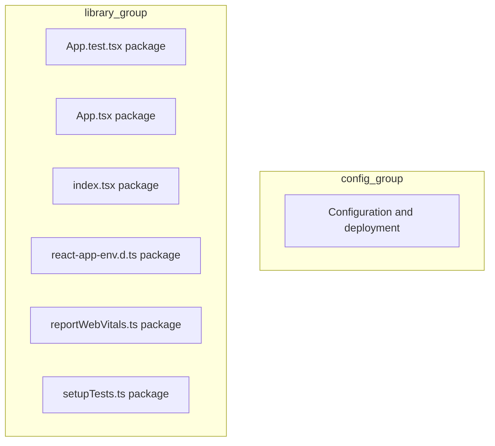

# Architecture report: gitname/react-gh-pages

> Automated static analysis. **Observed** = directly seen in files/imports/AST; **Inferred** = interpretation from that evidence. Repository code was not executed.

## 1. Repository at a glance

| Item | Value |
| --- | --- |
| Repository | gitname/react-gh-pages |
| Description | Deploying a React App (created using create-react-app) to GitHub Pages |
| Language | TypeScript |
| Stars | 6950 |
| Licence | Not detected |
| Analysed commit / branch | ca8b9f38392149c0143064cad3f7606f4e28241e / master |
| Framework(s) | React |
| Files analysed | 17 |
| Components | 7 |

## 2. Architecture in one minute

gitname/react-gh-pages - Deploying a React App (created using create-react-app) to GitHub Pages. This repository was analysed statically from 17 file(s) (0 Python). Detected technologies (observed from imports/manifests): React, TypeScript. Files are grouped into 7 component(s): App.test.tsx package, App.tsx package, Configuration and deployment, index.tsx package, react-app-env.d.ts package, reportWebVitals.ts package, setupTests.ts package. Findings below distinguish observed facts from inferred interpretation.

## 3. High-level block diagram

## 4. Main components

### App.test.tsx package (`app_test_tsx`)

- **Kind:** library
- **Status:** Observed
- **Confidence:** 0.85
- **Responsibility:** Groups 1 file(s) under app.test.tsx package (observed from repository paths and static analysis).
- **Paths:** `src/App.test.tsx`
- **Evidence:** [src/App.test.tsx](https://github.com/gitname/react-gh-pages/blob/ca8b9f38392149c0143064cad3f7606f4e28241e/src/App.test.tsx)

### App.tsx package (`app_tsx`)

- **Kind:** library
- **Status:** Observed
- **Confidence:** 0.85
- **Responsibility:** Groups 1 file(s) under app.tsx package (observed from repository paths and static analysis).
- **Paths:** `src/App.tsx`
- **Evidence:** [src/App.tsx](https://github.com/gitname/react-gh-pages/blob/ca8b9f38392149c0143064cad3f7606f4e28241e/src/App.tsx)

### Configuration and deployment (`config`)

- **Kind:** config
- **Status:** Observed
- **Confidence:** 0.85
- **Responsibility:** Groups 3 file(s) under configuration and deployment (observed from repository paths and static analysis).
- **Paths:** `package.json`, `public/manifest.json`, `tsconfig.json`
- **Evidence:** [package.json](https://github.com/gitname/react-gh-pages/blob/ca8b9f38392149c0143064cad3f7606f4e28241e/package.json); [public/manifest.json](https://github.com/gitname/react-gh-pages/blob/ca8b9f38392149c0143064cad3f7606f4e28241e/public/manifest.json); [tsconfig.json](https://github.com/gitname/react-gh-pages/blob/ca8b9f38392149c0143064cad3f7606f4e28241e/tsconfig.json)

### index.tsx package (`index_tsx`)

- **Kind:** library
- **Status:** Observed
- **Confidence:** 0.85
- **Responsibility:** Groups 1 file(s) under index.tsx package (observed from repository paths and static analysis).
- **Paths:** `src/index.tsx`
- **Evidence:** [src/index.tsx](https://github.com/gitname/react-gh-pages/blob/ca8b9f38392149c0143064cad3f7606f4e28241e/src/index.tsx)

### react-app-env.d.ts package (`react_app_env_d_ts`)

- **Kind:** library
- **Status:** Observed
- **Confidence:** 0.85
- **Responsibility:** Groups 1 file(s) under react-app-env.d.ts package (observed from repository paths and static analysis).
- **Paths:** `src/react-app-env.d.ts`
- **Evidence:** [src/react-app-env.d.ts](https://github.com/gitname/react-gh-pages/blob/ca8b9f38392149c0143064cad3f7606f4e28241e/src/react-app-env.d.ts)

### reportWebVitals.ts package (`reportwebvitals_ts`)

- **Kind:** library
- **Status:** Observed
- **Confidence:** 0.85
- **Responsibility:** Groups 1 file(s) under reportwebvitals.ts package (observed from repository paths and static analysis).
- **Paths:** `src/reportWebVitals.ts`
- **Evidence:** [src/reportWebVitals.ts](https://github.com/gitname/react-gh-pages/blob/ca8b9f38392149c0143064cad3f7606f4e28241e/src/reportWebVitals.ts)

### setupTests.ts package (`setuptests_ts`)

- **Kind:** library
- **Status:** Observed
- **Confidence:** 0.85
- **Responsibility:** Groups 1 file(s) under setuptests.ts package (observed from repository paths and static analysis).
- **Paths:** `src/setupTests.ts`
- **Evidence:** [src/setupTests.ts](https://github.com/gitname/react-gh-pages/blob/ca8b9f38392149c0143064cad3f7606f4e28241e/src/setupTests.ts)

## 5. Execution flow

**Observed** entry point(s):

- [src/App.tsx](https://github.com/gitname/react-gh-pages/blob/ca8b9f38392149c0143064cad3f7606f4e28241e/src/App.tsx)
- [src/index.tsx](https://github.com/gitname/react-gh-pages/blob/ca8b9f38392149c0143064cad3f7606f4e28241e/src/index.tsx)

Representative flow (derived from observed entry points and the import graph; steps beyond the entry point are **Inferred**):

1. Execution starts at an observed entry point listed above, if present.
2. No internal import relationships between components were observed.

## 6. Project structure

### `(root)`

- `.gitignore` - other (317 bytes)
- `README.md` - docs (14839 bytes)
- `package.json` - manifest (1147 bytes)
- `tsconfig.json` - config (535 bytes)

### `.github`

- `.github/ISSUE_TEMPLATE/help.md` - docs (735 bytes)

### `public`

- `public/index.html` - other (1721 bytes)
- `public/manifest.json` - config (492 bytes)
- `public/robots.txt` - docs (67 bytes)

### `src`

- `src/App.css` - other (564 bytes)
- `src/App.test.tsx` - source, TypeScript (273 bytes)
- `src/App.tsx` - source, TypeScript (556 bytes)
- `src/index.css` - other (366 bytes)
- `src/index.tsx` - source, TypeScript (500 bytes)
- `src/logo.svg` - other (2632 bytes)
- `src/react-app-env.d.ts` - source, TypeScript (40 bytes)
- `src/reportWebVitals.ts` - source, TypeScript (425 bytes)
- `src/setupTests.ts` - source, TypeScript (241 bytes)

## 7. Key dependencies and integrations

| Name | Category | Status | Confidence | Evidence |
| --- | --- | --- | --- | --- |
| React | framework | Observed | 0.90 | [package.json:4](https://github.com/gitname/react-gh-pages/blob/ca8b9f38392149c0143064cad3f7606f4e28241e/package.json#L4); [package.json:13](https://github.com/gitname/react-gh-pages/blob/ca8b9f38392149c0143064cad3f7606f4e28241e/package.json#L13) |
| TypeScript | tooling | Observed | 0.85 | [package.json:17](https://github.com/gitname/react-gh-pages/blob/ca8b9f38392149c0143064cad3f7606f4e28241e/package.json#L17) |

## 8. Data and state

No database, cache, queue, or persistent-state usage was observed in the analysed files. State handling, if any, may be in-memory or in files that were not analysed.

## 9. Configuration and deployment clues

- `package.json` (manifest)
- `public/manifest.json` (config)
- `tsconfig.json` (config)

## 10. Design observations

- No strong design patterns could be established from the available evidence.

These observations are interpretations (**Inferred**) of the observed structure, not guarantees about runtime design.

## 11. Limitations and unknowns

- Static analysis only: repository code was not executed, installed, or imported at runtime.
- Components and relationships are inferred from file paths, imports, and AST structure; runtime behaviour, dynamic imports, and reflection may not be visible.
- No clear application entry point was observed in the analysed files.
- Repository text was treated as untrusted data; no instructions found in repository files were followed, and likely secret values were redacted/excluded.
- JavaScript and TypeScript files were inventoried from paths and package manifests. They were not parsed with a full language AST, and repository code was not executed.

## 12. Source references

- [package.json](https://github.com/gitname/react-gh-pages/blob/ca8b9f38392149c0143064cad3f7606f4e28241e/package.json)
- [package.json:4](https://github.com/gitname/react-gh-pages/blob/ca8b9f38392149c0143064cad3f7606f4e28241e/package.json#L4)
- [package.json:13](https://github.com/gitname/react-gh-pages/blob/ca8b9f38392149c0143064cad3f7606f4e28241e/package.json#L13)
- [package.json:17](https://github.com/gitname/react-gh-pages/blob/ca8b9f38392149c0143064cad3f7606f4e28241e/package.json#L17)
- [public/manifest.json](https://github.com/gitname/react-gh-pages/blob/ca8b9f38392149c0143064cad3f7606f4e28241e/public/manifest.json)
- [src/App.test.tsx](https://github.com/gitname/react-gh-pages/blob/ca8b9f38392149c0143064cad3f7606f4e28241e/src/App.test.tsx)
- [src/App.tsx](https://github.com/gitname/react-gh-pages/blob/ca8b9f38392149c0143064cad3f7606f4e28241e/src/App.tsx)
- [src/index.tsx](https://github.com/gitname/react-gh-pages/blob/ca8b9f38392149c0143064cad3f7606f4e28241e/src/index.tsx)
- [src/react-app-env.d.ts](https://github.com/gitname/react-gh-pages/blob/ca8b9f38392149c0143064cad3f7606f4e28241e/src/react-app-env.d.ts)
- [src/reportWebVitals.ts](https://github.com/gitname/react-gh-pages/blob/ca8b9f38392149c0143064cad3f7606f4e28241e/src/reportWebVitals.ts)
- [src/setupTests.ts](https://github.com/gitname/react-gh-pages/blob/ca8b9f38392149c0143064cad3f7606f4e28241e/src/setupTests.ts)
- [tsconfig.json](https://github.com/gitname/react-gh-pages/blob/ca8b9f38392149c0143064cad3f7606f4e28241e/tsconfig.json)
