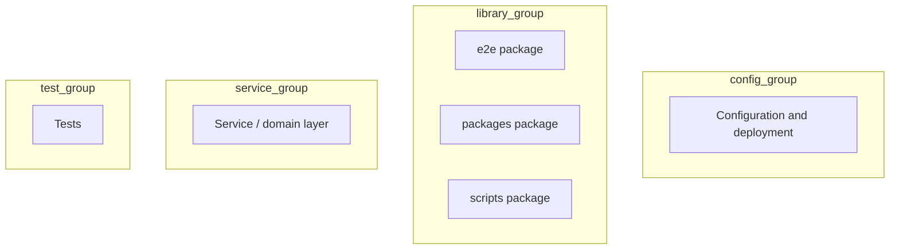

# Architecture report: gkurt/tegaki

> Automated static analysis. **Observed** = directly seen in files/imports/AST; **Inferred** = interpretation from that evidence. Repository code was not executed.

## 1. Repository at a glance

| Item | Value |
| --- | --- |
| Repository | gkurt/tegaki |
| Description | Handwriting animation for the web. Supports any font or text. |
| Language | TypeScript |
| Stars | 3307 |
| Licence | MIT |
| Analysed commit / branch | bf18556996d9683326e8f2130bd50e7632e9f187 / main |
| Framework(s) | Next.js, React, Svelte, Vue |
| Files analysed | 663 |
| Components | 6 |

## 2. Architecture in one minute

gkurt/tegaki - Handwriting animation for the web. Supports any font or text.. This repository was analysed statically from 663 file(s) (0 Python). Detected technologies (observed from imports/manifests): GitHub Actions, Next.js, React, Svelte, Vue, Tailwind CSS. Files are grouped into 6 component(s): Configuration and deployment, e2e package, packages package, scripts package, Service / domain layer, Tests. Findings below distinguish observed facts from inferred interpretation.

## 3. High-level block diagram

## 4. Main components

### Configuration and deployment (`config`)

- **Kind:** config
- **Status:** Observed
- **Confidence:** 0.85
- **Responsibility:** Groups 34 file(s) under configuration and deployment (observed from repository paths and static analysis).
- **Paths:** `bunfig.toml`, `e2e/examples/package.json`, `package.json`, `packages/generator/package.json`, `packages/renderer/fonts/amiri/glyphData.json`, `packages/renderer/fonts/atma/glyphData.json`, `packages/renderer/fonts/caveat/glyphData.json`, `packages/renderer/fonts/ems-allure/glyphData.json`, `packages/renderer/fonts/hershey-script/glyphData.json`, `packages/renderer/fonts/italianno/glyphData.json`, `packages/renderer/fonts/italianno/glyphDataById.json`, `packages/renderer/fonts/parisienne/glyphData.json`, `packages/renderer/fonts/parisienne/glyphDataById.json`, `packages/renderer/fonts/suez-one/glyphData.json`, `packages/renderer/fonts/suez-one/glyphDataById.json`, `packages/renderer/fonts/tangerine/glyphData.json`, `packages/renderer/fonts/tillana/glyphData.json`, `packages/renderer/package.json`, `packages/renderer/scoreboard/amiri.json`, `packages/renderer/scoreboard/atma.json`, `packages/renderer/scoreboard/caveat.json`, `packages/renderer/scoreboard/italianno.json`, `packages/renderer/scoreboard/klee-one.json`, `packages/renderer/scoreboard/lxgw-wenkai.json`, `packages/renderer/scoreboard/nanum-pen-script.json`, `packages/renderer/scoreboard/parisienne.json`, `packages/renderer/scoreboard/suez-one.json`, `packages/renderer/scoreboard/tangerine.json`, `packages/renderer/scoreboard/tillana.json`, `packages/website/bunfig.toml`, `packages/website/package.json`, `packages/website/tsconfig.json`, `skills-lock.json`, `tsconfig.json`
- **Evidence:** [bunfig.toml](https://github.com/gkurt/tegaki/blob/bf18556996d9683326e8f2130bd50e7632e9f187/bunfig.toml); [e2e/examples/package.json](https://github.com/gkurt/tegaki/blob/bf18556996d9683326e8f2130bd50e7632e9f187/e2e/examples/package.json); [package.json](https://github.com/gkurt/tegaki/blob/bf18556996d9683326e8f2130bd50e7632e9f187/package.json); [packages/generator/package.json](https://github.com/gkurt/tegaki/blob/bf18556996d9683326e8f2130bd50e7632e9f187/packages/generator/package.json); [packages/renderer/fonts/amiri/glyphData.json](https://github.com/gkurt/tegaki/blob/bf18556996d9683326e8f2130bd50e7632e9f187/packages/renderer/fonts/amiri/glyphData.json); [packages/renderer/fonts/atma/glyphData.json](https://github.com/gkurt/tegaki/blob/bf18556996d9683326e8f2130bd50e7632e9f187/packages/renderer/fonts/atma/glyphData.json); [packages/renderer/fonts/caveat/glyphData.json](https://github.com/gkurt/tegaki/blob/bf18556996d9683326e8f2130bd50e7632e9f187/packages/renderer/fonts/caveat/glyphData.json); [packages/renderer/fonts/ems-allure/glyphData.json](https://github.com/gkurt/tegaki/blob/bf18556996d9683326e8f2130bd50e7632e9f187/packages/renderer/fonts/ems-allure/glyphData.json)

### e2e package (`e2e`)

- **Kind:** library
- **Status:** Observed
- **Confidence:** 0.85
- **Responsibility:** Groups 4 file(s) under e2e package (observed from repository paths and static analysis).
- **Paths:** `e2e/examples/check-remotion-still.ts`, `e2e/examples/check-wc-cdn.ts`, `e2e/examples/playwright.config.ts`, `e2e/examples/smoke.e2e.ts`
- **Evidence:** [e2e/examples/check-remotion-still.ts](https://github.com/gkurt/tegaki/blob/bf18556996d9683326e8f2130bd50e7632e9f187/e2e/examples/check-remotion-still.ts); [e2e/examples/check-wc-cdn.ts](https://github.com/gkurt/tegaki/blob/bf18556996d9683326e8f2130bd50e7632e9f187/e2e/examples/check-wc-cdn.ts); [e2e/examples/playwright.config.ts](https://github.com/gkurt/tegaki/blob/bf18556996d9683326e8f2130bd50e7632e9f187/e2e/examples/playwright.config.ts); [e2e/examples/smoke.e2e.ts](https://github.com/gkurt/tegaki/blob/bf18556996d9683326e8f2130bd50e7632e9f187/e2e/examples/smoke.e2e.ts)

### packages package (`packages`)

- **Kind:** library
- **Status:** Observed
- **Confidence:** 0.85
- **Responsibility:** Groups 369 file(s) under packages package (observed from repository paths and static analysis).
- **Paths:** `packages/generator/scripts/build-hershey-data.ts`, `packages/generator/scripts/build-letterpaths-data.ts`, `packages/generator/scripts/derive-korean-chars.ts`, `packages/generator/src/charsets.test.ts`, `packages/generator/src/charsets.ts`, `packages/generator/src/cli/index.test.ts`, `packages/generator/src/cli/index.ts`, `packages/generator/src/commands/compact.test.ts`, `packages/generator/src/commands/coverage-report.test.ts`, `packages/generator/src/commands/coverage-report.ts`, `packages/generator/src/commands/extract-bundle.test.ts`, `packages/generator/src/commands/generate.ts`, `packages/generator/src/commands/scoreboard.test.ts`, `packages/generator/src/commands/scoreboard.ts`, `packages/generator/src/commands/stroke-order-report.test.ts`, `packages/generator/src/commands/stroke-order-report.ts`, `packages/generator/src/constants.ts`, `packages/generator/src/debug/output.ts`, `packages/generator/src/font/download.ts`, `packages/generator/src/font/enumerate-variants.test.ts`, `packages/generator/src/font/enumerate-variants.ts`, `packages/generator/src/font/glyph-forms.test.ts`, `packages/generator/src/font/glyph-forms.ts`, `packages/generator/src/font/hb-shaper.ts`, `packages/generator/src/font/local.test.ts`, `packages/generator/src/font/local.ts`, `packages/generator/src/font/parse.ts`, `packages/generator/src/font/progress-font.test.ts`, `packages/generator/src/font/progress-font.ts`, `packages/generator/src/font/subset.test.ts`, `packages/generator/src/font/subset.ts`, `packages/generator/src/font/unicode-range.test.ts`, `packages/generator/src/font/unicode-range.ts`, `packages/generator/src/geometry/bends.test.ts`, `packages/generator/src/geometry/bends.ts`, `packages/generator/src/geometry/contours.test.ts`, `packages/generator/src/geometry/contours.ts`, `packages/generator/src/geometry/corners.ts`, `packages/generator/src/geometry/cuts.ts`, `packages/generator/src/geometry/face-medial.test.ts`, `packages/generator/src/geometry/face-medial.ts`, `packages/generator/src/geometry/face-merge.test.ts`, `packages/generator/src/geometry/face-merge.ts`, `packages/generator/src/geometry/face-straight-skeleton.test.ts`, `packages/generator/src/geometry/face-straight-skeleton.ts`, `packages/generator/src/geometry/ink/cover.ts`, `packages/generator/src/geometry/ink/extract.ts`, `packages/generator/src/geometry/ink/graph.ts`, `packages/generator/src/geometry/ink/ink.test.ts`, `packages/generator/src/geometry/ink/mesh.ts`, `packages/generator/src/geometry/ink/nib.ts`, `packages/generator/src/geometry/ink/spatial.ts`, `packages/generator/src/geometry/junction-routing.test.ts`, `packages/generator/src/geometry/junction-routing.ts`, `packages/generator/src/geometry/marks.test.ts`, `packages/generator/src/geometry/marks.ts`, `packages/generator/src/geometry/medial.test.ts`, `packages/generator/src/geometry/medial.ts`, `packages/generator/src/geometry/ordering.test.ts`, `packages/generator/src/geometry/ordering.ts`, `packages/generator/src/geometry/partition.test.ts`, `packages/generator/src/geometry/partition.ts`, `packages/generator/src/geometry/pipeline.test.ts`, `packages/generator/src/geometry/pipeline.ts`, `packages/generator/src/geometry/primitives.ts`, `packages/generator/src/geometry/raycast.ts`, `packages/generator/src/geometry/reference-regroup.test.ts`, `packages/generator/src/geometry/regions.test.ts`, `packages/generator/src/geometry/regions.ts`, `packages/generator/src/geometry/regroup.test.ts`, `packages/generator/src/geometry/regroup.ts`, `packages/generator/src/geometry/strokes.test.ts`, `packages/generator/src/geometry/strokes.ts`, `packages/generator/src/geometry/trial-join.test.ts`, `packages/generator/src/geometry/trial-join.ts`, `packages/generator/src/geometry/types.ts`, `packages/generator/src/geometry/visualize.test.ts`, `packages/generator/src/geometry/visualize.ts`, `packages/generator/src/index.ts`, `packages/generator/src/processing/animated-svg.ts`, `packages/generator/src/processing/bezier.ts`, `packages/generator/src/processing/font-units.ts`, `packages/generator/src/processing/png.ts`, `packages/generator/src/processing/rasterize.ts`, `packages/generator/src/processing/rtl.ts`, `packages/generator/src/processing/skeletonize/cleanup.ts`, `packages/generator/src/processing/skeletonize/guo-hall.ts`, `packages/generator/src/processing/skeletonize/index.ts`, `packages/generator/src/processing/skeletonize/lee.ts`, `packages/generator/src/processing/skeletonize/medial-axis.ts`, `packages/generator/src/processing/skeletonize/morphological.ts`, `packages/generator/src/processing/skeletonize/zhang-suen.ts`, `packages/generator/src/processing/stroke-order.ts`, `packages/generator/src/processing/trace.ts`, `packages/generator/src/processing/visualize.ts`, `packages/generator/src/processing/voronoi-medial-axis.ts`, `packages/generator/src/processing/width.ts`, `packages/generator/src/stroke-font/bundle.ts`, `packages/generator/src/stroke-font/parse.ts`, `packages/generator/src/stroke-font/stroke-font.test.ts`, `packages/generator/src/stroke-font/types.ts`, `packages/generator/src/stroke-order/dataset-fetch.ts`, `packages/generator/src/stroke-order/datasets.ts`, `packages/generator/src/stroke-order/drawn.test.ts`, `packages/generator/src/stroke-order/drawn.ts`, `packages/generator/src/stroke-order/guide.test.ts`, `packages/generator/src/stroke-order/guide.ts`, `packages/generator/src/stroke-order/hangul.test.ts`, `packages/generator/src/stroke-order/hangul.ts`, `packages/generator/src/stroke-order/hershey-jhf.ts`, `packages/generator/src/stroke-order/hershey.test.ts`, `packages/generator/src/stroke-order/hershey.ts`, `packages/generator/src/stroke-order/jhf.ts`, `packages/generator/src/stroke-order/kanjivg-fetch.ts`, `packages/generator/src/stroke-order/kanjivg.test.ts`, `packages/generator/src/stroke-order/kanjivg.ts`, `packages/generator/src/stroke-order/letterpaths-data.ts`, `packages/generator/src/stroke-order/letterpaths.test.ts`, `packages/generator/src/stroke-order/letterpaths.ts`, `packages/generator/src/stroke-order/makemeahanzi-fetch.ts`, `packages/generator/src/stroke-order/makemeahanzi.test.ts`, `packages/generator/src/stroke-order/makemeahanzi.ts`, `packages/generator/src/stroke-order/match.test.ts`, `packages/generator/src/stroke-order/match.ts`, `packages/generator/src/stroke-order/providers.test.ts`, `packages/generator/src/stroke-order/providers.ts`, `packages/generator/src/stroke-order/punctuation.ts`, `packages/generator/src/stroke-order/register.test.ts`, `packages/generator/src/stroke-order/register.ts`, `packages/generator/src/stroke-order/svg-path.test.ts`, `packages/generator/src/stroke-order/svg-path.ts`, `packages/generator/src/stroke-order/types.ts`, `packages/renderer/fonts/amiri/bundle.ts`, `packages/renderer/fonts/atma/bundle.ts`, `packages/renderer/fonts/caveat/bundle.ts`, `packages/renderer/fonts/ems-allure/bundle.ts`, `packages/renderer/fonts/hershey-script/bundle.ts`, `packages/renderer/fonts/italianno/bundle.ts`, `packages/renderer/fonts/klee-one/bundle.ts`, `packages/renderer/fonts/lxgw-wenkai/bundle.ts`, `packages/renderer/fonts/nanum-pen-script/bundle.ts`, `packages/renderer/fonts/parisienne/bundle.ts`, `packages/renderer/fonts/suez-one/bundle.ts`, `packages/renderer/fonts/tangerine/bundle.ts`, `packages/renderer/fonts/tillana/bundle.ts`, `packages/renderer/scripts/bundled-fonts.ts`, `packages/renderer/scripts/generate-fonts.ts`, `packages/renderer/scripts/scoreboard.ts`, `packages/renderer/src/astro/integration.test.ts`, `packages/renderer/src/astro/integration.ts`, `packages/renderer/src/cli.ts`, `packages/renderer/src/env.d.ts`, `packages/renderer/src/index.ts`, `packages/renderer/src/internal/index.ts`, `packages/renderer/src/lib/bidi.test.ts`, `packages/renderer/src/lib/bidi.ts`, `packages/renderer/src/lib/catmullRom.ts`, `packages/renderer/src/lib/css-properties.ts`, `packages/renderer/src/lib/drawFallbackGlyph.ts`, `packages/renderer/src/lib/easings.ts`, `packages/renderer/src/lib/fallbackRuns.test.ts`, `packages/renderer/src/lib/fallbackRuns.ts`, `packages/renderer/src/lib/features.ts`, `packages/renderer/src/lib/flattenPath.test.ts`, `packages/renderer/src/lib/flattenPath.ts`, `packages/renderer/src/lib/font.ts`, `packages/renderer/src/lib/inkBounds.test.ts`, `packages/renderer/src/lib/inkBounds.ts`, `packages/renderer/src/lib/itemize.test.ts`, `packages/renderer/src/lib/itemize.ts`, `packages/renderer/src/lib/paintStroke.ts`, `packages/renderer/src/lib/random.ts`, `packages/renderer/src/lib/shaper.ts`, `packages/renderer/src/lib/strokeCache.ts`, `packages/renderer/src/lib/strokePath.test.ts`, `packages/renderer/src/lib/strokePath.ts`, `packages/renderer/src/lib/strokeTimeline.test.ts`, `packages/renderer/src/lib/strokeTimeline.ts`, `packages/renderer/src/lib/svgExport.test.ts`, `packages/renderer/src/lib/svgExport.ts`, `packages/renderer/src/lib/textLayout.test.ts`, `packages/renderer/src/lib/textLayout.ts`, `packages/renderer/src/lib/textToSvg.test.ts`, `packages/renderer/src/lib/textToSvg.ts`, `packages/renderer/src/lib/timeline.test.ts`, `packages/renderer/src/lib/timeline.ts`, `packages/renderer/src/lib/utils.test.ts`, `packages/renderer/src/lib/utils.ts`, `packages/renderer/src/lib/weights.test.ts`, `packages/renderer/src/lib/weights.ts`, `packages/renderer/src/nuxt/index.ts`, `packages/renderer/src/nuxt/module.ts`, `packages/renderer/src/plugins/annotate.test.ts`, `packages/renderer/src/plugins/annotate.ts`, `packages/renderer/src/plugins/boil.test.ts`, `packages/renderer/src/plugins/boil.ts`, `packages/renderer/src/plugins/glow.ts`, `packages/renderer/src/plugins/glyphSpace.ts`, `packages/renderer/src/plugins/gradient.ts`, `packages/renderer/src/plugins/groups.test.ts`, `packages/renderer/src/plugins/groups.ts`, `packages/renderer/src/plugins/styles.test.ts`, `packages/renderer/src/plugins/taper.ts`, `packages/renderer/src/plugins/testStrokes.ts`, `packages/renderer/src/plugins/variation.test.ts`, `packages/renderer/src/plugins/variation.ts`, `packages/renderer/src/react/TegakiRenderer.tsx`, `packages/renderer/src/react/index.ts`, `packages/renderer/src/shaper-harfbuzz/index.test.ts`, `packages/renderer/src/shaper-harfbuzz/index.ts`, `packages/renderer/src/solid/TegakiRenderer.tsx`, `packages/renderer/src/solid/index.ts`, `packages/renderer/src/svelte/TegakiRenderer.svelte`, `packages/renderer/src/svelte/index.ts`, `packages/renderer/src/types.test.ts`, `packages/renderer/src/types.ts`, `packages/renderer/src/vue/TegakiRenderer.vue`, `packages/renderer/src/vue/index.ts`, `packages/renderer/src/wc/TegakiElement.ts`, `packages/renderer/src/wc/index.ts`, `packages/renderer/tsdown.config.ts`, `packages/website/astro.config.ts`, `packages/website/playwright.config.ts`, `packages/website/scripts/e2e-docker.sh`, `packages/website/src/components/LiveDemo.tsx`, `packages/website/src/components/home/ChatStream.tsx`, `packages/website/src/components/home/ControlledTime.tsx`, `packages/website/src/components/home/Finale.tsx`, `packages/website/src/components/home/Hero.tsx`, `packages/website/src/components/home/Plugins.tsx`, `packages/website/src/components/home/Scripts.tsx`, `packages/website/src/components/home/TypeIt.tsx`, `packages/website/src/components/home/Write.tsx`, `packages/website/src/components/home/rainbow.ts`, `packages/website/src/components/home/shared.ts`, `packages/website/src/components/home/snippets.ts`, `packages/website/src/components/plugins/ballpoint.ts`, `packages/website/src/components/plugins/bleed.ts`, `packages/website/src/components/plugins/brush.ts`, `packages/website/src/components/plugins/burn.ts`, `packages/website/src/components/plugins/caption.test.ts`, `packages/website/src/components/plugins/caption.ts`, `packages/website/src/components/plugins/chalk.ts`, `packages/website/src/components/plugins/color.ts`, `packages/website/src/components/plugins/colors.ts`, `packages/website/src/components/plugins/crt.ts`, `packages/website/src/components/plugins/echo.ts`, `packages/website/src/components/plugins/eraser.ts`, `packages/website/src/components/plugins/foil.ts`, `packages/website/src/components/plugins/grain.ts`, `packages/website/src/components/plugins/graphite.ts`, `packages/website/src/components/plugins/haptics.ts`, `packages/website/src/components/plugins/hatch.ts`, `packages/website/src/components/plugins/index.ts`, `packages/website/src/components/plugins/ink-canvas.ts`, `packages/website/src/components/plugins/ink3d.ts`, `packages/website/src/components/plugins/joins.ts`, `packages/website/src/components/plugins/karaoke.ts`, `packages/website/src/components/plugins/laser.ts`, `packages/website/src/components/plugins/marker.ts`, `packages/website/src/components/plugins/neon.ts`, `packages/website/src/components/plugins/nib.ts`, `packages/website/src/components/plugins/noise.ts`, `packages/website/src/components/plugins/paper.ts`, `packages/website/src/components/plugins/pen.ts`, `packages/website/src/components/plugins/plugins.test.ts`, `packages/website/src/components/plugins/rhythm.ts`, `packages/website/src/components/plugins/segment.ts`, `packages/website/src/components/plugins/settle.ts`, `packages/website/src/components/plugins/shadow.ts`, `packages/website/src/components/plugins/shake.ts`, `packages/website/src/components/plugins/shaky.ts`, `packages/website/src/components/plugins/slant.ts`, `packages/website/src/components/plugins/sound.ts`, `packages/website/src/components/plugins/sparkle.ts`, `packages/website/src/components/plugins/spray.ts`, `packages/website/src/components/plugins/stitch.ts`, `packages/website/src/components/plugins/stroke-order.ts`, `packages/website/src/components/plugins/svg.ts`, `packages/website/src/components/plugins/sweep.ts`, `packages/website/src/components/plugins/testStrokes.ts`, `packages/website/src/components/plugins/text-path.test.ts`, `packages/website/src/components/plugins/text-path.ts`, `packages/website/src/components/plugins/typewriter.ts`, `packages/website/src/components/plugins/wet.ts`, `packages/website/src/components/plugins/wobble.ts`, `packages/website/src/components/preview/StandaloneTextPreview.tsx`, `packages/website/src/components/preview/TegakiTextPreview.tsx`, `packages/website/src/components/preview/constants.ts`, `packages/website/src/components/preview/drawn-datasets.test.ts`, `packages/website/src/components/preview/drawn-datasets.ts`, `packages/website/src/components/preview/export.ts`, `packages/website/src/components/preview/font-cache-id.ts`, `packages/website/src/components/preview/font-cdn.ts`, `packages/website/src/components/preview/shaped-glyphs.test.ts`, `packages/website/src/components/preview/shaped-glyphs.ts`, `packages/website/src/components/preview/stage-views.tsx`, `packages/website/src/components/preview/stroke-fonts.ts`, `packages/website/src/components/preview/stroke-order-providers.ts`, `packages/website/src/components/preview/utils.test.ts`, `packages/website/src/components/preview/utils.ts`, `packages/website/src/components/solid/LiveDemo.tsx`, `packages/website/src/components/solid/LiveDemoControlled.tsx`, `packages/website/src/components/studio/AgentPromptMenu.tsx`, `packages/website/src/components/studio/ExportMenu.tsx`, `packages/website/src/components/studio/FontPicker.tsx`, `packages/website/src/components/studio/GlyphForms.tsx`, `packages/website/src/components/studio/GlyphPicker.tsx`, `packages/website/src/components/studio/GlyphWorkspace.tsx`, `packages/website/src/components/studio/ReferenceDraw.tsx`, `packages/website/src/components/studio/ShortcutsDialog.tsx`, `packages/website/src/components/studio/Studio.tsx`, `packages/website/src/components/studio/TextFrame.tsx`, `packages/website/src/components/studio/TextWorkspace.tsx`, `packages/website/src/components/studio/Transport.tsx`, `packages/website/src/components/studio/VariableFontPreview.tsx`, `packages/website/src/components/studio/ZoomStage.tsx`, `packages/website/src/components/studio/agent-prompt.test.ts`, `packages/website/src/components/studio/agent-prompt.ts`, `packages/website/src/components/studio/charsets.test.ts`, `packages/website/src/components/studio/charsets.ts`, `packages/website/src/components/studio/glyph-cluster.test.ts`, `packages/website/src/components/studio/glyph-cluster.ts`, `packages/website/src/components/studio/glyph-hit.test.ts`, `packages/website/src/components/studio/glyph-hit.ts`, `packages/website/src/components/studio/icons.tsx`, `packages/website/src/components/studio/inspector/DrawnDatasets.tsx`, `packages/website/src/components/studio/inspector/Inspector.tsx`, `packages/website/src/components/studio/inspector/MotionPanel.tsx`, `packages/website/src/components/studio/inspector/PipelinePanel.tsx`, `packages/website/src/components/studio/inspector/PluginsPanel.tsx`, `packages/website/src/components/studio/inspector/StylePanel.tsx`, `packages/website/src/components/studio/inspector/dial.tsx`, `packages/website/src/components/studio/inspector/weights.ts`, `packages/website/src/components/studio/progress-font.test.ts`, `packages/website/src/components/studio/progress-font.ts`, `packages/website/src/components/studio/seed.test.ts`, `packages/website/src/components/studio/seed.ts`, `packages/website/src/components/studio/shortcuts.test.ts`, `packages/website/src/components/studio/shortcuts.ts`, `packages/website/src/components/studio/state.ts`, `packages/website/src/components/studio/ui.tsx`, `packages/website/src/components/svelte/LiveDemo.svelte`, `packages/website/src/components/svelte/LiveDemoControlled.svelte`, `packages/website/src/components/url-state.test.ts`, `packages/website/src/components/url-state.ts`, `packages/website/src/components/vue/LiveDemo.vue`, `packages/website/src/components/vue/LiveDemoControlled.vue`, `packages/website/src/content.config.ts`, `packages/website/src/env.d.ts`, `packages/website/src/home-fonts.test.ts`, `packages/website/src/home-fonts.ts`, `packages/website/src/llms/content.test.ts`, `packages/website/src/llms/content.ts`, `packages/website/src/llms/load.ts`, `packages/website/src/llms/mdx-to-markdown.test.ts`, `packages/website/src/llms/mdx-to-markdown.ts`, `packages/website/src/pages/.well-known/agent-skills/index.json.ts`, `packages/website/src/pages/[...slug].md.ts`, `packages/website/src/pages/index.md.ts`, `packages/website/src/pages/llms-full.txt.ts`, `packages/website/src/pages/llms.txt.ts`, `packages/website/src/pages/sitemap.md.ts`, `packages/website/src/pages/skill.md.ts`, `packages/website/src/route-middleware.ts`, `packages/website/src/seo.ts`, `packages/website/src/site.ts`, `packages/website/src/types/gifenc.d.ts`, `packages/website/svelte.config.js`
- **Evidence:** [packages/generator/scripts/build-hershey-data.ts](https://github.com/gkurt/tegaki/blob/bf18556996d9683326e8f2130bd50e7632e9f187/packages/generator/scripts/build-hershey-data.ts); [packages/generator/scripts/build-letterpaths-data.ts](https://github.com/gkurt/tegaki/blob/bf18556996d9683326e8f2130bd50e7632e9f187/packages/generator/scripts/build-letterpaths-data.ts); [packages/generator/scripts/derive-korean-chars.ts](https://github.com/gkurt/tegaki/blob/bf18556996d9683326e8f2130bd50e7632e9f187/packages/generator/scripts/derive-korean-chars.ts); [packages/generator/src/charsets.test.ts](https://github.com/gkurt/tegaki/blob/bf18556996d9683326e8f2130bd50e7632e9f187/packages/generator/src/charsets.test.ts); [packages/generator/src/charsets.ts](https://github.com/gkurt/tegaki/blob/bf18556996d9683326e8f2130bd50e7632e9f187/packages/generator/src/charsets.ts); [packages/generator/src/cli/index.test.ts](https://github.com/gkurt/tegaki/blob/bf18556996d9683326e8f2130bd50e7632e9f187/packages/generator/src/cli/index.test.ts); [packages/generator/src/cli/index.ts](https://github.com/gkurt/tegaki/blob/bf18556996d9683326e8f2130bd50e7632e9f187/packages/generator/src/cli/index.ts); [packages/generator/src/commands/compact.test.ts](https://github.com/gkurt/tegaki/blob/bf18556996d9683326e8f2130bd50e7632e9f187/packages/generator/src/commands/compact.test.ts)

### scripts package (`scripts`)

- **Kind:** library
- **Status:** Observed
- **Confidence:** 0.85
- **Responsibility:** Groups 7 file(s) under scripts package (observed from repository paths and static analysis).
- **Paths:** `scripts/brand/lib.ts`, `scripts/brand/write.ts`, `scripts/generate-card.ts`, `scripts/generate-logo.ts`, `scripts/generate-readme-svg.ts`, `scripts/prepareForRelease.ts`, `scripts/test-published-examples.ts`
- **Evidence:** [scripts/brand/lib.ts](https://github.com/gkurt/tegaki/blob/bf18556996d9683326e8f2130bd50e7632e9f187/scripts/brand/lib.ts); [scripts/brand/write.ts](https://github.com/gkurt/tegaki/blob/bf18556996d9683326e8f2130bd50e7632e9f187/scripts/brand/write.ts); [scripts/generate-card.ts](https://github.com/gkurt/tegaki/blob/bf18556996d9683326e8f2130bd50e7632e9f187/scripts/generate-card.ts); [scripts/generate-logo.ts](https://github.com/gkurt/tegaki/blob/bf18556996d9683326e8f2130bd50e7632e9f187/scripts/generate-logo.ts); [scripts/generate-readme-svg.ts](https://github.com/gkurt/tegaki/blob/bf18556996d9683326e8f2130bd50e7632e9f187/scripts/generate-readme-svg.ts); [scripts/prepareForRelease.ts](https://github.com/gkurt/tegaki/blob/bf18556996d9683326e8f2130bd50e7632e9f187/scripts/prepareForRelease.ts); [scripts/test-published-examples.ts](https://github.com/gkurt/tegaki/blob/bf18556996d9683326e8f2130bd50e7632e9f187/scripts/test-published-examples.ts)

### Service / domain layer (`service_layer`)

- **Kind:** service
- **Status:** Observed
- **Confidence:** 0.85
- **Responsibility:** Groups 22 file(s) under service / domain layer (observed from repository paths and static analysis).
- **Paths:** `packages/renderer/src/core/attach.test.ts`, `packages/renderer/src/core/bundle-registry.test.ts`, `packages/renderer/src/core/bundle-registry.ts`, `packages/renderer/src/core/createBundle.ts`, `packages/renderer/src/core/createPlugin.test.ts`, `packages/renderer/src/core/createPlugin.ts`, `packages/renderer/src/core/drawGlyph.test.ts`, `packages/renderer/src/core/drawGlyph.ts`, `packages/renderer/src/core/engine.test.ts`, `packages/renderer/src/core/engine.ts`, `packages/renderer/src/core/index.ts`, `packages/renderer/src/core/nib.test.ts`, `packages/renderer/src/core/plugin-registry.ts`, `packages/renderer/src/core/plugins.ts`, `packages/renderer/src/core/pressure.ts`, `packages/renderer/src/core/render-elements.test.ts`, `packages/renderer/src/core/render-elements.ts`, `packages/renderer/src/core/shaper-registry.test.ts`, `packages/renderer/src/core/shaper-registry.ts`, `packages/renderer/src/core/steps.test.ts`, `packages/renderer/src/core/timing.test.ts`, `packages/renderer/src/core/types.ts`
- **Evidence:** [packages/renderer/src/core/attach.test.ts](https://github.com/gkurt/tegaki/blob/bf18556996d9683326e8f2130bd50e7632e9f187/packages/renderer/src/core/attach.test.ts); [packages/renderer/src/core/bundle-registry.test.ts](https://github.com/gkurt/tegaki/blob/bf18556996d9683326e8f2130bd50e7632e9f187/packages/renderer/src/core/bundle-registry.test.ts); [packages/renderer/src/core/bundle-registry.ts](https://github.com/gkurt/tegaki/blob/bf18556996d9683326e8f2130bd50e7632e9f187/packages/renderer/src/core/bundle-registry.ts); [packages/renderer/src/core/createBundle.ts](https://github.com/gkurt/tegaki/blob/bf18556996d9683326e8f2130bd50e7632e9f187/packages/renderer/src/core/createBundle.ts); [packages/renderer/src/core/createPlugin.test.ts](https://github.com/gkurt/tegaki/blob/bf18556996d9683326e8f2130bd50e7632e9f187/packages/renderer/src/core/createPlugin.test.ts); [packages/renderer/src/core/createPlugin.ts](https://github.com/gkurt/tegaki/blob/bf18556996d9683326e8f2130bd50e7632e9f187/packages/renderer/src/core/createPlugin.ts); [packages/renderer/src/core/drawGlyph.test.ts](https://github.com/gkurt/tegaki/blob/bf18556996d9683326e8f2130bd50e7632e9f187/packages/renderer/src/core/drawGlyph.test.ts); [packages/renderer/src/core/drawGlyph.ts](https://github.com/gkurt/tegaki/blob/bf18556996d9683326e8f2130bd50e7632e9f187/packages/renderer/src/core/drawGlyph.ts)

### Tests (`tests`)

- **Kind:** test
- **Status:** Observed
- **Confidence:** 0.85
- **Responsibility:** Groups 3 file(s) under tests (observed from repository paths and static analysis).
- **Paths:** `packages/website/tests/e2e/cross-browser.e2e.ts`, `packages/website/tests/e2e/preview.ts`, `packages/website/tests/e2e/text-preview.e2e.ts`
- **Evidence:** [packages/website/tests/e2e/cross-browser.e2e.ts](https://github.com/gkurt/tegaki/blob/bf18556996d9683326e8f2130bd50e7632e9f187/packages/website/tests/e2e/cross-browser.e2e.ts); [packages/website/tests/e2e/preview.ts](https://github.com/gkurt/tegaki/blob/bf18556996d9683326e8f2130bd50e7632e9f187/packages/website/tests/e2e/preview.ts); [packages/website/tests/e2e/text-preview.e2e.ts](https://github.com/gkurt/tegaki/blob/bf18556996d9683326e8f2130bd50e7632e9f187/packages/website/tests/e2e/text-preview.e2e.ts)

## 5. Execution flow

**Observed** entry point(s):

- [packages/generator/src/index.ts](https://github.com/gkurt/tegaki/blob/bf18556996d9683326e8f2130bd50e7632e9f187/packages/generator/src/index.ts)
- [packages/renderer/src/index.ts](https://github.com/gkurt/tegaki/blob/bf18556996d9683326e8f2130bd50e7632e9f187/packages/renderer/src/index.ts)

Representative flow (derived from observed entry points and the import graph; steps beyond the entry point are **Inferred**):

1. Execution starts at an observed entry point listed above, if present.
2. No internal import relationships between components were observed.

## 6. Project structure

### `(root)`

- `.editorconfig` - config (161 bytes)
- `.gitignore` - other (458 bytes)
- `AGENTS.md` - docs (64465 bytes)
- `CHANGELOG.md` - docs (103 bytes)
- `CLAUDE.md` - docs (11 bytes)
- `CONTRIBUTING.md` - docs (7760 bytes)
- `LICENSE` - docs (1068 bytes)
- `README.md` - docs (4707 bytes)
- `biome.jsonc` - other (1710 bytes)
- `bunfig.toml` - config (58 bytes)
- `package.json` - manifest (2053 bytes)
- `skills-lock.json` - config (463 bytes)
- `tegaki.code-workspace` - other (981 bytes)
- `tsconfig.json` - config (719 bytes)

### `.agents`

- `.agents/skills/padrone/SKILL.md` - docs (10585 bytes)
- `.agents/skills/padrone/api-reference.md` - docs (18655 bytes)
- `.agents/skills/padrone/examples.md` - docs (14442 bytes)
- `.agents/skills/remotion-best-practices/SKILL.md` - docs (9676 bytes)
- `.agents/skills/remotion-best-practices/rules/3d.md` - docs (2292 bytes)
- `.agents/skills/remotion-best-practices/rules/assets/charts-bar-chart.tsx` - source, TypeScript (3845 bytes)
- `.agents/skills/remotion-best-practices/rules/assets/text-animations-typewriter.tsx` - source, TypeScript (2281 bytes)
- `.agents/skills/remotion-best-practices/rules/assets/text-animations-word-highlight.tsx` - source, TypeScript (2634 bytes)
- `.agents/skills/remotion-best-practices/rules/audio-visualization.md` - docs (4892 bytes)
- `.agents/skills/remotion-best-practices/rules/audio.md` - docs (3625 bytes)
- `.agents/skills/remotion-best-practices/rules/calculate-metadata.md` - docs (3254 bytes)
- `.agents/skills/remotion-best-practices/rules/compositions.md` - docs (3358 bytes)
- `.agents/skills/remotion-best-practices/rules/display-captions.md` - docs (5471 bytes)
- `.agents/skills/remotion-best-practices/rules/ffmpeg.md` - docs (1093 bytes)
- `.agents/skills/remotion-best-practices/rules/get-audio-duration.md` - docs (1357 bytes)
- `.agents/skills/remotion-best-practices/rules/get-video-dimensions.md` - docs (1626 bytes)
- `.agents/skills/remotion-best-practices/rules/get-video-duration.md` - docs (1377 bytes)
- `.agents/skills/remotion-best-practices/rules/gifs.md` - docs (3707 bytes)
- `.agents/skills/remotion-best-practices/rules/google-fonts.md` - docs (1692 bytes)
- `.agents/skills/remotion-best-practices/rules/html-in-canvas.md` - docs (3629 bytes)
- `.agents/skills/remotion-best-practices/rules/images.md` - docs (1464 bytes)
- `.agents/skills/remotion-best-practices/rules/import-srt-captions.md` - docs (2247 bytes)
- `.agents/skills/remotion-best-practices/rules/light-leaks.md` - docs (2305 bytes)
- `.agents/skills/remotion-best-practices/rules/local-fonts.md` - docs (1511 bytes)
- `.agents/skills/remotion-best-practices/rules/lottie.md` - docs (1796 bytes)
- `.agents/skills/remotion-best-practices/rules/maplibre.md` - docs (12468 bytes)
- `.agents/skills/remotion-best-practices/rules/measuring-dom-nodes.md` - docs (973 bytes)
- `.agents/skills/remotion-best-practices/rules/measuring-text.md` - docs (2783 bytes)
- `.agents/skills/remotion-best-practices/rules/parameters.md` - docs (2387 bytes)
- `.agents/skills/remotion-best-practices/rules/sequencing.md` - docs (3295 bytes)
- `.agents/skills/remotion-best-practices/rules/sfx.md` - docs (867 bytes)
- `.agents/skills/remotion-best-practices/rules/silence-detection.md` - docs (2548 bytes)
- `.agents/skills/remotion-best-practices/rules/subtitles.md` - docs (922 bytes)
- `.agents/skills/remotion-best-practices/rules/tailwind.md` - docs (420 bytes)
- `.agents/skills/remotion-best-practices/rules/text-animations.md` - docs (700 bytes)
- `.agents/skills/remotion-best-practices/rules/timing.md` - docs (4470 bytes)
- `.agents/skills/remotion-best-practices/rules/transcribe-captions.md` - docs (1897 bytes)
- `.agents/skills/remotion-best-practices/rules/transitions.md` - docs (5816 bytes)
- `.agents/skills/remotion-best-practices/rules/transparent-videos.md` - docs (2267 bytes)
- `.agents/skills/remotion-best-practices/rules/trimming.md` - docs (1209 bytes)
- `.agents/skills/remotion-best-practices/rules/videos.md` - docs (3509 bytes)
- `.agents/skills/remotion-best-practices/rules/voiceover.md` - docs (3318 bytes)

### `.claude`

- `.claude/launch.json` - config (409 bytes)
- `.claude/settings.json` - config (225 bytes)

### `.github`

- `.github/ISSUE_TEMPLATE.md` - docs (394 bytes)
- `.github/workflows/ci.yml` - ci, YAML (2904 bytes)
- `.github/workflows/deploy-docs.yml` - ci, YAML (2141 bytes)
- `.github/workflows/release-smoke.yml` - ci, YAML (3148 bytes)
- `.github/workflows/release.yml` - ci, YAML (2514 bytes)
- `.github/workflows/scoreboard.yml` - ci, YAML (2183 bytes)
- `.github/workflows/tegami-pr-comment.yml` - ci, YAML (1179 bytes)
- `.github/workflows/tegami-pr.yml` - ci, YAML (926 bytes)

### `.husky`

- `.husky/pre-commit` - other (99 bytes)

### `.tegami`

- `.tegami/publish-lock.yaml` - config (2901 bytes)

### `.vscode`

- `.vscode/extensions.json` - config (72 bytes)
- `.vscode/settings.json` - config (528 bytes)

### `e2e`

- `e2e/examples/check-remotion-still.ts` - source, TypeScript (2011 bytes)
- `e2e/examples/check-wc-cdn.ts` - source, TypeScript (5493 bytes)
- `e2e/examples/package.json` - manifest (417 bytes)
- `e2e/examples/playwright.config.ts` - source, TypeScript (4633 bytes)
- `e2e/examples/smoke.e2e.ts` - source, TypeScript (6101 bytes)

### `examples`

- `examples/astro/.gitignore` - other (25 bytes)
- `examples/astro/astro.config.ts` - source, TypeScript (672 bytes)
- `examples/astro/package.json` - manifest (398 bytes)
- `examples/astro/src/pages/index.astro` - other (1457 bytes)
- `examples/astro/tsconfig.json` - config (234 bytes)
- `examples/editframe/README.md` - docs (1432 bytes)
- `examples/editframe/index.html` - other (425 bytes)
- `examples/editframe/package.json` - manifest (933 bytes)
- `examples/editframe/src/Handwriting.tsx` - source, TypeScript (3147 bytes)
- `examples/editframe/src/Video.tsx` - source, TypeScript (11672 bytes)
- `examples/editframe/src/assets/.gitkeep` - other (0 bytes)
- `examples/editframe/src/fonts.ts` - source, TypeScript (690 bytes)
- `examples/editframe/src/main.tsx` - source, TypeScript (352 bytes)
- `examples/editframe/src/styles.css` - other (543 bytes)
- `examples/editframe/tsconfig.json` - config (501 bytes)
- `examples/editframe/vite.config.ts` - source, TypeScript (754 bytes)
- `examples/next/.gitignore` - other (51 bytes)
- `examples/next/README.md` - docs (1471 bytes)
- `examples/next/app/demo.tsx` - source, TypeScript (736 bytes)
- `examples/next/app/globals.css` - other (483 bytes)
- `examples/next/app/layout.tsx` - source, TypeScript (418 bytes)
- `examples/next/app/page.tsx` - source, TypeScript (1243 bytes)
- `examples/next/next.config.ts` - source, TypeScript (1070 bytes)
- `examples/next/package.json` - manifest (506 bytes)
- `examples/next/tsconfig.json` - config (583 bytes)
- `examples/nuxt/.gitignore` - other (38 bytes)
- `examples/nuxt/app.vue` - source, Vue (38 bytes)
- `examples/nuxt/nuxt.config.ts` - source, TypeScript (146 bytes)
- `examples/nuxt/package.json` - manifest (474 bytes)
- `examples/nuxt/pages/index.vue` - source, Vue (1595 bytes)
- `examples/nuxt/tsconfig.json` - config (168 bytes)
- `examples/remotion/.gitignore` - other (64 bytes)
- `examples/remotion/package.json` - manifest (1102 bytes)
- `examples/remotion/remotion.config.ts` - source, TypeScript (1586 bytes)
- `examples/remotion/scripts/audio/dsp.ts` - source, TypeScript (6738 bytes)
- `examples/remotion/scripts/audio/instruments.ts` - source, TypeScript (11088 bytes)
- `examples/remotion/scripts/audio/pen.ts` - source, TypeScript (5244 bytes)
- `examples/remotion/scripts/soundtrack.ts` - source, TypeScript (23185 bytes)
- `examples/remotion/src/Promo.tsx` - source, TypeScript (12890 bytes)
- `examples/remotion/src/Root.tsx` - source, TypeScript (1833 bytes)
- `examples/remotion/src/ScriptsPromo.tsx` - source, TypeScript (7404 bytes)
- `examples/remotion/src/env.d.ts` - source, TypeScript (141 bytes)
- `examples/remotion/src/index.ts` - source, TypeScript (109 bytes)
- `examples/remotion/src/launch/GlyphStages.tsx` - source, TypeScript (6052 bytes)
- `examples/remotion/src/launch/Launch.tsx` - source, TypeScript (2004 bytes)
- `examples/remotion/src/launch/Write.tsx` - source, TypeScript (2213 bytes)
- `examples/remotion/src/launch/components.tsx` - source, TypeScript (6353 bytes)
- `examples/remotion/src/launch/fonts.ts` - source, TypeScript (1695 bytes)
- `examples/remotion/src/launch/plugins/blueprint.ts` - source, TypeScript (4999 bytes)
- `examples/remotion/src/launch/plugins/brush.ts` - source, TypeScript (3971 bytes)
- `examples/remotion/src/launch/plugins/chalk.ts` - source, TypeScript (3415 bytes)
- `examples/remotion/src/launch/plugins/comet.ts` - source, TypeScript (5037 bytes)
- `examples/remotion/src/launch/plugins/ember.ts` - source, TypeScript (3430 bytes)
- `examples/remotion/src/launch/plugins/foil.ts` - source, TypeScript (5300 bytes)
- `examples/remotion/src/launch/plugins/glitch.ts` - source, TypeScript (3349 bytes)
- `examples/remotion/src/launch/plugins/neon.ts` - source, TypeScript (3519 bytes)
- `examples/remotion/src/launch/plugins/stardust.ts` - source, TypeScript (3460 bytes)
- `examples/remotion/src/launch/plugins/strokeNumbers.ts` - source, TypeScript (1396 bytes)
- `examples/remotion/src/launch/plugins/util.ts` - source, TypeScript (4953 bytes)
- `examples/remotion/src/launch/plugins/watercolor.ts` - source, TypeScript (4021 bytes)
- `examples/remotion/src/launch/scenes/Everywhere.tsx` - source, TypeScript (9489 bytes)
- `examples/remotion/src/launch/scenes/Outro.tsx` - source, TypeScript (3317 bytes)
- `examples/remotion/src/launch/scenes/Plugins.tsx` - source, TypeScript (7505 bytes)
- `examples/remotion/src/launch/scenes/Scripts.tsx` - source, TypeScript (6192 bytes)
- `examples/remotion/src/launch/scenes/Studio.tsx` - source, TypeScript (21610 bytes)
- `examples/remotion/src/launch/scenes/Title.tsx` - source, TypeScript (2180 bytes)
- `examples/remotion/src/launch/scenes/Video.tsx` - source, TypeScript (15080 bytes)
- `examples/remotion/src/launch/theme.ts` - source, TypeScript (2614 bytes)
- `examples/remotion/src/launch/timing.ts` - source, TypeScript (5587 bytes)
- `examples/remotion/tsconfig.json` - config (316 bytes)
- `examples/solid/index.html` - other (302 bytes)
- `examples/solid/package.json` - manifest (422 bytes)
- `examples/solid/src/App.tsx` - source, TypeScript (969 bytes)
- `examples/solid/src/app.css` - other (332 bytes)
- `examples/solid/src/main.tsx` - source, TypeScript (238 bytes)
- `examples/solid/tsconfig.json` - config (527 bytes)
- `examples/solid/vite.config.ts` - source, TypeScript (194 bytes)
- `examples/svelte/index.html` - other (302 bytes)
- `examples/svelte/package.json` - manifest (505 bytes)
- `examples/svelte/src/App.svelte` - source, Svelte (829 bytes)
- `examples/svelte/src/app.css` - other (332 bytes)
- `examples/svelte/src/main.ts` - source, TypeScript (214 bytes)
- `examples/svelte/tsconfig.json` - config (469 bytes)
- `examples/svelte/vite.config.ts` - source, TypeScript (211 bytes)
- `examples/vanilla/index.html` - other (981 bytes)
- `examples/vanilla/package.json` - manifest (360 bytes)
- `examples/vanilla/src/app.css` - other (264 bytes)
- `examples/vanilla/src/main.ts` - source, TypeScript (716 bytes)
- `examples/vanilla/tsconfig.json` - config (469 bytes)
- `examples/vanilla/vite.config.ts` - source, TypeScript (133 bytes)
- `examples/vite/.gitignore` - other (24 bytes)
- `examples/vite/index.html` - other (301 bytes)
- `examples/vite/package.json` - manifest (541 bytes)
- `examples/vite/src/App.tsx` - source, TypeScript (3680 bytes)
- `examples/vite/src/app.css` - other (332 bytes)
- `examples/vite/src/main.tsx` - source, TypeScript (304 bytes)
- `examples/vite/tsconfig.json` - config (493 bytes)
- `examples/vite/vite.config.ts` - source, TypeScript (197 bytes)
- `examples/vue/index.html` - other (299 bytes)
- `examples/vue/package.json` - manifest (472 bytes)
- `examples/vue/src/App.vue` - source, Vue (1577 bytes)
- `examples/vue/src/app.css` - other (332 bytes)
- `examples/vue/src/env.d.ts` - source, TypeScript (304 bytes)
- `examples/vue/src/main.ts` - source, TypeScript (115 bytes)
- `examples/vue/tsconfig.json` - config (516 bytes)
- `examples/vue/vite.config.ts` - source, TypeScript (191 bytes)

### `media`

- `media/hello-world.svg` - other (129138 bytes)
- `media/tegaki.svg` - other (9710 bytes)

### `packages`

- `packages/generator/package.json` - manifest (1553 bytes)
- `packages/generator/scripts/build-hershey-data.ts` - source, TypeScript (2201 bytes)
- `packages/generator/scripts/build-letterpaths-data.ts` - source, TypeScript (5427 bytes)
- `packages/generator/scripts/derive-korean-chars.ts` - source, TypeScript (14066 bytes)
- `packages/generator/src/charsets.test.ts` - source, TypeScript (2050 bytes)
- `packages/generator/src/charsets.ts` - source, TypeScript (16381 bytes)
- `packages/generator/src/cli/index.test.ts` - source, TypeScript (288 bytes)
- `packages/generator/src/cli/index.ts` - source, TypeScript (24129 bytes)
- `packages/generator/src/commands/compact.test.ts` - source, TypeScript (807 bytes)
- `packages/generator/src/commands/coverage-report.test.ts` - source, TypeScript (3089 bytes)
- `packages/generator/src/commands/coverage-report.ts` - source, TypeScript (10464 bytes)
- `packages/generator/src/commands/extract-bundle.test.ts` - source, TypeScript (8019 bytes)
- `packages/generator/src/commands/generate.ts` - source, TypeScript (45068 bytes)
- `packages/generator/src/commands/scoreboard.test.ts` - source, TypeScript (5227 bytes)
- `packages/generator/src/commands/scoreboard.ts` - source, TypeScript (13289 bytes)
- `packages/generator/src/commands/stroke-order-report.test.ts` - source, TypeScript (2728 bytes)
- `packages/generator/src/commands/stroke-order-report.ts` - source, TypeScript (7464 bytes)
- `packages/generator/src/constants.ts` - source, TypeScript (8558 bytes)
- `packages/generator/src/debug/output.ts` - source, TypeScript (2657 bytes)
- `packages/generator/src/font/download.ts` - source, TypeScript (4991 bytes)
- `packages/generator/src/font/enumerate-variants.test.ts` - source, TypeScript (2471 bytes)
- `packages/generator/src/font/enumerate-variants.ts` - source, TypeScript (10673 bytes)
- `packages/generator/src/font/glyph-forms.test.ts` - source, TypeScript (4115 bytes)
- `packages/generator/src/font/glyph-forms.ts` - source, TypeScript (17416 bytes)
- `packages/generator/src/font/hb-shaper.ts` - source, TypeScript (5110 bytes)
- `packages/generator/src/font/local.test.ts` - source, TypeScript (1752 bytes)
- `packages/generator/src/font/local.ts` - source, TypeScript (2584 bytes)
- `packages/generator/src/font/parse.ts` - source, TypeScript (6165 bytes)
- `packages/generator/src/font/progress-font.test.ts` - source, TypeScript (10972 bytes)
- `packages/generator/src/font/progress-font.ts` - source, TypeScript (35417 bytes)
- `packages/generator/src/font/subset.test.ts` - source, TypeScript (1810 bytes)
- `packages/generator/src/font/subset.ts` - source, TypeScript (4203 bytes)
- `packages/generator/src/font/unicode-range.test.ts` - source, TypeScript (1242 bytes)
- `packages/generator/src/font/unicode-range.ts` - source, TypeScript (2324 bytes)
- `packages/generator/src/geometry/bends.test.ts` - source, TypeScript (3082 bytes)
- `packages/generator/src/geometry/bends.ts` - source, TypeScript (13446 bytes)
- `packages/generator/src/geometry/contours.test.ts` - source, TypeScript (1581 bytes)
- `packages/generator/src/geometry/contours.ts` - source, TypeScript (5718 bytes)
- `packages/generator/src/geometry/corners.ts` - source, TypeScript (5801 bytes)
- `packages/generator/src/geometry/cuts.ts` - source, TypeScript (7868 bytes)
- `packages/generator/src/geometry/face-medial.test.ts` - source, TypeScript (40326 bytes)
- `packages/generator/src/geometry/face-medial.ts` - source, TypeScript (49094 bytes)
- `packages/generator/src/geometry/face-merge.test.ts` - source, TypeScript (5216 bytes)
- `packages/generator/src/geometry/face-merge.ts` - source, TypeScript (5364 bytes)
- `packages/generator/src/geometry/face-straight-skeleton.test.ts` - source, TypeScript (13554 bytes)
- `packages/generator/src/geometry/face-straight-skeleton.ts` - source, TypeScript (17134 bytes)
- `packages/generator/src/geometry/ink/cover.ts` - source, TypeScript (44063 bytes)
- `packages/generator/src/geometry/ink/extract.ts` - source, TypeScript (11430 bytes)
- `packages/generator/src/geometry/ink/graph.ts` - source, TypeScript (16567 bytes)
- `packages/generator/src/geometry/ink/ink.test.ts` - source, TypeScript (21090 bytes)
- `packages/generator/src/geometry/ink/mesh.ts` - source, TypeScript (8423 bytes)
- `packages/generator/src/geometry/ink/nib.ts` - source, TypeScript (19914 bytes)
- `packages/generator/src/geometry/ink/spatial.ts` - source, TypeScript (5357 bytes)
- `packages/generator/src/geometry/junction-routing.test.ts` - source, TypeScript (11547 bytes)
- `packages/generator/src/geometry/junction-routing.ts` - source, TypeScript (13219 bytes)
- `packages/generator/src/geometry/marks.test.ts` - source, TypeScript (3268 bytes)
- `packages/generator/src/geometry/marks.ts` - source, TypeScript (3724 bytes)
- `packages/generator/src/geometry/medial.test.ts` - source, TypeScript (11166 bytes)
- `packages/generator/src/geometry/medial.ts` - source, TypeScript (41240 bytes)
- `packages/generator/src/geometry/ordering.test.ts` - source, TypeScript (10040 bytes)
- `packages/generator/src/geometry/ordering.ts` - source, TypeScript (19235 bytes)
- `packages/generator/src/geometry/partition.test.ts` - source, TypeScript (4859 bytes)
- `packages/generator/src/geometry/partition.ts` - source, TypeScript (15909 bytes)
- `packages/generator/src/geometry/pipeline.test.ts` - source, TypeScript (22706 bytes)
- `packages/generator/src/geometry/pipeline.ts` - source, TypeScript (47962 bytes)
- `packages/generator/src/geometry/primitives.ts` - source, TypeScript (5946 bytes)
- `packages/generator/src/geometry/raycast.ts` - source, TypeScript (2256 bytes)
- `packages/generator/src/geometry/reference-regroup.test.ts` - source, TypeScript (7025 bytes)
- `packages/generator/src/geometry/regions.test.ts` - source, TypeScript (3842 bytes)
- `packages/generator/src/geometry/regions.ts` - source, TypeScript (5502 bytes)
- `packages/generator/src/geometry/regroup.test.ts` - source, TypeScript (25303 bytes)
- `packages/generator/src/geometry/regroup.ts` - source, TypeScript (74229 bytes)
- `packages/generator/src/geometry/strokes.test.ts` - source, TypeScript (10486 bytes)
- `packages/generator/src/geometry/strokes.ts` - source, TypeScript (24711 bytes)
- `packages/generator/src/geometry/trial-join.test.ts` - source, TypeScript (7710 bytes)
- `packages/generator/src/geometry/trial-join.ts` - source, TypeScript (3154 bytes)
- `packages/generator/src/geometry/types.ts` - source, TypeScript (15094 bytes)
- `packages/generator/src/geometry/visualize.test.ts` - source, TypeScript (4360 bytes)
- `packages/generator/src/geometry/visualize.ts` - source, TypeScript (19229 bytes)
- `packages/generator/src/index.ts` - source, TypeScript (4849 bytes)
- `packages/generator/src/processing/animated-svg.ts` - source, TypeScript (3537 bytes)
- `packages/generator/src/processing/bezier.ts` - source, TypeScript (3553 bytes)
- `packages/generator/src/processing/font-units.ts` - source, TypeScript (1410 bytes)
- `packages/generator/src/processing/png.ts` - source, TypeScript (3167 bytes)
- `packages/generator/src/processing/rasterize.ts` - source, TypeScript (3361 bytes)
- `packages/generator/src/processing/rtl.ts` - source, TypeScript (936 bytes)
- `packages/generator/src/processing/skeletonize/cleanup.ts` - source, TypeScript (7433 bytes)
- `packages/generator/src/processing/skeletonize/guo-hall.ts` - source, TypeScript (3095 bytes)
- `packages/generator/src/processing/skeletonize/index.ts` - source, TypeScript (4414 bytes)
- `packages/generator/src/processing/skeletonize/lee.ts` - source, TypeScript (3773 bytes)
- `packages/generator/src/processing/skeletonize/medial-axis.ts` - source, TypeScript (2798 bytes)
- `packages/generator/src/processing/skeletonize/morphological.ts` - source, TypeScript (1410 bytes)
- `packages/generator/src/processing/skeletonize/zhang-suen.ts` - source, TypeScript (2625 bytes)
- `packages/generator/src/processing/stroke-order.ts` - source, TypeScript (8820 bytes)
- `packages/generator/src/processing/trace.ts` - source, TypeScript (21783 bytes)
- `packages/generator/src/processing/visualize.ts` - source, TypeScript (16712 bytes)
- `packages/generator/src/processing/voronoi-medial-axis.ts` - source, TypeScript (14938 bytes)
- `packages/generator/src/processing/width.ts` - source, TypeScript (5467 bytes)
- `packages/generator/src/stroke-font/bundle.ts` - source, TypeScript (10703 bytes)
- `packages/generator/src/stroke-font/parse.ts` - source, TypeScript (6578 bytes)
- `packages/generator/src/stroke-font/stroke-font.test.ts` - source, TypeScript (5653 bytes)
- `packages/generator/src/stroke-font/types.ts` - source, TypeScript (1256 bytes)
- `packages/generator/src/stroke-order/dataset-fetch.ts` - source, TypeScript (1911 bytes)
- `packages/generator/src/stroke-order/datasets.ts` - source, TypeScript (3244 bytes)
- `packages/generator/src/stroke-order/drawn.test.ts` - source, TypeScript (2282 bytes)
- `packages/generator/src/stroke-order/drawn.ts` - source, TypeScript (3837 bytes)
- `packages/generator/src/stroke-order/guide.test.ts` - source, TypeScript (4054 bytes)
- `packages/generator/src/stroke-order/guide.ts` - source, TypeScript (8989 bytes)
- `packages/generator/src/stroke-order/hangul.test.ts` - source, TypeScript (4128 bytes)
- `packages/generator/src/stroke-order/hangul.ts` - source, TypeScript (11237 bytes)
- `packages/generator/src/stroke-order/hershey-jhf.ts` - source, TypeScript (13950 bytes)
- `packages/generator/src/stroke-order/hershey.test.ts` - source, TypeScript (4748 bytes)
- `packages/generator/src/stroke-order/hershey.ts` - source, TypeScript (4399 bytes)
- `packages/generator/src/stroke-order/jhf.ts` - source, TypeScript (3138 bytes)
- `packages/generator/src/stroke-order/kanjivg-fetch.ts` - source, TypeScript (1083 bytes)
- `packages/generator/src/stroke-order/kanjivg.test.ts` - source, TypeScript (3680 bytes)
- `packages/generator/src/stroke-order/kanjivg.ts` - source, TypeScript (4663 bytes)
- `packages/generator/src/stroke-order/letterpaths-data.ts` - source, TypeScript (39210 bytes)
- `packages/generator/src/stroke-order/letterpaths.test.ts` - source, TypeScript (1793 bytes)
- `packages/generator/src/stroke-order/letterpaths.ts` - source, TypeScript (2796 bytes)
- `packages/generator/src/stroke-order/makemeahanzi-fetch.ts` - source, TypeScript (1285 bytes)
- `packages/generator/src/stroke-order/makemeahanzi.test.ts` - source, TypeScript (2638 bytes)
- `packages/generator/src/stroke-order/makemeahanzi.ts` - source, TypeScript (3525 bytes)
- `packages/generator/src/stroke-order/match.test.ts` - source, TypeScript (5527 bytes)
- `packages/generator/src/stroke-order/match.ts` - source, TypeScript (10498 bytes)
- `packages/generator/src/stroke-order/providers.test.ts` - source, TypeScript (6081 bytes)
- `packages/generator/src/stroke-order/providers.ts` - source, TypeScript (6012 bytes)
- `packages/generator/src/stroke-order/punctuation.ts` - source, TypeScript (1879 bytes)
- `packages/generator/src/stroke-order/register.test.ts` - source, TypeScript (3903 bytes)
- `packages/generator/src/stroke-order/register.ts` - source, TypeScript (3239 bytes)
- `packages/generator/src/stroke-order/svg-path.test.ts` - source, TypeScript (2883 bytes)
- `packages/generator/src/stroke-order/svg-path.ts` - source, TypeScript (6150 bytes)
- `packages/generator/src/stroke-order/types.ts` - source, TypeScript (2555 bytes)
- `packages/renderer/.gitignore` - other (70 bytes)
- `packages/renderer/CHANGELOG.md` - docs (51015 bytes)
- `packages/renderer/FONTS-LICENSE.md` - docs (5878 bytes)
- `packages/renderer/fonts/amiri/bundle.ts` - source, TypeScript (812 bytes)
- `packages/renderer/fonts/amiri/glyphData.json` - config (140678 bytes)
- `packages/renderer/fonts/atma/bundle.ts` - source, TypeScript (799 bytes)
- `packages/renderer/fonts/atma/glyphData.json` - config (169043 bytes)
- `packages/renderer/fonts/caveat/bundle.ts` - source, TypeScript (768 bytes)
- `packages/renderer/fonts/caveat/glyphData.json` - config (75313 bytes)
- `packages/renderer/fonts/ems-allure/LICENSE.txt` - docs (406 bytes)
- `packages/renderer/fonts/ems-allure/bundle.ts` - source, TypeScript (479 bytes)
- `packages/renderer/fonts/ems-allure/glyphData.json` - config (103810 bytes)
- `packages/renderer/fonts/hershey-script/LICENSE.txt` - docs (1479 bytes)
- `packages/renderer/fonts/hershey-script/bundle.ts` - source, TypeScript (518 bytes)
- `packages/renderer/fonts/hershey-script/glyphData.json` - config (100866 bytes)
- `packages/renderer/fonts/italianno/bundle.ts` - source, TypeScript (814 bytes)
- `packages/renderer/fonts/italianno/glyphData.json` - config (90969 bytes)
- `packages/renderer/fonts/italianno/glyphDataById.json` - config (184095 bytes)
- `packages/renderer/fonts/klee-one/bundle.ts` - source, TypeScript (809 bytes)
- `packages/renderer/fonts/lxgw-wenkai/bundle.ts` - source, TypeScript (661 bytes)
- `packages/renderer/fonts/nanum-pen-script/bundle.ts` - source, TypeScript (703 bytes)
- `packages/renderer/fonts/parisienne/bundle.ts` - source, TypeScript (786 bytes)
- `packages/renderer/fonts/parisienne/glyphData.json` - config (108473 bytes)
- `packages/renderer/fonts/parisienne/glyphDataById.json` - config (119540 bytes)
- `packages/renderer/fonts/suez-one/bundle.ts` - source, TypeScript (780 bytes)
- `packages/renderer/fonts/suez-one/glyphData.json` - config (150026 bytes)
- `packages/renderer/fonts/suez-one/glyphDataById.json` - config (162819 bytes)
- `packages/renderer/fonts/tangerine/bundle.ts` - source, TypeScript (661 bytes)
- `packages/renderer/fonts/tangerine/glyphData.json` - config (79145 bytes)
- `packages/renderer/fonts/tillana/bundle.ts` - source, TypeScript (845 bytes)
- `packages/renderer/fonts/tillana/glyphData.json` - config (175400 bytes)
- `packages/renderer/package.json` - manifest (8130 bytes)
- `packages/renderer/scoreboard/amiri.json` - config (13400 bytes)
- `packages/renderer/scoreboard/atma.json` - config (14985 bytes)
- `packages/renderer/scoreboard/caveat.json` - config (8418 bytes)
- `packages/renderer/scoreboard/italianno.json` - config (8413 bytes)
- `packages/renderer/scoreboard/klee-one.json` - config (46495 bytes)
- `packages/renderer/scoreboard/lxgw-wenkai.json` - config (102590 bytes)
- `packages/renderer/scoreboard/nanum-pen-script.json` - config (71434 bytes)
- `packages/renderer/scoreboard/parisienne.json` - config (8437 bytes)
- `packages/renderer/scoreboard/suez-one.json` - config (10838 bytes)
- `packages/renderer/scoreboard/tangerine.json` - config (8310 bytes)
- `packages/renderer/scoreboard/tillana.json` - config (15607 bytes)
- `packages/renderer/scripts/bundled-fonts.ts` - source, TypeScript (3363 bytes)
- `packages/renderer/scripts/generate-fonts.ts` - source, TypeScript (2631 bytes)
- `packages/renderer/scripts/scoreboard.ts` - source, TypeScript (4170 bytes)
- `packages/renderer/src/astro/TegakiRenderer.astro` - other (7775 bytes)
- `packages/renderer/src/astro/integration.test.ts` - source, TypeScript (2731 bytes)
- `packages/renderer/src/astro/integration.ts` - source, TypeScript (3192 bytes)
- `packages/renderer/src/cli.ts` - source, TypeScript (16381 bytes)
- `packages/renderer/src/core/attach.test.ts` - source, TypeScript (3625 bytes)
- `packages/renderer/src/core/bundle-registry.test.ts` - source, TypeScript (1227 bytes)
- `packages/renderer/src/core/bundle-registry.ts` - source, TypeScript (1563 bytes)
- `packages/renderer/src/core/createBundle.ts` - source, TypeScript (1960 bytes)
- `packages/renderer/src/core/createPlugin.test.ts` - source, TypeScript (7535 bytes)
- `packages/renderer/src/core/createPlugin.ts` - source, TypeScript (12655 bytes)
- `packages/renderer/src/core/drawGlyph.test.ts` - source, TypeScript (5404 bytes)
- `packages/renderer/src/core/drawGlyph.ts` - source, TypeScript (6135 bytes)
- `packages/renderer/src/core/engine.test.ts` - source, TypeScript (3477 bytes)
- `packages/renderer/src/core/engine.ts` - source, TypeScript (107669 bytes)
- `packages/renderer/src/core/index.ts` - source, TypeScript (3104 bytes)
- `packages/renderer/src/core/nib.test.ts` - source, TypeScript (6579 bytes)
- `packages/renderer/src/core/plugin-registry.ts` - source, TypeScript (6452 bytes)
- `packages/renderer/src/core/plugins.ts` - source, TypeScript (14374 bytes)
- `packages/renderer/src/core/pressure.ts` - source, TypeScript (1354 bytes)
- `packages/renderer/src/core/render-elements.test.ts` - source, TypeScript (667 bytes)
- `packages/renderer/src/core/render-elements.ts` - source, TypeScript (6696 bytes)
- `packages/renderer/src/core/shaper-registry.test.ts` - source, TypeScript (1836 bytes)
- `packages/renderer/src/core/shaper-registry.ts` - source, TypeScript (2634 bytes)
- `packages/renderer/src/core/steps.test.ts` - source, TypeScript (7790 bytes)
- `packages/renderer/src/core/timing.test.ts` - source, TypeScript (3584 bytes)
- `packages/renderer/src/core/types.ts` - source, TypeScript (26060 bytes)
- `packages/renderer/src/env.d.ts` - source, TypeScript (491 bytes)
- `packages/renderer/src/index.ts` - source, TypeScript (34 bytes)
- `packages/renderer/src/internal/index.ts` - source, TypeScript (1845 bytes)
- `packages/renderer/src/lib/bidi.test.ts` - source, TypeScript (4543 bytes)
- `packages/renderer/src/lib/bidi.ts` - source, TypeScript (7162 bytes)
- `packages/renderer/src/lib/catmullRom.ts` - source, TypeScript (3799 bytes)
- `packages/renderer/src/lib/css-properties.ts` - source, TypeScript (866 bytes)
- `packages/renderer/src/lib/drawFallbackGlyph.ts` - source, TypeScript (1066 bytes)
- `packages/renderer/src/lib/easings.ts` - source, TypeScript (1052 bytes)
- `packages/renderer/src/lib/fallbackRuns.test.ts` - source, TypeScript (2752 bytes)
- `packages/renderer/src/lib/fallbackRuns.ts` - source, TypeScript (2949 bytes)
- `packages/renderer/src/lib/features.ts` - source, TypeScript (2719 bytes)
- `packages/renderer/src/lib/flattenPath.test.ts` - source, TypeScript (1076 bytes)
- `packages/renderer/src/lib/flattenPath.ts` - source, TypeScript (3423 bytes)
- `packages/renderer/src/lib/font.ts` - source, TypeScript (4873 bytes)
- `packages/renderer/src/lib/inkBounds.test.ts` - source, TypeScript (2344 bytes)
- `packages/renderer/src/lib/inkBounds.ts` - source, TypeScript (2479 bytes)
- `packages/renderer/src/lib/itemize.test.ts` - source, TypeScript (2063 bytes)
- `packages/renderer/src/lib/itemize.ts` - source, TypeScript (3694 bytes)
- `packages/renderer/src/lib/paintStroke.ts` - source, TypeScript (4742 bytes)
- `packages/renderer/src/lib/random.ts` - source, TypeScript (718 bytes)
- `packages/renderer/src/lib/shaper.ts` - source, TypeScript (2912 bytes)
- `packages/renderer/src/lib/strokeCache.ts` - source, TypeScript (4048 bytes)
- `packages/renderer/src/lib/strokePath.test.ts` - source, TypeScript (7547 bytes)
- `packages/renderer/src/lib/strokePath.ts` - source, TypeScript (14928 bytes)
- `packages/renderer/src/lib/strokeTimeline.test.ts` - source, TypeScript (12049 bytes)
- `packages/renderer/src/lib/strokeTimeline.ts` - source, TypeScript (20293 bytes)
- `packages/renderer/src/lib/svgExport.test.ts` - source, TypeScript (10389 bytes)
- `packages/renderer/src/lib/svgExport.ts` - source, TypeScript (29828 bytes)
- `packages/renderer/src/lib/textLayout.test.ts` - source, TypeScript (9724 bytes)
- `packages/renderer/src/lib/textLayout.ts` - source, TypeScript (31127 bytes)
- `packages/renderer/src/lib/textToSvg.test.ts` - source, TypeScript (14694 bytes)
- `packages/renderer/src/lib/textToSvg.ts` - source, TypeScript (16711 bytes)
- `packages/renderer/src/lib/timeline.test.ts` - source, TypeScript (21204 bytes)
- `packages/renderer/src/lib/timeline.ts` - source, TypeScript (25143 bytes)
- `packages/renderer/src/lib/utils.test.ts` - source, TypeScript (4698 bytes)
- `packages/renderer/src/lib/utils.ts` - source, TypeScript (3003 bytes)
- `packages/renderer/src/lib/weights.test.ts` - source, TypeScript (3312 bytes)
- `packages/renderer/src/lib/weights.ts` - source, TypeScript (2981 bytes)
- `packages/renderer/src/nuxt/index.ts` - source, TypeScript (89 bytes)
- `packages/renderer/src/nuxt/module.ts` - source, TypeScript (955 bytes)
- `packages/renderer/src/plugins/annotate.test.ts` - source, TypeScript (5770 bytes)
- `packages/renderer/src/plugins/annotate.ts` - source, TypeScript (20696 bytes)
- `packages/renderer/src/plugins/boil.test.ts` - source, TypeScript (4688 bytes)
- `packages/renderer/src/plugins/boil.ts` - source, TypeScript (6374 bytes)
- `packages/renderer/src/plugins/glow.ts` - source, TypeScript (8355 bytes)
- `packages/renderer/src/plugins/glyphSpace.ts` - source, TypeScript (1199 bytes)
- `packages/renderer/src/plugins/gradient.ts` - source, TypeScript (7206 bytes)
- `packages/renderer/src/plugins/groups.test.ts` - source, TypeScript (1673 bytes)
- `packages/renderer/src/plugins/groups.ts` - source, TypeScript (4441 bytes)
- `packages/renderer/src/plugins/styles.test.ts` - source, TypeScript (18100 bytes)
- `packages/renderer/src/plugins/taper.ts` - source, TypeScript (1759 bytes)
- `packages/renderer/src/plugins/testStrokes.ts` - source, TypeScript (1571 bytes)
- `packages/renderer/src/plugins/variation.test.ts` - source, TypeScript (5160 bytes)
- `packages/renderer/src/plugins/variation.ts` - source, TypeScript (6922 bytes)
- `packages/renderer/src/react/TegakiRenderer.tsx` - source, TypeScript (7480 bytes)
- `packages/renderer/src/react/index.ts` - source, TypeScript (142 bytes)
- `packages/renderer/src/shaper-harfbuzz/index.test.ts` - source, TypeScript (9943 bytes)
- `packages/renderer/src/shaper-harfbuzz/index.ts` - source, TypeScript (13246 bytes)
- `packages/renderer/src/solid/TegakiRenderer.tsx` - source, TypeScript (3686 bytes)
- `packages/renderer/src/solid/index.ts` - source, TypeScript (137 bytes)
- `packages/renderer/src/svelte/TegakiRenderer.svelte` - source, Svelte (5819 bytes)
- `packages/renderer/src/svelte/index.ts` - source, TypeScript (98 bytes)
- `packages/renderer/src/types.test.ts` - source, TypeScript (585 bytes)
- `packages/renderer/src/types.ts` - source, TypeScript (7383 bytes)
- `packages/renderer/src/vue/TegakiRenderer.vue` - source, Vue (3482 bytes)
- `packages/renderer/src/vue/index.ts` - source, TypeScript (132 bytes)
- `packages/renderer/src/wc/TegakiElement.ts` - source, TypeScript (11443 bytes)
- `packages/renderer/src/wc/index.ts` - source, TypeScript (109 bytes)
- `packages/renderer/tsdown.config.ts` - source, TypeScript (6212 bytes)
- `packages/website/.gitignore` - other (229 bytes)
- `packages/website/astro.config.ts` - source, TypeScript (7553 bytes)
- `packages/website/bunfig.toml` - config (17 bytes)
- `packages/website/package.json` - manifest (1830 bytes)
- `packages/website/playwright.config.ts` - source, TypeScript (1944 bytes)
- `packages/website/public/.nojekyll` - other (0 bytes)
- `packages/website/public/favicon.svg` - other (5348 bytes)
- `packages/website/public/robots.txt` - docs (217 bytes)
- `packages/website/scripts/e2e-docker.sh` - source, Shell (1422 bytes)
- `packages/website/src/assets/tegaki-dark.svg` - other (9711 bytes)
- `packages/website/src/assets/tegaki.svg` - other (9710 bytes)
- `packages/website/src/components/Analytics.astro` - other (327 bytes)
- `packages/website/src/components/InstallTabs.astro` - other (743 bytes)
- `packages/website/src/components/LiveDemo.tsx` - source, TypeScript (5122 bytes)
- `packages/website/src/components/astro/LiveDemo.astro` - other (1097 bytes)
- `packages/website/src/components/home/ChatStream.tsx` - source, TypeScript (3701 bytes)
- `packages/website/src/components/home/ControlledTime.tsx` - source, TypeScript (4034 bytes)
- `packages/website/src/components/home/Finale.tsx` - source, TypeScript (1297 bytes)
- `packages/website/src/components/home/Hero.tsx` - source, TypeScript (7266 bytes)
- `packages/website/src/components/home/Plugins.tsx` - source, TypeScript (8580 bytes)
- `packages/website/src/components/home/Scripts.tsx` - source, TypeScript (5387 bytes)
- `packages/website/src/components/home/TypeIt.tsx` - source, TypeScript (3683 bytes)
- `packages/website/src/components/home/Write.tsx` - source, TypeScript (1404 bytes)
- `packages/website/src/components/home/rainbow.ts` - source, TypeScript (387 bytes)
- `packages/website/src/components/home/shared.ts` - source, TypeScript (5223 bytes)
- `packages/website/src/components/home/snippets.ts` - source, TypeScript (2248 bytes)
- `packages/website/src/components/plugins/ballpoint.ts` - source, TypeScript (5245 bytes)
- `packages/website/src/components/plugins/bleed.ts` - source, TypeScript (3042 bytes)
- `packages/website/src/components/plugins/brush.ts` - source, TypeScript (8410 bytes)
- `packages/website/src/components/plugins/burn.ts` - source, TypeScript (8158 bytes)
- `packages/website/src/components/plugins/caption.test.ts` - source, TypeScript (4052 bytes)
- `packages/website/src/components/plugins/caption.ts` - source, TypeScript (9726 bytes)
- `packages/website/src/components/plugins/chalk.ts` - source, TypeScript (9110 bytes)
- `packages/website/src/components/plugins/color.ts` - source, TypeScript (2340 bytes)
- `packages/website/src/components/plugins/colors.ts` - source, TypeScript (3366 bytes)
- `packages/website/src/components/plugins/crt.ts` - source, TypeScript (9020 bytes)
- `packages/website/src/components/plugins/echo.ts` - source, TypeScript (5448 bytes)
- `packages/website/src/components/plugins/eraser.ts` - source, TypeScript (9715 bytes)
- `packages/website/src/components/plugins/foil.ts` - source, TypeScript (5526 bytes)
- `packages/website/src/components/plugins/grain.ts` - source, TypeScript (2550 bytes)
- `packages/website/src/components/plugins/graphite.ts` - source, TypeScript (8488 bytes)
- `packages/website/src/components/plugins/haptics.ts` - source, TypeScript (1982 bytes)
- `packages/website/src/components/plugins/hatch.ts` - source, TypeScript (6182 bytes)
- `packages/website/src/components/plugins/index.ts` - source, TypeScript (9607 bytes)
- `packages/website/src/components/plugins/ink-canvas.ts` - source, TypeScript (3354 bytes)
- `packages/website/src/components/plugins/ink3d.ts` - source, TypeScript (32785 bytes)
- `packages/website/src/components/plugins/joins.ts` - source, TypeScript (10636 bytes)
- `packages/website/src/components/plugins/karaoke.ts` - source, TypeScript (6295 bytes)
- `packages/website/src/components/plugins/laser.ts` - source, TypeScript (8039 bytes)
- `packages/website/src/components/plugins/marker.ts` - source, TypeScript (5225 bytes)
- `packages/website/src/components/plugins/neon.ts` - source, TypeScript (6689 bytes)
- `packages/website/src/components/plugins/nib.ts` - source, TypeScript (3998 bytes)
- `packages/website/src/components/plugins/noise.ts` - source, TypeScript (1961 bytes)
- `packages/website/src/components/plugins/paper.ts` - source, TypeScript (11285 bytes)
- `packages/website/src/components/plugins/pen.ts` - source, TypeScript (13625 bytes)
- `packages/website/src/components/plugins/plugins.test.ts` - source, TypeScript (46927 bytes)
- `packages/website/src/components/plugins/rhythm.ts` - source, TypeScript (3454 bytes)
- `packages/website/src/components/plugins/segment.ts` - source, TypeScript (9019 bytes)
- `packages/website/src/components/plugins/settle.ts` - source, TypeScript (716 bytes)
- `packages/website/src/components/plugins/shadow.ts` - source, TypeScript (4753 bytes)
- `packages/website/src/components/plugins/shake.ts` - source, TypeScript (5011 bytes)
- `packages/website/src/components/plugins/shaky.ts` - source, TypeScript (2915 bytes)
- `packages/website/src/components/plugins/slant.ts` - source, TypeScript (1445 bytes)
- `packages/website/src/components/plugins/sound.ts` - source, TypeScript (7449 bytes)
- `packages/website/src/components/plugins/sparkle.ts` - source, TypeScript (5774 bytes)
- `packages/website/src/components/plugins/spray.ts` - source, TypeScript (8155 bytes)
- `packages/website/src/components/plugins/stitch.ts` - source, TypeScript (8489 bytes)
- `packages/website/src/components/plugins/stroke-order.ts` - source, TypeScript (11257 bytes)
- `packages/website/src/components/plugins/svg.ts` - source, TypeScript (1265 bytes)
- `packages/website/src/components/plugins/sweep.ts` - source, TypeScript (3300 bytes)
- `packages/website/src/components/plugins/testStrokes.ts` - source, TypeScript (1519 bytes)
- `packages/website/src/components/plugins/text-path.test.ts` - source, TypeScript (3911 bytes)
- `packages/website/src/components/plugins/text-path.ts` - source, TypeScript (8139 bytes)
- `packages/website/src/components/plugins/typewriter.ts` - source, TypeScript (9375 bytes)
- `packages/website/src/components/plugins/wet.ts` - source, TypeScript (6937 bytes)
- `packages/website/src/components/plugins/wobble.ts` - source, TypeScript (3558 bytes)
- `packages/website/src/components/preview/StandaloneTextPreview.tsx` - source, TypeScript (5492 bytes)
- `packages/website/src/components/preview/TegakiTextPreview.tsx` - source, TypeScript (24916 bytes)
- `packages/website/src/components/preview/constants.ts` - source, TypeScript (5159 bytes)
- `packages/website/src/components/preview/drawn-datasets.test.ts` - source, TypeScript (2947 bytes)
- `packages/website/src/components/preview/drawn-datasets.ts` - source, TypeScript (7357 bytes)
- `packages/website/src/components/preview/export.ts` - source, TypeScript (7270 bytes)
- `packages/website/src/components/preview/font-cache-id.ts` - source, TypeScript (631 bytes)
- `packages/website/src/components/preview/font-cdn.ts` - source, TypeScript (2241 bytes)
- `packages/website/src/components/preview/shaped-glyphs.test.ts` - source, TypeScript (2286 bytes)
- `packages/website/src/components/preview/shaped-glyphs.ts` - source, TypeScript (3233 bytes)
- `packages/website/src/components/preview/stage-views.tsx` - source, TypeScript (8354 bytes)
- `packages/website/src/components/preview/stroke-fonts.ts` - source, TypeScript (6881 bytes)
- `packages/website/src/components/preview/stroke-order-providers.ts` - source, TypeScript (2657 bytes)
- `packages/website/src/components/preview/utils.test.ts` - source, TypeScript (910 bytes)
- `packages/website/src/components/preview/utils.ts` - source, TypeScript (5431 bytes)
- `packages/website/src/components/solid/LiveDemo.tsx` - source, TypeScript (1469 bytes)
- `packages/website/src/components/solid/LiveDemoControlled.tsx` - source, TypeScript (1282 bytes)
- `packages/website/src/components/studio/AgentPromptMenu.tsx` - source, TypeScript (5729 bytes)
- `packages/website/src/components/studio/ExportMenu.tsx` - source, TypeScript (11584 bytes)
- `packages/website/src/components/studio/FontPicker.tsx` - source, TypeScript (8630 bytes)
- `packages/website/src/components/studio/GlyphForms.tsx` - source, TypeScript (10754 bytes)
- `packages/website/src/components/studio/GlyphPicker.tsx` - source, TypeScript (10074 bytes)
- `packages/website/src/components/studio/GlyphWorkspace.tsx` - source, TypeScript (46739 bytes)
- `packages/website/src/components/studio/ReferenceDraw.tsx` - source, TypeScript (9785 bytes)
- `packages/website/src/components/studio/ShortcutsDialog.tsx` - source, TypeScript (3448 bytes)
- `packages/website/src/components/studio/Studio.tsx` - source, TypeScript (18815 bytes)
- `packages/website/src/components/studio/TextFrame.tsx` - source, TypeScript (8802 bytes)
- `packages/website/src/components/studio/TextWorkspace.tsx` - source, TypeScript (20133 bytes)
- `packages/website/src/components/studio/Transport.tsx` - source, TypeScript (2238 bytes)
- `packages/website/src/components/studio/VariableFontPreview.tsx` - source, TypeScript (7316 bytes)
- `packages/website/src/components/studio/ZoomStage.tsx` - source, TypeScript (6005 bytes)
- `packages/website/src/components/studio/agent-prompt.test.ts` - source, TypeScript (9123 bytes)
- `packages/website/src/components/studio/agent-prompt.ts` - source, TypeScript (18420 bytes)
- `packages/website/src/components/studio/charsets.test.ts` - source, TypeScript (1310 bytes)
- `packages/website/src/components/studio/charsets.ts` - source, TypeScript (2654 bytes)
- `packages/website/src/components/studio/glyph-cluster.test.ts` - source, TypeScript (1706 bytes)
- `packages/website/src/components/studio/glyph-cluster.ts` - source, TypeScript (1699 bytes)
- `packages/website/src/components/studio/glyph-hit.test.ts` - source, TypeScript (1453 bytes)
- `packages/website/src/components/studio/glyph-hit.ts` - source, TypeScript (3148 bytes)
- `packages/website/src/components/studio/icons.tsx` - source, TypeScript (7746 bytes)
- `packages/website/src/components/studio/inspector/DrawnDatasets.tsx` - source, TypeScript (5472 bytes)
- `packages/website/src/components/studio/inspector/Inspector.tsx` - source, TypeScript (3747 bytes)
- `packages/website/src/components/studio/inspector/MotionPanel.tsx` - source, TypeScript (4810 bytes)
- `packages/website/src/components/studio/inspector/PipelinePanel.tsx` - source, TypeScript (25994 bytes)
- `packages/website/src/components/studio/inspector/PluginsPanel.tsx` - source, TypeScript (9865 bytes)
- `packages/website/src/components/studio/inspector/StylePanel.tsx` - source, TypeScript (14291 bytes)
- `packages/website/src/components/studio/inspector/dial.tsx` - source, TypeScript (4984 bytes)
- `packages/website/src/components/studio/inspector/weights.ts` - source, TypeScript (425 bytes)
- `packages/website/src/components/studio/progress-font.test.ts` - source, TypeScript (6055 bytes)
- `packages/website/src/components/studio/progress-font.ts` - source, TypeScript (9164 bytes)
- `packages/website/src/components/studio/seed.test.ts` - source, TypeScript (665 bytes)
- `packages/website/src/components/studio/seed.ts` - source, TypeScript (393 bytes)
- `packages/website/src/components/studio/shortcuts.test.ts` - source, TypeScript (2934 bytes)
- `packages/website/src/components/studio/shortcuts.ts` - source, TypeScript (5889 bytes)
- `packages/website/src/components/studio/state.ts` - source, TypeScript (5537 bytes)
- `packages/website/src/components/studio/ui.tsx` - source, TypeScript (12553 bytes)
- `packages/website/src/components/svelte/LiveDemo.svelte` - source, Svelte (1194 bytes)
- `packages/website/src/components/svelte/LiveDemoControlled.svelte` - source, Svelte (824 bytes)
- `packages/website/src/components/url-state.test.ts` - source, TypeScript (13083 bytes)
- `packages/website/src/components/url-state.ts` - source, TypeScript (26546 bytes)
- `packages/website/src/components/vanilla/LiveDemo.astro` - other (2054 bytes)
- `packages/website/src/components/vanilla/LiveDemoControlled.astro` - other (1779 bytes)
- `packages/website/src/components/vue/LiveDemo.vue` - source, Vue (1426 bytes)
- `packages/website/src/components/vue/LiveDemoControlled.vue` - source, Vue (998 bytes)
- `packages/website/src/components/wc/LiveDemo.astro` - other (1587 bytes)
- `packages/website/src/components/wc/LiveDemoControlled.astro` - other (1549 bytes)
- `packages/website/src/content.config.ts` - source, TypeScript (270 bytes)
- `packages/website/src/content/docs/about.mdx` - docs (1903 bytes)
- `packages/website/src/content/docs/api/generator.mdx` - docs (1214 bytes)
- `packages/website/src/content/docs/api/renderer.mdx` - docs (53373 bytes)
- `packages/website/src/content/docs/contact.mdx` - docs (1283 bytes)
- `packages/website/src/content/docs/credits.mdx` - docs (4442 bytes)
- `packages/website/src/content/docs/demos/videos.mdx` - docs (1523 bytes)
- `packages/website/src/content/docs/frameworks/astro.mdx` - docs (5851 bytes)
- `packages/website/src/content/docs/frameworks/nuxt.mdx` - docs (2887 bytes)
- `packages/website/src/content/docs/frameworks/react.mdx` - docs (4023 bytes)
- `packages/website/src/content/docs/frameworks/remotion.mdx` - docs (7824 bytes)
- `packages/website/src/content/docs/frameworks/solid.mdx` - docs (3671 bytes)
- `packages/website/src/content/docs/frameworks/svelte.mdx` - docs (2790 bytes)
- `packages/website/src/content/docs/frameworks/vanilla.mdx` - docs (3879 bytes)
- `packages/website/src/content/docs/frameworks/vue.mdx` - docs (3681 bytes)
- `packages/website/src/content/docs/frameworks/web-components.mdx` - docs (11770 bytes)
- `packages/website/src/content/docs/getting-started.mdx` - docs (6144 bytes)
- `packages/website/src/content/docs/guides/bundlers.mdx` - docs (3589 bytes)
- `packages/website/src/content/docs/guides/cli.mdx` - docs (3979 bytes)
- `packages/website/src/content/docs/guides/generating.mdx` - docs (6445 bytes)
- `packages/website/src/content/docs/guides/rendering.mdx` - docs (5310 bytes)
- `packages/website/src/content/docs/guides/shaping.mdx` - docs (3470 bytes)
- `packages/website/src/content/docs/guides/streaming.mdx` - docs (2455 bytes)
- `packages/website/src/content/docs/privacy.mdx` - docs (2224 bytes)
- `packages/website/src/env.d.ts` - source, TypeScript (409 bytes)
- `packages/website/src/home-fonts.test.ts` - source, TypeScript (1536 bytes)
- `packages/website/src/home-fonts.ts` - source, TypeScript (10290 bytes)
- `packages/website/src/llms/content.test.ts` - source, TypeScript (2957 bytes)
- `packages/website/src/llms/content.ts` - source, TypeScript (14616 bytes)
- `packages/website/src/llms/load.ts` - source, TypeScript (686 bytes)
- `packages/website/src/llms/mdx-to-markdown.test.ts` - source, TypeScript (3172 bytes)
- `packages/website/src/llms/mdx-to-markdown.ts` - source, TypeScript (4564 bytes)
- `packages/website/src/pages/.well-known/agent-skills/index.json.ts` - source, TypeScript (265 bytes)
- `packages/website/src/pages/[...slug].md.ts` - source, TypeScript (534 bytes)
- `packages/website/src/pages/generator.astro` - other (717 bytes)
- `packages/website/src/pages/index.astro` - other (16843 bytes)
- `packages/website/src/pages/index.md.ts` - source, TypeScript (212 bytes)
- `packages/website/src/pages/llms-full.txt.ts` - source, TypeScript (234 bytes)
- `packages/website/src/pages/llms.txt.ts` - source, TypeScript (226 bytes)
- `packages/website/src/pages/preview.astro` - other (781 bytes)
- `packages/website/src/pages/sitemap.md.ts` - source, TypeScript (238 bytes)
- `packages/website/src/pages/skill.md.ts` - source, TypeScript (202 bytes)
- `packages/website/src/pages/studio.astro` - other (2864 bytes)
- `packages/website/src/route-middleware.ts` - source, TypeScript (866 bytes)
- `packages/website/src/seo.ts` - source, TypeScript (9149 bytes)
- `packages/website/src/site.ts` - source, TypeScript (6833 bytes)
- `packages/website/src/styles/global.css` - other (1501 bytes)
- `packages/website/src/styles/home.css` - other (42208 bytes)
- `packages/website/src/styles/studio.css` - other (3666 bytes)
- `packages/website/src/types/gifenc.d.ts` - source, TypeScript (1203 bytes)
- `packages/website/svelte.config.js` - source, JavaScript (103 bytes)
- `packages/website/tests/e2e/cross-browser.e2e.ts` - test, TypeScript (14232 bytes)
- `packages/website/tests/e2e/preview.ts` - test, TypeScript (1671 bytes)
- `packages/website/tests/e2e/text-preview.e2e.ts` - test, TypeScript (12303 bytes)
- `packages/website/tsconfig.json` - config (174 bytes)

### `scripts`

- `scripts/brand/lib.ts` - source, TypeScript (9420 bytes)
- `scripts/brand/write.ts` - source, TypeScript (1831 bytes)
- `scripts/generate-card.ts` - source, TypeScript (10381 bytes)
- `scripts/generate-logo.ts` - source, TypeScript (4753 bytes)
- `scripts/generate-readme-svg.ts` - source, TypeScript (952 bytes)
- `scripts/prepareForRelease.ts` - source, TypeScript (345 bytes)
- `scripts/tegami.mts` - other (2635 bytes)
- `scripts/test-published-examples.ts` - source, TypeScript (8385 bytes)

## 7. Key dependencies and integrations

| Name | Category | Status | Confidence | Evidence |
| --- | --- | --- | --- | --- |
| GitHub Actions | ci | Observed | 0.90 | [.github/workflows/ci.yml](https://github.com/gkurt/tegaki/blob/bf18556996d9683326e8f2130bd50e7632e9f187/.github/workflows/ci.yml); [.github/workflows/deploy-docs.yml](https://github.com/gkurt/tegaki/blob/bf18556996d9683326e8f2130bd50e7632e9f187/.github/workflows/deploy-docs.yml); [.github/workflows/release-smoke.yml](https://github.com/gkurt/tegaki/blob/bf18556996d9683326e8f2130bd50e7632e9f187/.github/workflows/release-smoke.yml); [.github/workflows/release.yml](https://github.com/gkurt/tegaki/blob/bf18556996d9683326e8f2130bd50e7632e9f187/.github/workflows/release.yml) |
| Next.js | framework | Observed | 0.85 | [examples/next/package.json:2](https://github.com/gkurt/tegaki/blob/bf18556996d9683326e8f2130bd50e7632e9f187/examples/next/package.json#L2) |
| React | framework | Observed | 0.90 | [examples/editframe/package.json:16](https://github.com/gkurt/tegaki/blob/bf18556996d9683326e8f2130bd50e7632e9f187/examples/editframe/package.json#L16); [examples/editframe/package.json:21](https://github.com/gkurt/tegaki/blob/bf18556996d9683326e8f2130bd50e7632e9f187/examples/editframe/package.json#L21); [examples/next/package.json:14](https://github.com/gkurt/tegaki/blob/bf18556996d9683326e8f2130bd50e7632e9f187/examples/next/package.json#L14); [examples/next/package.json:15](https://github.com/gkurt/tegaki/blob/bf18556996d9683326e8f2130bd50e7632e9f187/examples/next/package.json#L15) |
| Svelte | framework | Observed | 0.90 | [examples/svelte/package.json:2](https://github.com/gkurt/tegaki/blob/bf18556996d9683326e8f2130bd50e7632e9f187/examples/svelte/package.json#L2); [package.json:16](https://github.com/gkurt/tegaki/blob/bf18556996d9683326e8f2130bd50e7632e9f187/package.json#L16); [packages/renderer/package.json:5](https://github.com/gkurt/tegaki/blob/bf18556996d9683326e8f2130bd50e7632e9f187/packages/renderer/package.json#L5); [packages/website/package.json:34](https://github.com/gkurt/tegaki/blob/bf18556996d9683326e8f2130bd50e7632e9f187/packages/website/package.json#L34) |
| Vue | framework | Observed | 0.90 | [examples/nuxt/package.json:16](https://github.com/gkurt/tegaki/blob/bf18556996d9683326e8f2130bd50e7632e9f187/examples/nuxt/package.json#L16); [examples/vue/package.json:2](https://github.com/gkurt/tegaki/blob/bf18556996d9683326e8f2130bd50e7632e9f187/examples/vue/package.json#L2); [package.json:16](https://github.com/gkurt/tegaki/blob/bf18556996d9683326e8f2130bd50e7632e9f187/package.json#L16); [packages/renderer/package.json:5](https://github.com/gkurt/tegaki/blob/bf18556996d9683326e8f2130bd50e7632e9f187/packages/renderer/package.json#L5) |
| Tailwind CSS | library | Observed | 0.90 | [examples/editframe/package.json:18](https://github.com/gkurt/tegaki/blob/bf18556996d9683326e8f2130bd50e7632e9f187/examples/editframe/package.json#L18); [packages/website/package.json:36](https://github.com/gkurt/tegaki/blob/bf18556996d9683326e8f2130bd50e7632e9f187/packages/website/package.json#L36) |
| TypeScript | tooling | Observed | 0.90 | [examples/astro/package.json:18](https://github.com/gkurt/tegaki/blob/bf18556996d9683326e8f2130bd50e7632e9f187/examples/astro/package.json#L18); [examples/editframe/package.json:31](https://github.com/gkurt/tegaki/blob/bf18556996d9683326e8f2130bd50e7632e9f187/examples/editframe/package.json#L31); [examples/next/package.json:22](https://github.com/gkurt/tegaki/blob/bf18556996d9683326e8f2130bd50e7632e9f187/examples/next/package.json#L22); [examples/nuxt/package.json:19](https://github.com/gkurt/tegaki/blob/bf18556996d9683326e8f2130bd50e7632e9f187/examples/nuxt/package.json#L19) |
| Vite | tooling | Observed | 0.90 | [examples/editframe/package.json:10](https://github.com/gkurt/tegaki/blob/bf18556996d9683326e8f2130bd50e7632e9f187/examples/editframe/package.json#L10); [examples/solid/package.json:7](https://github.com/gkurt/tegaki/blob/bf18556996d9683326e8f2130bd50e7632e9f187/examples/solid/package.json#L7); [examples/svelte/package.json:7](https://github.com/gkurt/tegaki/blob/bf18556996d9683326e8f2130bd50e7632e9f187/examples/svelte/package.json#L7); [examples/vanilla/package.json:7](https://github.com/gkurt/tegaki/blob/bf18556996d9683326e8f2130bd50e7632e9f187/examples/vanilla/package.json#L7) |

## 8. Data and state

No database, cache, queue, or persistent-state usage was observed in the analysed files. State handling, if any, may be in-memory or in files that were not analysed.

## 9. Configuration and deployment clues

- `.claude/launch.json` (config)
- `.claude/settings.json` (config)
- `.editorconfig` (config)
- `.github/workflows/ci.yml` (ci)
- `.github/workflows/deploy-docs.yml` (ci)
- `.github/workflows/release-smoke.yml` (ci)
- `.github/workflows/release.yml` (ci)
- `.github/workflows/scoreboard.yml` (ci)
- `.github/workflows/tegami-pr-comment.yml` (ci)
- `.github/workflows/tegami-pr.yml` (ci)
- `.tegami/publish-lock.yaml` (config)
- `.vscode/extensions.json` (config)
- `.vscode/settings.json` (config)
- `bunfig.toml` (config)
- `e2e/examples/package.json` (manifest)
- `examples/astro/package.json` (manifest)
- `examples/astro/tsconfig.json` (config)
- `examples/editframe/package.json` (manifest)
- `examples/editframe/tsconfig.json` (config)
- `examples/next/package.json` (manifest)
- `examples/next/tsconfig.json` (config)
- `examples/nuxt/package.json` (manifest)
- `examples/nuxt/tsconfig.json` (config)
- `examples/remotion/package.json` (manifest)
- `examples/remotion/tsconfig.json` (config)
- `examples/solid/package.json` (manifest)
- `examples/solid/tsconfig.json` (config)
- `examples/svelte/package.json` (manifest)
- `examples/svelte/tsconfig.json` (config)
- `examples/vanilla/package.json` (manifest)
- `examples/vanilla/tsconfig.json` (config)
- `examples/vite/package.json` (manifest)
- `examples/vite/tsconfig.json` (config)
- `examples/vue/package.json` (manifest)
- `examples/vue/tsconfig.json` (config)
- `package.json` (manifest)
- `packages/generator/package.json` (manifest)
- `packages/renderer/fonts/amiri/glyphData.json` (config)
- `packages/renderer/fonts/atma/glyphData.json` (config)
- `packages/renderer/fonts/caveat/glyphData.json` (config)
- `packages/renderer/fonts/ems-allure/glyphData.json` (config)
- `packages/renderer/fonts/hershey-script/glyphData.json` (config)
- `packages/renderer/fonts/italianno/glyphData.json` (config)
- `packages/renderer/fonts/italianno/glyphDataById.json` (config)
- `packages/renderer/fonts/parisienne/glyphData.json` (config)
- `packages/renderer/fonts/parisienne/glyphDataById.json` (config)
- `packages/renderer/fonts/suez-one/glyphData.json` (config)
- `packages/renderer/fonts/suez-one/glyphDataById.json` (config)
- `packages/renderer/fonts/tangerine/glyphData.json` (config)
- `packages/renderer/fonts/tillana/glyphData.json` (config)
- `packages/renderer/package.json` (manifest)
- `packages/renderer/scoreboard/amiri.json` (config)
- `packages/renderer/scoreboard/atma.json` (config)
- `packages/renderer/scoreboard/caveat.json` (config)
- `packages/renderer/scoreboard/italianno.json` (config)
- `packages/renderer/scoreboard/klee-one.json` (config)
- `packages/renderer/scoreboard/lxgw-wenkai.json` (config)
- `packages/renderer/scoreboard/nanum-pen-script.json` (config)
- `packages/renderer/scoreboard/parisienne.json` (config)
- `packages/renderer/scoreboard/suez-one.json` (config)
- `packages/renderer/scoreboard/tangerine.json` (config)
- `packages/renderer/scoreboard/tillana.json` (config)
- `packages/website/bunfig.toml` (config)
- `packages/website/package.json` (manifest)
- `packages/website/tsconfig.json` (config)
- `skills-lock.json` (config)
- `tsconfig.json` (config)

## 10. Design observations

- Service/domain code is distinct from entry and data code, suggesting layered separation (Inferred).
- Tests are present alongside source code (Observed from test file paths).

These observations are interpretations (**Inferred**) of the observed structure, not guarantees about runtime design.

## 11. Limitations and unknowns

- Static analysis only: repository code was not executed, installed, or imported at runtime.
- Components and relationships are inferred from file paths, imports, and AST structure; runtime behaviour, dynamic imports, and reflection may not be visible.
- No clear application entry point was observed in the analysed files.
- Repository text was treated as untrusted data; no instructions found in repository files were followed, and likely secret values were redacted/excluded.
- JavaScript and TypeScript files were inventoried from paths and package manifests. They were not parsed with a full language AST, and repository code was not executed.

## 12. Source references

- [.github/workflows/ci.yml](https://github.com/gkurt/tegaki/blob/bf18556996d9683326e8f2130bd50e7632e9f187/.github/workflows/ci.yml)
- [.github/workflows/deploy-docs.yml](https://github.com/gkurt/tegaki/blob/bf18556996d9683326e8f2130bd50e7632e9f187/.github/workflows/deploy-docs.yml)
- [.github/workflows/release-smoke.yml](https://github.com/gkurt/tegaki/blob/bf18556996d9683326e8f2130bd50e7632e9f187/.github/workflows/release-smoke.yml)
- [.github/workflows/release.yml](https://github.com/gkurt/tegaki/blob/bf18556996d9683326e8f2130bd50e7632e9f187/.github/workflows/release.yml)
- [.github/workflows/scoreboard.yml](https://github.com/gkurt/tegaki/blob/bf18556996d9683326e8f2130bd50e7632e9f187/.github/workflows/scoreboard.yml)
- [.github/workflows/tegami-pr-comment.yml](https://github.com/gkurt/tegaki/blob/bf18556996d9683326e8f2130bd50e7632e9f187/.github/workflows/tegami-pr-comment.yml)
- [.github/workflows/tegami-pr.yml](https://github.com/gkurt/tegaki/blob/bf18556996d9683326e8f2130bd50e7632e9f187/.github/workflows/tegami-pr.yml)
- [bunfig.toml](https://github.com/gkurt/tegaki/blob/bf18556996d9683326e8f2130bd50e7632e9f187/bunfig.toml)
- [e2e/examples/check-remotion-still.ts](https://github.com/gkurt/tegaki/blob/bf18556996d9683326e8f2130bd50e7632e9f187/e2e/examples/check-remotion-still.ts)
- [e2e/examples/check-wc-cdn.ts](https://github.com/gkurt/tegaki/blob/bf18556996d9683326e8f2130bd50e7632e9f187/e2e/examples/check-wc-cdn.ts)
- [e2e/examples/package.json](https://github.com/gkurt/tegaki/blob/bf18556996d9683326e8f2130bd50e7632e9f187/e2e/examples/package.json)
- [e2e/examples/playwright.config.ts](https://github.com/gkurt/tegaki/blob/bf18556996d9683326e8f2130bd50e7632e9f187/e2e/examples/playwright.config.ts)
- [e2e/examples/smoke.e2e.ts](https://github.com/gkurt/tegaki/blob/bf18556996d9683326e8f2130bd50e7632e9f187/e2e/examples/smoke.e2e.ts)
- [examples/astro/package.json:18](https://github.com/gkurt/tegaki/blob/bf18556996d9683326e8f2130bd50e7632e9f187/examples/astro/package.json#L18)
- [examples/editframe/package.json:10](https://github.com/gkurt/tegaki/blob/bf18556996d9683326e8f2130bd50e7632e9f187/examples/editframe/package.json#L10)
- [examples/editframe/package.json:16](https://github.com/gkurt/tegaki/blob/bf18556996d9683326e8f2130bd50e7632e9f187/examples/editframe/package.json#L16)
- [examples/editframe/package.json:18](https://github.com/gkurt/tegaki/blob/bf18556996d9683326e8f2130bd50e7632e9f187/examples/editframe/package.json#L18)
- [examples/editframe/package.json:21](https://github.com/gkurt/tegaki/blob/bf18556996d9683326e8f2130bd50e7632e9f187/examples/editframe/package.json#L21)
- [examples/editframe/package.json:31](https://github.com/gkurt/tegaki/blob/bf18556996d9683326e8f2130bd50e7632e9f187/examples/editframe/package.json#L31)
- [examples/next/package.json:2](https://github.com/gkurt/tegaki/blob/bf18556996d9683326e8f2130bd50e7632e9f187/examples/next/package.json#L2)
- [examples/next/package.json:14](https://github.com/gkurt/tegaki/blob/bf18556996d9683326e8f2130bd50e7632e9f187/examples/next/package.json#L14)
- [examples/next/package.json:15](https://github.com/gkurt/tegaki/blob/bf18556996d9683326e8f2130bd50e7632e9f187/examples/next/package.json#L15)
- [examples/next/package.json:22](https://github.com/gkurt/tegaki/blob/bf18556996d9683326e8f2130bd50e7632e9f187/examples/next/package.json#L22)
- [examples/nuxt/package.json:16](https://github.com/gkurt/tegaki/blob/bf18556996d9683326e8f2130bd50e7632e9f187/examples/nuxt/package.json#L16)
- [examples/nuxt/package.json:19](https://github.com/gkurt/tegaki/blob/bf18556996d9683326e8f2130bd50e7632e9f187/examples/nuxt/package.json#L19)
- [examples/remotion/package.json:22](https://github.com/gkurt/tegaki/blob/bf18556996d9683326e8f2130bd50e7632e9f187/examples/remotion/package.json#L22)
- [examples/remotion/package.json:23](https://github.com/gkurt/tegaki/blob/bf18556996d9683326e8f2130bd50e7632e9f187/examples/remotion/package.json#L23)
- [examples/remotion/package.json:31](https://github.com/gkurt/tegaki/blob/bf18556996d9683326e8f2130bd50e7632e9f187/examples/remotion/package.json#L31)
- [examples/solid/package.json:7](https://github.com/gkurt/tegaki/blob/bf18556996d9683326e8f2130bd50e7632e9f187/examples/solid/package.json#L7)
- [examples/solid/package.json:17](https://github.com/gkurt/tegaki/blob/bf18556996d9683326e8f2130bd50e7632e9f187/examples/solid/package.json#L17)
- [examples/svelte/package.json:2](https://github.com/gkurt/tegaki/blob/bf18556996d9683326e8f2130bd50e7632e9f187/examples/svelte/package.json#L2)
- [examples/svelte/package.json:7](https://github.com/gkurt/tegaki/blob/bf18556996d9683326e8f2130bd50e7632e9f187/examples/svelte/package.json#L7)
- [examples/svelte/package.json:19](https://github.com/gkurt/tegaki/blob/bf18556996d9683326e8f2130bd50e7632e9f187/examples/svelte/package.json#L19)
- [examples/vanilla/package.json:7](https://github.com/gkurt/tegaki/blob/bf18556996d9683326e8f2130bd50e7632e9f187/examples/vanilla/package.json#L7)
- [examples/vanilla/package.json:16](https://github.com/gkurt/tegaki/blob/bf18556996d9683326e8f2130bd50e7632e9f187/examples/vanilla/package.json#L16)
- [examples/vite/package.json:2](https://github.com/gkurt/tegaki/blob/bf18556996d9683326e8f2130bd50e7632e9f187/examples/vite/package.json#L2)
- [examples/vite/package.json:14](https://github.com/gkurt/tegaki/blob/bf18556996d9683326e8f2130bd50e7632e9f187/examples/vite/package.json#L14)
- [examples/vite/package.json:15](https://github.com/gkurt/tegaki/blob/bf18556996d9683326e8f2130bd50e7632e9f187/examples/vite/package.json#L15)
- [examples/vue/package.json:2](https://github.com/gkurt/tegaki/blob/bf18556996d9683326e8f2130bd50e7632e9f187/examples/vue/package.json#L2)
- [examples/vue/package.json:7](https://github.com/gkurt/tegaki/blob/bf18556996d9683326e8f2130bd50e7632e9f187/examples/vue/package.json#L7)
- [package.json](https://github.com/gkurt/tegaki/blob/bf18556996d9683326e8f2130bd50e7632e9f187/package.json)
- [package.json:16](https://github.com/gkurt/tegaki/blob/bf18556996d9683326e8f2130bd50e7632e9f187/package.json#L16)
- [packages/generator/package.json](https://github.com/gkurt/tegaki/blob/bf18556996d9683326e8f2130bd50e7632e9f187/packages/generator/package.json)
- [packages/generator/scripts/build-hershey-data.ts](https://github.com/gkurt/tegaki/blob/bf18556996d9683326e8f2130bd50e7632e9f187/packages/generator/scripts/build-hershey-data.ts)
- [packages/generator/scripts/build-letterpaths-data.ts](https://github.com/gkurt/tegaki/blob/bf18556996d9683326e8f2130bd50e7632e9f187/packages/generator/scripts/build-letterpaths-data.ts)
- [packages/generator/scripts/derive-korean-chars.ts](https://github.com/gkurt/tegaki/blob/bf18556996d9683326e8f2130bd50e7632e9f187/packages/generator/scripts/derive-korean-chars.ts)
- [packages/generator/src/charsets.test.ts](https://github.com/gkurt/tegaki/blob/bf18556996d9683326e8f2130bd50e7632e9f187/packages/generator/src/charsets.test.ts)
- [packages/generator/src/charsets.ts](https://github.com/gkurt/tegaki/blob/bf18556996d9683326e8f2130bd50e7632e9f187/packages/generator/src/charsets.ts)
- [packages/generator/src/cli/index.test.ts](https://github.com/gkurt/tegaki/blob/bf18556996d9683326e8f2130bd50e7632e9f187/packages/generator/src/cli/index.test.ts)
- [packages/generator/src/cli/index.ts](https://github.com/gkurt/tegaki/blob/bf18556996d9683326e8f2130bd50e7632e9f187/packages/generator/src/cli/index.ts)
- [packages/generator/src/commands/compact.test.ts](https://github.com/gkurt/tegaki/blob/bf18556996d9683326e8f2130bd50e7632e9f187/packages/generator/src/commands/compact.test.ts)
- [packages/generator/src/index.ts](https://github.com/gkurt/tegaki/blob/bf18556996d9683326e8f2130bd50e7632e9f187/packages/generator/src/index.ts)
- [packages/renderer/fonts/amiri/glyphData.json](https://github.com/gkurt/tegaki/blob/bf18556996d9683326e8f2130bd50e7632e9f187/packages/renderer/fonts/amiri/glyphData.json)
- [packages/renderer/fonts/atma/glyphData.json](https://github.com/gkurt/tegaki/blob/bf18556996d9683326e8f2130bd50e7632e9f187/packages/renderer/fonts/atma/glyphData.json)
- [packages/renderer/fonts/caveat/glyphData.json](https://github.com/gkurt/tegaki/blob/bf18556996d9683326e8f2130bd50e7632e9f187/packages/renderer/fonts/caveat/glyphData.json)
- [packages/renderer/fonts/ems-allure/glyphData.json](https://github.com/gkurt/tegaki/blob/bf18556996d9683326e8f2130bd50e7632e9f187/packages/renderer/fonts/ems-allure/glyphData.json)
- [packages/renderer/package.json:5](https://github.com/gkurt/tegaki/blob/bf18556996d9683326e8f2130bd50e7632e9f187/packages/renderer/package.json#L5)
- [packages/renderer/src/core/attach.test.ts](https://github.com/gkurt/tegaki/blob/bf18556996d9683326e8f2130bd50e7632e9f187/packages/renderer/src/core/attach.test.ts)
- [packages/renderer/src/core/bundle-registry.test.ts](https://github.com/gkurt/tegaki/blob/bf18556996d9683326e8f2130bd50e7632e9f187/packages/renderer/src/core/bundle-registry.test.ts)
- [packages/renderer/src/core/bundle-registry.ts](https://github.com/gkurt/tegaki/blob/bf18556996d9683326e8f2130bd50e7632e9f187/packages/renderer/src/core/bundle-registry.ts)
- [packages/renderer/src/core/createBundle.ts](https://github.com/gkurt/tegaki/blob/bf18556996d9683326e8f2130bd50e7632e9f187/packages/renderer/src/core/createBundle.ts)
- [packages/renderer/src/core/createPlugin.test.ts](https://github.com/gkurt/tegaki/blob/bf18556996d9683326e8f2130bd50e7632e9f187/packages/renderer/src/core/createPlugin.test.ts)
- [packages/renderer/src/core/createPlugin.ts](https://github.com/gkurt/tegaki/blob/bf18556996d9683326e8f2130bd50e7632e9f187/packages/renderer/src/core/createPlugin.ts)
- [packages/renderer/src/core/drawGlyph.test.ts](https://github.com/gkurt/tegaki/blob/bf18556996d9683326e8f2130bd50e7632e9f187/packages/renderer/src/core/drawGlyph.test.ts)
- [packages/renderer/src/core/drawGlyph.ts](https://github.com/gkurt/tegaki/blob/bf18556996d9683326e8f2130bd50e7632e9f187/packages/renderer/src/core/drawGlyph.ts)
- [packages/renderer/src/index.ts](https://github.com/gkurt/tegaki/blob/bf18556996d9683326e8f2130bd50e7632e9f187/packages/renderer/src/index.ts)
- [packages/website/package.json:34](https://github.com/gkurt/tegaki/blob/bf18556996d9683326e8f2130bd50e7632e9f187/packages/website/package.json#L34)
- [packages/website/package.json:35](https://github.com/gkurt/tegaki/blob/bf18556996d9683326e8f2130bd50e7632e9f187/packages/website/package.json#L35)
- [packages/website/package.json:36](https://github.com/gkurt/tegaki/blob/bf18556996d9683326e8f2130bd50e7632e9f187/packages/website/package.json#L36)
- [packages/website/tests/e2e/cross-browser.e2e.ts](https://github.com/gkurt/tegaki/blob/bf18556996d9683326e8f2130bd50e7632e9f187/packages/website/tests/e2e/cross-browser.e2e.ts)
- [packages/website/tests/e2e/preview.ts](https://github.com/gkurt/tegaki/blob/bf18556996d9683326e8f2130bd50e7632e9f187/packages/website/tests/e2e/preview.ts)
- [packages/website/tests/e2e/text-preview.e2e.ts](https://github.com/gkurt/tegaki/blob/bf18556996d9683326e8f2130bd50e7632e9f187/packages/website/tests/e2e/text-preview.e2e.ts)
- [scripts/brand/lib.ts](https://github.com/gkurt/tegaki/blob/bf18556996d9683326e8f2130bd50e7632e9f187/scripts/brand/lib.ts)
- [scripts/brand/write.ts](https://github.com/gkurt/tegaki/blob/bf18556996d9683326e8f2130bd50e7632e9f187/scripts/brand/write.ts)
- [scripts/generate-card.ts](https://github.com/gkurt/tegaki/blob/bf18556996d9683326e8f2130bd50e7632e9f187/scripts/generate-card.ts)
- [scripts/generate-logo.ts](https://github.com/gkurt/tegaki/blob/bf18556996d9683326e8f2130bd50e7632e9f187/scripts/generate-logo.ts)
- [scripts/generate-readme-svg.ts](https://github.com/gkurt/tegaki/blob/bf18556996d9683326e8f2130bd50e7632e9f187/scripts/generate-readme-svg.ts)
- [scripts/prepareForRelease.ts](https://github.com/gkurt/tegaki/blob/bf18556996d9683326e8f2130bd50e7632e9f187/scripts/prepareForRelease.ts)
- [scripts/test-published-examples.ts](https://github.com/gkurt/tegaki/blob/bf18556996d9683326e8f2130bd50e7632e9f187/scripts/test-published-examples.ts)
