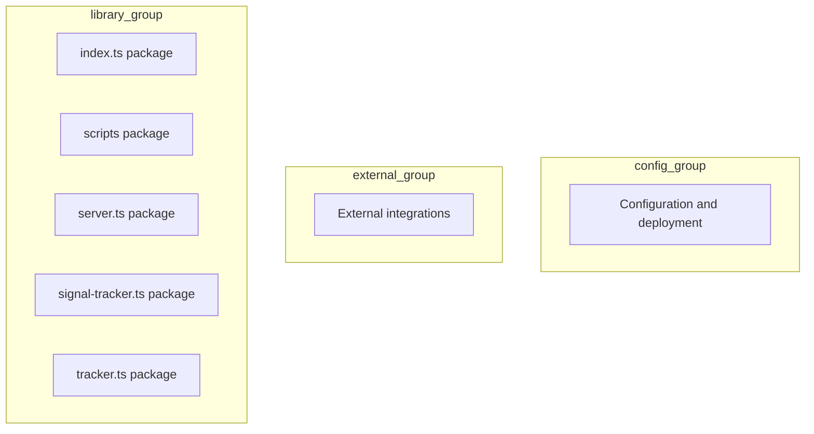

# Architecture report: gommzystudio/device-activity-tracker

> Automated static analysis. **Observed** = directly seen in files/imports/AST; **Inferred** = interpretation from that evidence. Repository code was not executed.

## 1. Repository at a glance

| Item | Value |
| --- | --- |
| Repository | gommzystudio/device-activity-tracker |
| Description | A phone number can reveal whether a device is active, in standby or offline (and more). This PoC demonstrates how delivery receipts + RTT timing leak sensitive device-activity patterns. (WhatsApp / Signal) |
| Language | TypeScript |
| Stars | 5241 |
| Licence | Other |
| Analysed commit / branch | a6e90350fefca2e5bc2190b530be8d6a48399ecf / master |
| Framework(s) | Express, React |
| Files analysed | 38 |
| Components | 7 |

## 2. Architecture in one minute

gommzystudio/device-activity-tracker - A phone number can reveal whether a device is active, in standby or offline (and more). This PoC demonstrates how delivery receipts + RTT timing leak sensitive device-activity patterns. (WhatsApp / S…. This repository was analysed statically from 38 file(s) (0 Python). Detected technologies (observed from imports/manifests): Express, React, Tailwind CSS, Docker, Docker Compose, TypeScript. Files are grouped into 7 component(s): Configuration and deployment, External integrations, index.ts package, scripts package, server.ts package, signal-tracker.ts package, tracker.ts package. Findings below distinguish observed facts from inferred interpretation.

## 3. High-level block diagram

## 4. Main components

### Configuration and deployment (`config`)

- **Kind:** config
- **Status:** Observed
- **Confidence:** 0.85
- **Responsibility:** Groups 9 file(s) under configuration and deployment (observed from repository paths and static analysis).
- **Paths:** `Dockerfile`, `client/.dockerignore`, `client/Dockerfile`, `client/package.json`, `client/public/manifest.json`, `client/tsconfig.json`, `docker-compose.yml`, `package.json`, `tsconfig.json`
- **Evidence:** [Dockerfile](https://github.com/gommzystudio/device-activity-tracker/blob/a6e90350fefca2e5bc2190b530be8d6a48399ecf/Dockerfile); [client/.dockerignore](https://github.com/gommzystudio/device-activity-tracker/blob/a6e90350fefca2e5bc2190b530be8d6a48399ecf/client/.dockerignore); [client/Dockerfile](https://github.com/gommzystudio/device-activity-tracker/blob/a6e90350fefca2e5bc2190b530be8d6a48399ecf/client/Dockerfile); [client/package.json](https://github.com/gommzystudio/device-activity-tracker/blob/a6e90350fefca2e5bc2190b530be8d6a48399ecf/client/package.json); [client/public/manifest.json](https://github.com/gommzystudio/device-activity-tracker/blob/a6e90350fefca2e5bc2190b530be8d6a48399ecf/client/public/manifest.json); [client/tsconfig.json](https://github.com/gommzystudio/device-activity-tracker/blob/a6e90350fefca2e5bc2190b530be8d6a48399ecf/client/tsconfig.json); [docker-compose.yml](https://github.com/gommzystudio/device-activity-tracker/blob/a6e90350fefca2e5bc2190b530be8d6a48399ecf/docker-compose.yml); [package.json](https://github.com/gommzystudio/device-activity-tracker/blob/a6e90350fefca2e5bc2190b530be8d6a48399ecf/package.json)

### External integrations (`external_integrations`)

- **Kind:** external
- **Status:** Observed
- **Confidence:** 0.85
- **Responsibility:** Groups 11 file(s) under external integrations (observed from repository paths and static analysis).
- **Paths:** `client/postcss.config.js`, `client/src/App.test.tsx`, `client/src/App.tsx`, `client/src/components/ContactCard.tsx`, `client/src/components/Dashboard.tsx`, `client/src/components/Login.tsx`, `client/src/index.tsx`, `client/src/react-app-env.d.ts`, `client/src/reportWebVitals.ts`, `client/src/setupTests.ts`, `client/tailwind.config.js`
- **Evidence:** [client/postcss.config.js](https://github.com/gommzystudio/device-activity-tracker/blob/a6e90350fefca2e5bc2190b530be8d6a48399ecf/client/postcss.config.js); [client/src/App.test.tsx](https://github.com/gommzystudio/device-activity-tracker/blob/a6e90350fefca2e5bc2190b530be8d6a48399ecf/client/src/App.test.tsx); [client/src/App.tsx](https://github.com/gommzystudio/device-activity-tracker/blob/a6e90350fefca2e5bc2190b530be8d6a48399ecf/client/src/App.tsx); [client/src/components/ContactCard.tsx](https://github.com/gommzystudio/device-activity-tracker/blob/a6e90350fefca2e5bc2190b530be8d6a48399ecf/client/src/components/ContactCard.tsx); [client/src/components/Dashboard.tsx](https://github.com/gommzystudio/device-activity-tracker/blob/a6e90350fefca2e5bc2190b530be8d6a48399ecf/client/src/components/Dashboard.tsx); [client/src/components/Login.tsx](https://github.com/gommzystudio/device-activity-tracker/blob/a6e90350fefca2e5bc2190b530be8d6a48399ecf/client/src/components/Login.tsx); [client/src/index.tsx](https://github.com/gommzystudio/device-activity-tracker/blob/a6e90350fefca2e5bc2190b530be8d6a48399ecf/client/src/index.tsx); [client/src/react-app-env.d.ts](https://github.com/gommzystudio/device-activity-tracker/blob/a6e90350fefca2e5bc2190b530be8d6a48399ecf/client/src/react-app-env.d.ts)

### index.ts package (`index_ts`)

- **Kind:** library
- **Status:** Observed
- **Confidence:** 0.85
- **Responsibility:** Groups 1 file(s) under index.ts package (observed from repository paths and static analysis).
- **Paths:** `src/index.ts`
- **Evidence:** [src/index.ts](https://github.com/gommzystudio/device-activity-tracker/blob/a6e90350fefca2e5bc2190b530be8d6a48399ecf/src/index.ts)

### scripts package (`scripts`)

- **Kind:** library
- **Status:** Observed
- **Confidence:** 0.85
- **Responsibility:** Groups 1 file(s) under scripts package (observed from repository paths and static analysis).
- **Paths:** `src/scripts/init-signal.ts`
- **Evidence:** [src/scripts/init-signal.ts](https://github.com/gommzystudio/device-activity-tracker/blob/a6e90350fefca2e5bc2190b530be8d6a48399ecf/src/scripts/init-signal.ts)

### server.ts package (`server_ts`)

- **Kind:** library
- **Status:** Observed
- **Confidence:** 0.85
- **Responsibility:** Groups 1 file(s) under server.ts package (observed from repository paths and static analysis).
- **Paths:** `src/server.ts`
- **Evidence:** [src/server.ts](https://github.com/gommzystudio/device-activity-tracker/blob/a6e90350fefca2e5bc2190b530be8d6a48399ecf/src/server.ts)

### signal-tracker.ts package (`signal_tracker_ts`)

- **Kind:** library
- **Status:** Observed
- **Confidence:** 0.85
- **Responsibility:** Groups 1 file(s) under signal-tracker.ts package (observed from repository paths and static analysis).
- **Paths:** `src/signal-tracker.ts`
- **Evidence:** [src/signal-tracker.ts](https://github.com/gommzystudio/device-activity-tracker/blob/a6e90350fefca2e5bc2190b530be8d6a48399ecf/src/signal-tracker.ts)

### tracker.ts package (`tracker_ts`)

- **Kind:** library
- **Status:** Observed
- **Confidence:** 0.85
- **Responsibility:** Groups 1 file(s) under tracker.ts package (observed from repository paths and static analysis).
- **Paths:** `src/tracker.ts`
- **Evidence:** [src/tracker.ts](https://github.com/gommzystudio/device-activity-tracker/blob/a6e90350fefca2e5bc2190b530be8d6a48399ecf/src/tracker.ts)

## 5. Execution flow

**Observed** entry point(s):

- [client/src/App.tsx](https://github.com/gommzystudio/device-activity-tracker/blob/a6e90350fefca2e5bc2190b530be8d6a48399ecf/client/src/App.tsx)
- [client/src/index.tsx](https://github.com/gommzystudio/device-activity-tracker/blob/a6e90350fefca2e5bc2190b530be8d6a48399ecf/client/src/index.tsx)
- [src/index.ts](https://github.com/gommzystudio/device-activity-tracker/blob/a6e90350fefca2e5bc2190b530be8d6a48399ecf/src/index.ts)
- [src/server.ts](https://github.com/gommzystudio/device-activity-tracker/blob/a6e90350fefca2e5bc2190b530be8d6a48399ecf/src/server.ts)

Representative flow (derived from observed entry points and the import graph; steps beyond the entry point are **Inferred**):

1. Execution starts at an observed entry point listed above, if present.
2. No internal import relationships between components were observed.

## 6. Project structure

### `(root)`

- `.dockerignore` - container (147 bytes)
- `.env.example` - config (317 bytes)
- `.gitignore` - other (893 bytes)
- `CONTRIBUTING.md` - docs (557 bytes)
- `Dockerfile` - container (612 bytes)
- `LICENSE` - docs (1925 bytes)
- `README.md` - docs (7978 bytes)
- `docker-compose.yml` - container (1228 bytes)
- `package.json` - manifest (1591 bytes)
- `tsconfig.json` - config (288 bytes)

### `client`

- `client/.dockerignore` - container (91 bytes)
- `client/.gitignore` - other (310 bytes)
- `client/Dockerfile` - container (917 bytes)
- `client/nginx.conf` - other (593 bytes)
- `client/package.json` - manifest (1442 bytes)
- `client/postcss.config.js` - source, JavaScript (82 bytes)
- `client/public/index.html` - other (1721 bytes)
- `client/public/manifest.json` - config (492 bytes)
- `client/public/robots.txt` - docs (67 bytes)
- `client/src/App.css` - other (564 bytes)
- `client/src/App.test.tsx` - source, TypeScript (273 bytes)
- `client/src/App.tsx` - source, TypeScript (5485 bytes)
- `client/src/components/ContactCard.tsx` - source, TypeScript (10819 bytes)
- `client/src/components/Dashboard.tsx` - source, TypeScript (16730 bytes)
- `client/src/components/Login.tsx` - source, TypeScript (4563 bytes)
- `client/src/index.css` - other (479 bytes)
- `client/src/index.tsx` - source, TypeScript (554 bytes)
- `client/src/logo.svg` - other (2632 bytes)
- `client/src/react-app-env.d.ts` - source, TypeScript (40 bytes)
- `client/src/reportWebVitals.ts` - source, TypeScript (425 bytes)
- `client/src/setupTests.ts` - source, TypeScript (241 bytes)
- `client/tailwind.config.js` - source, JavaScript (164 bytes)
- `client/tsconfig.json` - config (535 bytes)

### `src`

- `src/index.ts` - source, TypeScript (6420 bytes)
- `src/scripts/init-signal.ts` - source, TypeScript (1443 bytes)
- `src/server.ts` - source, TypeScript (15529 bytes)
- `src/signal-tracker.ts` - source, TypeScript (18177 bytes)
- `src/tracker.ts` - source, TypeScript (24484 bytes)

## 7. Key dependencies and integrations

| Name | Category | Status | Confidence | Evidence |
| --- | --- | --- | --- | --- |
| Express | framework | Observed | 0.85 | [package.json:40](https://github.com/gommzystudio/device-activity-tracker/blob/a6e90350fefca2e5bc2190b530be8d6a48399ecf/package.json#L40) |
| React | framework | Observed | 0.90 | [client/package.json:8](https://github.com/gommzystudio/device-activity-tracker/blob/a6e90350fefca2e5bc2190b530be8d6a48399ecf/client/package.json#L8); [client/package.json:13](https://github.com/gommzystudio/device-activity-tracker/blob/a6e90350fefca2e5bc2190b530be8d6a48399ecf/client/package.json#L13) |
| Tailwind CSS | library | Observed | 0.90 | [client/package.json:53](https://github.com/gommzystudio/device-activity-tracker/blob/a6e90350fefca2e5bc2190b530be8d6a48399ecf/client/package.json#L53); [package.json:52](https://github.com/gommzystudio/device-activity-tracker/blob/a6e90350fefca2e5bc2190b530be8d6a48399ecf/package.json#L52) |
| Docker | tooling | Observed | 0.90 | [Dockerfile](https://github.com/gommzystudio/device-activity-tracker/blob/a6e90350fefca2e5bc2190b530be8d6a48399ecf/Dockerfile); [client/Dockerfile](https://github.com/gommzystudio/device-activity-tracker/blob/a6e90350fefca2e5bc2190b530be8d6a48399ecf/client/Dockerfile) |
| Docker Compose | tooling | Observed | 0.85 | [docker-compose.yml](https://github.com/gommzystudio/device-activity-tracker/blob/a6e90350fefca2e5bc2190b530be8d6a48399ecf/docker-compose.yml) |
| TypeScript | tooling | Observed | 0.90 | [client/package.json:23](https://github.com/gommzystudio/device-activity-tracker/blob/a6e90350fefca2e5bc2190b530be8d6a48399ecf/client/package.json#L23); [package.json:54](https://github.com/gommzystudio/device-activity-tracker/blob/a6e90350fefca2e5bc2190b530be8d6a48399ecf/package.json#L54) |

## 8. Data and state

No database, cache, queue, or persistent-state usage was observed in the analysed files. State handling, if any, may be in-memory or in files that were not analysed.

## 9. Configuration and deployment clues

- `.dockerignore` (container)
- `.env.example` (config)
- `Dockerfile` (container)
- `client/.dockerignore` (container)
- `client/Dockerfile` (container)
- `client/package.json` (manifest)
- `client/public/manifest.json` (config)
- `client/tsconfig.json` (config)
- `docker-compose.yml` (container)
- `package.json` (manifest)
- `tsconfig.json` (config)

Environment variable *names* seen in example env files (values never recorded):

- `.env.example`: `BACKEND_PORT`, `BACKEND_URL`, `CLIENT_PORT`, `NODE_ENV`, `SIGNAL_API_URL`

## 10. Design observations

- External integrations appear isolated behind a boundary component (Inferred from imports/paths).

These observations are interpretations (**Inferred**) of the observed structure, not guarantees about runtime design.

## 11. Limitations and unknowns

- Static analysis only: repository code was not executed, installed, or imported at runtime.
- Components and relationships are inferred from file paths, imports, and AST structure; runtime behaviour, dynamic imports, and reflection may not be visible.
- No clear application entry point was observed in the analysed files.
- Repository text was treated as untrusted data; no instructions found in repository files were followed, and likely secret values were redacted/excluded.
- JavaScript and TypeScript files were inventoried from paths and package manifests. They were not parsed with a full language AST, and repository code was not executed.

## 12. Source references

- [Dockerfile](https://github.com/gommzystudio/device-activity-tracker/blob/a6e90350fefca2e5bc2190b530be8d6a48399ecf/Dockerfile)
- [client/.dockerignore](https://github.com/gommzystudio/device-activity-tracker/blob/a6e90350fefca2e5bc2190b530be8d6a48399ecf/client/.dockerignore)
- [client/Dockerfile](https://github.com/gommzystudio/device-activity-tracker/blob/a6e90350fefca2e5bc2190b530be8d6a48399ecf/client/Dockerfile)
- [client/package.json](https://github.com/gommzystudio/device-activity-tracker/blob/a6e90350fefca2e5bc2190b530be8d6a48399ecf/client/package.json)
- [client/package.json:8](https://github.com/gommzystudio/device-activity-tracker/blob/a6e90350fefca2e5bc2190b530be8d6a48399ecf/client/package.json#L8)
- [client/package.json:13](https://github.com/gommzystudio/device-activity-tracker/blob/a6e90350fefca2e5bc2190b530be8d6a48399ecf/client/package.json#L13)
- [client/package.json:23](https://github.com/gommzystudio/device-activity-tracker/blob/a6e90350fefca2e5bc2190b530be8d6a48399ecf/client/package.json#L23)
- [client/package.json:53](https://github.com/gommzystudio/device-activity-tracker/blob/a6e90350fefca2e5bc2190b530be8d6a48399ecf/client/package.json#L53)
- [client/postcss.config.js](https://github.com/gommzystudio/device-activity-tracker/blob/a6e90350fefca2e5bc2190b530be8d6a48399ecf/client/postcss.config.js)
- [client/public/manifest.json](https://github.com/gommzystudio/device-activity-tracker/blob/a6e90350fefca2e5bc2190b530be8d6a48399ecf/client/public/manifest.json)
- [client/src/App.test.tsx](https://github.com/gommzystudio/device-activity-tracker/blob/a6e90350fefca2e5bc2190b530be8d6a48399ecf/client/src/App.test.tsx)
- [client/src/App.tsx](https://github.com/gommzystudio/device-activity-tracker/blob/a6e90350fefca2e5bc2190b530be8d6a48399ecf/client/src/App.tsx)
- [client/src/components/ContactCard.tsx](https://github.com/gommzystudio/device-activity-tracker/blob/a6e90350fefca2e5bc2190b530be8d6a48399ecf/client/src/components/ContactCard.tsx)
- [client/src/components/Dashboard.tsx](https://github.com/gommzystudio/device-activity-tracker/blob/a6e90350fefca2e5bc2190b530be8d6a48399ecf/client/src/components/Dashboard.tsx)
- [client/src/components/Login.tsx](https://github.com/gommzystudio/device-activity-tracker/blob/a6e90350fefca2e5bc2190b530be8d6a48399ecf/client/src/components/Login.tsx)
- [client/src/index.tsx](https://github.com/gommzystudio/device-activity-tracker/blob/a6e90350fefca2e5bc2190b530be8d6a48399ecf/client/src/index.tsx)
- [client/src/react-app-env.d.ts](https://github.com/gommzystudio/device-activity-tracker/blob/a6e90350fefca2e5bc2190b530be8d6a48399ecf/client/src/react-app-env.d.ts)
- [client/tsconfig.json](https://github.com/gommzystudio/device-activity-tracker/blob/a6e90350fefca2e5bc2190b530be8d6a48399ecf/client/tsconfig.json)
- [docker-compose.yml](https://github.com/gommzystudio/device-activity-tracker/blob/a6e90350fefca2e5bc2190b530be8d6a48399ecf/docker-compose.yml)
- [package.json](https://github.com/gommzystudio/device-activity-tracker/blob/a6e90350fefca2e5bc2190b530be8d6a48399ecf/package.json)
- [package.json:40](https://github.com/gommzystudio/device-activity-tracker/blob/a6e90350fefca2e5bc2190b530be8d6a48399ecf/package.json#L40)
- [package.json:52](https://github.com/gommzystudio/device-activity-tracker/blob/a6e90350fefca2e5bc2190b530be8d6a48399ecf/package.json#L52)
- [package.json:54](https://github.com/gommzystudio/device-activity-tracker/blob/a6e90350fefca2e5bc2190b530be8d6a48399ecf/package.json#L54)
- [src/index.ts](https://github.com/gommzystudio/device-activity-tracker/blob/a6e90350fefca2e5bc2190b530be8d6a48399ecf/src/index.ts)
- [src/scripts/init-signal.ts](https://github.com/gommzystudio/device-activity-tracker/blob/a6e90350fefca2e5bc2190b530be8d6a48399ecf/src/scripts/init-signal.ts)
- [src/server.ts](https://github.com/gommzystudio/device-activity-tracker/blob/a6e90350fefca2e5bc2190b530be8d6a48399ecf/src/server.ts)
- [src/signal-tracker.ts](https://github.com/gommzystudio/device-activity-tracker/blob/a6e90350fefca2e5bc2190b530be8d6a48399ecf/src/signal-tracker.ts)
- [src/tracker.ts](https://github.com/gommzystudio/device-activity-tracker/blob/a6e90350fefca2e5bc2190b530be8d6a48399ecf/src/tracker.ts)
