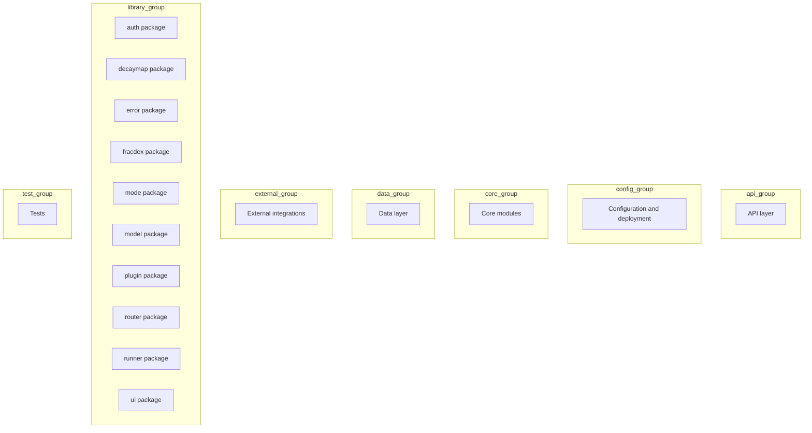

# Architecture report: gotify/server

> Automated static analysis. **Observed** = directly seen in files/imports/AST; **Inferred** = interpretation from that evidence. Repository code was not executed.

## 1. Repository at a glance

| Item | Value |
| --- | --- |
| Repository | gotify/server |
| Description | A simple server for sending and receiving messages in real-time per WebSocket. (Includes a sleek web-ui) |
| Language | Go |
| Stars | 16206 |
| Licence | Other |
| Analysed commit / branch | 01086b95a8b69ee87383f6e8bcae601d8c33384b / master |
| Framework(s) | React |
| Files analysed | 255 |
| Components | 16 |

## 2. Architecture in one minute

gotify/server - A simple server for sending and receiving messages in real-time per WebSocket. (Includes a sleek web-ui). This repository was analysed statically from 255 file(s) (0 Python). Detected technologies (observed from imports/manifests): GitHub Actions, React, axios, React Router, Docker, Docker Compose. Files are grouped into 16 component(s): API layer, auth package, Configuration and deployment, Core modules, Data layer, decaymap package, error package, External integrations. Findings below distinguish observed facts from inferred interpretation.

## 3. High-level block diagram

## 4. Main components

### API layer (`api_layer`)

- **Kind:** api
- **Status:** Observed
- **Confidence:** 0.85
- **Responsibility:** Groups 28 file(s) under api layer (observed from repository paths and static analysis).
- **Paths:** `api/application.go`, `api/application_test.go`, `api/client.go`, `api/client_test.go`, `api/errorHandling.go`, `api/errorHandling_test.go`, `api/health.go`, `api/health_test.go`, `api/internalutil.go`, `api/mcp.go`, `api/mcp_test.go`, `api/message.go`, `api/message_test.go`, `api/oidc.go`, `api/oidc_test.go`, `api/plugin.go`, `api/plugin_test.go`, `api/session.go`, `api/session_test.go`, `api/stream/client.go`, `api/stream/once.go`, `api/stream/once_test.go`, `api/stream/stream.go`, `api/stream/stream_test.go`, `api/tokens.go`, `api/tokens_test.go`, `api/user.go`, `api/user_test.go`
- **Evidence:** [api/application.go](https://github.com/gotify/server/blob/01086b95a8b69ee87383f6e8bcae601d8c33384b/api/application.go); [api/application_test.go](https://github.com/gotify/server/blob/01086b95a8b69ee87383f6e8bcae601d8c33384b/api/application_test.go); [api/client.go](https://github.com/gotify/server/blob/01086b95a8b69ee87383f6e8bcae601d8c33384b/api/client.go); [api/client_test.go](https://github.com/gotify/server/blob/01086b95a8b69ee87383f6e8bcae601d8c33384b/api/client_test.go); [api/errorHandling.go](https://github.com/gotify/server/blob/01086b95a8b69ee87383f6e8bcae601d8c33384b/api/errorHandling.go); [api/errorHandling_test.go](https://github.com/gotify/server/blob/01086b95a8b69ee87383f6e8bcae601d8c33384b/api/errorHandling_test.go); [api/health.go](https://github.com/gotify/server/blob/01086b95a8b69ee87383f6e8bcae601d8c33384b/api/health.go); [api/health_test.go](https://github.com/gotify/server/blob/01086b95a8b69ee87383f6e8bcae601d8c33384b/api/health_test.go)

### auth package (`auth`)

- **Kind:** library
- **Status:** Observed
- **Confidence:** 0.85
- **Responsibility:** Groups 11 file(s) under auth package (observed from repository paths and static analysis).
- **Paths:** `auth/authentication.go`, `auth/authentication_test.go`, `auth/cookie.go`, `auth/cors.go`, `auth/cors_test.go`, `auth/password/password.go`, `auth/password/password_test.go`, `auth/token.go`, `auth/token_test.go`, `auth/util.go`, `auth/util_test.go`
- **Evidence:** [auth/authentication.go](https://github.com/gotify/server/blob/01086b95a8b69ee87383f6e8bcae601d8c33384b/auth/authentication.go); [auth/authentication_test.go](https://github.com/gotify/server/blob/01086b95a8b69ee87383f6e8bcae601d8c33384b/auth/authentication_test.go); [auth/cookie.go](https://github.com/gotify/server/blob/01086b95a8b69ee87383f6e8bcae601d8c33384b/auth/cookie.go); [auth/cors.go](https://github.com/gotify/server/blob/01086b95a8b69ee87383f6e8bcae601d8c33384b/auth/cors.go); [auth/cors_test.go](https://github.com/gotify/server/blob/01086b95a8b69ee87383f6e8bcae601d8c33384b/auth/cors_test.go); [auth/password/password.go](https://github.com/gotify/server/blob/01086b95a8b69ee87383f6e8bcae601d8c33384b/auth/password/password.go); [auth/password/password_test.go](https://github.com/gotify/server/blob/01086b95a8b69ee87383f6e8bcae601d8c33384b/auth/password/password_test.go); [auth/token.go](https://github.com/gotify/server/blob/01086b95a8b69ee87383f6e8bcae601d8c33384b/auth/token.go)

### Configuration and deployment (`config`)

- **Kind:** config
- **Status:** Observed
- **Confidence:** 0.85
- **Responsibility:** Groups 22 file(s) under configuration and deployment (observed from repository paths and static analysis).
- **Paths:** `config/config.go`, `config/config_test.go`, `config/error.go`, `config/file.go`, `config/keys.go`, `config/loglevel.go`, `config/loglevel_test.go`, `config/migrate/migrate.go`, `config/migrate/migrate_test.go`, `config/origin.go`, `config/origin_test.go`, `config/parse.go`, `docker/Dockerfile`, `go.mod`, `renovate.json`, `test/oidc/authelia/docker-compose.yml`, `test/oidc/dex/docker-compose.yml`, `ui/package.json`, `ui/public/manifest.json`, `ui/tsconfig.json`, `ui/tsconfig.prod.json`, `ui/tsconfig.test.json`
- **Evidence:** [config/config.go](https://github.com/gotify/server/blob/01086b95a8b69ee87383f6e8bcae601d8c33384b/config/config.go); [config/config_test.go](https://github.com/gotify/server/blob/01086b95a8b69ee87383f6e8bcae601d8c33384b/config/config_test.go); [config/error.go](https://github.com/gotify/server/blob/01086b95a8b69ee87383f6e8bcae601d8c33384b/config/error.go); [config/file.go](https://github.com/gotify/server/blob/01086b95a8b69ee87383f6e8bcae601d8c33384b/config/file.go); [config/keys.go](https://github.com/gotify/server/blob/01086b95a8b69ee87383f6e8bcae601d8c33384b/config/keys.go); [config/loglevel.go](https://github.com/gotify/server/blob/01086b95a8b69ee87383f6e8bcae601d8c33384b/config/loglevel.go); [config/loglevel_test.go](https://github.com/gotify/server/blob/01086b95a8b69ee87383f6e8bcae601d8c33384b/config/loglevel_test.go); [config/migrate/migrate.go](https://github.com/gotify/server/blob/01086b95a8b69ee87383f6e8bcae601d8c33384b/config/migrate/migrate.go)

### Core modules (`core`)

- **Kind:** core
- **Status:** Observed
- **Confidence:** 0.85
- **Responsibility:** Groups 2 file(s) under core modules (observed from repository paths and static analysis).
- **Paths:** `app.go`, `app_test.go`
- **Evidence:** [app.go](https://github.com/gotify/server/blob/01086b95a8b69ee87383f6e8bcae601d8c33384b/app.go); [app_test.go](https://github.com/gotify/server/blob/01086b95a8b69ee87383f6e8bcae601d8c33384b/app_test.go)

### Data layer (`data_layer`)

- **Kind:** data
- **Status:** Observed
- **Confidence:** 0.85
- **Responsibility:** Groups 15 file(s) under data layer (observed from repository paths and static analysis).
- **Paths:** `database/application.go`, `database/application_test.go`, `database/client.go`, `database/client_test.go`, `database/database.go`, `database/database_test.go`, `database/message.go`, `database/message_test.go`, `database/migration_test.go`, `database/ping.go`, `database/ping_test.go`, `database/plugin.go`, `database/plugin_test.go`, `database/user.go`, `database/user_test.go`
- **Evidence:** [database/application.go](https://github.com/gotify/server/blob/01086b95a8b69ee87383f6e8bcae601d8c33384b/database/application.go); [database/application_test.go](https://github.com/gotify/server/blob/01086b95a8b69ee87383f6e8bcae601d8c33384b/database/application_test.go); [database/client.go](https://github.com/gotify/server/blob/01086b95a8b69ee87383f6e8bcae601d8c33384b/database/client.go); [database/client_test.go](https://github.com/gotify/server/blob/01086b95a8b69ee87383f6e8bcae601d8c33384b/database/client_test.go); [database/database.go](https://github.com/gotify/server/blob/01086b95a8b69ee87383f6e8bcae601d8c33384b/database/database.go); [database/database_test.go](https://github.com/gotify/server/blob/01086b95a8b69ee87383f6e8bcae601d8c33384b/database/database_test.go); [database/message.go](https://github.com/gotify/server/blob/01086b95a8b69ee87383f6e8bcae601d8c33384b/database/message.go); [database/message_test.go](https://github.com/gotify/server/blob/01086b95a8b69ee87383f6e8bcae601d8c33384b/database/message_test.go)

### decaymap package (`decaymap`)

- **Kind:** library
- **Status:** Observed
- **Confidence:** 0.85
- **Responsibility:** Groups 2 file(s) under decaymap package (observed from repository paths and static analysis).
- **Paths:** `decaymap/decaymap.go`, `decaymap/decaymap_test.go`
- **Evidence:** [decaymap/decaymap.go](https://github.com/gotify/server/blob/01086b95a8b69ee87383f6e8bcae601d8c33384b/decaymap/decaymap.go); [decaymap/decaymap_test.go](https://github.com/gotify/server/blob/01086b95a8b69ee87383f6e8bcae601d8c33384b/decaymap/decaymap_test.go)

### error package (`error`)

- **Kind:** library
- **Status:** Observed
- **Confidence:** 0.85
- **Responsibility:** Groups 4 file(s) under error package (observed from repository paths and static analysis).
- **Paths:** `error/handler.go`, `error/handler_test.go`, `error/notfound.go`, `error/notfound_test.go`
- **Evidence:** [error/handler.go](https://github.com/gotify/server/blob/01086b95a8b69ee87383f6e8bcae601d8c33384b/error/handler.go); [error/handler_test.go](https://github.com/gotify/server/blob/01086b95a8b69ee87383f6e8bcae601d8c33384b/error/handler_test.go); [error/notfound.go](https://github.com/gotify/server/blob/01086b95a8b69ee87383f6e8bcae601d8c33384b/error/notfound.go); [error/notfound_test.go](https://github.com/gotify/server/blob/01086b95a8b69ee87383f6e8bcae601d8c33384b/error/notfound_test.go)

### External integrations (`external_integrations`)

- **Kind:** external
- **Status:** Observed
- **Confidence:** 0.85
- **Responsibility:** Groups 5 file(s) under external integrations (observed from repository paths and static analysis).
- **Paths:** `ui/src/client/AddClientDialog.tsx`, `ui/src/client/ClientStore.ts`, `ui/src/client/Clients.tsx`, `ui/src/client/ElevateClientDialog.tsx`, `ui/src/client/UpdateClientDialog.tsx`
- **Evidence:** [ui/src/client/AddClientDialog.tsx](https://github.com/gotify/server/blob/01086b95a8b69ee87383f6e8bcae601d8c33384b/ui/src/client/AddClientDialog.tsx); [ui/src/client/ClientStore.ts](https://github.com/gotify/server/blob/01086b95a8b69ee87383f6e8bcae601d8c33384b/ui/src/client/ClientStore.ts); [ui/src/client/Clients.tsx](https://github.com/gotify/server/blob/01086b95a8b69ee87383f6e8bcae601d8c33384b/ui/src/client/Clients.tsx); [ui/src/client/ElevateClientDialog.tsx](https://github.com/gotify/server/blob/01086b95a8b69ee87383f6e8bcae601d8c33384b/ui/src/client/ElevateClientDialog.tsx); [ui/src/client/UpdateClientDialog.tsx](https://github.com/gotify/server/blob/01086b95a8b69ee87383f6e8bcae601d8c33384b/ui/src/client/UpdateClientDialog.tsx)

### fracdex package (`fracdex`)

- **Kind:** library
- **Status:** Observed
- **Confidence:** 0.85
- **Responsibility:** Groups 2 file(s) under fracdex package (observed from repository paths and static analysis).
- **Paths:** `fracdex/fracdex.go`, `fracdex/fracdex_test.go`
- **Evidence:** [fracdex/fracdex.go](https://github.com/gotify/server/blob/01086b95a8b69ee87383f6e8bcae601d8c33384b/fracdex/fracdex.go); [fracdex/fracdex_test.go](https://github.com/gotify/server/blob/01086b95a8b69ee87383f6e8bcae601d8c33384b/fracdex/fracdex_test.go)

### mode package (`mode`)

- **Kind:** library
- **Status:** Observed
- **Confidence:** 0.85
- **Responsibility:** Groups 2 file(s) under mode package (observed from repository paths and static analysis).
- **Paths:** `mode/mode.go`, `mode/mode_test.go`
- **Evidence:** [mode/mode.go](https://github.com/gotify/server/blob/01086b95a8b69ee87383f6e8bcae601d8c33384b/mode/mode.go); [mode/mode_test.go](https://github.com/gotify/server/blob/01086b95a8b69ee87383f6e8bcae601d8c33384b/mode/mode_test.go)

### model package (`model`)

- **Kind:** library
- **Status:** Observed
- **Confidence:** 0.85
- **Responsibility:** Groups 14 file(s) under model package (observed from repository paths and static analysis).
- **Paths:** `model/application.go`, `model/client.go`, `model/elevate.go`, `model/elevate_test.go`, `model/error.go`, `model/gotifyinfo.go`, `model/health.go`, `model/message.go`, `model/oidc.go`, `model/paging.go`, `model/pluginconf.go`, `model/security.go`, `model/user.go`, `model/version.go`
- **Evidence:** [model/application.go](https://github.com/gotify/server/blob/01086b95a8b69ee87383f6e8bcae601d8c33384b/model/application.go); [model/client.go](https://github.com/gotify/server/blob/01086b95a8b69ee87383f6e8bcae601d8c33384b/model/client.go); [model/elevate.go](https://github.com/gotify/server/blob/01086b95a8b69ee87383f6e8bcae601d8c33384b/model/elevate.go); [model/elevate_test.go](https://github.com/gotify/server/blob/01086b95a8b69ee87383f6e8bcae601d8c33384b/model/elevate_test.go); [model/error.go](https://github.com/gotify/server/blob/01086b95a8b69ee87383f6e8bcae601d8c33384b/model/error.go); [model/gotifyinfo.go](https://github.com/gotify/server/blob/01086b95a8b69ee87383f6e8bcae601d8c33384b/model/gotifyinfo.go); [model/health.go](https://github.com/gotify/server/blob/01086b95a8b69ee87383f6e8bcae601d8c33384b/model/health.go); [model/message.go](https://github.com/gotify/server/blob/01086b95a8b69ee87383f6e8bcae601d8c33384b/model/message.go)

### plugin package (`plugin`)

- **Kind:** library
- **Status:** Observed
- **Confidence:** 0.85
- **Responsibility:** Groups 27 file(s) under plugin package (observed from repository paths and static analysis).
- **Paths:** `plugin/compat/instance.go`, `plugin/compat/plugin.go`, `plugin/compat/plugin_test.go`, `plugin/compat/v1.go`, `plugin/compat/v1_test.go`, `plugin/compat/wrap.go`, `plugin/compat/wrap_test.go`, `plugin/compat/wrap_test_norace.go`, `plugin/compat/wrap_test_race.go`, `plugin/example/clock/main.go`, `plugin/example/echo/echo.go`, `plugin/example/minimal/main.go`, `plugin/manager.go`, `plugin/manager_test.go`, `plugin/manager_test_norace.go`, `plugin/manager_test_race.go`, `plugin/messagehandler.go`, `plugin/messagehandler_test.go`, `plugin/pluginenabled.go`, `plugin/pluginenabled_test.go`, `plugin/storagehandler.go`, `plugin/testing/broken/cantinstantiate/main.go`, `plugin/testing/broken/malformedconstructor/main.go`, `plugin/testing/broken/noinstance/main.go`, `plugin/testing/broken/nothing/main.go`, `plugin/testing/broken/unknowninfo/main.go`, `plugin/testing/mock/mock.go`
- **Evidence:** [plugin/compat/instance.go](https://github.com/gotify/server/blob/01086b95a8b69ee87383f6e8bcae601d8c33384b/plugin/compat/instance.go); [plugin/compat/plugin.go](https://github.com/gotify/server/blob/01086b95a8b69ee87383f6e8bcae601d8c33384b/plugin/compat/plugin.go); [plugin/compat/plugin_test.go](https://github.com/gotify/server/blob/01086b95a8b69ee87383f6e8bcae601d8c33384b/plugin/compat/plugin_test.go); [plugin/compat/v1.go](https://github.com/gotify/server/blob/01086b95a8b69ee87383f6e8bcae601d8c33384b/plugin/compat/v1.go); [plugin/compat/v1_test.go](https://github.com/gotify/server/blob/01086b95a8b69ee87383f6e8bcae601d8c33384b/plugin/compat/v1_test.go); [plugin/compat/wrap.go](https://github.com/gotify/server/blob/01086b95a8b69ee87383f6e8bcae601d8c33384b/plugin/compat/wrap.go); [plugin/compat/wrap_test.go](https://github.com/gotify/server/blob/01086b95a8b69ee87383f6e8bcae601d8c33384b/plugin/compat/wrap_test.go); [plugin/compat/wrap_test_norace.go](https://github.com/gotify/server/blob/01086b95a8b69ee87383f6e8bcae601d8c33384b/plugin/compat/wrap_test_norace.go)

### router package (`router`)

- **Kind:** library
- **Status:** Observed
- **Confidence:** 0.85
- **Responsibility:** Groups 3 file(s) under router package (observed from repository paths and static analysis).
- **Paths:** `router/mcp_test.go`, `router/router.go`, `router/router_test.go`
- **Evidence:** [router/mcp_test.go](https://github.com/gotify/server/blob/01086b95a8b69ee87383f6e8bcae601d8c33384b/router/mcp_test.go); [router/router.go](https://github.com/gotify/server/blob/01086b95a8b69ee87383f6e8bcae601d8c33384b/router/router.go); [router/router_test.go](https://github.com/gotify/server/blob/01086b95a8b69ee87383f6e8bcae601d8c33384b/router/router_test.go)

### runner package (`runner`)

- **Kind:** library
- **Status:** Observed
- **Confidence:** 0.85
- **Responsibility:** Groups 4 file(s) under runner package (observed from repository paths and static analysis).
- **Paths:** `runner/runner.go`, `runner/runner_test.go`, `runner/umask.go`, `runner/umask_fallback.go`
- **Evidence:** [runner/runner.go](https://github.com/gotify/server/blob/01086b95a8b69ee87383f6e8bcae601d8c33384b/runner/runner.go); [runner/runner_test.go](https://github.com/gotify/server/blob/01086b95a8b69ee87383f6e8bcae601d8c33384b/runner/runner_test.go); [runner/umask.go](https://github.com/gotify/server/blob/01086b95a8b69ee87383f6e8bcae601d8c33384b/runner/umask.go); [runner/umask_fallback.go](https://github.com/gotify/server/blob/01086b95a8b69ee87383f6e8bcae601d8c33384b/runner/umask_fallback.go)

### Tests (`tests`)

- **Kind:** test
- **Status:** Observed
- **Confidence:** 0.85
- **Responsibility:** Groups 28 file(s) under tests (observed from repository paths and static analysis).
- **Paths:** `test/asserts.go`, `test/asserts_test.go`, `test/assets/text.txt`, `test/auth.go`, `test/auth_test.go`, `test/filepath.go`, `test/filepath_test.go`, `test/oidc/.gitignore`, `test/oidc/README.md`, `test/oidc/authelia/config/configuration.yml`, `test/oidc/authelia/config/users_database.yml`, `test/oidc/dex/config/dex.conf`, `test/testdb/database.go`, `test/testdb/database_test.go`, `test/tmpdir.go`, `test/tmpdir_test.go`, `ui/src/tests/application.test.ts`, `ui/src/tests/authentication.ts`, `ui/src/tests/client.test.ts`, `ui/src/tests/dex.ts`, `ui/src/tests/elevation.test.ts`, `ui/src/tests/message.test.ts`, `ui/src/tests/oidc.test.ts`, `ui/src/tests/plugin.test.ts`, `ui/src/tests/selector.ts`, `ui/src/tests/setup.ts`, `ui/src/tests/user.test.ts`, `ui/src/tests/utils.ts`
- **Evidence:** [test/asserts.go](https://github.com/gotify/server/blob/01086b95a8b69ee87383f6e8bcae601d8c33384b/test/asserts.go); [test/asserts_test.go](https://github.com/gotify/server/blob/01086b95a8b69ee87383f6e8bcae601d8c33384b/test/asserts_test.go); [test/assets/text.txt](https://github.com/gotify/server/blob/01086b95a8b69ee87383f6e8bcae601d8c33384b/test/assets/text.txt); [test/auth.go](https://github.com/gotify/server/blob/01086b95a8b69ee87383f6e8bcae601d8c33384b/test/auth.go); [test/auth_test.go](https://github.com/gotify/server/blob/01086b95a8b69ee87383f6e8bcae601d8c33384b/test/auth_test.go); [test/filepath.go](https://github.com/gotify/server/blob/01086b95a8b69ee87383f6e8bcae601d8c33384b/test/filepath.go); [test/filepath_test.go](https://github.com/gotify/server/blob/01086b95a8b69ee87383f6e8bcae601d8c33384b/test/filepath_test.go); [test/oidc/.gitignore](https://github.com/gotify/server/blob/01086b95a8b69ee87383f6e8bcae601d8c33384b/test/oidc/.gitignore)

### ui package (`ui`)

- **Kind:** library
- **Status:** Observed
- **Confidence:** 0.85
- **Responsibility:** Groups 57 file(s) under ui package (observed from repository paths and static analysis).
- **Paths:** `ui/eslint.config.mjs`, `ui/serve.go`, `ui/src/CurrentUser.ts`, `ui/src/ElevateStore.ts`, `ui/src/apiAuth.ts`, `ui/src/application/AddApplicationDialog.tsx`, `ui/src/application/AppStore.ts`, `ui/src/application/Applications.tsx`, `ui/src/application/UpdateApplicationDialog.tsx`, `ui/src/clipboard.ts`, `ui/src/common/BaseStore.ts`, `ui/src/common/ConfirmDialog.tsx`, `ui/src/common/ConnectionErrorBanner.tsx`, `ui/src/common/Container.tsx`, `ui/src/common/CopyableSecret.tsx`, `ui/src/common/DefaultPage.tsx`, `ui/src/common/ElevationForm.tsx`, `ui/src/common/LastUsedCell.tsx`, `ui/src/common/LoadingSpinner.tsx`, `ui/src/common/Markdown.tsx`, `ui/src/common/NumberField.tsx`, `ui/src/common/RemainingTime.tsx`, `ui/src/common/ScrollUpButton.tsx`, `ui/src/common/TimeAgoFormatter.ts`, `ui/src/common/TokenConfirmDialog.tsx`, `ui/src/config.ts`, `ui/src/index.tsx`, `ui/src/layout/Header.tsx`, `ui/src/layout/Layout.tsx`, `ui/src/layout/Navigation.tsx`, `ui/src/layout/theme.ts`, `ui/src/message/Message.tsx`, `ui/src/message/Messages.tsx`, `ui/src/message/MessagesStore.ts`, `ui/src/message/PushMessageDialog.tsx`, `ui/src/message/WebSocketStore.ts`, `ui/src/message/extras.ts`, `ui/src/plugin/PluginDetailView.tsx`, `ui/src/plugin/PluginStore.ts`, `ui/src/plugin/Plugins.tsx`, `ui/src/react-app-env.d.ts`, `ui/src/reactions.ts`, `ui/src/registerServiceWorker.ts`, `ui/src/snack/SnackManager.ts`, `ui/src/snack/browserNotification.ts`, `ui/src/stores.tsx`, `ui/src/typedef/notifyjs.d.ts`, `ui/src/types.ts`, `ui/src/user/AddEditUserDialog.tsx`, `ui/src/user/Login.tsx`, `ui/src/user/Register.tsx`, `ui/src/user/Settings.tsx`, `ui/src/user/UserStore.ts`, `ui/src/user/Users.tsx`, `ui/vite-env.d.ts`, `ui/vite.config.ts`, `ui/vitest.config.js`
- **Evidence:** [ui/eslint.config.mjs](https://github.com/gotify/server/blob/01086b95a8b69ee87383f6e8bcae601d8c33384b/ui/eslint.config.mjs); [ui/serve.go](https://github.com/gotify/server/blob/01086b95a8b69ee87383f6e8bcae601d8c33384b/ui/serve.go); [ui/src/CurrentUser.ts](https://github.com/gotify/server/blob/01086b95a8b69ee87383f6e8bcae601d8c33384b/ui/src/CurrentUser.ts); [ui/src/ElevateStore.ts](https://github.com/gotify/server/blob/01086b95a8b69ee87383f6e8bcae601d8c33384b/ui/src/ElevateStore.ts); [ui/src/apiAuth.ts](https://github.com/gotify/server/blob/01086b95a8b69ee87383f6e8bcae601d8c33384b/ui/src/apiAuth.ts); [ui/src/application/AddApplicationDialog.tsx](https://github.com/gotify/server/blob/01086b95a8b69ee87383f6e8bcae601d8c33384b/ui/src/application/AddApplicationDialog.tsx); [ui/src/application/AppStore.ts](https://github.com/gotify/server/blob/01086b95a8b69ee87383f6e8bcae601d8c33384b/ui/src/application/AppStore.ts); [ui/src/application/Applications.tsx](https://github.com/gotify/server/blob/01086b95a8b69ee87383f6e8bcae601d8c33384b/ui/src/application/Applications.tsx)

## 5. Execution flow

**Observed** entry point(s):

- [ui/src/index.tsx](https://github.com/gotify/server/blob/01086b95a8b69ee87383f6e8bcae601d8c33384b/ui/src/index.tsx)

Representative flow (derived from observed entry points and the import graph; steps beyond the entry point are **Inferred**):

1. Execution starts at an observed entry point listed above, if present.
2. No internal import relationships between components were observed.

## 6. Project structure

### `(root)`

- `.dockerignore` - container (81 bytes)
- `.editorconfig` - config (366 bytes)
- `.gitignore` - other (133 bytes)
- `.golangci.yml` - config (1038 bytes)
- `CODEOWNERS` - other (20 bytes)
- `CODE_OF_CONDUCT.md` - docs (3218 bytes)
- `CONTRIBUTING.md` - docs (3484 bytes)
- `GO_VERSION` - other (7 bytes)
- `LICENSE` - docs (1216 bytes)
- `Makefile` - other (6831 bytes)
- `README.md` - docs (3002 bytes)
- `SECURITY.md` - docs (1281 bytes)
- `app.go` - source, Go (3819 bytes)
- `app_test.go` - source, Go (766 bytes)
- `go.mod` - manifest (3585 bytes)
- `go.sum` - other (19357 bytes)
- `gotify-server.env.example` - other (11646 bytes)
- `renovate.json` - config (1648 bytes)

### `.github`

- `.github/FUNDING.yml` - config (599 bytes)
- `.github/ISSUE_TEMPLATE/bug_report.md` - docs (1203 bytes)
- `.github/ISSUE_TEMPLATE/feature_request.md` - docs (602 bytes)
- `.github/ISSUE_TEMPLATE/questions.md` - docs (1046 bytes)
- `.github/workflows/build.yml` - ci, YAML (2830 bytes)

### `api`

- `api/application.go` - source, Go (16742 bytes)
- `api/application_test.go` - source, Go (26510 bytes)
- `api/client.go` - source, Go (8783 bytes)
- `api/client_test.go` - source, Go (12080 bytes)
- `api/errorHandling.go` - source, Go (197 bytes)
- `api/errorHandling_test.go` - source, Go (289 bytes)
- `api/health.go` - source, Go (954 bytes)
- `api/health_test.go` - source, Go (1202 bytes)
- `api/internalutil.go` - source, Go (314 bytes)
- `api/mcp.go` - source, Go (4220 bytes)
- `api/mcp_test.go` - source, Go (1079 bytes)
- `api/message.go` - source, Go (12912 bytes)
- `api/message_test.go` - source, Go (22467 bytes)
- `api/oidc.go` - source, Go (20057 bytes)
- `api/oidc_test.go` - source, Go (21874 bytes)
- `api/plugin.go` - source, Go (11121 bytes)
- `api/plugin_test.go` - source, Go (21086 bytes)
- `api/session.go` - source, Go (3801 bytes)
- `api/session_test.go` - source, Go (4368 bytes)
- `api/stream/client.go` - source, Go (2778 bytes)
- `api/stream/once.go` - source, Go (722 bytes)
- `api/stream/once_test.go` - source, Go (757 bytes)
- `api/stream/stream.go` - source, Go (5355 bytes)
- `api/stream/stream_test.go` - source, Go (17478 bytes)
- `api/tokens.go` - source, Go (222 bytes)
- `api/tokens_test.go` - source, Go (608 bytes)
- `api/user.go` - source, Go (13411 bytes)
- `api/user_test.go` - source, Go (14022 bytes)

### `auth`

- `auth/authentication.go` - source, Go (9308 bytes)
- `auth/authentication_test.go` - source, Go (23913 bytes)
- `auth/cookie.go` - source, Go (467 bytes)
- `auth/cors.go` - source, Go (1122 bytes)
- `auth/cors_test.go` - source, Go (1779 bytes)
- `auth/password/password.go` - source, Go (717 bytes)
- `auth/password/password_test.go` - source, Go (691 bytes)
- `auth/token.go` - source, Go (6437 bytes)
- `auth/token_test.go` - source, Go (1782 bytes)
- `auth/util.go` - source, Go (1824 bytes)
- `auth/util_test.go` - source, Go (2200 bytes)

### `config`

- `config/config.go` - source, Go (6504 bytes)
- `config/config_test.go` - source, Go (4992 bytes)
- `config/error.go` - source, Go (434 bytes)
- `config/file.go` - source, Go (1498 bytes)
- `config/keys.go` - source, Go (3399 bytes)
- `config/loglevel.go` - source, Go (561 bytes)
- `config/loglevel_test.go` - source, Go (495 bytes)
- `config/migrate/migrate.go` - source, Go (5298 bytes)
- `config/migrate/migrate_test.go` - source, Go (4247 bytes)
- `config/origin.go` - source, Go (669 bytes)
- `config/origin_test.go` - source, Go (750 bytes)
- `config/parse.go` - source, Go (2191 bytes)

### `database`

- `database/application.go` - source, Go (2508 bytes)
- `database/application_test.go` - source, Go (3672 bytes)
- `database/client.go` - source, Go (3252 bytes)
- `database/client_test.go` - source, Go (7495 bytes)
- `database/database.go` - source, Go (5199 bytes)
- `database/database_test.go` - source, Go (3507 bytes)
- `database/message.go` - source, Go (3089 bytes)
- `database/message_test.go` - source, Go (8652 bytes)
- `database/migration_test.go` - source, Go (2081 bytes)
- `database/ping.go` - source, Go (190 bytes)
- `database/ping_test.go` - source, Go (276 bytes)
- `database/plugin.go` - source, Go (2457 bytes)
- `database/plugin_test.go` - source, Go (2569 bytes)
- `database/user.go` - source, Go (2389 bytes)
- `database/user_test.go` - source, Go (6474 bytes)

### `decaymap`

- `decaymap/decaymap.go` - source, Go (1619 bytes)
- `decaymap/decaymap_test.go` - source, Go (902 bytes)

### `docker`

- `docker/Dockerfile` - container (2168 bytes)

### `docs`

- `docs/package.go` - docs (2171 bytes)
- `docs/spec.json` - config (94767 bytes)
- `docs/swagger.go` - docs (488 bytes)
- `docs/swagger_test.go` - docs (690 bytes)
- `docs/ui.go` - docs (2393 bytes)
- `docs/ui_test.go` - docs (796 bytes)

### `error`

- `error/handler.go` - source, Go (1580 bytes)
- `error/handler_test.go` - source, Go (2503 bytes)
- `error/notfound.go` - source, Go (430 bytes)
- `error/notfound_test.go` - source, Go (384 bytes)

### `fracdex`

- `fracdex/fracdex.go` - source, Go (9316 bytes)
- `fracdex/fracdex_test.go` - source, Go (4260 bytes)

### `mode`

- `mode/mode.go` - source, Go (694 bytes)
- `mode/mode_test.go` - source, Go (640 bytes)

### `model`

- `model/application.go` - source, Go (2293 bytes)
- `model/client.go` - source, Go (2145 bytes)
- `model/elevate.go` - source, Go (789 bytes)
- `model/elevate_test.go` - source, Go (1649 bytes)
- `model/error.go` - source, Go (530 bytes)
- `model/gotifyinfo.go` - source, Go (834 bytes)
- `model/health.go` - source, Go (566 bytes)
- `model/message.go` - source, Go (3607 bytes)
- `model/oidc.go` - source, Go (2289 bytes)
- `model/paging.go` - source, Go (1291 bytes)
- `model/pluginconf.go` - source, Go (2001 bytes)
- `model/security.go` - source, Go (1219 bytes)
- `model/user.go` - source, Go (3467 bytes)
- `model/version.go` - source, Go (512 bytes)

### `plugin`

- `plugin/compat/instance.go` - source, Go (2124 bytes)
- `plugin/compat/plugin.go` - source, Go (598 bytes)
- `plugin/compat/plugin_test.go` - source, Go (373 bytes)
- `plugin/compat/v1.go` - source, Go (4516 bytes)
- `plugin/compat/v1_test.go` - source, Go (3120 bytes)
- `plugin/compat/wrap.go` - source, Go (1049 bytes)
- `plugin/compat/wrap_test.go` - source, Go (3679 bytes)
- `plugin/compat/wrap_test_norace.go` - source, Go (69 bytes)
- `plugin/compat/wrap_test_race.go` - source, Go (75 bytes)
- `plugin/example/clock/main.go` - source, Go (1321 bytes)
- `plugin/example/echo/echo.go` - source, Go (2900 bytes)
- `plugin/example/minimal/main.go` - source, Go (713 bytes)
- `plugin/manager.go` - source, Go (12454 bytes)
- `plugin/manager_test.go` - source, Go (16995 bytes)
- `plugin/manager_test_norace.go` - source, Go (69 bytes)
- `plugin/manager_test_race.go` - source, Go (75 bytes)
- `plugin/messagehandler.go` - source, Go (1209 bytes)
- `plugin/messagehandler_test.go` - source, Go (1002 bytes)
- `plugin/pluginenabled.go` - source, Go (370 bytes)
- `plugin/pluginenabled_test.go` - source, Go (778 bytes)
- `plugin/storagehandler.go` - source, Go (450 bytes)
- `plugin/testing/broken/cantinstantiate/main.go` - source, Go (749 bytes)
- `plugin/testing/broken/malformedconstructor/main.go` - source, Go (709 bytes)
- `plugin/testing/broken/noinstance/main.go` - source, Go (325 bytes)
- `plugin/testing/broken/nothing/main.go` - source, Go (85 bytes)
- `plugin/testing/broken/unknowninfo/main.go` - source, Go (246 bytes)
- `plugin/testing/mock/mock.go` - source, Go (4395 bytes)

### `router`

- `router/mcp_test.go` - source, Go (5054 bytes)
- `router/router.go` - source, Go (10333 bytes)
- `router/router_test.go` - source, Go (14867 bytes)

### `runner`

- `runner/runner.go` - source, Go (4590 bytes)
- `runner/runner_test.go` - source, Go (695 bytes)
- `runner/umask.go` - source, Go (77 bytes)
- `runner/umask_fallback.go` - source, Go (70 bytes)

### `test`

- `test/asserts.go` - test, Go (905 bytes)
- `test/asserts_test.go` - test, Go (965 bytes)
- `test/assets/text.txt` - test (0 bytes)
- `test/auth.go` - test, Go (273 bytes)
- `test/auth_test.go` - test, Go (386 bytes)
- `test/filepath.go` - test, Go (549 bytes)
- `test/filepath_test.go` - test, Go (1075 bytes)
- `test/oidc/.gitignore` - test (111 bytes)
- `test/oidc/README.md` - test (1598 bytes)
- `test/oidc/authelia/config/configuration.yml` - test (5601 bytes)
- `test/oidc/authelia/config/users_database.yml` - test (189 bytes)
- `test/oidc/authelia/docker-compose.yml` - container (282 bytes)
- `test/oidc/dex/config/dex.conf` - test (763 bytes)
- `test/oidc/dex/docker-compose.yml` - container (179 bytes)
- `test/testdb/database.go` - test, Go (9896 bytes)
- `test/testdb/database_test.go` - test, Go (5907 bytes)
- `test/tmpdir.go` - test, Go (552 bytes)
- `test/tmpdir_test.go` - test, Go (429 bytes)

### `ui`

- `ui/.gitignore` - other (285 bytes)
- `ui/.prettierrc` - other (233 bytes)
- `ui/.yarnrc` - other (20 bytes)
- `ui/eslint.config.mjs` - source, JavaScript (180 bytes)
- `ui/index.html` - other (2353 bytes)
- `ui/package.json` - manifest (2244 bytes)
- `ui/public/manifest.json` - config (175 bytes)
- `ui/serve.go` - source, Go (1975 bytes)
- `ui/src/CurrentUser.ts` - source, TypeScript (5580 bytes)
- `ui/src/ElevateStore.ts` - source, TypeScript (3247 bytes)
- `ui/src/apiAuth.ts` - source, TypeScript (823 bytes)
- `ui/src/application/AddApplicationDialog.tsx` - source, TypeScript (3146 bytes)
- `ui/src/application/AppStore.ts` - source, TypeScript (3939 bytes)
- `ui/src/application/Applications.tsx` - source, TypeScript (12383 bytes)
- `ui/src/application/UpdateApplicationDialog.tsx` - source, TypeScript (3251 bytes)
- `ui/src/client/AddClientDialog.tsx` - source, TypeScript (2643 bytes)
- `ui/src/client/ClientStore.ts` - source, TypeScript (2096 bytes)
- `ui/src/client/Clients.tsx` - source, TypeScript (7616 bytes)
- `ui/src/client/ElevateClientDialog.tsx` - source, TypeScript (3385 bytes)
- `ui/src/client/UpdateClientDialog.tsx` - source, TypeScript (2970 bytes)
- `ui/src/clipboard.ts` - source, TypeScript (460 bytes)
- `ui/src/common/BaseStore.ts` - source, TypeScript (1440 bytes)
- `ui/src/common/ConfirmDialog.tsx` - source, TypeScript (2000 bytes)
- `ui/src/common/ConnectionErrorBanner.tsx` - source, TypeScript (758 bytes)
- `ui/src/common/Container.tsx` - source, TypeScript (539 bytes)
- `ui/src/common/CopyableSecret.tsx` - source, TypeScript (1558 bytes)
- `ui/src/common/DefaultPage.tsx` - source, TypeScript (785 bytes)
- `ui/src/common/ElevationForm.tsx` - source, TypeScript (3690 bytes)
- `ui/src/common/LastUsedCell.tsx` - source, TypeScript (530 bytes)
- `ui/src/common/LoadingSpinner.tsx` - source, TypeScript (437 bytes)
- `ui/src/common/Markdown.tsx` - source, TypeScript (964 bytes)
- `ui/src/common/NumberField.tsx` - source, TypeScript (1014 bytes)
- `ui/src/common/RemainingTime.tsx` - source, TypeScript (1001 bytes)
- `ui/src/common/ScrollUpButton.tsx` - source, TypeScript (1283 bytes)
- `ui/src/common/TimeAgoFormatter.ts` - source, TypeScript (629 bytes)
- `ui/src/common/TokenConfirmDialog.tsx` - source, TypeScript (2073 bytes)
- `ui/src/config.ts` - source, TypeScript (777 bytes)
- `ui/src/index.tsx` - source, TypeScript (2570 bytes)
- `ui/src/layout/Header.tsx` - source, TypeScript (7271 bytes)
- `ui/src/layout/Layout.tsx` - source, TypeScript (8353 bytes)
- `ui/src/layout/Navigation.tsx` - source, TypeScript (4320 bytes)
- `ui/src/layout/theme.ts` - source, TypeScript (189 bytes)
- `ui/src/message/Message.tsx` - source, TypeScript (9359 bytes)
- `ui/src/message/Messages.tsx` - source, TypeScript (6177 bytes)
- `ui/src/message/MessagesStore.ts` - source, TypeScript (7156 bytes)
- `ui/src/message/PushMessageDialog.tsx` - source, TypeScript (3267 bytes)
- `ui/src/message/WebSocketStore.ts` - source, TypeScript (1741 bytes)
- `ui/src/message/extras.ts` - source, TypeScript (717 bytes)
- `ui/src/plugin/PluginDetailView.tsx` - source, TypeScript (8554 bytes)
- `ui/src/plugin/PluginStore.ts` - source, TypeScript (1868 bytes)
- `ui/src/plugin/Plugins.tsx` - source, TypeScript (3686 bytes)
- `ui/src/react-app-env.d.ts` - source, TypeScript (40 bytes)
- `ui/src/reactions.ts` - source, TypeScript (2160 bytes)
- `ui/src/registerServiceWorker.ts` - source, TypeScript (193 bytes)
- `ui/src/snack/SnackManager.ts` - source, TypeScript (262 bytes)
- `ui/src/snack/browserNotification.ts` - source, TypeScript (1216 bytes)
- `ui/src/stores.tsx` - source, TypeScript (1040 bytes)
- `ui/src/tests/application.test.ts` - test, TypeScript (5535 bytes)
- `ui/src/tests/authentication.ts` - test, TypeScript (963 bytes)
- `ui/src/tests/client.test.ts` - test, TypeScript (5396 bytes)
- `ui/src/tests/dex.ts` - test, TypeScript (3605 bytes)
- `ui/src/tests/elevation.test.ts` - test, TypeScript (4414 bytes)
- `ui/src/tests/message.test.ts` - test, TypeScript (11642 bytes)
- `ui/src/tests/oidc.test.ts` - test, TypeScript (4252 bytes)
- `ui/src/tests/plugin.test.ts` - test, TypeScript (7449 bytes)
- `ui/src/tests/selector.ts` - test, TypeScript (831 bytes)
- `ui/src/tests/setup.ts` - test, TypeScript (5576 bytes)
- `ui/src/tests/user.test.ts` - test, TypeScript (5996 bytes)
- `ui/src/tests/utils.ts` - test, TypeScript (2597 bytes)
- `ui/src/typedef/notifyjs.d.ts` - source, TypeScript (112 bytes)
- `ui/src/types.ts` - source, TypeScript (1608 bytes)
- `ui/src/user/AddEditUserDialog.tsx` - source, TypeScript (3786 bytes)
- `ui/src/user/Login.tsx` - source, TypeScript (5533 bytes)
- `ui/src/user/Register.tsx` - source, TypeScript (3326 bytes)
- `ui/src/user/Settings.tsx` - source, TypeScript (3852 bytes)
- `ui/src/user/UserStore.ts` - source, TypeScript (1193 bytes)
- `ui/src/user/Users.tsx` - source, TypeScript (4413 bytes)
- `ui/tsconfig.json` - config (929 bytes)
- `ui/tsconfig.prod.json` - config (34 bytes)
- `ui/tsconfig.test.json` - config (87 bytes)
- `ui/vite-env.d.ts` - source, TypeScript (64 bytes)
- `ui/vite.config.ts` - source, TypeScript (1563 bytes)
- `ui/vitest.config.js` - source, JavaScript (218 bytes)

## 7. Key dependencies and integrations

| Name | Category | Status | Confidence | Evidence |
| --- | --- | --- | --- | --- |
| GitHub Actions | ci | Observed | 0.85 | [.github/workflows/build.yml](https://github.com/gotify/server/blob/01086b95a8b69ee87383f6e8bcae601d8c33384b/.github/workflows/build.yml) |
| React | framework | Observed | 0.90 | [ui/package.json:11](https://github.com/gotify/server/blob/01086b95a8b69ee87383f6e8bcae601d8c33384b/ui/package.json#L11); [ui/package.json:28](https://github.com/gotify/server/blob/01086b95a8b69ee87383f6e8bcae601d8c33384b/ui/package.json#L28) |
| axios | library | Observed | 0.85 | [ui/package.json:19](https://github.com/gotify/server/blob/01086b95a8b69ee87383f6e8bcae601d8c33384b/ui/package.json#L19) |
| React Router | library | Observed | 0.85 | [ui/package.json:30](https://github.com/gotify/server/blob/01086b95a8b69ee87383f6e8bcae601d8c33384b/ui/package.json#L30) |
| Docker | tooling | Observed | 0.90 | [.github/workflows/build.yml:43](https://github.com/gotify/server/blob/01086b95a8b69ee87383f6e8bcae601d8c33384b/.github/workflows/build.yml#L43); [docker/Dockerfile](https://github.com/gotify/server/blob/01086b95a8b69ee87383f6e8bcae601d8c33384b/docker/Dockerfile) |
| Docker Compose | tooling | Observed | 0.90 | [test/oidc/authelia/docker-compose.yml](https://github.com/gotify/server/blob/01086b95a8b69ee87383f6e8bcae601d8c33384b/test/oidc/authelia/docker-compose.yml); [test/oidc/dex/docker-compose.yml](https://github.com/gotify/server/blob/01086b95a8b69ee87383f6e8bcae601d8c33384b/test/oidc/dex/docker-compose.yml) |
| TypeScript | tooling | Observed | 0.85 | [ui/package.json:64](https://github.com/gotify/server/blob/01086b95a8b69ee87383f6e8bcae601d8c33384b/ui/package.json#L64) |
| Vite | tooling | Observed | 0.85 | [ui/package.json:18](https://github.com/gotify/server/blob/01086b95a8b69ee87383f6e8bcae601d8c33384b/ui/package.json#L18) |
| Vitest | tooling | Observed | 0.85 | [ui/package.json:37](https://github.com/gotify/server/blob/01086b95a8b69ee87383f6e8bcae601d8c33384b/ui/package.json#L37) |

## 8. Data and state

- Data component `data_layer` (Observed): Groups 15 file(s) under data layer (observed from repository paths and static analysis).

## 9. Configuration and deployment clues

- `.dockerignore` (container)
- `.editorconfig` (config)
- `.github/FUNDING.yml` (config)
- `.github/workflows/build.yml` (ci)
- `.golangci.yml` (config)
- `docker/Dockerfile` (container)
- `docs/spec.json` (config)
- `go.mod` (manifest)
- `renovate.json` (config)
- `test/oidc/authelia/docker-compose.yml` (container)
- `test/oidc/dex/docker-compose.yml` (container)
- `ui/package.json` (manifest)
- `ui/public/manifest.json` (config)
- `ui/tsconfig.json` (config)
- `ui/tsconfig.prod.json` (config)
- `ui/tsconfig.test.json` (config)

## 10. Design observations

- An entry/API layer is separated from other code (Inferred from paths and decorators).
- Data-related code is grouped separately, suggesting a data-layer boundary (Inferred).
- Tests are present alongside source code (Observed from test file paths).
- External integrations appear isolated behind a boundary component (Inferred from imports/paths).

These observations are interpretations (**Inferred**) of the observed structure, not guarantees about runtime design.

## 11. Limitations and unknowns

- Static analysis only: repository code was not executed, installed, or imported at runtime.
- Components and relationships are inferred from file paths, imports, and AST structure; runtime behaviour, dynamic imports, and reflection may not be visible.
- 1 file(s) were skipped during inventory (1 x lockfile excluded).
- No clear application entry point was observed in the analysed files.
- Repository text was treated as untrusted data; no instructions found in repository files were followed, and likely secret values were redacted/excluded.
- JavaScript and TypeScript files were inventoried from paths and package manifests. They were not parsed with a full language AST, and repository code was not executed.

## 12. Source references

- [.github/workflows/build.yml](https://github.com/gotify/server/blob/01086b95a8b69ee87383f6e8bcae601d8c33384b/.github/workflows/build.yml)
- [.github/workflows/build.yml:43](https://github.com/gotify/server/blob/01086b95a8b69ee87383f6e8bcae601d8c33384b/.github/workflows/build.yml#L43)
- [api/application.go](https://github.com/gotify/server/blob/01086b95a8b69ee87383f6e8bcae601d8c33384b/api/application.go)
- [api/application_test.go](https://github.com/gotify/server/blob/01086b95a8b69ee87383f6e8bcae601d8c33384b/api/application_test.go)
- [api/client.go](https://github.com/gotify/server/blob/01086b95a8b69ee87383f6e8bcae601d8c33384b/api/client.go)
- [api/client_test.go](https://github.com/gotify/server/blob/01086b95a8b69ee87383f6e8bcae601d8c33384b/api/client_test.go)
- [api/errorHandling.go](https://github.com/gotify/server/blob/01086b95a8b69ee87383f6e8bcae601d8c33384b/api/errorHandling.go)
- [api/errorHandling_test.go](https://github.com/gotify/server/blob/01086b95a8b69ee87383f6e8bcae601d8c33384b/api/errorHandling_test.go)
- [api/health.go](https://github.com/gotify/server/blob/01086b95a8b69ee87383f6e8bcae601d8c33384b/api/health.go)
- [api/health_test.go](https://github.com/gotify/server/blob/01086b95a8b69ee87383f6e8bcae601d8c33384b/api/health_test.go)
- [app.go](https://github.com/gotify/server/blob/01086b95a8b69ee87383f6e8bcae601d8c33384b/app.go)
- [app_test.go](https://github.com/gotify/server/blob/01086b95a8b69ee87383f6e8bcae601d8c33384b/app_test.go)
- [auth/authentication.go](https://github.com/gotify/server/blob/01086b95a8b69ee87383f6e8bcae601d8c33384b/auth/authentication.go)
- [auth/authentication_test.go](https://github.com/gotify/server/blob/01086b95a8b69ee87383f6e8bcae601d8c33384b/auth/authentication_test.go)
- [auth/cookie.go](https://github.com/gotify/server/blob/01086b95a8b69ee87383f6e8bcae601d8c33384b/auth/cookie.go)
- [auth/cors.go](https://github.com/gotify/server/blob/01086b95a8b69ee87383f6e8bcae601d8c33384b/auth/cors.go)
- [auth/cors_test.go](https://github.com/gotify/server/blob/01086b95a8b69ee87383f6e8bcae601d8c33384b/auth/cors_test.go)
- [auth/password/password.go](https://github.com/gotify/server/blob/01086b95a8b69ee87383f6e8bcae601d8c33384b/auth/password/password.go)
- [auth/password/password_test.go](https://github.com/gotify/server/blob/01086b95a8b69ee87383f6e8bcae601d8c33384b/auth/password/password_test.go)
- [auth/token.go](https://github.com/gotify/server/blob/01086b95a8b69ee87383f6e8bcae601d8c33384b/auth/token.go)
- [config/config.go](https://github.com/gotify/server/blob/01086b95a8b69ee87383f6e8bcae601d8c33384b/config/config.go)
- [config/config_test.go](https://github.com/gotify/server/blob/01086b95a8b69ee87383f6e8bcae601d8c33384b/config/config_test.go)
- [config/error.go](https://github.com/gotify/server/blob/01086b95a8b69ee87383f6e8bcae601d8c33384b/config/error.go)
- [config/file.go](https://github.com/gotify/server/blob/01086b95a8b69ee87383f6e8bcae601d8c33384b/config/file.go)
- [config/keys.go](https://github.com/gotify/server/blob/01086b95a8b69ee87383f6e8bcae601d8c33384b/config/keys.go)
- [config/loglevel.go](https://github.com/gotify/server/blob/01086b95a8b69ee87383f6e8bcae601d8c33384b/config/loglevel.go)
- [config/loglevel_test.go](https://github.com/gotify/server/blob/01086b95a8b69ee87383f6e8bcae601d8c33384b/config/loglevel_test.go)
- [config/migrate/migrate.go](https://github.com/gotify/server/blob/01086b95a8b69ee87383f6e8bcae601d8c33384b/config/migrate/migrate.go)
- [database/application.go](https://github.com/gotify/server/blob/01086b95a8b69ee87383f6e8bcae601d8c33384b/database/application.go)
- [database/application_test.go](https://github.com/gotify/server/blob/01086b95a8b69ee87383f6e8bcae601d8c33384b/database/application_test.go)
- [database/client.go](https://github.com/gotify/server/blob/01086b95a8b69ee87383f6e8bcae601d8c33384b/database/client.go)
- [database/client_test.go](https://github.com/gotify/server/blob/01086b95a8b69ee87383f6e8bcae601d8c33384b/database/client_test.go)
- [database/database.go](https://github.com/gotify/server/blob/01086b95a8b69ee87383f6e8bcae601d8c33384b/database/database.go)
- [database/database_test.go](https://github.com/gotify/server/blob/01086b95a8b69ee87383f6e8bcae601d8c33384b/database/database_test.go)
- [database/message.go](https://github.com/gotify/server/blob/01086b95a8b69ee87383f6e8bcae601d8c33384b/database/message.go)
- [database/message_test.go](https://github.com/gotify/server/blob/01086b95a8b69ee87383f6e8bcae601d8c33384b/database/message_test.go)
- [decaymap/decaymap.go](https://github.com/gotify/server/blob/01086b95a8b69ee87383f6e8bcae601d8c33384b/decaymap/decaymap.go)
- [decaymap/decaymap_test.go](https://github.com/gotify/server/blob/01086b95a8b69ee87383f6e8bcae601d8c33384b/decaymap/decaymap_test.go)
- [docker/Dockerfile](https://github.com/gotify/server/blob/01086b95a8b69ee87383f6e8bcae601d8c33384b/docker/Dockerfile)
- [error/handler.go](https://github.com/gotify/server/blob/01086b95a8b69ee87383f6e8bcae601d8c33384b/error/handler.go)
- [error/handler_test.go](https://github.com/gotify/server/blob/01086b95a8b69ee87383f6e8bcae601d8c33384b/error/handler_test.go)
- [error/notfound.go](https://github.com/gotify/server/blob/01086b95a8b69ee87383f6e8bcae601d8c33384b/error/notfound.go)
- [error/notfound_test.go](https://github.com/gotify/server/blob/01086b95a8b69ee87383f6e8bcae601d8c33384b/error/notfound_test.go)
- [fracdex/fracdex.go](https://github.com/gotify/server/blob/01086b95a8b69ee87383f6e8bcae601d8c33384b/fracdex/fracdex.go)
- [fracdex/fracdex_test.go](https://github.com/gotify/server/blob/01086b95a8b69ee87383f6e8bcae601d8c33384b/fracdex/fracdex_test.go)
- [mode/mode.go](https://github.com/gotify/server/blob/01086b95a8b69ee87383f6e8bcae601d8c33384b/mode/mode.go)
- [mode/mode_test.go](https://github.com/gotify/server/blob/01086b95a8b69ee87383f6e8bcae601d8c33384b/mode/mode_test.go)
- [model/application.go](https://github.com/gotify/server/blob/01086b95a8b69ee87383f6e8bcae601d8c33384b/model/application.go)
- [model/client.go](https://github.com/gotify/server/blob/01086b95a8b69ee87383f6e8bcae601d8c33384b/model/client.go)
- [model/elevate.go](https://github.com/gotify/server/blob/01086b95a8b69ee87383f6e8bcae601d8c33384b/model/elevate.go)
- [model/elevate_test.go](https://github.com/gotify/server/blob/01086b95a8b69ee87383f6e8bcae601d8c33384b/model/elevate_test.go)
- [model/error.go](https://github.com/gotify/server/blob/01086b95a8b69ee87383f6e8bcae601d8c33384b/model/error.go)
- [model/gotifyinfo.go](https://github.com/gotify/server/blob/01086b95a8b69ee87383f6e8bcae601d8c33384b/model/gotifyinfo.go)
- [model/health.go](https://github.com/gotify/server/blob/01086b95a8b69ee87383f6e8bcae601d8c33384b/model/health.go)
- [model/message.go](https://github.com/gotify/server/blob/01086b95a8b69ee87383f6e8bcae601d8c33384b/model/message.go)
- [plugin/compat/instance.go](https://github.com/gotify/server/blob/01086b95a8b69ee87383f6e8bcae601d8c33384b/plugin/compat/instance.go)
- [plugin/compat/plugin.go](https://github.com/gotify/server/blob/01086b95a8b69ee87383f6e8bcae601d8c33384b/plugin/compat/plugin.go)
- [plugin/compat/plugin_test.go](https://github.com/gotify/server/blob/01086b95a8b69ee87383f6e8bcae601d8c33384b/plugin/compat/plugin_test.go)
- [plugin/compat/v1.go](https://github.com/gotify/server/blob/01086b95a8b69ee87383f6e8bcae601d8c33384b/plugin/compat/v1.go)
- [plugin/compat/v1_test.go](https://github.com/gotify/server/blob/01086b95a8b69ee87383f6e8bcae601d8c33384b/plugin/compat/v1_test.go)
- [plugin/compat/wrap.go](https://github.com/gotify/server/blob/01086b95a8b69ee87383f6e8bcae601d8c33384b/plugin/compat/wrap.go)
- [plugin/compat/wrap_test.go](https://github.com/gotify/server/blob/01086b95a8b69ee87383f6e8bcae601d8c33384b/plugin/compat/wrap_test.go)
- [plugin/compat/wrap_test_norace.go](https://github.com/gotify/server/blob/01086b95a8b69ee87383f6e8bcae601d8c33384b/plugin/compat/wrap_test_norace.go)
- [router/mcp_test.go](https://github.com/gotify/server/blob/01086b95a8b69ee87383f6e8bcae601d8c33384b/router/mcp_test.go)
- [router/router.go](https://github.com/gotify/server/blob/01086b95a8b69ee87383f6e8bcae601d8c33384b/router/router.go)
- [router/router_test.go](https://github.com/gotify/server/blob/01086b95a8b69ee87383f6e8bcae601d8c33384b/router/router_test.go)
- [runner/runner.go](https://github.com/gotify/server/blob/01086b95a8b69ee87383f6e8bcae601d8c33384b/runner/runner.go)
- [runner/runner_test.go](https://github.com/gotify/server/blob/01086b95a8b69ee87383f6e8bcae601d8c33384b/runner/runner_test.go)
- [runner/umask.go](https://github.com/gotify/server/blob/01086b95a8b69ee87383f6e8bcae601d8c33384b/runner/umask.go)
- [runner/umask_fallback.go](https://github.com/gotify/server/blob/01086b95a8b69ee87383f6e8bcae601d8c33384b/runner/umask_fallback.go)
- [test/asserts.go](https://github.com/gotify/server/blob/01086b95a8b69ee87383f6e8bcae601d8c33384b/test/asserts.go)
- [test/asserts_test.go](https://github.com/gotify/server/blob/01086b95a8b69ee87383f6e8bcae601d8c33384b/test/asserts_test.go)
- [test/assets/text.txt](https://github.com/gotify/server/blob/01086b95a8b69ee87383f6e8bcae601d8c33384b/test/assets/text.txt)
- [test/auth.go](https://github.com/gotify/server/blob/01086b95a8b69ee87383f6e8bcae601d8c33384b/test/auth.go)
- [test/auth_test.go](https://github.com/gotify/server/blob/01086b95a8b69ee87383f6e8bcae601d8c33384b/test/auth_test.go)
- [test/filepath.go](https://github.com/gotify/server/blob/01086b95a8b69ee87383f6e8bcae601d8c33384b/test/filepath.go)
- [test/filepath_test.go](https://github.com/gotify/server/blob/01086b95a8b69ee87383f6e8bcae601d8c33384b/test/filepath_test.go)
- [test/oidc/.gitignore](https://github.com/gotify/server/blob/01086b95a8b69ee87383f6e8bcae601d8c33384b/test/oidc/.gitignore)
- [test/oidc/authelia/docker-compose.yml](https://github.com/gotify/server/blob/01086b95a8b69ee87383f6e8bcae601d8c33384b/test/oidc/authelia/docker-compose.yml)
- [test/oidc/dex/docker-compose.yml](https://github.com/gotify/server/blob/01086b95a8b69ee87383f6e8bcae601d8c33384b/test/oidc/dex/docker-compose.yml)
- [ui/eslint.config.mjs](https://github.com/gotify/server/blob/01086b95a8b69ee87383f6e8bcae601d8c33384b/ui/eslint.config.mjs)
- [ui/package.json:11](https://github.com/gotify/server/blob/01086b95a8b69ee87383f6e8bcae601d8c33384b/ui/package.json#L11)
- [ui/package.json:18](https://github.com/gotify/server/blob/01086b95a8b69ee87383f6e8bcae601d8c33384b/ui/package.json#L18)
- [ui/package.json:19](https://github.com/gotify/server/blob/01086b95a8b69ee87383f6e8bcae601d8c33384b/ui/package.json#L19)
- [ui/package.json:28](https://github.com/gotify/server/blob/01086b95a8b69ee87383f6e8bcae601d8c33384b/ui/package.json#L28)
- [ui/package.json:30](https://github.com/gotify/server/blob/01086b95a8b69ee87383f6e8bcae601d8c33384b/ui/package.json#L30)
- [ui/package.json:37](https://github.com/gotify/server/blob/01086b95a8b69ee87383f6e8bcae601d8c33384b/ui/package.json#L37)
- [ui/package.json:64](https://github.com/gotify/server/blob/01086b95a8b69ee87383f6e8bcae601d8c33384b/ui/package.json#L64)
- [ui/serve.go](https://github.com/gotify/server/blob/01086b95a8b69ee87383f6e8bcae601d8c33384b/ui/serve.go)
- [ui/src/CurrentUser.ts](https://github.com/gotify/server/blob/01086b95a8b69ee87383f6e8bcae601d8c33384b/ui/src/CurrentUser.ts)
- [ui/src/ElevateStore.ts](https://github.com/gotify/server/blob/01086b95a8b69ee87383f6e8bcae601d8c33384b/ui/src/ElevateStore.ts)
- [ui/src/apiAuth.ts](https://github.com/gotify/server/blob/01086b95a8b69ee87383f6e8bcae601d8c33384b/ui/src/apiAuth.ts)
- [ui/src/application/AddApplicationDialog.tsx](https://github.com/gotify/server/blob/01086b95a8b69ee87383f6e8bcae601d8c33384b/ui/src/application/AddApplicationDialog.tsx)
- [ui/src/application/AppStore.ts](https://github.com/gotify/server/blob/01086b95a8b69ee87383f6e8bcae601d8c33384b/ui/src/application/AppStore.ts)
- [ui/src/application/Applications.tsx](https://github.com/gotify/server/blob/01086b95a8b69ee87383f6e8bcae601d8c33384b/ui/src/application/Applications.tsx)
- [ui/src/client/AddClientDialog.tsx](https://github.com/gotify/server/blob/01086b95a8b69ee87383f6e8bcae601d8c33384b/ui/src/client/AddClientDialog.tsx)
- [ui/src/client/ClientStore.ts](https://github.com/gotify/server/blob/01086b95a8b69ee87383f6e8bcae601d8c33384b/ui/src/client/ClientStore.ts)
- [ui/src/client/Clients.tsx](https://github.com/gotify/server/blob/01086b95a8b69ee87383f6e8bcae601d8c33384b/ui/src/client/Clients.tsx)
- [ui/src/client/ElevateClientDialog.tsx](https://github.com/gotify/server/blob/01086b95a8b69ee87383f6e8bcae601d8c33384b/ui/src/client/ElevateClientDialog.tsx)
- [ui/src/client/UpdateClientDialog.tsx](https://github.com/gotify/server/blob/01086b95a8b69ee87383f6e8bcae601d8c33384b/ui/src/client/UpdateClientDialog.tsx)
- [ui/src/index.tsx](https://github.com/gotify/server/blob/01086b95a8b69ee87383f6e8bcae601d8c33384b/ui/src/index.tsx)
