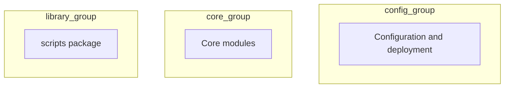

# Architecture report: greatfrontend/top-reactjs-interview-questions

> Automated static analysis. **Observed** = directly seen in files/imports/AST; **Inferred** = interpretation from that evidence. Repository code was not executed.

## 1. Repository at a glance

| Item | Value |
| --- | --- |
| Repository | greatfrontend/top-reactjs-interview-questions |
| Description | Most important React.js interview questions for busy Frontend Engineers (updated for 2026) |
| Language | MDX |
| Stars | 6109 |
| Licence | Not detected |
| Analysed commit / branch | 63863b1221bdaaf9922688f8066120eb5dff4ef8 / main |
| Framework(s) | None detected |
| Files analysed | 211 |
| Components | 3 |

## 2. Architecture in one minute

greatfrontend/top-reactjs-interview-questions - Most important React.js interview questions for busy Frontend Engineers (updated for 2026). This repository was analysed statically from 211 file(s) (0 Python). Detected technologies (observed from imports/manifests): GitHub Actions, TypeScript. Files are grouped into 3 component(s): Configuration and deployment, Core modules, scripts package. Findings below distinguish observed facts from inferred interpretation.

## 3. High-level block diagram

## 4. Main components

### Configuration and deployment (`config`)

- **Kind:** config
- **Status:** Observed
- **Confidence:** 0.85
- **Responsibility:** Groups 102 file(s) under configuration and deployment (observed from repository paths and static analysis).
- **Paths:** `package.json`, `pnpm-workspace.yaml`, `questions/explain-one-way-data-flow-of-react-and-its-benefits/en-US.langnostic.json`, `questions/explain-one-way-data-flow-of-react-and-its-benefits/metadata.json`, `questions/explain-server-side-rendering-of-react-applications-and-its-benefits/en-US.langnostic.json`, `questions/explain-server-side-rendering-of-react-applications-and-its-benefits/metadata.json`, `questions/explain-static-generation-of-react-applications-and-its-benefits/en-US.langnostic.json`, `questions/explain-static-generation-of-react-applications-and-its-benefits/metadata.json`, `questions/explain-the-composition-pattern-in-react/en-US.langnostic.json`, `questions/explain-the-composition-pattern-in-react/metadata.json`, `questions/explain-the-presentational-vs-container-component-pattern-in-react/en-US.langnostic.json`, `questions/explain-the-presentational-vs-container-component-pattern-in-react/metadata.json`, `questions/explain-what-happens-when-setstate-is-called-in-react/en-US.langnostic.json`, `questions/explain-what-happens-when-setstate-is-called-in-react/metadata.json`, `questions/explain-what-react-hydration-is/en-US.langnostic.json`, `questions/explain-what-react-hydration-is/metadata.json`, `questions/how-do-you-debug-react-applications/en-US.langnostic.json`, `questions/how-do-you-debug-react-applications/metadata.json`, `questions/how-do-you-decide-between-using-react-state-context-and-external-state-managers/en-US.langnostic.json`, `questions/how-do-you-decide-between-using-react-state-context-and-external-state-managers/metadata.json`, `questions/how-do-you-handle-asynchronous-data-loading-in-react-applications/en-US.langnostic.json`, `questions/how-do-you-handle-asynchronous-data-loading-in-react-applications/metadata.json`, `questions/how-do-you-localize-react-applications/en-US.langnostic.json`, `questions/how-do-you-localize-react-applications/metadata.json`, `questions/how-do-you-reset-a-components-state-in-react/en-US.langnostic.json`, `questions/how-do-you-reset-a-components-state-in-react/metadata.json`, `questions/how-do-you-test-react-applications/en-US.langnostic.json`, `questions/how-do-you-test-react-applications/metadata.json`, `questions/how-does-virtual-dom-in-react-work-what-are-its-benefits-and-downsides/en-US.langnostic.json`, `questions/how-does-virtual-dom-in-react-work-what-are-its-benefits-and-downsides/metadata.json`, `questions/how-would-one-optimize-the-performance-of-react-contexts-to-reduce-rerenders/en-US.langnostic.json`, `questions/how-would-one-optimize-the-performance-of-react-contexts-to-reduce-rerenders/metadata.json`, `questions/what-are-error-boundaries-in-react-for/en-US.langnostic.json`, `questions/what-are-error-boundaries-in-react-for/metadata.json`, `questions/what-are-higher-order-components-in-react/en-US.langnostic.json`, `questions/what-are-higher-order-components-in-react/metadata.json`, `questions/what-are-react-fragments-used-for/en-US.langnostic.json`, `questions/what-are-react-fragments-used-for/metadata.json`, `questions/what-are-react-portals-used-for/en-US.langnostic.json`, `questions/what-are-react-portals-used-for/metadata.json`, `questions/what-are-render-props-in-react-and-what-are-they-for/en-US.langnostic.json`, `questions/what-are-render-props-in-react-and-what-are-they-for/metadata.json`, `questions/what-are-some-common-pitfalls-when-doing-data-fetching-in-react/en-US.langnostic.json`, `questions/what-are-some-common-pitfalls-when-doing-data-fetching-in-react/metadata.json`, `questions/what-are-some-pitfalls-about-using-context-in-react/en-US.langnostic.json`, `questions/what-are-some-pitfalls-about-using-context-in-react/metadata.json`, `questions/what-are-some-react-anti-patterns/en-US.langnostic.json`, `questions/what-are-some-react-anti-patterns/metadata.json`, `questions/what-are-the-benefits-of-using-hooks-in-react/en-US.langnostic.json`, `questions/what-are-the-benefits-of-using-hooks-in-react/metadata.json`, `questions/what-are-the-rules-of-react-hooks/en-US.langnostic.json`, `questions/what-are-the-rules-of-react-hooks/metadata.json`, `questions/what-does-re-rendering-mean-in-react/en-US.langnostic.json`, `questions/what-does-re-rendering-mean-in-react/metadata.json`, `questions/what-does-the-dependency-array-of-useeffect-affect/en-US.langnostic.json`, `questions/what-does-the-dependency-array-of-useeffect-affect/metadata.json`, `questions/what-is-code-splitting-in-a-react-application/en-US.langnostic.json`, `questions/what-is-code-splitting-in-a-react-application/metadata.json`, `questions/what-is-forwardref-in-react-used-for/en-US.langnostic.json`, `questions/what-is-forwardref-in-react-used-for/metadata.json`, `questions/what-is-jsx-and-how-does-it-work/en-US.langnostic.json`, `questions/what-is-jsx-and-how-does-it-work/metadata.json`, `questions/what-is-react-describe-the-benefits-of-react/en-US.langnostic.json`, `questions/what-is-react-describe-the-benefits-of-react/metadata.json`, `questions/what-is-react-fiber-and-how-is-it-an-improvement-over-the-previous-approach/en-US.langnostic.json`, `questions/what-is-react-fiber-and-how-is-it-an-improvement-over-the-previous-approach/metadata.json`, `questions/what-is-react-strict-mode-and-what-are-its-benefits/en-US.langnostic.json`, `questions/what-is-react-strict-mode-and-what-are-its-benefits/metadata.json`, `questions/what-is-react-suspense-and-what-does-it-enable/en-US.langnostic.json`, `questions/what-is-react-suspense-and-what-does-it-enable/metadata.json`, `questions/what-is-reconciliation-in-react/en-US.langnostic.json`, `questions/what-is-reconciliation-in-react/metadata.json`, `questions/what-is-the-consequence-of-using-array-indices-as-the-value-for-key-s-in-react/en-US.langnostic.json`, `questions/what-is-the-consequence-of-using-array-indices-as-the-value-for-key-s-in-react/metadata.json`, `questions/what-is-the-difference-between-controlled-and-uncontrolled-react-components/en-US.langnostic.json`, `questions/what-is-the-difference-between-controlled-and-uncontrolled-react-components/metadata.json`, `questions/what-is-the-difference-between-react-node-react-element-and-a-react-component/en-US.langnostic.json`, `questions/what-is-the-difference-between-react-node-react-element-and-a-react-component/metadata.json`, `questions/what-is-the-difference-between-state-and-props-in-react/en-US.langnostic.json`, `questions/what-is-the-difference-between-state-and-props-in-react/metadata.json`, `questions/what-is-the-difference-between-useeffect-and-uselayouteffect-in-react/en-US.langnostic.json`, `questions/what-is-the-difference-between-useeffect-and-uselayouteffect-in-react/metadata.json`, `questions/what-is-the-flux-pattern-and-what-are-its-benefits/en-US.langnostic.json`, `questions/what-is-the-flux-pattern-and-what-are-its-benefits/metadata.json`, `questions/what-is-the-purpose-of-callback-function-argument-format-of-setstate-in-react-and-when-should-it-be-used/en-US.langnostic.json`, `questions/what-is-the-purpose-of-callback-function-argument-format-of-setstate-in-react-and-when-should-it-be-used/metadata.json`, `questions/what-is-the-purpose-of-the-key-prop-in-react/en-US.langnostic.json`, `questions/what-is-the-purpose-of-the-key-prop-in-react/metadata.json`, `questions/what-is-the-usecallback-hook-in-react-and-when-should-it-be-used/en-US.langnostic.json`, `questions/what-is-the-usecallback-hook-in-react-and-when-should-it-be-used/metadata.json`, `questions/what-is-the-useid-hook-in-react-and-when-should-it-be-used/en-US.langnostic.json`, `questions/what-is-the-useid-hook-in-react-and-when-should-it-be-used/metadata.json`, `questions/what-is-the-usememo-hook-in-react-and-when-should-it-be-used/en-US.langnostic.json`, `questions/what-is-the-usememo-hook-in-react-and-when-should-it-be-used/metadata.json`, `questions/what-is-the-usereducer-hook-in-react-and-when-should-it-be-used/en-US.langnostic.json`, `questions/what-is-the-usereducer-hook-in-react-and-when-should-it-be-used/metadata.json`, `questions/what-is-the-useref-hook-in-react-and-when-should-it-be-used/en-US.langnostic.json`, `questions/what-is-the-useref-hook-in-react-and-when-should-it-be-used/metadata.json`, `questions/what-is-virtual-dom-in-react/en-US.langnostic.json`, `questions/what-is-virtual-dom-in-react/metadata.json`, `questions/why-does-react-recommend-against-mutating-state/en-US.langnostic.json`, `questions/why-does-react-recommend-against-mutating-state/metadata.json`
- **Evidence:** [package.json](https://github.com/greatfrontend/top-reactjs-interview-questions/blob/63863b1221bdaaf9922688f8066120eb5dff4ef8/package.json); [pnpm-workspace.yaml](https://github.com/greatfrontend/top-reactjs-interview-questions/blob/63863b1221bdaaf9922688f8066120eb5dff4ef8/pnpm-workspace.yaml); [questions/explain-one-way-data-flow-of-react-and-its-benefits/en-US.langnostic.json](https://github.com/greatfrontend/top-reactjs-interview-questions/blob/63863b1221bdaaf9922688f8066120eb5dff4ef8/questions/explain-one-way-data-flow-of-react-and-its-benefits/en-US.langnostic.json); [questions/explain-one-way-data-flow-of-react-and-its-benefits/metadata.json](https://github.com/greatfrontend/top-reactjs-interview-questions/blob/63863b1221bdaaf9922688f8066120eb5dff4ef8/questions/explain-one-way-data-flow-of-react-and-its-benefits/metadata.json); [questions/explain-server-side-rendering-of-react-applications-and-its-benefits/en-US.langnostic.json](https://github.com/greatfrontend/top-reactjs-interview-questions/blob/63863b1221bdaaf9922688f8066120eb5dff4ef8/questions/explain-server-side-rendering-of-react-applications-and-its-benefits/en-US.langnostic.json); [questions/explain-server-side-rendering-of-react-applications-and-its-benefits/metadata.json](https://github.com/greatfrontend/top-reactjs-interview-questions/blob/63863b1221bdaaf9922688f8066120eb5dff4ef8/questions/explain-server-side-rendering-of-react-applications-and-its-benefits/metadata.json); [questions/explain-static-generation-of-react-applications-and-its-benefits/en-US.langnostic.json](https://github.com/greatfrontend/top-reactjs-interview-questions/blob/63863b1221bdaaf9922688f8066120eb5dff4ef8/questions/explain-static-generation-of-react-applications-and-its-benefits/en-US.langnostic.json); [questions/explain-static-generation-of-react-applications-and-its-benefits/metadata.json](https://github.com/greatfrontend/top-reactjs-interview-questions/blob/63863b1221bdaaf9922688f8066120eb5dff4ef8/questions/explain-static-generation-of-react-applications-and-its-benefits/metadata.json)

### Core modules (`core`)

- **Kind:** core
- **Status:** Observed
- **Confidence:** 0.85
- **Responsibility:** Groups 1 file(s) under core modules (observed from repository paths and static analysis).
- **Paths:** `vite.config.ts`
- **Evidence:** [vite.config.ts](https://github.com/greatfrontend/top-reactjs-interview-questions/blob/63863b1221bdaaf9922688f8066120eb5dff4ef8/vite.config.ts)

### scripts package (`scripts`)

- **Kind:** library
- **Status:** Observed
- **Confidence:** 0.85
- **Responsibility:** Groups 2 file(s) under scripts package (observed from repository paths and static analysis).
- **Paths:** `scripts/gen.ts`, `scripts/types.ts`
- **Evidence:** [scripts/gen.ts](https://github.com/greatfrontend/top-reactjs-interview-questions/blob/63863b1221bdaaf9922688f8066120eb5dff4ef8/scripts/gen.ts); [scripts/types.ts](https://github.com/greatfrontend/top-reactjs-interview-questions/blob/63863b1221bdaaf9922688f8066120eb5dff4ef8/scripts/types.ts)

## 5. Execution flow

No entry point was observed; the startup flow below is therefore limited.

Representative flow (derived from observed entry points and the import graph; steps beyond the entry point are **Inferred**):

1. Execution starts at an observed entry point listed above, if present.
2. No internal import relationships between components were observed.

## 6. Project structure

### `(root)`

- `.gfe-source-commit` - other (41 bytes)
- `.gitignore` - other (2073 bytes)
- `AGENTS.md` - docs (13570 bytes)
- `README.md` - docs (60808 bytes)
- `package.json` - manifest (671 bytes)
- `pnpm-workspace.yaml` - config (302 bytes)
- `vite.config.ts` - source, TypeScript (373 bytes)

### `.github`

- `.github/workflows/gen-toc.yml` - ci, YAML (719 bytes)

### `.vite-hooks`

- `.vite-hooks/pre-commit` - other (10 bytes)

### `questions`

- `questions/explain-one-way-data-flow-of-react-and-its-benefits/en-US.langnostic.json` - config (946 bytes)
- `questions/explain-one-way-data-flow-of-react-and-its-benefits/en-US.mdx` - other (5588 bytes)
- `questions/explain-one-way-data-flow-of-react-and-its-benefits/metadata.json` - config (352 bytes)
- `questions/explain-one-way-data-flow-of-react-and-its-benefits/zh-CN.mdx` - other (2726 bytes)
- `questions/explain-server-side-rendering-of-react-applications-and-its-benefits/en-US.langnostic.json` - config (1071 bytes)
- `questions/explain-server-side-rendering-of-react-applications-and-its-benefits/en-US.mdx` - other (8133 bytes)
- `questions/explain-server-side-rendering-of-react-applications-and-its-benefits/metadata.json` - config (366 bytes)
- `questions/explain-server-side-rendering-of-react-applications-and-its-benefits/zh-CN.mdx` - other (2703 bytes)
- `questions/explain-static-generation-of-react-applications-and-its-benefits/en-US.langnostic.json` - config (1101 bytes)
- `questions/explain-static-generation-of-react-applications-and-its-benefits/en-US.mdx` - other (7244 bytes)
- `questions/explain-static-generation-of-react-applications-and-its-benefits/metadata.json` - config (362 bytes)
- `questions/explain-static-generation-of-react-applications-and-its-benefits/zh-CN.mdx` - other (3065 bytes)
- `questions/explain-the-composition-pattern-in-react/en-US.langnostic.json` - config (987 bytes)
- `questions/explain-the-composition-pattern-in-react/en-US.mdx` - other (6098 bytes)
- `questions/explain-the-composition-pattern-in-react/metadata.json` - config (341 bytes)
- `questions/explain-the-composition-pattern-in-react/zh-CN.mdx` - other (2356 bytes)
- `questions/explain-the-presentational-vs-container-component-pattern-in-react/en-US.langnostic.json` - config (989 bytes)
- `questions/explain-the-presentational-vs-container-component-pattern-in-react/en-US.mdx` - other (5864 bytes)
- `questions/explain-the-presentational-vs-container-component-pattern-in-react/metadata.json` - config (367 bytes)
- `questions/explain-the-presentational-vs-container-component-pattern-in-react/zh-CN.mdx` - other (2648 bytes)
- `questions/explain-what-happens-when-setstate-is-called-in-react/en-US.langnostic.json` - config (867 bytes)
- `questions/explain-what-happens-when-setstate-is-called-in-react/en-US.mdx` - other (7057 bytes)
- `questions/explain-what-happens-when-setstate-is-called-in-react/metadata.json` - config (355 bytes)
- `questions/explain-what-happens-when-setstate-is-called-in-react/zh-CN.mdx` - other (2713 bytes)
- `questions/explain-what-react-hydration-is/en-US.langnostic.json` - config (951 bytes)
- `questions/explain-what-react-hydration-is/en-US.mdx` - other (6511 bytes)
- `questions/explain-what-react-hydration-is/metadata.json` - config (327 bytes)
- `questions/explain-what-react-hydration-is/zh-CN.mdx` - other (2818 bytes)
- `questions/how-do-you-debug-react-applications/en-US.langnostic.json` - config (1187 bytes)
- `questions/how-do-you-debug-react-applications/en-US.mdx` - other (6767 bytes)
- `questions/how-do-you-debug-react-applications/metadata.json` - config (331 bytes)
- `questions/how-do-you-debug-react-applications/zh-CN.mdx` - other (4209 bytes)
- `questions/how-do-you-decide-between-using-react-state-context-and-external-state-managers/en-US.langnostic.json` - config (1151 bytes)
- `questions/how-do-you-decide-between-using-react-state-context-and-external-state-managers/en-US.mdx` - other (11323 bytes)
- `questions/how-do-you-decide-between-using-react-state-context-and-external-state-managers/metadata.json` - config (378 bytes)
- `questions/how-do-you-decide-between-using-react-state-context-and-external-state-managers/zh-CN.mdx` - other (4312 bytes)
- `questions/how-do-you-handle-asynchronous-data-loading-in-react-applications/en-US.langnostic.json` - config (987 bytes)
- `questions/how-do-you-handle-asynchronous-data-loading-in-react-applications/en-US.mdx` - other (7597 bytes)
- `questions/how-do-you-handle-asynchronous-data-loading-in-react-applications/metadata.json` - config (373 bytes)
- `questions/how-do-you-handle-asynchronous-data-loading-in-react-applications/zh-CN.mdx` - other (4231 bytes)
- `questions/how-do-you-localize-react-applications/en-US.langnostic.json` - config (1311 bytes)
- `questions/how-do-you-localize-react-applications/en-US.mdx` - other (8444 bytes)
- `questions/how-do-you-localize-react-applications/metadata.json` - config (344 bytes)
- `questions/how-do-you-localize-react-applications/zh-CN.mdx` - other (3313 bytes)
- `questions/how-do-you-reset-a-components-state-in-react/en-US.langnostic.json` - config (1029 bytes)
- `questions/how-do-you-reset-a-components-state-in-react/en-US.mdx` - other (5303 bytes)
- `questions/how-do-you-reset-a-components-state-in-react/metadata.json` - config (349 bytes)
- `questions/how-do-you-reset-a-components-state-in-react/zh-CN.mdx` - other (2725 bytes)
- `questions/how-do-you-test-react-applications/en-US.langnostic.json` - config (1069 bytes)
- `questions/how-do-you-test-react-applications/en-US.mdx` - other (6387 bytes)
- `questions/how-do-you-test-react-applications/metadata.json` - config (336 bytes)
- `questions/how-do-you-test-react-applications/zh-CN.mdx` - other (2967 bytes)
- `questions/how-does-virtual-dom-in-react-work-what-are-its-benefits-and-downsides/en-US.langnostic.json` - config (1191 bytes)
- `questions/how-does-virtual-dom-in-react-work-what-are-its-benefits-and-downsides/en-US.mdx` - other (8092 bytes)
- `questions/how-does-virtual-dom-in-react-work-what-are-its-benefits-and-downsides/metadata.json` - config (368 bytes)
- `questions/how-does-virtual-dom-in-react-work-what-are-its-benefits-and-downsides/zh-CN.mdx` - other (3036 bytes)
- `questions/how-would-one-optimize-the-performance-of-react-contexts-to-reduce-rerenders/en-US.langnostic.json` - config (831 bytes)
- `questions/how-would-one-optimize-the-performance-of-react-contexts-to-reduce-rerenders/en-US.mdx` - other (7527 bytes)
- `questions/how-would-one-optimize-the-performance-of-react-contexts-to-reduce-rerenders/metadata.json` - config (390 bytes)
- `questions/how-would-one-optimize-the-performance-of-react-contexts-to-reduce-rerenders/zh-CN.mdx` - other (2657 bytes)
- `questions/what-are-error-boundaries-in-react-for/en-US.langnostic.json` - config (1031 bytes)
- `questions/what-are-error-boundaries-in-react-for/en-US.mdx` - other (6312 bytes)
- `questions/what-are-error-boundaries-in-react-for/metadata.json` - config (340 bytes)
- `questions/what-are-error-boundaries-in-react-for/zh-CN.mdx` - other (2859 bytes)
- `questions/what-are-higher-order-components-in-react/en-US.langnostic.json` - config (1071 bytes)
- `questions/what-are-higher-order-components-in-react/en-US.mdx` - other (5355 bytes)
- `questions/what-are-higher-order-components-in-react/metadata.json` - config (342 bytes)
- `questions/what-are-higher-order-components-in-react/zh-CN.mdx` - other (2644 bytes)
- `questions/what-are-react-fragments-used-for/en-US.langnostic.json` - config (947 bytes)
- `questions/what-are-react-fragments-used-for/en-US.mdx` - other (5061 bytes)
- `questions/what-are-react-fragments-used-for/metadata.json` - config (338 bytes)
- `questions/what-are-react-fragments-used-for/zh-CN.mdx` - other (2369 bytes)
- `questions/what-are-react-portals-used-for/en-US.langnostic.json` - config (1111 bytes)
- `questions/what-are-react-portals-used-for/en-US.mdx` - other (7566 bytes)
- `questions/what-are-react-portals-used-for/metadata.json` - config (330 bytes)
- `questions/what-are-react-portals-used-for/zh-CN.mdx` - other (3077 bytes)
- `questions/what-are-render-props-in-react-and-what-are-they-for/en-US.langnostic.json` - config (991 bytes)
- `questions/what-are-render-props-in-react-and-what-are-they-for/en-US.mdx` - other (4891 bytes)
- `questions/what-are-render-props-in-react-and-what-are-they-for/metadata.json` - config (353 bytes)
- `questions/what-are-render-props-in-react-and-what-are-they-for/zh-CN.mdx` - other (2615 bytes)
- `questions/what-are-some-common-pitfalls-when-doing-data-fetching-in-react/en-US.langnostic.json` - config (1029 bytes)
- `questions/what-are-some-common-pitfalls-when-doing-data-fetching-in-react/en-US.mdx` - other (10193 bytes)
- `questions/what-are-some-common-pitfalls-when-doing-data-fetching-in-react/metadata.json` - config (361 bytes)
- `questions/what-are-some-common-pitfalls-when-doing-data-fetching-in-react/zh-CN.mdx` - other (3846 bytes)
- `questions/what-are-some-pitfalls-about-using-context-in-react/en-US.langnostic.json` - config (951 bytes)
- `questions/what-are-some-pitfalls-about-using-context-in-react/en-US.mdx` - other (5265 bytes)
- `questions/what-are-some-pitfalls-about-using-context-in-react/metadata.json` - config (349 bytes)
- `questions/what-are-some-pitfalls-about-using-context-in-react/zh-CN.mdx` - other (2839 bytes)
- `questions/what-are-some-react-anti-patterns/en-US.langnostic.json` - config (1183 bytes)
- `questions/what-are-some-react-anti-patterns/en-US.mdx` - other (8728 bytes)
- `questions/what-are-some-react-anti-patterns/metadata.json` - config (331 bytes)
- `questions/what-are-some-react-anti-patterns/zh-CN.mdx` - other (2854 bytes)
- `questions/what-are-the-benefits-of-using-hooks-in-react/en-US.langnostic.json` - config (1027 bytes)
- `questions/what-are-the-benefits-of-using-hooks-in-react/en-US.mdx` - other (4701 bytes)
- `questions/what-are-the-benefits-of-using-hooks-in-react/metadata.json` - config (340 bytes)
- `questions/what-are-the-benefits-of-using-hooks-in-react/zh-CN.mdx` - other (2121 bytes)
- `questions/what-are-the-rules-of-react-hooks/en-US.langnostic.json` - config (870 bytes)
- `questions/what-are-the-rules-of-react-hooks/en-US.mdx` - other (6154 bytes)
- `questions/what-are-the-rules-of-react-hooks/metadata.json` - config (329 bytes)
- `questions/what-are-the-rules-of-react-hooks/zh-CN.mdx` - other (2374 bytes)
- `questions/what-does-re-rendering-mean-in-react/en-US.langnostic.json` - config (1027 bytes)
- `questions/what-does-re-rendering-mean-in-react/en-US.mdx` - other (4411 bytes)
- `questions/what-does-re-rendering-mean-in-react/metadata.json` - config (337 bytes)
- `questions/what-does-re-rendering-mean-in-react/zh-CN.mdx` - other (2779 bytes)
- `questions/what-does-the-dependency-array-of-useeffect-affect/en-US.langnostic.json` - config (789 bytes)
- `questions/what-does-the-dependency-array-of-useeffect-affect/en-US.mdx` - other (6919 bytes)
- `questions/what-does-the-dependency-array-of-useeffect-affect/metadata.json` - config (348 bytes)
- `questions/what-does-the-dependency-array-of-useeffect-affect/zh-CN.mdx` - other (3308 bytes)
- `questions/what-is-code-splitting-in-a-react-application/en-US.langnostic.json` - config (987 bytes)
- `questions/what-is-code-splitting-in-a-react-application/en-US.mdx` - other (6900 bytes)
- `questions/what-is-code-splitting-in-a-react-application/metadata.json` - config (343 bytes)
- `questions/what-is-code-splitting-in-a-react-application/zh-CN.mdx` - other (2797 bytes)
- `questions/what-is-forwardref-in-react-used-for/en-US.langnostic.json` - config (1029 bytes)
- `questions/what-is-forwardref-in-react-used-for/en-US.mdx` - other (4761 bytes)
- `questions/what-is-forwardref-in-react-used-for/metadata.json` - config (338 bytes)
- `questions/what-is-forwardref-in-react-used-for/zh-CN.mdx` - other (2840 bytes)
- `questions/what-is-jsx-and-how-does-it-work/en-US.langnostic.json` - config (1309 bytes)
- `questions/what-is-jsx-and-how-does-it-work/en-US.mdx` - other (5182 bytes)
- `questions/what-is-jsx-and-how-does-it-work/metadata.json` - config (330 bytes)
- `questions/what-is-jsx-and-how-does-it-work/zh-CN.mdx` - other (2309 bytes)
- `questions/what-is-react-describe-the-benefits-of-react/en-US.langnostic.json` - config (1025 bytes)
- `questions/what-is-react-describe-the-benefits-of-react/en-US.mdx` - other (4785 bytes)
- `questions/what-is-react-describe-the-benefits-of-react/metadata.json` - config (340 bytes)
- `questions/what-is-react-describe-the-benefits-of-react/zh-CN.mdx` - other (3728 bytes)
- `questions/what-is-react-fiber-and-how-is-it-an-improvement-over-the-previous-approach/en-US.langnostic.json` - config (1107 bytes)
- `questions/what-is-react-fiber-and-how-is-it-an-improvement-over-the-previous-approach/en-US.mdx` - other (6169 bytes)
- `questions/what-is-react-fiber-and-how-is-it-an-improvement-over-the-previous-approach/metadata.json` - config (375 bytes)
- `questions/what-is-react-fiber-and-how-is-it-an-improvement-over-the-previous-approach/zh-CN.mdx` - other (3058 bytes)
- `questions/what-is-react-strict-mode-and-what-are-its-benefits/en-US.langnostic.json` - config (947 bytes)
- `questions/what-is-react-strict-mode-and-what-are-its-benefits/en-US.mdx` - other (4354 bytes)
- `questions/what-is-react-strict-mode-and-what-are-its-benefits/metadata.json` - config (349 bytes)
- `questions/what-is-react-strict-mode-and-what-are-its-benefits/zh-CN.mdx` - other (2640 bytes)
- `questions/what-is-react-suspense-and-what-does-it-enable/en-US.langnostic.json` - config (947 bytes)
- `questions/what-is-react-suspense-and-what-does-it-enable/en-US.mdx` - other (6754 bytes)
- `questions/what-is-react-suspense-and-what-does-it-enable/metadata.json` - config (348 bytes)
- `questions/what-is-react-suspense-and-what-does-it-enable/zh-CN.mdx` - other (3053 bytes)
- `questions/what-is-reconciliation-in-react/en-US.langnostic.json` - config (951 bytes)
- `questions/what-is-reconciliation-in-react/en-US.mdx` - other (5773 bytes)
- `questions/what-is-reconciliation-in-react/metadata.json` - config (329 bytes)
- `questions/what-is-reconciliation-in-react/zh-CN.mdx` - other (2553 bytes)
- `questions/what-is-the-consequence-of-using-array-indices-as-the-value-for-key-s-in-react/en-US.langnostic.json` - config (907 bytes)
- `questions/what-is-the-consequence-of-using-array-indices-as-the-value-for-key-s-in-react/en-US.mdx` - other (4911 bytes)
- `questions/what-is-the-consequence-of-using-array-indices-as-the-value-for-key-s-in-react/metadata.json` - config (376 bytes)
- `questions/what-is-the-consequence-of-using-array-indices-as-the-value-for-key-s-in-react/zh-CN.mdx` - other (2306 bytes)
- `questions/what-is-the-difference-between-controlled-and-uncontrolled-react-components/en-US.langnostic.json` - config (1029 bytes)
- `questions/what-is-the-difference-between-controlled-and-uncontrolled-react-components/en-US.mdx` - other (6902 bytes)
- `questions/what-is-the-difference-between-controlled-and-uncontrolled-react-components/metadata.json` - config (370 bytes)
- `questions/what-is-the-difference-between-controlled-and-uncontrolled-react-components/zh-CN.mdx` - other (2903 bytes)
- `questions/what-is-the-difference-between-react-node-react-element-and-a-react-component/en-US.langnostic.json` - config (747 bytes)
- `questions/what-is-the-difference-between-react-node-react-element-and-a-react-component/en-US.mdx` - other (4741 bytes)
- `questions/what-is-the-difference-between-react-node-react-element-and-a-react-component/metadata.json` - config (375 bytes)
- `questions/what-is-the-difference-between-react-node-react-element-and-a-react-component/zh-CN.mdx` - other (2397 bytes)
- `questions/what-is-the-difference-between-state-and-props-in-react/en-US.langnostic.json` - config (1069 bytes)
- `questions/what-is-the-difference-between-state-and-props-in-react/en-US.mdx` - other (5665 bytes)
- `questions/what-is-the-difference-between-state-and-props-in-react/metadata.json` - config (349 bytes)
- `questions/what-is-the-difference-between-state-and-props-in-react/zh-CN.mdx` - other (3155 bytes)
- `questions/what-is-the-difference-between-useeffect-and-uselayouteffect-in-react/en-US.langnostic.json` - config (1349 bytes)
- `questions/what-is-the-difference-between-useeffect-and-uselayouteffect-in-react/en-US.mdx` - other (8900 bytes)
- `questions/what-is-the-difference-between-useeffect-and-uselayouteffect-in-react/metadata.json` - config (364 bytes)
- `questions/what-is-the-difference-between-useeffect-and-uselayouteffect-in-react/zh-CN.mdx` - other (3325 bytes)
- `questions/what-is-the-flux-pattern-and-what-are-its-benefits/en-US.langnostic.json` - config (1349 bytes)
- `questions/what-is-the-flux-pattern-and-what-are-its-benefits/en-US.mdx` - other (6632 bytes)
- `questions/what-is-the-flux-pattern-and-what-are-its-benefits/metadata.json` - config (351 bytes)
- `questions/what-is-the-flux-pattern-and-what-are-its-benefits/zh-CN.mdx` - other (3386 bytes)
- `questions/what-is-the-purpose-of-callback-function-argument-format-of-setstate-in-react-and-when-should-it-be-used/en-US.langnostic.json` - config (909 bytes)
- `questions/what-is-the-purpose-of-callback-function-argument-format-of-setstate-in-react-and-when-should-it-be-used/en-US.mdx` - other (5127 bytes)
- `questions/what-is-the-purpose-of-callback-function-argument-format-of-setstate-in-react-and-when-should-it-be-used/metadata.json` - config (399 bytes)
- `questions/what-is-the-purpose-of-callback-function-argument-format-of-setstate-in-react-and-when-should-it-be-used/zh-CN.mdx` - other (2568 bytes)
- `questions/what-is-the-purpose-of-the-key-prop-in-react/en-US.langnostic.json` - config (869 bytes)
- `questions/what-is-the-purpose-of-the-key-prop-in-react/en-US.mdx` - other (5496 bytes)
- `questions/what-is-the-purpose-of-the-key-prop-in-react/metadata.json` - config (347 bytes)
- `questions/what-is-the-purpose-of-the-key-prop-in-react/zh-CN.mdx` - other (2711 bytes)
- `questions/what-is-the-usecallback-hook-in-react-and-when-should-it-be-used/en-US.langnostic.json` - config (949 bytes)
- `questions/what-is-the-usecallback-hook-in-react-and-when-should-it-be-used/en-US.mdx` - other (5107 bytes)
- `questions/what-is-the-usecallback-hook-in-react-and-when-should-it-be-used/metadata.json` - config (362 bytes)
- `questions/what-is-the-usecallback-hook-in-react-and-when-should-it-be-used/zh-CN.mdx` - other (2615 bytes)
- `questions/what-is-the-useid-hook-in-react-and-when-should-it-be-used/en-US.langnostic.json` - config (1030 bytes)
- `questions/what-is-the-useid-hook-in-react-and-when-should-it-be-used/en-US.mdx` - other (9124 bytes)
- `questions/what-is-the-useid-hook-in-react-and-when-should-it-be-used/metadata.json` - config (353 bytes)
- `questions/what-is-the-useid-hook-in-react-and-when-should-it-be-used/zh-CN.mdx` - other (3034 bytes)
- `questions/what-is-the-usememo-hook-in-react-and-when-should-it-be-used/en-US.langnostic.json` - config (1071 bytes)
- `questions/what-is-the-usememo-hook-in-react-and-when-should-it-be-used/en-US.mdx` - other (4869 bytes)
- `questions/what-is-the-usememo-hook-in-react-and-when-should-it-be-used/metadata.json` - config (358 bytes)
- `questions/what-is-the-usememo-hook-in-react-and-when-should-it-be-used/zh-CN.mdx` - other (2589 bytes)
- `questions/what-is-the-usereducer-hook-in-react-and-when-should-it-be-used/en-US.langnostic.json` - config (1029 bytes)
- `questions/what-is-the-usereducer-hook-in-react-and-when-should-it-be-used/en-US.mdx` - other (6116 bytes)
- `questions/what-is-the-usereducer-hook-in-react-and-when-should-it-be-used/metadata.json` - config (361 bytes)
- `questions/what-is-the-usereducer-hook-in-react-and-when-should-it-be-used/zh-CN.mdx` - other (3203 bytes)
- `questions/what-is-the-useref-hook-in-react-and-when-should-it-be-used/en-US.langnostic.json` - config (1176 bytes)
- `questions/what-is-the-useref-hook-in-react-and-when-should-it-be-used/en-US.mdx` - other (5209 bytes)
- `questions/what-is-the-useref-hook-in-react-and-when-should-it-be-used/metadata.json` - config (357 bytes)
- `questions/what-is-the-useref-hook-in-react-and-when-should-it-be-used/zh-CN.mdx` - other (3141 bytes)
- `questions/what-is-virtual-dom-in-react/en-US.langnostic.json` - config (829 bytes)
- `questions/what-is-virtual-dom-in-react/en-US.mdx` - other (4489 bytes)
- `questions/what-is-virtual-dom-in-react/metadata.json` - config (333 bytes)
- `questions/what-is-virtual-dom-in-react/zh-CN.mdx` - other (2343 bytes)
- `questions/why-does-react-recommend-against-mutating-state/en-US.langnostic.json` - config (866 bytes)
- `questions/why-does-react-recommend-against-mutating-state/en-US.mdx` - other (6350 bytes)
- `questions/why-does-react-recommend-against-mutating-state/metadata.json` - config (347 bytes)
- `questions/why-does-react-recommend-against-mutating-state/zh-CN.mdx` - other (2124 bytes)

### `scripts`

- `scripts/gen.ts` - source, TypeScript (4219 bytes)
- `scripts/types.ts` - source, TypeScript (377 bytes)

## 7. Key dependencies and integrations

| Name | Category | Status | Confidence | Evidence |
| --- | --- | --- | --- | --- |
| GitHub Actions | ci | Observed | 0.85 | [.github/workflows/gen-toc.yml](https://github.com/greatfrontend/top-reactjs-interview-questions/blob/63863b1221bdaaf9922688f8066120eb5dff4ef8/.github/workflows/gen-toc.yml) |
| TypeScript | tooling | Observed | 0.85 | [package.json:25](https://github.com/greatfrontend/top-reactjs-interview-questions/blob/63863b1221bdaaf9922688f8066120eb5dff4ef8/package.json#L25) |

## 8. Data and state

No database, cache, queue, or persistent-state usage was observed in the analysed files. State handling, if any, may be in-memory or in files that were not analysed.

## 9. Configuration and deployment clues

- `.github/workflows/gen-toc.yml` (ci)
- `package.json` (manifest)
- `pnpm-workspace.yaml` (config)
- `questions/explain-one-way-data-flow-of-react-and-its-benefits/en-US.langnostic.json` (config)
- `questions/explain-one-way-data-flow-of-react-and-its-benefits/metadata.json` (config)
- `questions/explain-server-side-rendering-of-react-applications-and-its-benefits/en-US.langnostic.json` (config)
- `questions/explain-server-side-rendering-of-react-applications-and-its-benefits/metadata.json` (config)
- `questions/explain-static-generation-of-react-applications-and-its-benefits/en-US.langnostic.json` (config)
- `questions/explain-static-generation-of-react-applications-and-its-benefits/metadata.json` (config)
- `questions/explain-the-composition-pattern-in-react/en-US.langnostic.json` (config)
- `questions/explain-the-composition-pattern-in-react/metadata.json` (config)
- `questions/explain-the-presentational-vs-container-component-pattern-in-react/en-US.langnostic.json` (config)
- `questions/explain-the-presentational-vs-container-component-pattern-in-react/metadata.json` (config)
- `questions/explain-what-happens-when-setstate-is-called-in-react/en-US.langnostic.json` (config)
- `questions/explain-what-happens-when-setstate-is-called-in-react/metadata.json` (config)
- `questions/explain-what-react-hydration-is/en-US.langnostic.json` (config)
- `questions/explain-what-react-hydration-is/metadata.json` (config)
- `questions/how-do-you-debug-react-applications/en-US.langnostic.json` (config)
- `questions/how-do-you-debug-react-applications/metadata.json` (config)
- `questions/how-do-you-decide-between-using-react-state-context-and-external-state-managers/en-US.langnostic.json` (config)
- `questions/how-do-you-decide-between-using-react-state-context-and-external-state-managers/metadata.json` (config)
- `questions/how-do-you-handle-asynchronous-data-loading-in-react-applications/en-US.langnostic.json` (config)
- `questions/how-do-you-handle-asynchronous-data-loading-in-react-applications/metadata.json` (config)
- `questions/how-do-you-localize-react-applications/en-US.langnostic.json` (config)
- `questions/how-do-you-localize-react-applications/metadata.json` (config)
- `questions/how-do-you-reset-a-components-state-in-react/en-US.langnostic.json` (config)
- `questions/how-do-you-reset-a-components-state-in-react/metadata.json` (config)
- `questions/how-do-you-test-react-applications/en-US.langnostic.json` (config)
- `questions/how-do-you-test-react-applications/metadata.json` (config)
- `questions/how-does-virtual-dom-in-react-work-what-are-its-benefits-and-downsides/en-US.langnostic.json` (config)
- `questions/how-does-virtual-dom-in-react-work-what-are-its-benefits-and-downsides/metadata.json` (config)
- `questions/how-would-one-optimize-the-performance-of-react-contexts-to-reduce-rerenders/en-US.langnostic.json` (config)
- `questions/how-would-one-optimize-the-performance-of-react-contexts-to-reduce-rerenders/metadata.json` (config)
- `questions/what-are-error-boundaries-in-react-for/en-US.langnostic.json` (config)
- `questions/what-are-error-boundaries-in-react-for/metadata.json` (config)
- `questions/what-are-higher-order-components-in-react/en-US.langnostic.json` (config)
- `questions/what-are-higher-order-components-in-react/metadata.json` (config)
- `questions/what-are-react-fragments-used-for/en-US.langnostic.json` (config)
- `questions/what-are-react-fragments-used-for/metadata.json` (config)
- `questions/what-are-react-portals-used-for/en-US.langnostic.json` (config)
- `questions/what-are-react-portals-used-for/metadata.json` (config)
- `questions/what-are-render-props-in-react-and-what-are-they-for/en-US.langnostic.json` (config)
- `questions/what-are-render-props-in-react-and-what-are-they-for/metadata.json` (config)
- `questions/what-are-some-common-pitfalls-when-doing-data-fetching-in-react/en-US.langnostic.json` (config)
- `questions/what-are-some-common-pitfalls-when-doing-data-fetching-in-react/metadata.json` (config)
- `questions/what-are-some-pitfalls-about-using-context-in-react/en-US.langnostic.json` (config)
- `questions/what-are-some-pitfalls-about-using-context-in-react/metadata.json` (config)
- `questions/what-are-some-react-anti-patterns/en-US.langnostic.json` (config)
- `questions/what-are-some-react-anti-patterns/metadata.json` (config)
- `questions/what-are-the-benefits-of-using-hooks-in-react/en-US.langnostic.json` (config)
- `questions/what-are-the-benefits-of-using-hooks-in-react/metadata.json` (config)
- `questions/what-are-the-rules-of-react-hooks/en-US.langnostic.json` (config)
- `questions/what-are-the-rules-of-react-hooks/metadata.json` (config)
- `questions/what-does-re-rendering-mean-in-react/en-US.langnostic.json` (config)
- `questions/what-does-re-rendering-mean-in-react/metadata.json` (config)
- `questions/what-does-the-dependency-array-of-useeffect-affect/en-US.langnostic.json` (config)
- `questions/what-does-the-dependency-array-of-useeffect-affect/metadata.json` (config)
- `questions/what-is-code-splitting-in-a-react-application/en-US.langnostic.json` (config)
- `questions/what-is-code-splitting-in-a-react-application/metadata.json` (config)
- `questions/what-is-forwardref-in-react-used-for/en-US.langnostic.json` (config)
- `questions/what-is-forwardref-in-react-used-for/metadata.json` (config)
- `questions/what-is-jsx-and-how-does-it-work/en-US.langnostic.json` (config)
- `questions/what-is-jsx-and-how-does-it-work/metadata.json` (config)
- `questions/what-is-react-describe-the-benefits-of-react/en-US.langnostic.json` (config)
- `questions/what-is-react-describe-the-benefits-of-react/metadata.json` (config)
- `questions/what-is-react-fiber-and-how-is-it-an-improvement-over-the-previous-approach/en-US.langnostic.json` (config)
- `questions/what-is-react-fiber-and-how-is-it-an-improvement-over-the-previous-approach/metadata.json` (config)
- `questions/what-is-react-strict-mode-and-what-are-its-benefits/en-US.langnostic.json` (config)
- `questions/what-is-react-strict-mode-and-what-are-its-benefits/metadata.json` (config)
- `questions/what-is-react-suspense-and-what-does-it-enable/en-US.langnostic.json` (config)
- `questions/what-is-react-suspense-and-what-does-it-enable/metadata.json` (config)
- `questions/what-is-reconciliation-in-react/en-US.langnostic.json` (config)
- `questions/what-is-reconciliation-in-react/metadata.json` (config)
- `questions/what-is-the-consequence-of-using-array-indices-as-the-value-for-key-s-in-react/en-US.langnostic.json` (config)
- `questions/what-is-the-consequence-of-using-array-indices-as-the-value-for-key-s-in-react/metadata.json` (config)
- `questions/what-is-the-difference-between-controlled-and-uncontrolled-react-components/en-US.langnostic.json` (config)
- `questions/what-is-the-difference-between-controlled-and-uncontrolled-react-components/metadata.json` (config)
- `questions/what-is-the-difference-between-react-node-react-element-and-a-react-component/en-US.langnostic.json` (config)
- `questions/what-is-the-difference-between-react-node-react-element-and-a-react-component/metadata.json` (config)
- `questions/what-is-the-difference-between-state-and-props-in-react/en-US.langnostic.json` (config)
- `questions/what-is-the-difference-between-state-and-props-in-react/metadata.json` (config)
- `questions/what-is-the-difference-between-useeffect-and-uselayouteffect-in-react/en-US.langnostic.json` (config)
- `questions/what-is-the-difference-between-useeffect-and-uselayouteffect-in-react/metadata.json` (config)
- `questions/what-is-the-flux-pattern-and-what-are-its-benefits/en-US.langnostic.json` (config)
- `questions/what-is-the-flux-pattern-and-what-are-its-benefits/metadata.json` (config)
- `questions/what-is-the-purpose-of-callback-function-argument-format-of-setstate-in-react-and-when-should-it-be-used/en-US.langnostic.json` (config)
- `questions/what-is-the-purpose-of-callback-function-argument-format-of-setstate-in-react-and-when-should-it-be-used/metadata.json` (config)
- `questions/what-is-the-purpose-of-the-key-prop-in-react/en-US.langnostic.json` (config)
- `questions/what-is-the-purpose-of-the-key-prop-in-react/metadata.json` (config)
- `questions/what-is-the-usecallback-hook-in-react-and-when-should-it-be-used/en-US.langnostic.json` (config)
- `questions/what-is-the-usecallback-hook-in-react-and-when-should-it-be-used/metadata.json` (config)
- `questions/what-is-the-useid-hook-in-react-and-when-should-it-be-used/en-US.langnostic.json` (config)
- `questions/what-is-the-useid-hook-in-react-and-when-should-it-be-used/metadata.json` (config)
- `questions/what-is-the-usememo-hook-in-react-and-when-should-it-be-used/en-US.langnostic.json` (config)
- `questions/what-is-the-usememo-hook-in-react-and-when-should-it-be-used/metadata.json` (config)
- `questions/what-is-the-usereducer-hook-in-react-and-when-should-it-be-used/en-US.langnostic.json` (config)
- `questions/what-is-the-usereducer-hook-in-react-and-when-should-it-be-used/metadata.json` (config)
- `questions/what-is-the-useref-hook-in-react-and-when-should-it-be-used/en-US.langnostic.json` (config)
- `questions/what-is-the-useref-hook-in-react-and-when-should-it-be-used/metadata.json` (config)
- `questions/what-is-virtual-dom-in-react/en-US.langnostic.json` (config)
- `questions/what-is-virtual-dom-in-react/metadata.json` (config)
- `questions/why-does-react-recommend-against-mutating-state/en-US.langnostic.json` (config)
- `questions/why-does-react-recommend-against-mutating-state/metadata.json` (config)

## 10. Design observations

- No strong design patterns could be established from the available evidence.

These observations are interpretations (**Inferred**) of the observed structure, not guarantees about runtime design.

## 11. Limitations and unknowns

- Static analysis only: repository code was not executed, installed, or imported at runtime.
- Components and relationships are inferred from file paths, imports, and AST structure; runtime behaviour, dynamic imports, and reflection may not be visible.
- 1 file(s) were skipped during inventory (1 x lockfile excluded).
- No clear application entry point was observed in the analysed files.
- Repository text was treated as untrusted data; no instructions found in repository files were followed, and likely secret values were redacted/excluded.
- JavaScript and TypeScript files were inventoried from paths and package manifests. They were not parsed with a full language AST, and repository code was not executed.

## 12. Source references

- [.github/workflows/gen-toc.yml](https://github.com/greatfrontend/top-reactjs-interview-questions/blob/63863b1221bdaaf9922688f8066120eb5dff4ef8/.github/workflows/gen-toc.yml)
- [package.json](https://github.com/greatfrontend/top-reactjs-interview-questions/blob/63863b1221bdaaf9922688f8066120eb5dff4ef8/package.json)
- [package.json:25](https://github.com/greatfrontend/top-reactjs-interview-questions/blob/63863b1221bdaaf9922688f8066120eb5dff4ef8/package.json#L25)
- [pnpm-workspace.yaml](https://github.com/greatfrontend/top-reactjs-interview-questions/blob/63863b1221bdaaf9922688f8066120eb5dff4ef8/pnpm-workspace.yaml)
- [questions/explain-one-way-data-flow-of-react-and-its-benefits/en-US.langnostic.json](https://github.com/greatfrontend/top-reactjs-interview-questions/blob/63863b1221bdaaf9922688f8066120eb5dff4ef8/questions/explain-one-way-data-flow-of-react-and-its-benefits/en-US.langnostic.json)
- [questions/explain-one-way-data-flow-of-react-and-its-benefits/metadata.json](https://github.com/greatfrontend/top-reactjs-interview-questions/blob/63863b1221bdaaf9922688f8066120eb5dff4ef8/questions/explain-one-way-data-flow-of-react-and-its-benefits/metadata.json)
- [questions/explain-server-side-rendering-of-react-applications-and-its-benefits/en-US.langnostic.json](https://github.com/greatfrontend/top-reactjs-interview-questions/blob/63863b1221bdaaf9922688f8066120eb5dff4ef8/questions/explain-server-side-rendering-of-react-applications-and-its-benefits/en-US.langnostic.json)
- [questions/explain-server-side-rendering-of-react-applications-and-its-benefits/metadata.json](https://github.com/greatfrontend/top-reactjs-interview-questions/blob/63863b1221bdaaf9922688f8066120eb5dff4ef8/questions/explain-server-side-rendering-of-react-applications-and-its-benefits/metadata.json)
- [questions/explain-static-generation-of-react-applications-and-its-benefits/en-US.langnostic.json](https://github.com/greatfrontend/top-reactjs-interview-questions/blob/63863b1221bdaaf9922688f8066120eb5dff4ef8/questions/explain-static-generation-of-react-applications-and-its-benefits/en-US.langnostic.json)
- [questions/explain-static-generation-of-react-applications-and-its-benefits/metadata.json](https://github.com/greatfrontend/top-reactjs-interview-questions/blob/63863b1221bdaaf9922688f8066120eb5dff4ef8/questions/explain-static-generation-of-react-applications-and-its-benefits/metadata.json)
- [scripts/gen.ts](https://github.com/greatfrontend/top-reactjs-interview-questions/blob/63863b1221bdaaf9922688f8066120eb5dff4ef8/scripts/gen.ts)
- [scripts/types.ts](https://github.com/greatfrontend/top-reactjs-interview-questions/blob/63863b1221bdaaf9922688f8066120eb5dff4ef8/scripts/types.ts)
- [vite.config.ts](https://github.com/greatfrontend/top-reactjs-interview-questions/blob/63863b1221bdaaf9922688f8066120eb5dff4ef8/vite.config.ts)
